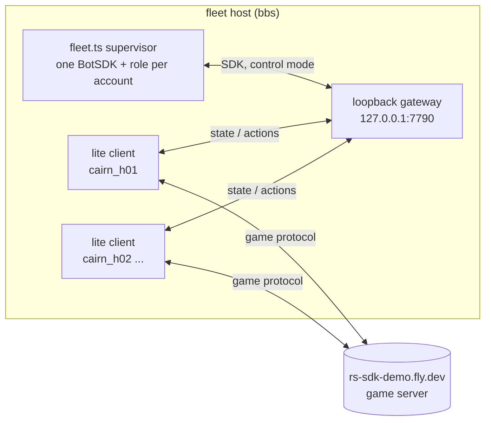

# Helper swarm

The speedrun's scored account (its name is chosen by the operator and kept out of git and out of game chat until the run) is ranked on its own logged-in ticks on the demo server rs-sdk-demo.fly.dev. Helper accounts' time costs nothing on the scoreboard, so helpers gather the run's supplies in advance (wines, bones, bars, logs, essence, feathers and the rest of the supply list in cairn://p/rs/41) and a mule hands them to the scored account in a few trades. This page is how the helpers are organised and how to operate the fleet that runs them.

## Pieces

| Piece | Where | What |
|---|---|---|
| Role contract | `speedrun/helpers/role.ts` | A role is a restartable loop for one account: `run(ctx)` with `ctx.bot`, `ctx.sdk`, `ctx.options`, `ctx.log`, `ctx.reportBank`, `ctx.signal`, and `ctx.state`, the account's durable notes (`fleet-run/role-state/<account>.json`), which survive role restarts, re-logins and supervisor restarts. How `run` ends is the one rule for both supervisors: it **returns**, so the role has finished its job and is not started again for that assignment (see `then` below); it **throws**, so it is restarted with backoff; its **signal aborts**, so it is restarted when the account has a session again. A role that reads player chat or private messages sets `readsChat: true`; the fleet hides player chat from every other role's SDK. Every role also runs standalone: `bun speedrun/helpers/<role>.ts <account>`. |
| Roles | `speedrun/helpers/<role>.ts` | One module per role, exporting `role`. The fleet imports it by name. |
| Supervisor | `speedrun/helpers/fleet.ts` | Keeps the accounts in `fleet.json` logged in and running their roles; writes `stockpile.json`. |
| Host control | `speedrun/helpers/fleetctl` | start/stop/status/logs/update on the fleet host, as a systemd user unit. |
| Mac side | `speedrun/helpers/bbs.sh` | `ssh` with bbs's pinned host key (for agent sandboxes) and `push` for development deploys. |

## Roles

| Role | Supplies | Accounts | Notes |
|---|---|---|---|
| [feathers](helpers/feathers.md) | Feathers (Fletching) | cairn_h01-h04 | Proof role of the fleet (cairn://p/rs/43). |
| [idle](../../speedrun/helpers/idle.ts) | nothing | any | Parks an account logged in; used for capacity measurements. |
| [woodcutter](helpers/woodcutter.md) | Magic logs and lower tiers (Firemaking) | cairn_h10-h14 | cairn://p/rs/44 |
| [bars](helpers/bars.md) | Mithril and adamant bars (Smithing) | cairn_h20-h24 | cairn://p/rs/45 |
| [essence](helpers/essence.md) | Rune/pure essence (Runecraft) | cairn_h30-h34 | cairn://p/rs/46 |
| [grapes, jugs, wine](helpers/wine.md) | Grapes (guild, Phoenix hideout, goblins), jugs of water, noted unfermented wine (Cooking) | cairn_h40-h49 | cairn://p/rs/47. Three roles; `wine` is the Cooking-35 maker and giver. |
| [bones](helpers/bones.md) | Dragon bones or the best Prayer xp per helper-hour | cairn_h50-h54 | cairn://p/rs/48 |
| [dragons](helpers/dragons.md) | Dragon bones from adult blue dragons, cast from a tile no dragon can attack (Taverley dungeon) | cairn_h55-h59 | cairn://p/rs/112. Needs coins (about 120k for a first trip) from a named earner. |
| [herbs](helpers/herbs.md) | Unfinished potions (the herb-table mix), vials of water, eyes of newt (Herblore) | cairn_h84-h87 | cairn://p/rs/122 |
| [brew](helpers/brew.md) | The run's finished potions (prayer, antipoison, superantipoison, super attack, super strength) to a target count, decanted to 4-dose where asked; unicorn horn dust on the way | a herb gatherer (cairn_h84, Herblore 63+) | cairn://p/rs/348. Finite: brews from its own bank and stops. |
| [mule](helpers/mule.md) | Consolidates stock, serves trades to the scored account | cairn_mule1 (stand-in receiver cairn_h05) | cairn://p/rs/49 |
| [kits](helpers/kits.md) | Starter kits for the per-skill rehearsal accounts, given at Lumbridge right after each tutorial skip; takes the tools back after each 99 | cairn_mule2, outside the fleet | cairn://p/rs/161. Never the scored run's gear. |
| [coins / buyer](helpers/coins.md) | Coins; Grand Exchange and shop purchases | cairn_h60-h65 | cairn://p/rs/50 |
| [fletcher](helpers/fletcher.md) | Headless arrows; arrowheads from shop restocks (Fletching); strung bows for the scored account (magic shortbows) | cairn_h76-h79 | cairn://p/rs/120, cairn://p/rs/346. `headless` mode on one account, `camp` mode per archery shop, `bows` mode (cairn_h78, Fletching 81) trains on GE logs and makes strung bows at Varrock west. |
| [bidder](helpers/bidder.md) | Standing GE buy offers just above the competing bids, up to per-item targets (dragon bones, grapes); with `offersFile`, records its own open offers and fills for the ambassador's Bounty Board | cairn_h61 | cairn://p/rs/63 |
| [rune-arrows](helpers/rune-arrows.md) | Rune arrows from Dargaud's in the Ranging Guild (trains Ranged 40 first) | cairn_h91 | cairn://p/rs/124 |
| [anvil](helpers/anvil.md) | The bars for S25a Smithing beside the Varrock west anvil: about 31 trades of 24-25 bars, each taking the products back, restocked at the Varrock west booth between trades | cairn_a01-a02 (lab: a01 the helper, a02 the stand-in scored side) | Run machine only, started by the launcher. Protocol agreed with rs/197. cairn://p/rs/188 |
| [bone-giver](helpers/bone-giver.md) | Dragon bones beside the scored account: S07's 16 loads of 23 at the Taverley trees (a standing request, re-sent on the next tick after a refusal), and S18's top-ups sized by the scored account | any run-machine helper (stand-in receiver `bone-receiver` on cairn_h75 in the lab) | Run machine only, started by the launcher. cairn://p/rs/141 |
| [altar-giver](helpers/altar-giver.md) | Rune essence into the scored account's hands inside the altar room, 27 per trade on the blind 7-tick Runecraft cycle | cairn_h70-h74 (stand-in receiver `altar-receiver` on cairn_h75) | Run machine only (see "Helpers on the run machine"), never the fleet. cairn://p/rs/117 |
| [fm-row](helpers/fm-row.md) | Nothing produced: drops S03's 157 Firemaking logs along SCORED's row, each paced to turn public (100-tick private window) a few ticks before SCORED reaches it | cairn_f01-f02 (lab: f01 drops, f02 is the stand-in SCORED) | cairn://p/rs/187. H6. Not tick-exact: runs in the fleet with `start: 'sighted'`, or on the run machine with `start: 'cue'`. Logs from the woodcutters through rs/41. |
| [handover](../../speedrun/helpers/handover.ts) | Nothing: trades exact amounts of banked stock (a few talismans, a few hundred essence, coins) to named accounts, then finishes | any | For ledger moves the courier cannot make (it carries whole stacks). Ask the coordinator before moving fleet stock, and borrow the account with `--return` (below) so it goes back to its job on its own. Works from either side of the Al Kharid toll gate: it pays the toll on the way to `bank` and `meet`, carries the coins for the crossings still ahead, and opens a bank only once it stands at `bank`. Works from underground in the Dwarven Mine or the Mining Guild cellar (a smelter at the adamantite rocks): `travelTo` climbs out first, by the guild door and the cellar ladder with Mining 60 south of z 9800, otherwise by the Ice Mountain ladder, and from anywhere in Taverley Dungeon (the chaos druids, the baby blues, the dragon room with its dusty key held) by the ladder to Taverley (`speedrun/lib/underground.ts`). From the Edgeville dungeon (the chaos druids) by its ladder beside the trapdoor. Underground anywhere else (the Varrock sewers, for one), the leg fails at once (`underground: no known way up`) and the handover stops. With `crossKandarin: true` a donor standing in Kandarin (a woodcutter at Seers') reaches a `bank` or `meet` on the Lumbridge side over White Wolf Mountain (`speedrun/lib/kandarin.ts`, which rests to 30 Hitpoints before every crossing). It crosses before the bank is opened, so nothing it withdraws makes the crossing, and its `then` role takes it back. Without the option such a leg fails. **Items by name or id:** a line is `{ item, n }` (exact name) or `{ id, n }` (an obj id from `server/content/pack/obj.pack`), with an optional `noted`. Use ids where names collide: every unfinished potion is "Unfinished potion" and every grimy herb "Herb", so H21e's types (guam unf 91, ranarr unf 99, ...) move only by id. An id may be the item's or its note's (`speedrun/lib/obj-pack.ts`): it withdraws the item id from the bank, noted when the id is a note's, `noted: true` says so, or `n` is above one, and it offers and counts whichever of the two ids is carried, so one type never counts toward another. A name that matches two different bank items, or a bank stack short of `n`, is refused before anything is withdrawn (retried, then failed). **One-shot:** each handover's outcome is kept in the account's role state, keyed by the list's `id` (default: a digest of `handovers`) and its position, and `giving` is written there before the trade opens. Any rerun (a stall, a re-login, a supervisor restart, the same assignment given again) skips a handover that was delivered or uncertain, and counts one it was killed in the middle of as uncertain. Uncertain (items gone, or not settled) still finishes the role: it is never repeated, `[fleet] !!! ATTENTION` goes in the account log, `fleetctl status` shows it as the account's error, and a `role_finished` event with `needsAttention` is recorded. Check the receiver before sending again, and send the same list again on purpose only under a new `id`. |
| [hides](helpers/hides.md) | Hard leather (cowhides from a Lumbridge cow field, tanned in Al Kharid), plus thread and needles from Dommik's (Crafting S25d's leather line) | borrowed 99-melee earners (cairn_h41, h45, h51) | cairn://p/rs/350. Finishes at a banked `target`. |
| [chest](helpers/chest.md) | Blood runes (and 500 gp each) from the two trapped chests in the Chaos Druid Tower basement, North Ardougne; about 4 runes per ~390-tick respawn | a combat-107+ Thieving-59+ account (cairn_h47, borrowed from coins) | cairn://p/rs/372. The basement's ogres attack anything below combat 107, so the role refuses such an account. Runs outside the fleet from a dev copy (`standalone.ts`) |
| [jeweller](helpers/jeweller.md) | Enchanting rings and strung amulets from uncut gems and its own gold bars (Crafting, Magic); the chisel | cairn_h80-h83 | cairn://p/rs/121 |
| [enchant](helpers/enchant.md) | Amulet of magic and amulet of strength (H7, H22), enchanted from the jeweller's strung sapphire and ruby amulets in its own bank | any account with Magic 49+ (cairn_h88 for attempt 1) | cairn://p/rs/442. Finite: casts from its own bank and stops. Amulets move by obj id: strung and unstrung share their names. |
| [questitems](helpers/questitems.md) | The quests' tradeable hand-off items (SUPPLIES.md H4, H6, H12, H15, H16, H19, H20, H22): ores, clay, buckets, dyes, meats, goblin mail, mind bomb, silk, bowl and the rest | cairn_h94-h97 (h97 the Fishing Contest carp helper) | cairn://p/rs/126. One role, one task set per account. |
| [ambassador](AMBASSADOR.md) | Nothing: talks with other bots at the GE, logs the conversation, daily digest, and announces Pebble's Bounty Board (item errands paid by the bidder's GE bids, never by trade) | cairn_md | The only role that chats, under hard rules enforced in code (cairn://p/rs/58, cairn://p/rs/217). |

Planned without an owner yet (supply list in cairn://p/rs/41): dart tips, gem supplier (uncut dragonstones or diamonds; not reachable without Shilo Village, see [jeweller.md](helpers/jeweller.md)), rune and jewellery buyer, combat-supply buyer (food, potions, gear, cannonballs).

## Accounts

- **Names.** Helpers are `cairn_hNN` (two digits), mules `cairn_mule1` and `cairn_mule2`. Usernames are at most 12 characters, lower-case letters, digits and underscore; the fleet refuses anything that does not start with `cairn_`, and always refuses `cairn_dot_md` (a claimed spare, never to be named or used), `cairn` (the operator's), `www_cairn_md` (a former scored-account candidate) and every name in the gitignored `forbidden-accounts.txt` at the checkout root on the fleet host (`~/rs-fleet/forbidden-accounts.txt`, one name per line). The scored account's real name goes in that file, never in git.
- **Ranges.** fleet h01-h04 (now coin earners) · mule child h05 · woodcutter h10-h14 · bars h20-h29 · essence h30-h34 · wine h40-h49 · bones h50-h54 (baby blue dragons h51-h54) · adult dragons h55-h59 · coins h60-h68 (h61 is the GE bidder) and coin earners `cairn_e01`-`e15` · Runecraft altar givers and stand-in receiver h70-h75 (run machine, credentials in `~/rs-run-machine/bots/`) · Fletching h76-h79 · gems h80-h83 · Herblore h84-h87 · runes and talismans h88-h89 · combat supplies h90-h91 · cannon helper h92-h93 · quest items h94-h97 (h97 the Fishing Contest carp helper) · run-day anvil giver `cairn_a01` (S25a's bars, `anvil.ts`; credentials in `~/rs-fleet/bots/`, outside fleet.json, to the run machine via host on run day; `cairn_a02` is the lab's stand-in only) · trade givers `cairn_mule1` and `cairn_mule2` (mule2 also the wine giver; `helpers/staging.md`) · ambassador `cairn_md`. `cairn_t01`-`t27` are load-test accounts from the fleet's capacity measurement: logged out, unused, nothing in their banks. Their env files stay in `~/rs-fleet/bots/` so the names are never reused by accident; they are not strays.
- **Credentials** live only on the fleet host, in `~/rs-fleet/bots/<account>/bot.env` (`BOT_USERNAME`, `PASSWORD`, `SERVER=rs-sdk-demo.fly.dev`; directory 700, file 600). `bots/*/` is gitignored. A demo account is created by its first login with whatever password is sent, so the env file is written before that login and is never overwritten: `fleetctl add` opens it with O_EXCL. A `bot.env` must not set `GATEWAY_URL`; the fleet refuses one that would bypass its gateway.
- **Hand-over.** A role child leaves its accounts logged out with their env files in `~/rs-fleet/bots/`; adopting them is one `fleetctl assign` per account and a `fleetctl reload`.

## How the fleet works



- **Transport.** The supervisor starts a private SDK gateway (`server/gateway/gateway.ts`) bound to 127.0.0.1 with no login server, so it accepts any local connection and nothing else. Each account's headless lite client (`server/webclient/src/lite/runner.ts`) logs in to the demo server and publishes its state to that gateway (`GATEWAY_URL`). The role's SDK talks to the same gateway, so action round trips stay on the host instead of crossing the demo's public gateway (measured on bbs by cairn://p/rs/50: about 300 ms per tick locally, versus 2-5 s stalls through the public one).
- **One client process per account.** A crashing or wedged client takes down one account. Measured cost is in the next section; it is small enough that the alternative (all clients in one process, like `lite/swarm.ts`) is not worth the coupling.
- **Supervision.** When a client exits, the role is aborted and the account logs in again after 10 s, doubling to 60 s on repeated failures (plus up to 50% random jitter, so accounts that fell together do not retry together) and resetting once a session lasts 5 minutes (the engine refuses a takeover login for about 10 s). Exit code 3 means the client revision is older than the server's: every account would fail the same way, so the whole fleet stops, logs it loudly, and systemd does not restart it. A role whose `run` returns has finished and is not restarted (`FleetRoleLoop` in `fleet.ts`, the same rule as the launcher's `RoleLoop`): with a `then` assignment the supervisor first rewrites the account's `fleet.json` entry to that role and options, then starts it; without one the account stays logged in, idle (`PHASE finished` in status), until it is reassigned. A role that throws is restarted after 15 s, doubling to 10 minutes; a role that logs nothing for `stallMinutes` (default 20) is restarted; a client whose state goes silent for 90 s is restarted. After every login (first, re-enable, relaunch after a crash or an outage) the role starts only on state from the live client session, never on the state the gateway replays or the SDK kept from an earlier one: `waitForFreshState` (`speedrun/lib/fresh-state.ts`) waits for two in-game states arriving after the login with an advancing tick, and the account log records the tick and inventory the role started on (`[fleet] session state at tick ...`). Standalone roles (`runStandalone`) start through the same gate.
- **Login rate limit.** Every login the fleet makes, first logins and re-logins alike, takes a token from one fleet-wide bucket: `loginBurst` (default 3) back to back, then `loginsPerMinute` (default 4) sustained, never two closer than `loginStaggerMs` (default 4 s), served in arrival order. So 40 accounts take about 10 minutes to come up, and after a mass disconnect (a network blip, a bbs or demo restart) they come back at the same pace rather than all at once. The demo's login server does refuse logins ("Login server offline" and "Too many login attempts" were both seen in the first hour), and the refusal's code decides what happens next:

  | Login response | Account waits | Every login in the fleet waits |
  |---|---|---|
  | 16 Too many login attempts, 9 Login limit exceeded | 5 min, doubling per repeat up to 20 min (+0-25%) | 2 min |
  | 8 Login server offline, 14 Server being updated, 7 World full, 13 Could not complete login | 1 min | 1 min |
  | 3 Invalid username or password, 4 Account disabled, 18 Account locked | 30 min, and the event is flagged `needsAttention` | - |
  | 5 Already logged in, anything else | the normal backoff above | - |

- **Stopping.** SIGINT (what `fleetctl stop` sends) aborts every role, then logs each account out with the logout button (component 2458, `logout:try_logout`), which removes the player from the world in the same tick; within 16 ticks of combat the server refuses, so the fleet waits that out and tries once more, and only then closes the client. Closing the socket alone leaves the player in the world for hundreds of ticks and makes the next login wait. Removing or disabling an account on reload does the same.
- **Process hygiene.** The fleet only ever stops processes it started, through the handles it holds (its gateway and its lite clients), and `fleetctl stop` stops the systemd unit `rs-fleet`, whose cgroup holds exactly those. Nothing here kills by name or pattern, and nobody should on bbs: a `pkill -f gateway.ts` kills the fleet's gateway too (it happened at 05:05 UTC on 2026-10-21; the fleet restarted its gateway in 5 s and no account dropped), and `pkill -f` can match a tmux server and every window in it. To kill one client for a test, take its PID from the `CLIENT PID` column of `fleetctl status`.
- **Market calls.** The SDK derives its HTTP origin (Grand Exchange, market prices) from the gateway URL unless told otherwise, and the fleet's gateway is loopback with no game server behind it. The fleet sets every account's SDK origin from the account's `SERVER`, so roles can call `openGE`, `getMarketItem` and friends without doing anything.
- **Events.** Every login, login refusal (with its code), session end (with its reason), logout, SDK stall warning ("safety timeout - no state updates"), watchdog restart, role error and gateway exit is appended to `~/rs-fleet/fleet-events.jsonl`, one JSON object per line (`{t, type, account?, role?, ...}`). `fleetctl status` summarises the last hour: counts by type, login refusals by code, and clusters, the minutes in which trouble hit two or more accounts or the gateway. A cluster points at the gateway, bbs or the demo server; a lone event points at one account or its role.
- **Reload.** `fleetctl reload` validates `fleet.json` and signals the running supervisor (SIGHUP). New accounts are logged in, removed or disabled ones logged out, and accounts whose role or options changed get their role restarted without a re-login. An invalid file is refused and the running config kept. New role code (a changed `.ts`) needs `fleetctl restart`.

## Capacity and the IP cap

The demo allows **50 concurrent sessions per source IP** (the operator cut it from 100 on 2026-10-22); our own ceiling is **45 per address**, counting fleet accounts, dev copies and children's demo logins together. bbs shares its public IP with every executor on the operator's network (local, bgsrv-mac, bgsrv-ub, fedora); the run host and the rehearsal twin each have their own (measured 2026-10-22 by `sha256(ifconfig.me)`). On run day the bbs side holds only the fleet roles the run uses plus the cannon helper; dev copies stop and demo logins from the executors freeze. The fleet refuses more than **60** enabled accounts, and `maxOnline` (34 since 2026-10-22) caps how many log in at once. A 1,100-account swarm once ran the 4 GB demo server out of memory (`World.ts`), so the cap is also manners. Measured on bbs (32 cores, 61 GB):

| Accounts | Supervisor RSS | Gateway RSS | Lite clients RSS | CPU, % of one core (supervisor / gateway / all clients) |
|---|---|---|---|---|
| 3 | 424 MB | 55 MB | 394 MB | 4.2 / 2.8 / 13.9 |
| 10 | 454 MB | 69 MB | 1,274 MB | 4.2 / 4.2 / 38.3 |
| 30 | 450 MB | 80 MB | 3,820 MB | 6-8 / 6-7 / 91-125 |

So an account costs about 128 MB and 3-4% of a core, nearly all of it in its own client process, and the supervisor barely grows with the account count; 40 accounts fit in about 6 GB and 2 cores. (The 10- and 30-account rows were measured with the `idle` role on Tutorial Island, which sees fewer entities than a busy gathering spot.)

## Etiquette

Helpers are ordinary players gathering resources: no chat (the [ambassador](AMBASSADOR.md) is the one exception, and its pacing and rules are enforced in code), no following or blocking players, no PvP, no crowding a contested spawn with many accounts (spread them with role options), no load near the server's limits. Never log in as the scored account (any login adds to its ranked playtime), `www_cairn_md`, `cairn_dot_md` or `Cairn`.

## The ledger: `~/rs-fleet/stockpile.json`

Every time a role calls `ctx.reportBank` (after each bank visit) the supervisor replaces that account's snapshot and rewrites the file atomically (temp file + rename), so readers never see a torn file.

```json
{
  "asOf": "2026-10-21T05:12:40.118Z",
  "totals": { "Coins": 75, "Feather": 2140 },
  "accounts": {
    "cairn_h01": {
      "role": "feathers",
      "asOf": "2026-10-21T05:12:40.118Z",
      "bank": [
        { "id": 995, "name": "Coins", "count": 25 },
        { "id": 314, "name": "Feather", "count": 840 }
      ]
    }
  }
}
```

- `accounts.<name>` is the full bank as the account last saw it (`role` it ran, `asOf` of the visit, `bank` rows `{id, name, count}` sorted by name). A report older than the snapshot held is ignored.
- `totals` sums every account's bank by item name, sorted by name. It is recomputed from `accounts` on every write and on every read, so it cannot drift.
- `asOf` is the newest snapshot's time. Accounts keep their row after they leave the fleet, so stock in a parked account still counts.
- Every report is also appended to `~/rs-fleet/fleet-run/bank-history.jsonl` (`{asOf, account, role, bank}` per line), which shows stock growing over time.

## Operating it (from the Mac)

Everything below is in the form `ssh bleu@bbs '...'`, which works from the operator's shell. From an agent's sandboxed batch (which cannot read `~/.ssh`), use `speedrun/helpers/bbs.sh '...'` from a checkout instead, with the same argument. It uses the dedicated fleet key when the machine has one (`~/.rs-fleet/id_ed25519_fleet` with `~/.rs-fleet/known_hosts_bbs`, installed on the operator's Mac and on bgsrv-mac, where some `local` build slots run), and otherwise whatever key the Mac's ssh-agent holds, with bbs's host key pinned from the environment: `RS_BBS_HOST` (its address) and `RS_BBS_HOSTKEY` (`ssh-ed25519 AAAA...`), or `RS_BBS_KNOWN_HOSTS` naming a known_hosts file outside the tree, set in your shell from the host's private record. No address or host key is committed; without them the script refuses. Either way it never disables host-key checking. fedora has neither. The run host (ashburn, never a Cairn executor) has a twin, `speedrun/helpers/ashburn.sh '...'` (and `ashburn.sh push`, which rsyncs `speedrun/` to the host's fork clone `~/rs-sdk/speedrun/`), using the per-machine key `~/.rs-fleet/id_ed25519_ashburn` installed on the operator's Mac, bgsrv-mac and bgsrv-ub. It takes the host's address from `RS_RUN_HOST` (and optionally `RS_RUN_TAILNET`), set in your shell from cairn://p/rs/host, or else from the machine's private `~/.rs-fleet/ashburn-ip`; no address is ever committed. Bun there is `~/.bun/bin/bun` for non-login commands. `F=~/rs-fleet/speedrun/helpers/fleetctl` below stands for that path; write it out in full inside the quotes.

| To | Run |
|---|---|
| See accounts, roles, last log age, stock | `ssh bleu@bbs '~/rs-fleet/speedrun/helpers/fleetctl status'` (`status --json` for everything) |
| Look at one account (position, levels, inventory) | `ssh bleu@bbs '~/rs-fleet/speedrun/helpers/fleetctl peek cairn_h01'` |
| Start | `ssh bleu@bbs '~/rs-fleet/speedrun/helpers/fleetctl start'` |
| Stop (logs everyone out) | `ssh bleu@bbs '~/rs-fleet/speedrun/helpers/fleetctl stop'` |
| Restart (new role code) | `ssh bleu@bbs '~/rs-fleet/speedrun/helpers/fleetctl restart'` |
| Supervisor log | `ssh bleu@bbs '~/rs-fleet/speedrun/helpers/fleetctl logs'` (`logs gateway`, `logs cairn_h01 200`, `journal`) |
| New account(s) in a range, straight into the fleet | `ssh bleu@bbs '~/rs-fleet/speedrun/helpers/fleetctl add h10-h14 --count 2 --role woodcutter --options "{\"tree\":\"yew\"}" && ~/rs-fleet/speedrun/helpers/fleetctl reload'` |
| Adopt an existing account | `ssh bleu@bbs '~/rs-fleet/speedrun/helpers/fleetctl assign cairn_h20 bars && ~/rs-fleet/speedrun/helpers/fleetctl reload'` |
| Take an account out (logs it out, keeps its ledger row) | `ssh bleu@bbs '~/rs-fleet/speedrun/helpers/fleetctl assign cairn_h20 bars --disable && ~/rs-fleet/speedrun/helpers/fleetctl reload'` |
| Borrow an account for one finite job (a handover, a courier trip), then put it back | `ssh bleu@bbs '~/rs-fleet/speedrun/helpers/fleetctl assign cairn_h63 handover --options "{\"handovers\":[...]}" --return && ~/rs-fleet/speedrun/helpers/fleetctl reload'` (or `--then ROLE --then-options JSON` for somewhere else) |
| Update to merged code (see below for which ref) | `ssh bleu@bbs '~/rs-fleet/speedrun/helpers/fleetctl update agent/rs-41-coordinator-0 && ~/rs-fleet/speedrun/helpers/fleetctl restart'` |
| Read the ledger | `ssh bleu@bbs 'cat ~/rs-fleet/stockpile.json'` |

`fleet.json` can also be edited by hand; `fleetctl reload` validates it before signalling and names every problem:

```json
{
  "maxOnline": 40,
  "gatewayPort": 7790,
  "loginStaggerMs": 4000,
  "accounts": [
    { "account": "cairn_h01", "role": "feathers" },
    { "account": "cairn_h03", "role": "feathers", "options": { "pen": "fred" } },
    { "account": "cairn_h20", "role": "bars", "enabled": false, "stallMinutes": 40 },
    { "account": "cairn_h63", "role": "handover", "options": { "handovers": [ ... ] },
      "then": { "role": "coins", "options": { "mode": "earn" } } }
  ]
}
```

`maxOnline` (default 40, at most 60) caps logged-in accounts; enabled accounts beyond it wait, in file order. `gatewayPort` must be in 7790-7799 (role children use 7710-7770 for development). `loginsPerMinute` (default 4, at most 12) and `loginBurst` (default 3, at most 6) set the login rate limit above. `stallMinutes` is per account.

**Borrowing an account: `then`.** A finite role (one whose `run` returns: `handover`, `courier`, a role with a bounded `target` or `trips`) can carry `then`, the assignment the account takes when it finishes. `fleetctl assign <acct> <role> --return` sets `then` to the account's current role and options, copied exactly (or to the current entry's own `then`, if it is itself borrowed); `--then ROLE [--then-options JSON]` names another. When the role finishes, the supervisor rewrites the entry in `fleet.json` (the `then` role and options replace `role`, `options` and `then`; `enabled` and `stallMinutes` stay) and only then starts that role, so nobody polls for the finish and a supervisor restart afterwards does not run the finished role again. If the entry on disk no longer assigns the role that finished (someone reassigned it meanwhile), it is left alone and the next reload decides. A reload that changes only `then` restarts nothing.

### Where things live on bbs

| Path | What |
|---|---|
| `~/rs-fleet` | Checkout of the fork (detached at the last `fleetctl update`), also the fleet's home |
| `~/rs-fleet/bots/<account>/bot.env` | Credentials |
| `~/rs-fleet/fleet.json` | Fleet config |
| `~/rs-fleet/stockpile.json` | Ledger |
| `~/rs-fleet/fleet-run/status.json` | Live status, rewritten every 10 s (what `fleetctl status` reads) |
| `~/rs-fleet/fleet-run/logs/` | `fleet.log`, `gateway.log`, one `<account>.log` each (role lines, lite client output, SDK output), rotated at 20 MB |
| `~/rs-fleet/fleet-run/bank-history.jsonl` | Every bank report |
| `~/rs-fleet/fleet-run/role-state/<account>.json` | The account's role state (`ctx.state`): e.g. every handover's outcome. Deleting a key lets that handover run again; an unreadable file stops the account's role until it is fixed |
| `~/rs-fleet/fleet-events.jsonl` | Fleet events (logins, refusals, session ends, stalls), rotated at 10 MB |

The supervisor runs as the transient systemd user unit `rs-fleet` (user lingering is on, so it survives logout). It restarts after a crash, but not after exit 2 (bad config, another fleet already running) or 3 (client outdated).

### Updating code

**Which ref.** Role children's work lands on the rs/41 mission branch and reaches `main` in numbered fleet snapshots (merge commits filed under integration). The fleet deploys `main` at or after the latest snapshot's merge, never the mission branch. Pass `update` the full 40-character hash: a short hash the host cannot fetch fails, and a restart after a failed update silently reloads the old code. Check `git -C ~/rs-fleet rev-parse HEAD` before `restart`.

**Merged code.** `fleetctl update <ref>` takes any branch or commit of the fork (default `main`): it fetches it, checks it out detached, runs `bun install` at the root and in `server/webclient`, and records the ref and commit in `fleet-run/deployed.json`. Then `fleetctl restart` loads it. Runtime files are gitignored and untouched. `fleetctl status` prints the code the running supervisor loaded (`code: running <ref> @ <sha>`) and says when the checkout has moved on and a restart is due.

**Code not yet merged (development).** `speedrun/helpers/bbs.sh push`, run from a checkout on the Mac, rsyncs that checkout's `speedrun/` over the host's, leaving the rest (the clients, the SDK) at whatever `update` last fetched; then `fleetctl restart`. Status shows this as `+ development speedrun/`. The next `fleetctl update` puts `speedrun/` back to the fetched revision.

### Browser-client demos on bbs

Fleet accounts never use the browser client; this is for a child's one-off demo of a step on the browser path. Demo mode (`openSession(bot, { client: 'browser', launch: true })` with no insecure query login) opens `CLIENT_URL` plus a one-time login token in a Chrome it reaches over CDP, so it needs a built bundle, a page server and a `CLIENT_URL`. `~/rs-fleet` provides none of these, and nothing may be built or written there.

1. **Bundle:** in your own dev copy (`~/rs-dev/<name>`), `cd server/webclient && bun run build`. Check that it honours `?server=` with `grep -c 'get("server")' out/bot/client.js` (must be at least 1). Do not grep for the `ignoring ?server=` message: the production build drops every console call (`bundle.ts`, `drop: ['console']`).
2. **Page server:** from that copy, `bun run proxy.ts --world=https://rs-sdk-demo.fly.dev --port=<page port> --gateway=ws://127.0.0.1:<gateway port>`. It serves `/bot/*` from the copy's `out/bot` and passes everything else to the demo; it refuses to start without a bundle.
3. **`CLIENT_URL`:** in a temporary bot.env outside `~/rs-fleet`, `CLIENT_URL=http://127.0.0.1:<page port>/bot?server=rs-sdk-demo.fly.dev&gateway=ws://127.0.0.1:<gateway port>`, with `CDP_URL` pointing at the Chrome below. Delete it after the demo.
4. **Chrome:** Chrome for Testing from `~/.cache/puppeteer`, `--headless=new --remote-debugging-port=<port> --user-data-dir=<fresh dir> --password-store=basic --no-sandbox`, under a `timeout`. The flags follow LAB.md's "Lab and demo browsers" note, which is the one statement of why `--password-store=basic` is required. On bbs, leaving it out stalls the first navigation for about 25 s.

On bbs this page reaches the demo's on-demand cache socket (`wss://rs-sdk-demo.fly.dev/`, 101) and loads its map files before login (rs/41, 2026-10-22). A tab whose `client.js` is the demo's own deployed bundle sends the socket to the page host instead and gets 400. Every demo login counts against the per-IP cap.

**Wait for the scene before reading it.** `openSession` returns as soon as ticks advance, before the scene is built. A fresh profile loads every model the scene needs through the on-demand worker, at about 15 files a second on bbs. That took 6.8 s (tick 22) on Tutorial Island, and 25.8 s (tick 74, about 350 models, with about 80 players nearby) at Varrock west bank (rs/41 probes on bbs, 2026-10-22, n=1 each). Until then `nearbyLocs` is 0, even though nothing has failed. Wait for `sceneReady` and then `nearbyLocs > 0`, up to the shared 200-tick bound, before treating 0 locs as a fault (rs/359's 0 was a read at tick 65, against a drain that ends at tick 73-83).

**A warm profile removes the wait.** The worker serves files from the page's IndexedDB (`lostcity`/`cache`) before going to the network. With the same `--user-data-dir` re-used after a logout, Varrock west's scene was built at tick 3 rather than 83: 441 of 442 models and all 12 map files came from the cache, and login took 4.5 s instead of 40 s (bbs, 2026-10-22). So bbs demo tabs should keep one persistent `--user-data-dir` and one fixed page origin. The cache belongs to the exact origin: `http://127.0.0.1:7864`, `http://127.0.0.1:7865` and `http://localhost:7864` are three separate caches. It survives a Chrome restart. It holds only the files some earlier tab on that origin loaded, and a demo cache update makes changed files cold again. The lab launcher makes a fresh profile every time, so lab tabs are always cold.

## Helpers on the run machine

A few helpers trade with the scored account on exact ticks, with no time to react: the Runecraft altar givers (the blind 7-tick cycle, `skills/runecraft.md` section 4), the trade giver that serves the scored account's hand-offs (the `mule` role) and the wine giver (the `wine` role with `receiver`, which is the same account as the trade giver). A relayed client from bbs is a tick late often enough to break those schedules, so these helpers run as lite clients **on the machine that runs the scored account**, beside its client, and not in the fleet. Everything else (gathering, crafting, buying, couriering stock to the trade giver ahead of a hand-off) stays on bbs.

The launcher is `speedrun/helpers/standalone.ts`. It needs nothing but a checkout (`bun install` at the root and in `server/webclient`) and has nothing to do with `fleetctl`:

    bun speedrun/helpers/standalone.ts run-machine/air.json

It starts one SDK gateway on loopback (`server/gateway/gateway.ts` with `AGENT_PORT=<gatewayPort> GATEWAY_HOSTNAME=127.0.0.1`, no login server, which is why it never binds anything but 127.0.0.1). Then, for each account **in config order and one at a time**, it starts the lite client (`server/webclient/src/lite/runner.ts`, with `GATEWAY_URL` pointing at that gateway and the credentials from `<botsDir>/<account>/bot.env`), waits until the client is in the world, and starts the role as its own process (`bun speedrun/helpers/<role>.ts <account>` with `ROLE_OPTIONS`, `RC_CUE_DIR` and `LOGGED_IN_AT`). The next account logs in only after that. A client that drops is logged back in with backoff, and login refusals pause every login (the fleet's `backoff.ts` policy). It writes `<runDir>/launcher.json` every 2 s: each account's state, `loggedInAt` and login count, and `helpersReady: true` once every non-receiver account is online.

**Login order is part of the schedule.** The engine handles players in login order, and the tuned 7-tick cycle needs each giver handled before the scored account in every tick (`skills/runecraft.md`, "Login order decides 7 or 8"). So the givers go first in the config, and the scored account's run script logs in only after `launcher.json` says `helpersReady`. A giver that relogs (after a drop) is handled after the scored account from then on. Its status file says so through `loggedInAt`, and the scored side gives it the robust 8-tick schedule. Measured in the lab: givers first, tuned, 21/21 at 7 ticks; scored side first, tuned, 0/21; scored side first, robust, 21/21 at 8 (`helpers/altar-giver.md`).

**Stopping.** SIGINT or SIGTERM to the launcher (or the exit of a role marked `final`) stops each role, clicks logout (component 2458) through the account's own SDK connection, waits for its client to leave (once more after 16 ticks if it was in combat), and only then closes the client and the gateway. It signals only the processes it started, through their own handles, and never kills by name or pattern. Each child runs in its own process group, so Ctrl-C in a terminal reaches only the launcher and the clients still get their clean logout. The same isolation means an outer `timeout` that kills the launcher would leave its children running, so the stop is bounded inside the launcher, from the signal's arrival (`StopRequest`): the handlers are installed before anything is spawned, and the first stop request fixes the deadline (`stopDeadlineMs`, default 25 s, of which the gateway gets the last 2 s). A login still pending doesn't hold the stop: the start loop races it, and a client or direct role that isn't in the world yet is closed without a logout attempt. Every account stops at once. Any role or client still alive at the deadline is SIGKILLed, and a watchdog half a second later kills every child the launcher holds and exits, whatever is still pending. A killed account stays in the world until the server times it out. The launcher logs every child's PID as it spawns it (`gateway started (pid N)`, `client started (pid N)`, `role ... started (pid N)`), so a slot's own fallback can stop exactly those. With the default, `exec timeout --kill-after=30s <secs> bun speedrun/helpers/standalone.ts ...` bounds the whole tree. The stop line and each account's `logout` in `launcher.json` say what the stop came to: `out` (the server removed the player), `queued` (the click was served and the player is still in the server's removal queue; it leaves on its turn), `unconfirmed` (no tick served after the click, or refused in combat), `killed`, or `not-in-world`.

**Run-day configs must not mark any account `final: true`.** Any exit of that role, including a crash, stops the whole launcher, not just its helper family. End run-day families through their scoped `stopOn` cues (or `loginOn`'s implicit stop scope). This restriction is on launcher account entries, not scoped cue payloads. The dress rehearsal's launcher generators follow the same no-final rule; its driver stops each family explicitly. The isolated lab acceptance receivers below deliberately use `final` to end only their own test launcher.

**Stop minutes before the accounts must be gone, not seconds.** The server removes at most one logging-out player per tick, world-wide, so a stop of many accounts queues behind every other logout in the world, ours included. A lone giver out of combat leaves 1 tick after its click, and on a quiet world all of them do: 22 out in 2 s in the lab (`speedrun/lab/launcher-stop.ts`, local engine at 600 ms, rs/267), 34 out in 12.5 s on the run host (rs/250). On a busy demo minute the queue is long: 22 givers stopped with 13 out and 9 still listed at the 25 s deadline, and those 9 were killed and stayed in the world for 2 to 4.5 more minutes (`helpers/altar-giver.md`, "Idle roster load"). Budget for that case: send the stop at least 5 minutes before the accounts must be out of the world. Raising `stopDeadlineMs` does not shorten the queue; it only turns kills into `queued` outcomes that leave on their own. A killed or crashed account that is still listed holds its next login: the launcher's first login of each account waits, up to its limit, until `/playerpositions` drops the earlier copy (measured in the lab: 295 s after a SIGKILL). A role that exits 0 has finished (`handover`, a stand-in with a fixed number of turns) and is not restarted; its account stays logged in until the stop, or until its stop cue for an account with `stopOn` ("The cue gate", below). That is the fleet's rule too (a role whose `run` returns, `role.ts`). Role processes keep their role state in `<runDir>/role-state/` (`ROLE_STATE_DIR`), so a handover restarted by a relaunch skips what it already gave. Any other exit restarts the role with backoff. When the launcher logs a dropped client back in, it also restarts that account's role at once (unless it had finished): the old role's SDK connection keeps reporting the previous session's state with `inGame: true` and gets no reconnect signal, while a fresh role start waits for the new session's state (`lib/fresh-state.ts`). `RoleLoop` in `standalone.ts` holds that rule.

**Credentials** stay out of git. `botsDir` (default `bots/`, gitignored) holds `<account>/bot.env` (`BOT_USERNAME`, `PASSWORD`, `SERVER`, no `GATEWAY_URL`). The launcher refuses a `bot.env` or a run directory that git would track, any name outside `cairn_*`, and the fleet's forbidden names. It never names the scored account: the scored client is the run script's, and the cue identifies it only by a hash. The altar givers' credentials are backed up on bbs in `~/rs-run-machine/bots/` (mode 700). New accounts get their `bot.env` from `speedrun/helpers/accounts.ts` (`createAccountEnv`) before their first login, which creates them on the demo.

**Config** (JSON, paths relative to the checkout):

| Key | Meaning |
|---|---|
| `gatewayPort` | loopback gateway port (default 7795; on bbs the fleet owns 7790-7799, so pick another there) |
| `botsDir` | directory of `<account>/bot.env` (default `bots`) |
| `runDir` | `launcher.json`, `logs/<account>.{lite,role,cue}.log`, `gateway.log`, and the cue directory `rc-cue/` (default `run-machine`, gitignored) |
| `loginSpacingMs` | pause after each login before the next (default 5000) |
| `stopDeadlineMs` | a stop's whole budget: all accounts in parallel, then the gateway; what is still alive at it is killed (default 25000, at least 5000). Keep it under the outer `timeout --kill-after` |
| `accounts` | `[{ account, role, options?, args?, receiver?, final?, after?, path?, stopOn?, loginOn?, cueDir? }]` in login order. `receiver`: a stand-in for the scored side, not counted in `helpersReady`. `final`: when this role exits, stop everything. `after: 'ready'`: log in only once every earlier `altar-giver` reports ready. `path: 'direct'`: the role drives its own in-process client instead of a lite runner behind the gateway (below); default `'relay'`. `stopOn: { step, family }`: log out at once on that scope's stop. `loginOn: { step, family, waitMinutes? }`: stay logged out until that scope's cue opens ("The cue gate", below). `cueDir`: this account's cue directory, for its role (`RC_CUE_DIR`) and its gate; default `RC_CUE_DIR`, else `<runDir>/rc-cue`; a role's `options.cueDir` must name the same directory |

The run-machine roles and their entries:

| Role | Entry | Notes |
|---|---|---|
| `altar-giver` | `{ account: 'cairn_h70', role: 'altar-giver', options: { altar: 'air', slot: 0, scope: { step: 'S06', family: 'altar' } } }` | one per giver; options and the cue contract in `helpers/altar-giver.md`. The run script owns `rc-cue/cue.json` (`CueWriter` in `altar-cue.ts`) |
| `mule` (trade giver) | `{ account: 'cairn_mule1', role: 'mule', options: { packages: [...] } }` | serves the scored account's hand-offs (`helpers/mule.md`). It calls `pointMarketAtServer` itself, so its GE calls reach the game server instead of the loopback gateway |
| `wine` (wine giver) | `{ account: ..., role: 'wine', options: { receiver: ..., giveAmount: ... } }` | `giveWine` at Varrock west bank (`helpers/wine.md`). It makes no GE calls |
| `bone-giver` | `{ account: ..., role: 'bone-giver', options: { scope: { step: 'S07', family: 'bone' } } }` (S07), or `options: { mode: 'on-request', sites: [...], scope: { step: 'S18', family: 'courier' } }` (S18) | `helpers/bone-giver.md`. Reads the receiver hash from `rc-cue/cue.json`, only from a cue scoped to its step and family (so S06's stop never stops it); at S18 the run script writes each top-up's size with `writeBoneAsk` before it clicks trade |
| `anvil` | `{ account: ..., role: 'anvil', options: { scope: { step: 'S25a', family: 'anvil' } } }` | `helpers/anvil.md`. Reads the receiver hash from `rc-cue/cue.json` and the next inventory from `rc-cue/anvil-plan.json` (`writeAnvilPlan`, written by the S25a step); restocks at the Varrock west booth |
| `bone-receiver` | `{ account: 'cairn_h75', role: 'bone-receiver', receiver: true, final: true, options: { giver: 'cairn_h70' } }` | lab-only test double for S07 and S18 (`speedrun/lab/bone-giver.ts`). Never on the scored account |
| `altar-receiver` | `{ account: 'cairn_h75', role: 'altar-receiver', receiver: true, final: true, after: 'ready', options: { cycles: 21 } }` | test double for the scored side; prints one `RESULT` line. Never on the scored account |
| `fm-row` | `{ account: 'cairn_f01', role: 'fm-row', options: { start: 'cue', row: {...}, restock: { kind: 'bank' } } }` | S03's log row (`helpers/fm-row.md`). Here only for the `cue` start: the run script writes `rc-cue/fm-row-go.json` about 105 ticks before SCORED reaches the row. Its pacing is not tick-exact |
| `handover` | `{ account: 'cairn_h31', role: 'handover', options: { handovers: [...] } }` | moving a few items from a fleet account to a run-machine helper; disable that account in the fleet only for the trade |

**The direct path** (`path: 'direct'`, for the altar givers). The launcher starts no lite runner for the account. Its role process logs in with its own lite client on the engine socket (`speedrun/lib/direct.ts` `openDirectSession`, which is the lite runner's `startSession`) and runs the unchanged role on a real BotSDK, whose socket is an in-process `DirectBridge` instead of the gateway. On every decoded tick the bridge collects `collectBotState` and hands it to the SDK before the client's tick callback returns. An action sent from a state listener goes through `executeBotAction` and is flushed to the engine within that callback. That removes the relay's four loopback hops (runner, gateway, SDK, gateway, runner), which on ashburn turned 53/60 on-time packets into 44/60. Login order still holds: the role prints `[direct] '<account>' logged into <host>` once it is in the world, and the next account starts only then. The role process takes a login slot from the launcher's limiter before each start, honours a login refusal's delay, clicks logout itself on SIGTERM (40 s grace for a combat timer), and exits 1 when the server ends its session, so that the launcher's restart is a new login. Exit 3 (client revision older than the server's) stops the launcher, as for a lite runner. The relay stays the default for every other role. Measurements: `helpers/altar-giver.md`, "The direct path".

**The cue gate** (`stopOn`, `loginOn`; `CueGate` in `standalone.ts`). The demo allows each address a fixed number of sessions, so a helper family is logged in only while its step needs it (main and rs/158's per-address schedule). `run.ts` and the step modules own the triggers, as cues in the cue directory (`altar-cue.ts` `CueWriter`, one writer per cue); the launcher acts on them, so the rule holds for every role, whether or not the role reads a cue itself. Each gated account reads `cue.json` through `CueWatcher`, the one cue reader, and acts only on a cue addressed to its scope (`cueAddresses`):

- **`stopOn`.** A stop addressed to the scope ends the account's run at once: the launcher stops its role and logs it out by the same path as its own stop (the role first, then the logout button, waiting out a combat refusal, `COMBAT_LOGOUT_TICKS`, and clicking again), under `stopDeadlineMs`, with no linger. The launcher log names the scope, session and seq, then the logout outcome (`out of the run on its stop cue (logout: out)`). The account is never logged back in or restarted in that launch, and `launcher.json` shows `cue.state: 'stopped'`. A stop that comes before the account's turn to log in keeps it out.
- **`loginOn`.** The account stays logged out (`awaiting-cue`) until a cue addressed to the scope opens, meaning any write that is not a stop; it then logs in through the launcher's login limiter and starts its role. The accounts after it in the config don't wait for it, and `helpersReady` doesn't count it. **A stop that arrives before the open is honoured: the account never logs in**, even if the scope opens again later. The wait is bounded by `waitMinutes`, 600 by default, which is longer than the whole run. If it runs out, the launcher logs `!!! <account>: no cue for <scope> within ...: it never logs in` and `launcher.json` shows `cue.state: 'expired'`. `loginOn`'s scope is also the account's stop scope unless `stopOn` names another. A role started this way gets `LOGIN_CUE_MS`, the opening cue's write time, so the mule serves that cue however long the login took (`mule.ts` `cueEpoch`).
- **Freshness.** A cue written before the launcher started counts for nothing. `cue.json` outlives a launch, and an earlier attempt's stop must not log this attempt's givers out. The consequence is that a launcher restarted mid-run doesn't see a stop or open written before the restart.
- `helpersReady` ignores `loginOn` accounts and keeps counting an account that left on its stop as ready, so the flag doesn't drop when a family logs out.

The run-day schedule (cue shapes agreed between rs/41 and rs/393, rs/186's ruling):

| Family | Entry | Cue writer |
|---|---|---|
| S03 log droppers (`fm-row`) | `stopOn: { step: 'S03', family: 'fmrow' }` | `run.ts`; their start cue stays `fm-row-go.json` |
| S04 ring givers | `stopOn: { step: 'S04', family: 'ring' }` | `run.ts` |
| S06 air givers (`altar-giver`) | `stopOn: { step: 'S06', family: 'altar' }` | `runecraft.ts` (its stop after the last craft) |
| S07 bone givers (`bone-giver`) | `stopOn: { step: 'S07', family: 'bone' }` | `run.ts` |
| S21 body givers (`altar-giver`) | `loginOn: { step: 'S21', family: 'altar' }` | After canonical altar arrival, SCORED logs out; `runecraft.ts`'s pre-login step opens the cue and waits for the entire giver roster while SCORED stays out, then the guarded in-page login runs (see [RESILIENCE](RESILIENCE.md)) |
| S18 stun-pack courier (`bone-giver` on request, cairn_e15) | `loginOn: { step: 'S18', family: 'courier' }` | `run.ts`: opened before S18 as the login trigger, stopped after S18 |
| H12o atoll helper (`mule` carried mode, cairn_h45, `cueDir: run-machine/h45-cue`) | `loginOn: { step: 'H12oM', family: 'mule' }`, `stopOn: { step: 'H12oP', family: 'mule' }` | `run.ts`: H12oM's open at least ~100 ticks before Monkey Madness segment M's ladder top (its login and M's request); H12oP's open after M's trade; H12oP's stop after P's trade (helpers/mule.md, "H12o, the atoll helper") |
| H21a anvil giver (`anvil`, cairn_a01) | `loginOn: { step: 'S25a', family: 'anvil' }` | `run.ts`: opened before S25a, stopped after it |

`fmrow` and `ring` are cue families only the launcher reads. The mule family has one `cue.json` per directory, so H12o's helper reads its own directory (`run-machine/h45-cue`), where H12oP's cue replaces H12oM's, and mule1's H12 cue never meets them. Cue-triggered logins go through the same login limiter as every other login (burst 3, then 6 a minute, at least 4 s apart), so a large family opened at once logs in over minutes: 22 givers take about 3.5. `speedrun/lab/launcher-cue.ts` runs the whole gate against the lab engine (rs/475, fedora, 300 ms ticks): a `stopOn` account was reported out 0.1-0.4 s after the stop's write and gone from `/playerpositions` within 0.5 s on both paths; the `loginOn` account was in the world 0.9 s after its open and out 0.3 s after its stop; the stop-first and expired accounts never logged in; the account with no gate stayed in; and the stale stop from before the launch kept nobody out.

Running the givers on another machine than the scored client defeats the point: the cue is a local directory, and the tick offset between the two clients is learned from frame arrival times on one clock. Measurements and the lab driver: `helpers/altar-giver.md` and `speedrun/lab/altar-givers.ts`.

## Writing a role

The contract and the rules every role follows are in `speedrun/helpers/role.ts` and the shared brief on cairn://p/rs/41: self-sufficient from a fresh account, restartable from any state, gate every action on an observed effect, dismiss level-up dialogs, call `ctx.reportBank` after every bank visit, check `ctx.signal`, never chat (only the ambassador does). Walk with `travelTo` (`speedrun/lib/toll-gate.ts`; `walkNear` in `mule.ts` is a thin wrapper over it): `bot.walkTo` takes the Al Kharid toll gate for a door and stalls there, while `travelTo` pays the toll when the destination is across the fence and says when it did not arrive. `bot.openBank` opens whichever booth is nearest, so open a bank only after the walk to it succeeded. Inside the fleet, a role is told about nothing else: re-logins, crashes and stalls are the supervisor's job, and the role simply starts again from wherever the account is. Return from `run` only when the job is done for good (a bounded target reached, a list delivered): the supervisor will not start it again, so a role that only needs to wait (for stock, for coins) waits inside its loop or throws. A step that must never happen twice, like a trade, records itself in `ctx.state` before it starts and checks there first, the way `handover` does. A role that lives through a reconnect without being restarted (standalone, after the SDK reports `connected` again) calls `await waitForFreshState(ctx.sdk, { timeoutMs, signal: ctx.signal })` before judging anything from inventory, bank or position. Log something at least every `stallMinutes`. When the role moves between stages, log it as `ctx.log('phase', { phase: 'gather' })` (or `ctx.log('phase gather')`): `fleetctl status` shows each account's latest phase and its age, which is how you tell an account that is training from one that is gathering. Write `docs/speedrun/helpers/<role>.md` and add the role to the table above.
