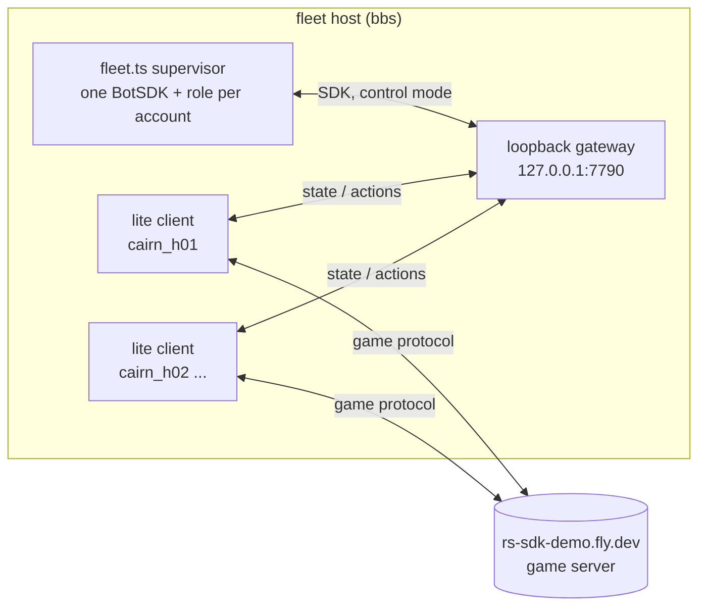

# Helper swarm

The speedrun's scored account (`www_cairn_md`, displayed as 'Www Cairn Md') is ranked on its own logged-in ticks on the demo server rs-sdk-demo.fly.dev. Helper accounts' time costs nothing on the scoreboard, so helpers gather the run's supplies in advance (wines, bones, bars, logs, essence, feathers and the rest of the supply list in cairn://p/rs/41) and a mule hands them to the scored account in a few trades. This page is how the helpers are organised and how to operate the fleet that runs them.

## Pieces

| Piece | Where | What |
|---|---|---|
| Role contract | `speedrun/helpers/role.ts` | A role is a restartable loop for one account: `run(ctx)` with `ctx.bot`, `ctx.sdk`, `ctx.options`, `ctx.log`, `ctx.reportBank`, `ctx.signal`. Every role also runs standalone: `bun speedrun/helpers/<role>.ts <account>`. |
| Roles | `speedrun/helpers/<role>.ts` | One module per role, exporting `role`. The fleet imports it by name. |
| Supervisor | `speedrun/helpers/fleet.ts` | Keeps the accounts in `fleet.json` logged in and running their roles; writes `stockpile.json`. |
| Host control | `speedrun/helpers/fleetctl` | start/stop/status/logs/update on the fleet host, as a systemd user unit. |
| Mac side | `speedrun/helpers/bbs.sh` | `ssh` with bbs's pinned host key (for agent sandboxes) and `push` for development deploys. |

## Roles

| Role | Supplies | Accounts | Notes |
|---|---|---|---|
| [feathers](helpers/feathers.md) | Feathers (Fletching) | cairn_h01-h04 | Proof role of the fleet (cairn://p/rs/43). |
| [idle](../../speedrun/helpers/idle.ts) | nothing | any | Parks an account logged in; used for capacity measurements. |
| [woodcutter](helpers/woodcutter.md) | Magic logs and lower tiers (Firemaking) | cairn_h10-h14 | cairn://p/rs/44 |
| [bars](helpers/bars.md) | Mithril and adamant bars (Smithing) | cairn_h20-h24 | cairn://p/rs/45 |
| [essence](helpers/essence.md) | Rune/pure essence (Runecraft) | cairn_h30-h34 | cairn://p/rs/46 |
| [grapes, jugs, wine](helpers/wine.md) | Grapes (guild, Phoenix hideout, goblins), jugs of water, noted unfermented wine (Cooking) | cairn_h40-h49 | cairn://p/rs/47. Three roles; `wine` is the Cooking-35 maker and giver. |
| [bones](helpers/bones.md) | Dragon bones or the best Prayer xp per helper-hour | cairn_h50-h54 | cairn://p/rs/48 |
| [mule](helpers/mule.md) | Consolidates stock, serves trades to the scored account | cairn_mule1, cairn_mule2 (stand-in receiver cairn_h05) | cairn://p/rs/49 |
| [coins / buyer](helpers/coins.md) | Coins; Grand Exchange and shop purchases | cairn_h60-h65 | cairn://p/rs/50 |
| [bidder](helpers/bidder.md) | Standing GE buy offer just above the competing bid, up to a target (grapes) | cairn_h61 | cairn://p/rs/63 |

Planned without an owner yet (supply list in cairn://p/rs/41): fletcher-supplier (arrowheads, dart tips, headless arrows), herb gatherer (unfinished potions and secondaries), gem supplier (uncut dragonstones or diamonds), rune and jewellery buyer, combat-supply buyer (food, potions, gear, cannonballs), quest-item gatherer.

## Accounts

- **Names.** Helpers are `cairn_hNN` (two digits), mules `cairn_mule1` and `cairn_mule2`. Usernames are at most 12 characters, lower-case letters, digits and underscore; the fleet refuses anything that does not start with `cairn_`, and always refuses `www_cairn_md` (the scored account), `cairn_dot_md` (its claimed spare, never to be named or used) and `cairn` (the operator's).
- **Ranges.** fleet h01-h04 · mule child h05 · woodcutter h10-h14 · bars h20-h24 · essence h30-h34 · wine h40-h49 · bones h50-h54 · coins/buyer h60-h65 (h61 is the grape bidder). `cairn_t01`-`t27` are load-test accounts from the fleet's capacity measurement: logged out, unused, nothing in their banks. Their env files stay in `~/rs-fleet/bots/` so the names are never reused by accident; they are not strays.
- **Credentials** live only on the fleet host, in `~/rs-fleet/bots/<account>/bot.env` (`BOT_USERNAME`, `PASSWORD`, `SERVER=rs-sdk-demo.fly.dev`; directory 700, file 600). `bots/*/` is gitignored. A demo account is created by its first login with whatever password is sent, so the env file is written before that login and is never overwritten: `fleetctl add` opens it with O_EXCL. A `bot.env` must not set `GATEWAY_URL`; the fleet refuses one that would bypass its gateway.
- **Hand-over.** A role child leaves its accounts logged out with their env files in `~/rs-fleet/bots/`; adopting them is one `fleetctl assign` per account and a `fleetctl reload`.

## How the fleet works



- **Transport.** The supervisor starts a private SDK gateway (`server/gateway/gateway.ts`) bound to 127.0.0.1 with no login server, so it accepts any local connection and nothing else. Each account's headless lite client (`server/webclient/src/lite/runner.ts`) logs in to the demo server and publishes its state to that gateway (`GATEWAY_URL`). The role's SDK talks to the same gateway, so action round trips stay on the host instead of crossing the demo's public gateway (measured on bbs by cairn://p/rs/50: about 300 ms per tick locally, versus 2-5 s stalls through the public one).
- **One client process per account.** A crashing or wedged client takes down one account. Measured cost is in the next section; it is small enough that the alternative (all clients in one process, like `lite/swarm.ts`) is not worth the coupling.
- **Supervision.** When a client exits, the role is aborted and the account logs in again after 10 s, doubling to 60 s on repeated failures (plus up to 50% random jitter, so accounts that fell together do not retry together) and resetting once a session lasts 5 minutes (the engine refuses a takeover login for about 10 s). Exit code 3 means the client revision is older than the server's: every account would fail the same way, so the whole fleet stops, logs it loudly, and systemd does not restart it. A role that throws is restarted after 15 s, doubling to 10 minutes; a role that logs nothing for `stallMinutes` (default 20) is restarted; a client whose state goes silent for 90 s is restarted.
- **Login rate limit.** Every login the fleet makes, first logins and re-logins alike, takes a token from one fleet-wide bucket: `loginBurst` (default 3) back to back, then `loginsPerMinute` (default 4) sustained, never two closer than `loginStaggerMs` (default 4 s), served in arrival order. So 40 accounts take about 10 minutes to come up, and after a mass disconnect (a network blip, a bbs or demo restart) they come back at the same pace rather than all at once. The demo's login server does refuse logins ("Login server offline" and "Too many login attempts" were both seen in the first hour), and the refusal's code decides what happens next:

  | Login response | Account waits | Every login in the fleet waits |
  |---|---|---|
  | 16 Too many login attempts, 9 Login limit exceeded | 5 min, doubling per repeat up to 20 min (+0-25%) | 2 min |
  | 8 Login server offline, 14 Server being updated, 7 World full, 13 Could not complete login | 1 min | 1 min |
  | 3 Invalid username or password, 4 Account disabled, 18 Account locked | 30 min, and the event is flagged `needsAttention` | - |
  | 5 Already logged in, anything else | the normal backoff above | - |

- **Stopping.** SIGINT (what `fleetctl stop` sends) aborts every role, then logs each account out with the logout button (component 2458, `logout:try_logout`), which removes the player from the world in the same tick; within 16 ticks of combat the server refuses, so the fleet waits that out and tries once more, and only then closes the client. Closing the socket alone leaves the player in the world for hundreds of ticks and makes the next login wait. Removing or disabling an account on reload does the same.
- **Process hygiene.** The fleet only ever stops processes it started, through the handles it holds (its gateway and its lite clients), and `fleetctl stop` stops the systemd unit `rs-fleet`, whose cgroup holds exactly those. Nothing here kills by name or pattern, and nobody should on bbs: a `pkill -f gateway.ts` kills the fleet's gateway too (it happened at 05:05 UTC on 2026-10-21; the fleet restarted its gateway in 5 s and no account dropped), and `pkill -f` can match a tmux server and every window in it. To kill one client for a test, take its PID from the `CLIENT PID` column of `fleetctl status`.
- **Market calls.** The SDK derives its HTTP origin (Grand Exchange, market prices) from the gateway URL unless told otherwise, and the fleet's gateway is loopback with no game server behind it. The fleet sets every account's SDK origin from the account's `SERVER`, so roles can call `openGE`, `getMarketItem` and friends without doing anything.
- **Events.** Every login, login refusal (with its code), session end (with its reason), logout, SDK stall warning ("safety timeout - no state updates"), watchdog restart, role error and gateway exit is appended to `~/rs-fleet/fleet-events.jsonl`, one JSON object per line (`{t, type, account?, role?, ...}`). `fleetctl status` summarises the last hour: counts by type, login refusals by code, and clusters, the minutes in which trouble hit two or more accounts or the gateway. A cluster points at the gateway, bbs or the demo server; a lone event points at one account or its role.
- **Reload.** `fleetctl reload` validates `fleet.json` and signals the running supervisor (SIGHUP). New accounts are logged in, removed or disabled ones logged out, and accounts whose role or options changed get their role restarted without a re-login. An invalid file is refused and the running config kept. New role code (a changed `.ts`) needs `fleetctl restart`.

## Capacity and the IP cap

The demo allows **100 concurrent sessions per source IP**, and bbs shares its public IP with everything else on the operator's network: the scored run, labs, development. The fleet refuses more than **60** enabled accounts; aim for 20-40. A 1,100-account swarm once ran the 4 GB demo server out of memory (`World.ts`), so the cap is also manners. Measured on bbs (32 cores, 61 GB):

| Accounts | Supervisor RSS | Gateway RSS | Lite clients RSS | CPU, % of one core (supervisor / gateway / all clients) |
|---|---|---|---|---|
| 3 | 424 MB | 55 MB | 394 MB | 4.2 / 2.8 / 13.9 |
| 10 | 454 MB | 69 MB | 1,274 MB | 4.2 / 4.2 / 38.3 |
| 30 | 450 MB | 80 MB | 3,820 MB | 6-8 / 6-7 / 91-125 |

So an account costs about 128 MB and 3-4% of a core, nearly all of it in its own client process, and the supervisor barely grows with the account count; 40 accounts fit in about 6 GB and 2 cores. (The 10- and 30-account rows were measured with the `idle` role on Tutorial Island, which sees fewer entities than a busy gathering spot.)

## Etiquette

Helpers are ordinary players gathering resources: no chat, no following or blocking players, no PvP, no crowding a contested spawn with many accounts (spread them with role options), no load near the server's limits. Never log in as `www_cairn_md` (the scored account: any login adds to its ranked playtime), `cairn_dot_md` or `Cairn`.

## The ledger: `~/rs-fleet/stockpile.json`

Every time a role calls `ctx.reportBank` (after each bank visit) the supervisor replaces that account's snapshot and rewrites the file atomically (temp file + rename), so readers never see a torn file.

```json
{
  "asOf": "2026-10-21T05:12:40.118Z",
  "totals": { "Coins": 75, "Feather": 2140 },
  "accounts": {
    "cairn_h01": {
      "role": "feathers",
      "asOf": "2026-10-21T05:12:40.118Z",
      "bank": [
        { "id": 995, "name": "Coins", "count": 25 },
        { "id": 314, "name": "Feather", "count": 840 }
      ]
    }
  }
}
```

- `accounts.<name>` is the full bank as the account last saw it (`role` it ran, `asOf` of the visit, `bank` rows `{id, name, count}` sorted by name). A report older than the snapshot held is ignored.
- `totals` sums every account's bank by item name, sorted by name. It is recomputed from `accounts` on every write and on every read, so it cannot drift.
- `asOf` is the newest snapshot's time. Accounts keep their row after they leave the fleet, so stock in a parked account still counts.
- Every report is also appended to `~/rs-fleet/fleet-run/bank-history.jsonl` (`{asOf, account, role, bank}` per line), which shows stock growing over time.

## Operating it (from the Mac)

Everything below is in the form `ssh bleu@bbs '...'`, which works from the operator's shell. From an agent's sandboxed batch (which cannot read `~/.ssh`), use `speedrun/helpers/bbs.sh '...'` from a checkout instead, with the same argument. It uses the dedicated fleet key when the machine has one (`~/.rs-fleet/id_ed25519_fleet` with `~/.rs-fleet/known_hosts_bbs`, installed on the operator's Mac and on bgsrv-mac, where some `local` build slots run), and otherwise whatever key the Mac's ssh-agent holds, with bbs's host key pinned in the script. Either way it never disables host-key checking. fedora has neither. `F=~/rs-fleet/speedrun/helpers/fleetctl` below stands for that path; write it out in full inside the quotes.

| To | Run |
|---|---|
| See accounts, roles, last log age, stock | `ssh bleu@bbs '~/rs-fleet/speedrun/helpers/fleetctl status'` (`status --json` for everything) |
| Look at one account (position, levels, inventory) | `ssh bleu@bbs '~/rs-fleet/speedrun/helpers/fleetctl peek cairn_h01'` |
| Start | `ssh bleu@bbs '~/rs-fleet/speedrun/helpers/fleetctl start'` |
| Stop (logs everyone out) | `ssh bleu@bbs '~/rs-fleet/speedrun/helpers/fleetctl stop'` |
| Restart (new role code) | `ssh bleu@bbs '~/rs-fleet/speedrun/helpers/fleetctl restart'` |
| Supervisor log | `ssh bleu@bbs '~/rs-fleet/speedrun/helpers/fleetctl logs'` (`logs gateway`, `logs cairn_h01 200`, `journal`) |
| New account(s) in a range, straight into the fleet | `ssh bleu@bbs '~/rs-fleet/speedrun/helpers/fleetctl add h10-h14 --count 2 --role woodcutter --options "{\"tree\":\"yew\"}" && ~/rs-fleet/speedrun/helpers/fleetctl reload'` |
| Adopt an existing account | `ssh bleu@bbs '~/rs-fleet/speedrun/helpers/fleetctl assign cairn_h20 bars && ~/rs-fleet/speedrun/helpers/fleetctl reload'` |
| Take an account out (logs it out, keeps its ledger row) | `ssh bleu@bbs '~/rs-fleet/speedrun/helpers/fleetctl assign cairn_h20 bars --disable && ~/rs-fleet/speedrun/helpers/fleetctl reload'` |
| Update to merged code (see below for which ref) | `ssh bleu@bbs '~/rs-fleet/speedrun/helpers/fleetctl update agent/rs-41-coordinator-0 && ~/rs-fleet/speedrun/helpers/fleetctl restart'` |
| Read the ledger | `ssh bleu@bbs 'cat ~/rs-fleet/stockpile.json'` |

`fleet.json` can also be edited by hand; `fleetctl reload` validates it before signalling and names every problem:

```json
{
  "maxOnline": 40,
  "gatewayPort": 7790,
  "loginStaggerMs": 4000,
  "accounts": [
    { "account": "cairn_h01", "role": "feathers" },
    { "account": "cairn_h03", "role": "feathers", "options": { "pen": "fred" } },
    { "account": "cairn_h20", "role": "bars", "enabled": false, "stallMinutes": 40 }
  ]
}
```

`maxOnline` (default 40, at most 60) caps logged-in accounts; enabled accounts beyond it wait, in file order. `gatewayPort` must be in 7790-7799 (role children use 7710-7770 for development). `loginsPerMinute` (default 4, at most 12) and `loginBurst` (default 3, at most 6) set the login rate limit above. `stallMinutes` is per account.

### Where things live on bbs

| Path | What |
|---|---|
| `~/rs-fleet` | Checkout of the fork (detached at the last `fleetctl update`), also the fleet's home |
| `~/rs-fleet/bots/<account>/bot.env` | Credentials |
| `~/rs-fleet/fleet.json` | Fleet config |
| `~/rs-fleet/stockpile.json` | Ledger |
| `~/rs-fleet/fleet-run/status.json` | Live status, rewritten every 10 s (what `fleetctl status` reads) |
| `~/rs-fleet/fleet-run/logs/` | `fleet.log`, `gateway.log`, one `<account>.log` each (role lines, lite client output, SDK output), rotated at 20 MB |
| `~/rs-fleet/fleet-run/bank-history.jsonl` | Every bank report |
| `~/rs-fleet/fleet-events.jsonl` | Fleet events (logins, refusals, session ends, stalls), rotated at 10 MB |

The supervisor runs as the transient systemd user unit `rs-fleet` (user lingering is on, so it survives logout). It restarts after a crash, but not after exit 2 (bad config, another fleet already running) or 3 (client outdated).

### Updating code

**Which ref.** Role children's PRs merge into the rs/41 integration branch (`agent/rs-41-coordinator-0`), not `main`; `main` only receives them when the whole mission ships. So during the mission, deploy the integration branch; after it ships, deploy `main`.

**Merged code.** `fleetctl update <ref>` takes any branch or commit of the fork (default `main`): it fetches it, checks it out detached, runs `bun install` at the root and in `server/webclient`, and records the ref and commit in `fleet-run/deployed.json`. Then `fleetctl restart` loads it. Runtime files are gitignored and untouched. `fleetctl status` prints the code the running supervisor loaded (`code: running <ref> @ <sha>`) and says when the checkout has moved on and a restart is due.

**Code not yet merged (development).** `speedrun/helpers/bbs.sh push`, run from a checkout on the Mac, rsyncs that checkout's `speedrun/` over the host's, leaving the rest (the clients, the SDK) at whatever `update` last fetched; then `fleetctl restart`. Status shows this as `+ development speedrun/`. The next `fleetctl update` puts `speedrun/` back to the fetched revision.

## Writing a role

The contract and the rules every role follows are in `speedrun/helpers/role.ts` and the shared brief on cairn://p/rs/41: self-sufficient from a fresh account, restartable from any state, gate every action on an observed effect, dismiss level-up dialogs, call `ctx.reportBank` after every bank visit, check `ctx.signal`, never chat. Inside the fleet, a role is told about nothing else: re-logins, crashes and stalls are the supervisor's job, and the role simply starts again from wherever the account is. Log something at least every `stallMinutes`. When the role moves between stages, log it as `ctx.log('phase', { phase: 'gather' })` (or `ctx.log('phase gather')`): `fleetctl status` shows each account's latest phase and its age, which is how you tell an account that is training from one that is gathering. Write `docs/speedrun/helpers/<role>.md` and add the role to the table above.
