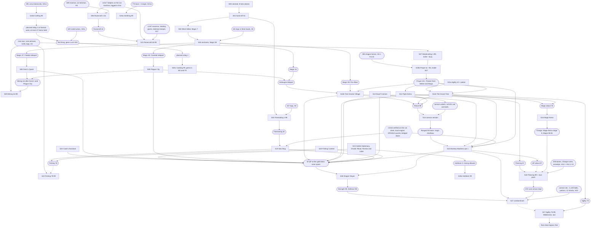

# Run order v2: the scored run, step by step

This page is the scored run's plan: what SCORED does, in which order, where, with which supplies,
and what each step costs in ticks logged in. **SCORED** is the scored account (its real name never
appears in this repository). The hiscores rank by the in-world tick of the last level-up
([playtime-audit.md](playtime-audit.md), "What this means for the run"); the record is 35,916. The
helper side of every hand-off is [SUPPLIES.md](SUPPLIES.md); the scripts that run each step are
[STEP-MANIFEST.md](STEP-MANIFEST.md); the run machine's runbook is [RUN-HOST.md](RUN-HOST.md).

**Version 2** is cairn://p/rs/111's reconciliation of rs/109's v1 (the rs/103 coordinator's
provisional order v1) with five local-engine labs: [run-transitions.md](research/run-transitions.md)
(rs/104: every leg measured, hand-offs, four ordering answers), [bones-placement.md](research/bones-placement.md)
(rs/105), [stun-pack.md](research/stun-pack.md) (rs/106), [wine-window.md](research/wine-window.md)
(rs/107) and [levelup-cost.md](research/levelup-cost.md) (rs/108); plus
[supply-fallbacks.md](research/supply-fallbacks.md) (rs/129), [RESILIENCE.md](RESILIENCE.md) (rs/127)
and main's notes relayed on cairn://p/rs/111. Section 7 lists every change against v1.

**Moves against v1** (step IDs are unchanged): S17 (Agility 75-99) moves from after S16 to the very
end, after S27; S16 now goes straight to S18. The early bones (S10a) and the booth bones (S25b) are
buried inside S07's knife Woodcutting loop, so S10a is retired and S25b's row sits beside S07. S18b,
S18c and S18d (bones, Charge and Fletching in the stuns) are measured inside S18's one figure.

The step IDs are the coordinator's (S00-S27). Splits use letter suffixes and follow the manifest
(S10a Prayer 1-43, S10b Tree Gnome Village; S25a Smithing, S25b Prayer, S25c Cooking, S25d Crafting,
S25e Herblore). Transition legs are `Tff-tt` (from step ff to step tt).

## How to read the numbers

Every tick figure carries a label and a source.

| Label | Meaning |
|---|---|
| **m** | measured, as the source document reports it |
| **r** | read from a script or engine line, as the source cites it |
| **i** | inferred: derived from m or r inputs, with the arithmetic here or in the source's model |
| **e** | estimated: an allowance set on this page by judgement |

The step table's **Kind** column classes each step's own figure: **M** measured end to end on the
route's method (on the local lab engine unless the source says demo), **I** inferred (a model, or
measured parts assembled into a total), **E** estimated. Section 7 sums the ticks of each kind.
Most lab figures are from the headless lite client against a local engine at 300 ms; the run is the
browser webclient against the demo, which rs/97's in-page figures (M0550) bridge for the reactive
loops. A figure taken only on the lite client says so.

| Tag | Source |
|---|---|
| RT§n | [research/run-transitions.md](research/run-transitions.md) (rs/104), section n; leg names (`L07`) are its script ids |
| BP§n | [research/bones-placement.md](research/bones-placement.md) (rs/105) |
| SP§n | [research/stun-pack.md](research/stun-pack.md) (rs/106) |
| WW§n | [research/wine-window.md](research/wine-window.md) (rs/107) |
| LU§n | [research/levelup-cost.md](research/levelup-cost.md) (rs/108) |
| SF§n | [research/supply-fallbacks.md](research/supply-fallbacks.md) (rs/129) |
| RES§n | [RESILIENCE.md](RESILIENCE.md) (rs/127) |
| Q§n | [quests/README.md](quests/README.md), section n |
| SK:x | `docs/speedrun/skills/x.md` (section given where it matters) |
| IL§n | [skills/interleaving.md](skills/interleaving.md) |
| TM | [skills/tick-manipulation.md](skills/tick-manipulation.md) |
| MAN | [STEP-MANIFEST.md](STEP-MANIFEST.md) |
| T&O | [research/travel-and-overhead.md](research/travel-and-overhead.md) (rs/59; row n, or the travel matrix) |
| WINE | `docs/speedrun/helpers/wine.md` on cairn://p/rs/41/1/coordinator |
| BONES | `docs/speedrun/helpers/bones.md` on cairn://p/rs/41/1/coordinator |
| HT | [research/competitors/hiscore-timestamps.md](research/competitors/hiscore-timestamps.md) (rs/60) |
| PRIM | [quests/primitives.md](quests/primitives.md) |
| SR | [speedrun/README.md](../../speedrun/README.md) (measured lib costs) |
| ARC | the main thread's arc, cairn://p/rs/main/arc |
| M05xx, M06xx | main's binding notes relayed by the rs/103 coordinator on 2026-10-21 at 05:30, 05:50, 06:02, 06:06 and 06:12; M0550's rates are "rs/97 in-page results via main, 05:50" (wired branch, local engine, visible tab) |
| C#n | comment n on cairn://p/rs/111 (the coordinator relaying main, rs/41, rs/124 and the labs) |

**Dialogue column.** The run uses rs/51's blind continues: `continueBurst` in
`speedrun/lib/dialogue.ts`, and the browser webclient's `clickDialogOption(..., blind)` in
`server/webclient/src/client/Client.ts` supports the flag (r). The burst column of Q§1 is mostly
inferred (recomputed or page-modelled), and no quest has yet been rehearsed in the browser client, so
**expected takes Q's fixed column and best takes its burst column**, both with Monkey Madness's
expected failures: 11,689 and 10,811 (sum of the Q§3 rows).

## Headline

| | Knife loops on (run gate holds) | Knife loops off all night (plain loops) |
|---|---|---|
| **Expected** | **34,766**: 1,150 under the record | **36,971**: 1,055 over |
| **Best** | **32,099**: 3,817 under | **34,675**: 1,241 under |

That is with every supply line held. With the supplies main's start policy expects (section 1), knife
on:

| Supply scenario (knife on) | Fallback deltas in force (exp / best) | Expected | Best | Against the record (exp) |
|---|---|---|---|---|
| Every line held: 555 dragon bones, rune axe, the full lists | 0 | 34,766 | 32,099 | -1,150 |
| rs/41's 09:35 plan: adamantite 0 (+119), mixed gems (+88), mixed herbs (+85), 2 nature talismans with a keeper (+34), 2,070 adamant + 570 rune arrowtips (0); 555 dragon bones and the rune axe held | +326 / +326 | 35,092 | 32,425 | -824 |
| As above on today's bone floor: 219 dragon, 470 babydragon, 672 big bones | +568 / +513 | 35,334 | 32,612 | -582 |
| As above, no rune axe (adamant axe) | +1,009 / +954 | 35,775 | 33,053 | -141 |
| As above, a mithril axe | +1,509 / +1,454 | 36,275 | 33,553 | +359 |

(i: section 7, "Supply fallbacks"; every delta is SF's line re-priced on this order.) The expected path
now clears the record by about 3% with everything held, and by about 1.6% on rs/41's plan with
today's bones. The knife gate failing all night erases it on its own (+2,205, R2), and so does a
mithril axe on today's bones (above). Monkey Madness's bad-but-plausible case (+~860 beyond its
expected, R5) erases it on today's bones. A demo restart is no
longer a score risk (about 7 ticks each, R7). The biggest single open swing is still the in-page
willow rate (O19, -~420 if 4.83 ticks per log is a band average).

## 1. Run-machine setup and the run gate

The run is first person: SCORED's browser webclient in a visible tab on the Ashburn machine, the
game socket direct to the demo (`?server=`), the SDK overlay on a loopback gateway (`?gateway=`) for
the non-reactive steps, and in-page tick programs (cairn://p/rs/97) for every reactive loop (the knife
loops, the pickpocket re-click, Agility obstacles) (ARC).

**Tick-exact helpers on the run machine (M0602, M0612).** The helpers whose packets must land on
predicted ticks beside SCORED run on the Ashburn machine, not on bbs: the altar givers of the 7-tick
Runecraft cycle (S06, S21), the trade giver that serves SCORED's hand-offs, and the wine giver (S25c;
the same account as the trade giver). They run through the launcher cairn://p/rs/117 (under rs/41):
a loopback gateway, lite runners with the #78 relay fix, **helpers logged in before SCORED**, clean
logout, independent of `fleetctl`, documented in HELPERS.md. The altar givers follow rs/117's cue
contract (cairn://p/rs/97/messages, 04:59). Everything else in the fleet stays on bbs. SUPPLIES.md
marks every giver's host.

**Setup (M0550; the host since 2026-10-21).** The run machine is an AWS c7i.2xlarge in us-east-1c
(8 vCPU, no GPU, Ubuntu 24.04, XFCE over xrdp). [RUN-HOST.md](RUN-HOST.md) is its run-night runbook,
with every command. In order:

- check Fly edge iad and TCP connect p50 of at most 5 ms;
- the operator connects over RDP at a fixed 1920x1080, 24 bpp, only to create the session and watch
  the bring-up, then disconnects for the rest of the run and watches a 3 fps MJPEG live view (one
  desktop session per user: disconnect, never log out);
- start the page server, the tab's loopback gateway and Chrome under `tmux -L run`. Chrome gets its own
  profile, tenet 12's three throttling flags and a maximised app window, and stays maximised and
  unobscured on display :10 for the whole run. Every launch on the host is reaped by its own hard
  timeout (9 h for the run), so nothing depends on an agent or a person being alive to stop it;
  teardown still stops everything explicitly. Chrome opens a bare page and is logged in by a
  one-time token, so no password is ever on a command line (cairn://p/rs/138). That path exists
  only on rs/138's branch, so no real account's credentials (fleet or SCORED) go on the host until
  rs/138 is merged to main (RUN-HOST.md, "Rules for every launch on the host");
- log rs/117's helpers in;
- start the recording on the VM (ffmpeg x11grab, 1920x1080, 30 fps, libx264 veryfast crf 20);
- check that nothing else runs, and reserve the host: the run writes `~/host-reserved.json` (owner the
  run, `until` = start + 9 h) before the gate measurement, so rs/83's gate timer skips; run.ts removes
  it after the final clean logout (RUN-HOST.md, "Host reservation", cairn://p/rs/139);
- measure the gate on a throwaway gate account, in the run's configuration (RDP disconnected,
  recording and live view on);
- only then open SCORED's tab. SCORED already exists: it was claimed with the tutorial skip and
  parked at 8 ticks (main's arc, 08:40 PDT), so this is its first login of the run, not its first ever;
- the bbs fleet is online and H1-H5 are staged before that login.

Gate (d) was measured there on 2026-10-21 at about 1,700 online. The tab's loop-rate p10 was 70.6-73.3
per second with RDP connected or disconnected and the capture on or off. The capture costs about
0.75-0.95 of a core. Chrome was not throttled with RDP disconnected. The recording is smooth only
disconnected: 29.9 fps against about 23 fps connected (m, RUN-HOST.md, "Measured"). Hence main's
configuration: RDP disconnected for the run (10:02 PDT 2026-10-21), now tenet 12 (approved,
cairn://p/rs/tenets/12), which supersedes tenet 11's "remote desktop connected".

**The run gate, and the knife switching rule (tenet 12; M0530, M0550; ARC).** The knife is on only
while the gate holds, measured on the run machine from the tab:

| | Condition (tenet 12) | Source |
|---|---|---|
| (a) | direct in-page probe at least 58 of 60 reactions on the next tick, at the real player count | rs/86, rs/96, TM "Run-time host gate" |
| (b) | state-publication interval p90 over the probe minute: **reported, not a pass line** | tenet 12; rs/83, rs/102 |
| (c) | **at most 2 catch-up ticks per probe minute**. A catch-up is an interval under 150 ms immediately after one over 350 ms, counted from raw frame arrivals with no grouping (`CATCH_UP` in `speedrun/lib/hostgate-verdict.ts`, r). Failing (c) means re-measure | tenet 12 |
| (d) | tab loop rate p10 at least 50 loops per second (measured ~72 on the run host, RUN-HOST.md "Measured") | M0550; tenet 12 |

Otherwise the step runs its plain loop and re-probes periodically. `HostGate` in
`speedrun/lib/hostgate.ts` does the probe, the measured-ticks-per-drop switch, re-probes while off and
the observed-slip trigger, and `speedrun/lib/hostgate-verdict.ts` now carries (b)-(d)
(`tickSteadiness`: p90, catch-ups per minute) (r). Predicted loops keep an in-run fallback and resync
on observed slips (ARC).

**In-run pause rule (rs/102, C#9).** A reactive or knife step pauses when catch-ups exceed about 5 per
minute and resumes when they fall under 1 per minute. A severe burst (at least ~10 catch-ups a minute
for 2 minutes) raises `restartLikely` in `speedrun/lib/demo-status.ts`; the response is the same pause,
not a save (RES§3).

**Start time.** It is chosen by the gate, measured on the run machine over 3-5 minutes, not by the
clock (tenet 12, C#9). The one clean stretch seen so far was 02:43-04:04 PDT.

**Start conditions (main adopted rs/129's policy at 09:30, C#15; SF "Recommended policy").**

- **Hard:** Prayer xp in hand of at least **39,938 base**, in any bone mix (dragon 72, babydragon 30,
  big 15 per bone). On 470 babydragon and 673 big bones that is at least 219 dragon bones; on 470 and
  ~900 big bones, about 172 (i, section 7).
- **Hard:** a cannon set and about **1,170 cannonballs** (SF§9; rs/125 is making them from ~290 steel
  bars, C#15).
- **Budget item:** the rune axe. Without it Woodcutting costs +441 (adamant) or +941 (mithril),
  which no other purchase recovers (SF§13 re-priced, section 7). The bid ladder runs to 1M (C#16).
- **Budget:** start only when the expected total plus the fallback deltas in force is under 35,916
  (the scenario table above); otherwise wait, and main decides the bet.

## 2. Step table (a)

"Expected" and "best" are the step's own ticks (the skill or quest figure, its own refills included
as its source counts them). Leg rows carry the leg **net of any arrival row the next step's own
figure already counts** (RT§2, last column), so a negative leg is a measured route shorter than the
one the quest document priced. The allowances (hand-offs outside the figures, level-up pages not in
them, contention, overrun share, relogs, restarts) are in section 6 and the totals in section 7.
Hand-off IDs (H1-H23, H4.x, H14.x) are SUPPLIES.md's. "Unsafe" means a logout there loses progress
(Q§4 and the step's own document); every other boundary is logout-safe, and logout is always refused
within 16 ticks of combat (m, PRIM §8). Quest state after a restart is read through rs/114's
`speedrun/lib/quests.ts` ([quests/quest-state.md](quests/quest-state.md), pending rs/114's merge);
each step's resume entry is in MAN.

No amulet of glory is used anywhere: rs/123 found charged glories unobtainable, and every leg below is
RT's measured no-glory method (RT, "No amulet of glory").

| ID | Kind | Where (tiles) | Step | Levels | Expected | Best | Supplies in, items out | Helper, hand-off | Login / logout-safe | Fallback if the fast path fails | Risks |
|---|---|---|---|---|---|---|---|---|---|---|---|
| S00 | M | Tutorial Island to (3222,3222) | first login and tutorial skip: **done** | - | 8 m (SCORED claimed and parked at 8 ticks, main's arc 08:40 PDT; tally row 58) | 8 m | starter kit: tinderbox, bronze axe, net, pickaxe, 9 other starters and 5 rune types (T&O row 1) | none | done; the run starts at the next login | - | the 8 ticks are on SCORED's clock already |
| S01 | M | (3222,3222) | hand-off H1 | - | 8 m (RT§3: 4 for 1 noted stack, 8 for 23, 12 of 12 at this tile; H1 is about 5 stacks) | 8 m | in: H1 (staff of water, cosmic, fire, air and earth runes; **no rings**: the starter kit leaves about 10 free slots) | trade giver (Ashburn, rs/117), requesting before SCORED logs in | **run login 1**; safe | stock trade, 9 m (PRIM §6) | the starter junk (12 items; the tinderbox stays) is dropped during T01-02 (a drop keeps the walk queue, T&O row 2) |
| T01-02 | M | (3222,3222) to the coop gate (3235,3295) | run, 1 gate | | 50 m (RT `L01`: 51, 49, 49) | 50 m | | | safe | | |
| S02 | M | Lumbridge chicken coop (3233,3295) | 4 Wind Strikes | Magic 1-7 | 18 m (SK:magic §1) | 18 m | starter-kit air and mind runes | none | safe | any attackable NPC nearer the landing (O3) | Wind Strike leaves its 5 level-up pages open: a blind burst on the next label (LU§4, section 6) |
| T02-03 | I | coop to the row's start beside it | walk | | 5 i (RT§9: a row at the coop gate cuts the measured 50 m to about 0) | 5 i | | | | | |
| S03 | I | open ground beside the coop, a 157-tile snake (SK:firemaking §1: any open ground) | Firemaking, tinderbox line, highest tier | Firemaking 1-99 | 695 i (SK:firemaking §1: 658 model + 6 trades, trade 5-6 m) | 650 m (dropped row; 634 and 666 measured) | in: H2, 157 logs; out: ashes | woodcutter (bbs): dropped row paced around the 100-tick reveal, or 6 trades of 27 by the trade giver | safe at any light | trades (695); bank at Falador east ~735 i | dropped logs turn public after 100 ticks (r, T&O row 5); Firemaking 30 must precede S19 |
| S04 | I | the row's end (no bank) | 60 enchants: 12 sapphire, 27 emerald, 16 ruby, 5 diamond | Magic 7-59 | 204 i (180 cast ticks m, SK:magic §1, every gap 3 with level-ups at 0, LU§2; 3 ring trades of 20 at 8 m, RT§3) | 204 i | in: H3 (three ring loads); out: 60 enchanted rings to the giver | trade giver | safe | a booth at Draynor | **standalone, not on the walk**: riding the walk to Doric's measured ~31 slower than casting here and teleporting, and 2 of 4 runs went wrong (RT§5). Gates: Magic 37 before S05, 45 before S08, 51 by S08's end, 59 before S10b (r, PRIM §4, Q§4 step 0) |
| T04-05 | M | row to Doric (2952,3451) | Falador teleport + run | | +1 m (RT `L04` 44 m, 42-46, against the 43 Doric's fixed column counts) | +1 m | | | safe | | |
| S05 | M | Doric (2951,3451) | Doric's Quest | Mining 1-49 | 65 m (Q§3) | 60 i | in: H4 (Doric's items, runes, the Woodcutting and Mining kits); out: 1 QP | trade giver at Doric | safe | - | none |
| T05-06 | M | Doric to inside the air altar room (2841,4830) | Falador teleport, run 52-54, talisman entry 4 | | 61 m (RT `L05`: 62, 60) | 61 m | | | safe | | |
| S06 | I | air altar, stand (2844,4832) | Runecraft, 7 crafts of 27, tuned 7-tick cycle | Runecraft 1-44 | 54 i (7 x 7 m, 8 of 8 at air 1 with a level-up every craft, LU§2; + 5 session trade) | 54 i | in: H5 (189 essence, air talisman); out: several hundred air runes | 7 altar givers (Ashburn, rs/117), logged in before SCORED | safe in the room | robust 8-tick: 61; stock 15-tick: 110 | R12 |
| T06-07 | M | room to the Taverley normal trees (2912,3495) | Falador teleport + run | | 74 m (RT `L06`: 75, 73) | 74 m | | | safe | | |
| S07 | I | normal trees (2912,3495) to 15; oaks from (2914,3494) 15-73; willows from (2920,3406) 73-99 | Woodcutting, in-page knife loop, **bury variant** (S25b's bones ride it, below) | Woodcutting 1-99 | **knife 3,390 i · plain 3,881 i** (SK:woodcutting §2's 3,958 less the model's ~77 ticks of level-ups, measured 0 when answered on the next label, LU§2-§3; knife at M0550's in-page willow 4.83 against plain 5.53 ticks per log) | knife 3,390 i | in: rune axe, knife, 1 normal log (H4); bone loads H4.1-H4.16 | bone giver (Ashburn, rs/117) on the next tile; a bbs lookout scouts the oaks | safe at any cycle boundary | gate fails: plain 4-tick loop with the bury (3,881) | contention (R9); overrun (R2); the willow rate (O19); the bury variant is lab-only, lite client (R15) |
| T07a | I | oak tile to willow tile (88 tiles) | run, inside S07 | | 46 i (0.51 ticks per route tile, PRIM §2) | 46 i | | | safe | | |
| S25b | I | **inside S07**, at the oak tile, then the willow tile | **moved from the booth into S07**: bury 355 dragon bones in the knife loop, the re-click moved to the roll tick (BP§2) | Prayer 1-~94 | 110 i (BP§6: 0.23 S07 ticks per bone m, oak, 357 bones, almost all of it the 23-bone trades; ~0.31 with willow-style bounces and margin) | 80 i (16 loads x 5 m, BP§3) | in: H4.1-H4.16 (23 unnoted per load); 0.298 bones per tick m, so ~1,190 of S07's ticks carry them | bone giver beside the tree requests first, re-requests the tick after a refusal (BP§3) | safe between loads | the plain loop with the bury (~110 / ~75, BP§6); the Mining `stay2` lap (up to ~200 bones, BP§4); the booth at 2.07 per bone | dragon bones (R6); level-ups free (57 per 600 ticks, 161 of 164 roll gaps kept, BP§2) |
| T07-08 | M | willows to Edmond (2568,3334) | Camelot teleport + run, 248 tiles | | +2 m (RT `L07` 131 against Plague City's 129) | +2 m | | | safe | | |
| S08 | M | Camelot in; Ardougne scroll read at the end | Plague City | Mining 49-64 | 620 m (Q§3) | 564 i | in: H6; out: 1 QP, the Ardougne teleport | trade giver | safe | - | needs Magic 45 and 51 from S04 |
| T08-09 | M | Edmond to the zoo iron (2604,3235) | Ardougne teleport + run | | 50 m (RT `L08t`) | 50 m | | | safe | | |
| S09 | I | six-rock iron cluster south of the zoo (2602-2605, 3233-3237) | Mining, in-page knife loop on the rotation | Mining 64-99 | **knife 3,116 i · plain 3,765 i** (SK:mining §2's 3,134 knife less the model's 18 ticks of level-ups, measured 0 in the rotation, LU§2; the plain loop's level-up cost is unmeasured, so it keeps 3,765) | knife 3,116 i | in: rune pickaxe, knife, ~5 logs (H4); out: ore dropped | none (bbs scout) | safe at any cycle | gate fails: plain adjacent-rock loop (3,765); second cluster north of East Ardougne | contention (R9); overrun (R2); in the rotation answer pages with the scheduled rock click, never a re-click (LU§5) |
| T09-10 | M | zoo to Elkoy, the maze entrance (2504,3191) | run | | -47.5 m (RT `L09` 55.5 against Tree Gnome Village's 103) | -47.5 m | | | safe | | |
| S10a | - | - | **retired**: Prayer 43 comes from S07 (S25b is ~94 when S07 ends, BP§5); its 11 bones are in S25b's 355 | - | 0 | 0 | | | | | |
| S10b | I | Tree Gnome Village | warlord by Fire Blast under Protect from Melee | Attack 1-~80, Magic 59-64 | 896 m/i (Q§3) | 842 i | in: H7 (no bones, no prayer potions now); out: 2 QP, spirit trees | trade giver at Elkoy | **unsafe**: Bolren's closing ceremony | Fire Bolt warlord 165 m (+32) | warlord at 10 HP and Defence 1 |
| T10-11 | M | Bolren to the course (2474,3436) by spirit trees; course end to the Grand Tree door | 20 m + 36 m | | +8.5 m (RT§2 `L10`, `L11a`: 56 against the Grand Tree's segment A, 47.5) | +8.5 m | | | safe | | |
| S11a | I | Gnome Stronghold course | laps, then the Agility potion | Agility 1-22 (+3 boost) | 122 i (SK:agility §7) | 122 i | in: Agility potion(4) (H8) | - | safe | - | none |
| S11b | I | The Grand Tree | black demon by Fire Bolt | Attack to ~94, Agility 22-75, Magic to ~73 | 1,576 i (Q§3) | 1,441 i | in: H8; out: 5 QP | - | **unsafe**: trapdoor to the demon's kill | - | the demon at 28 HP |
| T11-12 | M | Narnode to Lady Servil (2566,3199) | Ardougne teleport + run | | -3 m (RT `L11` 71 against Fight Arena's 74) | -3 m | | | safe | | |
| S12 | I | Fight Arena | Fire Blast, Protect from Melee per fight | Attack 99, Thieving 1-57, Magic to ~76 | 645 i (Q§3) | 598 i | in: H9; out: 2 QP | - | **unsafe**: the arena fights | - | General Khazard at stage 12: prayer on until out of the door |
| T12-13 | r | Lady Servil to Lawgof (2571,3463) | Ardougne teleport + run, 189 tiles | | 0 r (RT§2: Dwarf Cannon counts its 121) | 0 | | | safe | | |
| S13 | I | Dwarf Cannon | quest | Crafting 1-42 | 976 i (Q§3) | 920 i | in: H10; out: the cannon unlock, 1 QP | - | safe | - | railing rolls vary |
| T13-14 | M | Lawgof to the poison spiders (3288,3810) | Ardougne teleport, run to the lever, lever, Deserted Keep web, run | | 181.5 m (RT `L13L`: 182, 181) | 181.5 m | H11 at Lawgof or the lever | | safe until the lever | | aggressive NPCs took up to 31 of 42 HP on the way (RT§2): carry food; PK |
| S14 | I | poison spiders, Wilderness 37 | pre-MM cannon session, **mithril scimitar** wielded, auto-retaliate off | Ranged 1-50+ | 132 i (113 m firing, rs/31; ~10 set-up i, Q§4 step 7; +9 i for the mithril scimitar in place of the unobtainable rune one, SF§10) | 132 i | in: H11 (cannon set, ~100 balls, the scimitar, food); out: the set and leftover balls (H11r) | cannon helper (rs/125) | **unsafe**: combat, Wilderness | Battlefield of Khazard (2523,3239): ~143 i | PK at combat ~52, 42 HP, Defence 1 (R8); Protect from Melee is available from S07 on (Prayer ~94) |
| T14-15 | I | spiders to Narnode | walk to Wilderness 20 (66 m), Ardougne teleport, the Khazard young spirit tree, village tree, stronghold (103.5 m) | | 173.5 i (RT§2, composite of measured parts; the two end-to-end no-glory variants measured 187-188) | 173.5 i | H11r at the Ardougne landing | | safe from level 20 | | |
| S15 | I | Monkey Madness, reward option 1 | quest | Strength 1-~97, HP to ~97, Defence 1-~89, Ranged to ~54 | 4,077 i (Q§6: 3,897 + 180 expected failures) | 3,726 i (burst 3,546 + 180) | in: H12; out: 3 QP | - | **unsafe**: the hangar puzzle's last tile to the powered hangar; the three chapter cutscenes; sigil to the Jungle Demon's kill | Q§6 failure budget | **verified on the run client (rs/116), local engine; not demo-confirmed**: the puzzle sends OPHELD5 via `sdk.sendUseItem` (R5); arrives at Defence 1, ~42 HP (O14) |
| T15-16 | r | Daero to Kolodion's cellar | Ardougne teleport, lever, Keep webs, ladder | | 0 r (RT§2: the Mage Arena counts its 158) | 0 | | | | | |
| S16 | I | Mage Arena | Kolodion at base ~76 under Protect from Magic | Magic 76-80/81 | 581 i (Q§3) | 574 i | in: H13; out: Charge (Mage Arena stage 8, the god staff given; rs/114, quest-state.md) | - | **unsafe**: the arena fight | 1 magic potion if Charge would start below 80 | PK in deep Wilderness (R8) |
| T16-18 | M | chamber guardian (2506,4696) to the Ardougne market (2655,3305) | Ardougne teleport from the chamber | | 6 m (RT§4 `L16B`: 6, 6, 6) | 6 m | | | safe after the teleport | | **moved**: S17 no longer follows S16 (section 9, O1) |
| S18 | M | East Ardougne market knights (~2655,3305) | pickpocket, in-page re-click; **the stun pack**: each stun carries 3 delay-free actions and a bury at +2, +4 and +6 (Charge until Magic 99, then arrow actions), clicks at +7 and +8; top-ups requested by SCORED at +2 (SP§2, §5) | Thieving 57-99, Magic 80-99, Fletching 1-99, Prayer ~94-99 | 2,000 m (SP§3: 1,908 / 2,098 / 1,997 with the pack, 84-93 failures; plain 1,986 m; lite client, local engine; level-ups natural, SP§9) | 1,908 m | in: H14 (load 0); top-ups H14.1-H14.13 **inside the figure** (SP§5: ~0.1-0.3 per top-up at k = 2) | trade giver (Ashburn, rs/117) within 3 tiles of SCORED at all times | safe at any attempt boundary, not while a trade is open | top-up at k = 4 if not adjacent (~+1 each); the plain pickpocket (1,975 i) with the pack's work elsewhere (~+130 i, section 7) | the helper keeping up on the demo (R16); a request on the tick after a bury is lost; one press per offered item (rs/136) |
| S18b | M | inside S18 | ~200 dragon bones, 3 per stocked stun (SP§2: 3.00 in every stocked stun; capacity (failures - top-ups) x 3, ~200-213) | Prayer ~94-99 | 0 (inside S18) | 0 | | | | | |
| S18c | M | inside S18 | Charge, 163-165 casts | Magic 80/81-99 | 0 (inside S18; outside the stuns it costs ~+300, SP§4) | 0 | | | | | |
| S18d | I | inside S18 | arrowtips on headless arrows, 294 actions: bronze 60, iron 90, steel 135, mithril 1,485, adamant 2,070, rune 570 (section 7, "Fletching mix") | Fletching 1-99 | 0 i (SP measured 240 actions inside; the stuns offer ~7.8 delay-free slots against 163 + 294 = 457 actions over ~84 stuns, 5.4 per stun, SP§2, §4) | 0 | the 570 rune arrows are kept for S27 | | | | |
| T18-19 | M | knights to Caroline (2716,3302) | run (the walker's route took 2 doors) | | +16 m (RT `L18` 49 against Sea Slug's 33) | +16 m | | | safe | | a door-free route ~31 i (O25) |
| S19 | M | Witchaven fishing platform | Sea Slug | Fishing 1-74 | 394 m (Q§3) | 340 i | in: H15; out: 1 QP | - | safe | Sheep Shearer (~68 i) for the point if it fails | **verified on the run client (rs/116), local engine; not demo-confirmed**: bridged doors; wait for the door loc after a teleport (R10) |
| T19-20 | r | Caroline to Hemenster | Camelot teleport + run | | 0 r (RT§2: Fishing Contest counts its 40-44) | 0 | | | | | |
| S20 | M | Hemenster | Fishing Contest, helper carp | Fishing 74-78 | 223 m (Q§3) | 200 i | in: H16; out: 1 QP | carp helper (bbs) and the trade giver | **unsafe**: inside the contest fence | - | the carp hand-off |
| T20-21 | M | the contest's dwarf (2820,3487) to inside the nature altar room (2400,4835) | Ardougne teleport, Captain Barnaby to Brimhaven (30 coins), gangplank, run 120, talisman entry 3-4 | | 161.5 m (RT§6 `L20S`: 162, 161) | 161.5 m | | | safe | the Port Sarim ship 311-312 m | |
| S21 | I | nature altar, stand (2400,4839) | Runecraft, 161 crafts of 27, tuned 7-tick cycle | Runecraft 44-99 | 1,132 i (161 x 7 m + 5; 13 of 14 measured cycles at 7, level-ups at 0, LU§2) | 1,132 i | in: H17 (4,347 essence, nature talisman); out: nature runes to the helpers | N altar givers (Ashburn, rs/117) rotating, with the talisman keeper at the ruins (SF§7) | safe in the room | robust 8-tick: 1,293; stock 15-tick: 2,420; SCORED logs out while givers restock only when it pays (section 4) | R12; roster and talismans (O7) |
| T21-22 | M | room to the Lumbridge fly spots (3241,3248) | Lumbridge teleport + run | | 33 m (RT `L21`: 32, 34) | 33 m | | | safe | | |
| S22 | I | Lumbridge river fly spots (3241,3248) | fly fishing, in-page knife loop | Fishing 78-99 | **knife 1,995 m/i · plain 3,410 m** (SK:fishing: knife 2,032 and 1,978 m, scaled by M0550's 4.26 against 4.28 ticks per catch; level-ups inside, about 0.05 rolls each, LU§2) | knife 1,969 m/i | in: H18 (fly rod, ~580 feathers); out: fish dropped | - | safe | gate fails: plain 5-tick loop (3,410) | spot moves; overrun (R2); answer pages by burst or re-click, not the read-then-act watcher (LU§2) |
| T22-23 | M | river to the cook (3209,3215) | Lumbridge teleport + run | | +6.3 m (RT `L22t` 16.3 against ~10 in quest_points.md) | +6.3 m | | | safe | | |
| S23 | I | Lumbridge castle kitchen | Cook's Assistant | Cooking 1-30 | 27 i (Q§3) | 22 i | in: H19; out: 1 QP | - | safe | - | none |
| T23-24 | M | cook to the Rusty Anchor (3045,3257) | Falador teleport + run | | +45 m (RT `L23f` 90 against Goblin Diplomacy's ~45 by glory) | +45 m | | | safe | | |
| S24 | I | Rusty Anchor; Taverley (stone circle, Sanfew, the dungeon cauldron); Goblin Village (2957,3511); Varrock | Goblin Diplomacy, Druidic Ritual, Romeo and Juliet | Crafting 42-45, Herblore 1-28 | 668 i (Q§3: 188 + 239 + 241) | 599 i | in: H20; out: 11 QP, 32 at the door | trade giver | treat as unsafe until rs/114's quest status covers these quests | Sheep Shearer if a point is missing (Q§7) | Druidic Ritual stays here, not beside Doric's: the dungeon at S05's Defence 1 and 10 HP is lethal (RT§7) |
| S24 legs | M | Rusty Anchor to Kaqemeex (2924,3486); to Goblin Village; to Romeo (3211,3425) | Falador teleport + run; run; Varrock teleport | | 127.5 m (RT `L24a` 69, `L24b` 54, `L24c` 4.5; S24's quests price no travel) | 127.5 m | | | safe | | |
| T24-25 | M | Romeo to the west anvil (3188,3426) | run | | 13 m (RT `L24e`) | 13 m | | | safe | | |
| S25 | | Varrock west: booths (3185,3436), anvil (3188,3426) | the Varrock west block: Smithing, Crafting, Herblore, then the wine last | | 1,488 i | 1,384 i | in: H21a, H21c, H21d, H21e; out: platebodies, cut gems, potions back to helpers | trade giver and wine giver (one account, Ashburn, rs/117); bars courier (bbs) | **planned relogs 1 and 2** | per sub-step | R6 (bars, gems, herbs) |
| S25a | M | anvil (3188,3426) | platebodies, 31 trades of 24-25 bars | Smithing 1-99 | 1,147 m (SK:smithing) | 1,107 m (helper staged) | H21a | trade giver at the anvil | safe at any trade | bank cycles, 42 ticks each m | adamantite (SF§2) |
| S25d | I | booth | cut 257 uncut diamonds standalone; 107 more ride the wine windows (S25c) | Crafting 45-99 | 91 i (SK:crafting §7's 121 from 42, less WW§5 B's 30 m moved into the wine sequence) | 85 i (less 36 i: done later in Crafting's route, the windows leak no pages into P1, WW§4) | H21d | trade giver | safe | hard leather bodies | dragonstones unobtainable (R6); mixed gems (SF§4) |
| S25e | I | booth | mix the supply-safe list (guam, irit) | Herblore 28-99 | 170 i (SK:herblore §7 supply-safe) | 117 i (ranging-cap list) | H21e | trade giver | safe | - | torstol unobtainable; mixed herbs (SF§5) |
| S25c | M | booth | wine fermentation on the two planned relogs, gems cut in the waits (WW§5 B) | Cooking 30-99 | 80 m (WINE demo run A and projection, 75-85; the gems' share is in S25d) | 75 m | H21c (520 noted unfermented wine, held); the uncut gems for the windows come from H21d's stack | wine giver beside the booth at relog 1 | relog 1 at the start, holding at most 27 items; relog 2 after the first firing | the deadline fallback relog (WINE) | relog tail (R1) |
| T25-26 | M | booth to the Champions' Guild door (3191,3364) | run | | +7 m (RT `L25` 44 against Dragon Slayer's 37) | +7 m | | | safe | | |
| S26 | I | Champions' Guild, then Q§4 step 13's route | Dragon Slayer; SCORED buys the rune chainbody and platelegs from Scavvo upstairs on arrival | Strength 99, Defence 89-98 | 966 i/e (Q§3 941; Scavvo +15-20 e and an adamant full helm +5 e, SF§12) | 945 i/e (925 + 15 + 5) | in: H22 (coins for Scavvo); out: 2 QP | - | safe (every varp permanent, r); the quest runs from stage 3 straight to 7, so no resume point between (rs/114) | - | a death on Crandor (return untested) |
| T26-27 | M | Elvarg's exit teleport (2846,9636) to the spiders | Ardougne teleport, lever, Keep web, run | | 179 m (RT `L26L`, 1 run; agrees with `L13L`) | 179 m | | | safe until the lever | | PK |
| S27 | I | poison spiders (3288,3810) | cannon + defensive melee to Defence 99, then cannon + rapid **magic shortbow with rune arrows** to Ranged 99, rs/91's kit without the glory | Defence 98-99, Ranged ~54-99, HP 97-99 | 1,889 i (1,857 i on rs/91's measured rates, Q§4 step 14; the bow costs nothing against knives, m, rs/124 via C#19; no glory +20 i, SF§11; mithril scimitar +12 i, SF§10) | 1,829 i (the bow's measured +4-5% at Ranged 85-99, rs/124 via C#19: -60 i) | in: H23; the 570 rune arrows SCORED fletched in S18 | cannon helper and the trade giver | **unsafe** (combat, Wilderness) | no kit 2,023-2,211 i; Battlefield of Khazard ~20-25% slower | PK (R8); balls (SF§9) |
| T27-17 | M | spiders to the Wilderness course | run | | 185.7 m (RT§4 `LB`: 185-186) | 185.7 m | | | not a pause point (Wilderness) | | PK |
| S17 | I | Wilderness Agility course, Wilderness 50-56 | laps, in-page obstacle program | Agility 75-99 | 4,024 i (SK:agility: 66-tick laps m; M0550 66 m; level-ups at 0, laps 66 with them, LU§2) | 3,820 i (fewer falls) | in: 12 sharks (H23) | - | safe between laps out of combat, not a pause point; **the last step**: the clean logout after the last level-up is free | relay-driven laps, 74 i: 4,512 | PK (R8); falls and skeletons |
| | | | **Steps and legs** (without section 6's allowances), knife on | | **33,481** | **32,037** | | | | | |

The last row is the step figures (32,099 expected, 30,655 best) and the legs (1,382 both: 1,157.5 m
and 224.5 i, net of the arrival rows the quests count; section 6). S25's 1,488 / 1,384 is S25a + S25c +
S25d + S25e.

## 3. Dependency graph (b)

Solid arrows are hard prerequisites (a script check or an item the step cannot run without). Dotted
arrows are ordering choices that save ticks. Rounded nodes are levels, items and unlocks; hexagons
are relogs and client conditions.

## 4. Login and relog plan (c)

A planned relog costs **2 ticks** on the clock (m, WINE "Relog risk": 28 of 29 demo logouts left the
world 0-2 ticks after the click, and the new session acts at its tick 1) plus a rare tail of tens of
ticks (one logout of 29 stayed 46 ticks, on the clock). It is a delayed logout, never a delayed login,
so the script cannot dodge it; the expected cost is about 2 + 46/29, **~3.6 ticks per relog** (i).
On the lab host the arming relog went out in 0 ticks in 42 of 42, with booth work in the windows
(WW§3), so the work does not add to the tail. The login tick itself is not counted (T&O row 1, via
playtime-audit.md). Main's rule: two planned relogs in all, and any step that adds one must show it
pays for itself (M0530). **No milestone saves** (main, 08:55; RES§3): a save relog protects 0
score ticks, because playtime rolls back with the progress.

**Helpers first.** rs/117's helpers on the run machine log in **before SCORED's run login** and
**stay logged in through both planned relogs** (M0612). SCORED's relogs then put it behind them in the
engine's player loop (players are visited by IP bucket, then login order, r, SK:runecraft §4), which
is the order the 7-tick Runecraft cycle needs. A helper that relogs after SCORED drops to the robust
8-tick schedule for its own trades (R12).

| Event | Where | When | Cost | Notes |
|---|---|---|---|---|
| The claim (S00) | Tutorial Island to Lumbridge | done, 2026-10-21 | 8 m, already on the clock | SCORED has been logged out since |
| **Run login 1** | Lumbridge landing (3222,3222) | S01 | 0 (the login tick is not counted) | after rs/117's helpers; the fermentation timer fires on an empty bank at login + 20: harmless (r, WINE) |
| **Planned relog 1** | Varrock west bank | start of S25c, after S25a, S25d and S25e | 2 m + tail | SCORED holds at most 27 items (WW§5 step 1); the wine giver is already beside the booth requesting; if anything for S25 is still short on arrival, this relog is also the staging pause |
| **Planned relog 2** | Varrock west bank | S25c, after the first firing's pages and the rest deposit | 2 m + tail | the arming relog; nothing pending at the click (WW§3) |
| Shortfall pause (only if needed) | any logout-safe boundary below | when the next hand-off is not staged as SCORED reaches it | ~3.6 i | pays for itself against any logged-in wait longer than ~4 ticks |
| Runecraft restock pauses (only if the roster cannot keep the cycle fed) | nature altar room | inside S21 | ~3.6 i each, plus a 5 m session trade (SF§7) | with the talisman keeper, 4 or more talismans need none, 2 need ~4 extra batches (+34), 1 needs ~6 (+52) (SF§7) |
| Demo restart (not planned) | anywhere | 1-2 per run expected (RES§2) | ~3.6 relog + 3 to the resumed step + the step's resume overhead (m, RES§6) | the watchdog relogs the moment logins are accepted, helpers first; run.ts resumes from game state (`runResumable`, RES§5). Section 6 carries 10 i |
| **Final logout** | the Wilderness course | after S17's last level-up | 0 on the score | the stamp is the level-up's own tick (HT); hiscore rows are written only at a clean logout (RES§2), so wait out the 16-tick combat window and log out with `logoutClean`; never drop the socket. A death after the last level-up costs nothing; log out cleanly after the respawn |

Two relogs is the whole planned count. Planned relogs need pages cleared and 16 ticks out of combat
before the click (WINE). S25 does the wine last so relog 1 can double as S25's staging pause, and so
the gems cut in the windows meet Crafting late in its route, where they leak no pages (WW§4).

**Logout-safe pause points** (where a supply shortfall is waited out logged out, at no tick cost
beyond the relog): S01's landing tile; after S03 and after S04 (the row's end); in the air altar room
(S06); any Woodcutting cycle at the oaks or willows between bone loads (S07); after S08 at the
Ardougne landing; any Mining cycle (S09); the maze entrance before S10b; the stronghold after S11b;
Lawgof after S13; the Grand Tree after S15; the market (S18, not while a trade is open); after S19;
Camelot after S20; the nature altar room (S21); the river (S22); after S23; Varrock after S24; S25's
sub-step boundaries before relog 1; after S26. **Never** in the Wilderness (from the lever on T13-14
to Wilderness 20 on T14-15, S16, T26-27, S27, T27-17, S17), inside the unsafe stretches of section 2,
or inside the wine window except at the two planned relogs. A step resumed after any logout or
restart is entered through `runResumable` (`speedrun/runner/resume.ts`), which checks each step's
`done` and `inProgress` against the game, with rs/114's quest status and journal probes for quests
(RES§5; MAN).

## 5. Idle-tick plan (d)

| Host | Free capacity | Planned use | Rule that binds | Basis |
|---|---|---|---|---|
| Knife Woodcutting: S07 | one bury per 3-tick cycle once the re-click moves from R+1 to R+2 (the bury on R, the click landing on R+3) | **355 dragon bones** (S25b): 0.298 bones per tick, ~1,190 of S07's ticks; 0.23 ticks per bone, the 23-bone trades | 4 events on R, 1 on R+2; the helper requests while SCORED holds 2 bones; a bury never shares R+1 with a page (BP§2-§3) | BP, measured on oak and willow (lite client) |
| Knife Mining: S09 | none on the planned lap (0 wait ticks at respawn 13, m); the `stay2` lap takes one bone per 15 ticks at 3.052 ticks per ore | reserve only: up to ~200 bones if S07 cannot carry them | a bury on a move costs 2 ticks; the 3-tile stay failure is unexplained (BP§4) | BP§4 |
| Knife fly fishing: S22 | none: a bury breaks the lock (3 catches in 400 ticks, m) | nothing | | BP§2 |
| Plain loops, if the run gate turns the knife off | 4-tick Woodcutting: 0.230 bones per tick m | the same 355 bones on the plain clock: 0.12-0.20 per bone against the plain column (~110 / ~75) | the bury goes in the roll gap | BP§1, §6 |
| Pickpocket stuns: S18 | ~84 stuns, 3 bury slots and 9 delay-free slots each (less ~1.2 page resumes) | ~200 bones (3 per stocked stun), Charge 163-165 casts, Fletching 294 actions; top-ups at k = 2 inside the stun | helpers then bury then the click in one tick; nothing on the tick after a bury; no xp action at k = 8 (SP§2) | SP, measured end to end |
| Walk legs | the route's walks | **nothing**: enchants are cheaper standalone (RT§5, +31 if ridden); Charge and Fletching fit in the stuns (SP§4); a bury cannot ride a walk (`p_stopaction`, T&O row 2) | | RT§5; SP§4 |
| Wine waits: S25c | W1 ~11 ticks, W2 ~19, P2 after the second firing | **107 uncut gems** cut in W1, W2 and P2 (WW§5 B): saves 30-31 m at Crafting 55, ~36 i later in Crafting's route | no bury on login + 19; nothing but pages and the booth click in P1; the bank opens by login + 19 (WW§3) | WW, measured (lab) |
| Page dismissals | everywhere | answer on the label that first shows the page: a blind burst of `pagesAt(level)` continues, or the loop's own next op (LU§5); never a rock re-click in the mining rotation | never burst across a choice page | LU§2, §5 |
| Smithing, Runecraft, Agility, Firemaking | none (anvil-bound and delayed; altar room schedule; obstacle delays; each light moves the player) (IL§8, IL§4) | nothing | | |

## 6. Overhead model per step (e)

What sits outside the step figures, rebuilt from RT's measured legs and hand-offs and LU's level-up
audit. Every cell names its basis.

| Steps | Legs (net, section 2) | Hand-offs outside the figures | Level-up pages not in the figures (LU§4) | Contention | Overrun-burst share | Basis |
|---|---|---|---|---|---|---|
| S00-S02 | T01-02 50 m | none (S01 is the H1 trade) | S02: 0-7 i (Wind Strike does not close pages) | - | - | RT `L01`; LU§4 |
| S03-S04 | T02-03 5 i | none (S03's 6 trades and S04's 3 ring trades are in the figures) | 0 (measured end to end; enchants 0 m) | - | - | SK:firemaking §1; LU§2 |
| S05-S06 | T04-05 +1 m; T05-06 61 m | in the quest; S06's session trade in the step | 0 | - | - | RT `L04`, `L05` |
| S07 + S25b | T06-07 74 m; T07a 46 i | the 16 bone loads are in S25b's figure | 0 m; the model's ~77 released into S07's row | 150 e (half of "a few hundred" for one site move, SK README open question 5) | 140 e | RT `L06`; LU§2-§3 |
| S08-S09 | T07-08 +2 m; T08-09 50 m | in the quest | 0 m; the model's 18 released into S09's row | 150 e | 129 e | RT `L07`, `L08t` |
| S10-S13 | T09-10 -47.5 m; T10-11 +8.5 m; T11-12 -3 m; T12-13 0 r | in the quests | S11: ~3 reward pages + 0-12 for the Gnome course; S12 ~2; S13 0-1 (i) | - | - | RT§2; LU§4 |
| S14 | T13-14 181.5 m | H11: 8 m (RT§3, at most the 23-stack figure) | 0 | - | - | RT `L13L`, §3 |
| S15-S16 | T14-15 173.5 i; T15-16 0 r | H11r: 8 i (SCORED gives ~5 stacks: 6-10 m on the giver's side, RT§3) | S15: ~3 reward pages | - | - | RT§2; LU§4 |
| S18 | T16-18 6 m | H14 (load 0): 8 m; top-ups inside S18 (SP§5) | 0: natural and inside the measured runs (SP§9) | - | 83 e | RT§4; SP |
| S19-S20 | T18-19 +16 m; T19-20 0 r | in the quests | S20: 0-1 | - | - | RT `L18` |
| S21 | T20-21 161.5 m | session trade 5 m, in the step | 0 | - | - | RT§6 |
| S22 | T21-22 33 m | H18: 5 i (2 stacks, between RT§3's 4 and 8) | 0 (inside the measured runs) | - | 82 e | RT `L21`; LU§3 |
| S23-S24 | T22-23 +6.3 m; T23-24 +45 m; S24's legs 127.5 m | in the quests | S23: 1-2; S24: ~2 | - | - | RT§2; LU§4 |
| S25 | T24-25 13 m | H21d + H21e in one trade, 8 m, + one deposit ~2 i: 10 i; Smithing's trades and the wine trade are in their figures; H21b is gone | 0 (measured end to end; the wine's page chains are inside WW's and WINE's sequences, WW§2) | - | - | RT `L24e`; WW§2 |
| S26-S27 | T25-26 +7 m; T26-27 179 m | H23: 8 m | S26: ~2 | - | - | RT `L25`, `L26L` |
| S17 | T27-17 185.7 m | S17's sharks ride H23 | 0 m (laps 66 with level-ups) | - | 166 e | RT§4; LU§2 |
| **Run-wide** | | | | | | |
| Hand-offs outside the figures | | **47** (H11 8, H11r 8, H14 8, H18 5, S25 10, H23 8) | | | | RT§3 |
| Level-up pages | | | **25 i expected, 15 best** (the cells above sum to 13-35; LU§1's "15-30") | | | LU§4, §6 |
| Relogs | | | | | | **2 planned**, 2 m each inside S25c's 80; their tail +3 i (2 x 46/29) |
| Demo restarts | | | | | | **+10 i**: 1-2 per run at ~3.6 + 3 m each, plus small resume overheads (RES§2, §6) |
| Step-boundary idle | | | | | | **0 m**: #92 measured 2 ticks per boundary before the runner fix and 0 after (main 08:30, C#12); it would have been ~100-160 over the run |
| Overlay relay on the non-reactive steps | | | | | | +200 e: rs/98's relay landed 60:0 calm and 40:20 in the 04:13 overrun minute (ARC); #90 (overlay executes on arrival) is merged, with no demo figure yet |
| Unmodelled retries | | | | | | +100 e: a mis-click, one dropped client (3-12 ticks in the world + 2, m, RES§6), a re-sent trade |

**The overrun-burst cost.** Main's arc carries ~600 expected for the demo's tick-overrun bursts
(ARC, rs/83's 04:13 sample, rs/85's mechanism; on the run host every probe minute from 16:28 to 17:02
UTC was a burst, ARC). This page spreads it over the reactive loops in proportion to their ticks (e):
Woodcutting 140, Mining 129, Fishing 82, Thieving 83, Agility 166. The best column carries 0. With the
knife off, the knife loops' 351 drops out (250 remain). The pause rule (section 1) and rs/102's burst
durations decide how much of it the run actually pays.

**Totals of section 6** (expected / best, knife on): legs 1,382 / 1,382; hand-offs outside the figures
47 / 47; level-ups 25 / 15; relog tail 3 / 0; restarts 10 / 0; contention 300 / 0; overrun 600 / 0;
relay 200 / 0; retries 100 / 0; boundary idle 0 / 0. Against v1: legs +350 (v1 estimated 1,032 i/e;
RT measured them), hand-offs -51 (the S18 top-ups moved inside S18's figure), level-ups -124 (v1
carried 149 e for S07, S09 and S17, all measured 0 now), boundary idle -75.

## 7. Reconciled total (f)

Against the main thread's 04:20 tally (cairn://p/rs/main, table tally, ids 42-57). Each line is the
sum of section 2's rows and section 6's cells that belong to it, knife on and knife off side by side
(M0602). Five lines differ between the two: the three knife skills, Prayer (whose best moves with the
plain clock) and the overrun share of the knife loops.

| Line (tally id) | Tally (exp / best) | Knife on (exp / best) | Knife off (exp / best) | Knife on minus tally | Why |
|---|---|---|---|---|---|
| Quests (42) | 12,260 / 10,700 | **11,714 / 10,831** | same | -546 / +131 | Q§1 after rs/59's temple ladder drop: MM's trapdoor failures are gone (11,689 / 10,811, the Q§3 rows); +25 / +20 for S26's Scavvo armour and adamant helm (SF§12). The tally's 12,260 is the old success path plus the old +780 failure budget; its 10,700 could not be reconstructed |
| Agility (43) | 4,146 / 4,024 | 4,146 / 3,942 | same | 0 / -82 | the tally's best left out the 122 pre-quest ticks; best takes 3,820 with fewer falls; laps are 66 with level-ups in them (LU§2), so no allowance |
| Mining (44) | 4,034 / 3,360 | 3,116 / 3,116 | 3,765 / 3,765 | -918 / -244 | from 64, not 49 (Plague City's 2,425 base, SK:mining §2): -269 plain, -226 knife; level-ups measured 0 in the rotation, -18 (LU§6); knife-on expected takes the knife (-631) |
| Woodcutting (45) | 3,958 / 3,028 | 3,390 / 3,390 | 3,881 / 3,881 | -568 / +362 | in-page willow 4.83 ticks per log against the lite 4.23 (M0550, O19): +432 on best; level-ups measured 0, -77 plain / -67 knife (LU§6); knife-on expected takes the knife |
| Fishing (46) | 3,410 / 2,000 | 1,995 / 1,969 | 3,410 / 3,410 | -1,415 / -31 | knife-on takes the knife; the two measured runs scaled by M0550's 4.26 against 4.28 ticks per catch |
| Thieving (47) | 1,975 / 1,975 | 2,000 / 1,908 | same | +25 / -67 | SP§3's three end-to-end runs with the pack: the pack costs Thieving 20-100, and replaces S18d's 20 and v1's 48 of top-ups (SP§11) |
| Combat (48) | 1,857 / 1,750 | 2,021 / 1,961 | same | +164 / +211 | the pre-MM cannon session (132) is in no tally line (Q§1; M0530); S27 1,889 / 1,829: the bow for the knives (0 m expected, -60 i best, rs/124), no glory +20, mithril scimitar +12 (SF§10-§11). No source supports the tally's 1,750 best (O17) |
| Magic (49) | 245 / 245 | 222 / 222 | same | -23 / -23 | Wind Strike 18 m + enchants 204 i (3 ring trades); Charge rides the stuns (0); the walk ride is off (RT§5) |
| Prayer (50) | 700 / 150 | **110 / 80** | 110 / 75 | -590 / -70 | **the bones ride S07's knife loop** at 0.23-0.31 ticks per bone (BP§6), ~200 ride the stuns (0). The tally's 150 best double-counted plain-loop idle ticks against knife figures (main confirmed, 05:30); BP restores the saving honestly |
| Smithing (51) | 1,147 / 1,107 | 1,147 / 1,107 | same | 0 | unchanged |
| Firemaking (52) | 740 / 600 | 695 / 650 | same | -45 / +50 | trades 695 (the dropped row's pacing is not built), dropped row 650 m |
| Runecraft (53) | 1,100 / 900 | 1,186 / 1,186 | same | +86 / +286 | 168 crafts on the tuned 7-tick cycle with the givers on the run machine (49 + 1,127 + two session trades); travel is in the overhead line |
| Fletching + Crafting + Cooking + Herblore (54) | 370 / 285 | 341 / 277 | same | -29 / -8 | Fletching 0 (inside S18, measured); Crafting 91 / 85 (107 gems ride the wine windows, WW§5); Cooking 80 / 75 (WINE demo); Herblore 170 / 117 |
| Overhead (55) | 1,500 / 900 | 1,483 / 1,460 | same | -17 / +560 | legs 1,382 (RT, measured, no glory), the claim 8 m, H1 8 m, hand-offs 47, level-ups 25 / 15, relog tail 3, restarts 10. Best keeps the measured legs |
| Contention, retries, boundary idle (56) | 1,000 / 300 | 400 / 0 | same | -600 / -300 | contention 300 e at the two depleting sites, retries 100 e, boundary idle 0 m (#92) |
| Demo latency and overrun (57) | 300 / 0 | 800 / 0 | 450 / 0 | +500 / 0 | overrun bursts 600 e (ARC; not in the tally) plus the overlay relay 200 e; knife off drops the knife loops' 351 |
| **Total** | **38,742 / 31,324** | **34,766 / 32,099** | **36,971 / 34,675** | **-3,976 / +775** | |

**Like for like.** The tally's expected column took the plain loops for the three knife skills, so
its 38,742 compares with the knife-off expected 36,971: 1,771 lower, mostly Prayer (-590), the
quests (-546), contention (-600), Mining from 64 (-269) and the level-up releases, against combat
(+164, the cannon session) and +150 of overrun. The tally's best took the knife, so its 31,324 compares with the knife-on best 32,099: 775
higher, mostly the measured legs inside the overhead line (+560), Woodcutting's in-page rate (+362),
Runecraft (+286) and combat (+211).

**The three largest changes against the 04:20 tally** (knife on, expected): Fishing -1,415 (the knife
column); Mining -918 (from 64, the knife, the level-up release); contention and retries -600 (a
re-estimate, e). The largest measured change is Prayer, -590 (BP).

**Against v1 of this page (35,321 / 32,325 knife on; 36,993 / 34,462 knife off).** Expected -555,
best -226:

| Change | Expected | Best | Source |
|---|---|---|---|
| Prayer: the bones ride S07 (742 / 583 to 110 / 80) | -632 | -503 | BP§6 |
| Legs measured, no glory, S17 last (1,032 to 1,382) | +350 | +350 | RT§2, §4 |
| Level-ups: allowances 149 e to 25 i (best 0 to 15), and the model releases in S07 (-70) and S09 (-18) | -212 | -73 | LU§4, §6 |
| S18 one measured row (Thieving +25 / -42), v1's top-ups (48 / 40) now inside it | -23 | -82 | SP§11 |
| Fletching inside S18, measured (20 / 5 to 0) | -20 | -5 | SP§3 |
| Other hand-offs outside the figures (50 to 47) and H1 (best 4 to 8) | -3 | +1 | RT§3 |
| Wine windows cut gems | -30 | -36 | WW§5 B |
| Boundary idle (75 to 0) | -75 | 0 | #92 |
| Combat: mithril scimitar, no glory, the bow | +41 | -19 | SF§10-§11; rs/124 |
| S26 armour from Scavvo | +25 | +20 | SF§12 |
| S04 ring loads by trade (3; H1 has no room) | +12 | +12 | RT§3 |
| The enchant walk ride dropped from best (v1's best had -107) | 0 | +107 | RT§5 |
| The claim at 8 m (6 m before) | +2 | +2 | ARC |
| Demo restarts | +10 | 0 | RES§2 |
| **Net** | **-555** | **-226** | |

**Main's tally row 59 (about 36,690) double-counts the legs.** It added rs/104's 1,365 uncounted legs
to v1's 35,321, but v1's 35,321 already carried its own 1,032 of estimated legs. Taken by
itself, the legs' correction to v1 was +350 (this table), not +1,365. RT§8 is also clarified here:
the legs' net addition to a step-sum total is 1,388 with S17 last, not 1,365 (the replaced arrival
legs measured 23 more than the quest documents count).

**How much of the plan is measured** (knife-on expected, by the Kind column and section 6):

| Kind | Ticks | Share |
|---|---|---|
| M: measured end to end on the route's method (steps and legs) | 5,720 | 16% |
| I: inferred (models, measured parts assembled, quests' mixed rows, composite legs, hand-offs, level-ups, relog tail, restarts) | 27,846 | 80% |
| E: estimated allowances (contention, overrun, relay, retries) | 1,200 | 3% |
| **Total** | **34,766** | |

Most of the I share rests on measured rates (the knife cycles, the lap, the pickpocket cadence, the
Runecraft cycle, the quests' measured fights); what is inferred is the assembly into a total.

### Supply fallbacks, re-priced on this order

SF priced each at-risk line against v1. Three of its lines change here.

- **Dragon bones.** A missing dragon bone no longer costs 2.07 booth ticks: the bones ride S07 at
  ~0.31 ticks per bone (0.225 best), which holds up to ~1,010 non-stun bones (S07's 3,390 knife ticks
  at 0.298 bones per tick, BP§1). The next ~200 go to the Mining `stay2` lap at ~0.26 (BP§4), and
  only then to the booth. The stuns take ~200 of any type. Bones of any kind bury in the same op, so
  the cost per bone is the same (i).
- **The rune axe.** SF§13's ratios (1.13 adamant, 1.28 mithril) on S07's 3,390: +441 / +941 knife,
  +505 / +1,087 plain (i).
- **The glory legs and the knives** are now measured inside the step figures (RT, rs/124), so SF's
  ~+290 (e) for the legs and its knife line are gone.

**Curve A, babydragon bones farmed as needed** (Prayer needs 39,938.3 base; i):

| Dragon bones | Babydragon bones | Total | Non-stun bones (S07, then Mining) | Delta (exp / best) |
|---|---|---|---|---|
| 555 | 0 | 555 | 355 | 0 / 0 |
| 450 | 252 | 702 | 502 | +46 / +33 |
| 350 | 492 | 842 | 642 | +89 / +65 |
| 219 | 806 | 1,025 | 825 | +146 / +106 |
| 100 | 1,092 | 1,192 | 992 | +197 / +144 |
| 0 | 1,332 | 1,332 | 1,010 + 122 in Mining | +235 / +179 |

**Curve B, today's stock: 470 babydragon and 673 big bones, nothing more farmed** (i):

| Dragon bones | Babydragon used | Big used | Non-stun bones | Delta (exp / best) |
|---|---|---|---|---|
| 450 | 252 | 0 | 502 | +46 / +33 |
| 350 | 470 | 43 | 663 | +95 / +69 |
| 300 | 470 | 283 | 853 | +154 / +112 |
| 250 | 470 | 523 | 1,010 + 33 in Mining | +212 / +156 |
| **219** (the floor) | 470 | 672 | 1,010 + 151 in Mining | **+242 / +187** |
| 200 | short of 99 by 1,343 base | | | infeasible |

At main's 10:25 count of ~900 big bones the floor falls to about 172 dragon bones (i). **Marginal
cost:** +0.43 per dragon bone short when babydragon bones replace it, +1.18 when big bones do
(expected; i). SF's +2.90 and +7.87 were booth rates. Every adult blue bone (rs/112) counts as a
dragon bone.

**The other graceful lines** stand as SF priced them (i): adamantite bars +0.35 per bar short (+119
at 0); diamonds by the gem-table mix +88 at 5 held; the herb-table mix +85; nature talismans with
the keeper +52 (1), +34 (2), 0 (4 or more), and without a keeper the body altar +205 (SF§7);
cannonballs +2.18 per ball short in S27 and +9.2 in S14, and no cannon at all ~+1,900-2,100 (SF§9).

**Fletching mix, 2,070 adamant + R rune arrowtips** (rs/41's 2,075 adamant, used in multiples of 15;
fletching.md §2's band xp on the demo's level curve, `Player.ts` `getExpByLevel`, which reproduces
fletching.md's own 283-action adamant-cap and 240-action rune lists exactly; i):

| Rune arrowtips R | Mithril arrowheads | Headless arrows | Actions | Rune arrows kept for S27 |
|---|---|---|---|---|
| 0 | 2,445 | 4,800 | 320 | 0 |
| 555 | 1,515 | 4,425 | 295 | 555 |
| **570** | **1,485** | **4,410** | **294** | **570** |
| 660 | 1,335 | 4,350 | 290 | 660 |

Plus bronze 60, iron 90 and steel 135 in every row. 570 covers S27's ~490-560 rune arrows (rs/124 via
C#19), so only Monkey Madness's 100 need buying. Every row fits the stuns (at most 163 + 320 = 483
actions against ~650 slots), so the tick delta against the plan is 0 (i, SP§2, §4).

**Sensitivity of the knife-on expected 34,766** (each alone; i from the cited inputs):

| Change | Ticks | Basis |
|---|---|---|
| Knife gate off all night | +2,205 | knife-off column |
| A mithril axe in place of the rune axe | +941 | SF§13 on 3,390 |
| MM bad-but-plausible case | +~860 | Q§6: +1,040 against the +180 expected |
| The S07 bury variant fails in the page: bones to the Mining `stay2` lap (200) and the booth (155) | +263 (+625 if all to the booth) | BP§4; SK:prayer §1 |
| An adamant axe in place of the rune axe | +441 | SF§13 on 3,390 |
| rs/97's willow 4.83 is a band average, not a level-99 figure | -~421 | the lite 4.23 on the plain 3,881 gives 2,969 |
| Today's bone floor (219 dragon, 470 babydragon, 672 big) | +242 | Curve B |
| One Wilderness death at S14, S27 or S17 (respawn, regear, walk back) | +~200-350 e | T&O matrix; death keeps 3 items |
| Runecraft on the robust 8-tick cycle | +168 | SK:runecraft §2 |
| The stun pack fails: plain pickpocket (-25), Charge standalone (+33), Fletching standalone (+59), 200 more bones in S07 (+62) | +~130 | SP§7; BP§5 |
| Adamantite bars none / gems by the table mix / herbs by the table mix | +119 / +88 / +85 | SF§2, §4, §5 |
| Herblore ranging-cap list obtainable | -53 | SK:herblore §7 |
| Nature talismans: 2 with the keeper / 1 with the keeper | +34 / +52 | SF§7 |
| Enchant 15 sapphires on T01-02 (needs the rings in H1, after the junk is dropped) | -~30 | RT§5 |
| A door-free route on T18-19 | -~18 | RT§9 |
| A demo restart | ~+7 each (10 carried) | RES§2, §6 |

**STEP-MANIFEST.md** carries the same figure for every step (section 1 of the manifest).

## 8. Risk register (g)

| # | Risk | Where | Cost | The run's response |
|---|---|---|---|---|
| R1 | **Relog tail**: a planned relog costs 2 ticks, and about 1 in 29 stays tens of ticks in the world, on the clock (46 seen) | S25c's two relogs; any shortfall pause; a restart's relog | ~3.6 expected per relog; 46 worst seen | two planned relogs only; clear pages and leave combat 16 ticks before each click; `logoutClean` waits up to 60 ticks before reporting failure (WINE "Relog risk"); booth work in the windows leaves nothing pending at the click (0 ticks in 42 of 42 lab relogs, WW§3) |
| R2 | **Demo tick-overrun bursts**: after an overrun the next tick runs ~0-190 ms later and reactions miss (P(miss) 48% against 3.5%, rs/85); every probe minute on the run host from 16:28 to 17:02 UTC was a burst (ARC) | every reactive loop: S07, S09, S17, S18, S22; the tuned Runecraft cycle | ~600 expected (ARC); a whole night of failed gates +2,205 | tenet 12's gate (section 1); knife only while it holds, plain otherwise with periodic re-probes; the pause rule (more than ~5 catch-ups a minute pauses, under 1 resumes); predicted loops resync on observed slips (rs/96, rs/97, `hostgate.ts`); the start chosen by a 3-5 minute gate read |
| R3 | **Browser background throttling**: a hidden or occluded tab slows timers and rAF, so every in-page and overlay reaction (M0550) | the whole run | unbounded: a throttled tab fails the knife and slows every step | section 1 setup (flags, a maximised unobscured tab on :10, power saving off); gate (d) measured ~72 loops per second p10 on the run host with RDP connected or disconnected and the capture on or off (RUN-HOST.md, "Measured"), checked continuously by the in-run monitor |
| R4 | **Our client or network drops while the server stays up**: the player stays in the world 500 ticks (socket closed) or 1,000 (open and silent) unless something takes it over (rs/101; RES§2) | anywhere | 3-12 ticks in the world + 2 to the resumed step with the watchdog (m, RES§6) | run under the watchdog; it takes the in-world player over at once (`session.ts`, `reconnect.ts`); never leave a dead client to the timeout; in the Wilderness a dropped player stays attackable |
| R5 | **Monkey Madness failure budget** | S15 | expected +180 inside the quest line; bad-but-plausible +1,040; MM stays ahead of no-MM until ~5,460 over (Q§6) | ladder drop (33-36 m); Protect from Melee beside the guards (Prayer ~94 from S07 lasts far longer than v1's 43); antipoison for the jungle spiders; prayer re-toggle every 4 ticks; walk the monkey back; open item (a): the route arrives at Defence 1 and ~42 HP, re-check at these levels (O14). The puzzle sends OPHELD5 through `sdk.sendUseItem` (rs/116, run client, local engine) |
| R6 | **Supply shortfalls on the demo** | S07/S25b, S18, S25, S27 | dragon bones: 0 held at main's 10:25 count (470 babydragon, ~900 big); +0.43 per dragon bone short (babydragon), +1.18 (big); the floor is Prayer xp in hand (section 7) | **start conditions** (section 1): Prayer xp of at least 39,938 base in any mix, a cannon set and ~1,170 balls, the rune axe as a budget item; the bid ladder, baby blues, adult blues (rs/112). Grapes: 520 held (rs/118, C#16). Fletching: 2,070 adamant + 570 rune arrowtips (section 7). Gems and herbs: the table mixes. Adamantite: mithril above 88. SUPPLIES.md marks each line |
| R7 | **Demo restarts**: process exits every 1.5-3.5 h, 1-2 per run expected; the world checkpoints every online player's save on any player's logout, every 1,500 ticks and on every GE operation, so the save is seconds old (RES§1-§2) | anywhere | **measured** (RES§6, 3 of 3 each on the local engine): progress and playtime roll back together, so the lost work is score-neutral; trades roll back on both sides or neither. Per restart: ~3.6 ticks of relog + 3 to the resumed step + that step's resume overhead (largest: re-planning an in-page program, re-opening a bank, a quest-journal probe; MAN); wall time ~4-12 min. Section 6 carries 10 | the watchdog logs in the moment logins are accepted, helpers first; run.ts resumes from game state (`runResumable`, `speedrun/runner/resume.ts`); no milestone saves (RES§3). A restart inside the wine window behaves like the planned relog (fermentation re-arms at login). A restart after the last level-up costs nothing if the next session ends with a clean logout |
| R8 | **Wilderness player killers** | S14 (level 37), S16 (deep Wilderness), S27 (level 37), S17 (levels 50-56, now the last step), and the legs T13-14, T14-15 to level 20, T26-27, T27-17 | a death keeps 3 items: the cannon set and the kit are lost; ~200-350 to regear and return (e); a death in S17 after its last level-up costs nothing | short exposures; a bbs lookout reports players in view before SCORED enters (no following or blocking, HELPERS.md etiquette); Protect from Melee available everywhere from S07 on (Prayer ~94); Nulodion replaces a lost cannon for its owner (SF§9); fallback cannon site the Battlefield of Khazard; for S17, relay or Gnome-course laps are the only alternatives (SK:agility). Aggressive NPCs took up to 31 of 42 HP on the Wilderness legs (RT§2): carry food |
| R9 | **Contention** at the zoo iron and the Taverley oaks and willows | S09, S07 | +150 each expected, "a few hundred" per site move | a scout helper checks the site before SCORED arrives; second sites: the iron cluster north of East Ardougne and SK:woodcutting §6's tiles. The S07 bone giver stands on the next tile, so a second tree also needs a free tile beside it |
| R10 | **Sea Slug's client dependency** (bridged doors) | S19 | without it the quest cannot finish; Sheep Shearer (~68 i) replaces the point and Fishing starts lower | verified on the run client by rs/116 (local engine, not demo-confirmed); wait for the door loc after a teleport; if it fails on the demo, swap in Sheep Shearer before S26 and re-cost S22 |
| R11 | **No spare quest point** at the Champions' Guild door: exactly 32 (Q§7) | S26 | any lost point blocks Dragon Slayer and the finish | check `questPoints` after S24 (rs/114, pending its merge); Sheep Shearer (~68 i) or Imp Catcher (~94 i) is the replacement |
| R12 | **Runecraft cycle order**: the tuned cycle schedules the giver's packets too, so the giver must be processed before SCORED (IP bucket, then login order, r) | S06, S21 | robust 8-tick +1 per craft (+168 if all); a relayed giver: the stock 15-tick cycle (+1,344) | altar givers on the run machine through rs/117, logged in before SCORED and staying in; a new SCORED session (a restart) cancels armed givers (rs/117's cue contract), and the givers must be back in before SCORED |
| R13 | **Quest steps in the browser client**: every quest figure was taken on the lite client | S05-S26 | unknown; the fixed-column expected assumes one tick per page | rehearse each quest script on the run configuration; S15 and S19 are verified on the run client on a local engine (rs/116); quest state and resume through rs/114's `quests.ts` |
| R14 | **SCORED's name exposed** in the repository, logs or game chat | everywhere | a named account before the run invites interference and breaks the naming rule | SCORED never appears by name in the repository, commits or documents; rs/117's cue carries a hash, never the name; the ambassador (rs/58) will not name the scored account in game chat before the run (M0606) |
| R15 | **The S07 knife-and-bury loop is lab-only**: measured on the lite client against a local engine, never in the page (BP§7; C#21) | S07 / S25b | +263 if the bones go to the Mining `stay2` lap and the booth; +625 all at the booth | cairn://p/rs/137 builds the in-page bury variant; the plain loop with the bury is its fallback; acceptance before the run (MAN entry 3) |
| R16 | **The stun-pack helper on the demo**: the lab teleported the helper beside SCORED (57 times in one run); a helper 28 tiles behind cost 18 dry stuns (SP§5, §12). An offer of an unstackable item in more than one press lands only the first (rs/136) | S18 | dry stuns lose their bones (to S07 at ~0.31 each) and slow nothing else; a late top-up at k = 4 costs ~1 | the helper keeps within 3 tiles at all times; SCORED tops up early (6 bones left) when the helper is far; one press per item; rs/136 fixes `trade.ts` |

## 9. Ordering questions

**Settled** (with the number that settles it):

- **O1, Agility after the Mage Arena or last: last.** S16 to S17 to S18 measured 113 + 177.7 =
  290.7; S16 to S18 (6) plus S27 to S17 (185.7) is 191.7, so last saves **99 m** (RT§4). The
  player-killer exposure is the same S17 block either way.
- **O2, Dragon Slayer before the Varrock west block: no.** v1's order costs T24-25 13 m + T25-26
  44 m (against Dragon Slayer's own 37) + T26-27 179 m; the other order costs Romeo to the guild door
  (~61 tiles, ~32 i), Elvarg's exit to Varrock west (~22 i) and then the same 179 from Varrock. The
  difference is ~3 ticks (i), under the legs' run-to-run spread, so the order stays.
- **O4, enchants standalone at S04, not on the walk**: the walk to Doric's with the casts riding took
  252-258 m; casting at the row and teleporting is ~240 i, 31 cheaper; 2 of 4 riding runs went wrong
  (RT§5).
- **O5, the bones outside the stuns go into S07's knife loop**: 0.23 S07 ticks per bone measured
  against 2.07 at the booth (BP§1-§3); Fishing cannot take them (the lock breaks) and Mining's planned
  lap has no wait ticks (BP§2, §4).
- **O6, the quests' way-in rows**: RT§2's last column nets every leg against the arrival row its
  quest already counts (T04-05, T07-08, T09-10, T10-11, T11-12, T12-13, T15-16, T18-19, T19-20,
  T22-23, T23-24, T25-26).
- **O8, the stun pack at route levels**: 2,000 / 1,908 m with ~200 bones, Charge and Fletching all
  inside the stuns (SP§3).
- **O9, work in the wine waits: gems** (WW§5 B, 30-31 m). Bones there would save 37 m against the
  booth, but against S07's ~0.31 per bone they save ~31, the same as gems, and the bones are already
  allocated to S07 (BP§5; C#21).
- **O10, level-up costs**: 0 measured in every route loop when answered on the next label (LU§2); 25
  i of quest reward and Gnome-course pages sit outside the figures (LU§4). The stun pack's pages
  were natural in SP's runs (109-111 page opens inside stuns, SP§9) and the wine's page chains are
  inside WW's measured sequences (WW§2), so neither of LU§4's two watched risks is open.
- **O13, a dropped client and a restart**: 3-12 ticks in the world + 2 with the watchdog; a restart
  is score-neutral apart from ~7 ticks (RES§6).
- **O15, Fletching in the stuns** (not on the walk legs): it fits, 294 actions beside 163 casts in ~84
  stuns (SP§2, §4; section 7).
- **O16, Charge in the stuns** (not on T16-17 or outside the stuns): outside, it slowed every success
  by 0.66 ticks and 48% of the casts landed, about +300 (SP§4).
- **O20, the runner's boundary idle**: 0 m after #92 (2 per boundary before).
- **O21, Druidic Ritual beside Doric's: no.** It saves ~14 m of travel (RT§7) but sends a Defence 1,
  10 HP account past six aggressive level-25 skeletons and an animated armour (r, RT§7).
- **O22, nature altar access: the Ardougne-Brimhaven ship**, 161.5 m, which beats even the
  unavailable glory (166-169) and the Port Sarim ship (311-312) (RT§6).
- **O23, Crafting riding Prayer's 2-tick bury cadence at the booth** (C#10, cairn://posts/381):
  moot while the bones ride S07, because S25 holds no bones. It becomes a lead again only if the
  S07 bury variant fails and the bones return to the booth (R15).
- **O24, the 2-tick Woodcutting flinch**: worth 0 on the demo (rs/128, merged as #110; ARC), so the
  Woodcutting route is unchanged.
- Carried from v1: Cooking at Varrock west behind planned relogs, never first (a fresh account's
  first login is 159 ticks from that bank, m, WINE); Thieving after Fight Arena, Monkey Madness and
  the Mage Arena; Fishing after Sea Slug and Fishing Contest; Herblore after Druidic Ritual;
  Firemaking first (Sea Slug checks Firemaking 30); Doric's and Plague City in either order;
  Plague City before the teleport users; the cannon session after Attack 99 and before Monkey
  Madness; Mining from 64; the dialogue column; the Runecraft givers on the run machine; the wine
  last inside S25.

**Open** (the measurement that settles each, and its owner):

| # | Question | Current figure | Settles it | Owner |
|---|---|---|---|---|
| O3 | Wind Strike at the coop or at an NPC nearer (3222,3222) | T01-02 50 m; a target within ~20 tiles would save ~35 i | a site check near the landing | rs/103 coordinator (no lab assigned) |
| O7 | The altar-giver roster N and the talisman keeper for S21 | N = ceil(restock / 7) + 1 (rs/117); 0 with 4+ talismans and the keeper, +34 with 2 (SF§ 7) | the keeper's pipeline time (R = 25 e) and the talisman count | rs/117, rs/41 |
| O11 | The knife loops on the demo from Ashburn in the browser | knife-on assumes they hold under the gate | rs/97's programs through the gate on the run host | rs/95, rs/97 |
| O12 | How long overrun bursts last, and whether the start time avoids them | ~600 e | overnight pair sampling | rs/102 |
| O14 | Monkey Madness at the route's real levels (Defence 1, ~42 HP; Prayer now ~94) | +180 expected failures | a run at those levels | Q open item (a) |
| O17 | The tally's combat best of 1,750 | not in the sources; 1,829 used | main's basis for it | main |
| O18 | S15 and S19 on the demo in the run client | verified on the run client, local engine (rs/116) | a demo run of each segment | rs/116 |
| O19 | rs/97's in-page willow rate, 4.83 ticks per log against the lite 4.23 | 4.83 used (S07 knife 3,390); -~421 if it is a band average | the level the 4.83 was measured at, or an in-page run at 99 | rs/97 |
| O25 | A door-free route for T18-19 | 49 m; ~31 i | a measured route from the knights | the legs builder (MAN entry 11) |
| O26 | T14-15 end to end | 173.5 i (a composite); the end-to-end no-glory variants measured 187-188 | one end-to-end run | the legs builder |
| O27 | Food and potions now that Prayer is ~94 from S07 on (H7's prayer potions dropped; MM's 6 and the Mage Arena's 2 kept as insurance) | not priced | the quests' fights at Prayer ~94 | rs/103 coordinator |
| O28 | The S07 knife-and-bury loop in the page | 110 / 80 (lite, lab) | rs/137's in-page variant at the oak and willow tiles | rs/137 |
| O29 | H1 with rings (15 sapphires enchanted on T01-02) | not in either column; -~30 i | the starter junk dropped on the landing before H1, and the ride measured | the hand-off builder (MAN entry 33) |
| O30 | The S07 bone giver's re-request on a level-up bounce | 3 of 22 willow trades took 30 ticks (BP§3); 1-2 i with a next-tick re-request | the helper's retry measured | rs/117 (the giver), rs/137 |

## Sources

On this branch: the five labs above and [research/supply-fallbacks.md](research/supply-fallbacks.md);
[RESILIENCE.md](RESILIENCE.md); [RUN-HOST.md](RUN-HOST.md); [quests/README.md](quests/README.md), the
per-quest documents and [quests/primitives.md](quests/primitives.md);
[skills/README.md](skills/README.md) and every `skills/*.md` (including
[interleaving.md](skills/interleaving.md) and [tick-manipulation.md](skills/tick-manipulation.md));
[playtime-audit.md](playtime-audit.md); [STEP-MANIFEST.md](STEP-MANIFEST.md);
[research/travel-and-overhead.md](research/travel-and-overhead.md);
[research/competitors/hiscore-timestamps.md](research/competitors/hiscore-timestamps.md);
[speedrun/README.md](../../speedrun/README.md), `speedrun/lib/hostgate.ts`, `hostgate-verdict.ts`,
`demo-status.ts` and `speedrun/runner/resume.ts`. On other branches: `HELPERS.md`, `helpers/wine.md`
and `helpers/bones.md` (cairn://p/rs/41/1/coordinator); rs/114's `quests/quest-state.md` (PR #123);
rs/124's bow measurement (relayed on cairn://p/rs/111, comment 19). The main thread's arc
(cairn://p/rs/main/arc), its 04:20 tally, tenet 12 (cairn://p/rs/tenets/12), and main's notes relayed
by cairn://p/rs/103/1/coordinator and on cairn://p/rs/111. Stock figures: cairn://p/rs/41 comments
15 and 16, and rs/41's report of 09:35 via the coordinator.
