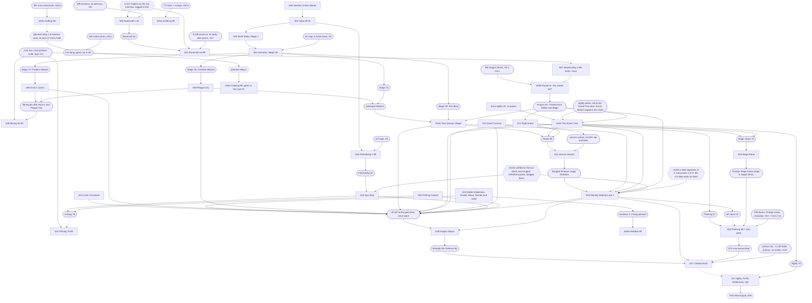

# Run order v2: the scored run, step by step

This page is the scored run's plan: what SCORED does, in which order, where, with which supplies,
and what each step costs in ticks logged in. **SCORED** is the scored account (its real name never
appears in this repository). The hiscores rank by the in-world tick of the last level-up
([playtime-audit.md](playtime-audit.md), "What this means for the run"); the record is 35,916. The
helper side of every hand-off is [SUPPLIES.md](SUPPLIES.md); the scripts that run each step are
[STEP-MANIFEST.md](STEP-MANIFEST.md); the run machine's runbook is [RUN-HOST.md](RUN-HOST.md).

**Version 2** is cairn://p/rs/111's reconciliation of rs/109's v1 (the rs/103 coordinator's
provisional order v1) with five local-engine labs: [run-transitions.md](research/run-transitions.md)
(rs/104: every leg measured, hand-offs, four ordering answers), [bones-placement.md](research/bones-placement.md)
(rs/105), [stun-pack.md](research/stun-pack.md) (rs/106), [wine-window.md](research/wine-window.md)
(rs/107) and [levelup-cost.md](research/levelup-cost.md) (rs/108); plus
[supply-fallbacks.md](research/supply-fallbacks.md) (rs/129), [RESILIENCE.md](RESILIENCE.md) (rs/127)
and main's notes relayed on cairn://p/rs/111. Section 7 lists every change against v1.

**Moves against v1** (step IDs are unchanged): S17 (Agility 75-99) moves from after S16 to the very
end, after S27; S16 now goes straight to S18. The early bones (S10a) and the booth bones (S25b) are
buried inside S07's knife Woodcutting loop, so S10a is retired and S25b's row sits beside S07. S18b,
S18c and S18d (bones, Charge and Fletching in the stuns) are measured inside S18's one figure.

The step IDs are the coordinator's (S00-S27). Splits use letter suffixes and follow the manifest
(S10a Prayer 1-43, S10b Tree Gnome Village; S25a Smithing, S25b Prayer, S25c Cooking, S25d Crafting,
S25e Herblore). Transition legs are `Tff-tt` (from step ff to step tt).

## How to read the numbers

**Wall time at 400 ms (fold-in 28's audit).** The demo has ticked at 400 ms since 2026-10-22 19:56:29Z (RUN-ORDER.md R42), and every figure here is in ticks unless it says otherwise. A wall-time figure that converts to ticks is restated at 400 ms beside its 300 ms value: mule1's timed re-request every 15 s, ~37.5 ticks (~50 at 300 ms); an unanswered request re-sent after 8 s, ~20 ticks (~27); `gated-program.ts`'s 60 s pause, 150 ticks (200); the demo's 0.34-0.37 s ticks of 2026-10-22 ~03:4xZ, a 300 ms-era reading. Every other wall-time figure (engine stalls, relog and restart seconds, refill and ramp minutes, lab wall clocks, the gate's probe minutes, 150 ticks a minute now against 200) is **a 300 ms reading** where it was measured before 19:56:29Z and is dated where it was measured after; the run's wall clock is ticks x 0.4 s (~3.9 h on the row in force).

Every tick figure carries a label and a source.

| Label | Meaning |
|---|---|
| **m** | measured, as the source document reports it |
| **r** | read from a script or engine line, as the source cites it |
| **i** | inferred: derived from m or r inputs, with the arithmetic here or in the source's model |
| **e** | estimated: an allowance set on this page by judgement |

The step table's **Kind** column classes each step's own figure: **M** measured end to end on the
route's method (on the local lab engine unless the source says demo), **I** inferred (a model, or
measured parts assembled into a total), **E** estimated. Section 7 sums the ticks of each kind.
Most lab figures are from the headless lite client against a local engine at 300 ms; the run is the
browser webclient against the demo, which rs/97's in-page figures (M0550) bridge for the reactive
loops. A figure taken only on the lite client says so. **Lab host (main's rule, fold-in 23):** fedora's
lab engine stalls 14-40 s and then resumes 1 tick later, so every measured figure whose runs were on
fedora carries '(fedora)' beside its citation, and a failure seen only on fedora never reverts a row
from m on its own.

| Tag | Source |
|---|---|
| RT§n | [research/run-transitions.md](research/run-transitions.md) (rs/104), section n; leg names (`L07`) are its script ids; every m figure on **fedora** (its 'Provenance of every m figure'; every row of `run-transitions-results.jsonl`) |
| BP§n | [research/bones-placement.md](research/bones-placement.md) (rs/105); measured on **fedora** |
| SP§n | [research/stun-pack.md](research/stun-pack.md) (rs/106); measured on **fedora** (its 'Setup for every figure') |
| RG | rs/199's Ranged module, `speedrun/skills/ranged.ts` (`cannonSession` S14, `combatFinish` S27), measured by `speedrun/lab/measure-ranged.ts`: local lab at 300 ms, staff fixtures, Dwarf Cannon set by varp plus a relog; a 400-tick window is good to about ±5%; lab-accepted, on main as 8a741554 (#212, rs/252's snapshot; PR #207 on rs/186's branch before it); lab is their final tier, since a demo test is not feasible (Dwarf Cannon, Attack 99, the Wilderness); `speedrun/README.md` "skills/ranged.ts" and `docs/speedrun/skills/ranged.md` section 1 on agent/rs-199-builder-0 at 4a99f151; relayed by rs/158 on cairn://p/rs/218 |
| SM | rs/197's Smithing module, `speedrun/skills/smithing.ts` (S25a), m (lab): with a scripted HS5 stand-in, and with rs/188's real anvil helper (`speedrun/helpers/anvil.ts` at ab8b90fb); relayed by rs/158 on cairn://p/rs/218, 18:52 PDT |
| LG | rs/198's legs: `speedrun/runner/legs.ts` over `speedrun/lib/travel.ts`, m (lab), and the demo check (rs/198 via rs/186: cairn_h55 on the loopback gateway on bbs, 05:26-05:29Z; run-transitions.md section 10, on main with PR #238): local Mac, 300 ms, `::tele` to the earlier step's end tile with that step's route stats and items, the clock from the first send to the first state inside the destination, means with runs in brackets. **On main** with rs/291's snapshot, **PR #238** (merge 5a70e4e6; #238, inside the run-commit floor cae93456): `runner/legs.ts` and its test, `tools/demo-legs.ts`, the lab's `measure-legs.ts` and `measure-ardougne-handoff.ts`, `ticks.ts`'s `travel` row kind and run-transitions.md section 10, byte-identical to rs/186's 2dc2dbe8 (PR #198 at 3c6cd2ae before it); the walker itself on main, 0658e896 (#200). **Pricing rule since the demo check:** a door-bound leg takes its closed-door figure for the expected (the demo's state, and safe because other players toggle doors) and its open-door figure for the best; a teleport leg takes the mean over its landing square (a random walkable tile within Chebyshev 2, `teleport.rs2`) for the expected, the demo reading until rs/198's per-landing-tile table (~40 casts over the 5x5 square, now that rs/294's `travel.ts` forcemove fix is on main, #240) gives the true mean, and the lab for the best; relayed by rs/158 on cairn://p/rs/218 and cairn://p/rs/265 |
| WW§n | [research/wine-window.md](research/wine-window.md) (rs/107) |
| LU§n | [research/levelup-cost.md](research/levelup-cost.md) (rs/108); measured on **fedora** |
| SF§n | [research/supply-fallbacks.md](research/supply-fallbacks.md) (rs/129) |
| RES§n | [RESILIENCE.md](RESILIENCE.md) (rs/127) |
| Q§n | [quests/README.md](quests/README.md), section n |
| SK:x | `docs/speedrun/skills/x.md` (section given where it matters) |
| IL§n | [skills/interleaving.md](skills/interleaving.md) |
| TM | [skills/tick-manipulation.md](skills/tick-manipulation.md) |
| MAN | [STEP-MANIFEST.md](STEP-MANIFEST.md) |
| T&O | [research/travel-and-overhead.md](research/travel-and-overhead.md) (rs/59; row n, or the travel matrix) |
| WINE | `docs/speedrun/helpers/wine.md` on cairn://p/rs/41/1/coordinator |
| BONES | `docs/speedrun/helpers/bones.md` on cairn://p/rs/41/1/coordinator |
| HT | [research/competitors/hiscore-timestamps.md](research/competitors/hiscore-timestamps.md) (rs/60) |
| PRIM | [quests/primitives.md](quests/primitives.md) |
| SR | [speedrun/README.md](../../speedrun/README.md) (measured lib costs) |
| ARC | the main thread's arc, cairn://p/rs/main/arc |
| M05xx, M06xx | main's binding notes relayed by the rs/103 coordinator on 2026-10-21 at 05:30, 05:50, 06:02, 06:06 and 06:12; M0550's rates are "rs/97 in-page results via main, 05:50" (wired branch, local engine, visible tab) |
| C#n | comment n on cairn://p/rs/111 (the coordinator relaying main, rs/41, rs/124 and the labs) |
| TWIN | rs/164 on the rehearsal twin, 2026-10-21 20:44-20:52Z, account cairn_smoke, at 3ed0cd49c (merged into rs/147's branch as 4e0e8ae4, the same code; on main as c2d9eada, #146, byte-identical to 4e0e8ae4); relayed by rs/147 at 13:53 PDT |
| F23 | rs/41's supply forecast to 2026-10-23 (15:00 PDT, from bank history and role logs at ~22:00 UTC), its talisman and essence counts from the fleet ledger (15:05 PDT), and rs/123's rune lines; relayed on cairn://p/rs/192 |
| R174 | rs/174's tab-relog fix, measured on the twin against the demo, 21:58-22:08Z 2026-10-21, 1,618-1,629 online, 3 relogs per path, session ticks with login + 1 the first in-world tick (`tab.ts` `reloadOrOpenTab` closes the old page's gateway socket before navigating; `login(s, {inPage: true})`); PR #164, on main as efdbe2e2 (00:14 UTC 2026-10-22, inside the run-commit floor; rs/183's client fix, #155, before it); the relog after an engine kill measured in the lab (16:11 PDT); relayed by rs/158 on cairn://p/rs/203 |
| BA | rs/163's body-altar roster (m, lab, bgsrv-mac, 300 ms, 23:12-23:17Z 2026-10-21, `speedrun/lab/altar-givers.ts --variant=bank --altar=body --cycles=12`; `ROUTE_ALTARS.body` in `speedrun/helpers/altar-room.ts` on agent/rs-163-builder-1 at f604077ba, 2bc114ac3): 12 of 12 tuned turns given, all 8 measurable craft-to-craft gaps 7 ticks; restock round trip (trade given, exit portal, Edgeville bank (3094,3491), 27 essence, the body ruins, back on its tile) **139-142 ticks, mean 140.8, n = 9**, so **N = ceil(142 / 7) + 1 = 22 givers on 23 body talismans** (22 + SCORED's 1, no keeper). That lab bank held no essence, so the givers got it by a staff give (as for the air altar's 91-93); rs/383's restock round trip on real bank withdrawals (`helpers/altar-giver.md` 'Measured', lab, 300 ms, Edgeville bank to the body ruins, 15 of 15 tuned turns, every gap 7): **140-143 ticks, mean 141.3, n = 12**, so N = ceil(143 / 7) + 1 = 22 stands, with 5 ticks of headroom before N = 23 (at 148) (fold-in 23). Relayed by rs/158 on cairn://p/rs/203, 16:17 PDT |
| MP | rs/153's in-page Mining lab via rs/147 (15:46 PDT 2026-10-21), relayed by rs/158 on cairn://p/rs/203: D = 13, Mining 99, the in-page knife 3.00 and the in-page plain loop **4.00** ticks per ore (without `selfStarter`; history since #220, MR) |
| MR | rs/230's Mining module lab (`speedrun/skills/mining.ts`, S09, with knife-mine's `selfStarter` and gated-program's `beforeRestart`): bgsrv-mac, 300 ms, `tickprog-lab.sh`, respawn pinned in content, default stats (combat 3, 10 HP) unless stated, rune pickaxe; `docs/speedrun/rehearsals/mining.md` sections 1-8 on rs/147's branch at 59ec3933 (the findings are not in #220); the module on main as **4235a9e7** (#220, rs/260's snapshot) |
| PB | rs/162's in-page plain and plain + bury lab (cairn://p/rs/162, #165, on main as 3dfc217f): local engine at 300 ms, a visible tab on bgsrv-mac, probe 60/60, rune axe, 600 ticks a run, `::give` top-ups, per-roll figures weighted by the sum of 1/p at each log's level (`tickprog-measure.ts oak\|tav-willow --technique=plain --bury`; `tick-programs.md` "Measured" on #165); relayed by rs/158 at 15:50 and 16:09 PDT 2026-10-21. The trades are not in the figures; "with trades" adds rs/105's 5 ticks per 25-bone load (i). Selection: `technique: 'plain'` with `bury` and `trees` (no new key) |
| DH | rs/176's run-host knife and plain sessions (oak, bronze axe, the in-page knife-cycle at c14428fc5; per-minute catch-up bins and whole runs; `demo-latency.md` section 8, PR into `agent/rs-83-coordinator-0`), relayed by rs/158 on cairn://p/rs/206 at 16:00 PDT |
| RCM | rs/196's Runecraft module lab (local engine at 300 ms, bgsrv-mac, rs/131's in-page `rc-cycle` in a visible tab, 3 production altar givers via `standalone.ts`, **every module run on the relay path**: the lab script set the givers' `path` in role options, but the launcher reads it only from the account entry, so it defaulted to relay; on the loopback lab engine the relay and direct tables are identical, so the numbers stand. **Confirmed on the direct path** for the tuned nature run: auto with givers first chose tuned, 30/30 at 29 x 7, step 218, first craft 7, identical to the relay figure (m, lab, rs/196 at 3b161c12 on its mission branch, the launcher logging `direct` for all 3 givers; relayed by rs/158, 20:43 PDT); **a partial demo confirmation** on the real server, 9 of 9 tuned turns from the twin (rs/196), then **the 20-cycle demo acceptance** (rs/196, the demo via the twin, 12:26-12:33Z 2026-10-22, the air altar, 3 direct givers logged in first, 20 cycles: 20 of 20 given, all tuned and giver-first, 0 missed or late, the first craft +7, 13 of 13 in-batch gaps at 7, step 626; fold-in 22), and the fix, the path from the account entry, is with rs/186; `runecraft.md` section 9 on rs/196's branch), relayed by rs/158 on cairn://p/rs/206 at 16:28 PDT |

**Units of the in-page knife figures.** `knife-cycle`'s old status fields `rolls` and `ticksPerRoll`
counted Woodcutting xp events, that is logs (`server/webclient/src/bot/programs/knife-cycle.ts`:
`summary()` reported `rolls: g.events`, and an event is the skill's xp rising). They were renamed
by rs/159 (#132): `ticksPerSuccess` is per log; `ticksPerExpectedRoll` is per expected roll. Every
in-page knife-cycle "ticks per roll" on this page predates the rename and is ticks per **log**. rs/130's
demo rows (O11) are ticks per **expected roll**: `tickmanip-demo-report.ts` weights each log by the
1/p rolls expected at its level. On oak from Woodcutting 60 with a rune axe, where p is 255/256 or 1,
the two coincide (with a bronze axe they do not: rs/130's oak rows, O11); on
willow at 99 a loop on the 3-tick lattice reads 4.36 per log and 3.00 per expected roll.

**Dialogue column.** The run uses rs/51's blind continues: `continueBurst` in
`speedrun/lib/dialogue.ts`, and the browser webclient's `clickDialogOption(..., blind)` in
`server/webclient/src/client/Client.ts` supports the flag (r). The burst column of Q§1 is mostly
inferred (recomputed or page-modelled). **Since fold-in 14 every quest row's expected is its burst
figure** (main's ruling, 2026-10-21 23:52 PDT, after rs/287's demo validation of burst dialogue on the
lite client: 0 failed bursts in 24, 8.13 ticks a 16-page talk against the lab's 8.00), on its fixed
figure's basis (from the arrival tile, with the same failure budgets, luck adjustments and measured
overruns): the module-measured burst where one exists (S26's three chains, S11b's chain, S13's runs)
and Q§3's burst column less the row's travel otherwise. Best keeps a faster measured case where one
exists (S13, S15, S26) and equals the expected otherwise. **The fixed figure is the fallback if burst
fails** (`continueBurst` drops to `advance`, 1 tick a page): +879 over the quests (section 7's
sensitivity table). No quest has yet run in the browser client; each quest's browser-client acceptance
(O51) runs burst, and a quest whose burst does not hold there reverts to its fixed figure in its row.
The Q§3 rows sum to 11,689 fixed and 10,811 burst with Monkey Madness's expected failures.

**Units of xp.** Every xp figure in these documents is the engine's base xp (game xp / 25 at `NODE_XPRATE` 25) unless it says otherwise; the engine's curve is `Player.ts`'s `levelExperience` (`Player.ts:77-85`, 2^(level/10)), with 99 at 998,458 game xp, 39,938 base. A per-tick rate quoted on RuneScape's 13M scale (for example 'S15 ~2,620 Str xp/tick') is base x 25 x 13.05, about base x 326: ratios between our rows hold on it, absolutes do not, so any such figure is relabelled on sight (rs/272, fold-in 17; none was found in RUN-ORDER.md, STEP-MANIFEST.md or SUPPLIES.md).

## Headline

| | Knife loops on (run gate holds) | Knife loops off all night, with rs/162's plain + bury (**in force**, #165 on main) | Knife loops off all night, without it (history) |
|---|---|---|---|
| **Expected** | **34,793.5**: 1,122.5 under the record | **37,448.5**: 1,532.5 over | 38,242.5: 2,326.5 over |
| **Best** | **32,354.9**: 3,561.1 under | **35,468.9**: 447.1 under | 36,292.9: 376.9 over |

rs/162's plain + bury is on main (#165, merged as 3dfc217f at 23:46 UTC) and lab-measured (PB):
willow passes rs/158's bar at ~0.226 bones a tick with trades, oak falls short at ~0.195 and is
accepted as measured, and Woodcutting is no slower with the bury than the plain loop alone. So on a
gate-off night S07 buries in the willow band (in oak from WC 60 only if the willow band cannot hold
them), and the knife-off column with it is in force (O31, settled). The column without it, with the
bones at the booth (Prayer 735 against 95), is history: it applies only to a `RUN_COMMIT` before
3dfc217f. Both knife-off columns price S07's plain Woodcutting at the in-page rates (PB), not the
lite model: 4,025 with rs/162 and 4,121 without it, against 3,881.

That is with every supply line held. Main's ruling (14:55 PDT): the earliest plausible run date is
**2026-10-23** (more likely the 24th or later), so the row in force prices the time-dependent supply
lines at that date, on rs/41's forecast (F23), and today's stock stays as the conservative row.
Knife on:

| Supply scenario (knife on) | Fallback deltas (exp / best) | Expected | Best | Against the record (exp) |
|---|---|---|---|---|
| **Forecast at 2026-10-23 (in force)**: **380 dragon bones** (rs/41's planning figure, ~450 if funding never lapses; the dragon room's 3 dragons cap it at two accounts, ~14 an hour combined) and ~430 babydragon to 39,938 base (Prayer 99 in S07 since fold-in 23, S18 burying none; 220 to 33,938 before, the ~210 more inside the Prayer line's +50), ~810 non-stun bones in S07 (+64 / +47: +12 against 413 and 141; condition: dragon farming funded and running, rs/41; each dragon bone above 380 removes 2.4 babydragon from S07); 0 nature talismans, so S21 at the body altar on the fleet's 57 body talismans (+143.0 / +143.0, T20-21 on the browser on c4e2a681, rs/308, fold-in 23); the diamonds unobtainable by the 23rd (rs/41): the wine windows cut 107 of the 108 held gems and S25d crafts 928 hard leather bodies (+172: 263 m; on the full 107 gems rs/331 staged, S25d's stop from rs/444's `craftingHandoffXp(gems)`, on main as #362, is the same 928 bodies (rs/359, lab, browser, 3 of 3; Kind M (lab, rs/359) on the leather route) against the diamond basis's 91 i; rs/350's leather line staged for attempt 1, 04:55 PDT 2026-10-22: 1,169 hard leather on cairn_mule1), the herb-table mix (+24 m, rs/302's route on current banks, 191 against 167; fold-in 22), the agility potion not obtainable today, so S11b's laps-to-25 fallback (+37; -37 the upside once one is held, rs/348); forecast complete (0): arrowtips, cannonballs, 365 adamantite bars, essence; the rune axe held | +440.0 / +423.0 | **35,233.5** | **32,777.9** | **-682.5** |
| Every line held: 555 dragon bones, rune axe, the full lists; **since fold-in 23 S07 buries all 555 dragon** (S18 burying none), Prayer 99 at S07's end, so main's hard precondition, combat 43 at S09 (Prayer 95, 30,264.5 base), needs no babydragon (before it S07's 355 left Prayer 92 and combat 42, and **157 more babydragon bones in S07, ~+41 i**, met it; main, 05:2x PDT), which closes R26's unmitigated case here | 0 / 0 | 34,793.5 | 32,354.9 | -1,122.5 |
| rs/41's 09:35 plan (history): adamantite 0 (+119), mixed gems (+88), mixed herbs (+24 m, fold-in 22; +85 then), 2 nature talismans with a keeper (+34), 2,070 adamant + 570 rune arrowtips (0); 555 dragon bones and the rune axe held | +265 / +265 | 35,058.5 | 32,619.9 | -857.5 |
| **Today's stock (conservative)**: **since fold-in 25, rs/383's staging on the 17:52Z stock: 251 dragon (h55 88, h56 126, h61 37) and 729 babydragon to 39,938 base, 980 bones, 964 in S07's 42 loads and 16 on the Mining `stay2` lap (H4m), +108.2 / +72.6** (S07's 409 past 555 at 6/23, best 4/23, and the lap's 16 at ~+3 i; 238 dragon at 10:43 PDT); before it, rs/331's per-account bank reads (08:48-09:56Z): 172 dragon and 1,533 babydragon (2,526 big unused); S07 takes every dragon bone, then babydragon to 39,938 base since fold-in 23 (S18 buries none): 172 + ~919 = ~1,091 bones, ~978 of them in S07's ~43 loads (Prayer 96+ at S07's end) and ~113 on the Mining `stay2` lap, inside the Prayer line's +50 (to 33,938 before: 891 bones in ~39 loads, the stuns 200 + 20 spare): ~+88 against fold-in 17's 554 at ~0.26 a bone (+140 / +123 in all); 0 nature talismans, the body altar (+143.0 / +143.0); the 09:35 plan's adamantite 0 (+119) and herbs (+24 m, fold-in 22), the gems (+172) and the agility potion (+37) as in force; the rune axe held | +603.2 / +567.6 | **35,396.7** | **32,922.5** | **-519.3** |
| History, the 21:20 UTC count: today's stock with the ~85 at the booth instead: the Mining bury cannot fire (iron respawning slower than 13 ticks, or a run commit without #159) (+339 / +284) | +834.0 / +779.0 | 35,627.5 | 33,133.9 | -288.5 |

(i: section 7, "Supply fallbacks"; every delta is SF's line re-priced on this order.) **In force,
on rs/41's forecast for 2026-10-23, the knife-on expected is under the record: 35,233.5, 682.5 under
(1.9%)**; best clears it by 3,138.1, and with every line held the expected is 1,122.5 under (3.1%). **Fold-in 30 adds 5.0** (S20 browser-accepted on the twin's lab, 319 against lite's 314, and off the burst-fails line; best +5; section 7, 'Changes since b313d34e'). **Fold-in 28 takes 60.6 off** (S13 on the browser basis -15.1, S12 browser-accepted +1.2, H12o's two legs +8, S11b browser-accepted -37, the relog before S21 +2, S03 at 400 ms on the demo -19.7; best -125.0; section 7, 'Changes since 3416f5e5'). **Beside the record, the competitor bar** (fold-in 28): their clean figure, about 27,000-29,000 on their self-report (e), is the bar, under our row in force by about 6,200-8,200, so **our run beats only the current 35,916 record, not a clean rerun by them** (section 7; the 300 / 400 / 600 ms readings history). If attempt 1 runs before the 23rd, the row that applies is today's stock, 519.3 under.
Fold-in 15 had moved it over (36,153.5, 237.5 over: Dragon Slayer, Dwarf Cannon and Monkey Madness
measured; section 7, "Changes since d9b3fa9b"). **Fold-in 14 brings it back under**: on main's ruling
(2026-10-21 23:52 PDT, after rs/287's demo validation of burst dialogue on the lite client) every
quest row's expected is its burst figure, -879, with Dragon Slayer's burst measured (1,334 m, three
chains). **Fold-in 17 takes a further 97.2 off** (S13 on the railing recount -104, S15's segment X and Q to S -3.2, S06 +2, Magic on the browser client +8; section 7, "Changes since 4a4699fa"). **Fold-in 18 takes 45.0 off** (the slot fixes' three new trades +15, S15's segments T and U measured -4 and -46, S13 on Dwarf Cannon's acceptance -10, J's door regression in it; section 7, "Changes since ab7bb6e9"), and the in-force row's diamonds become the wine windows' held gems and S25d's hard leather, +89 (+177 against +88: diamonds are unobtainable by the 23rd), its bones rs/41's 380 dragon (+12), and its agility potion, not obtainable today, S11b's laps-to-25 fallback, +37 (rs/348). **Fold-in 19 adds 62.0** (S15's atoll half measured end to end, its fixed row built from its parts, +128; S13's J on rs/343's door fix -25; S26's pinned rerun with the amulet drop -41; section 7, "Changes since cd34aa5e"), and the in-force row's hard leather is measured, -5 (+172 against +177). **Fold-in 20 adds 14.7** (T05-06 on its browser figure, 75.7 against lite's 61, rs/196; section 7, "Changes since 86e2a96c"), and the in-force row's body altar 1.7 (T20-21 on the browser, 71.0 against 69.3). **Fold-in 22 adds 72.4** (S20 on the self route, the helper carp being untradeable, +142; S10b measured -61; S07's end on the 0-tick path with fleet snapshot 4, -5; S25e -3, S25c +1, H17e -1 and the legs on rs/308's browser figures -0.6; section 7, "Changes since 63b27df3"), and the in-force row's herbs are measured, -61 (+24 against +85), and its body altar takes rs/308's browser T20-21, +3.7: the row in force moves +15.1. **Fold-in 23 takes 136.6 off** (S20 measured on the self route +14, Monkey Madness's segment G measured -62, Fight Arena measured +8, T05-06 on the browser on #321 -9.6, Charge + Superheat in the expected -58, T16-18 to S18's anchor +8, Mage Arena's A-F -36, Plague City -49, the legs on the browser +44.3, Sea Slug +3.7, H12's second trade +5 and off again with H11r's two-way swap; section 7, "Changes since 15cff9ee"), and the in-force row's body altar takes T20-21 and T21-22 on the browser, -5.4 and +1.0: the row in force moves -141.0. **Fold-in 24 adds 45.6** (S19 on the browser +0.3, S26 on the browser +45.3; section 7, "Changes since 9f873c9e"), and the row in force moves +45.6. **Fold-in 25 adds 25.7** (S24 on the browser +20, S15's rope pin on its measured recovery +5.7; section 7, "Changes since 87bf166e"), and the row in force moves with it (+25.7). **Blood runes are complete for attempt 1** (rs/41, 12:15Z: rs/372's chest delivered 184 to cairn_mule1, handover rs372-mule1-blood-1, so mule1 holds **640: S16 70, S18 570**, attempt 1's full 570 plus 70 toward attempt 2), so S18 has full Charge and the blood-rune shortfall sensitivity is closed for attempt 1; the 22:00 PDT count rule applies to attempts 2-3 only, where the budget holds down to ~259 held (i, rs/367's curve, S16's 90 reserved first; ~250 at fold-in 24, ~236 at fold-in 23; section 7). Charge + Superheat in every stocked stun is in the expected since fold-in 23 (-58: S18 +17, S07 +50, S25a -125; main's ruling); Superheat off would put the row in force at 35,291.5, 624.5 under. **If burst fails on the night the quests not yet browser-confirmed revert to their fixed figures, +412.0** (S15 +351, S16 +32 and S08 +29, by script; S20 off it since fold-in 30, S12 and S11b since fold-in 28, S05, S23, S24, S10b and S13 since fold-in 25 and S19 and S26 since fold-in 24, browser-confirmed; +425.3 at fold-in 28, +554.6 at fold-in 25; +655.8 at fold-in 25's first statement, +738.8 before fold-in 25, +803.4 before fold-in 24, +819.8 before fold-in 23's S16, S08, S19, S05 and S23, +851.2 before its S20 and S12, +864.2 before fold-in 22's S10b, +881.5 before fold-in 19), and the row
in force is **35,645.5, 270.5 under the record** (fold-in 30: S20 off the line, browser-accepted; 35,653.8, 262.2 under at fold-in 28, S12 and S11b off it; 35,843.7, 72.3 under at fold-in 25, the first time under; fold-in 24: 36,002.2, 86.2 over). The validation ran on the lite client, so each quest's
browser-client acceptance (O51) runs burst, and a quest whose burst does not hold there reverts in
its row (section 7, "The statement and the go/no-go figure"). The forecast's bones are an assumption
until rs/112's firm forecast (due 16:00 PDT): ~14 dragon bones an hour from 22:00 UTC on the 21st
to a run starting at 00:00 UTC on the 23rd, 49 + 364 = **~413**, with 341 babydragon to reach
Prayer 99. All 554 non-stun bones then fit S07 (+52), and the ~110 dragon bones forecast for
tonight already close O35 with no code. Each dragon bone fewer than 413 costs ~0.37 (0.24 best),
down to ~110 held (section 7, "The forecast at 2026-10-23"). The new cost is the nature talismans:
rs/41 holds none (a GE bid of 6 at 30,025 has never filled), so S21 moves to the body altar, +143.0
(SF§7's +231 of crafts, less the body route's shorter legs, measured by rs/198, LG, T20-21 on the browser by rs/308 on c4e2a681, fold-in 23), on the fleet's 57 body talismans (F23), with 22 givers on 23 body talismans and no keeper (m, lab, BA); main made it the S21 plan at 15:17 PDT. The nature altar is
a sensitivity row only: with the keeper, 2 or 4 or more nature talismans would save 109.0 or 143.0, but
it needs ~52 tick-exact givers on the run machine (rs/163's measured ~355-tick round trip) and at least 30 fleet accounts logged out under the
80-login cap (O38). rs/194 (16:35 PDT) holds none but projects ~4 by midday on the 22nd and ~10 by
the 23rd (i, a farm measured at ~0.25 an hour), so 4 or more now look likely by the run date; the
open conditions are main's (17:07 PDT): rs/194 holding 4 or more talismans before the run's eve, and the
~65-client giver-load check passing (O41). Adamantite (365 by ~12:00
UTC on the 22nd), the arrowtips, the cannonballs and the essence are forecast complete; diamonds
(+172, the wine windows' held gems and S25d's hard leather, 263 m) and herbs (+24 m, the herb-table mix measured on current banks) stay deltas.

**Today's stock (conservative)** keeps the 21:20 UTC bones and, line by line, the worse of rs/41's
09:35 plan and today's count: **519.3 under the record (1.4%)** on rs/383's staging of the 17:52Z stock (251 dragon and 729 babydragon: S07 takes 964 bones in 42 loads and 16 ride the Mining `stay2` lap on H4m since fold-in 25; on rs/331's bank reads before, 172 dragon and 1,533 babydragon at 09:56Z, ~978 and ~113 since fold-in 23, 891 and none before). The rest of this paragraph is on the 21:20 UTC count, history. On that stock 49 dragon and 1,214
babydragon reach Prayer 99 with ~197 babydragon to spare, so another babydragon bone is worth ~0.
S07 holds 978 of the 1,063 non-stun bones; the other ~85 ride the Mining `stay2` lap on
`knife-mine`'s bury, on main since #159 (15:52 PDT; O35 closed by its option (a), and a run-commit
requirement). If the bury cannot fire, because iron respawns slower than 13 ticks or the run commit
lacks #159, they go to the booth: +119, 178.3 under (history), and another dragon bone is then worth ~2.9 until
~61 more are held (section 7, "Today's stock").

The knife gate failing all night adds +2,655 with rs/162's plain + bury, in force (+3,391 without
it, R2; S09's plain fallback is the in-page plain loop with `selfStarter`, 3.62 ticks per ore
measured at D = 13, MR, and S07's the in-page plain rates, PB). **Monkey Madness's bad case beyond
its expected, ~+261.3 (one rope pin at ~392 on rs/201 exec 7's measured recovery, 130.7 of it in the expected; ~+250 before fold-in 25; i; rs/185, 00:38 PDT: the Jungle Demon passed 3 of 3 clean on 200
arrows, so its 120 is retired, R5), puts the row in force at 35,494.8, about 421.2 under**, and today's
stock at 35,713.6, 202.4 under; S13's railings at
p90 (+~150 on the recount) alone would put the row in force at 35,383.5, 532.5 under. S15's atoll half, H
to Z, is measured segment by segment, 3 of 3 each (H to P end to end, 2,425 m, rs/201; X 323.8 over five kills; Q, R and S 625
chained; T 120 and U 319, fold-in 18; V 14, W 96, Y 175 and Z 73, fold-in 19), so none of S15's burst 4,425.8 is estimated (its
fixed 4,776.8 is built from the parts, 4,170.8 m for H to Z and G's 91 m (fedora), fold-in 23), and
**S15 is the critical path for the run date** until it chains A-Z clean on its kit: chain 1 of 3 measured the gnome half with the rest (A-G 490 against the row's ~480 i, H-Z 4,174 against 4,170.8 m) but failed the kit gate, all 15 sharks eaten and HP down to 6 (fold-in 24; R37; O36; section 7, "Monkey Madness after H to P").
A relog from SCORED's tab is back to about **2 ticks** (m, R174): the ~20 that TWIN measured was the
old page's gateway socket outliving the navigation, which rs/174 now closes first. The two planned
relogs and the expected restarts give back the +63 / +36 fold-in 3 added and 2 more (section 7), a
demo restart costs about 5 (R7), and the wine's login + 19 deadline is met at login + 3 to + 6 (R17, now
low-likelihood). If the wine failed outright, the fish route (+~927) would leave the run ~306.8 over the record
on the row in force (~471.9 over on today's stock, ~700.8 with its bones at the booth). The in-page willow
question is settled (O19, section 9): rs/97's 4.83 ticks per log was the server's chop RNG at level
99, not the client, so S07's willow knife takes the lite ratio, and its knife is now measured on the demo (rs/261's cairn_chops): the luck-free 3,053
against #129's 3,390. The biggest open swings are the knife gate itself (R2, O11), S15's unrun atoll
half (O36), burst dialogue on the browser client (O51) and S13's railings (section 7).

## 1. Run-machine setup and the run gate

The run is first person: SCORED's browser webclient in a visible tab on **the run machine**, the
Ashburn machine chosen at the gate (RUN-HOST.md step 5a, "Choose the machine"), the
game socket direct to the demo (`?server=`), the SDK overlay on a loopback gateway (`?gateway=`) for
the non-reactive steps, and in-page tick programs (cairn://p/rs/97) for every reactive loop (the knife
loops, the pickpocket re-click, Agility obstacles) (ARC).

**Tick-exact helpers on the run machine (M0602, M0612).** The helpers whose packets must land on
predicted ticks beside SCORED run on the run machine, SCORED's own, not on bbs (main's plan of
record, 16:35 PDT; RUN-HOST.md step 4): the altar givers of the 7-tick
Runecraft cycle (S06, S21), the trade giver that serves SCORED's hand-offs, and the wine giver (S25c;
the same account as the trade giver). They run through the launcher cairn://p/rs/117 (under rs/41):
a loopback gateway, lite runners with the #78 relay fix, **helpers logged in before SCORED**, clean
logout, independent of `fleetctl`, documented in HELPERS.md. The altar givers follow rs/117's cue
contract (cairn://p/rs/97/messages, 04:59), with every cue scoped to its step and helper family
(R38; MAN entries 9 and 33). Everything else in the fleet stays on bbs. SUPPLIES.md
marks every giver's host.

**Setup (M0550; two run-capable machines since 2026-10-21, tenet 17).** Two identical AWS
c7i.2xlarge machines in us-east-1c (8 vCPU, no GPU, Ubuntu 24.04, XFCE over xrdp) are kept
run-capable with the same RUN_COMMIT, gate history timer, reservation, recording and live view:
rs-ashburn-run (the run host) and its twin (cairn://p/rs/tenets/17, approved 17:44 PDT; addresses:
cairn://p/rs/host). The run starts on whichever passes the gate immediately before the start, and
rehearsals pause during the gate and the run. [RUN-HOST.md](RUN-HOST.md) is their run-night
runbook, with every command. In order, steps 0-5 on **both** machines:

- reserve each machine before anything else starts: step 0 writes `~/host-reserved.json` (owner the run,
  `until` covering setup, the 9 h run bound and an hour's margin), so every firing of rs/83's gate
  history timer (rs/140) skips; the timer is never disabled instead. run.ts refuses to start unless
  the reservation is live and its own, and removes it after the final clean logout (RUN-HOST.md,
  "Host reservation" and "Gate history timer", cairn://p/rs/139; main via rs/103);
- check Fly edge iad and TCP connect p50 of at most 5 ms;
- the operator connects over RDP at a fixed 1920x1080, 24 bpp, only to create the session and watch
  the bring-up, then disconnects for the rest of the run and watches a 3 fps MJPEG live view (one
  desktop session per user: disconnect, never log out);
- start the page server, the tab's loopback gateway and Chrome under `tmux -L run`. Chrome gets its own
  profile, tenet 12's three throttling flags and a maximised app window, and stays maximised and
  unobscured on display :10 for the whole run. Every launch on the host is reaped by its own hard
  timeout (9 h for the run), so nothing depends on an agent or a person being alive to stop it;
  teardown still stops everything explicitly. Chrome opens a bare page and is logged in by a
  one-time token, so no password is ever on a command line (cairn://p/rs/138, on main since #120,
  96fc462a; no real account's credentials, fleet or SCORED, go on either machine before its
  `RUN_COMMIT` includes it; RUN-HOST.md, "Credentials");
- log the opening roster in on each machine: S06's 7 air-altar givers (RUN-HOST.md step 4);
- start the recording on the VM (ffmpeg x11grab, 1920x1080, 30 fps, libx264 veryfast crf 20);
- check that nothing else runs (the leftover check does not count the gate history timer's
  `rs-gate-read.service`, and waits out a firing in progress);
- **choose the machine** (RUN-HOST.md step 5a): measure the gate on both machines in the same
  minute, each on its own throwaway gate account, in the run's configuration (RDP disconnected,
  recording and live view on, the opening roster in). Start on the one that passes; if both pass, on
  the run host unless the twin's read is clearly better in that minute (the run host at the margin,
  the twin at 60 of 60 with at most 1 catch-up a minute); if neither, no start. Only reads taken
  after a machine's last address change count. Record both reads. On the other machine the 7 log
  out and rehearsals stay paused until the run's teardown;
- on the chosen machine, log the rest of the roster in before SCORED (R12), and hand over from the
  gate to the run: the gate tab logged out and closed, the run tab alone on the recorded display,
  the recording already running, and a live frame of the capture showing the run tab, which is a
  pass line of the gate (main, 18:16 PDT; R20);
- only then open SCORED's tab. SCORED already exists: it was claimed with the tutorial skip and
  parked at 8 ticks (main's arc, 08:40 PDT), so this is its first login of the run, not its first ever;
- the bbs roles the run uses are online, every other fleet account is logged out (tenet 16), and
  H1-H5 are staged before that login.

Gate (d) was measured on the run host on 2026-10-21, before its address change, at about 1,700
online, and on the twin at 70.8 / 72.0 / 72.9 (m, RUN-HOST.md "Measured"). The tab's loop-rate p10 was 70.6-73.3
per second with RDP connected or disconnected and the capture on or off. The capture costs about
0.75-0.95 of a core. Chrome was not throttled with RDP disconnected. The recording is smooth only
disconnected: 29.9 fps against about 23 fps connected (m, RUN-HOST.md, "Measured"). Hence main's
configuration: RDP disconnected for the run (10:02 PDT 2026-10-21), now tenet 12 (approved,
cairn://p/rs/tenets/12), which supersedes tenet 11's "remote desktop connected".

**The run gate, and the knife switching rule (tenet 12; M0530, M0550; ARC).** The knife is on only
while the gate holds, measured from the tab on each candidate machine before the start
(RUN-HOST.md step 5a) and on the run machine during the run:

| | Condition (tenet 12) | Source |
|---|---|---|
| (a) | direct in-page probe at least 58 of 60 reactions on the next tick, at the real player count | rs/86, rs/96, TM "Run-time host gate" |
| (b) | state-publication interval p90 over the probe minute: **reported, not a pass line** (in tick periods at 400 ms: **rs/471**, host's, pending) | tenet 12; rs/83, rs/102; rs/471 |
| (c) | **at most 2 catch-up ticks per probe minute**. A catch-up is an interval under 150 ms immediately after one over 350 ms, counted from raw frame arrivals with no grouping (`CATCH_UP` in `speedrun/lib/hostgate-verdict.ts`, r). Failing (c) means re-measure; in tick periods at 400 ms, **rs/471** (host's, pending) | tenet 12; rs/471 |
| (d) | tab loop rate p10 at least 50 loops per second (measured ~72 on the run host, RUN-HOST.md "Measured") | M0550; tenet 12 |

Otherwise the step runs its plain loop and re-probes periodically. `HostGate` in
`speedrun/lib/hostgate.ts` does the probe, the measured-ticks-per-drop switch, re-probes while off and
the observed-slip trigger, and `speedrun/lib/hostgate-verdict.ts` now carries (b)-(d)
(`tickSteadiness`: p90, catch-ups per minute) (r). Predicted loops keep an in-run fallback and resync
on observed slips (ARC).

**In-run pause rule (rs/102, C#9).** A reactive or knife step pauses when catch-ups exceed about 5 per
minute and resumes when they fall under 1 per minute. A severe burst (at least ~10 catch-ups a minute
for 2 minutes) raises `restartLikely` in `speedrun/lib/demo-status.ts`; the response is the same pause,
not a save (RES§3).

**Start time.** It is chosen by the gate, measured on the run machine over 3-5 minutes (450-750 ticks at 400 ms), not by the
clock (tenet 12, C#9). (fold-in 25 execution 2: the gate failing on both machines since ~16:00Z is R41, the top risk row; the start plan is readiness, not the clock) rs/102's overnight series (24 Ashburn samples, 02:43-12:30 PDT; m,
`docs/speedrun/research/demo-latency.md` section 9, "Overrun bursts overnight", on
`agent/rs-83-coordinator-0`) found three regimes: **calm** (at most 2 catch-ups a minute) in 18
samples, 971 of 985 reactions on the next tick; **simmer** (2-10) in 1; **severe** (10 or more) in
5, 212 of 300. Each severe burst was seen in one sample, so each is bounded above at 12-65 minutes;
simmer stretches can last hours (08:36-11:36). No hour is clean in advance, and the player count
correlates only weakly with catch-ups (r = 0.20). 4 of the 5 severe bursts fell within 40 minutes
before a restart (i, from two restarts). The calmest window was 12:02-12:21. So the start is picked
from rs/140's gate history on both machines (RUN-HOST.md, "Gate history timer"; on the twin it is
enabled only on run night) plus a fresh read on both in the same minute, which also picks the
machine (RUN-HOST.md step 5a; R19).

**Start conditions (main adopted rs/129's policy at 09:30, C#15; SF "Recommended policy").** Main's
ruling of 14:55 PDT prices them at the earliest plausible run date, 2026-10-23 (F23).

- **Hard (main, 04:5x PDT 2026-10-22; fold-in 20):** no scored start until Monkey Madness chained A-Z
  passes **the kit gate**: 3 clean A-Z chains off fedora with exactly the kit, then once on the browser client, each ending its last eating segment with at least 1 shark unused and HP never below 10 (main, fold-in 23); if rs/201 shows no antipoison drunk in any chain, the antipoison(4) comes out, the 16th shark goes in, and the gate re-runs on that kit (section 7, beside burst dialogue's browser acceptance; R37; owner rs/185, rs/201's executions 4 and 5). **Not met: chain 1 of 3 failed it** (fold-in 24; rs/201 execution 5: all 15 sharks eaten, the last in R, and HP down to 6 in O and 9 in P); the remedies, in order, are section 7's sensitivity row on S15 (R37).

- **Hard (main, 06:0x PDT 2026-10-22; fold-in 22): met on c4e2a681** (fold-in 23): rs/309 on the run-commit
  floor as #321, with T14-15 passing 3 of 3 on the browser client (178-181, rs/309; R39, closed).

- **Hard:** Prayer xp in hand of at least **39,938 base**, in any bone mix (dragon 72, babydragon 30,
  big 15 per bone). At rs/41's 21:20 UTC count (49 dragon, 1,411 babydragon, ~3,100 big) dragon and
  babydragon alone meet it: 49 dragon (3,528) and 1,214 babydragon (36,420) make 39,948, with
  **~197 babydragon to spare** and no big bone needed. The bones are a tick cost, not readiness:
  +52 on the forecast at the 23rd (~413 dragon, assumed), +220 on today's stock with the Mining
  bury (#159), +339 if its ~85 go to the booth (section 7).
- **Hard:** a cannon set and about **1,270 cannonballs**: S27's hand-off and gate of 1,200 and S14's ~70
  of its 100 (RG; SF§9 had ~1,170): **met**. cairn_h92 holds two sets and 1,416 balls (F23), ~146 spare.
- **Budget item:** the rune axe: **held** (rs/41, 13:10). Without it Woodcutting would cost +394
  (adamant) or +848 (mithril) with the knife (+536 / +1,154 plain), which no other purchase recovers
  (SF§13 re-priced, section 7).
- **Supply lines at the 23rd (F23).** Forecast complete, 0 in the row in force: rune arrowtips (570
  of 570 now), mithril (h76's 750 complete; h91 buying ~735 at ~450 an hour), adamant (1,220 of
  2,070 at ~190 an hour, complete ~09:30 UTC on the 22nd), the cannonballs (above), adamantite bars
  (~107 at ~30 an hour, 365 by ~12:00 UTC on the 22nd), rune essence (63,674 in the fleet ledger
  against the body plan's 5,238), cosmic and death runes (banked, rs/123). Still deltas in the row
  in force: diamonds (unobtainable: the windows' held gems and S25d's hard leather, +172), herbs (complete, the herb-table mix, +24 m on current banks), nature talismans (0 held: the
  body altar, +205) and the dragon bones (+52 on the assumed ~413). Still to buy, at no tick cost
  if bought before the start: air runes ~1,400, earth 45, law 49 (blood runes complete for attempt 1: 640 on cairn_mule1, S16 70
  and S18 570, rs/41 12:15Z) (SUPPLIES.md, "Status by hand-off").
- **Hard, per address (fold-in 28, main 13:3x via rs/158): the operator's per-IP cap is 50, with 45 the working cap** (ruled: main accepted rs/41's address map at 14:1x, fold-in 30; tenet 16's successor), so the count that matters is per address; on R12's late-login order the peak per address is 25 at the start and 26 at S21's ramp (m, rs/41's address map, 20:59-21:07Z), not ~49. Before: **(cairn://p/rs/tenets/16, approved 17:43 PDT; main's working cap): simultaneous demo logins,
  summed across both Ashburn machines and every other host, at most 100, with a working cap of 80**,
  counted before SCORED logs in; anything still logged in on the machine not chosen counts (its 7
  opening givers log out and its rehearsals pause, RUN-HOST.md step 5a); fleet accounts not
  needed during the run are logged out (RUN-HOST.md step 7; SUPPLIES.md, "Peak concurrent
  logins"). The server's operator caps simultaneous connections at 50 per address (100 before; ours 45, ruled), and spreading across
  IPs to evade it is what gets accounts banned. The S21 givers log in after SCORED's pre-S21 logout since fold-in 28 (~3.5 wall minutes through the limiter, off SCORED's clock) (R12's late-login order; O38's earlier settlement superseded), so the families logging out after S03, S04, S06 and S07 bring the peak per address down to 25 at the start and 26 at S21's ramp (m, rs/41). The gate minute holds 16 on the two machines
  (7 givers and a gate account each).
- **Met (main 15:1x via rs/158; fold-in 28): rs/485 on the floor** (#398, c7eae140, inside the run-commit floor, d4a75da9 since fold-in 30; 0 ticks: the SDK walk now waits for the scene): on the browser client a `bot.walkTo` started during a scene rebuild fails 'Stuck at' without moving (rs/310, m, n = 1), and run-path steps call it, Runecraft's altar entry first (rs/186's list; R29), so the scored run does not start on a `RUN_COMMIT` without it.
- **Hard, pending (main 15:3x via rs/186; fold-in 30): S21's two launcher conditions** (owner rs/491, under rs/41; run.ts's lab checks for both in rs/490, under rs/186, on rs/393's run.ts work as landed on rs/186's branch, d546dd61; on the floor's pending list, MAN entry 0): **(a)** with the cued helper families deliberately logged out, `standalone.ts`'s 'helpers ready' counts 'waiting for cue' as ready; without it S21's givers all get the robust schedule and run.ts's start gate refuses; **(b)** the launcher logs a giver out on an `{S21, altar}` segment stop; without it S21's hand-back finds no runes-only giver. Neither is met until rs/491's change is deployed and rs/490's lab checks pass.
- **Budget:** start only when the expected total plus the fallback deltas in force is under 35,916
  (the scenario table above: 35,233.5 on the forecast row in force, 35,396.7 on today's stock, **both
  under it on fold-in 30's figures**, every quest at its burst figure and S18 on Charge + Superheat in every stocked stun (blood runes
  complete for attempt 1; Superheat off, +58 i, 35,291.5; for attempts 2-3 it stays under down to ~259 held, i, section 7's
  blood-rune table); if burst fails on the night (+412.0, S20 off it since fold-in 30, S12 and S11b since fold-in 28, S05, S23, S24, S10b and S13 since fold-in 25) they are 35,645.5, 270.5 under, and 35,808.7, 107.3 under, so each quest's browser-client burst acceptance, O51, is part
  of the condition); otherwise wait, and main decides the bet.

## 2. Step table (a)

"Expected" and "best" are the step's own ticks (the skill or quest figure, its own refills included
as its source counts them). Leg rows carry the **whole leg**, from the earlier step's end tile to
the next step's start tile, and **travel into a quest is priced wholly in its leg row**: each quest
row starts at its arrival tile (O6, settled; `speedrun/runner/legs.ts` owns the way in). Where a
quest document counted its own way in, the quest row is that document's figure less the arrival, and
the leg row carries the measured leg: RT's, or rs/198's lab figure (LG) where RT had none or differs
by 2 ticks or more. The allowances (hand-offs outside the figures, level-up pages not in
them, contention, overrun share, relogs, restarts) are in section 6 and the totals in section 7.
Hand-off IDs (H1-H23, H4.x, H4m.x, H14.x) are SUPPLIES.md's; helper scripts are MAN's HS1-HS8 (section 4 there). "Unsafe" means a logout there loses progress
(Q§4 and the step's own document); every other boundary is logout-safe, and logout is always refused
within 16 ticks of combat (m, PRIM §8). Quest state after a restart is read through rs/114's
`speedrun/lib/quests.ts` (`questStatus`, `questStage`, `readQuestStage`, `requireQuestStage`, `questDone`, `questPoints`; stage tables in `speedrun/data/quest-stages.ts`; [quests/quest-state.md](quests/quest-state.md); on main, PR #123);
each step's resume entry is in MAN.

No amulet of glory is used anywhere: rs/123 found charged glories unobtainable, and every leg below is
RT's measured no-glory method (RT, "No amulet of glory").

| ID | Kind | Where (tiles) | Step | Levels | Expected | Best | Supplies in, items out | Helper, hand-off | Login / logout-safe | Fallback if the fast path fails | Risks |
|---|---|---|---|---|---|---|---|---|---|---|---|
| S00 | M | Tutorial Island to (3222,3222) | first login and tutorial skip: **done** | - | 8 m (SCORED claimed and parked at 8 ticks, main's arc 08:40 PDT; tally row 58) | 8 m | starter kit: tinderbox, bronze axe, net, pickaxe, 9 other starters and 5 rune types (T&O row 1) | none | done; the run starts at the next login | - | the 8 ticks are on SCORED's clock already; **Precondition: a loopback gateway, enforced** (rs/287, m, demo; main, 23:52 PDT): an env without a loopback `GATEWAY_URL` silently drives the client through the demo's public relay, and S00's guide talk can miss `tutorialSkip`'s 12-tick window. rs/287's fresh throwaway failed that way ('the guide did not answer within 12 ticks', aborted before any talk, with a clean logout): its env had no `GATEWAY_URL`, the first socket closed and reconnected, the first state came at client tick 62 and one logout click was refused; with the same account, start.ts and client the retry on a loopback `GATEWAY_URL` passed (first state at tick 2); which action was lost is not established. Five rehearsal accounts passed S00 on the demo the same night through rs/147's harness. SCORED is never on the relay (tenet 12): fleet.ts and standalone.ts refuse other gateways, the run-night checklist and run.ts assert it, RUN-HOST.md step 3 checks the scored env (fold-in 12, rs/256), HOST.md's env template carries a loopback `GATEWAY_URL`, and **on the floor** `openSession` refuses a demo world without a loopback or direct gateway (rs/312, #250, 7cc8afac; `allowRelay` is a warned opt-out that no caller uses). Not a risk row; the retry-the-talk fallback is dropped. SCORED's own S00 is done, so this governs the rehearsal and gate accounts' skips |
| S01 | M | (3222,3222) | hand-off H1 | - | 8 m (RT§3 (fedora): 4 for 1 noted stack, 8 for 23, 12 of 12 at this tile; H1 is about 5 stacks) | 8 m | in: H1 (staff of water, cosmic, fire, air and earth runes; **no rings**: the starter kit leaves about 10 free slots) | trade giver (Ashburn, rs/117), requesting before SCORED logs in | **run login 1**; safe | stock trade, 9 m (PRIM §6) | the starter junk (12 items; the tinderbox stays) is dropped during T01-02 (a drop keeps the walk queue, T&O row 2) |
| T01-02 | M | (3222,3222) to the coop gate (3235,3295) | run, 1 gate; SCORED drops the starter junk, the 2 body runes and the starter's water runes (the staff of water, held from H1, covers every water cost; H4's and S06's slot rules, S05 and S06) | | 50 m (RT `L01` (fedora): 51, 49, 49; 51 on the demo, within the bar, m-demo, LG) | 50 m | | | safe | | |
| S02 | M | Lumbridge chicken coop (3233,3295) | 4 Wind Strikes | Magic 1-7 | **20.3 m (pre-rs/411; browser client, lab)** (rs/285, m, a cold arrival from S01's tile, 3 runs: 24, 20, 17; fold-in 17): the run's client adds up to 6 over lite, a late first strike after the landing and an occasional missed click label (one 6-tick gap for a 5), R29's fault 2 on a cold arrival; the lite figures stay as the source: 14 m before (lite client and demo; rs/285's module, the mean of five runs: 12, 12, 12 and 17 in the lab and 17 on the demo, cairn_m01 on the twin, 06:35Z, ~1,790 online, 4 strikes and 700 game xp to level 7, m-demo; the step's length is set by the damage rolls, 3 strikes or 4, not by the client): three Wind Strikes reach Magic 7 in 12 ticks when the hits are big enough, since 582 game xp needs an average of ~7.8 base a strike (5.5 on the cast and 2 a damage, `player_magic.rs2:170`, at `NODE_XPRATE` 25, `speedrun/lib/xp.ts`, on the engine's own curve, `Player.ts` `levelExperience`), and a fourth otherwise, 17; the step stops at 7 and drops the 11 mind runes at its exit (`dropAtStrikeExit` in magic.ts, which also fires on a resume that finds the goal already met, and fired on the demo too; H4's slot rule, S05); +10 for a fifth strike after misses (section 7 sensitivity); the demo acceptance on cairn_m01; 18 m before, SK:magic §1) | 17 m (browser client, lab; 12 m on lite before) | starter-kit air and mind runes | none | safe | any attackable NPC nearer the landing (O3) | Wind Strike leaves its 5 level-up pages open: a blind burst on the next label (LU§4, section 6); **auto-retaliate off** at every login, relog and resume (#361, `lib/session.ts`; the module attacks explicitly; fold-in 28) |
| T02-03 | M | coop to the row's start beside it ((3240,3296) in rs/198's lab; no Firemaking module fixes the row start yet) | walk; the 11 mind runes are already dropped at S02's exit (`dropAtStrikeExit`, magic.ts; H4's slot rule, S05) | | 4 m (rs/198, m (lab), LG: 4, 4; RT§9 inferred 5) | 4 m | | | | | |
| S03 | M | open ground beside the coop, a 157-tile snake (SK:firemaking §1: any open ground) | Firemaking, tinderbox line, highest tier | Firemaking 1-99 | **661.3 m (demo, T=400)** (fold-in 28: rs/439's demo run at 400 ms (cairn_ashes, a fresh name, the browser from the twin, harness 2ec58839 with the floor's S03 path; m (demo, T=400, luck-adjusted)): 2 login + 6 S00 + 4 waiting for log 0 + 1 to the first light + **652 on the line** (157 logs, 6 failed rolls against 7.58 expected) = 665, every later light at R+2 with 0 slips, 0 lost and 0 resends, the hiscore stamp 664; SCORED has no login or S00 inside S03, so the line **at expected failures**, 652 + (7.58 - 6) x 4 = 658.3, plus 1 to the first light, plus the dropper-cue wait (0-4, its midpoint 2; this run's 4 came from arriving early): **661.3** (-19.7); the S00 inside this run took 6 ticks against the lab's 3 on a fresh account, a rehearsal-only cost; the hiscore scraper could not parse the new hover (#379's tooling); rs/269's 681 run kept as history). Before, **681 m (demo)**: rs/269's cairn_burns on the demo, 2026-10-22 03:43-03:47Z, ~1,700-1,790 online, the six log-row droppers at 2 logins per host, the gate 60/60 direct and 58/60 in-page; the step 681 in a 683-tick session from a parked login: 2 from the login to the step, 21 fixed before the first light and 660 of line, 157 logs with 8 failed rolls against 7.58 expected (the first roll 3 ticks after the attempt, then 4 a roll); hiscore 690 (#1) against the model's median 669 (`docs/speedrun/rehearsals/firemaking.md` on rs/147's line, rs/269 at 2480e3b4; main, 20:58 PDT). **~665 i** from a parked login once the launch waits on a dropper's observed tick (`speedrun/tools/tick-wait.ts`): the harness timed the login at T0 + 75 x 300 ms of wall clock on a demo running 0.34-0.37 s a tick (a 300 ms-era reading; the cue is in ticks at 400 ms, T0 + 78, S03), so it landed ~20 ticks before log 0 turned public and the first light went at tick 23, not ~3 (R23); from a standing start the fixed cost is ~5 with the launch on observed ticks. 695 i before (658 model + 6 trades). **Corroboration** (m, lab, rs/245's lab acceptance through the step module, 300 ms, branch 954ed235, `firemaking.md` section 9): 660 / 700 / 660 against an expected 674 i (4 x (157 + 7.58 failed rolls) + 16 of overhead: a 6-tick approach and two 5-tick lap turns), the spread being failed rolls below level 43, laps 2 and 3 at exactly 4.000 ticks a fire; the demo measurement outranks the lab | 657 m (fold-in 28: rs/439's measured line plus the first light plus 4 at the early wait, the 1.58 fewer failures its luck; 650 m before, the dropped row, 634 and 666 measured, a good-roll run) | in: H2, 157 logs; out: ashes | six log-row droppers (rs/41's `fm-row.ts`, HS6) paced around the 100-tick reveal, or 8 refills of 20 by the trade giver | safe at any light | trades: **8 refills of 20, ~719 i** (717 and 709 m, rs/245; S03 starts holding 8 non-log items; `firemaking.ts` `tradePlan`; each trade 4 ticks when the giver requests on the last held log's roll; 6 trades of 27 at 695 i before); bank at Falador east ~735 i | dropped logs turn public after 100 ticks (r, T&O row 5); Firemaking 30 must precede S19; **the line ran exactly 4.00 ticks a log from Firemaking 30 to 99 on the demo with strangers on the row: no stolen logs, slips or resends** (m, rs/269); the droppers' cue on observed ticks (R23); **the dropper-cue launch offset is T0 + 78 ticks at 400 ms** (rs/439, main via rs/158, fold-in 28): a late launch costs nothing, an early one costs ticks (rs/439's run arrived 4 early) |
| S04 | M | the row's end (no bank) | 60 enchants: 12 sapphire, 27 emerald, 16 ruby, 5 diamond | Magic 7-59 (from 8 only after an overshooting fourth strike; the same 60-cast plan either way, rs/285's `simulatePlan`) | **192.7 m (pre-rs/411; browser client, lab)** (rs/285, m, 3 runs: 192, 195, 191; fold-in 17); 191 m before on the lite client: 191 m (rs/285's module, lab, 300 ms, 2 of 2: 57 of 57 in-load gaps at 3, each ring trade 4 ticks on SCORED's clock, load turnarounds 7; the ring givers stand on SCORED's side of any wall or fence at the row's end, `RING_CONTRACT.where`, since a wall cost ~20 in an earlier lab run); 204 i before (180 cast ticks m, SK:magic §1, every gap 3 with level-ups at 0, LU§2; 3 ring trades of 20 at 8 m, RT§3) | 191 m (browser client, lab; the lite figure the same) | in: H3 (three ring loads); out: 40 enchanted rings to the giver in ring trades 2-3; **the last 20 kept** (`handBack: 'keep'`, the module's only behaviour: the 4th trade and the `handBack`/`handBackTo` options are gone, rs/285) and handed back at H4 (S05) | trade giver | safe | a booth at Draynor | **standalone, not on the walk**: riding the walk to Doric's measured ~31 slower than casting here and teleporting, and 2 of 4 runs went wrong (RT§5). Gates: Magic 37 before S05, 45 before S08, 51 by S08's end, 59 before S10b (r, PRIM §4, Q§4 step 0) |
| T04-05 | M | row to Doric (2952,3451), S05's arrival tile | Falador teleport (its law rune from H1, which gains 1; T04-05 had none) + run; at S04's exit SCORED drops the tinderbox and the leftover 4 earth runes (S04's diamonds spend H1's 50 exactly) on the walk out, 0 ticks (S06's slot rule) | | **50.7 m** (pre-rs/411; browser, the doors closed, fold-in 23: rs/308's phase 2, bgsrv-mac, 300 ms, on #321's settle, 51 / 50 / 51; 44 m lite before, RT `L04` (fedora): 46, 42; the way into Doric's Quest) | 43 m (browser, the doors open) | | | safe | | |
| S05 | M | Doric (2951,3451) | Doric's Quest | Mining 1-49 | **17 m (pre-rs/411; lab, lite; browser-accepted)** (burst; **browser-accepted, fold-in 25**: rs/416, bgsrv-mac, the browser client, burst, the webclient built from tree 349da9f4 with rs/416's files at ec4f1b36, 11 from arrival on the browser against lite's 11, so no price change; fold-in 23: rs/416, lab, lite, bgsrv-mac, from the arrival tile, 3 of 3 each mode, 11 burst and 18 fixed from arrival, + rs/285's 6-tick swap; **segment C (doric-hand-in) 9 fixed / 5 burst** (lite, 3 of 3: 9, 9, 9 and 5, 5, 5; fold-in 25, rs/158's ruling): the 8 in `dorics_quest.md`'s step 4 was the old standalone row, whose script left the Mining level-up page open where the module answers it and drops the 180 coins on the tick they land, the +1 inferred to be the page (rs/416, not measured apart); S05's totals unchanged; **fixed 24 m** (22 m before); 17 i before, Q§3's burst 60 less its 43 of travel, `dorics_quest.md` "Tick total"; the way in is T04-05) | 17 m (= expected) | in: H4 (Doric's items, the air talisman, law 2 and air 6 for T05-06 and T06-07; **no water and no kits now**: the kits come at H4k, S07); out: 1 QP (and 180 coins, dropped in segment C on the tick they land, answering the Mining level-up page, rs/416, fold-in 23) and **S04's last 20 enchanted rings**, handed back in H4's trade as a `swap()` in the same trade (`lib/trade.ts`, on main, #230; `trade.rs2:161-190` counts offered items as freed, so no extra slots): SCORED's half is rs/185's S05 module, `dorics-quest.ts`, using magic.ts's `enchantedRingSpecs(state)`; the trade giver's half already exists, HS1's `giveOpenTrade` (`speedrun/helpers/mule.ts:345-376`), which calls `lib/trade.ts` `give()` with `expectTheirs: ANY_OFFER` and re-accepts after SCORED's offer resets both accepts (`mule.test.ts:128` tests the two-way swap; rs/41). Fallback: a give-only trade at Doric's with the same giver, +4-8 (a sensitivity). The swap itself costs 0: 6 ticks with the 20 rings and 6 without (m, rs/285). **H4's slots** (rs/285's lab; rs/158's rule): H4 needs 23 free (22 unstackables and the new law stack), and SCORED reached Doric's with 22, so H4 was refused with or without the rings; so SCORED **drops the 2 body runes with the starter junk on T01-02 and the 11 mind runes at S02's exit** (`dropAtStrikeExit`; nothing on the route casts with either), which leaves 1 spare slot at H4, **confirmed** (swap 6, 6; receive 6, 6; 4 of 4 trials; `skills/magic.md` section 9) | trade giver at Doric | safe | - | none; rs/393's run-script chunk reading of 11 is not comparable with this row: its H4 was staff-supplied before A (fold-in 28) |
| T05-06 | M | Doric to inside the air altar room (2841,4830) | Falador teleport, run 52-54, talisman entry 4; SCORED drops Doric's 180-coin reward on the run, 0 ticks (S06's slot rule) | | **64 m** (pre-rs/411; browser, fold-in 23: rs/308's phase 2, the browser mean, no doors, superseding 64.5; before it, 64.5 on rs/309's legs on the fix, #321 (c4e2a681, inside the run-commit floor; fold-in 23), 3 of 3, 64-65, the run hop 57 and no misroute; before, **74.1 m** (browser, fold-in 22: rs/308's phase 1, lab, bgsrv-mac, 300 ms, through `runLeg`, lite on the same machine beside it, rs/308 at 0a36c4a7; run-transitions.md section 10; n = 11, lite 60.7 beside it; the cause is rs/309's click-after-landing case, the first walk click on the landing tick misrouting 14 tiles south in 9 of 11; with a 3-tick hold about 63-66, so it reverts when rs/309 covers `sendWalk` (R29); 75.7 m before, rs/196's browser lab, n = 3, fold-in 20; 61 m lite, RT `L05` (fedora): 62, 60)) | 64 m (browser, rs/308; 75 fold-in 20; 61 m lite before) | | | safe | | one unexplained run of 21 (rs/308) published no air talisman in the inventory at the ruins; it did not recur in 6 traced runs |
| S06 | M | air altar, stand (2844,4832) | Runecraft, 7 crafts of 27 (**26 a load**, confirmed: 7 x 26 reaches Runecraft 44, `lib/xp.ts`; rc-cycle and the giver need no code), tuned 7-tick cycle | Runecraft 1-44 | **60 m** at 26 a load (rs/186 and rs/196, m, lab: 7 of 7 crafts at 7 ticks, the step 60 in both runs, reaching Runecraft 44; fold-in 17); 58 m before at 27 a load (lab, relay path, RCM: 7 of 7 given, 6 gaps of 7, 58 in two runs; the program's 49 is the first trade's 7 and six 7-tick gaps, and ~9 more is the walk from where the ruins drop SCORED to the stand tile; the entry's 54 was 7 x 7 + a 5-tick trade; 59 measured with the target inventory); **demo-accepted** (rs/196, the demo via the twin, 12:26-12:33Z 2026-10-22, the air altar, 3 direct givers logged in first, 20 cycles: 20 of 20 given, all tuned and giver-first, 0 missed or late, the first craft +7, 13 of 13 in-batch gaps at 7, step 626; fold-in 22; no re-price) | 60 m | **slots** (rs/196's census, m/r, lab 300 ms; rs/158's rulings, 23:2x PDT): as routed SCORED held 14 other items and the air stack, so 13 free against 27; the step refused at its start, and with the check bypassed 0 crafts landed. The drops at 0 ticks (the body and water runes on T01-02, the mind runes at S02's exit, the tinderbox and leftover earth at S04's exit, Doric's coins on T05-06), H4 without the kits (H4k) and 26-essence loads close it; fallback, a law-rune trade after the last craft, +5 i (O48, R28); in: H5 (**182 essence**, 26 a load, air talisman; **each S06 giver holds exactly 26 essence**: a 27 is offered whole and refused, a run-day condition, rs/41); out: 594 air runes (crafts at Runecraft 1, 20, 28, 34, 37, 40 and 43, floor(level / 11) + 1 a essence, r, `runecraft.rs2`), **dropped on T06-07** (rs/158: S21 refuses to start while they are held, and keeping them would cost a slot in every S07 bone load) | 7 altar givers (Ashburn, rs/117), logged in before SCORED | safe in the room | robust 8-tick: 66 m (SCORED first, relay path (lab), RCM); stock reacting cycle: **9 a cycle on the floor** (m, lab, rs/267; rs/267's `openTrade` on main with #266, e4f5a9f5's net in place of 3042ae95's patch, and the stock receive's opt-in, `noReplyTicks: DROPPED_TICKS` and `openMaxTicks: 30`, with #288, rs/362, 4bdebcd5), ~72 (7 x 9 + the ~9 walk, i); 31 a cycle without that opt-in (m, lab, rs/196), ~226 (i), on no commit at or after the floor | R12 |
| T06-07 | M | room to the Taverley normal trees (2912,3495) | Falador teleport + run; SCORED drops S06's air runes on the way (+2 i in section 6; a drop keeps the walk queue, T&O row 2); the leg ends where H4k waits (S07) | | **80.7 m** (pre-rs/411; browser, the gate closed, fold-in 23: rs/308's phase 2, bgsrv-mac, 300 ms, on #321's settle, 81 / 80 / 81; 79 m before, rs/198, m (lab), LG: 83 with the Taverley gate closed, 75 open; RT `L06` (fedora) 75, 73; 76 on the demo, within the bar, m-demo) | 74 m (browser, the gate open) | | | safe | | |
| S07 | I | normal trees (2912,3495) to 15; oaks from (2914,3494) 15-73; willows from (2920,3406) 73-99 | Woodcutting, in-page knife loop, **bury variant** (S25b's bones ride it, below) | Woodcutting 1-99 | **knife 3,053 i · plain 4,025 i** (**the knife on the demo's luck-free figure** (rs/261's cairn_chops, 2026-10-22 04:03-04:22Z, 1,732-1,782 online, D ~16 (i), 0.332 s a tick; Rimmington oaks and Draynor-west willows, the rune axe carried, no bury, `measureDrops` 120; hiscore 3,329, #1; `docs/speedrun/rehearsals/woodcutting.md`): with the model at 3 x the expected rolls, the luck the lattice less the model and the client loss the knife less the lattice, oak 15-73 is model 556 + client 18 + probes 21 = **~595**, and willow 73-99 model 2,332 (646 for 73-85, 1,686 for 85-99) + client 49 (35, 8) + probes 63 = **~2,444**; with the normal trees' 14, **3,053**: m (demo) for the client loss, the probes and the lattice, i for the roll model. The raw draw was 605 + 2,464 + 14 = 3,083 (luck oak +10, willow 73-85 +103, 85-99 -77); knife ticks 584 + 2,401 = 2,985 against the knife model's 2,986; lattice hits oak 97.1%, willow 98.6%; probes 20/20 in 20 ticks; **no respawn waits at all at ~1,750 online**, so the lab's 60-86 a willow band do not apply on the night and D-based waits are ~0. The stands were not Taverley's (rs/261's Taverley lab chain at S07's stands matched the row, willow 2,394, oak 658 at D = 29), and the bury was not run (S25b measured it at no loop cost). **3,027 i before**: expected rolls by band, from the demo's level table and the rune axe's catch chance, r: oak 15-73 185.4, willow 73-99 778.8, `docs/speedrun/scripts/s07-knife-off.ts`. **Knife by band:** willows 73-99 at TM's lite ratio 0.765 on SK:woodcutting §2's plain less the model's level-ups (3,145 - 26 = 3,119), 3,119 x 0.765 = 2,386 (3.06 per expected roll), because the in-page timing matches lite (tick-programs.md "Measured"; O19 settled), and knife + bury measured 3.02 at WC 88-93 (m, lab, PB); **oaks 15-73 627**: knife + bury from WC 15 reached L72 in 600 ticks (177.4 expected rolls, m, lab, PB), and the last 8.0 rolls at that run's 3.38 add 27 (i), against 586 before (748 x 0.783, the in-page knife oak at WC 60, 3.247 ticks per log over six runs, SK:woodcutting §9, taken below 60 too); the lab's oak respawn (D ~29) is slower than the demo's (~20), worth ~12 of the 627 (i, §2's 812 against 796); normal trees plain, 14; 14 + 627 + 2,386 = 3,027. **Plain at the in-page rates** (PB): oak 15-73 plain alone 891 (600 m from WC 15 to L67, 126.4 expected rolls, and the other 59.0 at the WC 60-75 run's 4.93, i); willow 73-99 at the WC 88-93 run's 4.13 per expected roll over the band (i), 3,216; normal 14; 14 + 891 + 3,216 = 4,121, against the lite model's 3,881 (§2's 3,958 less 77 of level-ups, measured 0, LU§2-§3), which took drops as free: the in-page plain loop loses ticks to its full-inventory drop. **With #165** (on main as 3dfc217f, in force) the 355 bones ride the willow band's first ~1,570 ticks at plain + bury's 3.89, so the willow band is 3,120 and S07 plain **4,025**) | knife 2,969 i (oak at the fastest in-page run, 3.156: 748 x 0.761 = 569; kept, since the demo's luck-free oak, ~595, gives no lower basis) | in: rune axe, knife, 1 normal log (H4); bone loads H4.1-H4.n (16 with every line held, 43 on the 21:20 UTC stock); at S07's end S07's last bone load carries T07-08's Camelot runes (21 bones + law 1 + air 5: rs/329's `finalExtras` / `finalN`, on main with fleet snapshot 4, #310; rs/333's `bones.lastLoad`, #293) and SCORED drops the axe (`dropAxe`), 0 ticks (fold-in 22; H4e's 4-tick swap the fallback, +5 i) | bone giver (Ashburn, rs/117) on the next tile; a bbs lookout scouts the oaks | safe at any cycle boundary | gate fails: the in-page plain loop **with the bury** (rs/162, #165, on main as 3dfc217f; O31): `technique: 'plain'` with `bury` and `trees` buries in the willow band (~0.226 bones a tick with trades, ~686 bones, at 3.89 per expected roll, no slower than plain) and in oak only from WC 60 if the willow band cannot hold them (~0.195, ~88), never below WC 50 (rs/158): 4,025 with the 355 (MAN entry 3). Before #165 (history) the plain loop could not bury: 4,121, and the bones went to the Mining `stay2` lap if its knife held, else the booth at 2.07 | contention (R9); overrun (R2); the knife on the demo (O11); the bury's trades in the page (R15); **rs/496's twin rehearsal** (~00:05Z, from rs/186's branch) runs on a parallel helper set from attempts 2-3's duplicates: its S07 runs on babydragon bones only and won't reach Prayer 99, and H7, H3, H4 and the agility potion are not served or are substitutes, so its S07 figure and any substituted hand-off are labelled **'rehearsal set, not the run's'**, and this row stays at its measured value (main 16:1x; fold-in 30) |
| T07a | M | oak tile to willow tile (114 tiles on rs/198's route) | run, inside S07 | | 58 m (rs/198, m (lab), LG: 58, 58; 46 i over 88 tiles before, at 0.51 ticks per route tile, PRIM §2) | 58 m | | | safe | | |
| S25b | I | **inside S07**, at the oak tile, then the willow tile | **moved from the booth into S07**: bury every bone in the knife loop (since fold-in 23 the ~200 the stuns took too: S18 buries none with Superheat on), the re-click moved to the roll tick (BP§2) | **Prayer 1-99 (39,938 base) since fold-in 23** on the row in force (~810 bones) and with every line held (all 555 dragon, the 157 babydragon no longer needed); 96+ on today's stock in S07 (~978 bones), the ~113 over on the Mining `stay2` lap. Before fold-in 23: Prayer 1-96 on the row in force (S07 takes every dragon bone first, rs/158's ruling, 0 ticks: 413 dragon + 141 babydragon, 33,966 base); 1-92 with every line held (355 dragon, 25,560 base); 1-95 on today's stock (the engine's curve, `Player.ts` levelExperience; '~94' before, fold-in 17) | **145 i** (fold-in 23: the 95 plus ~210 more bones, the stuns' share, +50 i, rs/367's line) on 95 i (the bury itself costs the loop nothing measurable in the tab: 3.21 against 3.30 ticks per log, knife-cycle's "ticks per roll", which at oak p = 1 is also per roll, 0.329 bones per tick, m, #124, SK:woodcutting §9 on main; the cost is the 16 trades: rs/141's lab giver measured 4 ticks per 23-bone load on SCORED's clock, the first 5, and 0 for a refusal, m, cairn://p/rs/141 at 732497c64, so 65; +30 i for the in-page stop, `receiveFrom` and restart, R15) | 115 (65 m, 5 + 15 x 4, lab, plus the same +50 i) | in: H4.1-H4.n (23 unnoted per load, any bone type; n = 16 for the 355; ~26 for all 555 since fold-in 23); 0.329 bones per S07 tick in the tab (m, #124), so ~1,080 of S07's ticks carry them; the trades are on top | bone giver beside the tree requests first, re-requests the tick after a refusal (BP§3) | safe between loads | on a gate-off night the in-page plain loop with the bury, 145 / 115 (the same loads' trades and restarts; the bury costs the plain loop no Woodcutting, PB; #165, on main as 3dfc217f, O31); the Mining `stay2` lap (up to ~200 bones, BP§4); the booth at 2.07 per bone | dragon bones (R6); level-ups free (57 per 600 ticks, 161 of 164 roll gaps kept, BP§2) |
| T07-08 | M | willows to Edmond (2568,3334), S08's arrival tile | Camelot teleport + run, 248 tiles | | **138.7 m** (pre-rs/411; browser, the doors closed, fold-in 23: rs/308's phase 2, bgsrv-mac, 300 ms, on #321's settle, 138 / 138 / 140; 131 m lite before, RT `L07` (fedora): 134, 128; the way into Plague City) | 129 m (browser, the doors open) | | | safe | | |
| S08 | M | from Edmond (2568,3334); Ardougne scroll read at the end; the exit drops | Plague City | Mining 49-64 | **386 m** (burst, fold-in 23: rs/400, lab, bgsrv-ub, lite, 300 ms, SCORED's arrival levels and pack, module 7d9e76b9, 6 of 6 chains with the scroll read observed and the Ardougne teleport landing after, from Edmond's arrival tile with H6's trade (9, m) included: burst 372 / 380 / 378 + 9, fixed 399 / 405 / 414 + 9; the exit drops inside the figure (Z takes the gas mask off, then drops the spade, the 4 empty buckets and the mask, 3 ticks); the browser re-run (rs/400, after its PR into rs/185) and the demo pending; **fixed 415 m**; from the arrival tile; the way in is T07-08; 435 i burst and 491 m fixed before, Q§3's 564 and 620 less 129 of travel to Edmond) | **381 m** (the fastest burst run + 9, fold-in 23; 435 i before) | in: H6; out: 1 QP, the Ardougne teleport | trade giver | safe | - | needs Magic 45 and 51 from S04; module on main, bf3e7ce3 (#329; rs/400's, lab-accepted on lite, 6 of 6, fold-in 23: exit drops, a computed slot check, the scroll read observed via `%elenaquest` 30) |
| T08-09 | M | Edmond to the zoo iron (2604,3235) | Ardougne teleport + run (Plague City's exit drops moved into S08, fold-in 23) | | **49.3 m** (pre-rs/411; browser, fold-in 23: rs/308's phase 2, bgsrv-mac, 300 ms, on #321's settle, no doors; 50 m lite before, RT `L08t` (fedora); both the teleport and the run only, no drops, so nothing comes off for S08's 3) | 49 m (browser) | | | safe | | |
| S09 | I | six-rock iron cluster south of the zoo (2602-2605, 3233-3237) | Mining, in-page knife loop on the rotation | Mining 64-99 | **knife 3,157 i · plain 3,775 i** (**the knife at the demo's measured rate** (rs/259's cairn_rocks to 99, m-demo, full findings on cairn://p/rs/259): **3.019 ticks per xp ore over 647 uncontested ores** (637 gaps of 3 and 4 of 6, 0 slips), respawn 11-12 at 1,534-1,744 online with the five-rock lap at 3.00 throughout, the gate 20/20 with 0 catch-ups at every band start, late starters 0.38 per 100 ores as in the lab. The row's basis is **1,035 xp ores** from 64 to 99 ((39,938.3 - 3,725) / 35 base; `mining-model.ts`'s ~1,039 rolls include the 1-in-256 gem-table roll that gives no xp, which a per-xp-ore rate already carries): 1,035 x 3.019 = 3,125, plus **one band start, ~32** (the run arrives at 64, so exactly one band, `mining.iron-63`: the first in-page gate probe after a login, ~30, and ~2 to the first ore; neither this row's derivation nor section 6 carried it), **3,157**, i on the m-demo rate. The demo run's own 3,172 for 1,047 ores (3.03 with its starts) is not taken: tonight's contested restarts cut that band into more segments (R26). Extra starts are R-row costs (R18). **3,116 i before**: SK:mining §2's 3,134 knife less the model's 18 ticks of level-ups, measured 0 in the rotation, LU§2; rs/230's chain ran the 63-99 band at 3.012, 1,048 ores, 0 slips, at D = 15 from account creation, m, lab, MR §1, which corroborates the knife but is a default-stats chain, so the row stays i. Plain at the in-page plain loop with `selfStarter` (on main, 4235a9e7, #220; the Mining module passes it on every iron band, inert under the knife): **3.62** ticks per ore on the five-rock lap at D = 13, 150 ores, 0 slips, 59 tricks, and 3.61 over 200 at D = 15 (m, lab, MR §2; success is 100% from 63, so it holds over 64-99): SK:mining §2's 3,765 at the lite adjacent-rock 3.61 rescaled with the model's unmeasured level-up cost kept, (3,765 - 17.5) x 3.62 / 3.61 + 17.5 = 3,775, best at 3.61 3,765 (section 7). Without the option the plain trick refused the next rock as its timer starter and never fired on this lap: 4.00 (MP), 4,170, history since #220) | knife 3,148 i (the row's ~1,039 rolls at the 3.00 floor plus the ~32 band start, which the best path pays too; 3,116 before) | in: rune pickaxe, knife, ~5 logs (H4; no log used over 1,050 ores in the page, m, lab, rs/226, nor in rs/230's chain, 0 in 3,493 knife ticks, m, MR §4); on the 21:20 UTC stock ~85 bones for the `stay2` lap (H4m.1-H4m.4; the lap's bury is lab-measured, rs/182's PR #159, section 7); out: ore dropped | none (bbs scout); the trade giver for H4m | safe at any cycle | gate fails: the in-page plain loop with `selfStarter` (3,775, MR); second cluster north of East Ardougne; on a page before 4235a9e7 the plain loop without the option, 4.00 (4,170, MP) | contention (R9) and the zoo contested by other teams (R26: +~110 a switch at D 13-15 (m, rs/340), at most 2, with rs/311's fallback, **mitigated on main** (#371, 5f08dc03: D = 15 priced like D = 13, `mining.md` section 11); **precondition: combat >= 43, hard in every scenario, now code** (main, 05:2x PDT; rs/360 and rs/435 on main with #371: both iron bands refuse when no site the fallback may use is safe; run.ts passes `fallback: 'auto'` for SCORED, never `acceptHazards`, so at combat 43 the fallback is ardougneNorth or nothing; ardougneNorth 43, Rellekka 129, wilderness31 never), met on the row in force under the dragon-first rule, Prayer 96; not with every line held, Prayer 92, combat 42, where the risk is unmitigated); a full pack after restarts (R27); overrun (R2); in the rotation answer pages with the scheduled rock click, never a re-click (LU§5); the restart after a knife-to-plain switch waits D (13 ticks at D = 13: 1 of 5 rocks live, m), and a restart after a re-probe of 20 ticks or more waits 0 (7 of 7, m, MR §3), with rs/207 (R18) |
| T09-10 | M | zoo to Elkoy, the maze entrance (2504,3191), S10b's arrival tile | run | | 55.5 m (RT `L09` (fedora): 54, 57; the way into Tree Gnome Village) | 55.5 m | | | safe | | |
| S10a | - | - | **retired**: Prayer 43 comes from S07 (S25b is ~94 when S07 ends, BP§5); its 11 bones are in S25b's 355 | - | 0 | 0 | | | | | |
| S10b | M | Tree Gnome Village | warlord by Fire Blast under Protect from Melee | Attack 1-~80, Magic 59-64 | **678 m (lab)** (**browser-confirmed, no re-price**, fold-in 25: rs/391, bgsrv-mac local lab, 300 ms, burst, built from rs/185's 9d5f841e, from the arrival tile (2504,3191): every segment but H within 2 ticks of the same-machine lite means (C 25.3 / 25.7, D 21.3 / 21.3, G 17 / 17, I 55 / 53.7, J 31.5 / 32.3, K 194.5 / 191 on fight variance, L 84 / 83, M 28.3 / 28.3, N 21 / 21), and one browser A-N chain passed at 707 against the 678 lite mean from another host (+4.3%), so H passed in it; H stays at its lite 74 (n = 6, rs/342) with the ClickGuard risk line (owner rs/411, then a browser re-run); Montai's talk straight after a giant kill did not stall (n = 1); **pre-rs/411**; off the burst-fails line) (burst, fold-in 22: rs/342, lab, 300 ms, from the arrival tile, Elkoy (2504,3191), at SCORED's arrival levels (Attack, Strength and Defence 1, 10 HP, Magic 59, Prayer 94), on rs/185's branch with #289, 3 runs a mode: burst 689 / 665 / 681, fixed 738 / 717 / 702; segments A-N in MAN entry 14; lite client, the browser pass **rs/391** behind rs/309 (O51); on main as #312, fe1fd23e; the way in is T09-10; **fixed fallback 719 m**; 739 i before, Q§3's burst 842 (r21) less its ~103 i from the Ardougne teleport to the maze, fixed 793 m/i) | 665 m (the fastest burst run; 739 i before) | in: H7 (no bones, no prayer potions now); out: 2 QP, spirit trees; the staff of water dropped at segment A and the gnome amulet at N, so S11a has nothing to drop | trade giver at Elkoy | **unsafe**: only segment M (Bolren's closing ceremony); a logout in N resumes at K (rs/342) | Fire Bolt warlord 165 m (+32) | warlord at 10 HP and Defence 1, **by Fire Blast 113.7 m (n = 7) against 133**, 20-26 casts, 0 damage, 19-25 prayer points (rs/342); **Protect from Melee on three stretches**, each toggled standing (the prayer button cancels a walk in progress): from the crumbled wall to the ladder down (two Khazard commanders, r, `quest_tree.rs2:56-65, 71-75`; main approved, 20:52 PDT), **the maze (B)**, on at the arrival tile and off at the railing, 1 + 1 tick, ~20 points (unprotected, a level-28 giant hit SCORED in 5 of 5 passes, lowest HP 6), and **K's walk and fight**, on at K's start while standing; Prayer 94 to 74 to 68 to ~25 spent in K, ample; HP never below 10 in 7 chains; the catapult and the ogre 0 hits; the insurance eat at HP 4 never used (rs/342, m); not exposed to doors or delayed loc scripts (the nearest run start 4 tiles from a door; the wall, chest and ballista open their dialogue at 0 ticks). Prayer 43 at S10b's start is met: S07 (S25b) ends at ~94 before S10b (S10a retired); **Montai's talk after the fight**, a talk-after-fight pattern #321's construction does not cover (main), rests on rs/342's single lab run until its browser re-run, rs/391 (fold-in 23; R29); **segment H fails 2 of 3 on lite on main** (fold-in 25: rs/391's bisect, a ClickGuard regression from #321, a block animation from a hit during a loc click counting as the click's script answer, so the retaliation swallows the click; 5 of 7 on the browser), owner rs/411 (its first item); **fix on main (#389)** (fold-in 28: rs/481 landed rs/411's H commits d683a6bd / 43dff60b / ef65fe1b on 36edbf1d as 4eb6b94b, the floor; #361, aa3f012c, had left them out; lite H 3/3 with them (74 / 70 / 70), 1/3 without, rs/457, on rs/185's 63033ad2); **segment H accepted on both clients** (rs/457, bgsrv-mac, 300 ms, burst, auto-retaliate off, rs/185's bc51940c carrying #389, no module change: lite 74 / 70 / 70 and browser 76 / 70 / 74, 3 of 3 each, against the reference 74 / 70 / 70), so **the segment-H risk line is closed and start blocker B met** (fold-in 28); **a browser A-N chain took 673** against a same-boot lite 642, equal without K (478 = 478), K being the warlord fight's RNG (browser 195, inside rs/391's 187-202); **the price stays 678 / 665**, its two browser chains (707, 673) bracketing it; no row change, and S10b's browser verdict counts only on a run where H passed; **auto-retaliate is off at every login, relog and resume** (#361, `lib/session.ts`, on the floor) and the module attacks explicitly, though on lite that alone does not fix H (0 of 3, fold-in 25) |
| T10-11 | M | Bolren to the course (2474,3436) by spirit trees; course end to the Grand Tree door | 20 m + 36 m | | 57 m (pre-rs/411; browser, fold-in 22: `L10` 21 against 20, the first click after the Stronghold landing not moving, rs/308; 21 and 21 again on #321, rs/309, browser, n = 2, so the +1 stays, fold-in 23, and 21 / 21 on rs/308's phase 2; RT§2 `L10` (fedora) 20 + `L11a` 36; the way into the Grand Tree, ending at its door, S11b's arrival tile) | 57 m | | | safe | | |
| S11a | M | Gnome Stronghold course | laps to 22; **no potion** (S11b drinks it at the climb) | Agility 1-22 | 114 m (lab: rs/155's in-page `agility` program, Gnome 1-22 at 300 ms, PR #149; SK:agility §7 had 122 i) | 114 m | none | - | safe | lap on to 25 only if S11b's potion is missing: +37 i (SK:agility, `agility.md:142-143, 303`) | none |
| S11b | M/I | The Grand Tree | black demon by Fire Bolt; **the Agility potion drunk in the tick or two before segment M's climb**, the quest's only Agility check (boosted `stat() < 25`, r, `quest_grandtree.rs2:25`), ~1,100 ticks after S11a ends: a boost drunk at S11a's end would be gone, since boosted stats fall one level per 100 ticks (r, `stat.rs2:45-56`, `[timer,stat_boost_restore]`, set at login, `login.rs2:36`) | Attack to ~94, Agility 22-75, Magic to ~73 | **1,352 m/i** (burst, **browser-accepted**, fold-in 28: rs/405, the Ashburn twin, browser, 300 ms, rs/185 @71ee7d39, m: three burst chains 1,259 / 1,265 / 1,338, mean 1,287.3, all pass, 8.4% under the same engine's lite control (1,405); priced by rs/158's rule as the browser chain mean of every segment but P, 1,248 (lite 1,258 on the same host, -0.8%), plus P at its expected over a random Daconia root, 104 (i, still the row's basis), = 1,352, -37 (the chains' own P averaged 39.3 on their drawn roots); segment A's +10.3% against a single lite run is burst-talk variance (A standalone averaged 38.7), no line; **off the burst-fails line** (-104 from it); the +40-60 sensitivity for the dropped click after a forced move is removed: King Narnode's first talk after the tree door dropped 0 of 48 on the browser (rs/299 had 11 of 13 before rs/309 and rs/411); 1,389 m/i before) (burst, fold-in 14): rs/202's burst A-to-P chain (lab, 300 ms, SCORED's S11b levels, 0 failed bursts, every shape held), 1,433 with segment P at 148 on a drawn root 14, re-based to P's expected **104 (i)**: ~1,389 (n = 1; per segment A 56, B 171, C 148, D 36, E 49, F 14, G 39, H 40, I 115, J 153, K 126, L 49, M 53, N1 28, N2 132, O 76, P 148), the module-measured burst on the fixed figure's basis. **Fixed fallback 1,493 m/i**: rs/202's 3 of 3 full A-to-P runs (lab, 300 ms, fixed dialogue, SCORED's S11b levels, the real `travel.ts`): 1,403 / 1,504 / 1,422, mean 1,443 (m), with segment P at its expected **104 (i)** in place of the runs' 54: P depends on the Daconia root, 33 ticks in two runs (root 10, first in the search order) and 96 in one (root 5), and the model's 104 is the expected cost over a random root. Measured from the arrival tile, the Grand Tree door (2465,3489), as O6 has it: segment A has 0 ticks of travel (the lab fixture starts on the tile; A's 73, 70 / 78 / 71, is the door, Narnode's talk with his trapdoor walk and two objboxes), and the way in is T10-11. 1,528.5 i before (Q§3's 1,576 less segment A's ~47.5); the drink's tick is inside | 1,259 m (the fastest browser chain, rs/405, fold-in 28, P on its drawn root; 1,389 m/i before) (= expected: no measured case is faster with P at its expectation; the fastest fixed run, 1,403 m, is at least 1,411 with P at 104, its own P having drawn 33 or 96; 1,403 m before fold-in 15) | in: H8 (the potion and runes, at the Grand Tree door (2465,3489) through S11b's `kitFrom` at its first segment; SUPPLIES.md); out: 5 QP | trade giver at the door, staged during S10b | **unsafe**: trapdoor to the demon's kill | a refused climb: drink another dose (4 doses, 3 retries; ~1 tick expected, i); no potion at all: S11a's laps to 25 (+37 i) | the demon at 28 HP; 9 free slots at segment L (MAN entry 8); **the jogres at the Karamja glider crash** (never priced before): unprotected they killed SCORED in 3 of 11 lab runs, so the module keeps **Protect from Melee on from boarding to the shipyard gate**, 0 HP lost in 10 of 10 for 4-7 prayer points (m, lab, rs/202; Karamja crash 0 HP and 4 points in every A-to-P run, segment I 141 each time); every toggle is sent standing still: on takes 1 tick (before the glider at I, before the trapdoor at N1), off at the shipyard gate 4 (the first click is dropped while the gate's scene holds the player and `setPrayer` re-sends after 3), and no walk was cancelled (m); the black demon does not attack first (m), the jungle spiders took at most 4 HP; no level gap at SCORED's arrival levels (rs/202); the Grand Tree door exit (segments D, G, K and M): rs/202's one-tick wait is **removed, on main (#267, rs/334; rs/299)**, and #240's walker fix (rs/294's `travel.ts` forcemove door fix) carries the exit: 24 of 24 exits passed (D, G, K and M, 3 normal and 3 fast runs each, 0 re-entries) within 0-3 ticks of the wait (rs/299, m, lab, 300 ms, S11b fixture levels, on d0461244), so nothing re-prices (no leg row starts with a forced move through that door, i). **The first click after the door's forced move is dropped** (rs/299, m, lab): on 11 of 13 Narnode-talk entries (segments A, C, E and L) SCORED stood 17-19 ticks on (2465,3493) before the talk went, and 2 landed in 2-3 ticks; J's ladder entry stalled 7 (rs/202's earlier chains show it only sometimes): **a sensitivity of +~40-60 a run (i), closed on #321** (rs/309's talk-click re-send after a forced move: the Narnode talk leaves the landing in 2-3 ticks, lite 25/25, browser 3/3; fold-in 23; R29). Beside the row, not taken: one fast-dialogue A-to-P run took 1,523 (P on root 15), ~1,460 with P at its expected 104, against 1,389 (n = 1; the dropped clicks explain most of the gap); segment F's 'no route' click at the top of the tree failed one earlier run, a lite-client flake unrelated to the change; **supply not held:** the agility potion (rs/348: GE bids only), so the scenario rows carry the laps-to-25 fallback, +37; **auto-retaliate off** at every login, relog and resume (#361, `lib/session.ts`; the module attacks explicitly; fold-in 28); the dropped first click after the tree door's forced move: 0 of 48 on the browser (rs/405), its +40-60 sensitivity removed (fold-in 28); segment P's root search reads its click reply through `replyAfter` on the floor (#396, rs/486; the browser stamping fix; fold-in 28) |
| T11-12 | M | Narnode to Lady Servil (2566,3199), S12's arrival tile | Ardougne teleport + run | | **72.7 m** (pre-rs/411; browser, fold-in 23: rs/308's phase 2, bgsrv-mac, 300 ms, on #321's settle, no doors, the catalogue 71; 71 m lite before, RT `L11` (fedora): 71, 71; the way into Fight Arena) | 72 m (browser) | | | safe | | |
| S12 | M | Fight Arena | Fire Blast, Protect from Melee per fight | Attack 99, Thieving 1-57, Magic to ~76, HP 10-31 (the arena's kills; m, rs/393 chunk, fold-in 28) | **533.2 m (browser, lab; browser-accepted)** (burst, fold-in 28, rs/158's pricing rule: the browser chain means for A-F, J and K (rs/401 exec 2, bgsrv-mac, 300 ms, 3 full A-K burst chains, 0 damage in 40 runs, m: A 8, B 44, C 43.3, D 46.7, E 42.3, F 40.3, J 12, K 59.3, 296.0) plus the pooled 6-run means for the combat segments, whose spread is rolls, not client (rs/379's 3 lite + rs/401's 3 browser: G 66.3, H 76.7, I 94.2, 237.2), = 533.2 (+1.2 on 532; the browser chains 506 / 522 / 527, mean 518.3, -2.6%); best 506, the fastest browser chain (521 before); fixed 557.3 stands (rs/401's fixed figures are segment-mode only: B 37.3, C 45.7, E 55.7, F 44, G 72.3, H 78.7, J 7); **B's +9 is a browser door fault** in shared `lib/travel` (rs/484, under rs/186, a floor item): the Khazard house door at (2609,3190) is closed on a fresh boot and `hopRun`'s `onRoute` misses it in `nearbyLocs` on the browser, so the walk stalls 4 ticks outside the south wall before the stall handler opens it; priced in, a sensitivity in our favour once rs/484 lands (R29); H's +11.6% in burst segment mode is combat rolls (casts 7 / 7 / 9 against 4 / 4 / 5), chains -8.3%, no move; off the burst-fails line, -25.3 from it; 532 m before (lab, lite, fedora; burst, fold-in 23: rs/379, lab, lite, 300 ms, **fedora**, from the arrival tile (2566,3199), SCORED's S12 levels and H9's pack, 3 fixed + 3 burst, 6 of 6 pass, 0 damage: burst 542 / 533 / 521, fixed 545 / 558 / 569; the browser re-run pending (it waited on rs/309, now on main as #321); the way in is T11-12; **fixed fallback 557.3 m**; 524 i / 571 i before, fold-in 14: Q§3's burst 598 and fixed 645 less the 74 i way in, `fight_arena.md` step 0b)) | 506 m (the fastest browser chain, rs/401, fold-in 28; 521 m lite before; 524 i before that) | in: H9; out: 2 QP and 1,000 coins; needAtStart **2** (helmet and armour worn in B; the peaks B's uniform and K's keys + coins), from `slotNeed` in `speedrun/quests/fight-arena.ts`; Fire Blast casts 28-35 a chain (death runes 84 to 50-60, air 353 to 217-257; H7 and H9 cover ~2.4 chains); prayer 32-38 points, Protect from Melee on from the ogre to outside the arena door, the toggle-off costing 4 ticks (the first click after the door's forced move dropped, as at S11b's shipyard gate); sharks 0 (H9's 3 are insurance); the loc ops B, C and E open their first page in 1-2 ticks, not exposed to the 6-tick re-send; run mode: F and H walk the player by script, measured with run on; **the cell keys are dropped at K's exit** (unit-tested), so T12-13 drops nothing of Fight Arena's; exit census 14 used / 14 free: knife, water 4, antipoison(3), shark x5, death 50-60, chaos 9, air 217-257, fire 1, law 2, coins 1,000 (H12's swap takes the 1,000 Fight Arena coins) | - | **unsafe**: the arena fights | - | General Khazard at stage 12: prayer on until out of the door (measured: the toggle-off 4 ticks); **auto-retaliate off** at every login, relog and resume (#361, `lib/session.ts`; the module attacks explicitly; fold-in 28) |
| T12-13 | M | Lady Servil to Lawgof (2571,3463), S13's arrival tile | Ardougne teleport + run, 189 tiles | | **109 m** (pre-rs/411; browser, the doors closed, n = 1, fold-in 23: rs/308's phase 2, bgsrv-mac, 300 ms, on #321's settle; the catalogue's 121 was reckoned (r), not measured, so ~-12; 101.5 m before, rs/198, m (lab), LG: 103, 100; `dwarf_cannon.md` step 1 counted 121, r, the Ardougne teleport 4 + 117 walked; the way into Dwarf Cannon; **one browser fault recorded here, not priced**: 1 dropped Ardougne teleport cast in ~60 browser teleports (0 on lite), recovered by act's re-send at +10 (10 ticks lost), ~3 ticks expected over the run's ~16 casts, inside the click-layer risk text, R29, rs/411) | 101 m (browser, the doors open) | | | safe | | |
| S13 | M | Dwarf Cannon | quest | Crafting 1-42 | **917.9 i** (**browser-accepted on main's code**, fold-in 28: #372, 36edbf1d, rs/456, the floor; re-priced on the browser basis, rs/158's ruling: B at the browser's per-try midpoint, 12.75 (rs/370's range 12.1-13.4 a try against the same host's lite 13.1-15.2; the mean is not in rs/370's record), x the formula's 25.2 tries = 321.3 (339.4 on lite's 13.47 before, -18.1); the non-roll segments +0.6% on the browser (493 against the same host's lite 490 in rs/370's one-tab chains; 489.9 to 492.9, +3.0); I at its 103.7 (per roll 4.7-6.1 on the browser against lite's 5.3-5.6, so no change); 933.0 - 18.1 + 3.0 = 917.9, -15.1, i ('browser per-try midpoint; mean pending rs/370'); rs/370's single-tab chains, browser fixed 944 and burst 878, carry their own B and I luck and are not the basis; the ~86-tick-a-miss browser read hazard is gone on the floor, R29. 933.0 m before (**browser-accepted, final, no change**, fold-in 25: rs/370, bgsrv-mac, built from rs/185's 8dcb54e6, module 6dee54fc, fixed and burst pass; a fedora re-check on the `replyAfter` module 5c28d113 with auto-retaliate off, 17 of 17, indicative; segment D's failures a lab artifact, 6 of 6 with runs spaced past the remains' 100-tick ground respawn; single-tab chains browser fixed 944, burst 878 are the representative ones; **pre-rs/411**; off the burst-fails line; segment I's `replyAfter` fix on main as #372, 36edbf1d, fold-in 28) (burst, fold-in 19: **J on rs/343's door-start fix** (#289, on the floor; m, rs/257, lab, 300 ms, bgsrv-mac, rs/185's tree 36880c29 with only travel.ts swapped): J 28 / 29 / 29 fixed (mean 28.7) and 21 / 20 / 20 burst (mean 20.3) against the regression's 54 / 45.3, so **fixed 993.2, burst 933.0** (-25.3 / -25.0), every other segment at fold-in 18's acceptance means; I unchanged (66 in rs/343's lab); the Grand Tree's door segments hold rs/299's figures with 0 re-entries (D 42.3 / 37, G 39.7 / 39.7, K 134.3 / 129, M 53.7 / 54). Before: **958.0 m** (burst, fold-in 18: **rs/257's acceptance, 6 of 6** (lab, 300 ms, from the arrival tile (2571,3463), Crafting 1, Smithing 1, 42 HP, J on the #240 regression): fixed 990 / 980 / 963 (mean 977.7), burst 956 / 957 / 832 (mean 915); on the row's luck basis, as fold-ins 14 and 17 priced it: **B (the railings) at the formula's ~25.2 expected tries for 6 successes** times the measured ticks a try (132 tries, 36 successes, 27.3% against the formula's 23.8%: lucky dice; 22 tries a run assumed in each mode, i: 12.80 fixed and 13.47 burst), 322.6 / 339.4, and every other segment at its measured mean (A 15 / 8, C 13.3 / 6, D 30.3 / 29.3, E 27 / 18, F 58 / 58.3, G 47 / 43, H 107.3 / 101.7, I 124.3 / 103.7, J 54 / 45.3, K 97 / 92.3, L 122.7 / 113): **fixed 1,018.5, burst 958.0** (-34.7 against the row's 992.7); J reverts by ~25 on rs/343's fix; damage 31-64, 0-2 sharks eaten (H10's 8 stand), lowest HP 8; the walking path (K 410.5, L 421.5, n = 2, no deaths) is the death and route fallback. Before: **992.7 m/i** (burst, fold-in 18: **segment J carries the travel.ts door regression**, +24.7 burst and +25.7 fixed (m, rs/257, lab, 300 ms, 3 runs a mode, only travel.ts varied: J 54 fixed / 45 burst on the floor with #240's door rule, e392933e, against 28.3 / 20.3 without; the ticks stand on the shed door tile (2576,3461)); main's ruling, price what the floor runs; it reverts on **rs/343**'s fix, -25, a sensitivity, R32. Before: **968 i** (burst, fold-in 17 on fold-in 14's rule; **the railing recount**, rs/257 execution 2, m/i, lab, 300 ms, from the arrival tile beside Lawgof (2571,3463); rs/257's PR (number to come) and the `dwarf_cannon` module's tables). The recount checks out: every counted try matches one server 'You attempt to replace' roll, with no 'already fixed' replies. Pooled, Crafting 1 ran **72 / 327 = 22.0% (m)** against the read roll `stat_random(crafting, 60, 150)` on the current level, 61/256 = 23.8% (`railings.rs2:78`; `PlayerOps.ts:591-600`; r), and Crafting 60 47.4% (m) against 44.5%, so execution 1's 19.1% (18.8% in its own count) and 59% were chance, and the formula rate is the basis. **Fixed fallback ~1,051.7 i** (~1,026 before fold-in 18's J): the ten other segments at execution 1's real-level fixed means, 548 (m); the railings (B) at the formula rate, 25.2 expected tries at 13.1 ticks a try including eats (m), **~330 (i)**; the shed (I) at its pooled mean, **148.5 (m)**: 548 + 330 + 148.5 = 1,026.5, ~1,026. **The burst on the same basis**: the ten other segments' burst saving, 58 (their means 548 fixed against 489 burst: Lawgof's talks in A, C, E, J and L, and H and K; fold-in 14), so 1,026 - 58 = **~968** (489 + 330 + 148.5 = 967.5). rs/257's own burst figure, ~961, is 7 lower: it takes the railings at the burst runs' 12.8 ticks a try (25.2 x 12.8 = 323 against 330), where fold-in 14's rule holds both segments without dialogue, B and the shed, at the row's basis in both columns (at 60/60 a try cost 12.3 fixed and 12.8 burst, and the shed 66 / 66 / 67 in both modes), so ~968 is the expected and ~961 the best. **The ~1,052 'upside' at the read rate is withdrawn**: the read rate is now the expected basis. Before: 1,072 m in burst (fold-in 14) and 1,130 m fixed (fold-in 15), with B at execution 1's measured 19.1%, ~450 (31.4 tries at 12.6 ticks a try plus ~54 of B's other ticks), and the shed at the fixed runs' 133. Execution 1 (rs/257, lab, 300 ms, the full quest A-L, 3 runs a mode at each level set, all passed, 0 deaths; per-segment table in rs/257's message to rs/158, 21:58 PDT): at SCORED's real levels (Crafting 1, Smithing 1, 42 HP, Magic 76) fixed 913 / 1,155 / 1,344, mean 1,137, and burst 973 / 1,077 / 946, mean 999; at 60/60, the old basis, fixed 758 and burst 731. The shed's roll is smithing(80,300) or crafting(80,350), 53% at 1/1 and ~99% at 60/60 (`mcannon_broken_cannon.rs2:90-97`). 855 i before fold-in 15 (Q§3's 976 less the 121 of its step 1) | 810 i (fold-in 28: 807 plus the browser's non-roll +3.0, rs/158's ruling); 807 i before (fold-in 19: 832 m, the fastest measured burst of rs/257's acceptance on the #240 regression, less J's 25.0 on the fix (its burst mean 45.3 to 20.3); before: 832 m (fold-in 18: the fastest measured burst of rs/257's acceptance, raw, on the basis S26's best takes; before: 985.7 i (fold-in 18: J's door regression, +24.7 on the same basis; rs/257's burst on the recount, the railings at the burst runs' 12.8 ticks a try: faster than the expected, kept; 999 m before, the real-level burst mean on its own railing luck, now slower than the expected; 799 i before that)) | in: H10 (**8 sharks**, and S13 needs **6 free slots when it starts** (the module's `QUEST_ITEMS` through `slotsCover`, `dwarf-cannon.ts`: the 6 railings at A-B the peak, 3 at K) and **starts with 11 free after T12-13 and H10** on S12's measured exit (rs/379; the inventory ledger, fold-in 23; '14 free after H10' before, written before rs/257's exit drops): the peak is the end of segment A, where Lawgof's `inv_add(inv, mcannonrailing1_obj, 6)` adds 6 unstackable railings; later items, the remains 1, the tool kit 1, the notes and mould 2, never exceed it; rs/257, `quest_mcannon.obj`); out: the cannon unlock, 1 QP | - | safe | - | **the railings' spread** (a sensitivity, not in the expected; a negative binomial for 6 successes at the formula's 23.8% and 13.1 ticks a try, i): **p90 +~150** (37 tries) and p99 +~340 (51 tries) over the mean (section 7; the go/no-go prints the p90 beside R5); +~275 and +~500 on execution 1's 19.1% before. **Food** (H10): at the formula rate ~19 expected failures at 3 damage each, ~58 HP (i); measured damage 14-143 over 12 chains (rs/257, both executions), at most 6 sharks eaten; execution 1's six real-level runs took 34 / 93 / 143 / 49 / 80 / 56 (mean 76), sharks eaten 1 / 3 / 6 / 1 / 3 / 2, the lowest HP 7; main's rule (the measured damage x1.5, whole sharks) gives 114 HP, 6 sharks, and rs/158 sets **8** for margin, unchanged by the recount (the 143-damage run ate all 6; stock ~298; rs/41 confirms); the module refuses a railing try that one failure could kill. **Slots:** the module checks its free slots at the start and stops loudly rather than `inv_add` into a full pack; S12's exit inventory is measured (rs/379, 14 used / 14 free: knife, water 4, antipoison(3), shark x5, death 50-60, chaos 9, air 217-257, fire 1, law 2, coins 1,000 (H12's swap takes the 1,000 Fight Arena coins); O46 closed, fold-in 23). Levers (unpriced, O47): Crafting 30 at arrival saves ~95 (i) and roughly halves the damage; raising Smithing or Crafting is worth ~70-100 (m) on the shed. Not levers: the railing order and shed tactics; **browser acceptance, interim** (fold-in 25: rs/370, bgsrv-mac, lab 300 ms, real levels, built from rs/185's tip 8dcb54e6, module 6dee54fc; cited by commit and host): **no change to S13's figures yet**; fixed and burst pass on every segment but D, whose 3 of 6 'no dwarf remains' failures are a lab artifact (a static ground spawn on the engine's 100-tick respawn, back-to-back fixtures starting inside it), a spaced re-run queued; the deterministic segments match lite within ~1-2% (browser burst 493 against the same host's lite 490 with B's and I's skill rolls taken out; fixed 555 against 546.3), and per-roll ticks in B and I are no worse on the browser; **a browser-only bug, fixed**: segment I read messages from the click's tick + 1, which the browser stamps a tick earlier, +216 in one chain, now via lib/world's `replyAfter` (f038d624), on main as #372 (36edbf1d, the floor; fold-in 28) (R29's message-stamp class); S13 off the burst-fails line since rs/370's final verdict (fold-in 25)
| T13-14 | M | Lawgof to the poison spiders (3288,3810) | Ardougne teleport, run to the lever, lever, Deserted Keep web, run | | **178.7 m** (pre-rs/411; browser, fold-in 23: rs/308's phase 2, bgsrv-mac, 300 ms, on #321's settle, no door effect; 181.5 m lite before, RT `L13L` (fedora): 182, 181) | 177 m (browser) | H11 at the Ardougne teleport landing (spread (2659-2663, 3299-3303); helper on (2658,3301), or (2659,3301) if blocked, pending rs/198's two-bot lab check; SUPPLIES.md H11), after the teleport | | safe until the lever | | aggressive NPCs took up to 31 of 42 HP on the way (RT§2): carry food; PK; **on the browser** (rs/308's phase 1, lab, bgsrv-mac, 300 ms, through `runLeg`, lite on the same machine beside it, rs/308 at 0a36c4a7; run-transitions.md section 10; fold-in 22): warm 179 / 178 against lite 179.7, no change, and **a cold keep region +27**, the knife on the web re-sent 6 times in 1 of 3 runs, a sensitivity; the lever's second pull (R36), **closed on #321** (rs/309, browser; fold-in 23): the lever pulled once, 185 with 0 re-sends |
| S14 | M | poison spiders, Wilderness 37 | pre-MM cannon session, **mithril scimitar** wielded, auto-retaliate off | Ranged 1-50+ | 118 m (rs/199, m (lab), RG: n = 4 from the step's start with the cannon set-up, 104, 124, 116 and 128; pick-up +1; 65-72 of the 100 balls, prayer flat under the flick, no deaths, one antipoison dose, the cannon never dry; 132 i before: 113 m firing, rs/31, ~10 of set-up, +9 for the mithril scimitar, SF§10) (**run-script chunk 137, under investigation**: rs/393, bgsrv-mac, browser, ce357982, overBudget 0, one run above rs/199's 104-128, the cause being split by rs/393; fold-in 25) | 104 m (the fastest of the four) | in: H11 (cannon set, ~100 balls, the scimitar, food); out: the set and leftover balls (H11r) | cannon helper (rs/125) | **unsafe**: combat, Wilderness | Battlefield of Khazard (2523,3239): ~143 i | PK at combat ~52, 42 HP, Defence 1 (R8); Protect from Melee is available from S07 on (Prayer 96 on the row in force (the dragon-first rule), 92 with every line held, 95 on today's stock (the engine's curve, `Player.ts` levelExperience)); **auto-retaliate off** at every login, relog and resume (#361, `lib/session.ts`; the module attacks explicitly; fold-in 28) |
| T14-15 | M | spiders to Narnode | walk to Wilderness 20 (66 m), Ardougne teleport, the Khazard young spirit tree, village tree, stronghold (103.5 m) | | **181 m** (pre-rs/411; browser, the door closed, n = 1, fold-in 23: rs/308's phase 2, bgsrv-mac, 300 ms, on #321's settle, 3 of 3 pass, R39 closed already; the catalogue 173.5 i; 174 m before, rs/198, m (lab), LG: 173, 175, end to end on this route, O26; the two other no-glory variants measured 187-188) | 178.5 m (browser, the door open) | H11r at the Ardougne landing | | safe from level 20 | | **on the browser on #321: 3 of 3 pass, 178-181** (rs/309, fold-in 23; lite 173.7; the row not re-priced until rs/308's browser figure arrives); before it, **failed 3 of 3 on the browser client** (rs/308's phase 1, lab, bgsrv-mac, 300 ms, through `runLeg`, lite on the same machine beside it, rs/308 at 0a36c4a7; run-transitions.md section 10; fold-in 22): 'no spirit tree near 2542,3169', the loc lookup running before the region is built; no tick figure; the start condition, now met (section 1; R39, closed) |
| S15 | M/I | Monkey Madness, reward option 1 | quest; **H to Z measured end to end, segment by segment, 3 of 3 each** (rs/201, lab, 300 ms, route levels, fixed dialogue; fold-in 19); the gnome half A-G run, not yet measured with the rest (next from rs/201; O36) | Strength, Hitpoints, Attack and Defence from the reward (Q§3: 35,000, 35,000, 20,000 and 20,000 xp, r) | **4,439.5 m/i** (fold-in 28: **H12o's two legs in the kit, +4 each, +8**: H12o-M, sharks sized to free slots at M's start (2763,2704), lab-checked, rs/473, in the next gate round, and H12o-P at P's start (2803,2724), m, rs/463, **sized like M since fold-in 30** (the Superantipoison(4) and min(9, free - 2) sharks, one slot free: rs/201 exec 8's smoke reached P with 7 free and no M leg, so the fixed 9 + 1 did not fit; its segment times are smoke only, not a price); **condition on both legs: rs/465's helper made and parked by run eve**; one helper, a human at Monkey Madness's end-of-G stage, cued once by run.ts at least 70 ticks before M, then idle on P's tile; one bounded retry on a decline at M, +4-5, a sensitivity; 4,431.5 before) (burst, fold-in 25: **the rope pin re-priced on its measured recovery**, ~392 a pin carried at the chain rate, 1 in 3 (3 pins in 9 chains), 130.7 in place of 125, +5.7 in each column. Before: **4,425.8 m/i** (burst, fold-in 23: **segment G measured** after rs/201's Waydar-intro fix, **90-92 ticks, 91 m (fedora)** (rs/201, 3 chains, lab, fixed dialogue) against `monkey_madness.md`'s stock 153 (G's two chapter-1 rows, 11 + 52 and 90; the row carried the gnome half as ~478 i without G apart, so G's part is the document's 153 and A-F's ~325): the fixed row 4,838.8 to **4,776.8** (4,261.8 m, ~515 i), the burst row taking the fixed column's -62 on fold-in 14's rule; best's G left as it is, rs/201 having sent no burst figure for G. Before: **4,487.8 m/i** (burst, fold-in 19: **the atoll half H to Z measured end to end, segment by segment** (rs/201, lab, 300 ms, route levels, fixed dialogue, 3 of 3 each, chained): H to M 1,466, N 117, O 388, P 454, Q 59, R 403, S 163, T 120, U 319, **V 14** (14 / 14 / 14), **W 96** (95 / 97 / 97; it leaves Awowogei's hall by Elder Guard 2, who talks only from the doorway's inner tile (2802,2759)), X 323.8, **Y 175** (176 / 173 / 175: the Varrock teleport straight from the arena, Narnode needing only mm_main 6, then Varrock's young tree, the village tree to the Stronghold and Narnode) and **Z 73** (62 / 97 / 61, priced at its 3-run mean like every other segment, the 97 one slow run): **4,170.8 m** in the fixed column. **The fixed row built from its parts** (rs/158's ruling): 4,170.8 m + the gnome half A-G ~478 i (~480 as played; the remainder of the row's own arithmetic) + the trade 5 + the expected failures 60 + the rope pin 125 = **4,838.8** (+128 against 4,710.8), V to Z's measured 358 in place of the ~230 the row's basis carried for them (the probe rows ~157 and the never-measured ~73). rs/201's stock column for them (V 20, W 115, Y 219, Z 63: 417) was never the row's basis, so deltas against it (-25 for V and W, -34 for Y and Z) would have left 4,651.8, ~187 short of the measured parts. None of the ~670 covers Y's Varrock teleport to Narnode or Z's Daero visit (r, rs/201's `SEGMENTS`: A-G chapter 1, the trade the Grand Tree hand-off before A, the failures X's demon, the pin N and P's rope; Y and Z their own segments). The burst row takes the fixed column's +128 (fold-in 14's rule), V to Z at I with their pages not yet read: **1,297.8 m** (N, P, X and R, no dialogue) and **~3,190 i**, 0 e; 0 damage, food or doses in Y and Z; Y's exit by `slotsCover` (4 free without a coin stack, 3 with one); measured reward xp +35,000 Strength, +35,000 Hitpoints, +20,000 Attack, +20,000 Defence, HP 42 to 97 (m). **Fixed fallback 4,790.5 m/i** (fold-in 30: H12o's two legs, fold-in 28's +8, in this column as in the burst one, so the burst-fails gap stays +351; 4,782.5 before; fold-in 25, the rope pin +5.7; 4,776.8 before: 4,261.8 m, ~515 i; 4,838.8 m/i, 4,170.8 m and ~668 i, before G, fold-in 23). Before: **4,359.8 m/i/e** (burst, fold-in 14, with X at 323.8, Q, R and S measured since fold-in 17 and **T and U since fold-in 18** (rs/201, lab, 300 ms, route levels, fixed dialogue, 3 of 3 each: T 105 / 134 / 122, mean 120 against stock 124, **-4**, 2 law and 2 water on its Ardougne teleport; U, the `walk` zoo return to the Stronghold's south gate (Femi's first-visit scene declined), the Grand Tree to Daero, the blindfold, Waydar to Crash Island, Lumdo and the ravine to the west gate, 310 / 338 / 310, mean 319 against stock 365, **-46**; 0 damage, food or doses; each carried onto the burst row as the fixed column's delta, fold-in 14's rule; I at the never-measured rows' burst share, their pages not yet read; V passed once, 14 against 20; W blocked on leaving Awowogei's hall, rs/201 diagnosing, kept on its document figure): Q§6's burst 3,726, 3,546 + 180 expected failures, with H to P and X as measured and each measured segment's dialogue pages at the burst rule (r21; the runs in `monkey_madness.md`'s step list, r): **H to M 1,394 i** (1,466 m less 72: Garkor's first talk, Zooknock's story and the items, 97 pages fixed against 25 in burst); **N 117 m** and **P 454 m** (no dialogue rows); **O 365 i** (388 m, the six-run mean, less 23: the four child talks and the talisman, 36 pages fixed against 13 in burst); **X 323.8 m** (n = 5, fold-in 17; no dialogue pages); **Q, R and S measured** (fold-in 17; rs/201 execution 2, m, lab, 300 ms, route levels, fixed dialogue, chained from Q, 3 of 3, potions 2): **Q** greegree 59 / 59 / 59 against fixed 86 (-27; the chapter 3 cutscene's 19 pages came through in one `converse` with `until`); **R** disguise 404 / 403 / 401, mean 403, against 389 (+14); **S** mission 164 / 161 / 165, mean 163, against 141 (+22: Kruk's strip has no walk-in, so the west watchtower's ladder over the gate, ~100 ticks round the ravine); net **+9**, carried onto the burst row as the fixed column's measured delta (fold-in 14's rule); on the burst basis **R 403 m** (no dialogue rows), **Q 38 i** and **S 135 i** (the measured fixed figures less their pages at the burst rule: Q's 19-line cutscene and Zooknock's 3 and 6 pages, 28 fixed against 7 burst; S's 5 / 5 / 6, state / 20, 37 against 9; r, `monkey_madness.md`'s step list);  the aunt retired (-120) and the rope pin (+~125 i) as in the fixed column. Against the burst column the deltas are the fixed column's, +687, so the move is the column gap, **-351**: the measured segments -95, the gnome half A-G -118 (its 194 pages fixed against 76 in burst by the document's chapter 1 runs, r) and the never-measured atoll rows -138 (the remainder, i; their talks are the document's chapter 3 and 4 rows). By `monkey_madness.md`'s Basis column: **1,297.8 m** (N, P, X and R); **~3,001 i** (H to M 1,394, O 365, Q 38, S 135, T ~100 and U ~261 on m inputs, the gnome half ~364, the atoll segments measured one at a time by probes ~157 (R's dungeon pass, 296, out),  the trade 5, the expected failures 60 and the rope pin's expected 125); **~61 e** (the never-measured rows, 882 less 138, less Q's, R's walk and S's 271 at the burst rule, fold-in 17, less T's and U's burst shares, ~104 and ~307, fold-in 18). **Fixed fallback 4,710.8 m/i/e** (4,760.8 before fold-in 18's T and U; 4,764 before fold-in 17's X and Q to S) (Q§6's 4,077, 3,897 + 180 expected failures, with H to S and X as measured: **3,373.8 m**, lab, 300 ms, route levels, fixed dialogue, the kit floor, rs/201's ledger (cairn://p/rs/201) against rs/185's fixed-column budget. **H to M 1,466** (chains 1,438 / 1,414 / 1,546, 0 ticks between segments) against 1,114, **+352** (fold-in 13); the success-path cost the document never priced (the jail yard's patrol wait, summoned knockout guards, protect prayers in town). **N 117** (116 / 119 / 117, 3 of 3 chained) against fixed 83 (no dialogue rows), **+34**. **O 388**, the six-run mean (402 / 403 / 413 in the N-to-P chains, 404 / 365 / 340 in the first; standalone 304 / 298 / 236), against fixed 197 (233 stock less 29 talk pages and 7 talisman pages), **+191**: O's ~90 chained-only ticks are a phase cost, not a fixture artefact (in fixed dialogue the four child talks, ~12 + 11 + 16 + 10 and the walk in, nearly fill the aunt's ~54-tick safe window; the chains kept a 16-tick margin after a talisman catch at 12, a catch costing ~165, and slipped the bananas talk to her next loop, +100-126). **P 454** (456 / 458 / 448 and 449 in the N-to-P chain, no deaths) against fixed 374 (the child to the dungeon ladder 83 + the dungeon to Zooknock 291), **+80**. **The failure budget:** the aunt is retired (6 of 6 clean, timed to her 76-tick patrol), so the expected failures drop from 180 to 60 (the demon), **-120**; the rope back up from the temple pins the player (9 pins in 55 climbs, 2 in 6 chains, m); the module waits 50 ticks and then teleports (a Varrock teleport freed 3 of 3 in 4 ticks; waiting freed 1 of 3, a relog 0 of 3), **~392 a pin since fold-in 25** (i on measured parts: the module now recovers instead of failing: N waits 50 ticks (constant), casts the spare Varrock teleport (~4, m), and O begins with the way back (the Varrock spirit tree, the village, the Stronghold, Daero, Waydar, Lumdo, the ravine knockout), resumable from any of seven places on it (unit-tested); O from the Varrock landing with the way back 683 (m, n = 1, clean) against O from its normal start 345 (m, exec 5), +338; the way back to the atoll landing alone 188 (m, n = 1); 50 + 4 + 338 = 392; 0 sharks and 0 doses used, HP 42 to 28 (rs/201 exec 7, bgsrv-mac lab, 300 ms, route levels, fixed dialogue); chain b of exec 7's gate chains recovered from a pin in 51 + a way back of 190; ~375 before, 50 + 4 + ~320 inferred for the way back), carried at 1 in 3 chains (3 in 9 since exec 7), **+130.7 (i)** (+~125 before) (rs/185's ruling, 23:15 PDT; +90 before); +310; **X 323.8** (the sigil and the Jungle Demon; the five completed kills pooled: 350 / 347 / 250 on 200 rune arrows (rs/201 execution 2, m, lab, 300 ms, route levels; the fights 304 / 301 / 204, 0 damage, 0 eats, 0 doses, prayer 94 down to 30-50; fail-fast on an empty quiver in 698add79, `agent/rs-201-builder-9`) and execution 1's 342 / 330 on 100 arrows, valid kills, m, n = 5) against fixed 311 (`monkey_madness.md`:235-236, no dialogue pages, so fixed equals stock and burst), **+12.8** (fold-in 17; +25 at n = 2 in fold-in 15, rs/185, 23:52 PDT); +335 in fold-in 15. **Q 59, R 403 and S 163** (rs/201 execution 2, 3 of 3 chained from Q) against fixed 86 / 389 / 141, **+9** (fold-in 17). By `quests/monkey_madness.md`'s Basis column, in the fixed column: **3,373.8 m**, H to S and X; **~825 i**, the gnome half A-G as played (~480, m), the atoll segments outside H-S and X measured one at a time by probes (~157, m; R's 296 out in fold-in 17), the trade (5), the expected failures (60) and the rope pin's expected (125); **~393 e**, the atoll rows outside H-P, X, T and U tagged R, T or I, never measured (T's 124 and U's 365 out, their 120 and 319 m in, fold-in 18). N to P's fixed 654 came out of the probes (325: the temple ladder drop 34 and the dungeon to Zooknock 291) and the e rows (329: the walk to the temple 35, the fire room 14, O's talks, walk and toy wait 197, the child to the dungeon ladder 83) (i, the Basis column against rs/201's segment map; rs/185 to check). 4,429 m/i/e before; X's 311 came out of the probe rows (I) | 4,277.7 m/i (fold-in 28: H12o's two legs, +4 each; 4,269.7 before) (fold-in 25: the rope pin's expected 130.7, +5.7; 4,264 before, fold-in 19, 223.8 under the expected: V to Z at their fastest runs, 14, 95, 173 and 61, 343 against the ~230 the basis carried, +113, on the same basis as the expected; before: 4,151 m/i/e (kept, 208.8 under the expected: T and U at their fastest runs, 105 against 124 and 310 against 365, -19 and -55 (fold-in 18); Q, R and S at their fastest runs, 59 / 401 / 161 against 86 / 389 / 141, +5 (fold-in 17); the fastest measured runs on the same burst basis; burst 3,546 + 180, with H to M at its fastest chain, 1,414, +300; N, O and P at their fastest measured runs, 116, 340 chained and 448, +33 / +143 / +74; the aunt retired, -120, and the rope pin's expected, +125, since the column carries the expected failures; X at its fastest kill, 250 (rs/201 execution 2; no dialogue pages, so fixed = burst), -61 against the fixed 311 (-80 against fold-in 15's 330, fold-in 17); +274 in fold-in 15 with X at 330. O's talks in one loop of the aunt's patrol, ~236-300 in burst (i, to be measured), would take a further ~65-129 off O's 365 i: a lever note, not in either column)) | in: H12, **H12 = 15 sharks + 4 prayer potion(4)** (main, fold-in 23; the 16-shark kit overflows by 1 slot in A-D, rs/201's slot table), the royal seal dropped **right after B** (only Caranock at B and Lumdo at G read it, Lumdo with a no-seal branch: `mm_caranock.rs2:50`, `mm_lumdo.rs2:39`), bananas picked from the atoll trees in O's wait (rs/201, 3 of 3, bgsrv-mac, at no slot cost: O sets 1-4 sharks down at the aunt's wait tile, picks the 5 bananas and takes every shark back after the hand-in; **precondition** (main's ruling, fold-in 23): the sharks set down are back in the pack within 80 ticks, because the engine reveals dropped items to every player after 100; each lab run records the ground time, and rs/185 prices a no-drop alternative; segment O not re-priced, its 388 standing until the A-Z chains report), vials dropped as drunk, an eat-for-room rule before J's crate searches when the pack is full; **H12m dropped** (no trade point reaches A-D's overflow); **the margin is an acceptance check** on rs/201's 3 clean chains (at least 1 shark unused after the last eating segment, HP never below 10), else O43 is priced; the counts pending those chains (a return to 16 sharks if the antipoison(4) comes off, rs/201 checking) (SUPPLIES.md H12; R37); the bow and arrows from **H11r**, the two-way swap with the cannon helper, in force since fold-in 23 (fleet snapshot 6 (rs/421) on main as merge 52b3c06e, carrying rs/403's `serve.returnExtras`, the cannon-receiver stand-in and `keepFood`; the fleet restarted on main 32627a55 at ~16:44Z with HEAD verified (rs/41), so the cannon helper's two-way trade is deployed): run.ts wields the bow and quivers the arrows straight after the trade, before T14-15, the combat style left to the Monkey Madness module; H12 one trade on mule1's tile with no bow or arrows in it; fold-in 20's resizing with the placeholder H12m, history; before, **superseded and provisional**: 2 prayer potions, 1 antipoison, the freed slots in sharks (9 at the floor; the 6-potion kit died in 3 of 3 lab chains of H-M, rs/201; O37); 2 free slots at segment J; the floor kit held N to P (sharks 8 to 5-7 over N and O, 5-9 left at P's end, HP 21-24, prayer 44-46 with 5 of 8 doses left; m, rs/201), and its prayer potions stay at the floor until the demon's chains measure dose use at 300 ms; out: 3 QP | - | **unsafe**: the hangar puzzle's last tile to the powered hangar; the three chapter cutscenes; sigil to the Jungle Demon's kill | Q§6 failure budget | **the critical path for the run date** (O36); **verified on the run client (rs/116), local engine; not demo-confirmed**: the puzzle sends OPHELD5 via `sdk.sendUseItem` (R5); arrives at Defence 1, ~42 HP (O14): H-P ran 3 of 3 at those levels; the rope pin and the demon are R5's; **A-Z not yet chained clean until the kit gate passes** (R37: **the kit gate**: 3 clean A-Z chains off fedora with exactly the kit, then once on the browser client, each ending its last eating segment with at least 1 shark unused and HP never below 10 (main, fold-in 23); if rs/201 shows no antipoison drunk in any chain, the antipoison(4) comes out, the 16th shark goes in, and the gate re-runs on that kit); **chain 1 of 3 failed it** (fold-in 24, rs/201 execution 5, bgsrv-mac, lab, lite, fixed dialogue, H12's 15 sharks + 4 prayer potion(4), no top-up: A-Z 4,664 m, 0 deaths, all 15 sharks eaten, HP down to 6 in O and 9 in P), so the risk line stays; the chain confirms S15's row (H-Z 4,174 against 4,170.8 m; A-G 490 against ~480 i), and S15 is re-priced only from all three chains (rs/201's chains 2-3; rs/158); the remedies, in order, the sensitivities on S15 (section 7): rs/201 exec 7 failed the gate too, at Defence 37 (fold-in 25: clean chains a and b 4,799 and 4,953, **0 sharks left at R's end in both**; chain c failed in N on a rope approach from a diagonal tile, being fixed; the kit emptied on overheal from eating below 30, ~3.5-4.3 sharks a chain, and the dungeon's direct `damage_player` is not reducible by Defence or prayer, rs/185); the gate is 3 of 3 clean A-Z chains, each with at least 1 shark left and HP at least 10 throughout, so start condition (2) is unmet and the kit stays 15 + 4 (fold-in 25 execution 2: **gate not passed**, 2 of 3 on the ruled kit (a later 12:45 round void, a module bug), 15 sharks + 4 prayer potion(4) + super antipoison(4) x1, the kit at the gate's edge; main's levers before O43b, H12o the atoll top-up among them; R37); **the next gate: three A-Z chains at the route's real state (Defence 1, O43a off) on an eat rule, below 10 + each segment's max damage in any 3-tick window, no top-up eats** (0 ticks, priced from exec 7's logs; ~3 sharks left at R's end expected, i), plus antipoison before each dungeon pass and trap-tile stepping if added (main, 11:4x; **The gate chains' eat thresholds** (rs/201 exec 7's logs; fold-in 25): eat below H 27, I 22, J 29, K 33, L 12, M 21, N 23, O 19, P 24, Q 10, R 16 (20 outside H-R), from the max 3-tick damage over six chains; no top-up eats; Defence 1; the super antipoison(4) tested in them, in place of H12's antipoison(4), SUPPLIES H12); **O43a (defensive casting) is off: rs/201 exec 7 at Defence 37 showed no saving (15 of 15 sharks eaten, as at Defence 1)**; (c) O43b, Hitpoints or Defence training, 1,500-7,000, the last resort only if the eat rule fails ((d), H12h, not available: no helper can reach the Stronghold hangar without Daero's blindfold (SUPPLIES H12), and the pack is 27-28 full through K, so it would buy at most ~1 shark; withdrawn; (a), the antipoison(4) out for a 16th shark, struck: chain 1 drank all 4 antipoison doses by the end of K (H 1, J 2, K 1; the poison from wildlife hits and dungeon traps), unless chains 2-3 drink none; rs/158); **the zoo return's walk through the Gnome Stronghold south gate** (`returnMonkey: 'walk'`, the default): **closed on #321** (rs/309's shared `passGate`, a fresh browser account's first pass n = 2; fold-in 23; R29); `returnMonkey: 'glider'` (+30 coins) the alternative; **H12's mule top-up and the other hand-offs never run at full scale on the demo** (R40: covered by rs/443's mule1 session, results pending); **auto-retaliate off** at every login, relog and resume (#361, `lib/session.ts`; the module attacks explicitly; fold-in 28); **S15's state (fold-in 28): gate not passed** (1 of 3 at 13:34, two module faults; the 848063bb round 0 of 3 gave no kit verdict, run without rs/411); **next round on aa3f012c with all levers**: the corridor's Protect-from-Melee zone rule, thresholds by location, the pre-dose, H12o-P and H12o-M; the damage named, Monkey Guards in the temple corridor and Karam's summon knockouts at J's crate (R37) |
| T15-16 | M | Daero to Kolodion's cellar (2543,4713), S16's arrival tile | Ardougne teleport, lever, Keep webs, ladder | | **143.7 m** (pre-rs/411; browser, fold-in 23: rs/308's phase 2, bgsrv-mac, 300 ms, on #321's settle, on the webs fix, #331 (rs/419), no door effect; the catalogue's 158 was reckoned, r; without the fix 196-294 on the browser, section 7's sensitivity; the webs' 50% roll adds variance on both clients; 143.5 m before, rs/198, m (lab), LG: 145, 142; `mage_arena.md` "Tick total" counted 156 in the fixed and burst columns S16's figures take and 158 stock, r; the way into the Mage Arena) | 140 m (browser) | | | | | |
| S16 | M | Mage Arena | Kolodion at base ~76 under Protect from Magic | Magic 76-80/81 | **382 m** (burst, fold-in 23: rs/371's A-F acceptance, lab, bgsrv-ub, 300 ms, from the route's arrival at Magic 77, 10 clean runs: burst 336, 375, 395, 422, fixed 390-435; the fight is the variance (26 clean Fire Wave fights from the route's arrival on all hosts, 252-340 ticks, mean ~318, 42-59 casts, plus the one past 70), and the non-fight segments run under their read rows (A+B+D+E+F ~75 burst / 87 fixed against ~103 / ~110); the browser re-run pending; from the arrival tile, Kolodion's cellar (2543,4713); the way in is T15-16; **fixed 414 m**; 418 i burst and 425 i fixed before, Q§3's 574 and 581 (r21) less their 156 of travel in) | **336 m** (the fastest burst run, fold-in 23; 418 i before) | in: H13 (blood 90, death 25, air 550 since fold-in 23); out: Charge (Mage Arena stage 8, the god staff given; rs/114, quest-state.md) | - | **unsafe**: the arena fight | 1 magic potion if Charge would start below 80 | PK in deep Wilderness (R8); **Fire Wave blood** (fold-in 23): 26 of 27 measured fights used 42-59 casts, one exceeded 70; 90 held, Fire Blast finish as guard (+10 to +35 when it fires, m), covering fights to ~108-112 Wave-equivalents (rs/371's module: on blood out mid-fight it finishes on Fire Blast, which every form accepts; forced from 20 blood, 328-353 against Fire Wave's ~318 mean, no HP lost; 25 death runes cover ~18-22 Waves past the 90 blood at 1.1-1.4 Blasts a Wave; the module's start check reads blood >= 90 and death >= 25); **entry check** (`mage_arena.rs2:100-138`): no arrows, helmet or body armour carried or worn, so H13 takes the bow, the leftover rune arrows and the Khazard armour; **blood runes staged, attempt 1** (640 on cairn_mule1: S16 70, S18 570; rs/41, 12:15Z); the potions (rs/348); **the Fire Blast lever** (rs/371, lab, fedora, 300 ms, burst, from the route's arrival at Magic 77 (9,130.5 base; H13's 9,117.5 close enough to leave); fold-in 22): 'Fire Blast in place of Fire Wave frees about 57 blood runes for about +76 ticks a fight (m: 391 against 315.2, both at Magic 77)', worth taking only when blood held is far enough below rs/367's ~436 net-zero point that 57 runes buy more than about 76 ticks there (roughly 3.7 ticks a rune), so only for attempts 2-3, attempt 1's blood being complete; **Fire Blast** 3 of 3 (m): fight 410 / 330 / 433, mean **391** against the inferred 315 (+24%), death runes 73 / 57 / 78 and air 292 / 228 / 312 (4 a cast), Magic exit 82 / 81 / 82 from 77 (so never the sip-then-Charge), 0 HP lost, 56-77 prayer points, 2 doses; **Fire Wave measured from the route's arrival** (rs/371, lab, bgsrv-ub, 300 ms, burst, 5 of 5 clean, Magic 77): fight mean 315.2 (292-340) against the manifest's 315, so S16's row stands with the fight measured; blood max 59, mean 54.2, against H13's 70 (11 margin); air max 295 of 400; exit Magic 81-82 every run, so S18's boosted 80 needs no sip (an arrival at base 75 with no potion exits at 79, m, 1 run, so the sip matters only below the route's 77); the earlier 277 was a short roll, dropped; the fedora lab stall did not recur on bgsrv-ub (0 gaps over ~1,900 fight ticks), a host artifact; Fire Wave stays the module default and the row unchanged; the kit if used: death runes 90 (the measured maximum 78 + 12) and air 400; rs/41 holds 700 death runes on cairn_mule1, which covers it; **auto-retaliate off** at every login, relog and resume (#361, `lib/session.ts`; the module attacks explicitly; fold-in 28) |
| T16-18 | M | chamber guardian (2506,4696) to S18's anchor in the Ardougne market (2670,3305) | Ardougne teleport from the chamber, then ~15 tiles running to the anchor | | **15.3** (pre-rs/411; fold-in 23: 7.3 m to (2655,3305) on the browser, rs/308's phase 2, bgsrv-mac, 300 ms, on #321's settle, best 7; 6 m lite before, RT§4 `L16B` (fedora): 6, 6, 6; plus ~15 tiles running to the anchor (2670,3305), ~8 i, priced nowhere before, until rs/308 or a legs run measures it; rs/393's run.ts plan via rs/158) | 15 (7 m + 8 i) | | | safe after the teleport | | **moved**: S17 no longer follows S16 (section 9, O1) |
| S18 | M | East Ardougne market knights, from the anchor (2670,3305) | pickpocket, in-page re-click; **the stun pack with Superheat** (the expected since fold-in 23: main's ruling, on bfbac17f, #327; run.ts passes `superheat: true`, rs/393): each stocked stun carries its delay-free actions (Charge until Magic 99, 148-149 casts, then arrow actions) and 2 Superheat Item casts at +2 and +5 in place of the three buries (no click on a cast tick, the bars dropped), clicks at +7 and +8; no bones (S07 buries every bone); top-ups requested by SCORED at +2 (SP§2, §5; `research/stun-pack.md` section 16) | Thieving 57-99, Magic 80-99, Fletching 1-99, Smithing 1 to ~53-55 (m, rs/375); no Prayer (96-99 before fold-in 23) | **2,017** (fold-in 23: the 2,000 plus Superheat's slip, +0.22 ± 0.17 a stun over 302 stuns, m, on ~75 stocked stuns, +17; rs/375, browser, bgsrv-mac, 300 ms) on 2,000 m (SP§3 (fedora): 1,908 / 2,098 / 1,997 with the pack, 84-93 failures; plain 1,986 m; lite client, local engine; level-ups natural, SP§9); **Demo confirmation of the program's behaviour, no re-price** (rs/315, cairn_steals, a fresh account on the twin, 2026-10-22 07:16-07:36Z; `rehearsals/thieving.md` 'Demo measurement run (rs/315)', tip 2ff8814d): 0 catch-ups in every program run, the 2-tick minimum on 88% of success gaps, reaction p90 2 ms, and the 98-99 level-up and the logout cost nothing visible (page-confirmed in 259 ms). Its 57-99 band took 2,135 (2,079 without a 56-tick bank stop) at 10 HP on cake, not the run's shape, so the row stays as priced (the lab's top-up runs at 97 HP, 1,870 / 1,883, rs/279); the whole account 1-99 took 3,343 ticks (hiscore 3,342, rank 3), a rehearsal note only; demo tick period 304-379 ms a minute, 1 glued tick in 19 minutes, 1,691-1,768 players. **The browser client:** rs/317's phase 1 (m, lab, browser, `research/stun-pack.md` section 13 at 262068da14) found a stocked stun costs nothing measurable there (a bury tick counts 4 events, the knight click refused after `p_delay`, so nothing is deferred) and dry stuns ~+0.08 ticks each; 57-99 with the pack took 2,056 (normalised 1,981) against lite's 1,906 / 1,976 / 1,992 normalised, so the row needs no change for the client; `route: false` on the OPNPC is a lever of ~0-10 (i, dry stuns only), a note, not a figure (rs/279's browser runs did not run the pack). **The stun pack is not yet in the step module on main** (`skills/thieving.ts:639` throws 'stun pack not implemented'; R31): built by rs/324 (0efc315c on rs/147's branch), its browser lab acceptance rs/335 | 1,925 (1,908 m plus the slip's 17, fold-in 23) | in: H14 (load 0: the Charge runes, nature ~180 and the first ore); top-ups H14.1-H14.13 **inside the figure**, carrying ore since fold-in 23 (8-15 iron a load, sized by SCORED to its free slots less the ~2-slot arrow reserve beside the tier in progress, as the bone loads were) (SP§5: ~0.1-0.3 per top-up at k = 2): **~0 a top-up in either mode with the courier on a side tile** (m, lab, rs/279: idle 9 of 10, restart 10 of 10 at +0.30); idle is the module default | the top-up courier (rs/41's `bone-giver.ts` on-request mode, Ashburn) on an **orthogonally adjacent tile** of SCORED at each due stun + 2, never a diagonal corner or 2-3 tiles away (rs/279; the fix rs/267's; R24) | safe at any attempt boundary, not while a trade is open | restart mode, the stop-and-restart fallback: +0.30 a top-up with the courier on a side tile (m, lab, rs/279), with rs/273's re-send fix (on main, #244: `trade.ts`'s opt-in `byTick`, `noReplyTicks` and `TRADE_SENT_RE`, `swap()` untouched; before it restart mode landed 0 trades, R16), so ~+4 over the ~13 (section 7 sensitivity, MAN entry 6; the +9 contract priced before is superseded); the plain pickpocket (1,975 i) with the pack's work elsewhere (~+120 i, section 7) | the helper keeping up on the demo (R16); the courier off a side tile (R24); the stun pack not wired (R31); **forced eats at low HP**: the demo's 10-HP run had 36 forced eats against the sim's 16.4 (~+110 the model does not carry), which does not apply at 97 HP with top-ups, but the eat-cost model (window eats 0, forced eats 3) is to be checked against those counters if S18's HP plan changes (rs/315); a request on the tick after a bury is lost; one press per offered item (rs/136); **rs/335's browser acceptance (fold-in 18):** idle normalised 1,990, restart 1,942, S18 stays 2,000 / 1,908; **with the real courier on the browser** (rs/330, lab, bgsrv-mac, Thieving 57-99, idle, n = 1 each; fold-in 20): normalised 1,944 with the courier's `standing` off and 2,046 with it on, against the row's 2,000 (band 2,157 / 2,084, bones 233 / 219), supporting measurements, the row unchanged, `standing` off by default (rs/158); idle the default (on main as #280, 050abf1c, rs/351; `research/stun-pack.md` section 14); top-up stuns ~+11 i on the browser, a note, not in the expected; **blood runes staged, attempt 1**: S18's 570 on cairn_mule1, full Charge (rs/41, 12:15Z; R35 closed for attempt 1); **Superheat insurance built** (rs/375, `stunPack.superheat`, opt-in, default off): 2 casts a stocked stun at +2 / +5 with no click on the cast tick, bars dropped, bones to S07; lab slip +0.22 ± 0.17 a stun (m, 302 stuns, 95% -0.11 to +0.56), net ~-58 i against section 15's -75; at full Charge with it, Magic 99 at 148-149 Charges (444-447 blood, m). In the row in force since fold-in 23 (Superheat on, no bury in the stuns; run.ts passes `superheat: true`, rs/393). (rs/375, browser, bgsrv-mac, 300 ms, 2 runs a config; `research/stun-pack.md` section 16 on agent/rs-375-builder at 484ed163; section 7's sensitivity row, R35; **in the expected since fold-in 23** (main's ruling: rs/375's PR on main as bfbac17f, #327, and H14's ore load staged for attempt 1, rs/331's direct read of cairn_mule2's bank, 13:02Z: nature 518, iron ore 454, copper 36, tin 36, with 60 nature, 52 iron and 6 + 6 copper and tin of margin coming for three attempts); S18's blood is 444-447 (148-149 Charges), 489 at full Charge and bury before); **a crowded knight square** (rs/453: 37 of 42 rival Thieving-99 bots in S18's square): R49, unpriced until rs/479 (fold-in 28) |
| S18b | M | inside S18 | **no bones since fold-in 23**: Superheat's 2 casts take the stocked stuns' bury slots and the ~200 bones go to S07 (S25b); before it ~200 dragon bones, 3 per stocked stun (SP§2: 3.00 in every stocked stun; capacity (failures - top-ups) x 3, ~200-213; babydragon under the dragon-first rule) | none (Prayer 96-99 before fold-in 23) | 0 (inside S18) | 0 | | | | | |
| S18c | M | inside S18 | Charge, 163-165 casts | Magic 80/81-99 | 0 (inside S18; outside the stuns it costs ~+300, SP§4) | 0 | | | | | |
| S18d | I | inside S18 | arrowtips on headless arrows, 304 actions: bronze 60, iron 90, steel 135, mithril 1,485, adamant 2,220 (2,070 + the margin's 150, fold-in 20), rune 570 (section 7, "Fletching mix") | Fletching 1-99 | 0 i (SP measured 240 actions inside; the stuns offer ~7.8 delay-free slots against 163 + 294 = 457 actions over ~84 stuns, 5.4 per stun, SP§2, §4) | 0 | the 570 rune arrows are kept for S27 | | | | |
| T18-19 | M | knights to Caroline (2716,3302), S19's arrival tile | run (the walker's route took 2 doors) | | 49 m (RT `L18` (fedora): 49, 49; the way into Sea Slug) | 49 m | | | safe | | a door-free route ~31 i (O25) |
| S19 | M | Witchaven fishing platform | Sea Slug | Fishing 1-74 (179,375 game xp, m, 6 of 6) | **311.0 m (pre-rs/411; browser, lab)** (burst, fold-in 24: **browser-accepted**, rs/414 execution 2, bgsrv-ub, local lab engine, 300 ms, burst, 3 of 3 from Caroline's tile, the webclient built from tree 289d61b7 (rs/185's tip 825d7368): 307 / 304 / 322, against a same-engine lite control of 304 m; a browser figure outranks lite (main); the per-segment table in MAN entry 20; 310.7 m (lab, lite) in fold-in 23: rs/414, bgsrv-mac, 300 ms, from Caroline's tile, 6 of 6; **fixed 346.3 m (lab, lite)**; the exit drops in segment Q, 1 tick, inside; from the arrival tile, Caroline (2716,3302); the way in is T18-19; 307 i burst and 361 m fixed before, Q§3's 340 and 394 less 33 of travel) | **304 m** (the fastest browser run, fold-in 24; 306 m lite, fold-in 23; 307 i before) | in: H15; out: 1 QP | - | safe | Sheep Shearer (~68 i) for the point if it fails | **browser-accepted** (rs/414 execution 2, bgsrv-ub, 3 of 3; fold-in 24); **on main, 54f6767e (#343, rs/431)**, the run-commit floor; **verified on the run client (rs/116), local engine; not demo-confirmed**: bridged doors; wait for the door loc after a teleport (R10); on the platform both clients now list the doors (rs/54's `SceneLite.mapLevel`), `nearbyLocs` short-range and the doors opening into the tile to the east (1533 to 1534 at (2766,3277), 1530 to 1531 at (2765,3285)), so LAB.md's 'no locs on bridge-flagged levels' does not hold there (rs/414; fold-in 23) |
| T19-20 | M | Caroline to (2820,3486), tolerance 1, beside the Fishing Contest tunnel stairs, S20's arrival tile (the stairs loc itself, (2820,3484), cannot be reached) | Camelot teleport + run | | **40.5 m** (pre-rs/411; browser, fold-in 23: rs/308's phase 2, bgsrv-mac, 300 ms, on #321's settle; 39.5 m before, rs/198, m (lab), LG: 39, 40; `fishing_contest.md` steps 1-2 counted 4 + 36-40, the 42 RT§8 sums, r; the way into Fishing Contest) | 39 m (browser) | | | | | |
| S20 | M | Hemenster; McGrubor's Wood | Fishing Contest, **the self route** (fold-in 22): the pass, a red vine worm dug in McGrubor's Wood, garlic in the pipe, SCORED's own carp at the pipe spot, Bonzo | Fishing 74-78 | **319 m (browser, lab; browser-accepted)** (burst, **fold-in 30: rs/396, the Ashburn twin's local lab engine, `--client=browser`, 300 ms, tree 89e5979d (rs/185's tip plus three files), 21:34-22:01Z, 3 runs a mode, all pass**: the full A-N burst chain 318 / 319 / 320 (mean 319) against lite's 314 (+1.6%); by segment nothing over +10%, the largest M, the run after the Camelot landing, +6% (40.7 fixed against lite 38.3), no re-sends; 0 failed bursts in 54, every talk shape matched, so **off the burst-fails line**; a browser figure outranks a lite one; **'browser lab; no real-server run'**: the only cleared account, h55, had Fishing 1 against the quest's 10, so no demo run (rs/396, 15:19); dialogues opened by a loc click (B's stairs, H's gate) answered 1 tick after the click, 9 of 9 each, all continued, and the first click after a landing moved the player in every run (R29); 314 m (lab, lite) before) (burst, fold-in 23: rs/388, lab, lite, bgsrv-mac, 300 ms, 6 of 6 from the arrival tile (2820,3486) beside the tunnel stairs, module 5bd450ad: burst 315 / 314 / 313 (mean 314), fixed 324 / 329 / 329 (mean 327.3); segment J varies with the Sinister Stranger, 9 ticks without his pages and 13 with; the browser re-run **rs/396** (it waited on rs/309, now on main as #321); merged into rs/185's branch as PR #317, **on main as #320** (f71978ca, rs/399, the run-commit floor; fold-in 23); the way in is T19-20; **fixed fallback 327.3 m** (lite; the browser's fixed segments ran within +6% of lite, rs/396); 300 i / 323 i before (fold-in 22: 158 + 142 on `fishing_contest.md`'s self route, which replaced steps 4-5's 69 ticks with ~211: the Camelot teleport 4, a run to McGrubor's railing west side (2661,3500) 58 m, the squeeze 2, the vines 38 m, the dig ~3 i, back 40 m, the squeeze 2, the gate 62 m, the garlic stash in the pipe ~4 i, and two of Bonzo's pages); 158 i / 181 m before that, on the helper carp: Q§3's burst 200 and fixed 223 less steps 1-2's 42) | 318 m (browser: the fastest browser chain, rs/396, fold-in 30; 313 lite before, the fastest burst run; 300 i before) | in: H16 (garlic 1, a spade; no carp), at the arrival tile (2820,3486) in segment A before the dwarf pass, gated `atArrival` (rs/388; fold-in 25: mule1's walk from Caroline's tile 213 tiles, ~107 ticks running, rs/443, r, against S19's ~350 after H15); out: 1 QP | the trade giver (H16); no carp helper | **unsafe**: inside the contest fence | - | **the helper-carp route impossible (r, demo): the raw giant carp is `tradeable=no` (`fishing.obj:378`, obj 338), as are the red vine worm and the pass (r), and two demo handovers failed empty (rs/41); measured on the self route, 6 of 6 (m, rs/388, lab, lite, rs/185's Fishing Contest module; fold-in 23)**. The quest stays: the guild door needs 32 QP with none spare (R11), so dropping Fishing Contest would need another 1-QP quest; fold-in 22's first measurement, 327 m (fixed, n = 1), is superseded by the 6 of 6; route notes (rs/388): pay Bonzo before the garlic (`quest_fishingcompo.rs2:90-93`); only the wall pipe at (2638,3446) is reachable; the wood is east of McGrubor's railing; no loc-script re-send exposure in the lab (the stairs and the gate open their page in 1 tick); owner rs/388 |
| T20-21 | M | the contest's dwarf (2820,3487) to inside the nature altar room (2400,4835) | Ardougne teleport, Captain Barnaby to Brimhaven (30 coins), gangplank, run 120, talisman entry 3-4 | | 158 m (rs/198, m (lab), LG: the ship 17-18, deck 14-15 and gangplank 2; RT§6 `L20S` (fedora) 162, 161) | 158 m | | | safe | the Port Sarim ship 311-312 m; **on the body plan in force** (S21) a Falador teleport, a run to the ruins south of Edgeville and the body talisman, **69.3 m** (browser, fold-in 23: rs/308's phase 2 on c4e2a681, lab, bgsrv-mac, 300 ms, browser, 3 of 3, 69 / 70 / 69: the Falador teleport 4, the run 62-63 with no misroute, the talisman 3; best 69); **74.7 m** before (fold-in 22: rs/308's phase 1, lab, bgsrv-mac, 300 ms, through `runLeg`, lite on the same machine beside it, rs/308 at 0a36c4a7; run-transitions.md section 10; n = 6, best 67, 2 of 6 misrouted after the landing, +16 / +19, rs/309's click-after-landing case; lite 69; +3.7 / -3 on the body-altar delta; 71.0 m before, rs/196, n = 3, best 70, fold-in 20; 69.3 m lite, rs/198, LG: 72, 67, 69) | |
| S21 | I | nature altar, stand (2400,4839) | Runecraft, 161 crafts of 27, tuned 7-tick cycle | Runecraft 44-99 | 1,136 i (fold-in 28: **+2, the 'relog before S21'**, m, in-page, after the S21 givers report ready and before the first trade, so SCORED falls behind them in its address bucket (R12's late-login order); 1,134 i before: 161 x 7 + ~7: under the program a session of N crafts takes 7N, the first trade's 7 and N - 1 gaps, measured at 7 on the body and nature altars, 29 of 29 gaps in 30-cycle runs, m, relay path (lab), RCM, and on the direct path for the tuned nature run, 30/30; the step adds ~7 for the walk from where the ruins drop SCORED to the stand tile, m, RCM; level-ups at 0, LU§2) | 1,136 i (+2, the relog before S21, fold-in 28; 1,134 i before) | in: H17 (4,347 essence, nature talisman); out: nature runes to the helpers | N altar givers (Ashburn, rs/117) rotating, with the talisman keeper at the ruins (SF§7) | safe in the room | **The S21 plan in force is the body altar** (main, 15:17 PDT; 0 nature talismans held, F23): +143.0 / +143.0 in every scenario row (SF§7's 33 more crafts at 7, +231, with the body route's legs measured by rs/198, T20-21 69.3 / 69 on the browser on c4e2a681 (rs/308's phase 2, fold-in 23; 74.7 / 67, rs/308's phase 1, fold-in 22; 71.0 / 70, rs/196, before; 69.3 lite, rs/198) against this table's 158 and T21-22 33.7 / 33 on the browser (rs/308's phase 2, fold-in 23; 32.7 lite) against 33 / 32, LG), on 23 of the fleet's 57 body talismans, SCORED's 1 and 22 givers', no keeper (m, lab, BA: a 140-143-tick restock round trip on real bank withdrawals (rs/383; 139-142 by a staff give before), 12 of 12 turns at 7 ticks; the body roster serves in strict rotation, oldest-ready first, the ~140-tick round trip under each giver's 154-tick wait, so delivery k goes to slot k mod 22 and the 194 end on t18; **cairn_t19**, roster slot 18 (216 essence + the Lumbridge runes), makes 8 essence trades and then the runes-only hand-back, H17e, +4 i, rs/383 and rs/196, fold-in 22). This row's nature figure is the every-line-held baseline, the body altar's +143.0 in force on top of it; the nature-altar plan is retired (fold-in 28: ~52 givers on one address under the 50 per-IP cap); robust 8-tick: 1,295 (8 a craft, m, relay path (lab), RCM); stock reacting cycle at 31 a craft (m, lab, rs/196: 4 runs of 9 crafts after two forced faults; totals i, a sensitivity only): ~5,000 at the nature altar's 161 crafts, ~6,000 at the body altar's 194, on a commit without #288's opt-in, none at or after the floor; **9 a cycle on the floor** (rs/267's `openTrade` on main with #266, e4f5a9f5's net in place of 3042ae95's patch, and the stock receive's opt-in, `noReplyTicks: DROPPED_TICKS` and `openMaxTicks: 30`, with #288, rs/362, 4bdebcd5) (m, lab, rs/267: nature 44, 8 of 8 gaps at 9, each stock trade 8 ticks from SCORED's first click, the rung's first 5): ~1,449 at the nature altar's 161 crafts, ~1,746 at the body altar's 194, so S06 + S21 on stock ~1,512 on the nature plan and ~1,809 on the body plan in force (i); **the body altar measured at the same 9 a cycle** (m, **relay (lab); direct re-measure pending**, bgsrv-mac, 300 ms, Runecraft 44, `runecraft-accept.ts --altar=body --cycles=12 --junk-after=3 --junk-clear-stock --path=direct`, three givers on the body room's tiles: until rs/330's fix 812c766f that driver's `--path=direct` silently ran on the relay, `path` sitting in the role options, and this run used the pre-fix copy (rs/186; `runecraft.md` section 9 on rs/186's branch); relay and direct have matched wherever both were measured, so no tick changes; rs/267's tree 915e2958 on ecf82f31: stock gaps 8 x 9, the first stock trade 5 then 8 x 8, step 181, 12 of 12 trades given), so the body plan's figure rests on a measured body rung; the rungs are tuned 7, robust 8, stock 31 today and 9 with rs/267; SCORED logs out while givers restock only when it pays (section 4) | R12; roster and talismans (O7); the 80-login cap (O38); **S21's 27 load is unverified against the route's inventory** (a finding of fold-in 17): S21 stays at 27 a load (runecraft.ts's per-band load, `S06_LOAD` 26 only), which needs SCORED to hold nothing but the talisman at H17, and a walk of MAN's inventory ledger as written shows far more held there (S18's made-arrow stacks, the rune axe, rune pickaxe and knife, rune stacks and quest leftovers, with no hand-back before H17; fold-in 17's own simplified walk, i, not rs/304's tool); to fold-in 18 (rs/318, the slot-ledger fixes) and rs/186, a census before the run (R28) |
| T21-22 | M | room to the Lumbridge fly spots (3241,3248) | Lumbridge teleport + run | | 33.0 m (a teleport leg at its landing square's mean: rs/198's lab landing-square table (m, lab, through `runLeg`, 300 ms; the cast 4 ticks every time; per-tile table in rs/186's messages), 40 casts over 14 tiles, range 32-34; the demo read 36, above every lab tile, so the excess is a demo-side cost, a 5-tick cast and a slower run, which section 7's demo-latency line already carries, and is not counted here; run-transitions.md section 10's landing sentence corrected on main with #288 (rs/362, 4bdebcd5); RT `L21` (fedora) 32, 34 before) | 32 m (the fastest tile) | | | safe | | |
| S22 | M | Lumbridge river fly spots (3241,3248) | fly fishing, in-page knife loop | Fishing 78-99 | **knife 1,995 m (lab) · plain 3,410 m** (rs/152's in-page band 78-99 measured **1,998** in the lab, execution 1, store commit 28ad07aa, which confirms this figure: SK:fishing's knife 2,032 and 1,978 m, scaled by M0550's 4.26 against 4.28 ticks per catch; level-ups inside, about 0.05 rolls each, LU§2) | knife 1,969 m/i | in: H18 (fly rod, ~580 feathers, 10 normal logs, the log margin: rs/195's loop fletched 1 log per 513 knife ticks, m, demo, SUPPLIES.md); out: fish dropped; the spider guard in the module costs 0 expected at SCORED's combat (rs/195; MAN entry 5) | - | safe | gate fails: plain 5-tick loop (3,410) | spot moves; overrun (R2); answer pages by burst or re-click, not the read-then-act watcher (LU§2) |
| T22-23 | M | river to the cook (3209,3215), S23's arrival tile | Lumbridge teleport + run | | **23 m** (pre-rs/411; browser, the doors closed, fold-in 23: rs/308's phase 2, bgsrv-mac, 300 ms, on #321's settle, 24 / 22 / 23; 21 m before, door-bound at the closed-door figure: rs/198's lab, Lumbridge Castle's three doors closed 21 and open 15, LG; 16.3 before that, RT `L22t` (fedora) 20, 15, 14; the way into Cook's Assistant) | 14 m (browser, the doors open) | | | safe | | |
| S23 | M | Lumbridge castle kitchen | Cook's Assistant | Cooking 1-30 (300 base, 7,500 game xp, `stat_advance(cooking, 3000)`; level 30 starts at 7,345 and 31 at 7,952, `speedrun/lib/xp.ts`; fold-in 23's 'about 24' reverted, rs/186 via rs/158, fold-in 24) | **12 m (pre-rs/411; lab, lite; browser-accepted)** (burst; **browser-accepted, fold-in 25**: rs/416, bgsrv-mac, the browser client, burst, the webclient built from tree 349da9f4 with rs/416's files at ec4f1b36, 12 on the browser against lite's 12, no price change; fold-in 23: rs/416, lab, lite, bgsrv-mac, from the arrival tile, the cook (3209,3215); **fixed 19 m** (17 i before); 12 i before, Q§3's burst 22 less its ~10 of travel, the Lumbridge teleport 4 and 12 tiles, `quest_points.md`; the way in is T22-23) | 12 m (= expected) | in: H19; out: 1 QP | - | safe | - | none |
| T23-24 | M | cook to the Rusty Anchor (3045,3257), S24's arrival tile | Falador teleport + run | | **98 m** (pre-rs/411; browser, fold-in 23: rs/308's phase 2, bgsrv-mac, 300 ms, on #321's settle, the door open in every run; the +8 against lite is a browser cost: +1 settle, a walk re-send near (3003,3358) and a longer client-side route from (3006,3289) to (3026,3270), untraced, noted; 90 m lite before, RT `L23f` (fedora): 90, 90; 94 on the demo against the lab's 91.5, within the bar, m-demo, LG; the way into Goblin Diplomacy, S24's first quest) | 98 m (browser) | | | safe | || on the browser +8 against lite, priced since fold-in 23 (rs/308) |
| S24 | M | Rusty Anchor; Taverley (stone circle, Sanfew, the dungeon cauldron); Goblin Village (2957,3511); Varrock | Goblin Diplomacy, Druidic Ritual, Romeo and Juliet | Crafting 42-45, Herblore 1-28 | **492 m (pre-rs/411; browser, n = 1)** (burst, fold-in 25: **browser-accepted**, rs/416, bgsrv-mac, the browser client, burst, n = 1, the webclient built from tree 349da9f4 with rs/416's files at ec4f1b36 (ff09774e for Druidic Ritual): **Goblin Diplomacy 22, Druidic Ritual 196, Romeo and Juliet 274**; a browser figure outranks lite (main); the browser Druidic Ritual run met a fresh prison door (it woke both suits), the route's case. **On lite** (rs/416, bgsrv-mac, lab at 300 ms, 3 of 3 a mode from each quest's arrival tile at SCORED's levels with the ledger's pack, the legs not included; every dialogue shape matched, 0 failed bursts; per segment in MAN entries 21, 22 and 25): burst means Goblin Diplomacy 21.3, Druidic Ritual 193.3 and Romeo and Juliet 265.3 (480), for the record; on the route Druidic Ritual is the fresh-door case (rs/158: SCORED is the first through the prison door, so D5 is 27, three opens with both suits woken, not an open door's 24), **209 fixed / 195.3 burst**. **Fixed fallback 560.7 m (lite, route)**: Goblin Diplomacy 51.7 (anchor 8.7 + village 43), Druidic Ritual 209 and Romeo and Juliet 300, by script from the per-quest figures (541 i before). Romeo and Juliet's excess over the inferred 241 / 211 (+24% / +26%) is walking: Juliet's room is reached only by the north door of her house (3160,3440), the stairs (3156,3435) and two doors upstairs, ~53 tiles each way; the legs are unchanged (T23-24 and the S24 legs row). Before: 472 i (burst, fold-in 14: Q§3's burst 168 + 220 + 211, less Goblin Diplomacy's ~127 of travel, which T23-24 and the S24 legs row carry: Q§3's 188 is quest_points.md's standalone figure, whose Falador teleport, walk to the Rusty Anchor and run from the bartender to Goblin Village are its ~127 (quest_points.md:147-150); the ~45 taken off before fold-in 11's part 5 was the Dragon Slayer route's travel, which S24 cannot use (MAN entry 25), so ~82 was counted twice (rs/185 via rs/158, 19:52 PDT); the way in is T23-24; fixed fallback 541 i, Q§3's 188 + 239 + 241 less 127) | **475 m (lite)** (fold-in 25: each quest's fastest burst run, Druidic Ritual's from the fresh-door runs only, since an open door will not happen on the route (rs/158): Goblin Diplomacy 20, Druidic Ritual 195, Romeo and Juliet 260; the fastest run overall, Druidic Ritual 192 on an open door, would give 472; 472 i (= expected) before) | in: H20; out: **14 QP** (Goblin Diplomacy 5, Druidic Ritual 4, Romeo and Juliet 5: quest-stages, rs/186; 11 before fold-in 23), 32 at the door, none spare (the rows sum to exactly 32: 1+1+2+5+2+1+3+1+1+1+14); D9 closes Kaqemeex's queued 15-page Herblore tutorial rather than reading it (rs/416) | trade giver | treat as unsafe until rs/114's quest status covers these quests | Sheep Shearer if a point is missing (Q§7) | Druidic Ritual stays here, not beside Doric's: the dungeon at S05's Defence 1 and 10 HP is lethal (RT§7); **no loc op in S24 opens a dialogue** (rs/416), so none of its clicks is exposed to the loc-op dialogue fault; **one browser-only fault, fixed in the module**: Druidic Ritual's prison-door reply is stamped on the click's own tick, now read by the message cursor and re-checked on both clients (rs/416); it reaches main with S24's snapshot once the module calls lib/world's `replyAfter` (rs/186, one cursor rule across modules; the floor's pending list, MAN entry 0); the prison door (2889,9831): on a fresh door the first two opens each wake a suit and the third lets SCORED through, and the suits turn back into locs 500 ticks after waking (rs/416); HP lost 0-1 in D5 |
| S24 legs | M | Rusty Anchor to Kaqemeex (2924,3486); to Goblin Village; to Romeo (3211,3425) | Falador teleport + run; run; Varrock teleport | | **137.3 m** (pre-rs/411; `L24a` **72** on the browser, the doors closed, 72 / 72, best 65 open (rs/308's phase 2, bgsrv-mac, 300 ms, on #321's settle, fold-in 23; RT `L24a` (fedora) 69, 68 on the demo, 67.5 in the lab, within the bar); `L24b` **60**, door-bound at the closed figure: the door at (2958,3506) and the large doors at (2958,3509), ~3 ticks each; `L24c` **5.3** on the browser (rs/308's phase 2, bgsrv-mac, 300 ms, on #321's settle, best 5; fold-in 23; 4.8 lite), the Varrock teleport and walk-on to (3211,3425) at its landing square's mean (rs/198's lab landing-square table (m, lab, through `runLeg`, 300 ms; the cast 4 ticks every time; per-tile table in rs/186's messages): 80 casts over 22 of 25 tiles, range 4-7; the demo's 8 is a demo-side cost carried in section 7's demo-latency line; run-transitions.md section 10's landing sentence corrected on main with #288 (rs/362, 4bdebcd5)); m (lab), LG; S24's quests price no travel; 133.8 before fold-in 23, 127.5 before that) | 124 m (`L24a` 65 and `L24b` 54 with the doors open, `L24c` 5 on the browser) | | | safe | | |
| T24-25 | M | Romeo to the west anvil (3188,3426) | run | | 13 m (RT `L24e` (fedora)) | 13 m | | | safe | | |
| S25 | | Varrock west: booths (3185,3436), anvil (3188,3426) | the Varrock west block: Smithing, Crafting, Herblore, then the wine last | | 1,281 i | 1,180 i | in: H21a, H21c, H21d, H21e; out: platebodies, cut gems, potions back to helpers | trade giver and wine giver (one account, Ashburn, rs/117); bars courier (bbs) | **planned relogs 1 and 2** | per sub-step | R6 (bars, gems, herbs); R17 |
| S25a | M | anvil (3188,3426) | platebodies, 31 trades of 24-25 bars | Smithing ~53-55 to 99 since fold-in 23 (S18's Superheat, m, rs/375; 1-99 before) | **940** (fold-in 23: 1,065 less the Smithing credit of S18's Superheat, -125 i, S25a starting at Smithing ~53-55 as rs/375 measured at S18's end; part of Superheat's net -58, not counted twice) on 1,065 m (lab, SM: rs/197's module with a scripted HS5 stand-in, 31 inventories; SK:smithing's 1,147 carried 40 ticks of the old lab helper's set-up) | **903** (1,028 less the same -125 i, fold-in 23) on 1,028 m (lab, SM: rs/197's module with rs/188's real HS5, 1 to 99 including the final hand-back, 32 trades, 0 retries; rs/188's own runs 1,024 and 1,058) | H21a | trade giver at the anvil | safe at any trade | bank cycles, 42 ticks each m | adamantite (SF§2); the demo attempt was inconclusive (rs/197, ~04:16Z: the home relay batched SCORED's actions, and the loopback trades used 3-bar inventories, not comparable; MAN entry 10), so the relay's ~+60 e stays in section 6's relay line; the module, `swap()` and `anvil.ts`'s fixes on main (#230) |
| S25d | I | booth | cut 257 uncut diamonds standalone; 107 more ride the wine windows (S25c) | Crafting 45-99 | 91 i (SK:crafting §7's 121 from 42, less WW§5 B's 30 m moved into the wine sequence) | 85 i (less 36 i: done later in Crafting's route, the windows leak no pages into P1, WW§4) | H21d | trade giver | safe | hard leather bodies | dragonstones unobtainable (R6); mixed gems (SF§4); **diamonds unobtainable by 2026-10-23** (rs/41): the wine windows cut 107 of the 108 held gems (rs/339) and S25d crafts 928 hard leather bodies (rs/359), **+172 in the scenario rows: 263 m**; H21d carries **the full 107** as rs/331 staged them on mule1 (by id, 19:00:59Z: uncut sapphire (1623) 62, emerald (1621) 23, ruby (1619) 20, diamond (1617) 2; fold-in 25, superseding the short-93 mix rs/41 had expected), and S25d stops at **`craftingHandoffXp(gems)`** (rs/444, **on main as #362, 069a8690**: `xpFor(99)` less 25 x the staged gems' base xp, read from H21d's ledger row, the single source; Cooking's `windowPlan` uses the same list; S25d refuses if leather or thread cannot cover the bodies): on the full 107 that is 834,270.5 game xp, **928 bodies, hard leather 954 (928 + a spare 26), thread 187**, as before, so no tick change (lab, browser, 3 of 3, rs/359, fold-in 19: 45 to `CRAFTING_HANDOFF_XP`, 928 bodies in 37 visits, 7.0 ticks per 26 bodies, m; **Kind M (lab, rs/359)** on the leather route; **lab-measured and demo-confirmed**: rs/359's demo, 11:25Z, cairn_h80 in a browser tab on the twin, 26 bodies at a 7-tick turnaround against the lab's 7.03 and the bar's 7.7, event peak 5, overBudget 0, fold-in 20) against 91 i; +177 i before (928 x 7.5 / 26 = 267.7); standalone to 99 with no gems in the windows **314 m**, the fallback; S25e starts at 28 free in every run |
| S25e | M | booth | mix the supply-safe list (guam, irit) | Herblore 28-99 | **167 m (pre-rs/411; lab, browser)** (rs/302, in page, a browser tab, bgsrv-mac, 300 ms, mission tip 9a161cf2, 3 runs tick-identical, from S25e's real preconditions: Herblore 28, H21e's notes, a cold walk-in to the booth (3185,3436); fold-in 22): 4 ticks an inventory in the steady cycle, and the level-up pages queued at the booth click cost about u - 1 ticks a load, 41 in all; planRoute's `expectedTicks` recalibrated to 4 an inventory plus the sum of max(0, level-ups - 1) a load (164 against L1's 164 measured); booth op 2 (Use-quickly) clicked unrouted from the stand tile, 5 ticks an inventory routed (181); 170 i before (SK:herblore §7 supply-safe) | 167 m (= expected; 117 i before, the ranging-cap list, not held) | H21e | trade giver | safe | - | torstol unobtainable; **the herb-table mix staged for attempt 1 (H21e, rs/302's list from current banks): **+24 (m)**, rs/302's route on current banks, measured (an L3-style lab, mission tip 074cd728, bgsrv-mac, a browser tab, 300 ms): program 188 ticks (the planner 185), about 191 as a step, 470 mixes, 11,562 base spare, against the row's 167; the planner greedy, the highest base-xp recipe at each visit (a hand-tuned mix could save at most ~8); +21 i on the planner and +50 m on the 547-mix stock (L3, 217) before it, +85 i before that (fold-in 22)**; the stock covers **one attempt's Herblore** (ranarr, irit, avantoe and kwuarm used up, tarromin nearly), so attempts 2-3 need their own H21e, **replanned on the better herbs** (rs/387, fold-in 25; SUPPLIES H21e: on the stock as gathered attempt 2 stops at Herblore 96; attempt 2 ~150 more better herbs, 210 planner ticks; attempt 3 ~410-440 better herbs + 200-300 guam, 191-222; both inside +20 of attempt 1's 210 on the planner's scale; attempt 1 unchanged); entry 27 lab-accepted, on main with #325 (3daddf0c, fold-in 23), **demo-accepted** (rs/302 on cairn_h85, 14:08-14:09Z, 12 program ticks for 2 inventories, overBudget 0; a152aeab on rs/186's branch; one 6-tick gap against 5, n = 1, a named part of section 6's 800, 0 to ~30 i; fold-in 23; MAN entry 27); **on main as #325** (3daddf0c, rs/407, the run-commit floor; fold-in 23); history: short by 29,664 base xp on rs/41's 23:16 stock, then complete (O52, closed) |
| S25c | M | booth | wine fermentation on the two planned relogs, gems cut in the waits (WW§5 B) | Cooking 30-99 | **81 m (pre-rs/411; lab, browser)** (fold-in 22: rs/339, through the module (`cooking-accept.ts`), bgsrv-mac, browser, 300 ms, rs/339's hash 14b1f173, at the run's levels (Cooking 30, the run's start; Crafting 96, the fleet's 108 gems), 3 reps: 77, 85, 81 scored ticks; `cooking.md` section 9; 80 m before, WINE demo run A and projection, 75-85, with 2 m per relog; a tab relog with rs/174's fix measured ~2, R174, section 4; the gems' share is in S25d) | 77 m (the fastest run; 75 m before) | H21c (520 noted unfermented wine, held); the uncut gems for the windows come from H21d's stack; **starts with 27 free** (the chisel and 26 uncut gems beside the noted wine, peak 28/28; m, rs/339, 3 reps: relog 1 entry 0, after the trade 1, burst 1 28, W1 28, relog 2 entry 1, W2 and P2 loads 28, end 0; fold-in 22) | wine giver beside the booth at relog 1 | relog 1 at the start, holding at most 27 items; relog 2 after the first firing | the deadline fallback relog (WINE) if the bank misses login + 19, which works from the tab because the wine is banked before it (R17); if the wine fails outright, kebabs 131 m (supplies not held) or fish ~980 i (SK:cooking) | relog tail (R1); R17, now low-likelihood; **demo-accepted** (rs/339, the rehearsal twin, browser, 13:20-13:28Z 2026-10-22, `cooking.md` section 9: both relogs in page at 1 tick each with 0 logout latency, the trade 7 ticks, the bank open at login + 11 against the + 19 deadline, both firings at login + 20, P1 16 pages in 17 ticks; fold-in 22); no re-price: the demo ran 52 wines (29 + 23) against the route's 520 (29 + 491), so it ended at Cooking 66 with fewer level-up pages; the 52-wine demo's 73 ticks check the mechanics only; ticks stay on the lab's 520-wine figure; **on main with #315** (881fa6a4, rs/394, inside the run-commit floor; fold-in 23), lab-accepted at the route's 520 wines (77 / 85 / 81, m) |
| T25-26 | M | booth to the Champions' Guild door (3191,3364), S26's arrival tile | run | | 41.5 m (rs/198, m (lab), LG; RT `L25` (fedora) 39, 49, mean 44; the way into Dragon Slayer) | 41.5 m | | | safe | | |
| S26 | M | Champions' Guild, then Q§4 step 13's route | Dragon Slayer; SCORED buys the rune chainbody and platelegs from Scavvo upstairs on arrival | Strength 99, Defence 89-98 | **1,338.3 m (pre-rs/411; browser, lab)** (burst, fold-in 24: **browser-accepted**, a per-segment composition (rs/158's ruling), rs/378, the Ashburn twin, local lab engine, 300 ms, headless Chrome 148, burst, the webclient built from ff300a82 (which contains rs/309); every browser run pooled per segment (both chains and the three segment runs), D and H from the two chains only (D's segment fixture starts downstairs and skips the climb from Scavvo: D 153 / 153, H 67 / 67), and B without chain 1's single 37-tick gap before the Guildmaster's talk (rs/158's ruling): B 15.5 (16 / 15 / 16 / 15), C 12.6, D 153, E 190.4, F 38.4, G 386.6, H 67, I 58.6, J 96.2, K 198.8, L 121.2 (168 / 88 / 166 / 106 / 78, Elvarg's fight draw); 1,338.3 by script; +45.3 against the lite 1,293; fixed stays the lite 1,322 until a browser fixed chain exists; a sensitivity beside it, not in it: Guildmaster position, 1 in 5 B runs, +37 (rs/185's trace: the guild door and its welcome page on time in both chains, the door at t=66-68, the page at t=68, closed at t=69; the Guildmaster's talk opened at t=106 against t=73, the NPC standing on a different tile), ~+7 expected, not in the row; owner rs/185, a module-side mitigation if it recurs. Before: **1,293 m** (burst, fold-in 19: rs/258's pinned rerun (bgsrv-mac, lab, 300 ms, lite client, route levels and kit, from the arrival tile (3191,3364), 6 of 6 passed; bginf-halo's spikes in execution 3 were host noise): burst 1,269 / 1,338 / 1,268, mean 1,292, and fixed 1,293 / 1,341 / 1,328, mean 1,321, each **+1 for the m'speak amulet drop at the start of segment B** (rs/258's addendum 8, the module's 5ade29d3, later than the pinned runs: B 15 against 14, n = 1), so **1,293 burst and 1,322 m fixed**, the fixed fallback; the start needs 2 free slots (the peak at C, Scavvo's armour bought before it is worn), against exactly 2: fits with 0 spare (rs/258, m; fold-in 20); lite client, the browser acceptance (O51) still pending; on #289's travel.ts every door-start segment moved by only 1-3 ticks (D 119 / 119, E 108 / 107, F 40 / 41, I 60 / 60, K 197 / 194), so D's 122 against the probe's 101 was the probe's tile tolerance against the module's exact hut tile (i), not a door stall; L drops the maze key at its exit, 0 ticks. Before: **1,334 m** (burst, fold-in 14): rs/258's three burst chains, 1,304 / 1,334 / 1,365 (mean 1,334, n = 3; lab, **lite client, browser acceptance pending (O51)**, **mithril kit**, from the arrival tile; rs/258 execution 1 via rs/185 and rs/158, 2026-10-22), the module-measured burst. **Fixed fallback 1,380 m** (one fixed chain has since measured 1,324, n = 1; the fixed figure stays at 1,380 until rs/258's three fixed runs land), **a single pass per segment** (rs/258, lab, mithril scimitar, from the arrival tile, the Champions' Guild door (3191,3364); main, 22:23 PDT; rs/258's three acceptance chains replace it when they land): Melzar's Maze with its six key fights 384-388 against 259 (the cellar ladder is in the one-way exit room, `funexit` at (2938,3252), `melzars_maze.rs2`, so there is no shortcut), Elvarg in mithril 107 (93 / 116 / 112, fight only 85 / 108 / 104) against 70, the guild to Oziach walked 163 against ~60, the dock to Ned walked 106 against 30, Oziach to the Oracle and the trapdoor detour per rs/258's table: **+411** against the row's 969 (+414 against the manifest's 966 by main's count), which **replaces the inferred notes**: Elvarg in mithril +40 i (fold-in 13, taken out first) and the no-glory walk to Oziach +72 i, neither added on top. The way in is T25-26. 969 i/e before (Q§3's 941 less segment 1's 37, Scavvo +15-20 e, the adamant helm +5 e, Elvarg in mithril +40 i) | **1,299 m** (fold-in 24: the fastest browser chain, chain 2, rs/378; before: 1,269 m (fold-in 19: the fastest burst run of rs/258's pinned rerun, 1,268, +1 for the amulet drop, on the other quests' basis; 1,304 m before, execution 1's fastest burst chain; 1,364 i before, the single pass less the quest document's fixed-against-burst gap of 16; 908 i/e before that). Sensitivities, not in it: the rune scimitar, an upside only (not held: no sellers, the h61 bid standing), priced from rs/258's measurement with it, mithril the bound; the walked legs are not a lever: no castable teleport closes D (the guild to Oziach), E (Oziach, the Oracle and the trapdoor) or J (the dock to Ned), and the old 966 assumed a charged glory, which is unobtainable (rs/123; rs/258 via rs/158, 2026-10-22); rs/258's execution 2 sends a per-leg glory saving as a named sensitivity, hypothetical while glories are unobtainable) | in: H22 (coins for Scavvo); out: 2 QP | - | safe (every varp permanent, r); the quest runs from stage 3 straight to 7, so no resume point between (rs/114) | Scavvo at stock 0: on without the rune pieces (the ~7,500-tick restock never pays; R22), the armourless Elvarg delta pending rs/258 | Scavvo's shared stock (R22); **a death on Crandor** keeps only the three priciest items (`death.rs2`: the rune platelegs, chainbody and adamant helm); the scimitar, amulet, shield, sharks and coins drop and expire in 200 ticks (`lootdrop.constant`), and the Karamja wall cannot be opened from outside before it has been opened from Crandor (`crandor.rs2`, `%dragon_wall`), so the return is the ship again: the Duke for a new shield, Ned re-hired, the hull patched again, which needs a **helper re-supply** of a weapon, food, 3 planks, 12 nails and a hammer (r, rs/258; the resume path is built into the Elvarg segment; the death return, segment L, measured at **495 m**, rs/258 via rs/158, 2026-10-22) |; the re-supply for a death is the **Crandor death kit**, a mithril-or-better scimitar, 8 sharks, 3 planks, 12 nails and a hammer from the on-call helper cairn_mule2 (`resupplyFrom`) at Lumbridge, Draynor or Port Sarim, staged by rs/237 (SUPPLIES.md, a contingency line, not part of H22); rs/258 rates the risk low: Elvarg's max hit is 10 with the shield, against ~97 HP; **auto-retaliate off** at every login, relog and resume (#361, `lib/session.ts`; the module attacks explicitly; fold-in 28)
| T26-27 | M | Elvarg's exit teleport (2846,9636) to the spiders | Ardougne teleport, lever, Keep web, run | | **179 m** (pre-rs/411; browser, fold-in 23: rs/308's phase 2, bgsrv-mac, 300 ms, on #321's settle, on the webs fix #331, no door effect; without it up to ~+30, section 7; RT `L26L` (fedora), 1 run, 179 lite; agrees with `L13L`) | 177 m (browser) | | | safe until the lever | | PK |
| S27 | I | poison spiders (3288,3810) | cannon + defensive melee with the mithril scimitar until Defence 99, then cannon + rapid **magic shortbow with rune arrows** to Ranged 99 (the bow on as soon as Defence reaches 99, the module's default), rs/91's kit without the glory | Defence 98-99, Ranged ~54-99, HP 97-99 | 1,972 i (the module's measured rates, rs/199, m (lab), RG, through `cannon-kit-model.ts` plan (e) at each window's mid-level Ranged, with the bow from the moment Defence reaches 99, the module's default (`FINISH.bowFrom` 50, the bow's requirement, on main in 8a741554, #212). With the bow from 70 it is 1,997: 1,987 of fighting, the cannon with the mithril scimitar from S14's Ranged 50 to 70, 287 (12.30 Ranged a tick at 55, 13.80 at 85), and the bow 70-99, 1,700 (18.24 / 20.14 / 22.02 at 70 / 85 / 99), + ~10 of set-up and pick-up. The early bow, priced from one start (Defence 99, Ranged 67, mithril scimitar, cannon up), took Ranged 67 to 70 in 55.3 firing ticks (47, 54, 65, the gear switch included) against the scimitar's 85.0 (73, 98, 84): about -25 scaled to the route, where Defence closes partway into 67. **Defence is off the critical path**: its 1,288 gap closes in 214 ticks with the mithril scimitar, so SF§10's +12 goes; the cannon's 12.3 at Ranged 55-66, not the 13.66 measured at 85 that the 1,889 used, is most of the +83. Hitpoints fills as a by-product, ~5,400 against ~4,220. One of three scimitar windows lost 3 prayer points (98 to 95), the first melee slip seen; the bow runs were flat. 1,889 i before, on rs/91's rates) | 1,946 i (the same model with each bow window at its measured upper end: 85 at 20.85, the highest of its three 400-tick windows, 19.82-20.85; 70 and 99 are single windows: the bow phase -26) | in: H23; the 570 rune arrows SCORED fletched in S18 (~540 used, 0.32 a bow tick, RG) | cannon helper and the trade giver | **unsafe** (combat, Wilderness) | `finish.bowFrom: 70`, 1,997 i (RG); no kit 2,023-2,211 i; Battlefield of Khazard ~20-25% slower | PK (R8); balls (S27's gate 1,200, ~1,110 used at 0.5-0.6 a tick, RG; SF§9); the magic shortbow **held, 3 attempts** (h92's own for H23, rs/344, rs/346); **no ranging potions** (fold-in 25, rs/41: none held anywhere, so H23 carries none unless h63's GE bid fills; rs/186 measured no S27 difference without them, 0 ticks, at most ~5% of the bow phase as the worst case); H23's poison cover 1 super antipoison(4) + 1 antipoison(4) (ranged.ts's proactive policy, `IMMUNITY.superAntipoison` 570 ticks; ~3 super doses expected over S27's ~1,972; rs/186); **auto-retaliate off** at every login, relog and resume (#361, `lib/session.ts`; the module attacks explicitly; fold-in 28) |
| T27-17 | M | spiders to the Wilderness course | run | | 185.7 m (RT§4 `LB` (fedora): 185-186) | 185.7 m | | | not a pause point (Wilderness) | | PK |
| S17 | I | Wilderness Agility course, Wilderness 50-56 | laps, in-page obstacle program | Agility 75-99 | **4,114 i** on the engine's fall roll (rs/270, `docs/speedrun/rehearsals/agility.md` §6.7 at f439bc7f on agent/rs-270-builder-0): the fall chance is `stat_random(agility, lo, 250)`'s, success (floor(lo·(99−L)/98) + floor(250·(L−1)/98) + 1)/256, with lo 200 for the rope swing and the log (`wilderness_course.rs2`, the `[oploc1,obstical_ropeswing2]` and `wilderness_log_balance1` blocks) and 180 for the stones (r): a fall 7.1% a try at 75 and 2.3% at 99 on the rope and the log, 9.0% and 2.3% on the stones; the fall costs measured, stones +16, log +47, rope +75, and the clean lap 66 (m). `agility-model.ts --lap=66 --sim`, 20,000 runs: **75-85 1,051 (sd 80), 85-99 3,128 (sd 109), 75-99 4,114 (sd 142)**, laps and falls only (no entry lap or final logout), the row's basis. Cross-checks (m): level crossings 76 to 85 measured 933 / 874 / 954 / 982 / 997 (mean 948) over 12-13 laps, ~1,020 with one lap for 75 to 76, against the simulated 1,051; rs/270's 69 laps at 75-85 (agility.md §6.6): stones 0.058 falls a lap, log 0.043, rope 0.072, pipe and rocks 0, the costs adding (66 + 75 + 16 = 157), ~74 a lap expected. **66 is the floor for a clean lap** (m, rs/270, a per-tick trace of 3 clean laps at 99, all 66; agility.md §6.8 at 721654c8): 19 walking ticks and 47 script ticks (pipe 17, rope swing 7, stones 15, log 17, rocks 10); each click lands on the tick after the xp shows and a click during an obstacle's delay is dropped (`OpLocHandler.ts`, 'cannot interact while delayed'), every approach runs at 2 tiles a tick and each script fixes its own start tile, so no reaction tick is lost and there is no route lever: S17's variance is falls only. **The competitor-lap question is closed**: stunagile's 6,772 is the 21st percentile of the simulated S17 distribution (fewer falls), not a faster lap (§6.8). 4,213 m/i before (rs/155's lab pace: 75-85 858 m, 85-99 3,355 i); the model's 4,024 is history; level-ups at 0, LU§2 | 3,820 i (fewer falls: about 2.1 sd under the simulation's 4,114, kept as the best basis; the lab's 75-85 ran under the model's 946) | in: 12 sharks (H23) | - | safe between laps out of combat, not a pause point; **the last step**: the clean logout after the last level-up is free | relay-driven laps, 74 i: 4,512 | PK (R8); skeletons (rs/241 at SCORED's stats, protect off, m, n = 1: 6 HP over 12 laps; no Protect from Melee, O34 settled; a shark below 60 HP, MAN entry 1; one eat at the 60 line in each of rs/270's five 75-85 runs, 4 HP from skeletons); **an eat costs 0 with `eatAt: 'land'`** (rs/270, m, lab, 15 timed laps at S17's arrival stats with an eat due at every chance: every eat lap cost exactly what its fall alone costs). The option is **on main with rs/300's Agility snapshot (#245, inside the run-commit floor cae93456)**: the program's `eatAt` opt-in (f95f9558, rs/241's work) and the module default `eatAt: 'land'` (a9298868, rs/270), so on the floor an eat costs 0. History only, for a run commit below the floor: without the option an eat sent during an approach made `OpHeldHandler`'s `clearPendingAction` drop the obstacle interaction and the program waited out its 40-tick `stepTimeout` (m, rs/270), 0-40 per eat, 0-120 over the 2-3 eats. **Falls are S17's whole variance** (sd 142 over the step, above)
| | | | **Steps and legs** (without section 6's allowances), knife on | | **33,494.5** | **32,276.9** | | | | | |

The last row is the step figures (31,283.8 expected, 30,198.7 best; 31,258.1 / 30,190 at fold-in 24, 31,212.5 / 30,162 at fold-in 23's final statement, 31,351.8 / 30,357 at its first statement, 31,391.8 / 30,347 before fold-in 23, 31,312.8 / 30,227 before fold-in 22, 31,250.8 / 30,174 before fold-in 19, 31,310.8 / 30,377 before fold-in 18, 31,408 / 30,483 before fold-in 17, 32,287 / 30,543 before fold-in 14's burst move) and the legs (2,266.3 expected, 2,198.2 best, rs/308's phase 2 browser legs and T16-18's 8 i, fold-in 23; 2,214.0 / 2,199.7 at fold-in 23's first statement, 2,223.6 / 2,199.7 before its T05-06 on the browser on #321, 2,224.2 / 2,209.7 before fold-in 22's legs on rs/308's browser figures, 2,209.5 / 2,195.7 before fold-in 20's T05-06 on its browser figure;
section 6). S25's 1,281 / 1,180 is S25a + S25c + S25d + S25e. Section
7's best total is 30,203.7 + 2,198.2 legs + 63 hand-offs + 15 level-up pages = 32,354.9. Until fold-in
11 the row read 33,243 / 31,593: fold-in 9's S07 oak band (+41), S06 (+4) and S21 (+2) reached the
rows and section 7 but not this sum, which is now its rows' sum again.

## 3. Dependency graph (b)

Solid arrows are hard prerequisites (a script check or an item the step cannot run without). Dotted
arrows are ordering choices that save ticks. Rounded nodes are levels, items and unlocks; hexagons
are relogs and client conditions.

## 4. Login and relog plan (c)

A planned relog from SCORED's browser tab costs **~2 ticks** on the clock (m, R174). rs/164 had
measured ~20 on the twin: out to back in the world in 11.9-12.9 s, and the new session's first
published state at client tick 20-22 against 3 for a first login on a fresh tab (m, TWIN). rs/174
found the cause (m, R174): navigating left the old page's gateway socket open, so the gateway
treated the new page as a second session (`save_and_disconnect`, a 5 s takeover timeout, a
force-close and 700 ms) and dropped its states for ~19 ticks. `tab.ts` `reloadOrOpenTab` now closes
the old socket before navigating, which covers the default `login`, the watchdog relaunch and the
in-page fallback. Three relogs per path against the demo at 1,618-1,629 online (m, R174):

| Path | Out to in world | First SDK state | Bank open from the booth tile |
|---|---|---|---|
| navigate, before the fix | 12.1-13.4 s | login + 19 / + 20 | - |
| navigate, with the fix | 7.2-7.9 s | login + 1 | + 3 / + 4 / + 6 |
| in page, `login(s, {inPage: true})` | 2.1-2.2 s | login + 1 | + 3 / + 3 / + 3 |

Click to confirmed out took 0 ticks (215-431 ms, confirmed from the page every time). The run's
relogs call `relog(session)` with no options: in page by default, navigation as the fallback, and
each logs `RelogResult`'s `tickBase` and `via` (#164, efdbe2e2; MAN entries 0 and 29).
On top sits the demo's rare tail: one logout of 29 stayed 46 ticks in the world, on the clock (m,
WINE "Relog risk"). It is a delayed logout, never a delayed login, so the script cannot dodge it;
the expected cost is about 2 + 46/29, **~3.6 ticks per relog** (i). A relog after a demo restart is
measured too, at ~2 (lab: in page 2.0 s after the replacement engine was ready, session tick 2 on
return, no gateway takeover; R7). Inside S25c the fermentation
timer fires at login + 20 whatever the bot does, and the bank opens by login + 3 to + 6, inside the
login + 19 deadline (R17). On the lab host the arming relog went out in 0 ticks in 42 of 42, with
booth work in the windows (WW§3), so the work does not add to the tail. The login tick itself is not
counted (T&O row 1, via playtime-audit.md). Main's rule: two planned relogs in all, and any step
that adds one must show it pays for itself (M0530). **No milestone saves** (main, 08:55; RES§3): a save relog protects 0
score ticks, because playtime rolls back with the progress.

**Helpers first.** rs/117's helpers on the run machine, SCORED's, log in **before SCORED's run
login** and **stay logged in through both planned relogs** (M0612). The engine visits players by
address group (the IPv4 address's last octet & 7, group 0 first), then login order, and a relog
re-appends at its group's tail (r, `World.ts`; m, lab, rs/131). One machine is one group, so
SCORED's relogs keep it behind every giver, which is the order the 7-tick Runecraft cycle needs, and
a helper that relogs after SCORED drops to the robust 8-tick schedule for its own trades (R12).

| Event | Where | When | Cost | Notes |
|---|---|---|---|---|
| The claim (S00) | Tutorial Island to Lumbridge | done, 2026-10-21 | 8 m, already on the clock | SCORED has been logged out since |
| **Run login 1** | Lumbridge landing (3222,3222) | S01 | 0 (the login tick is not counted) | after rs/117's helpers; the fermentation timer fires on an empty bank at login + 20: harmless (r, WINE). A fresh tab publishes its first state at client tick 3 (m, TWIN), about 2 later than the lite client's tick 1 that S01's 8 m assumes: not in the totals (inside the retries' 100 e) |
| **Planned relog 1** | Varrock west bank | start of S25c, after S25a, S25d and S25e | ~2 m + tail (R174) | SCORED holds at most 27 items (WW§5 step 1); the wine giver is already beside the booth requesting; if anything for S25 is still short on arrival, this relog is also the staging pause. The trade and the 29 deposit need the bank open by login + 19; with rs/174's fix it opens at login + 3 in page and + 3 to + 6 navigated (m, R174), so the first firing finds the wine (R17, low-likelihood) |
| **Planned relog 2** | Varrock west bank | S25c, after the first firing's pages and the rest deposit | ~2 m + tail (R174) | the arming relog; nothing pending at the click (WW§3). The wines are banked before the click, so the second firing needs no action from the bot (5 of 5 on the demo, WINE); the bot sees state from login + 1 (R174), so W2's gems are cut as planned |
| Shortfall pause (only if needed) | any logout-safe boundary below | when the next hand-off is not staged as SCORED reaches it | ~3.6 i | pays for itself against any logged-in wait longer than ~4 ticks |
| Runecraft restock pauses (only if the roster cannot keep the cycle fed) | nature altar room | inside S21 | ~3.6 i each, plus a 5 m session trade (SF§7) | with the talisman keeper, 4 or more talismans need none, 2 need ~4 extra batches (+34), 1 needs ~6 (+52) (SF§7) |
| Demo restart (not planned) | anywhere | 1-2 per run expected (RES§2) | ~2 relog (m, lab, R174: after an engine kill under a logged-in tab, `reconnectAfterOutage` logged in in page 2.0 s after the replacement engine was ready, first attempt, session tick 2 on return, no gateway takeover; the outage itself costs SCORED nothing on the clock) + 3 to the resumed step (m, RES§6) + the step's resume overhead | the watchdog relogs the moment logins are accepted, helpers first; run.ts resumes from game state (`runResumable`, RES§5). Section 6 carries 8 i |
| **Final logout** | the Wilderness course | after S17's last level-up | 0 on the score | the stamp is the level-up's own tick (HT); hiscore rows are written only at a clean logout (RES§2), so wait out the 16-tick combat window and log out with `logoutClean`; never drop the socket. A death after the last level-up costs nothing; log out cleanly after the respawn |

Two relogs is the whole planned count. Planned relogs need pages cleared and 16 ticks out of combat
before the click (WINE). S25 does the wine last so relog 1 can double as S25's staging pause, and so
the gems cut in the windows meet Crafting late in its route, where they leak no pages (WW§4).
Before rs/164, `logoutClean` (`speedrun/lib/session.ts`) read `lastDamageTick = -1` (never damaged)
as a hit and waited 17 ticks on any logout in a session's first 16 ticks. No planned logout falls
there: relog 1 and the final logout end long sessions, and the arming relog comes at login + 21 or
later, after the first firing at + 20 and P1, so that wait never fell on a planned relog. Only an
unplanned logout within 16 ticks of a re-login was exposed, and rs/164 fixes it.

**These logouts all leave from SCORED's browser tab, so `RUN_COMMIT` must include rs/164, which is
main's `c2d9eada`** (#146; RUN-HOST.md "Credentials" and step 0). That covers both planned relogs,
every shortfall or restock pause, and the final logout. rs/164 passed on the twin: the page
confirmed every logout in 222-324 ms, 0 ticks of latency, and because the gateway still said
`inGame: true` afterwards, `session.ts` no longer consults it for a browser session (m, TWIN). The
code that ran is 3ed0cd49c, merged into rs/147's branch as 4e0e8ae4 and brought to main
byte-identical as c2d9eada. From c2d9eada `logoutClean` confirms a tab's logout through the page's
own in-game flag over Chrome's DevTools port (`speedrun/lib/tab.ts` `pageInGame`; r), so a relog's
logout confirms at once; the ~2 above also needs rs/174's fix on `RUN_COMMIT` (on main as efdbe2e2,
#164, inside the run-commit floor; RUN-HOST.md "Credentials"). **The ~60-tick worst case is historical**, gone on any `RUN_COMMIT` at or after
c2d9eada. Before rs/164, `logoutClean` could not confirm a tab's logout, because the gateway keeps
`inGame: true` with status `stale` after the page leaves the game (m, rs/149 on the rehearsal twin,
via rs/147, 2026-10-21). Each planned relog then risked `logoutClean`'s wait up to failure, up to
~60 ticks (i, R1's bound). This is a precondition on `RUN_COMMIT` (RUN-HOST.md "Credentials"; MAN
entries 0 and 29), not a line in section 7. The final logout is still checked on the host before
the recording stops: the run script's `logoutClean` result and the login screen in the live view
(RUN-HOST.md step 8).

**Logout-safe pause points** (where a supply shortfall is waited out logged out, at no tick cost
beyond the relog): S01's landing tile; after S03 and after S04 (the row's end); in the air altar room
(S06); any Woodcutting cycle at the oaks or willows between bone loads (S07); after S08 at the
Ardougne landing; any Mining cycle (S09); the maze entrance before S10b; the stronghold after S11b;
Lawgof after S13; the Grand Tree after S15; the market (S18, not while a trade is open); after S19;
Camelot after S20; the nature altar room (S21); the river (S22); after S23; Varrock after S24; S25's
sub-step boundaries before relog 1; after S26. **Never** in the Wilderness (from the lever on T13-14
to Wilderness 20 on T14-15, S16, T26-27, S27, T27-17, S17), inside the unsafe stretches of section 2,
or inside the wine window except at the two planned relogs. A step resumed after any logout or
restart is entered through `runResumable` (`speedrun/runner/resume.ts`), which checks each step's
`done` and `inProgress` against the game, with rs/114's quest status and journal probes for quests
(RES§5; MAN).

## 5. Idle-tick plan (d)

| Host | Free capacity | Planned use | Rule that binds | Basis |
|---|---|---|---|---|
| Knife Woodcutting: S07 | one bury per 3-tick cycle once the re-click moves from R+1 to R+2 (the bury on R, the click landing on R+3) | **355 dragon bones** (S25b): 0.329 bones per S07 tick in the tab (#124), ~1,080 of S07's ticks; the 23-bone trades on top, 4 ticks per load (rs/141, lab), 0.17-0.26 ticks per bone with the in-page restart | 4 events on R, 1 on R+2; the helper requests while SCORED holds 2 bones; a bury never shares R+1 with a page (BP§2-§3) | BP, measured on oak and willow (lite client); #124, measured in the page on oak (SK:woodcutting §9 on main) |
| Knife Mining: S09 | none on the planned lap (0 wait ticks at respawn 13, m); the `stay2` lap takes one bone per ~15 ticks (0.066 a tick) at 3.026-3.041 ticks per ore in the page (m, lab, rs/182) | the bones S07 cannot carry, ~205 over S09: **~85 on the 21:20 UTC stock** (H4m), in `stay2` segments of ~5 ores a bone, then back to the five-rock lap (MAN entry 4). `knife-mine`'s `bury` is lab-measured (rs/182, PR #159 open): at most **+0.02 a Mining ore** (the upper figure, not significant) and ~0.21 ticks a bone in trades | `stay2` only, and only while iron respawns in 13 ticks or less; inert under the plain technique, so a gate-off stretch leaves its bones for the bank; a bury on a move costs 2 ticks (BP§4) | rs/182 (lab); BP§4 |
| Knife fly fishing: S22 | none: a bury breaks the lock (3 catches in 400 ticks, m) | nothing | | BP§2 |
| Plain loops, if the run gate turns the knife off | in-page plain + bury (rs/162, #165, on main as 3dfc217f; m, lab, rune axe): willow at WC 88-93 0.240 / 0.235 bones a tick at 3.97 / 3.81 ticks per expected roll, oak at WC 60-75 0.205 / 0.201 at 4.26 / 4.32, against the plain loop's 4.13 and 4.93; ~0.226 and ~0.195 with trades (i). Before #165 knife-cycle refused `bury` with the plain technique (O31) | the 355 bones in the willow band's first ~1,570 ticks; it holds ~686, and oak from WC 60 ~88 more (i); none below WC 50 | the bury only in the willow band, and in oak from WC 60 only if the willow band cannot hold them (rs/158); on an oak level-up the cycle answers the dialogue and gives up that cycle's bone | PB; BP§1, §6 for the lite figures |
| Pickpocket stuns: S18 | ~84 stuns, 3 bury slots and 9 delay-free slots each (less ~1.2 page resumes) | ~200 bones (3 per stocked stun), Charge 163-165 casts, Fletching 294 actions; top-ups at k = 2 inside the stun | helpers then bury then the click in one tick; nothing on the tick after a bury; no xp action at k = 8 (SP§2) | SP, measured end to end |
| Walk legs | the route's walks | **nothing**: enchants are cheaper standalone (RT§5, +31 if ridden); Charge and Fletching fit in the stuns (SP§4); a bury cannot ride a walk (`p_stopaction`, T&O row 2) | | RT§5; SP§4 |
| Wine waits: S25c | W1 ~11 ticks, W2 ~19, P2 after the second firing; with rs/174's fix the bot sees state from login + 1, so all three windows are worked (R174, R17) | **107 uncut gems** cut in W1, W2 and P2 (WW§5 B): saves 15-16 m at Crafting 55 on WW's earlier setup (rs/186; WW's 30-31 did not reproduce through the module, rs/339, entry 29), ~36 i later in Crafting's route | no bury on login + 19; nothing but pages and the booth click in P1; the bank opens by login + 19 (WW§3) | WW, measured (lab) |
| Page dismissals | everywhere | answer on the label that first shows the page: a blind burst of `pagesAt(level)` continues, or the loop's own next op (LU§5); never a rock re-click in the mining rotation | never burst across a choice page | LU§2, §5 |
| Smithing, Runecraft, Agility, Firemaking | none (anvil-bound and delayed; altar room schedule; obstacle delays; each light moves the player) (IL§8, IL§4) | nothing | | |

## 6. Overhead model per step (e)

What sits outside the step figures, rebuilt from RT's measured legs and hand-offs and LU's level-up
audit. Every cell names its basis.

| Steps | Legs (section 2) | Hand-offs outside the figures | Level-up pages not in the figures (LU§4) | Contention | Overrun-burst share | Basis |
|---|---|---|---|---|---|---|
| S00-S02 | T01-02 50 m | none (S01 is the H1 trade) | S02: 0-7 i (Wind Strike does not close pages) | - | - | RT `L01`; LU§4 |
| S03-S04 | T02-03 4 m | none (S03's dropped row and S04's 3 ring trades are in the figures) | 0 (measured end to end; enchants 0 m) | - | - | SK:firemaking §1; LU§2 |
| S05-S06 | T04-05 50.7 m; T05-06 64 m (browser, rs/308's phase 2, fold-in 23; 64.5 on #321, rs/309; 74.1 before, rs/308; 61 lite) | in the quest; S06's session trade in the step | 0 | - | - | RT `L04`, `L05` |
| S07 + S25b | T06-07 80.7 m; T07a 58 m | the 16 bone loads are in S25b's figure; S06's air runes dropped on T06-07, 2 i (rs/158: ~1-2); **H4k**, the Woodcutting kit at S07's arrival, 5 i (rs/158; until measured); S07's end on the 0-tick path (fold-in 22): S07's last bone load carries T07-08's Camelot runes (21 bones + law 1 + air 5: rs/329's `finalExtras` / `finalN`, on main with fleet snapshot 4, #310; rs/333's `bones.lastLoad`, #293) and SCORED drops the axe (`dropAxe`), 0 ticks; **H4e**'s 4-tick swap (T07-08's Camelot runes in, the axe back; rs/319: 4 m on SCORED's clock, +5 i) is the documented fallback | 0 m; the model's ~77 released into S07's row | 150 e (half of "a few hundred" for one site move, SK README open question 5) | 140 e | RT `L06`; LU§2-§3 |
| S08-S09 | T07-08 138.7 m; T08-09 49.3 m | in the quest; **H4p**, the Mining kit at S09's arrival, 5 i (rs/319: 3 m on the giver's clock) | 0 m; the model's 18 released into S09's row | 150 e | 129 e | RT `L07`, `L08t` |
| S10-S13 | T09-10 55.5 m; T10-11 57 m; T11-12 72.7 m; T12-13 109 m | in the quests | S11: ~3 reward pages + 0-12 for the Gnome course; S12 ~2; S13 0-1 (i) | - | - | RT§2; LU§4 |
| S14 | T13-14 178.7 m | H11: 8 m (RT§3, at most the 23-stack figure) | 0 | - | - | RT `L13L`, §3 |
| S15-S16 | T14-15 181 m; T15-16 143.7 m | H11r: 8 i (SCORED gives ~5 stacks: 6-10 m on the giver's side, RT§3) | S15: ~3 reward pages | - | - | RT§2; LU§4 |
| S18 | T16-18 7.3 m + 8 i (the browser; to the anchor, fold-in 23) | H14 (load 0): 8 m; top-ups inside S18 (SP§5) | 0: natural and inside the measured runs (SP§9) | - | 83 e | RT§4; SP |
| S19-S20 | T18-19 49 m; T19-20 40.5 m | in the quests | S20: 0-1 | - | - | RT `L18` |
| S21 | T20-21 158 m (the nature row; the body plan in force runs its shorter legs inside its scenario delta, section 7, LG) | the first trade 7 m and the walk to the stand ~7 m, in the step (RCM); **H17e**, T21-22's runes after the last craft from **cairn_t19** (216 essence + the Lumbridge runes), a runes-only final trip (no 23rd account, rs/41; rs/383), **4 i** (fold-in 22: 8 m from the last craft's frame to the runes in the pack, part of it the last craft's own delay, rs/196; 5 i before, rs/318 ruling 7) | 0 | - | - | RT§6 |
| S22 | T21-22 33.0 m | H18: 5 i (2 stacks, between RT§3's 4 and 8) | 0 (inside the measured runs) | - | 82 e | RT `L21`; LU§3 |
| S23-S24 | T22-23 23 m; T23-24 98 m; S24's legs 137.3 m | in the quests | S23: 1-2; S24: ~2 | - | - | RT§2; LU§4 |
| S25 | T24-25 13 m | H21d + H21e in one trade, 8 m, + one deposit ~2 i: 10 i; Smithing's trades and the wine trade are in their figures; H21b is gone | 0 (measured end to end; the wine's page chains are inside WW's and WINE's sequences, WW§2) | - | - | RT `L24e`; WW§2 |
| S26-S27 | T25-26 41.5 m; T26-27 179 m | H23: 8 m | S26: ~2 | - | - | RT `L25`, `L26L` |
| S17 | T27-17 185.7 m | S17's sharks ride H23 | 0 m (laps 66 with level-ups) | - | 166 e | RT§4; LU§2 |
| **Run-wide** | | | | | | |
| Hand-offs outside the figures | | **63** (H4k 5 i, H4p 5 i, H17e 4 i, H11 8, H11r 8, H14 8, H18 5, S25 10, H23 8, the T06-07 air-rune drop 2 i) | | | | RT§3 |
| Level-up pages | | | **25 i expected, 15 best** (the cells above sum to 13-35; LU§1's "15-30") | | | LU§4, §6 |
| Relogs | | | | | | **2 planned**, tab relogs at ~2 m each inside S25c's 80 (R174; run A's 80 carried 2 m each); their tail +3 i (2 x 46/29) on top |
| Demo restarts | | | | | | **+8 i**: 1-2 per run, 1.5 expected (RES§2), at ~2 m of relog (in page after a lab engine kill, R174; a crash has no logout tail) + 3 m (RES§6) each, 1.5 x 5 = 7.5, plus small resume overheads; fold-in 3's ~21.6 per relog (37) is undone |
| Step-boundary idle | | | | | | **0 m**: #92 measured 2 ticks per boundary before the runner fix and 0 after (main 08:30, C#12); it would have been ~100-160 over the run |
| Overlay relay on the non-reactive steps | | | | | | +200 e: rs/98's relay landed 60:0 calm and 40:20 in the 04:13 overrun minute (ARC); #90 (overlay executes on arrival) is merged, with no demo figure yet |
| Unmodelled retries | | | | | | +100 e: a mis-click, one dropped client (3-12 ticks in the world + 2, m, RES§6), a re-sent trade |

**The overrun-burst cost.** Main's arc carries ~600 expected for the demo's tick-overrun bursts
(ARC, rs/83's 04:13 sample, rs/85's mechanism; on the run host every probe minute from 16:28 to 17:02
UTC was a burst, ARC). This page spreads it over the reactive loops in proportion to their ticks (e):
Woodcutting 140, Mining 129, Fishing 82, Thieving 83, Agility 166. The best column carries 0. With the
knife off, the knife loops' 351 drops out (250 remain). The pause rule (section 1) and rs/102's burst
durations decide how much of it the run actually pays.

**A named part of the 800: real-server interactions in the quest block** (fold-in 19; main's final ruling via rs/158: inside the allowance, not a row beside it, which would count the same lateness twice; the expected column and the 800 do not change). **The sample** (m, demo, n = 1): rs/257's Dwarf Cannon on the throwaway cairn_dc01 from bgsrv-mac, lite client, burst, loopback gateway, against the lab's fast-dialogue means: A 12 against 8, and C, D, E, G, H and J 242 against 218.3, **about +0.5 to 1 tick a dialogue opened or object clicked**, +27.7 over A and C-J; B and I (the dice) 469 against 400.0, inside the lab's spread; K and L (+105 / +125) were the throwaway's walked crossings, not S13's route, and stay out. bgsrv-mac's round trip to the demo is the 2-3-tick reaction cost already on record, and beside it rs/287's sample on the Ashburn twin at run conditions reads **+0.13 a talk** (Aereck, burst): the host explains most of the gap. **The size, at ~1 tick an interaction** over the quest block S08-S26 (an interaction is a dialogue opened, cutscenes the script opens included, or a loc clicked: doors, ladders, gates, chests, item-on-loc uses; talk pages do not count, a burst talk counts once; ground pickups, item-on-item uses, casts and fight clicks are not interactions; counted from each quest document's step list from the arrival tile, i): Plague City ~35-40, Tree Gnome Village 17-19, the Grand Tree ~50-60, Fight Arena 14-17, Dwarf Cannon 43-54 (the railings at the formula's ~25 tries), Monkey Madness ~68-85, Mage Arena 4-5, Sea Slug 19-22, Fishing Contest ~7, Cook's Assistant 1-2, S24's three quests ~20-30 (no route document, so a range) and Dragon Slayer ~40-48: **~320-390 ticks (i), 40-49% of the 800**, under main's ~400 flag; on the twin's +0.13 a talk (~150 talks) it would be ~20. **Its sizing** (rs/185's correction, fold-in 23): it is sized on rs/287 (+0.13 a talk, twin) and rs/257 (~+0.5-1, bgsrv-mac, lite, one demo run); a second real-server sample needs a twin demo, which main is deciding. The quests' browser re-runs from the twin run on its local lab engine, not the demo, so they cannot size it.

**A named part of the 800: Herblore's cadence on the demo, 0 to ~30 i (n = 1)** (fold-in 23; main via rs/158: inside the allowance, as the teleport casts are, not a row and not in S25e). Entry 27's demo acceptance (rs/302, cairn_h85, a browser tab on the rehearsal twin, the demo world, 14:08-14:09Z, 28 attack mixes, Herblore 63-66, the Falador west booth, m: 12 program ticks for 2 inventories (6.0 each against L1's 5.47, +9.7% with the first reset visit), overBudget 0, 6 of 6 work ticks landed on the next tick; recorded at a152aeab on rs/186's branch) had one cycle gap of 6 ticks against L1's predicted 5 (n = 1, no timeline kept); if it were systematic, +1 on every load with 2 or more level-ups, attempt 1's 42-visit route would gain up to ~20-30 (i). S25e stays at 188 program ticks, ~191 as a step (L1 164 against 164 modelled, L3 +1.9%). **A named part of the 800: S07's bone loads on the run host, 0 to +3 a load (i, until measured on the run host)** (fold-in 23; main via rs/158): S07's four bone givers on the demo (m, demo, bbs: rs/383, cairn_b01-b04 as one group via `bone-giver.ts`'s `group`, 16 loads, 14:11-14:20Z, the launcher on bbs) took 10.2 ticks (8-11) from the last bury to the next across a trade through bbs's relay, ~7 a load against the lab's 4; the run machine is 1.8 ms from the demo, so nearer 4 is expected: up to ~+105 on the row in force's ~35 loads, ~+129 on today's stock's ~43 (S07 burying every bone since fold-in 23; ~+78 on ~26 and ~+117 on 39 before). **The 800's named parts now:** the teleport casts ~20 i, the real-server interactions ~320-390 i, Herblore's cadence 0 to ~30 i and S07's bone loads 0 to ~105 i (~129 on today's stock), **~340-545 of the 800 (43-68%) on the row in force, ~340-569 (43-71%) on today's stock**, within it.

**A named part of the 800: burst-tick landing slips** (fold-in 25; rs/158): a 5-action tick landing a tick late, every later batch shifted by one and nothing lost; 2 seen today, on the twin (Herblore's demo, visible Chrome, loopback gateway) and on bbs (Fletching's, headless Chrome, loopback gateway), neither through a relay, so the twin's own path has shown one; cause unknown. The run.ts live rehearsal counts them per step, with the host and the gateway path. No row change.

**Its basis on the run host (DH; no re-price).** rs/176's final run-host data (oak, bronze axe, the
in-page knife-cycle at c14428fc5) puts the 600 e on a whole-run footing, not a per-catch-up one.
Per-minute bins (one session, 22:45Z; ticks per expected roll): knife 3.76 at 0-2 catch-ups a minute
(43 gaps, sum of 1/p 125.4) and 1.97 at 2-5 (10 gaps); plain 3.42 at 0-2, 3.10 at 2-5 and 6.19 at
5-10 (5 gaps). Whole runs (catch-ups a minute to ticks per expected roll): knife 0.7 to 3.42, 2.6 to
3.19, 4.5 to 3.07, and rs/130's 12.4 to 3.25; plain 0.5 to 3.81, 2.6 to 3.58, 5.8 to 4.06. Pooled,
knife **3.23 +/- 0.22** and plain **3.80 +/- 0.26** (m, demo). rs/176's reading: no per-minute or
per-catch-up cost is visible on the in-page knife up to ~5 a minute, and the calm bin is the worst
knife figure (10 oak falls under a crowd); slips match honest miss runs, not catch-ups. A cost of
one plain cycle per catch-up (~10% at 4.5 a minute) is at these runs' resolution, so it is neither
supported nor excluded, and the run host's catch-up rates include ticks held on Fly's path to that
machine. So the data do not support a per-catch-up cost model. What they show is a whole-run demo
penalty on the knife of about **+8% +/- 7%** against the lab's 3.00 (m, run host, oak, bronze axe,
n = 4 sessions), part of it tree falls under a crowd, which the contention line (300 e) already
carries. The knife skills' share of the allowance (351, about 4% of their ~8,100 ticks) sits inside
that range, so neither direction is evidenced, and the 600 e stands. The knife-to-plain ratio is
0.85 pooled against the lab's 0.75 (rs/176's simmer session alone gave 0.76), with wide error. The
Mining module's late-starter rate has its lab bin: **0.38 late starters per 100 ores at 0 catch-ups
a minute** (4 in 1,048 ores over 17 minutes, each a 6-tick gap, counted per event from knife-mine's
`onPredictedTick`; m, lab, MR §6), about +12 over S09 (i), the gap between the chain's 3.012 and
3.00. It is an input to R2's overrun allowance, not a re-price: the lab has only the calm bin. Still
to come in the same per-minute shape: the Mining rehearsal's demo bins (cairn_rocks), rs/195's fly
loop (cairn_casts), and S07's own setup (rune axe, willow, oak at 15-73) on the demo from rs/211's
Woodcutting rehearsal (O12).

**Totals of section 6** (expected / best, knife on): legs 2,266.3 / 2,198.2, m but T16-18's 8 i (**rs/308's phase 2 browser legs** (fold-in 23: bgsrv-mac, 300 ms, on #321's settle; the door convention, expected the doors closed and best open; the run-0 excess was closed doors, not region loading, the same on lite; the browser costs +1 a leg for the settle and 1-4 more where doors are closed; T23-24's +8 a browser cost, untraced; the lever 1 click a pull on the browser since #321); T05-06 at its browser figure since fold-in 20, rs/309's 64.5 / 64 on #321 since fold-in 23 (rs/308's 74.1 / 64 in fold-in 22), and T10-11 57 on the browser; the door-bound legs at the closed-door figure and the teleport legs at the lab's landing-square mean for the expected, the open doors and the fastest tile for the best, LG; fold-in 15) (RT and rs/198's lab legs, LG; 1,382 until fold-in
11, net of the quests' arrival rows; the 840.5 of way-in travel moved in from the quest rows, O6); hand-offs outside the figures
63 / 63 (H4k's 5 i since fold-in 15; H4p's 5 i since fold-in 18; H17e's 4 i since fold-in 22, 5 i since fold-in 18 before; H4e's 5 i, fold-in 18, gone in fold-in 22 on #310); level-ups 25 / 15; relog tail 3 / 0; restarts 8 / 0; contention 300 / 0; overrun 600 / 0;
relay 200 / 0; retries 100 / 0; boundary idle 0 / 0. Against v1: legs +350 (net of the arrival rows, as v1 counted
them; v1 estimated 1,032 i/e; RT measured them), hand-offs -51 (the S18 top-ups moved inside S18's figure), level-ups -124 (v1
carried 149 e for S07, S09 and S17, all measured 0 now), boundary idle -75.

## 7. Reconciled total (f)

Against the main thread's 04:20 tally (cairn://p/rs/main, table tally, ids 42-57). Each line is the
sum of section 2's rows and section 6's cells that belong to it, knife on and knife off side by side
(M0602). Five lines differ between the two: the three knife skills, Prayer (the plain loop's bury since #165;
at the booth before it, O31) and the overrun share of the knife loops. The knife-off column is the one in
force, with rs/162's plain + bury (PB; #165, on main as 3dfc217f); the bracketed cells and the row
under the total give the line without it, now history.

| Line (tally id) | Tally (exp / best) | Knife on (exp / best) | Knife off (exp / best) | Knife on minus tally | Why |
|---|---|---|---|---|---|
| Quests (42) | 12,260 / 10,700 | **11,177.9 / 10,659.7** | same | -1,082.1 / -40.3 | **S20 browser-accepted** (fold-in 30: rs/396, the twin's lab on the browser, 319 / 318, +5 / +5: the A-N burst chain against lite's 314 / 313; off the burst-fails line). **S11b browser-accepted** (fold-in 28: rs/405, 1,352 / 1,259, -37 / -130: the browser chains' A-O mean plus P at its expected 104; off the burst-fails line). **H12o's two legs in S15's kit** (fold-in 28: +4 each in the expected and best, 4,439.5 / 4,277.7). **S12 browser-accepted** (fold-in 28: rs/401, 533.2 / 506, +1.2 / -15: the browser chains for A-F, J and K, the pooled 6-run means for G, H and I; off the burst-fails line). **S13 on the browser basis** (fold-in 28: 917.9 / 810, -15.1 / +3.0, i: B at the browser's per-try midpoint, 12.75 (rs/370's range 12.1-13.4 a try against the same host's lite 13.1-15.2; the mean is not in rs/370's record), x the formula's 25.2 tries = 321.3 (339.4 on lite's 13.47 before, -18.1); the non-roll segments +0.6% on the browser (493 against the same host's lite 490 in rs/370's one-tab chains; 489.9 to 492.9, +3.0); I at its 103.7 (per roll 4.7-6.1 on the browser against lite's 5.3-5.6, so no change)). **S15's rope pin on its measured recovery** (rs/201 exec 7), ~392 a pin at 1 in 3, 130.7 in place of 125, +5.7 / +5.7 (fold-in 25). **S24 on the browser** (rs/416, bgsrv-mac, burst, n = 1, tree 349da9f4 with rs/416's ec4f1b36 and ff09774e), 492 m (browser) and best 475 m (lite, Druidic Ritual's fastest fresh-door run), fixed 560.7 lite, +20 / +3 (fold-in 25). **S05 and S23 browser-accepted** (rs/416, bgsrv-mac, burst, the same build): S05 11 and S23 12 from arrival on both clients, 0 / 0 (fold-in 25). **S26 on the browser** (rs/378, the Ashburn twin, local lab engine, burst, ff300a82), a per-segment composition, 1,338.3 / 1,299 m (browser), fixed 1,322 lite, +45.3 / +30 (fold-in 24). **S19 on the browser** (rs/414 execution 2, bgsrv-ub, local lab engine, 300 ms, burst, 3 of 3 from Caroline's tile, the webclient built from tree 289d61b7 (rs/185's tip 825d7368)), 311.0 / 304 m (browser), fixed 346.3 lite, +0.3 / -2 (fold-in 24). **S19 measured** (rs/414, lab, lite, 6 of 6 from Caroline's tile), 310.7 / 306 m, fixed 346.3, +3.7 / -1; **S05 and S23 measured** (rs/416, lab, lite), 17 / 17 and 12 / 12 m, fixed 24 and 19, 0 / 0 (fold-in 23). **S08 lab-accepted** (rs/400, lab, bgsrv-ub, lite, 6 of 6 from Edmond's tile, H6's 9 included), 386 / 381 m, fixed 415, -49 / -54 (fold-in 23). **S16's A-F lab-accepted** (rs/371, lab, bgsrv-ub, 10 clean runs from the route's arrival), 382 / 336 m, fixed 414, -36 / -82 (fold-in 23). **S12 measured end to end** (rs/379, lab, lite, fedora, 6 of 6 from the arrival tile), 532 / 521 m, fixed 557.3, +8 / -3 (fold-in 23). **S15's segment G measured** (rs/201, 3 chains, lab, fedora, fixed dialogue, after the Waydar-intro fix), 91 m against the document's stock 153, the burst row taking the fixed column's delta, best unchanged, -62 / 0 (fold-in 23). **S20 measured on the self route** (rs/388, lab, lite, 6 of 6 from the arrival tile), 314 / 313 m, fixed 327.3, +14 / +13 (fold-in 23). **S20 on the self route**, the helper carp being untradeable, 300 / 300 i, fixed 323, +142 / +142 (fold-in 22). **S10b measured end to end** (rs/342, lab, 3 runs a mode from Elkoy at SCORED's arrival levels), 678 / 665 m, fixed 719, -61 / -74 (fold-in 22). **S26 on rs/258's pinned rerun**, 1,293 / 1,269 m (6 of 6 from the arrival tile, +1 for the m'speak amulet drop at B's start, addendum 8; fixed 1,322), -41 / -35 (fold-in 19). **S15's atoll half H to Z measured end to end** (V, W, Y and Z, 3 of 3 each), the fixed row built from its parts on rs/158's ruling, 4,838.8 fixed, 4,487.8 / 4,264, +128 / +113 (rs/201; fold-in 19). **S13's segment J on rs/343's door-start fix** (#289, on the floor), 933.0 / 807, -25.0 / -25 (rs/257, m; best i; fold-in 19). **S13's segment J with the travel.ts door regression**, +24.7 / +24.7 (rs/257, m; reverts on rs/343's fix), then **S13 on Dwarf Cannon's acceptance**, 958.0 / 832 (rs/257, 6 of 6, B at the formula's tries), -34.7 / -153.7, and **S15's segments T and U measured**, -4 / -19 and -46 / -55 (rs/201; fold-in 18). **S15's segment X at 323.8 m over five kills**, best 250, -12.2 / -80, and **Q, R and S measured**, +9 / +5 (rs/201 execution 2; fold-in 17). **S13 on the railing recount**, ~968 / ~961 i, -104 / -38 (rs/257 execution 2; fold-in 17: the formula rate, 23.8%, in place of execution 1's measured 19.1%; its fixed fallback ~1,026, -104). **The burst expected** (fold-in 14; main's ruling, 2026-10-21 23:52 PDT, after rs/287's demo validation): every quest row's expected takes its burst figure on its fixed figure's basis, -879 (S15 -351, S11b -104, S13 -58, S26 -46 on rs/258's three burst chains, the nine rows on Q§3's burst column -320), and S26's best its fastest burst chain, -60; the fixed figures, 12,169, are the fallback if burst fails (+879, section 7's sensitivity table). **From each quest's arrival tile** (O6): the twelve rows that counted their own way in give its 840.5 to the legs in the overhead line (55), so like for like with the tally, which counted it here, the line is 12,130.5 / 11,914.5, -129.5 / +1,214.5 (13,009.5 / 11,974.5, +749.5 / +1,274.5 before fold-in 14; the 11,988.5 / 11,058.5 printed here until then was fold-in 13's); S15's H to M measured end to end, +352 / +300 (m, lab, rs/201; fold-in 13); S26's Elvarg in mithril, +40 / 0 (i, rs/258; fold-in 13), replaced by S26 measured, a single pass per segment, 1,380 m / 1,364 i, +411 / +456 net (rs/258; fold-in 15); S13 measured at SCORED's levels, 1,130 m with the railings at the measured 19.1% / 999 m burst, +275 / +200 (rs/257; fold-in 15); S15's N, O and P measured, the aunt retired and the rope pin carried at ~375 a pin, and segment X measured, +335 / +274 (rs/201, rs/185; fold-in 15); S11b measured from A to P, -35.5 / +9.5 (m/i, rs/202; fold-in 13), and its best the burst chain, ~1,389, -14 (m/i, n = 1; fold-in 15); since part 5, Goblin Diplomacy's standalone travel, all of it in the legs, is off its row too (-82). Q§1 after rs/59's temple ladder drop: MM's trapdoor failures are gone (11,689 / 10,811, the Q§3 rows); +25 / +20 for S26's Scavvo armour and adamant helm (SF§12). The tally's 12,260 is the old success path plus the old +780 failure budget; its 10,700 could not be reconstructed |
| Agility (43) | 4,146 / 4,024 | 4,228 / 3,934 | same | +82 / -90 | S11a measured 114 in the lab against the 122 inferred; S17 4,114 on the engine's fall roll with the measured 66-tick lap and fall costs (rs/270's simulation, sd 142; fold-in 15; 4,213 at rs/155's lab pace before), the 66-tick lap the floor (rs/270's per-tick trace); the tally's best left out S11a's pre-quest ticks; best takes 3,820 with fewer falls; laps are 66 with level-ups in them (LU§2), so no allowance |
| Mining (44) | 4,034 / 3,360 | 3,157 / 3,148 | 3,775 / 3,765 | -877 / -212 | **the knife at the demo's 3.019 per xp ore** (rs/259's cairn_rocks, uncontested) on 1,035 xp ores, plus one ~32-tick band start, best the 3.00 floor plus the start (fold-in 15; 3,116 / 3,116 before, on the lab's 3.00 without a start); from 64, not 49 (Plague City's 2,425 base, SK:mining §2): -269 plain, -226 knife; level-ups measured 0 in the rotation, -18 (LU§6); knife-on expected takes the knife (-631); knife off is the in-page plain loop with `selfStarter` (on main, 4235a9e7, #220): 3.62 ticks per ore at D = 13, best 3.61 over 200 at D = 15 (m, lab, MR §2), on the lite adjacent-rock 3.61's 3,765: 3,775 / 3,765. Before #220 the in-page plain loop's 4.00 (MP), 4,170 (history) |
| Woodcutting (45) | 3,958 / 3,028 | 3,053 / 2,969 | 4,025 / 4,025 (4,121 / 4,121 without rs/162, history) | -905 / -59 | **the knife at the demo's luck-free figure, 3,053** (rs/261's cairn_chops, m (demo) for the client loss, the probes and the lattice, i for the roll model; fold-in 15), against 3,027 on the lab's basis below; best kept; the knife-off column unchanged (plain was not run on the demo). Before it: O19 settled: the in-page timing matches lite, so willow takes the lite ratio 0.765 (knife + bury measured 3.02 per expected roll at WC 88-93, PB); oak 15-73 is 627, knife + bury measured from WC 15 to L72 in 600 ticks (m, lab, PB) and its last level at that run's rate (27 i), against 586 at the WC 60 ratio; best keeps 0.761 on oak (569); normal trees plain; S07's row. Corroborated, not re-priced (MAN entry 3): rs/261's reading of rs/236's lab chains, willow 73-99 at 3.05-3.22 per expected roll and oak 15-73 612-653, and its Taverley chain at S07's own stands, willow 2,394 (3.053) and oak 658 at the lab's D = 29, no bury. **Knife off at the in-page plain rates** (PB): oak plain alone 891; willow with rs/162's plain + bury (in force), the 355 bones riding the band's first ~1,570 ticks at 3.89 and the rest at the plain loop's 4.13, 3,120; without it (history) 3,216 at 4.13 (the lite model's 3,881 took drops as free; level-ups measured 0, LU§6); the tally's best is the uniform 0.765 on 3,958; knife-on expected takes the knife |
| Fishing (46) | 3,410 / 2,000 | 1,995 / 1,969 | 3,410 / 3,410 | -1,415 / -31 | knife-on takes the knife; the two measured runs scaled by M0550's 4.26 against 4.28 ticks per catch; rs/152's lab band 78-99 measured 1,998, so the figure is m (lab) (store commit 28ad07aa) |
| Thieving (47) | 1,975 / 1,975 | 2,017 / 1,925 | 2,017 / 1,925 (2,000 / 1,908 without rs/162, history) | +42 / -50 | **Superheat in every stocked stun, in the expected** (fold-in 23; rs/375, main): its slip, +0.22 a stun on ~75 stocked stuns, +17 m; history keeps full Charge and the bury, a `RUN_COMMIT` before 3dfc217f having no Superheat (bfbac17f). SP§3's three end-to-end runs with the pack: the pack costs Thieving 20-100, and replaces S18d's 20 and v1's 48 of top-ups (SP§11) |
| Combat (48) | 1,857 / 1,750 | 2,090 / 2,050 | same | +233 / +300 | the pre-MM cannon session (118 / 104 m, lab, RG) is in no tally line (Q§1; M0530); S27 1,972 / 1,946 on rs/199's module rates (RG): the bow from Defence's close (1,997 with it from 70), Defence off the critical path, the cannon at 12.3 a tick over Ranged 55-66, the bow at 18.24 / 20.14 / 22.02, best with the 85 window at its upper end, 20.85. No source supports the tally's 1,750 best (O17) |
| Magic (49) | 245 / 245 | 213 / 208 | same | -32 / -37 | **on the browser client, the run's client** (rs/285, lab, 3 runs each, a cold arrival from S01's tile; fold-in 17): Wind Strike 20.3 m (best 17) + enchants 192.7 m (best 191); on the lite client before, Wind Strike 14 m (rs/285's module, the mean of 12, 12, 12 and 17 in the lab and 17 on the demo; best 12; 18 before, fold-in 15) + enchants 191 m (rs/285's module, 2 of 2, the 3 ring trades at 4 each; the cadence demo-confirmed, 19 of 19 gaps at 3 over 20 sapphire enchants on cairn_m01; 204 i before; the last 20 rings kept for H4's swap); Charge rides the stuns (0); the walk ride is off (RT§5) |
| Prayer (50) | 700 / 150 | **145 / 115** | **145 / 115** (735 / 735 without rs/162, history) | -555 / -35 | **every bone rides S07's knife loop** (fold-in 23: S18 buries none with Superheat on, so S07's target is Prayer 99, 39,938 base, in place of 33,938, and the ~210 bones the stuns took go to S07, +50 i, rs/367's line; on today's stock ~113 overflow to the Mining `stay2` lap at ~0.21 a bone, the net about the same; history keeps the stuns' bury): 16 loads at rs/141's measured 4 ticks (the first 5, refusals free; lab), +30 i for the in-page restart (R15), the ~10 more loads in the +50; ~200 rode the stuns (0) before fold-in 23. Knife off, since #165 (3dfc217f): the same 16 loads' trades and restarts, the bury itself at no Woodcutting cost in the willow band (PB; it replaces BP§6's lite 110 / 75). Before #165 (history) the plain loop could not bury and Mining's `stay2` lap is a knife lap, so the 355 went to the booth (SK:prayer §1, 58 ticks per 28). The tally's 150 best double-counted plain-loop idle ticks against knife figures (main confirmed, 05:30); BP restores the saving honestly |
| Smithing (51) | 1,147 / 1,107 | 940 / 903 | 940 / 903 (1,065 / 1,028 without rs/162, history) | -207 / -204 | **S25a from Smithing ~53-55** (fold-in 23: S18's Superheat, rs/375's measured level at S18's end): the Smithing credit, -125 i, part of Superheat's net -58; history from Smithing 1. S25a measured in the lab (SM): 1,065 on rs/197's module with a scripted HS5 stand-in, 1,028 with rs/188's real HS5; the tally's 1,147 carried 40 ticks of the old lab helper's set-up |
| Firemaking (52) | 740 / 600 | 661.3 / 657 | same | -78.7 / +57 | **661.3 / 657 m (demo, T=400; fold-in 28)**, rs/439's cairn_ashes at 400 ms, the line at expected failures plus the first light and the cue wait's midpoint (best: the measured line, the light and the early wait's 4). Before: **681 m (demo)**, rs/269's cairn_burns on the dropped row with six droppers, the first whole step measured end to end on the demo (~665 i with the launch on observed ticks, R23); 695 i by trades before; dropped row 650 m in the lab; rs/245's lab acceptance 660 / 700 / 660 (674 i expected) corroborates; the traded fallback ~719 i (8 refills of 20; 717 and 709 m, rs/245) |
| Runecraft (53) | 1,100 / 900 | 1,196 / 1,196 | same | +96 / +296 | **the relog before S21, +2** (fold-in 28, m, in-page: R12's late-login order). 168 crafts on the tuned 7-tick cycle with the givers on the run machine: S06 60 m at 26 a load (lab; rs/186 and rs/196; 58 m at 27 before, RCM); S21 1,134, 161 x 7 (the first trade's 7 and 160 gaps, measured at 7 on the body altar) + ~7 of step overhead (m, RCM); travel is in the overhead line |
| Fletching + Crafting + Cooking + Herblore (54) | 370 / 285 | 339 / 329 | same | -31 / +44 | Fletching 0 (inside S18, measured); Crafting 91 / 85 (107 gems ride the wine windows, WW§5); Cooking 81 / 77 (m, lab, browser: rs/339 through the module at the run's levels, fold-in 22; 80 / 75 before, the WINE demo with 2 m per relog; rs/174's fixed tab relog is ~2 m, R174); Herblore 167 / 167 (m, lab, browser, rs/302, n = 3; fold-in 22; 170 i / 117 i before, the best on the ranging-cap list, not held) |
| Overhead (55) | 1,500 / 900 | 2,381.3 / 2,292.2 | same | +881.3 / +1,392.2 | legs 2,266.3 / 2,198.2 (**rs/308's phase 2 browser legs**, fold-in 23, the door convention: expected the doors closed, best open; T16-18 to S18's anchor (2670,3305), +8 i, fold-in 23; T05-06 on the browser on #321, 64.5 / 64, rs/309, fold-in 23; rs/308's browser figure, 74.1 / 64, and T10-11 57 on the browser, fold-in 22; 75.7 / 75 in fold-in 20; lite 61; RT and rs/198's lab legs and demo check, LG, measured, no glory, with the quests' 840.5 of way-in travel since fold-in 11, O6; the door-bound and teleport legs priced as ranges since fold-in 15; like for like, 1,425.8 / 1,357.7 net of it, the line is 1,540.8 / 1,451.7, +40.8 / +551.7 (fold-in 23; 1,488.5 / 1,453.2 at its first statement), with fold-in 18's three trades less H4e's, gone in fold-in 22, +15, which this sentence left out until fold-in 20), the claim 8 m, H1 8 m, hand-offs 63 (with S06's air-rune drop on T06-07, 2 i, and H4k's 5 i at S07's arrival, fold-in 15; H4p's 5 i, fold-in 18's slot fixes, and H17e's 4 i, fold-in 22; H4e's 5 i gone in fold-in 22, S07's end on the 0-tick path with #310), level-ups 25 / 15, relog tail 3, restarts 8 (in-page relogs after a restart, R174). Best keeps the measured legs |
| Contention, retries, boundary idle (56) | 1,000 / 300 | 400 / 0 | same | -600 / -300 | contention 300 e at the two depleting sites, retries 100 e, boundary idle 0 m (#92) |
| Demo latency and overrun (57) | 300 / 0 | 800 / 0 | 450 / 0 | +500 / 0 | **The 800 stays** (fold-in 28): rs/83's T=400 sweep (slack over 250 ms at the median, 0.6 T, against ~50 ms on 21 Oct) is the reason it may shrink, not cut until the twin rehearsal's real-server per-interaction delta; every reaction-miss cost priced at 300 ms is conservative at 400 (a note, no price change). overrun bursts 600 e (ARC; not in the tally) plus the overlay relay 200 e; knife off drops the knife loops' 351. **One named component inside it, not on top:** teleport casts on the demo took 5 ticks on 3 of 5 casts (Varrock for L24c, Falador for T23-24 and L24a) against 4 in all 120 lab casts, and T21-22's run took 32 against 28-30 (rs/186 and rs/198; one reading a leg), so ~+0.6 a cast over the run's ~33 teleport casts (SUPPLIES.md's law runes: 15 Ardougne, 7 Falador, 4 Camelot, 4 Varrock, 3 Lumbridge) is **~+20 (i)**, about 2.5% of the 800: it fits. **A second named component** (fold-in 19; section 6): real-server interactions in the quest block, ~1 tick a dialogue opened or object clicked over S08-S26 on rs/257's one Dwarf Cannon demo run from bgsrv-mac, **~320-390 (i), 40-49% of the 800**; rs/287's twin sample, +0.13 a talk, puts it at ~20; a second real-server sample needs a twin demo, which main is deciding (the twin's browser re-runs are on its local lab engine, rs/185, fold-in 23). With the casts, Herblore's cadence on the demo (0 to ~30 i, n = 1, rs/302) and S07's bone loads on the run host (0 to ~78 i on the row in force, ~117 on today's stock, rs/383; fold-in 23), ~340-518 of the 800 (~557 on today's stock) is now named. The leg rows stay at the lab cast means; run.ts's dress rehearsal measures it |
| **Total** | **38,742 / 31,324** | **34,793.5 / 32,354.9** | **37,448.5 / 35,468.9** | **-3,948.5 / +1,030.9** | |
| Total, knife off without rs/162's plain + bury (history: in force until #165 merged; a `RUN_COMMIT` before 3dfc217f) | | | 38,242.5 / 36,292.9 | | Woodcutting 4,121, Prayer 735 / 735 at the booth |

**Like for like.** Both comparisons put the twelve quests' 840.5 of way-in travel back on the quest
line, where the tally counted it; since fold-in 11 it sits in the overhead line's legs (O6), which
moves it between the two lines and changes no total. The tally's expected column took the plain loops
for the three knife skills, so its 38,742 compares with the knife-off expected in force, 37,448.5
(with rs/162's plain + bury): 1,293.5 lower, mostly Prayer (-555: the bones ride the plain loop's
willow band, every bone since fold-in 23), contention (-600), Mining (-259: from 64, -269, and the in-page plain loop with
`selfStarter` at 3.62 against the lite 3.61, +10) and the quests (-241.6: fold-in 14's burst expected,
-879, fold-in 17's -107.2, fold-in 18's -60, fold-in 19's +62, fold-in 22's +81 (S10b -61, S20 +142), fold-in 23's -121.3 (S20 +14, S15's G -62, S12 +8, S16 -36, S08 -49, S19 +3.7) fold-in 24's +45.6 (S19 +0.3 and S26 +45.3 on the browser) and fold-in 25's +25.7 (S24 +20 on the browser, S15's rope pin +5.7), fold-in 28's -42.9 (S13 -15.1, S12 +1.2, H12o +8, S11b -37) and fold-in 30's +5 (S20 on the browser) on the quest rows, against Dragon Slayer, Dwarf Cannon and Monkey Madness's H to Z and the Grand Tree measured),
against combat (+233, the cannon session and
S27 on rs/199's module rates), +150 of overrun, Runecraft (+96), Agility (+82: S17 on the engine's
fall roll) and Woodcutting (+67: the in-page plain loop, PB), with Smithing -207 (S25a from Smithing ~53-55, Superheat's credit, fold-in 23) and Magic -32. Without
rs/162 (history, 38,242.5) it is 499.5 lower, with Prayer at the booth (+35) and Woodcutting +163.
The tally's best took the knife, so its 31,324 compares with the knife-on best 32,354.9: 1,030.9
higher, mostly the quests (+800.2, at their measured best), the measured legs inside the overhead
line (+551.7), combat (+300) and Runecraft (+296), against contention (-300) and Mining (-212).
Woodcutting's best is 59 under the tally's, which already took the lite willow ratio: the difference
is the level-up release.

**The three largest changes against the 04:20 tally** (knife on, expected, like for like: the
quests' line reads -1,082.1 only because its way-in travel now sits in the overhead line, O6, and is
-241.6 with it): Fishing -1,415 (the knife column); Woodcutting -905 (the knife at the demo's luck-free
figure, O19, and the level-up release); Mining -877 (from 64, the knife on the demo's 3.019, the
level-up release). The largest increase is now the demo-latency and overrun line, +500 (e), then
combat, +233; the quests, +673.8 on their fixed figures at fold-in 25's statement (Dragon Slayer, Dwarf Cannon and Monkey
Madness measured; S10b -74 and S20 +142 in fold-in 22; S20 +4.3, S15's G -62, S12 -13.7, S16 -11, S08 -76, S19 -14.7, S05 +2 and S23 +2 in fold-in 23; S24 +19.7 and S15 +5.7 in fold-in 25), are -241.6 on the burst expected (fold-in 14, fold-in 17's -107.2, fold-in 18's -60, fold-in 19's +62, fold-in 22's +81, fold-in 23's -121.3, fold-in 24's +45.6, fold-in 25's +25.7, fold-in 28's -42.9 and fold-in 30's +5). Contention and retries (-600, a
re-estimate, e) is the next largest decrease. The largest
measured change is Prayer, -555 (BP; rs/141; -605 before fold-in 23's Superheat moved ~210 bones from the stuns to S07).

**Changes since b313d34e (fold-in 28, rs/477; on main with snapshot 19, #405, rs/492; 34,788.5 / 32,349.9 knife on; 37,443.5 / 35,463.9 knife off in force; 38,237.5 / 36,287.9 without rs/162, history).** Fold-in 30 (rs/493): the inputs that reached rs/158 after snapshot 19, one commit each; every knife-off line moves with the knife-on line:

| Change | Line (tally id) | Expected | Best | Source |
|---|---|---|---|---|
| **1. The floor d4a75da9; S21's two launcher start conditions** (main 15:3x via rs/186, 16:1x-16:3x via rs/158; rs/487, rs/491, rs/490, rs/393; no totals): **entry 0's line is d4a75da9** (#404, rs/487; full hash d4a75da9b78467b6f278bc8f5ba0598688c4138e, from main's log) with `tickMs=400`, and nothing later even if fleet snapshot 10 merges first (rs/496's twin rehearsal runs from rs/186's branch, which holds d4a75da9 and no later main commit; main 15:2x); #404 in the floor table, #405 (docs) and #401 (tooling) beside it, neither a floor move; **rs/464 and rs/487 off the pending list**, S16's rune pin pinned by main's code (`AIR_RUNES` 550; rune-pins 0 pending); rule (2) states that run.ts's preflight reads the line from GitHub's main live, so the line on main must name the floor main last named and the machines' checkout needs no particular documents commit; rule (4) cites `lib/run-floor.ts` on rs/186's branch since d546dd61 (rs/393's run.ts chain); **two new start conditions**, in section 1 and on the pending list: (a) 'helpers ready' counting 'waiting for cue' as ready for the cued families deliberately logged out, (b) the launcher logging a giver out on an `{S21, altar}` segment stop (owner rs/491; run.ts's lab checks rs/490); fleet snapshot 10 (rs/505) and rs/491's snapshot 11 (if filed by 09:00Z) pending for the floor; rs/496's rehearsal labels on S07's row | - | 0 | 0 | main via rs/158; rs/186, rs/487, rs/491, rs/490, rs/393 |
| **2. A spare 570 rune arrows and S27's death re-priced** (main's ruling (2), rs/41 via rs/158; a sensitivity, no totals): SUPPLIES H23's stock line, **staging** (h76's tips at Hickton's, h78 fletching, h92 holding, h91's Dargaud arrows a parallel top-up, ~115-125k coins, target 20:00 PDT); R8's S27 death **by `scripts/r8-deaths.ts`** (new: the ledger's own rows, section 2's legs and the engine's death rules): a death to a player respawns at Lumbridge on **1 HP** (`death.rs2`, r), the three priciest units kept by obj cost, **a deployed cannon left for its owner** (owner-only pick-up, 2,500-tick decay, r), so S27's death is **~209** in either phase (the spawn trade ~15 e with the spare arrows, 5 sharks eaten back 15 i, T26-27 179 m; ~217 plus the interval before), **pending rs/41** until the 570 is banked | - | 0 | 0 | main; rs/41 via rs/158 |
| **3. The H13 cellar helpers, pending** (rs/41 via rs/158; rs/185, rs/490, main 16:3x; no totals): SUPPLIES H13's cellar route written **pending** (rs/185's cellar-mode child on main by 09:00Z, else the landing stands for attempt 1; the ledger's H13 row at the landing): **cairn_h41 and cairn_h52, proposed** (99 melee, a full kit each, one the spare, a knife and food); the lever, the Keep, the webs and the ladder, **loc (3091,3957)**, standing tile (3092,3957); ~150 ticks in on foot, ~145 back, or 4 by the Ardougne teleport; ~75-93 Wilderness ticks each way at levels 49-55; no Mage Arena gate; login on run.ts's cue after S07, parked by S12's start (rs/490's trigger, on the pending list with rs/488); the spare kit's blood from h47 (attempt 1's margin ~105); **the knife variant** beside it (kept through H12 and S15, H12's sharks 15 to 14, a scratch ledger run 98 of 98, adopted only if the MM gate round leaves at least 3 spare after R; else **H13k**, ~4-5); R8's rulings (1) and (2) restated | - | 0 | 0 | rs/41, rs/185, rs/490 via rs/158; main |
| **4. The Wilderness carry, censused and re-priced** (main's ruling (4) as restated 16:0x-16:3x via rs/158, replacing the issue's two-way H11; rs/41, rs/490, rs/186; a sensitivity, no totals): R8's ruling (4) lists what SCORED carries on T13-14, S14, T14-15 and T15-16 **by `scripts/r8-deaths.ts`** (the state after H11 and after H13, both trades at the landing inside their legs; the ledger lists each after its leg, reported, no reorder); Narnode's coins and diamonds used by no later row (back in H13's swap); **the T13-16 death re-priced** on the reduced kit and the engine's rules: ~24-203 on T13-14 or in S14, ~24-90 on T14-15, ~24-168 on T15-16 plus a second H13 kit (~200-500 e before); **no recovery helper staged at the Lumbridge spawn** (SCORED holds no teleport runes after a death; reported); **H11 two-way: possible, not used for attempt 1**, with main's reason, on R8's new after-attempt-1 list with Khazard and the hop item; the knife delivered at H13 and every row T12-13 to T15-16 passing; **rs/490's no-knife stop at the webs under R40**, a staging or rehearsal-set fault | - | 0 | 0 | main via rs/158; rs/41, rs/490, rs/186 |
| **5. Superantipoison by its game name** (rs/483 via rs/41 and rs/158; rs/387; no totals): the game's name is `Superantipoison(4)`, no space (likewise `(1)` and `(3)`), and the hand-off code matches by name (case aside), so a spaced name never matches: the inventory ledger's entries already spelled it without the space, and now carry the ids, `superantipoison(4) @2448` (H12, H12o-P, H23) and `superantipoison(1) @185` (H12's 28th slot); every spaced spelling in the ledger's notes and in SUPPLIES corrected; **the stock by id** (rs/387): Superantipoison(4) 9 on cairn_mule1 (the 7 brewed on h84 arrived 22:14:49Z), 3 an attempt (H12, H12o-P, H23), attempts 1-3 exactly; Superantipoison(1) 1 (staged 21:58Z), **attempt 1 complete, attempts 2-3 one (1) short each**; H13's prayer potion(4) staged (id 2434, 4 to 5); R40's 'still to be staged' line closed; the slot ledger and rs/443's mule-ledger test re-run | - | 0 | 0 | rs/483, rs/41, rs/387 via rs/158 |
| **6. The working cap of 45, ruled** (main accepted rs/41's address map at 14:1x, via rs/158; no totals): 'proposed' dropped wherever fold-in 28 wrote it beside the 45 per-address working cap (section 1, R43 and the per-address risk line, SUPPLIES' peak-logins section); fold-in 28's change rows keep their wording as history | - | 0 | 0 | main via rs/158; rs/41 |
| **7. Fishing Contest (S20) browser-accepted** (rs/396, the Ashburn twin's local lab engine, `--client=browser`, 300 ms, tree 89e5979d (rs/185's tip plus three files), 21:34-22:01Z, 3 runs a mode, all pass; main via rs/158): **priced on the browser, a browser figure outranking a lite one: expected 319, best 318** (the A-N burst chain 318 / 319 / 320 against lite 314 / 313, +1.6%; by segment nothing over +10%, the largest M, the run after the Camelot landing, +6%, 40.7 fixed against 38.3; no re-sends); the fixed column stays at its lite 327.3, the browser's fixed segments within +6% of lite; **off the burst-fails line** (0 failed bursts in 54, every talk shape matched), so the line is **+412.0** (S15 +351, S16 +32, S08 +29), now **computed by `run-order-sums.ts`** from the exposed quests' rows and checked against the go/no-go table; S15's fixed fallback written 4,790.5 (fold-in 28's +8 for H12o's legs, which the +351 already assumed); R29's notes for S20 (loc-click dialogues answered 1 tick after the click, 9 of 9, the first click after a landing moving the player every run); **'browser lab; no real-server run'** (h55 had Fishing 1 against the quest's 10; rs/396, 15:19), the Catherby null catch a one-line observation in MAN entry 5; S20 out of the script's lite-only door count (0 doors, no change) | Quests (42) | +5 | +5 | rs/396 via rs/158; main |
| **The statement** (section 7's go/no-go on fold-in 30's figures, by script, FROM fold-in 28's final): knife on **34,793.5 / 32,354.9** (+5 / +5: S20 on the browser), knife off in force 37,448.5 / 35,468.9, history 38,242.5 / 36,292.9; **the row in force 35,233.5 / 32,777.9, 682.5 under** (1.9%); Superheat off 35,291.5, 624.5 under; **with burst failing +412.0** (S20 off it), **35,645.5, 270.5 under**; today's stock 35,396.7, 519.3 under (with burst failing 35,808.7, 107.3 under); at Monkey Madness's ~+261.3 35,494.8, ~421.2 under (the death after a pin back, 35,834.8, ~81.2 under); S13's railings at p90 35,383.5, 532.5 under (with Monkey Madness's as well 35,644.8, ~271.2 under); M / I / E 15,779.4 / 17,814.1 / 1,200.0 (45.4% / 51.2% / 3.4%). **Stale figures restated** (left by fold-in 28 at fold-in 25's): the like-for-like and largest-changes paragraphs (37,448.5, 1,293.5 lower; 38,242.5, 499.5; best 1,030.9 higher; the quests -241.6 like for like and +800.2 at best; Runecraft +96 / +296), the headline's history row (35,627.5, against 35,683.1), SUPPLIES' budget deltas (+603.2 and +834.0, against +611.8 and +840.7), R35's first 'row in force at that N' cell (36,318.5), the margins' history ('626.9 at fold-in 25', where '687.5' was written) and the competitor bar's history sentence (its differences are on fold-in 25's 35,289.1 and 32,897.9) | Quests (42) | +5 | +5 | script |
| **8. H12o-P sized like M** (rs/201 exec 8's smoke, main's ruling via rs/158; no totals): SCORED reached P with 7 free and no M leg, so the fixed 9 sharks + 1 Superantipoison(4) could not fit and P went on; **P now offers the Superantipoison(4) first, then min(9, free - 2) sharks**, one slot left free, sized at arrival as a top-up request; the ledger has no free-slot count, so its row writes the cap, 9 (flagged to rs/158; the ledger passes 98 of 98); S15's row and SUPPLIES H12o-P restated; the smoke's segment times (J 157, K 436, L 97, M 450, N 140, O 658, P 362) are smoke only, not a price; the kit gate still not passed, its round not yet run | - | 0 | 0 | rs/201 via rs/158; main |
| **9. H21e staged and planner-confirmed; H21c checked at scale** (rs/387 and rs/443 via rs/41 and rs/158; no totals): **H21e 'staged on mule1, planner-confirmed'** (mule1 by id, 21:58:20Z: guam unf 330, tarromin 198, ranarr 128, irit 82, avantoe 60, kwuarm 50, eye of newt 453, limpwurt 249, snape grass 206; Herblore 99 in 466 mixes, 10,850 base spare, 2,600 excluding guam, over the 2,000 bar; no guam used, 52 tarromin and 330 guam left; the 11,562 figure history); **H21c 'checked at scale (rs/443, demo)'**, cairn_h40 named the wine giver in place of mule2 (520 noted wines in 4 ticks to the stand-in h94, back by id in 4, no note loose, h40's bank unchanged), its priced ticks kept, R40's 'partial' line closed | - | 0 | 0 | rs/387, rs/443, rs/41 via rs/158 |

**Changes since 3416f5e5 (fold-in 25 execution 2 and fold-ins 26-27, rs/433 and rs/469; on main with snapshot 18, #386, rs/476; 34,849.1 / 32,474.9 knife on; 37,504.1 / 35,588.9 knife off in force; 38,298.1 / 36,412.9 without rs/162, history).** Fold-in 28 (rs/477): the inputs that reached rs/158 after snapshot 18, one commit each; every knife-off line moves with the knife-on line:

| Change | Line (tally id) | Expected | Best | Source |
|---|---|---|---|---|
| **1. The run-commit floor, 36edbf1d** (main 13:3x-13:5x via rs/158; no totals): main named #361 (aa3f012c, rs/411's ClickGuard follow-up) and then #372 (36edbf1d, rs/456: Dwarf Cannon's click replies through `replyAfter`), so **entry 0's line is 36edbf1d** (full hash 36edbf1d9e1c623ba8fe61990c7bdf505f502ad6, from main's log) with `tickMs=400` on the same bullet, rule 5 now worded without a second tickMs= code span (rs/393's `parseFloorTickMs` reads every one in the bullet); the floor table gains #361 and #372, with #378 (dae514a1, rune pins) and #379 (87d39451, the hiscore `titleTicks`) as tooling; **auto-retaliate is off at every login, relog and resume** (#361, `lib/session.ts`), noted in entry 0 and on each combat step's row (S02, S10b, S11b, S12, S14, S15, S16, S26, S27), the modules attacking explicitly; rs/411 marked merged on R29's lines (the spell re-send, the early re-send, the shared message-stamp sites) and off the pending list; **S10b's H not fixed on the floor**: #361 left out rs/411's three segment-H commits (d683a6bd / 43dff60b / ef65fe1b), now **rs/481** (PR #389), lite H 3/3 with them and 1/3 without (rs/457), waiting on rs/481's merge + browser H 3/3; rs/481's merge moves the floor again | - | 0 | 0 | main via rs/158; rs/411, rs/456, rs/457, rs/481 |
| **2. Dwarf Cannon (S13) on the browser basis, browser-accepted on main's code** (rs/370, rs/456 as #372; rs/158's ruling, 13:5x): the row's basis (burst, B at the formula's 25.2 tries times the ticks a try, the rest at measured means) re-read on rs/370's browser chains: B at the browser per-try midpoint 12.75 (range 12.1-13.4; the mean is not in rs/370's record, and rs/370 is closed) = 321.3 against 339.4, -18.1; the non-roll segments +0.6% (493 / 490), +3.0; I unchanged; **917.9 / 810** (i; 933.0 / 807 before), and S13 from M to I in the split; the ratio method (B at 13.47 x 12.75 / 14.15, -30.5) not used; the ~86-tick-a-miss hazard off S13 and R29 (#372) | Quests (42) | -15.1 | +3.0 | rs/370, rs/456; rs/158 |
| **3. Fight Arena (S12) browser-accepted** (rs/401 exec 2, bgsrv-mac, 300 ms, 3 full A-K burst chains, 0 damage in 40 runs, m; rs/158's pricing rule, 14:0x): the browser chain means for A-F, J and K (296.0) plus the pooled 6-run means (rs/379's 3 lite + rs/401's 3 browser) for the combat segments G, H and I (237.2): **533.2 / 506** (532 / 521 before; the chains 518.3, -2.6%); fixed 557.3 stands; **off the burst-fails line** (-25.3); B's +9 is rs/484's browser door fault in shared travel.ts, on S12's row and R29, with R29's ~+9 a closed door sensitivity on lite-only quest segments | Quests (42) | +1.2 | -15 | rs/401, rs/379, rs/484; rs/158, main |
| **4. Two browser faults in shared code, R29** (rs/401, rs/310; main 14:0x via rs/158; no totals): **rs/484**, `hopRun` missing a closed door on the browser, ~+9 a door: priced where measured (S12's B), and a sensitivity on the lite-only quests' doors, counted by `run-order-sums.ts` (S08 9, S11b 15, S15 1: ~+225 at most, i); **rs/485**, a `bot.walkTo` started during a scene rebuild failing 'Stuck at' (rs/310, the demo, n = 1): unpriced, its run-path callers listed (Runecraft's altar entry first), **a start condition** in section 1 and on the pending list; rs/310's Agility rehearsal figure noted | - | 0 | 0 | rs/401, rs/310, rs/186, rs/484, rs/485; main |
| **5. H12o in the kit, two legs** (main 13:3x via rs/158; rs/463, rs/465, rs/473): **H12o-M** at the dungeon exit ladder's top, M's start, (2763,2704) or within 1, sharks only, **sized to free slots on arrival** (`want = min(row, free - 1)`), ~4 ticks, **lab-checked** (rs/473, fedora, T=400: 4-tick clean trades 2 of 2, one closed by an NPC hit, so one bounded retry on decline, +4-5 a sensitivity; SCORED under Protect from Melee), in the next gate round; **H12o-P** at (2803,2724), P's start, **9 sharks + 1 super antipoison(4)**, 4 ticks (m, rs/463, 3 of 3); **+4 each in S15's expected and best**; one helper for both legs (rs/465's, made and parked by run eve, the condition on both rows), cued once by run.ts at least 70 ticks before M, idle on P's tile after M's trade, a dropped session relogging through run.ts's resume and P's leg waiting a bounded window; the ledger's rows in the walk after S15 with a sub-row each returning the walk to S15's exit census, H12o-M in the `to N` form (the grammar has no free-slot count; flagged); SUPPLIES' rows; H12o was not in the fallback table, so nothing came out of it, and mule-ledger.ts's tests run unchanged | Quests (42) | +8 | +8 | rs/473, rs/463, rs/465, rs/201; main via rs/158 |
| **6. The Grand Tree (S11b) browser-accepted** (rs/405, the Ashburn twin, browser, 300 ms, rs/185 @71ee7d39, three burst chains 1,259 / 1,265 / 1,338, m; rs/158's rule): the browser chain mean of every segment but P (1,248; lite 1,258 on the same host) plus P at its expected over a random Daconia root (104, the row's basis): **1,352 / 1,259** (1,389 / 1,389 before), by script; **off the burst-fails line** (-104); the +40-60 dropped-click sensitivity removed (0 of 48 on the browser); A's +10.3% burst-talk variance, no line | Quests (42) | -37 | -130 | rs/405; rs/158 |
| **7. S15's state** (rs/201, rs/185 via rs/158; no re-price): the 848063bb round (0 of 3) ran without rs/411, no kit verdict; the 13:34 round 1 of 3 (two module faults); the damage named (Monkey Guards in the temple corridor; Karam's summon knockouts at J's crate, the Sleeping Monkey zone); the levers in test (the corridor's Protect-from-Melee zone rule, thresholds by location, the pre-dose, H12o-P and -M); auto-retaliate off breaks nothing; the 9737ec7f round 'exposed at clicks under hits'; risk line 'gate not passed; next round on aa3f012c with all levers', O43b only if it still dies with both legs; R37, S15's row, MAN entry 2 | - | 0 | 0 | rs/201, rs/185; main via rs/158 |
| **8. The relog before S21 and the per-address plan** (main 13:3x via rs/158; rs/393, rs/41): **R12 rewritten to the late-login order**: the S21 givers log in late, and SCORED relogs to fall behind them in the address bucket once they report ready, **+2 ticks** (m, in-page) before S21's first trade; family logouts after S03, S04, S06 and S07; **the peak per address 25 at the start and 26 at S21's ramp** (m, rs/41's address map; ~49 before); **per-IP cap 50, working 45 proposed** (tenet 16's successor) in section 1, R43 and SUPPLIES; the triggers run.ts's (rs/393), acted on by rs/41's schedule; the navigating fallback's cold bundle 0-1 ticks, a sensitivity | Runecraft (53) | +2 | +2 | main via rs/158; rs/393, rs/41 |
| **9. The per-address plan on rs/41's address map** (rs/41, m, 20:59-21:07Z; rs/158 14:2x): **the peak per address 25 at the start (S01-S03) and 26 at S21's ramp**, under the 45 working cap, in place of ~30 (i); **the order**: SCORED logs out at S21's start, the 22 givers log in on `{S21, altar}` through the login limiter (~3.5 wall minutes, **off SCORED's clock**: logged-out time is free, `playtime-audit.md` 4d), and SCORED logs back in behind them (+2, item 8); 'no relog before S25c' replaced; the operator's cap 50 per address (100 before), ours 45 proposed; **the nature-altar plan retired** (~52 givers on one address under a 50 cap, ruling (A) keeping them on SCORED's machine): its sensitivity row (-109.0 / -143.0) and SUPPLIES' conditions removed, a one-line history kept, the S21 row's nature figure the accounting baseline under the body altar's +143.0; a01 `{S25a, anvil}` and the courier `{S18, courier}` gated (rs/41 adding), the courier's and four air givers' names pending rs/41 | - | 0 | 0 | rs/41; rs/158 |
| **10. The floor moves to 4eb6b94b** (#389, rs/481; main 14:2x via rs/158; no totals): rs/411 execution 3's three segment-H commits on main, so **entry 0's line is 4eb6b94b** (full hash 4eb6b94b50ea2d246b34cc086fa453dfab7499ab, from main's log) with `tickMs=400`; #389 in the floor table; rs/481 off the pending list; **S10b's H line: 'fix on main (#389); condition B is rs/457's browser H 3/3 plus A-N on rs/185's tip carrying it'**, off when that passes | - | 0 | 0 | main via rs/158; rs/481, rs/457 |
| **11. Helper names from rs/41's roster** (rs/41 via rs/158; no totals): the S06 air givers h70, h71, h72 and cairn_e11-e14; the S18 courier cairn_e15 (`{S18, courier}`); a01 `{S25a, anvil}`; rs/41's HELPERS.md at dd474668 cited (H12oM, then stop and H12oP; the 50 / 45 cap) | - | 0 | 0 | rs/41 via rs/158 |
| **12. The start schedule** (main 13:3x and 13:5x via rs/158; no totals): the gate series from ~15:00Z (08:00 PDT) 2026-10-23, starting on the first pass; the floor freeze 13:00Z (06:00 PDT); the run-eve loads (3.5-4 h) by ~09:00Z (02:00 PDT) at the latest, after tonight's kit ruling; the overnight sequential lab pass before the freeze if the chunks are green by ~03:00Z (20:00 PDT); all subject to the operator and the MM kit gate tonight; a tick-length change before the start a stop, mid-run never a stop (recorded, alerted, told, labelled); tenet 12's (b) and (c) in tick periods cited as **rs/471** (host's, pending), not #370 | - | 0 | 0 | main via rs/158 |
| **13. rs/393's doc gaps and rs/464's rune rows** (rs/393, rs/464 via rs/158; no totals): S12's Levels gain HP 10-31 (the arena's kills; m, rs/393 chunk); **S06's row `air rune x572 [s] (crafted)`** in place of `x?` (seven 26-essence loads, 1-44, one more a craft each 11 levels); S05's row notes that rs/393's 11 is not comparable (H4 staff-supplied before A); **S26 drops the Varrock set** (nothing casts it; T25-26 a run): S26's out law 2, air 6, earth 1, water 1, H22 less law 1, air 3, fire 1; **S16's C at its guarded worst case**, blood 90, death 25, air 550 (measured maxima 59 and 295 over 25 fights), the need at B air 550 once `AIR_RUNES` is raised (rs/464's PR, pending), 400 until then; rune-pins' seven stale PENDING entries deleted (S20 and S26 left for rs/185's `RUNE_USE`); slot-ledger and rune-pins re-run | - | 0 | 0 | rs/393, rs/464, rs/185 via rs/158 |
| **14. S26 without the Varrock set, in the code that reads the ledger** (rs/464 via rs/158; no totals): `lab/quests/dragon-slayer.ts`'s `RUNES_LEGS` is T26-27's Ardougne cast only, and `quests/dragon-slayer.test.ts`'s ledger fixture drops the fire rune, so **S26 starts with 3 free** (1 spare; 2 before) in both and in the manifest and SUPPLIES; no S26 entries were in rune-pins' PENDING on this branch, so none to delete; **rs/464 (#397 on rs/185's branch), pending main**, cited on S16's pin and the pending list, the S16 pin pending until it is in the code base | - | 0 | 0 | rs/464 via rs/158 |
| **15. SUPPLIES H4.x on the staged state** (rs/383's 19:23Z stockpile via rs/158; no totals, fold-in 25's change 28 already priced it): the H4.1-H4.n row rewritten: 42 loads, 964 bones, **258 dragon + 706 babydragon**, the per-giver banks (b01 65 + 211, b02 65 + 211, b03 64 + 212, b04 64 + 212 with law 1 / air 30), the dragon-first list, `trades` 42, **b04's `finalExtras`** law 1 / air 5 (`finalN` 21), **H4m 7** | - | 0 | 0 | rs/383 via rs/158 |
| **16. Hand-offs at scale and mule1 deployed** (rs/443, rs/41 via rs/158; no re-price): R40's full-scale column: **14 checked at scale** (rs/443, demo, full load, 14 of 14, 0 refusals; trades 4-6 ticks, none more than 2 over its priced trade), H8, H13, H14 and H22 partial pending stock, H21d + H21e not exercised; **mule1's side deployed** on H10, H12 and H22 (the fleet on 36edbf1d, SPEEDRUN_TICK_MS=400), the drop-then-fixed fallback in force until rs/393's ask writer is on main; H11r / H23's `serveDrift` waits on rs/393's cannon receiver | - | 0 | 0 | rs/443, rs/41 via rs/158 |
| **17. The engine-change row and the 400 ms regime** (main 13:5x-14:0x via rs/158; rs/468, rs/396, rs/83; no totals): R42's status: **holds**: the hiscore stamps, the pickpocket cadence, the tick length, fermentation (m, 10-22 20:2xZ, rs/468) and **bursts** (m, 10-22 20:5xZ, rs/396: 8.00 a talk, 0 of 24 failed, -1.6% against rs/287), the ~+880 sensitivity dropped (the burst-fails line stays); **open**: Charge (rs/466 on h56) and the knife loops (rs/470's T=400 lab plus the twin rehearsal), Runecraft's cycle and the stun pack in rs/470's lab; a tick change before the start a stop, mid-run never; **rs/83's sweep** (slack over 250 ms at the median, 0.6 T), named on R41 and R42 and repeating daily at 20:35Z; the 800 allowance stays, the sweep the reason it may shrink; reaction-miss costs at 300 ms conservative (a note); R41's start-timing levers removed, the regime currently passing; rs/464 cited as #397 on rs/185's branch, pending main | - | 0 | 0 | main via rs/158; rs/468, rs/396, rs/83, rs/466, rs/470 |
| **18. S18's crowded knight square, R49** (rs/453's census, rs/147's read, main via rs/158; unpriced): 37 of 42 rival Thieving-99 bots in S18's square; players do not block players (`Player.ts:783`), NPCs are blocked by players (`Npc.ts:412-413`); open, a same-tick double pickpocket and the browser frame cost with ~40 in view; levers: a pre-S18 square count (RUN-HOST, fold-in 29) and **rs/480**'s `prefer: 'uncrowded'`, **built, held pending rs/479's verdict**, not a floor item; rs/479's lab at T=400 to price it | - | 0 | 0 | rs/453, rs/147, rs/479, rs/480 via rs/158; main |
| **19. S03 re-priced at 400 ms** (rs/439's demo run, cairn_ashes, the browser from the twin, harness 2ec58839; m, demo, T=400, luck-adjusted; via rs/158): the demo split 2 + 6 + 4 + 1 + 652 = 665 (157 logs, 6 failed rolls against 7.58 expected, every later light at R+2, 0 slips, 0 lost, 0 resends; the hiscore stamp 664); SCORED's row, by script: the line at expected failures 652 + 1.58 x 4 = 658.3, + 1 to the first light, + the dropper-cue wait's midpoint 2: **661.3**; best 652 + 1 + 4 = **657** (681 / 650 before; rs/269's 681 kept as history); **the dropper-cue launch offset T0 + 78 at 400 ms** on S03's cue line and SUPPLIES' H2 (a late launch free, an early one costing ticks); the rehearsal's S00 at 6 against the lab's 3, a rehearsal-only cost; the scraper's hover parse is #379's | Firemaking (52) | -19.7 | +7 | rs/439 via rs/158 |
| **20. rs/485 accepted, PR pending** (rs/158; no totals): **rs/485, PR pending, tip 91b86b36**, on R29, the start condition and the pending list: the browser lab at 400 ms passed the T05-06 hops and the S06 altar entry every run; its merge, first in main's queue, moves the floor and meets the start condition | - | 0 | 0 | rs/485 via rs/158 |
| **21. The seconds and minutes audit at 400 ms** (main via rs/158; no totals): each document's reading note states the rule; the figures that convert to ticks restated at 400 ms beside their 300 ms value (mule1's 15 s re-request ~37.5 ticks, the unanswered 8 s request ~20, the 60 s pause 150, the gate's 3-5 minutes 450-750); the 0.34-0.37 s and 0.35 s tick readings labelled 300 ms-era; every other wall-time figure a 300 ms reading where measured before 19:56:29Z, dated after | - | 0 | 0 | rs/158 |
| **22. R8's Wilderness exposure** (rs/158; no totals; the full row is fold-in 30's): T15-16 in the 'where' list (the lever, the Keep webs and the Mage Bank ladder run, H13's runes crossing it); ~7,100 Wilderness ticks, the last ~6,300 continuous (S27, T27-17, S17); the '~200-350 to regear' marked out of date: a death in S27 loses the cannon, the bow and S18's 570 rune arrows, none spare, unpriced pending rs/41 | - | 0 | 0 | rs/158 |
| **The statement** (section 7's go/no-go on fold-in 28's figures, by script, FROM fold-in 25's final): knife on **34,788.5 / 32,349.9** (-60.6 / -125.0: S13 -15.1 / +3, S12 +1.2 / -15, H12o +8 / +8, S11b -37 / -130, the relog before S21 +2 / +2, S03 -19.7 / +7), knife off in force 37,443.5 / 35,463.9, history 38,237.5 / 36,287.9; **the row in force 35,228.5 / 32,772.9, 687.5 under**; Superheat off 35,286.5, 629.5 under; **with burst failing +425.3** (S12 and S11b off it), **35,653.8, 262.2 under**; today's stock 35,391.7, 524.3 under (with burst failing 35,817.0, 99.0 under); at Monkey Madness's ~+261.3 35,489.8, ~426.2 under (the death after a pin back, 35,829.8, ~86.2 under); S13's railings at p90 35,378.5; every line held 34,788.5, 1,127.5 under; the 09:35 plan (history) 35,053.5; the 21:20 UTC count (history) 35,622.5; **the competitor bar** stated once: their clean ~27,000-29,000 (e), under our row in force by ~6,200-8,200, so our run beats only the current 35,916 record, not a clean rerun by them. The headline, the scenario rows, section 1's budget, the burst-fails line and its exposed quests, the blood table's row in force at each N -60.6, the go/no-go, section 9's note, R37's margin, the M / I / E total and percentages, the manifest's section 1 sum and SUPPLIES' budget item re-stated | - | 0 | 0 | rs/158 |
| **23. R8 rewritten to main's Wilderness rulings** (main 14:4x-15:0x via rs/158; rs/83, rs/185, rs/186, rs/41; a sensitivity, no totals): the headline exposure the ~6,300-tick continuous window (S27, T27-17, S17) at Defence ~99 / HP ~97; the fragile stretch T13-14, S14 and T15-16 at Defence 1, 42 HP; counts pending rs/83; visibility on the spectator feed; Kolodion's arena shared world (r/i); **H13 'landing today; cellar pending rs/185's child and rs/41's helper route (not mule1)'**, deadline 09:00Z; deaths priced by script: T13-16 ~200-500 e, S27 ~217 plus the interval on rs/41's spare 570 (pending rs/41), S17 ~445-536 a mid-course death; Khazard not built, so the contingency is a logged-out stop at the boundary before T13-14 / T26-27 on rs/489's feed watch (0 while out, ~2 for the relog, any helper re-cue), Khazard after attempt 1 (+425-515 / +~25); no walker lever from waypoints; S14's kit plus `WILD_FOOD` 2 on T13-16, the extra items a PR finding | - | 0 | 0 | main via rs/158; rs/83, rs/185, rs/186, rs/41 |
| **24. On main after the floor line, not yet named the floor** (main's log at the PR): #396 (8f201736, rs/405: the Grand Tree's root search through `replyAfter`, the message-stamp fix off the module list once named) and **#398 (c7eae140, rs/485)**, so rs/485's start condition is met when main names a floor at or after c7eae140; entry 0's line stays 4eb6b94b until main names one | - | 0 | 0 | main's log |
| **25. The floor c7eae140; Khazard not built; S15's exec-8 module changes** (main 15:1x via rs/158; rs/485, rs/486, rs/186, rs/201; no totals): **entry 0's line is c7eae140** (#398, rs/485; full hash c7eae140dc4ef1e4a83ea1e9810a4cf7b313d997) with `tickMs=400`, #396 (8f201736, rs/486: the Grand Tree's root search through `replyAfter`) and #398 in the floor table, rs/485 off the pending list and **its start condition met** (the SDK walk waits for the scene), S11b's segment P on the fix; **R8**: Khazard is not built (rs/186), so the S14 / S27 contingency is a logged-out stop at the safe boundary before T13-14 / T26-27 on rs/489's feed watch, 0 while out + ~2 for the relog + any helper re-cue (R43's idle expiry), Khazard after attempt 1; **S15** (rs/201 exec 8, 5b58cae9..0a7062d5): prayer by tile (`tilePrayer`), one threshold column everywhere (the corridor column gone), H12o's receive legs bounded (30 + 10, one retry, then on: up to ~40 a leg and the top-up lost if the helper is absent, a sensitivity), H12o-M at free slots less one | - | 0 | 0 | main via rs/158; rs/485, rs/486, rs/186, rs/201 |
| **26. S10b's segment H accepted on both clients** (rs/457, bgsrv-mac, 300 ms, burst, auto-retaliate off, rs/185's bc51940c carrying #389; main 15:2x via rs/158; no re-price): lite 74 / 70 / 70 and browser 76 / 70 / 74 (3 of 3 each, reference 74 / 70 / 70); **the segment-H risk line closed and start blocker B met**; a browser A-N chain 673 against a same-boot lite 642, equal without K (478 = 478; K the warlord's RNG, browser 195 inside rs/391's 187-202), so S10b stays 678 / 665, bracketed by its browser chains 707 and 673; S11b carries no open note on segment B (browser 175 / 171 / 171), so nothing came off it | - | 0 | 0 | rs/457 via rs/158; main |

**Changes since 87bf166e (fold-in 24, rs/427; on main with snapshot 17, #346, rs/432; 34,823.4 / 32,466.2 knife on; 37,478.4 / 35,580.2 knife off in force; 38,272.4 / 36,404.2 without rs/162, history).** Fold-in 25 (rs/433): the inputs that reached rs/158 after fold-in 24, one commit each; every knife-off line moves with the knife-on line:

| Change | Line (tally id) | Expected | Best | Source |
|---|---|---|---|---|
| **1. S24 (entries 21, 22 and 25) on the browser** (rs/416, bgsrv-mac, the browser client, burst, n = 1; the webclient built from tree 349da9f4 with rs/416's files at ec4f1b36, ff09774e for Druidic Ritual; cited by tree, commit and host, never an md5): Goblin Diplomacy 22, Druidic Ritual 196, Romeo and Juliet 274, **492 m (browser, n = 1)** in place of 472 i, on main's rule that a browser figure outranks lite; the browser Druidic Ritual run met a fresh door (it woke the suits). **Best 475 m (lite)** on rs/158's ruling, Druidic Ritual's fastest **fresh-door** burst run (195; an open door will not happen on the route, SCORED being the first through it) beside Goblin Diplomacy's 20 and Romeo and Juliet's 260: +3 against the 472 that the fastest run overall (192, on an open door) gives. **Fixed 560.7 m (lite, route)** by script from the per-quest figures: Goblin Diplomacy 51.7, Druidic Ritual 209 on the route's fresh door, Romeo and Juliet 300 (541 i before). rs/158's 560 took Goblin Diplomacy at 50.7, but rs/416's G1 correction (runs 6, 9, 8, mean 7.7) changed only the run list the document had copied from the anchor part's totals (7, 10, 9), not the total (anchor 8.7 = G1 7.7 + G2 1), so the fixed is 560.7, as rs/158's 10:31 ruling (561) had it; rs/158 told; the fixed moves no total, S24 leaving the burst-fails line (item 3). Lite burst means for the record: 21.3, 193.3 and 265.3 (480; Druidic Ritual 195.3 on the route). Entries 21, 22 and 25 carry rs/416's per-segment tables (G1-G6, D1-D9, R1-R6, fixed and burst, as sent, with the corrections in rs/186's 0c95a83b and rs/416's be9781b5: G1's fixed runs 6, 9, 8, and D2's burst 41.3); Romeo and Juliet's excess is walking (the north door (3160,3440), the stairs and two doors upstairs, ~53 tiles each way); D9 closes Kaqemeex's queued 15-page Herblore tutorial; S24 has no loc op that opens a dialogue; one browser-only fault, fixed in the module (Druidic Ritual's prison-door reply stamped on the click's own tick, now read by the message cursor and re-checked on both clients). S24's Kind I to M; MAN section 1 and O51 browser-accepted; the floor's pending list carries S24's three modules (rs/186's 76703cf3) **with the door-reply fix via `replyAfter`** until that snapshot merges (rs/158, main 10:3x), no price change | Quests (42): S24 472 / 472 to 492 / 475 | **+20** | **+3** | rs/416 via rs/158; rs/186; main |
| **2. S05 and S23 browser-accepted, and S05's segment C** (rs/416, bgsrv-mac, the browser client, burst, the webclient built from tree 349da9f4 with rs/416's files at ec4f1b36): **S05 browser 11 = lite 11** and **S23 browser 12 = lite 12** from arrival, so both rows stand (17 / 17 and 12 / 12 m, fixed 24 and 19) and are marked browser-accepted (entries 30 and 31, MAN section 1, O51). **S05's segment C (doric-hand-in) is 9 fixed / 5 burst** (lite, bgsrv-mac, 3 of 3: 9, 9, 9 and 5, 5, 5; rs/158's ruling): the 8 was `dorics_quest.md`'s old standalone row (the smallskill script, step 4), which left the Mining level-up page open (its notes say the next click closes it), whereas the module answers the page and drops the 180 coins on the tick they land; rs/416 infers the +1 is the page, not measured apart. **The sum check rs/158 asked for:** these documents carry no per-segment S05 table (MAN entry 30 and S05's row hold the run totals, 11 burst and 18 fixed from arrival + the 6-tick swap), so the check is that the totals are rs/416's measured run totals, which already contain C at 9 / 5, and they still read 17 / 24 as written; nothing to re-sum; rs/158 told | - | 0 | 0 | rs/416 via rs/158 |
| **3. 'Burst fails on the night': S05, S23 and S24 off it, browser-confirmed** (main's ruling, as fold-in 24's item 8: start condition (1) is met for a quest whose burst figure is browser-confirmed; items 1 and 2): S05's +7, S23's +7 and S24's +69 off, **+738.8 to +655.8** by script (fold-in 24's builder had put it at about -14 and -69), the sum of the eight still exposed: S15 +351, S11b +104, S13 +60.2, S10b +41, S16 +32, S08 +29, S12 +25.3, S20 +13.3; the row lists the five browser-confirmed quests (S19, S26, S05, S23, S24) and the eight still pending. On the line's own basis S24 now stays at its browser 492 under burst failure where it took its old fixed 541 before, so the row in force with burst failing falls by more than the line (S24's 541 to 492, -49, and S05 and S23 -14); restated, with whether it is over or under the record, in the statement | sensitivity only | 0 | 0 | main via rs/158 |
| **4. S19's segment Q, settled** (rs/414's later figures, which supersede its first table; text only, S19 stays 311.0 / 304): **Q 17.3 fixed / 13.0 burst (lite)** and **12 (browser, 3 of 3)**, in place of fold-in 24's '~17 / ~13' (entry 20's note) and '18 / 13.3' (entry 20's table and fold-in 24's item 2 here); the table's lite segment means now sum to 345.6 fixed and 310.3 burst against the run means 346.3 and 310.7, which stand | - | 0 | 0 | rs/414 via rs/158 |
| **5. Attempts 2-3's herbs replanned** (SUPPLIES H21e, attempts 2-3 only, attempt 1 unchanged; rs/387 via rs/158; main accepted it as ruled): the Edgeville gatherers looted mostly guam and marrentill (about two-thirds, against 44% on the drop table, likely from picking up other players' drops) and the better herbs (harralander, ranarr, irit, avantoe) at 11%, so on the stock as gathered attempt 2 would stop at Herblore 96; the fix is more of the better herbs, not more herbs: attempt 2 ~150 more better herbs, 210 planner ticks, staged ~13:30 PDT; attempt 3 ~410-440 better herbs plus 200-300 guam, 191-222, staged ~19:00 PDT; no blue dragon scales for either (the line dropped); both within rs/158's 20-tick limit over attempt 1 on the planner's scale; rs/387 proposed a loot filter and moving 1-2 accounts back to Taverley. In SUPPLIES H21e (the hand-off row, the status row and the stockpile row) and S25e's row | - | 0 | 0 | rs/387 via rs/158; main |
| **6. S15: the rope pin's measured recovery, and the kit gate at Defence 37** (rs/201 exec 7, bgsrv-mac lab, 300 ms, route levels, fixed dialogue, ca8c43e0; rs/185; main 11:4x via rs/158). **The rope pin:** the module now recovers instead of failing: N waits 50 ticks (constant), casts the spare Varrock teleport (~4, m), and O begins with the way back (the Varrock spirit tree, the village, the Stronghold, Daero, Waydar, Lumdo, the ravine knockout), resumable from any of seven places on it (unit-tested); O from the Varrock landing with the way back 683 (m, n = 1, clean) against O from its normal start 345 (m, exec 5), +338; the way back to the atoll landing alone 188 (m, n = 1); 50 + 4 + 338 = 392; 0 sharks and 0 doses used, HP 42 to 28 (rs/201 exec 7, bgsrv-mac lab, 300 ms, route levels, fixed dialogue); chain b of exec 7's gate chains recovered from a pin in 51 + a way back of 190. **~392 a pin (i)**, replacing ~375; the pin row 3 in 9 chains (2 in 6 before; earlier probes 9 in 55 climbs), so the expected share stays 1 in 3, **130.7** in place of 125 (+5.7 on S15's expected, best and fixed: 4,431.5 / 4,269.7, fixed 4,782.5), and the bad case beyond the expected **~+261.3** (392 - 130.7; ~+250 before); the 'not yet built' note on the pin's way back closes. **The kit gate at Defence 37:** rs/201 exec 7 failed the gate too, at Defence 37 (fold-in 25: clean chains a and b 4,799 and 4,953, **0 sharks left at R's end in both**; chain c failed in N on a rope approach from a diagonal tile, being fixed; the kit emptied on overheal from eating below 30, ~3.5-4.3 sharks a chain, and the dungeon's direct `damage_player` is not reducible by Defence or prayer, rs/185); the gate is 3 of 3 clean A-Z chains, each with at least 1 shark left and HP at least 10 throughout, so start condition (2) is unmet and the kit stays 15 + 4 (fold-in 25 execution 2: **gate not passed**, 2 of 3 on the ruled kit (a later 12:45 round void, a module bug), 15 sharks + 4 prayer potion(4) + super antipoison(4) x1, the kit at the gate's edge; main's levers before O43b, H12o the atoll top-up among them; R37); exec 7's chains ate on 'below 30 plus top-up eats in O and P' with the Khazard armour worn; the overheal from eating below 30 wasted 69-85 HP a clean chain over the 42 max (~3.5-4.3 sharks; rs/201's traces, i). The damage under the protect prayers in K, M, P and R is `ape_atoll_dungeon.rs2`'s direct `damage_player` (spring traps 8% of base HP + 1; spikes and spear traps 7% of current HP + 1, plus poison 3 unless immune; a roof collapse every 20-30 ticks, 3% of current + 1, skipped under a ledge), none of it reducible by Defence or prayer (rs/185, r; the `npc#-1` hitter in the logs). **the next gate: three A-Z chains at the route's real state (Defence 1, O43a off) on an eat rule, below 10 + each segment's max damage in any 3-tick window, no top-up eats** (0 ticks, priced from exec 7's logs; ~3 sharks left at R's end expected, i), plus antipoison before each dungeon pass and trap-tile stepping if added (main, 11:4x; **The gate chains' eat thresholds** (rs/201 exec 7's logs; fold-in 25): eat below H 27, I 22, J 29, K 33, L 12, M 21, N 23, O 19, P 24, Q 10, R 16 (20 outside H-R), from the max 3-tick damage over six chains; no top-up eats; Defence 1; the super antipoison(4) tested in them, in place of H12's antipoison(4), SUPPLIES H12); **O43a (defensive casting) is off: rs/201 exec 7 at Defence 37 showed no saving (15 of 15 sharks eaten, as at Defence 1)**; (c) O43b, Hitpoints or Defence training, 1,500-7,000, the last resort only if the eat rule fails. **O43a is off**, written as one line on rs/158's ruling (the 'O43a on' columns for S10b, S11b and S12 are not added), and `run-order-sums.ts` gains the assertion that S16 arrives at Magic >= 77 with O43a on (9,117.5 - 362 = 8,755.5 base, level 77 from 8,675.5), which passes. S15's row, R5, R37, the A-Z paragraph, the start condition, the levers, the two sensitivity rows, MAN section 1 and entry 2 and SUPPLIES H12; the go/no-go at the bad case in the statement | Quests (42): S15 4,425.8 / 4,264 to 4,431.5 / 4,269.7 | **+5.7** | **+5.7** | rs/201, rs/185 via rs/158; main |
| **7. The `mule` cue family, a sixth** (rs/41; rs/429 at 029c6825 on rs/41's branch, rs/393, rs/443, rs/186): mule.ts serves the `to N` rows from an ask SCORED writes on the first open-trade frame, **H12's `shark to 15`, H10's `shark to 8` and H22's `shark to 10` with `coins to 126000`** (one ask at H22), rs/393's writer general to every `to N` row with a test a row. **The scope contract**, agreed by rs/186 and rs/41: 'step = the step id for altar, bone, courier, anvil and cannon; the hand-off id for mule' (`{step: 'H12', family: 'mule'}`); request mode reads the cue's scope, no second channel; every mule1 hand-off served by name from the cue scope, run.ts naming the package before each one, queue order the fallback. The reader is **on main with fleet snapshot 8** (rs/438, merge c9472897, rs/429 as af1cffb4; main 4bfc4f7d; fold-in 25). **Pending for the floor:** the hand-off-id scope in fleet snapshot 9, **on main as #376 (dd225788)**, (the contract committed as 2c38a339 on rs/41's branch: step = the hand-off id, the package requested via the cue only, no separate file) (rs/443, on ff0dc396), rs/393's writer, and rs/443's mule.ts fix (thread and nails stack, else mule1 refuses H21d's 187 thread and H22's 12 nails). **Fallbacks until both halves are on main and deployed**: H12's as fold-in 24 (SCORED drops its sharks on T14-15, mule1 a fixed 15, ~+2 i), H10's and H22's the same shape (SCORED drops its held sharks, and coins at H22, at the hand-off tile; mule1 the fixed full counts), ~+1-2 i a row, which become history only once both halves are deployed. H12's cost note: with 15 sharks already held SCORED would write no ask and pay the mule's ~3-tick wait (8 against 4-5), which cannot happen at H12 (SCORED holds 2-8 after S13). In MAN entries 0, 9 and 33 and the ledger (H10, H12, H22), R38, fold-in 22's item 12, SUPPLIES H10, H12 and H22 | - | 0 | 0 | rs/158; rs/41, rs/186, rs/393, rs/429, rs/443 |
| **8. rs/147's items** (text and the pending list; no totals): **S18's top-up counts** (measure-thieving.ts's message readers): band ticks, the 'fired' counts (rs/335's 21 and 18, rs/363's 23) and the corner and side tallies stand; the 'completed' counts and rs/279's side-tile success counts went through message-keyed matching that may under-read when a trade line shares a tick, so they are **lower bounds** (the true completion rates at least those reported), beside the counts in entry 6 and on R24; fresh counts from rs/352's four acceptance arms on the fixed readers (pending). **S00** (entry 34, rehearsal and gate accounts only): the 1-in-30 refusal is ClickGuard's 3-tick re-send, #291 counting waits from the server tick (8 of 8 throttled, 40 of 40 quiet); residual two refusals in a row, ~1 in 1,000, failing with the click ticks and last state. **The floor's pending list:** rs/435 (Mining's combat gate refusing whenever no fallback site is safe, `acceptHazards` opt-in, the Rellekka-at-42 test, PR #352 with the mid-band rule) now rides a new rs/147 Mining-fallback snapshot under main with rs/340's `mining.md` section 11 and `stun-pack.md` section 17 as a docs-only rider; **rs/434's items are not on main** (main at 87bf166e, the store's main: no `boneServer` in `woodcutting.ts`, `stun-pack.md` lacking sections 15 and 17, line 284 the old row), so rs/436 (closing O53 once on main), rs/437, the line-284 correction (4,410 / 2,070 / 570) and rs/367's section 15 stay pending, no main commit to cite; rs/158 told | - | 0 | 0 | rs/147 via rs/158 |
| **9. S07's end and bone staging** (rs/383, rs/158; the knife-on total unchanged; today's stock re-based): **S07's end, staged** (rs/383, lab 7 of 7; `helpers/bone-giver.md` 'Taking turns' at 86ea3e16; rs/158's ruling, fold-in 25): **cairn_b04's bank holds T07-08's Camelot runes (1 law, 5 air)**, one set, with `finalExtras` on b04's launcher entry; all four givers carry `trades` = S07's load count; b04 carries the runes on every trip (23 bones + 2 rune stacks fits) and serves the group's last load (21 bones + the runes). The no-cost end still needs rs/329's giver code (the fleet snapshot carrying 86ea3e16; with #348, fleet snapshot 9, rs/458, on main as #376, dd225788) and rs/436's `woodcutting.ts` (#357) both on main; until the fleet restart deploys it, the 4-tick axe-back trade (H4e) stays in force (no totals move, rs/158: a +5 i the rows do not carry). **Staging, attempt 1** (rs/383 on the 17:52Z stock; rs/158's ruling, fold-in 25): target **Prayer 99, 39,938 base** (every bone in S07, Superheat in force); on **251 dragon held** (h55 88, h56 126, h61 37) that is 980 bones (251 dragon and 729 babydragon), staged as **42 loads (964 bones, inside S07's ~978)** plus **16 babydragon on H4m** for S09's `stay2` lap bury (the fallback hand-offs table; H4p's kit stays fixed); each dragon bone arriving before staging removes 2.4 babydragon, and at ~290 dragon the overflow vanishes; each giver fills its load dragon first from its own bank (rs/383's priority list in `bone-giver.ts`, lab test pending, a floor item once on main), so every dragon bone is buried however the rotation falls. Counts: **238 dragon held at 10:43 PDT**, 251 at 17:52Z (10:52 PDT); forecast ~290 at 18:00 and ~320 at 21:00 PDT; 380 is not reachable today from farming alone (rs/41). **The fallback hand-offs table** (rs/158 via rs/443), directly after STEP-MANIFEST's inventory ledger, the ledger's columns, read by `mule-ledger.ts` for named packages and **not walked by `slot-ledger.ts`** (its parser stops at the ledger table's end; checked, 94 rows before and after): **H4e** (`law rune x1 [s]; air rune x5 [s]`, gives `rune axe x1 (swap)`, S07's end, only if the last load's runes fail) and **H4m** (`babydragon bones xN [u]`, N at staging, 16 on 251 dragon, 0 once dragon reaches ~290; slot check for 16: 23 free after H4p at S09's arrival, 7 left against S09's 4); both mule1's, served on request only; H4p's kit stays fixed (rs/158's correction of 'remainder on H4p'). **Today's stock re-based on 251 dragon** (the row in force still assumes 380): its bone line +140 / +123 to **+108.2 / +72.6** (S07's 964 at 6/23 a bone past 555, best 4/23, and the lap's 16 at ~+3 i), its deltas +635.0 / +618.0 to +603.2 / +567.6; restated in the statement | scenario rows: today's stock | 0 | 0 | rs/383, rs/41, rs/443 via rs/158 |
| **10. H3's giver corrected** (rs/443 via rs/158): **three ring givers, cairn_h81-h83, one load each** (magic.ts `RING_CONTRACT`; rs/285's measured 3-tick trades; each takes the previous load's 20 back), not the trade giver; SUPPLIES H3 and the ledger's H3 source | - | 0 | 0 | rs/443 via rs/158 |
| **11. H12's and H23's potions, and S15's gate thresholds** (rs/186 and rs/41 via rs/158; rs/201): **H23 carries no ranging potions** unless h63's GE bid fills (none held anywhere; rs/186 measured no S27 difference without them, 0 ticks, with the existing ~5%-of-the-bow-phase worst case), removed from H23's row, the ledger (H23's need 16 to 13) and h92's staging note; **super antipoison(4) 1 in place of the antipoison(4)** (fold-in 25, rs/186's ruling via rs/158): the engine gives ~600 ticks of immunity a dose against ~150 (`anti_poison.rs2:5,15`, `poison.rs2:72-75`), and the dungeon spikes skip poison while immune; poison, not traps, is the big underground source (rs/201: the one antipoison(4) used up by K in all 3 chains, then M, P and R ran poisoned; trap-tile HP 0-2 a segment, so no trap routing); taken from H23's two; pending rs/201's gate chains and supply (rs/41); staging one super from h92 to mule1 and one antipoison from mule1 to h92 (rs/41, rs/331); **H23: super antipoison(4) 1 + antipoison(4) 1** (H12's former one, S27's margin past ~2,280 ticks; ranged.ts's proactive policy, `IMMUNITY.superAntipoison` 570 ticks, ~3 super doses over S27's ~1,972); H13's swap gains the super back (dead since S15); H13's prayer potion(4) brewed from attempts 2-3's ranarr (attempt 1's H21e untouched). **The gate chains' eat thresholds** (rs/201 exec 7's logs; fold-in 25): eat below H 27, I 22, J 29, K 33, L 12, M 21, N 23, O 19, P 24, Q 10, R 16 (20 outside H-R), from the max 3-tick damage over six chains; no top-up eats; Defence 1; the super antipoison(4) tested in them. The ledger re-run on both rows: 94 rows pass | - | 0 | 0 | rs/186, rs/41, rs/201 via rs/158 |
| **12. Two hand-off locations** (no totals): **H16 at S20's arrival tile (2820,3486), in segment A before the dwarf pass**, in place of 'Hemenster, before the contest' (the module receives it there, gated `atArrival`; rs/388, lab-accepted; rs/185 via rs/158), same items; reachable: mule1's walk from Caroline's tile (2716,3302) to S20's arrival (2820,3486) is **213 tiles, ~107 ticks running** (rs/443, the SDK's `findLongPath` on the bundled collision map, plane 0, r, not demo-walked): north past East Ardougne and across Seers' and Catherby's fields, clear of White Wolf Mountain, with one plain field gate at (2766,3443) needing no quest or item, against S19's ~350 ticks after H15; **H12 at the Grand Tree door, before S15**, in place of 'King Narnode' (rs/186: run.ts places H12 as its own hand-off from Monkey Madness's exported `h12Plan`, which rs/201 adds, and MM's segment A only checks and wields; H12's row otherwise unchanged, no ledger change). SUPPLIES H12 and H16, the ledger's sources, S20's row | - | 0 | 0 | rs/185, rs/186, rs/388, rs/443 via rs/158 |
| **13. Supply lines** (rs/41, rs/442, rs/331, rs/444, rs/186 via rs/158): **H21d's gems, the full 107** (execution 2, superseding execution 1's short-93 mix and its +6.7): rs/331 staged all 107 on mule1 (19:00:59Z, by id: uncut sapphire (1623) 62, emerald (1621) 23, ruby (1619) 20, diamond (1617) 2), so H21d's row keeps the full mix with **hard leather x954 [n] and thread x187 [s]**, and S25d stops at **rs/444's `craftingHandoffXp(gems)`** (on main as #362, 069a8690: `xpFor(99)` less 25 x the staged gems' base xp, read from H21d's ledger row, the single source; Cooking's `windowPlan` on the same list; S25d refusing if leather or thread cannot cover the bodies) at 834,270.5 game xp, 928 bodies, as before: **no tick change**, the diamonds line +172 in every scenario row as at fold-in 24. mule1 also holds hard leather 1,169, thread 250, needles 2, chisel 1, and limpwurt root (225) 249 for H21e. **H7's amulet of magic and H22's amulet of strength staged on mule1** (ids 1727 and 1725, rs/442) | - | 0 | 0 | rs/41, rs/442, rs/331, rs/444, rs/186 via rs/158 |
| **14. Fleet snapshot 8 on main** (rs/438, merge c9472897; main 4bfc4f7d; rs/158, main 12:0x): mule1's top-up reader (rs/429, af1cffb4) is on main, marked so on H10, H12 and H22, MAN entries 0, 9 and 33, R38 and fold-in 22's item 12; the cue-asked top-ups still wait on rs/393's writer and the fleet restart deploying fleet snapshot 9 (on main as #376, dd225788; rs/443's package list, the mule scope by hand-off id, 2c38a339, and the thread and nails stacking fix), so the drop-then-fixed fallback stays written; the snapshot also carries rs/387's loot filter, the bone engine's `skipIds` (7087221e), noted beside H21e's attempts 2-3; the floor unchanged at 54f6767e; rs/434's items still not on main at 4bfc4f7d | - | 0 | 0 | rs/158; rs/438, rs/429, rs/387 |
| **15. Hand-offs never run at full scale: R40** (rs/158, main 10:5x-11:0x): one risk row holding each line's status as checked at scale / partial / risk: checked at scale H2 (rs/269, rs/439 today); covered by rs/41's approved mule1 session (rs/443), risk until its results: H1, H4, H4k, H4p, H6, H10, H12, H13, H22, H21d, H21e's trade; partial H4.x (16 of 16 loads; the ~39-load rotation in rs/443's session) and H21c (52 of 520); risk H11, H11r and H23 (rs/393's `--until=S14` rehearsal, H23 inheriting it), H17 (`roster.ts plan` dry run, rs/383), the S18 courier top-ups, H5 and H21a (the full lab rehearsal only); a pointer on S15's risk line | - | 0 | 0 | rs/158; main |
| **16. The browser click layer** (rs/370, rs/185, rs/391, main 11:1x via rs/158; no totals): **S13's browser acceptance, interim** (rs/370, bgsrv-mac, lab 300 ms, real levels, rs/185's tip 8dcb54e6, module 6dee54fc): no change to S13's figures; every segment passes but D (a lab spawn artifact, a spaced re-run queued); lite within ~1-2% (burst 493 against 490, fixed 555 against 546.3); a browser-only segment I bug (+216 in one chain) fixed via `replyAfter` (f038d624), pending with rs/185's next Dwarf Cannon snapshot; S13 stays on the burst-fails line until the final verdict. **R29 gains the message-stamp class** (Druidic Ritual's door, then S13's I) and **rs/185's audit as a closed sweep with one shared item open** (fixed in dwarf-cannon.ts, grand-tree.ts:570, sea-slug.ts and druidic-ritual.ts; open in lib/act.ts, lib/idle.ts and lib/levelup.ts, owner rs/411; safe and no-read modules listed). **rs/411 is a floor item** (main): its first item the ClickGuard regression in Tree Gnome Village's segment H (rs/391: 2 of 3 failing on lite on main, 5 of 7 on the browser; on S10b's risk line, no row change, S10b's browser verdict counting only on a run where H passed; auto-retaliate off run-wide pending main's ruling after rs/186). **Every browser figure before rs/411 stands and is tagged 'pre-rs/411'** in its row (26 rows), a sensitivity in our favour; the re-runs owed: S10b (segment H) and T12-13 (the dropped cast) | - | 0 | 0 | rs/370, rs/185, rs/391, rs/416 via rs/158; main |
| **17. One writer per cue, and rs/436 built** (rs/186, main 11:5x; rs/147 via rs/158; no totals): **One writer per helper step's cue, module or run.ts's chain, never both** (rs/186, main 11:5x; fold-in 25): S07 {bone}: `woodcutting.ts` (in force: rs/436 on main as #357, d35ec6e3); S06 / S21 {altar}: `runecraft.ts`; S18 {courier}: run.ts (`thieving.ts` writes none); the mule rows {Hx, mule} and the cannon {S14 / S27, cannon}: run.ts via `handoff.ts`; S25a {anvil}: run.ts unless `smithing.ts` turns out to write its own (pending rs/186); rs/393 adds a test that each helper step has exactly one writer. In MAN entries 3, 9 and 33 and R38. **rs/436, built** (rs/147; on main's head 05932a73, its PR to main next, a floor item; `woodcutting.md` section 9, 'The giver group'; fold-in 25): `bones.group` (CLI `boneGroup=cairn_b01,...,b04`, `boneServerWait` 400 observed ticks) takes each load from the group's server (`awaitBoneServer`), refusing clearly if no server answers within the bound, the single-giver path unchanged; the scored config `bury: true`, `bones: { group: [b01..b04], lastLoad: 21 }`, `dropAxe: true`, with `handBack: true` refused beside a group; once the last load's runes are in, the band asks for no more loads and chops on without bones (a run-relevant fix). Lab (bgsrv-mac, 4 givers): 6 of 6 and 7 of 7 loads in rotation, **4 ticks a load** (5 on the first and on the runes load), no stall, ~7.5 band ticks around a load, the 7th load b04's 21 bones + runes. The S07 cue's writer is `woodcutting.ts` once rs/436 is on main (rs/186's one-writer rule); the giver side's group last load depends on rs/383's #348 (pending). O53 stays open until rs/436 is on main | - | 0 | 0 | rs/186, rs/147, rs/393 via rs/158; main |
| **18. Entry 32 demo-accepted, reduced, and burst-tick landing slips** (rs/186, rs/158; no row change): Fletching's standalone fallback on the demo (rs/186, bbs, cairn_h97, 30 actions): 6 work ticks at 5 actions each, overBudget 0, all 30 landed, one batch a tick late with every later one shifted by one, nothing lost, accepted on what the module controls; section 6's 800 gains a named part, **burst-tick landing slips** (2 seen today, the twin's Herblore and bbs's Fletching, both on a loopback gateway, neither through a relay; cause unknown; counted per step with host and gateway path by run.ts's live rehearsal) | - | 0 | 0 | rs/186 via rs/158 |
| **19. O43a's record** (rs/425 via rs/158; off per main; no totals): **O43a off** (main; fold-in 25): rs/201 exec 7 at Defence 37 showed no saving (15 of 15 sharks eaten, as at Defence 1). **rs/425's record** (`docs/speedrun/quests/pre_mm_fights.md` section 6, rs/425's PR into rs/185, pending main; lite m for xp, ticks indicative on a loaded host, r for engine facts): with it on, Defence after S12 is 546-548 base, level 38, and S16 still arrives at Magic 77 with ~77 base spare (8,752.5). Two engine facts: `set_attackstyle` (`player_attackstyles.rs2:90-98`) silently drops a style click unless the player is free, so a one-shot style click can be lost; and **the attack style persists across weapon swaps**, so any non-default style set earlier carries into Monkey Madness's bow and Kolodion's fight. The sums script's O43a assertion now reads rs/425's 8,752.5 (9,117.5 - 365) and still passes at level 77 | - | 0 | 0 | rs/425, rs/201 via rs/158; main |
| **20. Gate tooling** (fold-in 12's carry-over via rs/158; no totals): rows in MAN's tooling table for **#216** (b1a2765d, `speedrun/tools/run-gate.ts`) and **#350** (d02c094f, rs/440: the twin default, `--prefer`, GATE labels, the scene / locs / tile report lines, rs-claim's source and `install.sh`): gate tooling, not floor items, like #208 and #213; R20's owner text gains run-gate.ts `handoff`. Entry 0's floor line untouched (RUN-HOST's floor check reads it as run-floor.ts parses it) | - | 0 | 0 | rs/256 via rs/158 |
| **21. The competitor bar and stun*'s route shape** (rs/147's relay; rs/158 and main 10:4x-10:5x; text only, no totals): beside the record in section 7 and the headline: stun*'s report (public Discord ~10:25 PDT) of 20-25% of their ticks lost to unstable connections and a VPS planned near the server; main's assumption stated ('lost ticks' read as ticks their reactions missed, a loss-free run 0.75-0.80 of the record's ticks); two readings, both e: scaled 26,937-28,733, reaction-bound ~30,200-32,300; on fold-in 25's totals the row in force (35,289.1) is 6,556.1-8,352.1 and 2,989.1-5,089.1 over them and the best (32,897.9) 4,164.9-5,960.9 and 597.9-2,697.9 over; our margin is against the current record only, timing the lever; both rival teams saw the US location. **Their route shape** (rs/147, hiscore stamps, i): stunbaron 12,003 / 17,697 / 35,913, stunhard 12,507 / 18,153 / 36,243, stunless 12,697 / 18,357 / 36,323, phase 1 Prayer, Woodcutting, Fishing and Mining, against our ~8,350 for those skills before legs. And under the scenarios: if attempt 1 runs before the 23rd, the row that applies is today's stock, not the 23rd's forecast | - | 0 | 0 | rs/147 via rs/158; main |
| **22. Tree Gnome Village (S10b) on the browser, off the burst-fails line** (rs/391 via rs/158; bgsrv-mac local lab, 300 ms, burst, built from rs/185's 9d5f841e, cited by commit and host): every segment but H within 2 ticks of the same-machine lite means, one browser A-N chain passed at 707 (H passed in it; +4.3% on the 678 lite mean from another host); **browser-confirmed, no re-price** (678 / 665 stand), 'pre-rs/411'; segment H stays at its lite 74 (n = 6, rs/342) with its ClickGuard risk line (fails on both clients since c4e2a681; auto-retaliate off does not fix it on lite, 0 of 3; owner rs/411, then a browser re-run); **S10b's +41 off the burst-fails line** (main's ruling; the verdict counts on a run where H passed) | sensitivity only | 0 | 0 | rs/391 via rs/158; main |
| **23. Dwarf Cannon (S13) browser-accepted, final, off the burst-fails line** (rs/370 via rs/158; bgsrv-mac, built from rs/185's 8dcb54e6, module 6dee54fc, fixed and burst pass; a fedora re-check on the `replyAfter` module 5c28d113, auto-retaliate off, 17 of 17, indicative; cited by commit and host): no change to S13's figures; entry 12 browser-accepted and 'pre-rs/411'; segment D's failures confirmed a lab artifact (6 of 6 spaced past the remains' 100-tick ground respawn); **S13's +60.2 off the burst-fails line**, which with item 22 takes it from +655.8 to **+554.6** (S15 +351, S11b +104, S16 +32, S08 +29, S12 +25.3, S20 +13.3 still exposed), and the row in force with burst failing to **35,843.7, 72.3 under the record**; the cold-region risk line gains a fresh tab's ~3 idle ticks on its first position jump and on first entering each map square (rs/370's traces: E fixed 32 against 26-27, K burst 98 against 91), so single-tab chain figures (S13 browser fixed 944, burst 878) are the representative ones; pending for the floor, rs/370's module PR into rs/185 (the `replyAfter` fix) via rs/185's next snapshot | sensitivity only | 0 | 0 | rs/370 via rs/158; main |
| **24. The run-commit floor and what reached main** (main via rs/158, 12:0x-13:0x; no totals): main named, in turn, d35ec6e3 (#357, rs/436), 069a8690 (#362, rs/444), 5f08dc03 (#371, rs/311 / rs/340 / rs/435 with the docs rider) and **a8e31d61** (#366, rs/448, Fletching's standalone fallback, entry 32); main's 13:0x ruling: the floor line is main's floor when the PR opens, fleet snapshot 9's merge if it has merged, else a8e31d61; then fleet snapshot 9 merged (#376, dd225788, rs/458) and **main named dd225788 the floor at 13:4x**, so **entry 0's line is dd225788** (full hash dd225788933f87fc62a873951e00326e9bca2985, from main's log), in run-floor.ts's shape, one distinct hash in it; #376 carries mule1's ledger-built packages, the mule cue directory and rule (2c38a339), the thread and nails fix, the enchant and wine round-trip helpers, the bone-type order with rs/383's final-giver fix (9fe6c9fd) and `runner/handoff.ts`'s `gameName` export; the H12 mule config deploys with rs/41's next fleet restart, so the drop-then-fixed fallbacks on H10, H12 and H22 stay until then and until rs/393's writer; #377 (2ec58839, rs/460's hiscore scraper) tooling; #350 tooling, not a floor move. **On main:** S07's four-giver rotation and its own {bone} cue (O53 closed; the 0-tick end waits on #348 in fleet snapshot 9, rs/458, so H4e stays the fallback), S25d's and Cooking's hand-off from H21d's staged gems, S09's contested-rock fallback with combat >= 43 as code (the contested-rocks risk mitigated, ~+110 a switch, at most two), `stun-pack.md` sections 15 and 17 and its line-284 correction, entry 32 (lab 61 against the 61.95 bar, demo reduced; #366 changes the bundle, main verified the eight default-stream goldens on fedora, so no Herblore, Crafting or Cooking change). **Off the pending list:** rs/436, rs/444, rs/435 with the Mining-fallback snapshot and rs/360, rs/448 / rs/409. **Still pending:** rs/437; the fleet restart deploying fleet snapshot 9; rs/393's writer; rs/459 (fleet snapshot 10); rs/411 (not merged, so S10b's segment-H risk line stands) | - | 0 | 0 | main via rs/158; rs/147, rs/186, rs/448 |
| **25. S15's gate, two rounds, and main's levers** (rs/201 exec 7; main 12:4x and 13:0x via rs/158; no re-price): the Defence-1 round on the ruled kit (15 sharks + 4 prayer potion(4) + super antipoison(4) x1) 2 of 3 (89494d3a: a 4,538, c 4,481, 1 shark left each, min HP 15; b failed in O on a banana-tree fault), then a round on ec9a9d46 reported 0 of 3, **void** (a module bug fixed at e5e50059; the kit at the gate's edge, 1-3 sharks spare at R); H12 adds a 1-dose super antipoison (43d6992b), lever (b) closed (13-14 of 16 doses used); curing every fresh poisoning in force (2526a686), the A-G antipoison deferral withdrawn, the pin row 4 in 15; the gate stands as written; levers before O43b in order: a super antipoison pre-drink at H12, a 16th shark for the 4th prayer potion if every armoured chain uses 11 doses or fewer, **H12o** (an atoll top-up, ~10 sharks at O's start, GO in parallel with rs/463, the helper being made, unpriced, no ledger row until ruled in), O43b; SUPPLIES' 'cannot reach' limited to the Stronghold hangar; U's Waydar-talk stall (2 in 7 hangar talks) under R29 with rs/411, rs/201's bounded stopgap deleted at the snapshot. R37, S15's row, MAN entry 33's copies, SUPPLIES H12 | - | 0 | 0 | rs/201, rs/185 via rs/158; main |
| **26. S18's top-ups and the courier's tiles** (rs/352, rs/454, rs/147, rs/41 via rs/158; no totals): `topUp.resend` off (seven browser arms, it recovers nothing; rs/352 built, off by default, off the floor's pending list); the unanswered requests' cause, a stunned SCORED reaching the courier only from a side tile with no wall edge between, 6 of 191 (3.1%, Wilson 95% 1.4-6.7%), 0 Thieving ticks recoverable, the lost-top-up row's price kept; the fix rs/459 (`bone-giver.ts` `sideTiles`, fleet snapshot 10), pending; `stun-pack.md` section 5's subsection c6a25f98, pending rs/147's next snapshot; R24, entry 6, the pending list | - | 0 | 0 | rs/352, rs/454, rs/147, rs/41 via rs/158 |
| **27. Run-script chunk readings and the cue layout** (rs/393, rs/186 via rs/158; notes, no re-price): rs/393's run.ts lab chunks on bgsrv-mac, browser, ce357982, overBudget 0, n = 1: S10b 680 (row 678), S11a 113 (114), S11b 1,340 (best 1,389), S12 530 (532), S13 956 (933, +2.5%), **S14 137 (118; one run above rs/199's 104-128, under investigation)**, legs T11-12 67, T12-13 103 (between doors open and closed), T13-14 178, each Ardougne cast 4 ticks; the chunk stopping at T11-12a 'runes short: 2 law' set H8's 7 law / 6 water, which then held. **Cue layout** (rs/186): mule1 has its own cue directory, `<cueRoot>/mule`, written by run.ts (one session per hand-off, scope {Hx, mule}; on main with fleet snapshot 9, #376); every other helper family shares the main cue directory, one writer per helper step (MAN entries 3 and 33). The cold-region risk line gains a fresh tab's ~3 idle ticks (rs/370) | - | 0 | 0 | rs/393, rs/186, rs/370 via rs/158 |
| **28. H4.x staged for attempt 1; today's stock on 258 dragon** (rs/383 via rs/158, 19:23Z stockpile, every move confirmed): 42 loads holding 964 bones, **258 dragon + 706 babydragon = 39,756 base**; banks b01 65+211, b02 65+211, b03 64+212, b04 64+212 with law 1 / air 30; the givers' list `["Dragon bones","Babydragon bones"]`, group b01-b04, `trades` 42, b04's `finalExtras` law 1 / air 5 (finalN 21); **the Mining-lap remainder 7 babydragon (210 base) on H4m**, not 16; 39,966 against 39,938. Today's stock re-based: S07's 964 unchanged, the lap's ~+3.4 for 16 bones becoming ~+1.5 for 7 (i), **-1.9 / -1.9**: 35,452.3 / 33,042.5, 463.7 under (with burst failing 36,006.9, 90.9 over); recomputed at the final top-up | today's stock | -1.9 | -1.9 | rs/383 via rs/158 |
| **The statement** (section 7's go/no-go on fold-in 25's figures, by script, FROM fold-in 24's final; restated at execution 2): knife on **34,849.1 / 32,474.9** (+25.7 / +8.7: S24 +20 / +3, S15's rope pin +5.7 / +5.7), knife off in force 37,504.1 / 35,588.9, history 38,298.1 / 36,412.9; **the row in force 35,289.1 / 32,897.9, 626.9 under** (+25.7 / +8.7: the knife-on move; execution 1's +6.7 for short gems gone, the full 107 staged); Superheat off 35,347.1, 568.9 under; for attempts 2-3 the budget holding down to ~259 held (~250 at fold-in 24); **with burst failing +554.6 (S05, S23, S24, S10b and S13 off it), 35,843.7: now under the record, by 72.3** (86.2 over at fold-in 24; 35.6 over at execution 1); at Monkey Madness's ~+261.3 35,550.4, ~365.6 under (the death after a pin back, ~+601.3, 35,890.4, ~25.6 under); S13's railings at p90 35,439.1; today's stock (251 dragon, the 17:52Z staging) 35,452.3, 463.7 under; every line held 34,849.1, 1,066.9 under; the 09:35 plan (history) 35,114.1; the 21:20 UTC count (history) 35,683.1. The headline, scenario rows, section 1's budget, the step-figure sentences, like for like, the three largest changes, the M / I / E percentages and its Total row (fold-in 23's 34,777.8 until now), the burst row, the blood table's row in force, the go/no-go, section 9's note, R37's margin, the manifest's section 1 sum and SUPPLIES' budget item re-stated | - | 0 | 0 | rs/158 |

**Changes since 9f873c9e (fold-in 23, rs/398; to main with snapshot 16, rs/426, pending; 34,777.8 / 32,438.2 knife on; 37,432.8 / 35,552.2 knife off in force; 38,226.8 / 36,376.2 without rs/162, history).** Fold-in 24 (rs/427): the inputs that reached rs/158 after fold-in 23, one commit each; every knife-off line moves with the knife-on line:

| Change | Line (tally id) | Expected | Best | Source |
|---|---|---|---|---|
| **1. Monkey Madness's kit gate failed, chain 1 of 3** (rs/201 execution 5, bgsrv-mac, lab, lite, fixed dialogue, H12's 15 sharks + 4 prayer potion(4), no top-up): A-Z 4,664 m, 0 deaths; all 15 sharks eaten, the last in R; HP down to 6 in O and 9 in P, below the floor of 10, and exactly 10 in J, N and R, so the kit has no HP margin anywhere in H-R; 14 of the 16 doses drunk; the pack at 27-28 from A through K, so the J-K peak sets the food the kit can carry. **Start condition (2), the kit gate, is not met**, and the risk line 'A-Z not yet chained clean' stays; the chain confirms S15's row (H-Z 4,174 against 4,170.8 m; A-G 490 against ~480 i), and S15 is re-priced only from all three chains (rs/201's chains 2-3; rs/158). **The remedy columns, as sensitivities in order** (rs/158): (0) eating earlier (a higher threshold, plus eats before dialogues and ladders) with the Khazard armour worn, 0 ticks (rs/425 testing); (b) O43a, defensive casting, 0 training ticks for ~1 shark (rs/425's lab); (c) O43b, Hitpoints or Defence training, 1,500-7,000, the last resort ((d), H12h, not available: no helper can reach the Stronghold hangar without Daero's blindfold (SUPPLIES H12), and the pack is 27-28 full through K, so it would buy at most ~1 shark; withdrawn; (a), the antipoison(4) out for a 16th shark, struck: chain 1 drank all 4 antipoison doses by the end of K (H 1, J 2, K 1; the poison from wildlife hits and dungeon traps), unless chains 2-3 drink none; rs/158) (O43a reopens three modules on main, S10b, S11b and S12, at -362 base Magic, S16 arriving at 77 with 80 base spare). **(d) is withdrawn** (rs/158's ruling): H12h, not available: no helper can reach the Stronghold hangar without Daero's blindfold (SUPPLIES H12), and the pack is 27-28 full through K, so it would buy at most ~1 shark; (a) is struck to a note ( the antipoison(4) out for a 16th shark, struck: chain 1 drank all 4 antipoison doses by the end of K (H 1, J 2, K 1; the poison from wildlife hits and dungeon traps), unless chains 2-3 drink none); the order is (0), (b), (c). In the headline, section 1's start condition, S15's row, the A-to-Z paragraph, section 7's start condition, the levers list, the sensitivity table's S15 row (was 'O43 on S15'), R37, O43, MAN section 1 and entry 2, SUPPLIES H12 | sensitivity only | 0 | 0 | rs/201 via rs/158; rs/425, rs/185 |
| **2. Sea Slug (S19, entry 20): its per-segment table, and browser-accepted** (rs/414; the lite table from Caroline's tile, lab, bgsrv-mac, 3 runs a mode; the browser run rs/414 execution 2, bgsrv-ub, local lab engine, 300 ms, burst, 3 of 3 from Caroline's tile, the webclient built from tree 289d61b7 (rs/185's tip 825d7368)): **311.0 / 304 m (browser)** in place of 310.7 / 306 m (lite), main's rule that a browser figure outranks lite; fixed stays 346.3 (lite); the browser runs 307 / 304 / 322 against a same-engine lite control of 304; per segment, fixed / burst lite / burst browser: A 0 / 0 / -, B 15 / 9.7 / 14.3 (9, 9, 25; a B-only recheck 9, 9, 9; the 25 unexplained, not recurring), C 16 / 7 / 7, D 16 / 14 / 14, E 12 / 12 / 13, F 24 / 24 / 24, G 26 / 22 / 23, H 50 / 49 / 49.3, I 26 / 24 (19, 33, 20) / 20, J 12.3 / 12.3 / 12.3, K 1 / 1 / 1, L 50 / 45 / 45, M 10 / 10 / 10, N 11 / 7 / 7, O 13 / 13 / 13, P 46 / 47.3 / 46, Q 17.3 / 13.0 / 12 (fold-in 25: rs/414's later figures; its first table's 18 / 13.3 here before); totals 346.3 (346 / 347 / 346), 310.7 (306 / 318 / 308) and 311.0 (307 / 304 / 322), the segment means summing to 310.6 and 310.9 by rounding; the burst ~4 over the old 307 i, mostly in I (Kent's script: `if_close` and `p_delay`s); Q's level-up page is content time (the module's converse `expect: 'interrupt'`). Entry 20's 'waits for the table' replaced by it; entry 20 and MAN section 1 browser-accepted; S19's step row, the quest line and M +0.3. Cited by tree and host, not by the bundle's md5 (main) | Quests (42): S19 310.7 / 306 to 311.0 / 304 | **+0.3** | **-2** | rs/414 via rs/158; main |
| **3. 'The stun pack fails' re-priced with Superheat on, +~177 (i)** (fold-in 23's residual 6; first marked unpriced, then rs/158's ruling on rs/427's composition: plain pickpocket -25, Superheat's slip gone -17, Charge standalone on full blood +33, Fletching standalone +61 m, bones +0, Superheat dropped +125, a standalone S18e being ~+530 against S25a's credit; the +~120 history): its +~120 (plain pickpocket -25, Charge standalone +33, Fletching standalone +61 m, 200 bones in S07 +52) is on full Charge and the bury in the stuns; rs/367's `research/stun-pack.md` section 15 (5e5ebed0) gives no figure for a failed pack with Superheat, Charge and the arrows sharing the stuns (its +1,398 / +909 / +434 is the blood-short case on the full-Charge basis), so the row is marked unpriced on the row in force, with what a re-price must take in (Superheat standalone or off, S25a's credit and S18's slip, the bones already in S07, Charge standalone on full blood); rs/158 told | sensitivity only | 0 | 0 | rs/158; rs/367, rs/375 |
| **4. The blood table's basis stated** (fold-in 23's residual 5): one sentence beside the table, that its nets are on rs/367's full-Charge-and-bury basis (489 blood, 163 Charges, ~200 bones in the stuns) and that with Superheat in force S18 needs 444-447 (148-149 Charges, rs/375, m) | sensitivity only | 0 | 0 | rs/158; rs/367, rs/375 |
| **5a. Dragon Slayer (S26, entry 13) on the browser** (rs/378, the Ashburn twin, local lab engine, 300 ms, headless Chrome 148, burst, the webclient built from ff300a82 (which contains rs/309); cited by commit and host, not the bundle's md5, main's rule): **1,338.3 / 1,299 m (browser)** in place of 1,293 / 1,269 (lite), a per-segment composition on rs/158's ruling (every browser run pooled per segment; D and H from the two chains only; B without chain 1's one 37-tick gap), B 15.5, C 12.6, D 153, E 190.4, F 38.4, G 386.6, H 67, I 58.6, J 96.2, K 198.8, L 121.2 (Elvarg's fight draw, 78-168), 1,338.3 by script; best the fastest browser chain, chain 2, 1,299; fixed stays the lite 1,322 until a browser fixed chain exists. **A sensitivity on the row, not in it:** Guildmaster position, 1 in 5 B runs, +37 (rs/185's trace: the guild door and its welcome page on time in both chains, the door at t=66-68, the page at t=68, closed at t=69; the Guildmaster's talk opened at t=106 against t=73, the NPC standing on a different tile), ~+7 expected, not in the row; owner rs/185, a module-side mitigation if it recurs. Entry 13 and MAN section 1 browser-accepted; S26's step row, the quest line and M +45.3 | Quests (42): S26 1,293 / 1,269 to 1,338.3 / 1,299 | **+45.3** | **+30** | rs/378 via rs/158; rs/185; main |
| **8. 'Burst fails on the night': browser-confirmed quests off it** (main's ruling: start condition (1) is met for a quest whose burst figure is browser-confirmed): S19's +35.6 and S26's +29 off, **+803.4 to +738.8** (the sum of the eleven still exposed: S15 +351, S11b +104, S24 +69, S13 +60.2, S16 +32, S08 +29, S10b +41, S12 +25.3, S20 +13.3, S05 +7, S23 +7); the row lists which are browser-confirmed and which still pending, so the remaining exposure reads off it; restated with the other scenario figures in the statement | sensitivity only | 0 | 0 | main via rs/158 |
| **9. The cannon and kit rows for rs/393's single cannon receiver** (its `serveDrift` declines any difference between a row and the helper's serve; rs/158 with rs/41): **H11 no sharks** (S14 eats none, rs/199), give-only to SCORED, the bow and 200 arrows coming back in H11r's two-way trade as written; **H23 one trade with h92**, the 4 cannon parts, the balls, the bow, 3 ranging potion(4), 2 superantipoison(4), super attack(3), super strength(3) and **a fixed 2 sharks** in place of 'shark to 12' (S27 ate none, S17 eats 2-3), the potions staged on h92, not mule1 (rs/331); **H12 keeps 'shark to 15'**, served from the cue (SCORED writes the count it wants into the step's cue and mule1 offers exactly that), pending rs/429 (mule1's cue reader) and rs/393 (SCORED's ask in `runner/handoff.ts`); **fallback until both are on main and deployed**: SCORED drops every held shark on T14-15 and H12 delivers a fixed 15, ~+2 ticks (i), because a fixed count cannot fit both S13's best and worst cases (SCORED holds 2-8 sharks after S13, and the pack is full at A-D) (rs/158, fold-in 24). In the ledger (H11, H12, H23) and SUPPLIES H11, H12 and H23; the floor's pending list gains rs/429 and rs/393; the ledger re-run | - | 0 | 0 | rs/158, rs/41; rs/393, rs/429, rs/331 |
| **The statement** (section 7's go/no-go on fold-in 24's figures, by script, FROM fold-in 23's final): knife on **34,823.4 / 32,466.2** (+45.6 / +28.0: S19 +0.3 / -2, S26 +45.3 / +30), knife off in force 37,478.4 / 35,580.2, history 38,272.4 / 36,404.2; **the row in force 35,263.4 / 32,889.2, 652.6 under** (+45.6 / +28.0); Superheat off 35,321.4, 594.6 under; for attempts 2-3 the budget holding down to ~250 held (~236 at fold-in 23); with burst failing **+738.8** (S19 and S26 off it), 36,002.2, 86.2 over; at Monkey Madness's ~+250 35,513.4, ~402.6 under (the death after a pin back, ~+590, 35,853.4, ~62.6 under); S13's railings at p90 35,413.4; today's stock 35,458.4, 457.6 under; every line held 34,823.4, 1,092.6 under; the 09:35 plan (history) 35,088.4. The headline, scenario rows, section 1's budget, the step-figure sentences, like for like, the three largest changes, the M / I / E percentages, the burst row, the blood table's row in force, the go/no-go, section 9's note, R37's margin, the manifest's section 1 sum and SUPPLIES' budget item re-stated | - | 0 | 0 | rs/158 |
| **The run-commit floor 54f6767e** (#343, rs/431's Sea Slug S19 module squashed on 7da08916: `quests/sea-slug.ts`, its test and lab driver, `sea_slug.md`, `lib/converse.ts`'s opt-in `expect: 'interrupt'`, `lib/world.ts`'s `replyAfter`, no bundle or SDK change; main named it, superseding 7da08916; Sea Slug on main, entry 20 and MAN section 1; the quest modules on main now GT, DC, DS, TGV, FC, FA, PC, MA and SS, Monkey Madness and the five small quests pending), a floor-table row for #343. Before it, the floor 7da08916 (#341, rs/428's fleet snapshot 7, main named it: the merge of edb90bff and a31ab46d, `lib/underground.ts`'s Edgeville climb-out and HELPERS.md, no bot bundle or SDK change), entry 0's line moved in run-floor.ts's exact shape (the backticked `RUN_COMMIT`, 'at or after the run-commit floor,' and the backticked short hash; `parseRunFloor` on rs/393's 71cde490 reads the line as `54f6767e`, one floor in the file); two floor-table rows, #338 (edb90bff, rs/426's docs snapshot 16, inside the floor) and #341; #332's two rows relabelled 'inside the run-commit floor'; the pending list gains S24's three quest modules (rs/416, 76703cf3 on rs/186's branch, wired as real steps, only S15 and S19 left as stand-ins in run.ts) and rs/429 with rs/393 for H12's cue | - | 0 | 0 | main; rs/428, rs/416, rs/186 via rs/158 |
| **6. 'Scene load on a cold region' narrowed** (rs/424; main's ruling, a deep warm-up): a copied Chrome profile stays warm, and the twin's `--until=S14` dress-rehearsal profile is copied to the run host (RUN-HOST step 7, fold-in 12's), so the route up to S14 is warm; the line now covers only the regions after S14 that the rehearsal did not visit and a resume into a busy scene on the verification-only path (if layer (i) is unavailable); rs/393's rehearsal records `sceneState` dips. In the sensitivity text and R7; no row | - | 0 | 0 | rs/424, main via rs/158 |

**Changes since 15cff9ee (fold-in 22, rs/385; on main as bf0f3d9d with snapshot 15, #318, rs/397; 34,914.4 / 32,624.7 knife on; 37,569.4 / 35,738.7 knife off in force; 38,305.4 / 36,504.7 without rs/162, history).** Fold-in 23 (rs/398): the inputs that reached rs/158 after fold-in 22, one commit each; every knife-off line moves with the knife-on line:

| Change | Line (tally id) | Expected | Best | Source |
|---|---|---|---|---|
| **1. The run-commit floor 881fa6a4** (#315, rs/394: Cooking S25c byte-identical from rs/186 at 7a0bb76e, `skills/cooking.ts`, `lab/cooking-accept.ts`, `cooking.md`, `helpers/wine.ts` and `wine-receive.ts`, `lib/trade.ts`'s `resendTicks`, `runner/step.ts`'s `tickBase` and the webclient's item-cycle program with its `mixed` load, all whole; `lib/item-cycle.ts` Cooking's change only, without rs/302's planRoute recalibration), the single ancestor check (MAN entry 0) above fold-in 22's df332771; a row in the manifest's floor table; rs/394 and item-cycle's `mixed` loads off the pending list. **Entry 29 (S25c) on main, lab-accepted** (77 / 85 / 81, m, at the route's 520 wines, Cooking 30, Crafting 96, 107 gems) and **demo-accepted on mechanics** (rs/339, the rehearsal twin's browser tab: both relogs in page at 1 tick, 0 logout latency, the bank by login + 11 against + 19, both firings at + 20; the 52-wine demo's 73 ticks check mechanics only). **The gem windows' saving on WW's earlier setup was 15-16, not 30-31** (rs/186): section 5's wine-wait row, O9 and entry 29's ticks text corrected (fold-in 22's item 8 had it in the acceptance note only); S25d's 91 i, which took WW's 30 into the wine sequence, is not re-priced (the row in force prices S25d on hard leather). Superseded floors (d0461244, de3a4944, 1514f47a, cae93456, 6804061a, 4dfe80c0, #305, 2538b7d8, df332771) relabelled 'inside the run-commit floor' where the text still called each 'the floor' | - | 0 | 0 | main; rs/394, rs/339, rs/186 via rs/158 |
| **2. S20 (Fishing Contest) measured on the self route** (rs/388, lab, lite, bgsrv-mac, 300 ms, 6 of 6 from the arrival tile (2820,3486), module 5bd450ad): burst 315 / 314 / 313 (mean 314), fixed 324 / 329 / 329 (mean 327.3); **expected 314** (burst, the expected column's convention since fold-in 14), **best 313**, **fixed 327.3**, replacing fold-in 22's 300 / 300 i and 323 i; Kind I to M (M +314, I -300), labelled m (lab, lite; the browser re-run pending rs/309); segment J varies with the Sinister Stranger (9 ticks without his pages, 13 with); the burst-fails sensitivity's S20 gap 23 to 13.3 (+851.2 to +841.5); MAN entry 23's ticks and acceptance; the H16, S20, 'S20 exit' and T20-21 ledger rows and entry 23's route text stay as fold-in 22 wrote them | Quests (42): S20 300 / 300 to 314 / 313 | **+14** | **+13** | rs/388, rs/185 via rs/158 |
| **3. H17's round trip on real bank withdrawals** (rs/383, `helpers/altar-giver.md` 'Measured', lab, 300 ms, Edgeville bank to the body ruins, 15 of 15 tuned turns, every gap 7): **140-143 ticks, mean 141.3, n = 12**, in place of rs/163's 139-142 (mean 140.8, n = 9) on a staff give; SUPPLIES H17's 'the lab gave the essence by a staff give' caveat replaced; **N = ceil(143 / 7) + 1 = 22 stands** (23 only at 148); H17e's cairn_t19 makes its runes-only trip, ~140 on the same route, arriving ready with its talisman and the Lumbridge runes, never named for essence (SUPPLIES H17e, MAN entry 9); the BA tag, the S21 row, O7 and the manifest's HS4 note | - | 0 | 0 | rs/383 via rs/158 |
| **4. Main's lab-host rule**: fedora's lab engine stalls 14-40 s and then resumes 1 tick later, so every measured figure whose runs were on fedora carries '(fedora)' beside its citation, and a fedora failure alone never reverts a row from m ('How to read the numbers'; MAN 'How to read an entry'). **The audit of the step table's m citations:** fedora, from the sources' own provenance lines: rs/104's run-transitions campaign (RT, every row of `run-transitions-results.jsonl`), rs/106's stun pack (SP), rs/108's level-up lab (LU) and rs/105's bones placement (BP), so the RT, SP, LU and BP tags carry it and so do the rows citing an RT leg or SP, **23 rows**: S01, T01-02, T04-05, T05-06 (its lite RT figure), T06-07, T07-08, T08-09, T09-10, T10-11, T11-12, T13-14, T16-18, S18 (SP§3), T18-19, T20-21, T21-22, T22-23, T23-24, S24 legs, T24-25, T25-26, T26-27 and T27-17; S16's Fire Blast option already read 'lab, fedora' and its Fire Wave 315.2 is bgsrv-ub. **Not fedora**, by the source: rs/198's LG legs (local Mac), S14 and S27's rates (RG, the Mac executor `local`, `ranged.md`), S17 (bgsrv-ub, `rehearsals/agility.md`), S06 and S21's cycle (RCM, bgsrv-mac), S13, S20, S25c, S25e and S26 (bgsrv-mac), S03, S07's knife and S09's knife (demo). **Not determined** (the citation and the cited source name no host for the run behind the figure): S02 and S04 (rs/285's browser runs; `magic.md`'s host note covers its earlier batches), S10b (rs/342), S11a (rs/155), S11b (rs/202), S15 (rs/201), S22 (rs/152's lab band; `fishing.md`'s bgsrv-mac covers the cycle measurement, not the band), S25a (rs/197's module) and S25b's trade figure (rs/141) | - | 0 | 0 | main via rs/158 |
| **5. SUPPLIES' wine line relabelled** (section 4, 'Where the documents disagree'): 'Wine 450 + 1 grapes + 1 jug' is `cooking.md`'s old one-login design, history (it reached Cooking 99 only 46% of the time); the plan is **520 an attempt** (29 + 491, `helpers/wine.md`, P(99) 99.83%), as SUPPLIES' stockpile row and S25c already have it | - | 0 | 0 | rs/158 |
| **6. Monkey Madness's segment G measured, and main's H12 kit** (rs/201 after its Waydar-intro fix; rs/158): **segment G measured** after rs/201's Waydar-intro fix, **90-92 ticks, 91 m (fedora)** (rs/201, 3 chains, lab, fixed dialogue) against `monkey_madness.md`'s stock 153 (G's two chapter-1 rows, 11 + 52 and 90; the row carried the gnome half as ~478 i without G apart, so G's part is the document's 153 and A-F's ~325); the fixed row 4,838.8 to **4,776.8** (4,261.8 m, ~515 i), the expected 4,487.8 to **4,425.8** (the burst row taking the fixed column's -62, fold-in 14's rule; G's pages not re-read), **best 4,264 unchanged** (rs/201 sent no burst figure for G); I -62; the burst-fails gap unchanged. The kit (comments 1 and 3): **H12 = 15 sharks + 4 prayer potion(4)** (main, fold-in 23; the 16-shark kit overflows by 1 slot in A-D, rs/201's slot table), the royal seal dropped **right after B** (only Caranock at B and Lumdo at G read it, Lumdo with a no-seal branch: `mm_caranock.rs2:50`, `mm_lumdo.rs2:39`), bananas picked from the atoll trees in O's wait, vials dropped as drunk, an eat-for-room rule before J's crate searches when the pack is full; **H12m dropped** (no trade point reaches A-D's overflow); **the margin is an acceptance check** on rs/201's 3 clean chains (at least 1 shark unused after the last eating segment, HP never below 10), else O43 is priced; the counts pending those chains (a return to 16 sharks if the antipoison(4) comes off, rs/201 checking). In S15's row, R37, the A-to-Z paragraph, O36, O43, MAN entry 2 and SUPPLIES H12, H12m, its status line and section 4's prayer potions (MM 6 to 4); the inventory ledger in the next commit, on rs/158's rulings | Quests (42): S15 4,487.8 / 4,264 to 4,425.8 / 4,264 | **-62** | **0** | rs/201 via rs/158; main |
| **6, the ledger** (rs/158's rulings on the 15 + 4 walk): (a) **the bow and the 200 rune arrows move to H11r**, the existing swap with the cannon helper at the Ardougne landing, wielded and quivered at once (H12's trade was 2 slots short with them in it, wielded only after it lands; ~0 ticks); the conditions checked: S14 ends at Ranged 50+ and nothing between H11r and H12 uses the staff of fire; H7's antipoison(3) back in H12's swap; H12 27/28 after the row; the cannon helper's take-back is receive-only today (`cannon.ts:1433`), so **rs/41's cannon-helper swap child** (`serve.returnExtras`; rs/403, cited in the citations item) joins the floor's pending list, and until it is deployed H12 runs as two trades on the same tile, +5 i (no total moves). (b) **S15's exit row carries rs/201's census floor** (fedora, staged; pending the clean chains): 1 shark and 2 partial prayer potions held, every empty vial dropped, the antipoison(4) held; H13 delivers its prayer potion(4) (item 7); every prayer potion dropped at S16's exit; later sharks as top-ups (T16-18's drop of 7 gone, H14's `shark to 2` bringing 1, its need 22; its prayer-potion give-back gone). **S15's needAtStart 3 to 1** (rs/201's slot table on this kit: A-B the seal, dropped right after B, C-D Narnode's orders; J-L's +2 covered within the step by the eat-for-room rule, J eating 2-3 sharks in all three census chains): **the kit is 0 spare from A to D by design** (S15's ledger row, R5, R37, SUPPLIES H12). SUPPLIES H11r; the ledger walks 91 rows, 0 fail | - | 0 | 0 | rs/158, rs/201, rs/41 |
| **7. H13's prayer potions 2 to 1 (4-dose)**, on rs/371's measured S16 fight, 5 of 5, bgsrv-ub: 1-2 doses, 49-58 prayer points, so the maximum + 1 dose, 3, fits one potion: SUPPLIES H13, the ledger's H13 row (one slot fewer, needAtStart 6 to 5; it walks), the stockpile row (5 an attempt: H12 4 + H13 1) and section 4 (Mage Arena 2 to 1); the potions status line: **per attempt, prayer potion(4) 5**, of which attempt 1 holds 4 and 1 more is to be brewed after rs/302's planner check | - | 0 | 0 | rs/371 via rs/158 |
| **Citations from rs/185 and rs/41** (no totals): Plague City's (S08) module is **rs/400**, running (exit drops, a computed slot check, the scroll read observed via `%elenaquest` 30), on S08's row and MAN entry 18 as building; Fishing Contest (S20) merged into rs/185's branch as **PR #317**, its snapshot to main **rs/399** (on the floor's pending list), its browser re-run **rs/396** (held on rs/309 when sent; rs/309 is now on main as #321, item 10); the cannon-helper swap child is **rs/403** (`serve.returnExtras` on `swap()` for H11r), on the floor's pending list and the H11r / H12 rows, with the staging note: until rs/403 is on the helpers' deployed commit the bow and the 200 rune arrows stay on cairn_mule1 and H12 runs as two trades on mule1's tile (+5 i); after it deploys they move to cairn_h92 for H11r | - | 0 | 0 | rs/185, rs/41 via rs/158 |
| **8. Fight Arena (S12, entry 17) lab-accepted** (rs/379, lab, lite, 300 ms, **fedora**, from the arrival tile (2566,3199), SCORED's S12 levels and H9's pack, 3 fixed + 3 burst, 6 of 6 pass, 0 damage): burst 542 / 533 / 521, **expected 532** (was 524, +8), **best 521** (was 524, -3), fixed 545 / 558 / 569, **557.3** (was 571); Kind I to M (M +532, I -524), labelled m (lab, lite, fedora), the browser re-run pending; the burst-fails gap 47 to 25.3 (+841.5 to +819.8). Entry 17's text: needAtStart **2** (helmet and armour worn in B; the peaks B's uniform and K's keys + coins), from `slotNeed` in `speedrun/quests/fight-arena.ts`; Fire Blast casts 28-35 a chain (death runes 84 to 50-60, air 353 to 217-257; H7 and H9 cover ~2.4 chains); prayer 32-38 points, Protect from Melee on from the ogre to outside the arena door, the toggle-off costing 4 ticks (the first click after the door's forced move dropped, as at S11b's shipyard gate); sharks 0 (H9's 3 are insurance); the loc ops B, C and E open their first page in 1-2 ticks, not exposed to the 6-tick re-send; run mode: F and H walk the player by script, measured with run on; **the cell keys are dropped at K's exit** (unit-tested), so T12-13 drops nothing of Fight Arena's; exit census 14 used / 14 free: knife, water 4, antipoison(3), shark x5, death 50-60, chaos 9, air 217-257, fire 1, law 2, coins 1,000 (H12's swap takes the 1,000 Fight Arena coins). **T12-13's key drop removed**. **S13's start slots reconciled**: the module's need is 6 (`QUEST_ITEMS` through `slotsCover` in `dwarf-cannon.ts`, the 6 railings at A-B; the ledger's 6), and rs/379's 11 free after T12-13 and H10 is the ledger's walk on S12's measured exit, so they agree; RUN-ORDER's and SUPPLIES H10's '14 free after H10' (written before rs/257's exit drops) corrected; O46 closed; the ledger walks 91 rows, 0 fail | Quests (42): S12 524 / 524 to 532 / 521 | **+8** | **-3** | rs/379, rs/185 via rs/158 |
| **9. O43 as named sensitivities on S15, and the kit gate** (main; rs/185's desk estimate, i): **O43a, defensive casting, ~0 to +5 i, buying ~1 shark (0.4-1.4)** (Defence 1 to 37 from S10b, S11b and S12's spells at -362 base Magic, ~17-24 HP saved over J-R; S16 still at Magic 77 with 80 base spare; S18 ~2 more Charge casts; H11r's wield sets the bow's style explicitly; unmeasured, opt-in only after a lab run); **O43b, Defence or Hitpoints training, not viable, >= ~1,500 i, last resort**; the order if the gate fails: the antipoison-off swap for a 16th shark, then O43a, then O43b. **The kit gate**: **the kit gate**: 3 clean A-Z chains off fedora with exactly the kit, then once on the browser client, each ending its last eating segment with at least 1 shark unused and HP never below 10 (main, fold-in 23); if rs/201 shows no antipoison drunk in any chain, the antipoison(4) comes out, the 16th shark goes in, and the gate re-runs on that kit; S15's risk line, R37, sections 1 and 7's start condition, the A-to-Z paragraph and MAN's section 1 keep 'A-Z not yet chained clean' until it passes. rs/185's poison correction in R5 and MAN entry 2: poison on the atoll comes from wildlife hits (severity 4 or 7, applied even when Protect from Melee zeroes the damage) and the dungeon's spikes and spears (severity 3); the archers never start one (r, rs/185, fold-in 23). A stray cell break in S15's risk cell removed | sensitivity only | 0 | 0 | main; rs/185 via rs/158 |
| **10. rs/309 on main as #321, the run-commit floor c4e2a681** (main named it, superseding item 1's 881fa6a4; the single ancestor check, MAN entry 0; #315 and #321 in the floor table; rs/309 off the pending list): **T05-06 re-priced to the browser on the fix, 64.5 m** (rs/309, 3 of 3, 64-65, the run hop 57 and no misroute; 74.1 / 64 before, rs/308), best 64 kept; **T14-15 3 of 3 on the browser** (178-181 against lite's 173.7; not re-priced until rs/308's figure), **R39 closed** and **start condition 3 met** on c4e2a681; T13-14's lever pulled once, 185 with 0 re-sends; T10-11 21 and 21 (browser, n = 2), the +1 stays; T20-21 in item 11. **R29 closed** on rs/309's per-fault status (bgsrv-ub, 300 ms): the object-click dialogue not a dialogue fault (e67edee1 and the shared `passGate`), the unbuilt-region click, the forced-move click and the gate fixed, so S11b's +40-60 sensitivity and S15's zoo-return gate line close; **R36 closed** (the lever 0 re-sends, n = 1, the small n noted); each quest's browser re-run (O51) the wider confirmation; **one line stays open** (main): S10b's Montai talk after the fight, not covered by #321's construction, on rs/342's single lab run until rs/391 | Overhead (55): legs 2,223.6 / 2,199.7 to 2,214.0 / 2,199.7 | **-9.6** | **0** | rs/309 via rs/158; main |
| **11. T20-21 (body altar) on the browser on the floor c4e2a681** (rs/308's phase 2 on c4e2a681, lab, bgsrv-mac, 300 ms, browser, 3 of 3, 69 / 70 / 69: the Falador teleport 4, the run 62-63 with no misroute, the talisman 3): **69.3 m** (best 69) in place of rs/308's phase-1 74.7 / 67, wherever carried: the body altar's scenario line **+147.4 / +139.7 to +142.0 / +141.7** (+231 of crafts less 89.0 / 89.3 of travel: 158 - 69.3 and 158 - 69 on T20-21, 0.3 on T21-22) in the three scenario rows that carry it; **the nature-altar sensitivity -113.4 / -147.4 to -108.0 / -142.0** (one talisman 95.4 to 90.0); the T20-21 and S21 rows, the supply-fallback paragraph (which also still carried item 3's 139-142 round trip, now rs/383's 140-143 and N = ceil(143 / 7) + 1), the sensitivity rows, O7, MAN entries 9 and 11 and SUPPLIES H16, H17 and the talisman line. By script: **the row in force 35,309.2 / 33,054.4 to 35,303.8 / 33,056.4 (-5.4 / +2.0), 612.2 under**; today's stock 35,498.8 / 33,251.4; the 21:20 history 35,697.8 / 33,412.4. rs/308's other browser legs on the fix (36 of 36, no misroute) are not re-priced here: a cold-region excess and T23-24's steady +8 are being checked (rs/308) | scenario rows only: the body altar +147.4 / +139.7 to +142.0 / +141.7 | 0 | 0 | rs/308 via rs/158 |
| **12. Entry 27 (S25e, Herblore) demo-accepted** (rs/302, cairn_h85, a browser tab on the rehearsal twin, the demo world, 14:08-14:09Z, 28 attack mixes, Herblore 63-66, the Falador west booth, m: 12 program ticks for 2 inventories (6.0 each against L1's 5.47, +9.7% with the first reset visit), overBudget 0, 6 of 6 work ticks landed on the next tick; recorded at a152aeab on rs/186's branch): S25e stays at 188 program / ~191 step (L1 164 against 164 modelled, L3 +1.9%); **one unplaced divergence**, a single cycle gap of 6 against L1's 5 (n = 1, no timeline kept), up to ~20-30 i on attempt 1's 42 visits if systematic, carried as **a named part of section 6's 800**, 'Herblore cadence on the demo, 0 to ~30 i, n = 1', not a row and not in S25e: the named parts (casts ~20, interactions ~320-390, Herblore 0-30) **~340-440 of the 800**, within it. Its snapshot **rs/407** (under main) on the floor's pending list. **rs/185's correction** to the interactions part's sizing: the quests' browser re-runs from the twin are on its local lab engine, not the demo, so the part is sized on rs/287 (+0.13 a talk, twin) and rs/257 (~+0.5-1, bgsrv-mac, lite, one demo run), and a second real-server sample needs a twin demo, which main is deciding | - | 0 | 0 | rs/302, rs/186, rs/185 via rs/158 |
| **6, H11r's follow-ups** (rs/186, rs/393, rs/41 via rs/158; no totals): the H11r row in rs/186's shape, so `runner/handoff.ts` runs it as one `swap()` and `handoff.test.ts` checks it: received `magic shortbow x1 (trade)` and `rune arrow x200 (trade)`, given the cannon set's 4 parts and `cannonball all`, the wield (`+magic shortbow; -mithril scimitar; +rune arrow`) immediately after the trade; run.ts (rs/393) wields the bow and quivers the arrows immediately after H11r, before T14-15's walk on, and sets no attack style (O43a, if ever adopted, would need it set); while rs/403 is not deployed it follows the H12 two-trade fallback (+5 i), recorded on H11r and S15; **rs/403 done** on rs/41's branch as 862808e4, reaching main in the fleet snapshot after #322 and pending until that snapshot is on main and deployed (the floor's pending list, the H11r and H12 rows) | - | 0 | 0 | rs/186, rs/393, rs/41 via rs/158 |
| **The Superheat load staged for attempt 1** (rs/331 via rs/158; no totals): SUPPLIES H14's 'if switched on' load verified by rs/331's direct read of cairn_mule2's bank (13:02Z): nature 518, iron ore 454, copper 36, tin 36, with 60 nature, 52 iron and 6 + 6 copper and tin of margin coming for three attempts; **the Charge + Superheat sensitivity's conversion (~-58 i) now waits only on rs/375's PR reaching main** (S18's row, the sensitivity row, the statement, R35, MAN entry 6, SUPPLIES H14 and the potions-and-supplies line) | sensitivity only | 0 | 0 | rs/331, rs/41 via rs/158 |
| **13. S07's four bone givers measured on the demo** (rs/383, cairn_b01-b04 as one group via `bone-giver.ts`'s `group`, 16 loads, 14:11-14:20Z, the launcher on bbs): the round trip Falador west to the oak tile with the bank visit **205-215 ticks (mean 211, n = 12)**, running, run energy staying at 100; four givers leave ~280 a trip at one load per ~70 ticks, so four stand (three would not); SUPPLIES H4.1-H4.n's rs/163 199-215 replaced, labelled m (demo, bbs). **Per load** 10.2 ticks (8-11) last bury to next bury through bbs's relay, ~7 against the lab's 4; the run machine 1.8 ms from the demo, so nearer 4 expected, unmeasured: **a named part of section 6's 800**, 'S07 bone loads on the run host, 0 to +3 a load (up to ~+78 on the row in force's ~26 loads, ~+117 on today's stock's 39), i, until measured on the run host'; the named parts ~340-518 of the 800 on the row in force (~557 on today's stock), within it. **O53 opened**: `woodcutting.ts` names a single bone giver, while the helper group's rule is `boneServer` (owner rs/147, pending) | - | 0 | 0 | rs/383 via rs/158 |
| **The run-commit floor f71978ca** (main named it, superseding item 10's c4e2a681; the single ancestor check, MAN entry 0): **#322** (merge e3dff143, fleet snapshot 5, rs/41 at b79f93c7: underground.ts's Taverley boxes and ladder, the brew helpers, bbs.sh's address from the environment, rs/383's turn-taking bone givers and the body roster on real withdrawals, rs/387's Edgeville herb line) and **#320** (f71978ca, rs/399: Fishing Contest S20 byte-identical from rs/185 at fd18ac02, PR #317, with `fishing_contest.md`'s untradeable carp), two rows in the manifest's floor table; rs/399 off the pending list and **entry 23 (S20) on main**, its figures unchanged (314 / 313 / 327.3); Fight Arena's snapshot **rs/406** (pending) on the list; fleet snapshot 5 does not carry rs/403, so H11r's helper side stays pending (the next fleet snapshot) | - | 0 | 0 | main; rs/41, rs/399 via rs/158 |
| **14. Entry 15's booth fallback (S25b) lab-accepted on both clients** (rs/395, `speedrun/skills/prayer.ts`, bgsrv-mac, 300 ms: 58.0 ticks per 28-bone inventory, bank open to bank open, on lite and the browser alike (5 inventories each, 140 dragon bones, Prayer 1-79, the step 292 ticks, 47 level-up pages; the browser from the arrival, 3 x 56 bones, the bank open 1 tick after the step starts, no dropped booth click); every xp gap 2 ticks, every bank gap 4): **the 735-tick fallback for the 355 bones stands, now m** (MAN entry 15 and its section 1 row); the booth's precondition, 28 free slots at the first withdrawal (the bones not counted against it; the module takes `freeSlots` if a row is ever added); no inventory-ledger row, being a fallback, not on the route, said in the entry | - | 0 | 0 | rs/395 via rs/158 |
| **The run-commit floor 3daddf0c** (main named it, superseding f71978ca; the single ancestor check, MAN entry 0): **#325** (rs/407: Herblore S25e's acceptance snapshot from rs/186 at 8c2af40c, `lab/herblore-accept.ts`, `herblore.md` and tests, `lib/item-cycle.ts`'s planRoute recalibration (an estimate only) and the tick monitor's `overBudget` per minute), a row in the manifest's floor table; rs/407 off the pending list; **entry 27 (S25e) on main and demo-accepted**, the row staying 167 m (the demo's +9.7% in section 6's 800, item 12); the pending list adds **rs/408** (the Prayer booth's snapshot, entry 15) and **rs/409** (Fletching's standalone fallback, building, entry 32) | - | 0 | 0 | main; rs/407 via rs/158 |
| **The run-commit floor bf3e7ce3** (main named each in turn: bfbac17f, f659c074, 7315c6d7, bf3e7ce3, each an ancestor of the next): **#327** (bfbac17f, rs/375: Superheat in the stuns, item 15), **#324** (f659c074, rs/406: Fight Arena S12), **#326** (7315c6d7, rs/408: the Prayer booth fallback, and `ranged.ts`'s H11r swap text) and **#329** (bf3e7ce3, rs/412: Plague City S08), four rows in the manifest's floor table; rs/375, rs/406 and rs/408 off the pending list, rs/414 (Sea Slug), rs/411 (the click-layer follow-ups) and rs/419 (the webs fix, a run requirement) on it; rs/345's PR #291 merged, not a floor item. **Entry 0's floor line is the single source** (rs/393: run.ts reads it at run time and refuses if it is missing or unparseable; its shape kept). **The module-status sweep** against the floor table: the Grand Tree on main (#235, #267), the Prayer booth (#326), Fight Arena (#324), Plague City (#329), Thieving's Superheat (#327), Dwarf Cannon and Herblore relabelled inside the floor, run.ts building (rs/393), Mage Arena building (rs/371) and Sea Slug rs/414 | - | 0 | 0 | main; rs/393, rs/375, rs/406, rs/408, rs/412 via rs/158 |
| **The statement:** section 7's go/no-go on fold-in 23's figures, by script (FROM fold-in 22): knife on 34,864.8 / 32,634.7 (-49.6 / +10.0), knife off in force 37,519.8 / 35,748.7, history 38,255.8 / 36,514.7; **the row in force 35,303.8 / 33,056.4, 612.2 under** (-55.0 / +12.0: the base -49.6 / +10.0 and the body altar -5.4 / +2.0); 35,245.8, 670.2 under, with Charge + Superheat (~-58); for attempts 2-3 the budget holding down to ~224 held (~241 before); with burst failing +819.8, 36,123.6, 207.6 over; at Monkey Madness's ~+250 35,553.8, ~362.2 under (the death after a pin back, ~+590, 35,893.8, ~22.2 under); S13's railings at p90 35,453.8; today's stock 35,498.8, 417.2 under; every line held 34,905.8; the 09:35 plan (history) 35,129.8. The headline, scenario rows, section 1's budget, the step-figure sentence, like for like, the M / I / E split (M +836.4, I -886), the blood table's row in force, section 9's note, R37's margin, the manifest's section 1 sum and SUPPLIES' budget item re-stated; `run-order-sums.ts`'s EXPECT and FROM examples stay at fold-in 22's, the script being outside this fold-in's three files | - | 0 | 0 | rs/158 |
| **rs/308's browser teleport legs, not re-priced** (rs/158: the statement came first): rs/308's browser teleport legs on the fix (36 of 36, no misroute): **browser figures measured, re-price pending the cold/warm comparison (rs/308)**, which checks a cold-region excess (the first run 6-9 over the warm runs on five legs) and T23-24's steady +8 against lite on the same host; T05-06 and T20-21 are already on their browser figures (fold-in 23); written on section 6's totals, the T23-24 row and MAN entry 11 | - | 0 | 0 | rs/308 via rs/158 |
| **15. Charge + Superheat in the expected** (main's ruling; rs/375 on main as bfbac17f, #327; attempt 1's ore staged on cairn_mule2, rs/331): by line, **S18's slip +17** (0.22 a stun on ~75 Superheat stuns, m: Thieving 2,017 / 1,925), **S07's ~210 more bones +50** (i, the Prayer line and S25b, 145 / 115: S07 to Prayer 99, 39,938 base, S18 burying none), **S25a's Smithing credit -125** (i, S25a from Smithing ~53-55 as rs/375 measured: 940 / 903), **net -58**, best the same; history unchanged (a `RUN_COMMIT` before 3dfc217f has no Superheat). S18's blood 444-447 (148-149 Charges); the courier carries ore (8-15 iron a load, sized to SCORED's free slots less the ~2-slot arrow reserve, item 17's check), H14's load 0 nature ~180 and copper 7 + tin 7, no bones; the ledger passes with the ore load at 14 beside the nature stack and the ~20 nature left going back in H15's swap with the blood; the sensitivity row retired for its reverse, 'Superheat off', +58 i; every line held's +41 gone (S07 buries all 555 dragon, Prayer 99, no babydragon needed); the S07 bone-load allowance part ~105 / ~129 on ~35 / ~43 loads, the 800's named parts ~340-545 / ~340-569 | Thieving, Prayer, Smithing (47, 50, 51) | -58 | -58 | main; rs/375, rs/393 via rs/158 |
| **H11r give-only and H12 as H12a / H12b, the rows in force** (rs/393's run.ts plan via main and rs/158: run.ts executes the inventory table as written, so it shows what works on the helpers' deployed code today; rs/403 is not deployed): H11r gives the cannon set and `cannonball all`, nothing in; **H12a** on mule1's tile, the swap-outs (the staff of fire, the scimitar, the knife, coins, death and chaos runes, H7's antipoison(3)) against the magic shortbow and 200 rune arrows, wielded at once; **H12b**, the rest of H12, **+5 i** (section 7's Overhead line, hand-offs 63 to 68); the two-way H11r as text, the target once **rs/421** (fleet snapshot 6, pin 3c1eac9c, carrying rs/403, lab-accepted on rs/41's branch: bow 1 + arrows 200 out, set + 100 balls back, one trade) is merged and the fleet restarted on it, a later fold-in switching the rows and dropping H12b's +5; rs/421 on the pending list for rs/403. **T16-18 ends at S18's anchor (2670,3305)**, not (2655,3305): ~15 tiles running priced nowhere, **+8 i** until rs/308 or a legs run measures it. **Entry 0**: `relog` is on main (`lib/session.ts`), off the Missing list. The ledger passes with H12a and H12b (S15's needAtStart 1 holding after H12b) | Overhead (55) | +13 | +13 | rs/393 via main and rs/158; rs/41 |
| **18 and 20. Mage Arena (S16): H13's guard and A-F lab-accepted** (main's ruling on 18; rs/371, lab, bgsrv-ub, 300 ms, route arrival Magic 77, 10 clean runs): **H13 = blood 90 [s] + death 25 [s] + air 550 [s]** (staged, rs/41), S16's precondition 'blood >= 90 and death >= 25 held'; the death runes because H12a returns `death rune all`; the guard, rs/371's module finishing on Fire Blast if blood runs out (forced from 20 blood: 328-353, +10 to +35, no HP lost; 25 death cover ~18-22 Waves past the 90), its PR into rs/185 pending; air 90 x 5 + 25 x 4; the S16 risk line '26 of 27 measured fights used 42-59 casts, one exceeded 70; 90 held, Fire Blast finish as guard (+10 to +35 when it fires, m), covering fights to ~108-112 Wave-equivalents'; SUPPLIES' blood split S16 90 + S18 444-447, H13 adding 25 death. **S16 382 / 336 m, fixed 414** (burst 336 / 375 / 395 / 422, fixed 390-435), against 418 / 418 i (fixed 425), Kind I to M; the browser re-run pending. Ledger: H13 needs 1 more (the death stack; S16's own precondition stays 2), the leftover death runes back in H14's swap | Quests (42) | -36 | -82 | main; rs/371, rs/41 via rs/158 |
| **19. Plague City (S08, entry 18) lab-accepted** (rs/400, bgsrv-ub, lite, 300 ms, SCORED's arrival levels and pack, module 7d9e76b9, 6 of 6 chains with the scroll read observed and the Ardougne teleport landing after; from Edmond's arrival tile, H6's trade, 9 m, included): **386 / 381 m, fixed 415** (burst 372 / 380 / 378 + 9, fixed 399 / 405 / 414 + 9), against 435 i burst and 491 m fixed, Kind I to M; the browser re-run and the demo pending. rs/400's corrections: entry 18's trade carries the Ardougne runes (2 law, 2 water), not the Camelot runes; **the exit drops move into S08** (Z takes the gas mask off, then drops the spade, the 4 buckets and the mask, 3 ticks inside the figure; S08's equip +gas mask then -gas mask; T08-09 keeps only the law runes), T08-09's 50 m (`L08t`) being the teleport and run only, so nothing comes off; **S08's needAtStart 2** with H6 held (14 without); entry 18's segment notes. The ledger passes | Quests (42) | -49 | -54 | rs/400 via rs/158 |
| **16. The legs on the browser, re-priced** (rs/308's phase 2, bgsrv-mac, 300 ms, on #321's settle; rs/158 replacing 'don't re-price yet': the run-0 excess is closed doors, not region loading, the same on lite), m (browser), the door convention (expected the doors closed, best open; doorless legs the browser mean and fastest run): T04-05 50.7 / 43, T06-07 80.7 / 74, T07-08 138.7 / 129, T22-23 23 / 14, L24a 72 / 65 (S24's legs 137.3 / 124), T05-06 64 / 64 (superseding 64.5), T08-09 49.3 / 49, T16-18 7.3 / 7 (+8 i to the anchor), T19-20 40.5 / 39, L24c 5.3 / 5, **T23-24 98 / 98** (door open every run; +8 a browser cost, untraced), T11-12 72.7 / 72, **T12-13 109 (closed, n = 1) / 101** (the catalogue's 121 reckoned), T14-15 181 (closed, n = 1) / 178.5, T13-14 178.7 / 177, T15-16 143.7 / 140, T26-27 179 / 177, T10-11 21 / 21 (L10, unchanged); T20-21 stays 69.3; **the body route's T21-22 33.7 / 33** moves the nature-talisman delta +142.0 / +141.7 to **+143.0 / +143.0**. The browser costs +1 a leg for the settle and 1-4 more where doors are closed. T15-16 and T26-27 on the webs fix (#331, rs/419; a sensitivity for a `RUN_COMMIT` without it: T15-16 196-294, +50-150, T26-27 up to ~+30). The T12-13 dropped cast recorded, not priced (~3 ticks over ~16 casts), and rs/411 cited on both click-layer lines in R29. The 'pending the cold/warm comparison' wording removed | Overhead (55) | +44.3 | -9.5 | rs/308 via rs/158 |
| **The run-commit floor 23f93a66** (main named it: #331 then #332, two squash merges on bf3e7ce3): **#331** (486d0811, rs/419, the legs snapshot from rs/186 at 2dad729a: `slashWeb` reading web replies past the message cursor, `world.ts`'s `messagesAfter`, the leg tools, run-transitions.md section 10's browser phases 1-2, crafting.md's rs/350 line) and **#332** (23f93a66, rs/417, Mage Arena S16 from rs/185 at 8ee81569, PR #330, with the shared quest lab runner's fix), two rows in the manifest's floor table; neither changes the bot bundle or the SDK. rs/419 and Mage Arena off the pending list, **rs/416** (the five small quests) on it; the quest modules on main: the Grand Tree, Dwarf Cannon, Dragon Slayer, Tree Gnome Village, Fishing Contest, Fight Arena, Plague City and Mage Arena (S16 on main at 382 / 336 / 414). The webs sensitivity now cites the merged fix, so it applies only to a `RUN_COMMIT` without #331. Entry 32 on rs/186's branch (940414c6), its snapshot pending. **Main's floor-line ruling** beside entry 0's line: main names each floor at the merge; the next docs snapshot to main writes the line (a fold-in within ~1 h, else a one-line doc child under main); RUN-HOST step 0 hard-checks the line on origin/main against main's last-named floor and `RUN_COMMIT` against it; the floor freezes 2 h before the gate series on run eve; run.ts reads only that line through rs/393's `lib/run-floor.ts` (71cde490, not yet on main), whose parser the line matches (checked) | - | 0 | 0 | main; rs/41, rs/186 via rs/158 |
| **Text, no totals** (fold-in 23): **entry 32** (item 17, rs/409's slot finding verbatim, `make_arrows` never checking space and `INV_ADD` dropping overflow at the feet; item 21, the standalone fallback **61 m** verbatim, 294 actions, against 59 + 5%, item-cycle's `fill` in rs/409's pending snapshot, on rs/186's branch as 940414c6, the demo waiting on cairn_h72; the sensitivity's Fletching standalone +61 m); **entry 34** (comments 26 and 28: S00 on the browser 4 ticks on #321's settle, a refusal ~3 more; rs/345's #291 on main, waits from the reached tick; rehearsal and gate accounts only, SCORED's 8 unaffected); **SUPPLIES' Herblore attempts 2 and 3** stated outright (1,010 new herbs, 214 planner ticks, staged ~10:30-11:00 PDT; 1,320, 223, accepted inside +20 of 210; no scale line, rs/387; rs/41); **S15's banana pick** (rs/201: sharks set down at the aunt's wait tile and back, no slot cost; the precondition, back within 80 ticks, main's ruling; O not re-priced); **rs/424's scene-load sensitivity** beside R7 (~+50-75 a resume into a busy scene, m, browser) and **O54** (a warm profile for SCORED's first login, rs/41's probe); **S25c from Cooking about 24** (rs/186: no change to the 520 wines or the 81 / 77), S23's level pending rs/416 (both reverted in fold-in 24: Cooking 30) | - | 0 | 0 | rs/409, rs/345, rs/41, rs/201, rs/424, rs/186, rs/416 via rs/158 |
| **S19 (Sea Slug, entry 20) measured, and S05 and S23 (entries 30, 31)** (rs/414 and rs/416, lab, lite, bgsrv-mac, from the arrival tiles; m (lab, lite), the browser acceptances pending): **S19 310.7 / 306 m, fixed 346.3** (307 i and 361 before), its exit drops (the torch, sticks, glass and pearls) in segment Q, 1 tick, as an 'S19 Q' sub-row, T19-20 keeping only its Camelot runes; **H15 carries 1 law and no water** (S19 casts nothing; the ledger shows no later use); the bridged doors listed by both clients on the platform, `nearbyLocs` short-range, the doors opening east, so LAB.md's note does not hold there; the run-mode lever 0 and no re-sends; Fishing 1-74 measured (179,375 game xp) and S20 taking it to 78, so S22's band holds. **S05 17 / 17 m, fixed 24; S23 12 / 12 m, fixed 19** (the expected unchanged, the fixed +2 each); Doric's coins dropped in segment C ('S05 C', out of T05-06); S23's Cooking about 24 pending rs/416 (reverted in fold-in 24: Cooking 30). rs/414's per-segment table was not in the message, so entry 20 waits for it | Quests (42) | +3.7 | -1 | rs/414, rs/416 via rs/158 |
| **H11r switched to the two-way swap** (rs/41 via rs/158: fleet snapshot 6 (rs/421) on main as merge 52b3c06e, carrying rs/403's `serve.returnExtras`, the cannon-receiver stand-in and `keepFood`; the fleet restarted on main 32627a55 at ~16:44Z with HEAD verified (rs/41), so the cannon helper's two-way trade is deployed): H11r receives the magic shortbow and 200 rune arrows and gives the cannon set and `cannonball all`, the bow wielded and the arrows quivered straight after the trade, before T14-15 (the combat style left to the Monkey Madness module); **H12 one trade on mule1's tile again**, no bow or arrows in it; **H12b's +5 off** (Overhead hand-offs 68 to 63); rs/403 and rs/421 off the pending list (the merge is not a floor move; the floor stays 23f93a66, #335 being the lab launcher only); the bow and arrows move from cairn_mule1 to cairn_h92 (rs/41). The ledger passes, H12 and S15's A-D peak included | Overhead (55) | -5 | -5 | rs/41 via rs/158 |
| **Text, no totals** (fold-in 23; rs/186, main via rs/158): **S24 gives 14 QP** (Goblin Diplomacy 5, Druidic Ritual 4, Romeo and Juliet 5; 11 before), the rows summing to exactly 32 at the guild door, none spare, and entry 26's precondition restated on them; **H15 at Caroline's tile (2716,3302)**, where run.ts places it at S19's start (T18-19 a plain run with no landing; 1 law, no water, as ruled); **O54 settled**, S01 taking no addition (the run tab's profile warmed at Lumbridge, RUN-HOST step 7, fold-in 12's), and the resume line renamed **'scene load on a cold region'** (~+50-75 into a busy scene; a crossing into an uncached region unpriced; rs/393's `sceneState` record, rs/41's copied-profile probe); **rs/416's S05 and S23 modules** on rs/186's branch as 644525c3, wired into run.ts, on the pending list with their snapshot to main | - | 0 | 0 | rs/186, rs/424, rs/416 via rs/158 |
| **The statement, final** (section 7's go/no-go on fold-in 23's figures after items 15-21 and the later inputs, by script, FROM fold-in 22): knife on **34,777.8 / 32,438.2** (-136.6 / -186.5), knife off in force 37,432.8 / 35,552.2, history 38,226.8 / 36,376.2 (-78.6 / -128.5: a commit before 3dfc217f has no Superheat); **the row in force 35,217.8 / 32,861.2, 698.2 under** (-141.0 / -183.2 on fold-in 22's: the base -136.6 / -186.5 and the body altar -5.4 / +2.0 and +1.0 / +1.3); Charge + Superheat in every stocked stun in it, Superheat off 35,275.8, 640.2 under; for attempts 2-3 the budget holding down to ~236 held (~224 at the first statement, S16 now reserving 90); with burst failing **+803.4**, 36,021.2, 105.2 over; at Monkey Madness's ~+250 35,467.8, ~448.2 under (the death after a pin back, ~+590, 35,807.8, ~108.2 under); S13's railings at p90 35,367.8; today's stock 35,412.8, 503.2 under; every line held 34,777.8, 1,138.2 under (its +41 gone); the 09:35 plan (history) 35,042.8. The headline, scenario rows, section 1's prose and budget, the step-figure sentence, like for like, the three largest changes, the Overhead line's like-for-like, the burst row, the blood table's row in force, section 9's note, R37's margin, the manifest's section 1 sum and SUPPLIES' budget item re-stated; `run-order-sums.ts`'s EXPECT and FROM examples stay at fold-in 22's | - | 0 | 0 | rs/158 |
| **The statement's residuals** (no totals): section 1's summary table (34,777.8, 1,138.2 under; knife off in force 37,432.8, 1,516.8 over; best 32,438.2), the M / I / E total and the sensitivity heading at 34,777.8, and the body altar's +143.0 (with the nature altar's savings, 109.0 / 143.0) wherever +142.0 still stood | - | 0 | 0 | rs/158 |
| **Net, knife on** | | **-136.6** | **-186.5** | knife off in force the same; history -78.6 / -128.5 (Superheat not in it) |

The totals after each item (knife on; knife off in force; without rs/162, history): item 1, none; item 2, 34,928.4 / 32,637.7, 37,583.4 / 35,751.7, 38,319.4 / 36,517.7; items 3 to 5, none; item 6, 34,866.4 / 32,637.7, 37,521.4 / 35,751.7, 38,257.4 / 36,517.7; item 7 and the citations, none; item 8, 34,874.4 / 32,634.7, 37,529.4 / 35,748.7, 38,265.4 / 36,514.7; item 9, none; item 10, 34,864.8 / 32,634.7, 37,519.8 / 35,748.7, 38,255.8 / 36,514.7; item 11, none (the scenario rows -5.4 / +2.0); item 12, none; item 13 and the H11r and Superheat notes, none; item 14 and the floor f71978ca, none; item 15, 34,806.8 / 32,576.7, 37,463.7 / 35,690.7, history unchanged; H11r / H12 as H12a and H12b and T16-18 to the anchor, 34,819.8 / 32,589.7, 37,474.8 / 35,703.7, 38,268.8 / 36,527.7; items 18 and 20, 34,783.8 / 32,507.7, 37,438.8 / 35,621.7, 38,232.8 / 36,445.7; item 19, 34,734.8 / 32,453.7, 37,389.8 / 35,567.7, 38,183.8 / 36,391.7; item 16, 34,779.1 / 32,444.2, 37,434.1 / 35,558.2, 38,228.1 / 36,382.2 (the scenario rows +1.0 / +1.3 more, the body route's T21-22); S19, S05 and S23, 34,782.8 / 32,443.2, 37,437.8 / 35,557.2, 38,231.8 / 36,381.2; H11r's two-way swap, **34,777.8 / 32,438.2, 37,432.8 / 35,552.2, 38,226.8 / 36,376.2**; the floors bf3e7ce3 and 23f93a66 and the text items, none. The final scenario rows: the row in force **35,217.8 / 32,861.2, 698.2 under the record**; today's stock 35,412.8 / 33,056.2; every line held 34,777.8 / 32,438.2; the 09:35 plan (history) 35,042.8 / 32,703.2. At the first statement the scenario rows were: the row in force 35,303.8 / 33,056.4, 612.2 under the record (-55.0 / +12.0: the base -49.6 / +10.0 and the body altar -5.4 / +2.0; 35,245.8, 670.2 under, with Charge + Superheat in every stocked stun; for attempts 2-3 the budget holding down to ~224 held, i); today's stock (conservative) 35,498.8 / 33,251.4; every line held 34,905.8 / 32,675.7; rs/41's 09:35 plan (history) 35,129.8 / 32,899.7.

**Changes since 63b27df3 (fold-in 21, rs/382, no totals; fold-in 20's figures, rs/376: 34,842.0 / 32,520.7 knife on; 37,497.0 / 35,634.7 knife off in force; 38,233.0 / 36,400.7 without rs/162, history).** Fold-in 22 (rs/385): the inputs that reached rs/158 after fold-in 20, one commit each; every knife-off line moves with the knife-on line:

| Change | Line (tally id) | Expected | Best | Source |
|---|---|---|---|---|
| **1. The cue scope contract** (main's floor ruling; wording rs/186, agreed with rs/41): every `cue.json` carries a required `scope: {step, family}` (family `altar`, `bone`, `courier`, `anvil` or `cannon`); a helper reads only cues matching its own step and family, `stop` included (`CueWatcher`), and refuses an unscoped cue; runecraft.ts writes `{S06\|S21, altar}`, run.ts `{S07, bone}` before S07 and `{S18, courier}` before S18. It closes rs/330's finding that S06's `stop` would end S07's bone givers b01-b04 and the S18 courier: **R38**; MAN entries 9 and 33; the joint snapshot (rs/383's helper side, rs/196's writer side), filed by rs/186, on the floor's pending list | - | 0 | 0 | rs/186, rs/41, rs/330 via rs/158; main |
| **2. Blood runes complete for attempt 1** (rs/41, 12:15Z): rs/372's chest delivered 184 to cairn_mule1 (handover rs372-mule1-blood-1), so mule1 holds **640, S16 70 and S18 570**: attempt 1's full 570 plus 70 toward attempt 2; the chest measured 166 an hour uncontested, its next batch of ~600 about 09:30 PDT for attempts 2-3. S18 has full Charge for attempt 1, so the blood-rune shortfall sensitivity reads **closed for attempt 1** and the 22:00 PDT count rule applies to attempts 2-3 only; the Charge + Superheat sensitivity (~-75 i, rs/375) is unchanged. R35, the statement, section 1, the headline, the S16 and S18 rows and SUPPLIES' blood line ('staged, attempt 1') | - | 0 | 0 | rs/41, rs/372 via rs/158 |
| **3. S25e lab-measured on the browser** (rs/302, in page, a browser tab, bgsrv-mac, 300 ms, mission tip 9a161cf2, 3 runs tick-identical, from S25e's real preconditions: Herblore 28, H21e's notes, a cold walk-in to the booth (3185,3436)): **167 expected / 167 best**, against 170 i / 117 i (the best on the ranging-cap list, not held), labelled m (lab, browser, n = 3); 4 ticks an inventory in the steady cycle, level-up pages queued at the booth click about u - 1 ticks a load (41 in all), planRoute's `expectedTicks` recalibrated to 4 an inventory + the sum of max(0, level-ups - 1) a load (164 against L1's 164); booth op 2 unrouted from the stand tile, routed 5 ticks an inventory (181; the R30 row +14 m). **The row in force's herbs** (comment 11's correction, then rs/302's corrected list): the step row is the every-line-held basis (the supply-safe list); the herb-table mix staged for attempt 1 is its delta, applied once in each scenario column that carries it (the row in force, today's stock and its 21:20 history, and the 09:35 plan); L3 measured the 547-mix stock at 214 + 3 = 217 m (+50), and rs/302's corrected list from current banks (466 mixes, 11,562 base spare) prices it **+21 (i)** by rs/158's rule, the planner's ~185 + 3 - 167, in place of +85 (-64 a column). Kind I to M (M +167, I -170). Entry 27 lab-accepted on rs/302's branch, not on main; the demo on cairn_h85 pending; SUPPLIES' H21e list replaced (rs/302 via rs/331, 06:01 PDT): one attempt's stock; the ledger's H21d row carries its nine noted stacks (need 11 to 17) and S25d's bank visit deposits them | Fletching + Crafting + Cooking + Herblore (54): 341 / 277 to 338 / 327; the scenario rows' herbs +85 to +21 | **-3** | **+50** | rs/302, rs/387 via rs/158 |
| **4. Tree Gnome Village (S10b, entry 14) measured end to end** (rs/342, lab, 300 ms, from the arrival tile, Elkoy (2504,3191), at SCORED's arrival levels (Attack, Strength and Defence 1, 10 HP, Magic 59, Prayer 94), on rs/185's branch with #289, 3 runs a mode; checked first: the row is priced from the same Elkoy arrival tile, so the walk in is not removed twice): burst 689 / 665 / 681, **678 expected, best 665**; fixed 738 / 717 / 702, **719** (739 / 793 before, -61 expected); Kind I to M (M +678, I -739); segments A-N (fixed / burst means) A 2 / 2, B 105 / 105, C 39.7 / 28.7, D 26 / 21.7, E 7 / 4, F 16 / 8, G 17.3 / 17.7, H 74 / 74, I 56.3 / 53.3, J 39.3 / 31.3, K 193.7 / 202, L 85.7 / 81.7, M 31 / 28, N 26 / 21 in MAN entry 14; the warlord by Fire Blast 113.7 (n = 7) against 133; two new Protect from Melee stretches, the maze (B) and K's walk and fight; only M logout-unsafe, a logout in N resuming at K; S10b not exposed to doors or delayed loc scripts; the staff of water drops at A and the gnome amulet at N, so S11a drops nothing (the ledger's S10b and S11a rows); SUPPLIES H7's antipoison **Antipoison(3)**, matching the ledger. On main as #312 (fe1fd23e, rs/390, merged into rs/185's branch as #311); the browser pass **rs/391**, held on rs/309; the burst-fails sensitivity +864.2 to +851.2 (the fixed gap 54 to 41) | Quests (42): S10b 739 / 739 to 678 / 665 | **-61** | **-74** | rs/342, rs/185 via rs/158 |
| **5. Entry 9 (Runecraft) demo-accepted** (rs/196, the demo via the twin, 12:26-12:33Z 2026-10-22, the air altar, 3 direct givers logged in first, 20 cycles: 20 of 20 given, all tuned and giver-first, 0 missed or late, the first craft +7, 13 of 13 in-batch gaps at 7, step 626): entry 9 is lab- and demo-accepted. The demo bar restated in rs/186's wording, **'every give on time, every in-batch gap at 7, with gaps between batches attributed to giver count'**; this run's 6 gaps between batches, 87-89 ticks, were the 3 givers' bank round trips. Giver supply on the night is set by the roster: S06 has 7 givers for 7 crafts, S21 22, so 154 ticks between turns against the body altar's measured 139-142 (BA; ~90 at the air altar). The demo's server tick about 390 ms (p90 late 187-273 ms), a dated observation. S06 and S21 stay on their measured figures | - | 0 | 0 | rs/196, rs/186 via rs/158 |
| **6. rs/348's potion status, no totals** (12:35Z): attempt 1's brewed potions complete on cairn_mule1, prayer potion(4) 4, antipoison(4) 1 + (3) 1, superantipoison(4) 2, super attack(3) 1 and super strength(3) 1, so H23's super strength is held; still Grand Exchange only, no sellers: ranging(4) 3 and magic(4) 1 (optional, 0 ticks) and agility(4) 1, S11b's +37 i fallback in force; no guam drawn (SUPPLIES' status line) | - | 0 | 0 | rs/348 via rs/158 |
| **7. S21's rune hand-back (H17e): cairn_t19, measured** (rs/383, rs/41, rs/196): the hand-back giver is **cairn_t19** (roster slot 18), or the spare that replaces it if t19 is refused; the body roster serves in strict rotation, oldest-ready first, the ~140-tick round trip under each giver's 154-tick wait, so delivery k goes to slot k mod 22 and the 194 end on t18; t19 makes **8 essence trades, then a runes-only trip** (its body talisman, 1 law, 3 air, 1 earth, no essence) starting after delivery 173 and arriving as the last craft lands, and SCORED names it in rs/196's stock turn carrying `items` and trades exactly the runes; **staging** (rs/41, rs/331): t19 banks **216 essence** (not 243), 21 x 243 + 216 = **5,319** against S21's 5,238, t20-t22 each keeping one spare load for a rotation shift from missed turns; the helper half on agent/rs-383-builder-0 (`helpers/altar-giver.md`, 'The hand-back (S21's end)'), the code reaching main in **rs/186's joint cue snapshot**, after fleet snapshot 4 (the floor's pending list). **Measured** (rs/196, lab, bgsrv-mac, 300 ms, browser, body at 44, in cairn_t19's role, 3 of 3: every hand-back first try, **8 ticks (m) from the last craft's frame to the Lumbridge runes in the pack**, part of it the last craft's own delay, which T21-22's teleport would wait out anyway, so the net beside the leg about 3-4 (i); the crafts before it held 7, 5 of 5 gaps a run): **+5 i to +4 (i)**; SCORED ends with exactly 1 law, 3 air and 1 earth beside its body runes, as the ledger's H17e and S21 rows have it. 'The last body-altar giver' is written 'cairn_t19 (216 essence + the Lumbridge runes)' | Overhead (55): hand-offs 69 to 68 | **-1** | **-1** | rs/383, rs/41, rs/196 via rs/158 |
| **8. S25c (entry 29) measured through the module** (rs/339, through the module (`cooking-accept.ts`), bgsrv-mac, browser, 300 ms, rs/339's hash 14b1f173, at the run's levels (Cooking 30, Crafting 96, the fleet's 108 gems), 3 reps: 77, 85, 81 scored ticks; `cooking.md` section 9; table in `cooking.md` section 9): **81 expected / 77 best (m, lab, browser)** against 80 / 75, Kind M. **Slots confirmed** (m, 3 reps): relog 1 entry 0, after the trade 1, burst 1 28, W1 28, relog 2 entry 1, W2 and P2 loads 28, end 0; needAtStart 27 and the peak 28/28 now m; the chisel withdraw shares burst 1's 2 ticks, so **fold-in 18's '+1 if not' on the chisel is removed** from the sensitivity table. **Acceptance restated** (entry 29): measured at the run's levels within 10% of the row; WW section 1's Crafting-55 fixture did not reproduce through the module (98 normalised against WW's 75-76, so the windows save 15-16 there, not 30-31; rs/339 traces it to Crafting-55 page leaks, 11 against 5, item-cycle's stow and page drains, and ~6-7 ticks of harness overhead; at the run's levels the leak is 0), a note, not a risk | Fletching + Crafting + Cooking + Herblore (54): 338 / 327 to 339 / 329 | **+1** | **+2** | rs/339 via rs/158 |
| **9. The run-commit floor fe1fd23e** (#312, rs/390: Tree Gnome Village (S10b) byte-identical from rs/185 at 2c0931b9, after #311, with `lib/combat.ts` and `quests/grand-tree.ts` whole, rs/342's `COMBAT_SPELLS` / `CombatSpell` moved verbatim out of grand-tree.ts; main named it, superseding rs/158's 9ecf5f7c), the single ancestor check (MAN entry 0), above **9ecf5f7c** (#303, rs/377: Dragon Slayer (S26) from rs/185 at 86a83471, `segments.ts` whole with rs/258's `slotNeed`, a slot credited past `until`, where a QuestItem's `until` is where the item actually leaves the pack, all of a stack; lab-accepted on lite, fixed 1,321 / burst 1,292), **cdfeda80** (#310, fleet snapshot 4, rs/386) and **c9aa282a** (#307, rs/384's snapshot 14, docs); four rows in the manifest's floor table (and the Dwarf Cannon row's notes cell, misplaced onto the item-identity row since fold-in 20, put back). **Entry 13 (S26) on main**, its browser pass waiting on rs/309, then rs/378 from the twin; **entry 14 (S10b) on main**, its browser pass rs/391; rs/377, fleet snapshot 4 and rs/390 off the pending list. **Checked on main** (9ecf5f7c and fe1fd23e): #310 carries (a) rs/330's courier half (0afa58d4: the walk result no longer awaited among the knights, `bone-giver.ts`'s `carry` / `once` list and the multi-item ask in `altar-cue.ts`) and (b) rs/329's `finalExtras` / `finalN` (`boneGiverOptions`, `loadOffer`, with tests), beside `woodcutting.ts`'s `bones.lastLoad` and `dropAxe` (#293). So **S07's end takes the 0-tick path**: S07's last bone load carries T07-08's Camelot runes (21 bones + law 1 + air 5: rs/329's `finalExtras` / `finalN`, on main with fleet snapshot 4, #310; rs/333's `bones.lastLoad`, #293) and SCORED drops the axe (`dropAxe`), 0 ticks; **the +5 i axe-back trade (H4e) leaves the row in force and the step table**, its 4-tick swap kept as the documented fallback; the ledger's H4e row becomes the 'S07 last load' sub-row (no trade). R24: the courier half on main (#310), the step half still on rs/375's Thieving snapshot | Overhead (55): hand-offs 68 to 63 | **-5** | **-5** | main; rs/158; rs/330, rs/329 (read on main) |
| **10. S20 (Fishing Contest): the helper carp is impossible** (rs/41, demo; main's ruling, 05:5x PDT: priced now, i until measured): the raw giant carp is `tradeable=no` (`fishing.obj:378`, obj 338), as are the red vine worm and the pass (r), and two demo handovers failed empty (rs/41). SCORED gets the pass, digs a worm in McGrubor's Wood, puts garlic in the pipe, catches its own carp and talks to Bonzo. **Re-priced on `fishing_contest.md`'s self route, which replaces steps 4-5's 69 ticks with ~211: the Camelot teleport 4, a run to McGrubor's railing west side (2661,3500) 58 m, the squeeze 2, the vines 38 m, the dig ~3 i, back 40 m, the squeeze 2, the gate 62 m, the garlic stash in the pipe ~4 i, and two of Bonzo's pages; the walks measured, the dig, the stash and the carp catch inferred from their scripts: +142 (i)**, burst 158 to **300**, best 300, fixed fallback 181 to **323**. The risk line 'helper carp impossible (r, demo); re-priced to the self route (i); lab 3/3 pending', owner **rs/388** (rs/185's Fishing Contest module, running); no longer unpriced. **The quest stays**: the guild door needs 32 QP with none spare (R11). **H16**: the carp and the carp helper out, **garlic 1 and a spade** in, the rod, the bait (unused, harmless) and 5 coins kept; HS7 retired. The ledger: H16 needs 6; S20 consumes the garlic and keeps only the pass (the worm and the carp come and go inside it, no shrimps); T20-21 drops the unused bait and the spade with the rod and the pass, 0 ticks; it walks | Quests (42): S20 158 / 158 to 300 / 300 | **+142** | **+142** | rs/41, rs/185, rs/388 via rs/158; main |
| **11. S25e's row-in-force herbs measured** (rs/158, after item 3): rs/302's route on current banks, measured (an L3-style lab, mission tip 074cd728, bgsrv-mac, a browser tab, 300 ms): program 188 ticks (the planner 185), about 191 as a step, 470 mixes, 11,562 base spare; the herb-mix delta becomes **+24 (m)**, 191 - 167, replacing both the old +85 and item 3's +21 i (and the +50 m from the 547-mix route); the step row stays 167 on the supply-safe list; the planner is greedy, the highest base-xp recipe at each visit, and a hand-tuned mix could save at most ~8 | scenario rows only: herbs +21 to +24 in the four columns that carry them | 0 | 0 | rs/302 via rs/158 |
| **12. The cue scope contract on main and the run-commit floor 2538b7d8** (#313, rs/389, via rs/186 at caf2217e: rs/383's helper readers and S21's runes-only giver from ab53bc5d, rs/196's runecraft.ts writer and the S21 hand-back from 8a43bd7d, byte-identical), the single ancestor check above item 9's fe1fd23e; a row in the manifest's floor table; item 1's joint snapshot off the pending list, the run.ts writer (rs/186's) staying on it. **rs/186's final wording** in entries 9 and 33 and R38, verbatim, after checking it against the code at 2538b7d8: `CUE_FAMILIES` altar, bone, courier, anvil and cannon (the five match; a sixth, `mule`, pending since fold-in 25: rs/429's reader **on main with fleet snapshot 8** (rs/438, merge c9472897, rs/429 as af1cffb4; main 4bfc4f7d; fold-in 25), the scope's step = the hand-off id for mule in fleet snapshot 9, **on main as #376 (dd225788)**, (the contract committed as 2c38a339 on rs/41's branch: step = the hand-off id, the package requested via the cue only, no separate file), rs/443; R38), each reader's `scope` option checked against its families, a cue without a scope refused with no legacy path, runecraft.ts opening each band's cue at `{step: band.id, family: 'altar'}`. H17e's hand-back code on main with it. Rs/41 restarts the fleet once on 2538b7d8, with fleet snapshot 4 and the scoped readers together; the run.ts writer is rs/186's and pending for the floor | - | 0 | 0 | main; rs/186, rs/389 via rs/158 |
| **13. rs/308's phase 1, the legs on the browser** (rs/308's phase 1, lab, bgsrv-mac, 300 ms, through `runLeg`, lite on the same machine beside it, rs/308 at 0a36c4a7; run-transitions.md section 10), replacing fold-in 20's T05-06 / T20-21 browser figures: **T05-06 74.1 / 64** (m, n = 11; lite 60.7), the cause rs/309's click-after-landing case, the first walk click on the landing tick misrouting 14 tiles south (9 of 11), about 63-66 with a 3-tick hold, so it reverts when rs/309 covers `sendWalk`; **T20-21 (body) 74.7 / 67** (m, n = 6; 2 of 6 misrouted, +16 / +19; lite 69), the body-altar delta +143.7 / +142.7 to **+147.4 / +139.7** in the three scenario rows that carry it and the nature-talisman sensitivity -113.4 / -147.4; **T10-11 +1** (21 against 20); **T13-14** no change warm (179 / 178 against lite 179.7) and a **+27 sensitivity** for a cold keep region (the knife on the web re-sent 6 times, 1 of 3 runs); **T14-15 fails 3 of 3** on the browser ('no spirit tree near 2542,3169'), **R39** and **a start condition** (main adopted it, 06:0x PDT): rs/309 on the floor with T14-15 passing 3 of 3 on the browser (rs/308 phase 2), listed with the burst acceptance on the browser, MM A-Z 3 of 3 and tenet 12's gate; **R32 closes** (T02-03 6, 4, 4 and T25-26 42, 42, 42 on lite after rs/343's rule, no stall); **R36's Ardougne lever** (T13-14, T15-16, T26-27): act's 6-idle re-send fires a second pull at +7-8 in every run after the warning page, dropped by the server so far, a live exposure owned by rs/309, spirit trees opening at +1 to +2; owner notes on R29, R36 and R39: rs/309/2's single settle at the top of `travel.ts`'s `runHop` (a09d661 + 51fbbdf) covers the post-teleport walk click, the spirit-tree and web loc lookups, the lever and the gate, and its act.ts rule (3c93f01c: a click whose script answered by message, animation or interface counts as landed and is never re-sent on idle ticks) covers the lever's second pull; both pending for the floor with rs/309; one unexplained run of 21 published no air talisman at the ruins, not recurring in 6 traced runs | Overhead (55): legs 2,224.2 / 2,209.7 to 2,223.6 / 2,199.7; the scenario rows' body altar +143.7 / +142.7 to +147.4 / +139.7 | **-0.6** | **-10** | rs/308 via rs/158; main |
| **14. S16's Fire Blast option measured** (rs/371, lab, fedora, 300 ms, burst, from the route's arrival at Magic 77 (9,130.5 base; H13's 9,117.5 close enough to leave)), no change to S16's row, Fire Wave the module default: **Fire Blast** 3 of 3 (m): fight 410 / 330 / 433, mean **391** against the inferred 315 (+24%), death runes 73 / 57 / 78 and air 292 / 228 / 312 (4 a cast), Magic exit 82 / 81 / 82 from 77 (so never the sip-then-Charge), 0 HP lost, 56-77 prayer points, 2 doses; **Fire Wave measured from the route's arrival** (rs/371, lab, bgsrv-ub, 300 ms, burst, 5 of 5 clean, Magic 77): fight mean 315.2 (292-340) against the manifest's 315, so S16's row stands with the fight measured; blood max 59, mean 54.2, against H13's 70 (11 margin); air max 295 of 400; exit Magic 81-82 every run, so S18's boosted 80 needs no sip (an arrival at base 75 with no potion exits at 79, m, 1 run, so the sip matters only below the route's 77); the earlier 277 was a short roll, dropped; the fedora lab stall did not recur on bgsrv-ub (0 gaps over ~1,900 fight ticks), a host artifact. A sensitivity on S16 and in the table: 'Fire Blast in place of Fire Wave frees about 57 blood runes for about +76 ticks a fight (m: 391 against 315.2, both at Magic 77)', worth taking only when blood held is far enough below rs/367's ~436 net-zero point that 57 runes buy more than about 76 ticks there (roughly 3.7 ticks a rune), so only for attempts 2-3, attempt 1's blood being complete; the kit if used: death runes 90 (the measured maximum 78 + 12) and air 400; rs/41 holds 700 death runes on cairn_mule1, which covers it; the blood table's and R35's lever text measured in place of 'unpriced' | sensitivity only | 0 | 0 | rs/371 via rs/158 |
| **15. rs/375's Superheat insurance lab** (rs/375, browser, bgsrv-mac, 300 ms, 2 runs a config; `research/stun-pack.md` section 16 on agent/rs-375-builder at 484ed163; no total moves, the row in force staying full Charge + bury): the Charge + Superheat sensitivity **~-75 i to ~-58 i**: 'Superheat insurance built (rs/375, `stunPack.superheat`, opt-in, default off): 2 casts a stocked stun at +2 / +5 with no click on the cast tick, bars dropped, bones to S07; lab slip +0.22 ± 0.17 a stun (m, 302 stuns, 95% -0.11 to +0.56), net ~-58 i against section 15's -75; at full Charge with it, Magic 99 at 148-149 Charges (444-447 blood, m). In the row in force since fold-in 23 (Superheat on, no bury in the stuns; run.ts passes `superheat: true`, rs/393).' On the S18 row, the sensitivity row, the fill-policy paragraph and R35. The slip dependency measured, so dropped; kept: S25a at Smithing ~52 (measured 53-55 at S18's end), ~210 bones to S07 (holds on the row in force (~810 of ~978); on today's stock ~123 overflow, which go to the Mining stay2 lap (capacity ~205, unused on today's stock; buried only while the knife runs and D <= 13) at ~0.21 a bone against S07's ~0.26, so the net stays ~-58 i on both rows (inferred)), ~70-80 stocked stuns; the action budget at full Charge, measured: 149 / 148 Charges + 240 arrow actions + 161 / 157 bar drops + 162 / 158 casts, ~90 of ~640 slots spare (the arrow actions are 240, not 294). **The conversion:** **it stays a sensitivity at ~-58 i until both rs/375's PR is on main and rs/41 confirms H14's ore load staged** (main's ruling); S18's blood figure stays 489 until then, and becomes 444-447 when it moves. SUPPLIES H14 / H14.x's 'if switched on' load: nature runes ~160 (m, 138-162 used), copper ore 12 and tin ore 12 (exact), iron ore ~150 over the top-ups (m, 126-150; courier loads of 8-15 iron ore each), no bones in S18 (~210 more to S07), replacing 140 / 12 / 12 / 128; held by cairn_mule2 (nature 518, iron ore 454 + 52 on a bid, copper 36, tin 36 for three attempts; staging target an attempt nature 180, iron 150-160, copper 12, tin 12; attempt 1 covered, rs/331's verified mule2 count pending); the arrowtip deliveries stay 2,220 adamant + 570 rune, once each. MAN entry 6's option text verbatim, lab-accepted on the browser, not on main; rs/375's PR on the floor's pending list | sensitivity only | 0 | 0 | rs/375, rs/41 via rs/158; main |
| **16. The run-commit floor df332771** (#314, rs/392: rs/330's S18 courier step half, the Thieving module's `topUpAsk` writing the top-up's load size (sized per `research/stun-pack.md` section 5) to the cue dir when the trade opens; main named it), the single ancestor check above item 12's 2538b7d8; a row in the manifest's floor table; rs/392 off the pending list; the S18 courier request side on main, so **R24's two fixes are both on the floor** (the courier half #310, the step half #314); rs/375's Superheat PR follows it, still pending | - | 0 | 0 | main; rs/392, rs/330 via rs/158 |
| **17. Entry 29 (S25c) demo-accepted** (rs/339, the rehearsal twin, browser, 13:20-13:28Z 2026-10-22, `cooking.md` section 9: both relogs in page at 1 tick each with 0 logout latency, the trade 7 ticks, the bank open at login + 11 against the + 19 deadline, both firings at login + 20, P1 16 pages in 17 ticks): no re-price: the demo ran 52 wines (29 + 23) against the route's 520 (29 + 491), so it ended at Cooking 66 with fewer level-up pages; the 52-wine demo checks the mechanics only; ticks stay on the lab's 520-wine figure; the row stays 81 / 77, the lab's figure at Cooking 30, Crafting 96 and the 107 gems. R17: confirmed on the live server with 8 ticks to spare; R1: the in-page relog measured 1 tick on the twin | - | 0 | 0 | rs/339 via rs/158 |
| **18. S20's self route corrected from rs/388's first full run**: the first measurement, **327 m** (rs/388, lab, lite, fixed dialogue, n = 1, from the arrival tile), against the row's 323 fixed / 300 burst; no re-price on one run (3 burst and 2 more fixed runs follow). Word for word from rs/388: **H16** gives the rod, a spade, garlic, 5 coins, law 4 (3 Camelot incl. T19-20's, 1 Falador), air 18, water 1 and the body talisman, **no fishing bait** (the worm is the bait, `hemenster_fishing.rs2:20-24`) and no carp, need 5; **S20** receives the pass, the worm, the carp and the trophy and consumes the garlic, the coins, law 2 and air 10, need 2, with an **'S20 exit'** sub-row giving up the worm, the carp (to Bonzo), the trophy (to the dwarf), the pass and the spade (the module drops both), the S10b N pattern (rs/158 approved the split: as one row the walk errors, out before in); **T20-21** drops only the rod (no pass or raw shrimps on this route). Entry 23's precondition and route notes: pay Bonzo before the garlic (`quest_fishingcompo.rs2:90-93`); only the wall pipe at (2638,3446) is reachable; the wood is east of McGrubor's railing; no loc-script re-send exposure in the lab (the stairs and the gate open their page in 1 tick); owner rs/388; the 'carp from a second throwaway' demo line dropped. The ledger walks 91 rows, 0 fail | - | 0 | 0 | rs/388 via rs/158 |
| **19. S16's Fire Wave measured from the route's arrival** (rs/371, lab, bgsrv-ub, 300 ms, burst, 5 of 5 clean, Magic 77): fight mean 315.2 (292-340) against the manifest's 315, so S16's row stands with the fight measured; blood max 59 / mean 54.2 against H13's 70 (11 margin), air max 295 of 400, exit Magic 81-82 every run (S18's boosted 80 with no sip; a base-75 arrival with no potion exits at 79, m, 1 run); the earlier 277 a short roll, dropped; the fedora stall a host artifact (0 gaps over ~1,900 fight ticks on bgsrv-ub). **Item 14's Fire Blast sensitivity is ~+76 ticks a fight** (391 against 315.2, both at Magic 77), replacing +60 to +110 | sensitivity only | 0 | 0 | rs/371 via rs/158 |
| **The statement:** section 7's go/no-go on fold-in 22's figures: the row in force 35,358.8, 557.2 under (+15.1); with Charge + Superheat in every stocked stun (~-58 i) 35,300.8, 615.2 under; for attempts 2-3 the budget holding down to ~241 held; with burst failing +851.2, 36,210.0, 294.0 over; at Monkey Madness's ~+250 35,608.8, ~307.2 under; S13's railings at p90 35,508.8; the headline, scenario rows, section 1's budget, the step-figure sentence, like for like, the M / I / E split, the supply-fallback paragraph's body altar (+147.4 / +139.7) and nature sensitivity (-113.4 / -147.4), section 9's note, the manifest's section 1 sum and SUPPLIES' budget item and H17 re-stated; the script's EXPECT and FROM | - | 0 | 0 | rs/158 |
| **Net, knife on** | | **+72.4** | **+104** | knife off in force and history the same |

The totals after each item (knife on; knife off in force; without rs/162, history): items 1 and 2, none; item 3, 34,839.0 / 32,570.7, 37,494.0 / 35,684.7, 38,230.0 / 36,450.7; item 4, 34,778.0 / 32,496.7, 37,433.0 / 35,610.7, 38,169.0 / 36,376.7; items 5 and 6, none; item 7, 34,777.0 / 32,495.7, 37,432.0 / 35,609.7, 38,168.0 / 36,375.7; item 8, 34,778.0 / 32,497.7, 37,433.0 / 35,611.7, 38,169.0 / 36,377.7; item 9, 34,773.0 / 32,492.7, 37,428.0 / 35,606.7, 38,164.0 / 36,372.7; item 10, 34,915.0 / 32,634.7, 37,570.0 / 35,748.7, 38,306.0 / 36,514.7; items 11 and 12, none; item 13, **34,914.4 / 32,624.7**, **37,569.4 / 35,738.7**, 38,305.4 / 36,504.7; items 14 to 19, none. The scenario rows: the row in force **35,358.8 / 33,042.5, 557.2 under the record** (+15.1 / +40.0: the base +72.4 / +104, the herbs -61 / -61 and the body altar +3.7 / -3; 35,300.8, 615.2 under, with Charge + Superheat in every stocked stun; for attempts 2-3 the budget holding down to ~241 held, i); today's stock (conservative) 35,553.8 / 33,239.4; every line held 34,955.4 / 32,665.7; rs/41's 09:35 plan (history) 35,179.4 / 32,889.7.

**Changes since 86e2a96c (fold-in 19, rs/369; on main as 6e01dd72; 34,827.3 / 32,506.7 knife on; 37,482.3 / 35,620.7 knife off in force; 38,218.3 / 36,386.7 without rs/162, history).** Fold-in 20 (rs/376): the inputs that reached rs/158 after fold-in 19, one commit each; every knife-off line moves with the knife-on line:

| Change | Line (tally id) | Expected | Best | Source |
|---|---|---|---|---|
| **1. S25c's inventory row, the ledger's last unknown** (rs/339, design figures, i; its lab sends the measured row): needAtStart **27**, the chisel and 26 uncut gems beside the noted-wine slot, peak 28/28; burst 1 deposits 29 wine and withdraws the chisel x1 and All uncut sapphire, 26 of the 62 (a bank withdraw larger than the free space moves only what fits, `bank.rs2` `bank_withdraw_request`, r): 10 events in 2 ticks, as WW's measured diamond burst, the chisel's withdraw 0 (i); W2 and P2 on item-cycle's opt-in `mixed` loads, 26 + 27 + 27 + 27 (building, rs/339; on the floor's pending list), no change expected from WW's 75-76 (i); the chisel and the gems are withdrawn and stowed inside the step (item-cycle's `stow`, rs/359, on main with #302), so they sit in neither S25c's `in` nor its `out`, and H22 drops its chisel swap and still finds 28 free; SUPPLIES H21c loses the make-arming grapes and jug of water (arming is the relog; SCORED holds no wine-making stock). **The ledger: 89 rows, 89 pass, 0 unknown, 0 fail** | - | 0 | 0 | rs/339, rs/359 via rs/158 |
| **2. A blood-rune sensitivity row, 'Charge + Superheat in every stocked stun', ~-75 (i)** (rs/367, `research/stun-pack.md` section 15 at 5e5ebed0, PR #294 against rs/147's branch; owner **rs/375**, whose browser lab at N = 100 and at full Charge with Superheat in every stocked stun is the condition for the expected): net crosses 0 at ~414 held (+42 at 400, gross +194) and is flat at ~-75 from ~436, full Charge included; the fill table with both policy columns (300 / 400 / 456 / 500 / 559 held: +371 / +42 / -74 / -49 / 0 as Magic needs, +371 / +42 / -75 / -75 / -75 in every stocked stun); its five dependencies (S25a's Smithing credit ~134 for 140 casts, needing S25a to start at Smithing ~52 on steel platebodies; ~210 bones to S07 at 0.26, +55; ~70 stocked stuns, ~±1 a stun; no next-attempt slip, ~+2 at the +1.1 bound; 163 casts + 294 arrows against ~476 slots); supplies 140 nature, 12 copper, 12 tin and **128 iron ore** (12 bronze casts first; rs/367 confirms, its message's 116 a slip), inside rs/331's staging. It replaces fold-in 19's single blood-rune line, the 22:00 PDT count rule unchanged; R35, the statement and SUPPLIES' blood line cite it. **The expected column stays on full Charge** (main) | sensitivity only | 0 | 0 | rs/367, rs/375 via rs/158; main |
| **3. The Fletching margin is adamant** (main's ruling): 4,410 headless / 570 rune / 2,070 adamant reach 99 with only 2.18 base spare, so H14 carries **2,220 adamant tips and 4,560 headless arrows** (~150 of each an attempt; rs/41's final counts not yet in, so the brief's figures), 304 actions; by script on `arrows.dbrow` and `speedrun/lib/xp.ts`, **Fletching 99 with 1,502.18 base spare**, every tier gate met, and the S18 rows (H14, S18 load 0, H14.x, S18) still pass; adamant because S18 starts at 0 free and adamant stacks with what SCORED holds (mithril would open 2 new stacks); rs/41 buys ~145 adamant tips an attempt at Hickton's; the 4,410 headless held cover one attempt, cairn_h78 making attempts 2 and 3. The fill policy's budget at full Charge reads 163 + 304 = 467 against ~476 (i); Fletching standalone in the stun-pack-fails row ~+61 (+~120 holds) | - | 0 | 0 | main via rs/158; rs/41 |
| **4. S26's free slots: fits with 0 spare** (rs/258, m): the measured need 2 (the peak at C) against 2 free after H22; fold-in 19's figures kept | - | 0 | 0 | rs/258 via rs/158 |
| **5. Fight Arena's module and Dragon Slayer's snapshot, no totals:** S12's module is **rs/379** (started), its spec carrying the cell-key exit drop on T12-13 and a measured exit-inventory census that confirms S13's 14-17 free slots after H10 (O46; MAN entry 17 and the ledger's S12 and T12-13 rows). Dragon Slayer merged into rs/185's branch as #298 with fold-in 19's figures; its snapshot to main, **rs/377** (held on rs/373), joins the floor's pending list; its browser re-runs are **rs/378** (held on rs/309; O51); S26's need stays 2 at C, the `until` marker off the coins, nails and earth runes | - | 0 | 0 | rs/185 via rs/158 |
| **6. Entry 28 (S25d Crafting) demo-accepted** (rs/359, 11:25Z): cairn_h80 in a browser tab on the twin with a local gateway, 26 hard leather bodies, a 7-tick open-to-open turnaround against the lab's 7.03 and the demo bar's 7.7, event peak 5, overBudget 0, a clean page-confirmed logout; S25d stays at its measured 263, now labelled lab-measured and demo-confirmed in the row, the entry and SUPPLIES' leather line | - | 0 | 0 | rs/359, rs/186 via rs/158 |
| **7. The run-commit floor 425c7047** (#299, rs/373: the Dwarf Cannon (S13) module, byte-identical from rs/185 at 3502672e, with `segments.ts`'s `QuestItem`, `slotNeed`, `slotsCover`, `freeSlots` and `INVENTORY_SLOTS`; rs/258's credit-past-`until` `slotNeed` change not in it, coming with rs/377), the single ancestor check (MAN entry 0), above **c8ea24da** (#302, rs/380: Crafting S25d from rs/186 at 95f0aeac, the item-cycle program and its driver with `stow`, `herblore.ts` only as crafting's import) and #301 (snapshot 13, docs). **Entry 12 (S13) on main**: lab 6 of 6 at real levels, the demo complete on cairn_dc01, the browser pass waiting on rs/309 and then rs/370. **Entry 28 lab- and demo-accepted on main.** **Entry 27 (S25e) not accepted**: `herblore.ts` is on main only as crafting's import. Two rows in the manifest's floor table; rs/380 and rs/373 off the pending list; rs/377 stays on it | - | 0 | 0 | rs/158; main |
| **8. S21's rune hand-back and entry 9 under #287, no totals:** H17e comes from **a runes-only hand-back trip** (the giver's body talisman and 1 law, 3 air and 1 earth, no essence, since a talisman plus 27 essence fills 28 slots): one of the 22 givers after the last essence turn (rs/196's preference), or a 23rd account, rs/41 deciding, the account pending; the roster count and login peak unchanged unless it is a 23rd; SCORED's side on rs/186's branch (023d8842, unit tests only); the +5 i fold-in 18 priced stays; the lab pending after rs/330's giver side. **Entry 9 under #287's message-reader fix** (rs/196, m, lab, browser, direct-path givers): 30 of 30 crafts, 29 gaps of 7, step 218, all giver-first, 0 late, identical to the pre-fix figure, on entry 9 and the closed R34 | - | 0 | 0 | rs/186, rs/196 via rs/158 |
| **9. Entry 9 browser-confirmed for arrival** (rs/196, m, lab, bgsrv-mac, browser client, direct givers logged in first; e2d47293 `runecraft-accept.ts --arrive=leg`): 6 of 6 under the browser arrival standard, arriving by the real leg (`runLeg`), not a staged click tile; S06 air 1-44 60 / 60 / 60, 7 of 7 given, gaps of 7, the first craft at +7, the talisman dropped first try, identical to the row's 60; the body altar at 44, 10 cycles, 82 / 83 / 82, 10 of 10. The two legs it arrived by are re-priced in item 10 | - | 0 | 0 | rs/196 via rs/158 |
| **10. T05-06 and T20-21 (body) on their browser figures** (rs/196, m, browser lab, n = 3, arriving by the real leg; measured browser figures outrank lite ones, as with S02): **T05-06 75.7 expected / 75 best**, was 61 lite, +14.7 / +14, the cause not diagnosed (if it is the after-landing click fault, R29, rs/308 and rs/309 may bring it back to the lite figure, and a later fold-in reverts it); **T20-21 on the body plan in force 71.0 / 70**, was 69.3, +1.7 / +0.7, inside the body-altar delta (+142 to +143.7 / +142.7) in the three scenario rows that carry it. Printed by `run-order-sums.ts` with FROM: knife on +14.7 / +14, knife off in force and history the same; Kind M +14.7. The statement, headline, section 1's budget, like for like (whose overhead sentence also gains fold-in 18's three trades, +15, missed until now), the blood table's row in force, the nature-talisman sensitivity (-109.7 / -143.7), section 9's note, the manifest's section 1 and legs entry, SUPPLIES' budget item and the script's EXPECT and FROM examples re-stated | Overhead (55): legs 2,209.5 / 2,195.7 to 2,224.2 / 2,209.7; the scenario rows' body altar +142 to +143.7 / +142.7 | **+14.7** | **+14** | rs/196 via rs/158 |
| **11. The run-commit floor 2fb76a38** (#305, rs/381: the ledger's item identity from rs/186 at 9a161cf2, rs/365 at 4f300e35: `slot-ledger.ts`'s `NAME @ID`, `NAME(*)` and `<placeholder>`, `runner/handoff.ts` by id or family, `lib/items.ts`'s `objName` and `noteOf`, `lib/trade.ts`'s `offerSatisfies` the one want rule), the single ancestor check above item 7's 425c7047; a row in the manifest's floor table; rs/381 and rs/365 off the pending list. **No row is converted to `@ID`** (fold-in 21's job): the rows stay by game name with ids in notes, the hand-offs match by exact name until converted (parity-pinned), and the manifest walks **89 rows, 89 pass, 0 unknown, 0 fail** under #305's walker as under the old one | - | 0 | 0 | rs/158; main |
| **12. Monkey Madness A to Z not yet chained clean** (rs/201 via rs/158, 04:56 PDT; main's ruling and wording, 04:5x PDT): rs/201's first A-Z chains on H12's floor went 0 of 3 clean (two atoll deaths out of food by N or O after H to M spent the 9 sharks and 2 prayer potions at Defence 1 / 42 HP; one lab stall in G). **R37**, beside R5: 'A-Z not yet chained clean: a death on the atoll is UNPRICED and is not covered by the row in force's 572.3 margin', repeated under the go/no-go line; S15's expected and R5 assume survival. **A start condition** in section 7 beside burst dialogue's browser acceptance, and in section 1: no scored start until MM chained A-Z passes 3 of 3 clean with the chosen kit, on the lab at route levels, then once on the browser client (owner rs/185, rs/201's execution 4). H12 resizing, with the placeholder **H12m** (a mid-quest top-up on the gnome half, size pending execution 4, no ticks; SUPPLIES.md, not walked in the ledger until sized); O43 the fallback only if the ledger cannot carry the kit. **S15's row keeps its figures** (G's +336 a module bug, Waydar's intro); the chain figures printed as notes | - | 0 | 0 | rs/201, rs/185 via rs/158; main |
| **13. R36, Monkey Madness's exposure** (rs/201 via rs/158, 04:56 PDT): only the crate searches in J (`p_delay(2)` before the choice, `quest_mm.rs2:904-969`), driven with a 5-tick re-send; lab click-to-dialogue 4, 6, 10, 4 (the denture crate, two of them re-sent), 4, 4 (the hole), 7, 7 (the mould); every other MM loc opens its chat at once or opens none; covered by rs/309 | - | 0 | 0 | rs/201 via rs/158 |
| **14. rs/331's staging update, no totals:** H15's 'Torch' (the game name; id 596 unlit, 594 lit); fully staged H1, H3, H4, H4k, H4p, H6, H9, H10, H15, H18, H19, H20 and H21a (cairn_a01: adamantite 365, steel 120, mithril 305, iron 39, bronze 15, the hammer); H12 waiting on rs/348's prayer potions and antipoison and resizing; H22 waiting only on the amulet of strength; blood 456 on cairn_mule1 (70 for S16, 386 for S18); the Superheat stock on cairn_mule2, nature 518 and iron ore 454 of 506, already covering the every-stocked-stun option (140 nature, 12 + 12, 128 iron) | - | 0 | 0 | rs/331 via rs/158 |
| **15. rs/348's potion status, no totals:** attempt 1 on cairn_mule1 (prayer potion(4) 4, antipoison(4) 1, antipoison(3) 1, superantipoison(4) 2, super attack(3) 1; the handover confirmed by both sides); pending super strength(3) 1 (a 1-limpwurt borrow, rs/41), ranging(4) 3 and magic(4) 1 on GE bids (optional, 0 ticks), agility(4) 1 on a GE bid, so S11b's +37 i fallback stays in force; the herb draw ~1,069 base xp for attempt 1, ~970 for attempt 2 | - | 0 | 0 | rs/348 via rs/158 |
| **16. S25d's leather line staged, attempt 1** (rs/350, 04:55 PDT, no totals): 1,169 hard leather, 250 thread and 2 needles on cairn_mule1, the H21d giver, covering attempt 1's 954 (928 bodies and a spare inventory) with ~215 left; restocking ~250-585 leather an account-hour, a second attempt's 954 ~1 hour on 3 accounts | - | 0 | 0 | rs/350 via rs/158 |
| **17. S18's courier on the browser** (rs/330, lab, bgsrv-mac, browser, Thieving 57-99, idle, n = 1 each, no totals): normalised 1,944 (`standing` off) and 2,046 (on) against the row's 2,000, band 2,157 / 2,084, bones 233 / 219, supporting, the row unchanged, `standing` off by default (rs/158). R24 and H14's courier: two fixes pending for the floor, the walk-await stall (16 of 36 and 36 of 51 due top-ups found the courier 5-15 tiles off; 0 after rs/330's fix, `refs/tmp/rs330-de58fa9a`) and the load size (the Thieving module writes the ask to the cue dir; the courier half to main in fleet snapshot 4 under rs/41's execution 2, the step half in rs/375's own Thieving snapshot PR ahead of its Superheat lab, main's owners); until both are on main a top-up can be missed, at no cost while SCORED has food (r, rs/279) | - | 0 | 0 | rs/330 via rs/158 |
| **18. rs/41's supply items (05:1x), no totals:** H14's headless arrows 4,560 an attempt, 13,680 for three, 4,410 held and 9,270 being made by cairn_h78; the adamant margin bought on cairn_h76 at Hickton's (target 2,520, about 2.5 h). S21's rune hand-back (item 8) is one of the 22 givers on a runes-only final trip, **no 23rd account**, the account from rs/330's rotation; the roster count and login peak unchanged. H14's load 0 (500 blood + 500 air) is the trade giver's swap (cairn_mule1), not the bone courier's; the courier carries bones, plus the adamant and rune tip stacks on two top-ups (rs/158's reading, the documented plan; no new trade). rs/41 confirms no new code: the courier's `carry` list (`bone-giver.ts`, rs/330's courier half, 0afa58d4), run config `carry: [Shark x2, Adamant arrowtips x2,220 once, Rune arrowtips x570 once]`, each `once` stack in exactly one top-up, the one the Thieving module's cue-dir ask names; the ask-writer (`TopUpAsker` / `topUpAsk`) via rs/375 and the courier half via fleet snapshot 4, both pending for the floor | - | 0 | 0 | rs/41 via rs/158 |
| **19. H12m's helper and place; rs/331's status at 05:0x, no totals:** H12m is **cairn_h95**, drawing sharks and doses from cairn_mule1 in one trade, on the Gnome Stronghold side before the flight to Karamja (it cannot reach Crash Island; Karamja's shipyard treated as no), rs/201's execution 4 naming the tile and boundary, the size pending. rs/331's staging record (`refs/tmp/rs331-staging-bc250e9d`, via rs/41, superseding item 14 where they differ): fully staged H1, H3, H4, H4k, H4p, H6, H9, H10, H13 (its insurance magic potion aside), H15, H18, H19, H20, H21a and H21d's leather; H12's current list on mule1, held for the re-size; H23 open, super strength (rs/348) and ranging x3 (GE, optional at 0); H8's agility potion GE-only, the +37 i fallback in force | - | 0 | 0 | rs/331, rs/201 via rs/158 |
| **Net, knife on** | | **+14.7** | **+14** | knife off in force and history the same |

The totals after each item (knife on; knife off in force; without rs/162, history): items 1 to 9, none; item 10, **34,842.0 / 32,520.7**, **37,497.0 / 35,634.7**, 38,233.0 / 36,400.7. The scenario rows: the row in force **35,343.7 / 33,004.4, 572.3 under the record** (+16.4 / +14.7: the legs' +14.7 / +14 and the body altar's +1.7 / +0.7; 35,268.7, 647.3 under, at today's 456 blood runes; the budget holding down to ~237 held, i); today's stock (conservative) 35,538.7 / 33,199.4; every line held 34,883.0 / 32,561.7 (no body altar there, so +14.7 / +14).

**Changes since cd34aa5e (fold-in 18, rs/318, with rs/368's two hand-off corrections; on main as 7094837c; 34,765.3 / 32,453.7 knife on; 37,420.3 / 35,567.7 knife off in force; 38,156.3 / 36,333.7 without rs/162, history).** Fold-in 19 (rs/369): the inputs that reached rs/158 after fold-in 18, one commit each; every knife-off line moves with the knife-on line:

| Change | Line (tally id) | Expected | Best | Source |
|---|---|---|---|---|
| **1. The run-commit floor 4dfe80c0** (#297, rs/364: Firemaking reads messages through the SDK's ChatHistory, R34's Firemaking half closed, S03 stays 681 m), the single ancestor check (MAN entry 0), above #293 (rs/354: `woodcutting.ts`'s `boneLastLoad`), #295 (rs/368's snapshot 12, docs), #287 (rs/356, the message reader: R34 closed on rs/363's re-lab, 2,011 band ticks, normalised 1,907, 0 of 647 lines behind another), #290 (rs/366's snapshot of rs/361, Charge on boosted Magic), #289 (rs/343, the door-start fix: item 2) and #288 (rs/362: S06 at 26 a load; **entry 9's stock fallback 9 a cycle on the floor**, #266's `openTrade` with #288's `noReplyTicks: DROPPED_TICKS` and `openMaxTicks: 30`; `essence.ts` on observed ticks; `runecraft.md` section 9 relabelled relay or direct; run-transitions.md section 10's landing sentence corrected); six rows in the manifest's floor table. Pending: rs/309, fleet snapshot 4 (rs/329, T07-08's giver side; H4e's swap, +~5 i, in force until then), rs/185's quest snapshots, rs/360 (built, 300468c5) with the Mining fallback snapshot, rs/352, the Herblore module, rs/365 (the ledger's id grammar) and rs/345 (S00's re-send) | - | 0 | 0 | rs/158; main; rs/363 |
| **2. S13's segment J on rs/343's door-start fix** (#289, on the floor; rs/257, m, lab, 300 ms, rs/185's tree 36880c29 with only travel.ts swapped): J 28.7 fixed / 20.3 burst against 54 / 45.3, I unchanged, the Grand Tree's door segments on rs/299's figures with 0 re-entries; **burst 933.0, fixed 993.2**, best 807 i (832 less J's 25.0). The door-start stall row keeps its unmeasured residue, **T02-03 and T25-26 up to +~50 i**, until their owners re-measure on the fix (S26's D, carried as '+21 (m; the hut door is the inferred cause), sensitivity', leaves it on rs/258's pinned rerun, item 4); R32 mitigated | Quests (42): S13 958.0 / 832 to 933.0 / 807 | **-25.0** | **-25** | rs/257, rs/343 via rs/158 |
| **3. Monkey Madness's V, W, Y and Z measured** (rs/201, lab, 300 ms, route levels, fixed dialogue, 3 of 3 each, chained): V 14, W 96 (out of Awowogei's hall by Elder Guard 2 from the doorway's inner tile (2802,2759)), Y 175 (the Varrock teleport from the arena), Z 73 (its 3-run mean); **S15's atoll half H to Z measured end to end, segment by segment, 4,170.8 m**, and on rs/158's ruling **the fixed row built from its parts**, 4,170.8 + the gnome half ~478 i + 190 = **4,838.8** (+128), V to Z's 358 m in place of the ~230 the basis carried (probes ~157, never-measured ~73); the burst row +128 (fold-in 14's rule), best +113 (V to Z at their fastest); Kind M/I/E to M/I. **The correction:** rs/201's stock column (417 for V to Z) was not the row's basis, so the delta method (-25 and -34, -59) would have read 4,300.8 / 4,077, ~187 under the measured parts. Reward xp checked against S16-S27 (Strength 97, Defence 89, HP 97, Attack capped at 99; S26's Strength 99 / Defence 98 and S27's gaps hold: no mismatch) | Quests (42): S15 4,359.8 / 4,151 to 4,487.8 / 4,264 | **+128** | **+113** | rs/201 via rs/158; rs/158's ruling on the basis |
| **4. Dragon Slayer's pinned rerun** (rs/258, bgsrv-mac, lab, 300 ms, lite client, route levels and kit, from the arrival tile, 6 of 6): burst 1,269 / 1,338 / 1,268, **mean 1,292**; fixed 1,293 / 1,341 / 1,328, **mean 1,321** (the fallback, from 1,380); best the fastest burst, **1,268**; **+1 each for the m'speak amulet drop at the start of segment B** (addendum 8: B 15 against 14, n = 1; the pinned runs predate it), so 1,293 / 1,322 / 1,269; the start needs 2 free slots, not 1 (the peak at C), against exactly 2 after H22; Kind M; the browser acceptance (O51) pending. **S26 D's '+21' is not a door stall**: on #289's travel.ts every door-start segment moved 1-3 ticks (D 119 / 119), the gap to the probe's 101 being its tile tolerance (i), so D leaves the door-start row and R32; S26 not exposed to the delayed loc-script re-send (R36) | Quests (42): S26 1,334 / 1,304 to 1,293 / 1,269 | **-41** | **-35** | rs/258 via rs/158 |
| **5. S25d's hard leather measured** (rs/359, lab, browser, 3 of 3): 263 m from 45 to `CRAFTING_HANDOFF_XP` (928 bodies, 37 visits, 7.0 ticks per 26 bodies), Kind M (lab) on the leather route; the step row stays on the every-line-held diamond basis (91 i), so the scenario delta is **+172** (263 m against 91 i) in place of +177 i; standalone to 99 with no gems in the windows 314 m, the fallback; the leather staging complete about 05:30 PDT 2026-10-22 (rs/350, measured rate) | scenario rows only: the row in force -5 | 0 | 0 | rs/359, rs/350 via rs/158 |
| **6. Blood runes priced as a named sensitivity** (rs/367; main's ruling: the row in force stays at full Charge): Charge to the runes' end, then Superheat Item; **+1,027 / +527 / +42 i** at N = 100 / 250 / 400, +1,128 with none; break-even 559, ~3.7 ticks per rune below 436; **~-75 i at today's 456** (11:12Z), the row in force 35,252.3 there (+139 i, 35,466.3, at 10:51Z's 370); the stun-pack-fails row +1,398 / +909 / +434 if the runes are short too; R35 priced; the Superheat insurance (rs/147, opt-in) pending; SUPPLIES' blood, nature and ore lines | sensitivity only | 0 | 0 | rs/367, rs/147, rs/41, rs/331 via rs/158; main |
| **7. Risk rows and notes, no totals:** R36 'delayed loc-script re-send' (rs/257, m, demo: S13's railing Inspect fixed in the module; skills none; legs ~6 hops at up to ~6-15 each, i, rs/186; S26 none, rs/258; the canonical fix rides rs/309); R34's Firemaking clause closed (rs/364: S03 stays 681 m); entry 34's re-send on 'I can't reach that!' (rs/345, +1 tick, rehearsal and gate protection only); entry 6's re-lab with the message-reader fix beside rs/335's runs (rs/363); rs/360 built (300468c5); S15's reward xp checked against S16-S27, no mismatch. S18's inventory on rs/158's rulings (H22's coins a top-up, `coins to 126000`; S18's knights' loot counted, x22450, and its peak 0, the finished-arrow stacks in its `in` and their +~2 slots inside the measured loads; headless arrows = the tips, 4,410, reaching Fletching 99 with 2.18 base to spare by script); S25c's needAtStart (rs/339) stays `?`, its text not yet in; **section 6's 800 gains a named part**, real-server interactions in the quest block (rs/257's Dwarf Cannon demo, ~1 tick an interaction, ~320-390 i over S08-S26, 40-49% of the 800, under the ~400 flag; the twin's re-runs set it) | - | 0 | 0 | rs/257, rs/186, rs/258, rs/364, rs/345, rs/363, rs/360, rs/147 via rs/158 |
| **The statement:** section 7's go/no-go on fold-in 19's figures: the row in force 35,327.3, 588.7 under; at today's 456 blood runes 35,252.3, 663.7 under (the budget holding down to ~232 held, i, and failing at 100: 36,354.3, 438.3 over); with burst failing +864.2, 36,191.5, 275.5 over; at Monkey Madness's ~+250 35,577.3, ~338.7 under; S13's railings at p90 35,477.3; the headline, scenario rows, section 1's budget, like for like, the M / I / E split, the sensitivity heading, section 9's note, the manifest's section 1 and sum and SUPPLIES' budget item re-stated; the script's EXPECT and FROM | - | 0 | 0 | rs/158 |
| **Net, knife on** | | **+62.0** | **+53** | knife off in force and history the same |

The totals after each item (knife on; knife off in force; without rs/162, history): item 1, none; item 2, 34,740.3 / 32,428.7, 37,395.3 / 35,542.7, 38,131.3 / 36,308.7; item 3, 34,868.3 / 32,541.7, 37,523.3 / 35,655.7, 38,259.3 / 36,421.7; item 4, **34,827.3 / 32,506.7**, **37,482.3 / 35,620.7**, 38,218.3 / 36,386.7. The scenario rows (items 5 to 7): the row in force **35,327.3 / 32,989.7, 588.7 under the record** (35,252.3, 663.7 under, at today's 456 blood runes); today's stock (conservative) 35,522.3 / 33,184.7; every line held 34,868.3 / 32,547.7. **The correction in item 3:** on the delta method fold-in 19 would have read 34,640.3 / 32,319.7 knife on and the row in force 35,140.3, 775.7 under; S15's fixed row built from its parts puts back the ~187 that rs/201's stock column never carried.

**Changes since ab7bb6e9 (fold-in 17, rs/307; 34,810.3 / 32,641.7 knife on; 37,465.3 / 35,755.7 knife off in force; 38,201.3 / 36,521.7 without rs/162, history).** Fold-in 18 (rs/318): every failing row of STEP-MANIFEST.md's inventory ledger cleared on rs/158's rulings, then the items that arrived during it; every knife-off line moves with the knife-on line:

| Change | Line (tally id) | Expected | Best | Source |
|---|---|---|---|---|
| **1. The inventory ledger walks clean** (rs/304's `slot-ledger.ts`, 554ead6d, run from scratch, not committed): 83 rows, 22 pass, 4 unknown, 57 fail to **89 rows, 87 pass, 2 unknown (S18's and S25c's own peaks), 0 fail**. P1 drops of every quest leftover, read from the scripts; top-ups as `NAME to N` (H10 8, H12 9, H14 2, H22 10, H23 12); the GT swap (H12); H13 out and back with Kolodion's entry check (`mage_arena.rs2:100-138`: the bow, the leftover arrows and the Khazard armour out); the knife out at H14 and back at H18; S21 entered with only the talisman; the hammer out at H21d and back at H22; the chisel banked at S25d's first visit; S15 Y's exit need 4 | - | 0 | 0 | rs/158 (rs/318 and its comments); rs/319 (d60cee33); rs/257; rs/201; rs/258; rs/320; rs/331; rs/359 |
| **2. The slot fixes' new trades** (rs/318 rulings 1, 2 and 7): **H4e**, S07's end hand-back (T07-08's Camelot runes in, the axe back; 4 m on SCORED's clock, rs/319), +5 i in force until rs/329 and rs/354 land; **H4p**, the Mining kit at S09's arrival (3 m on the giver's clock), +5 i; **H17e**, T21-22's runes from the last body-altar giver after the last craft, +5 i | Overhead (55): hand-offs 54 to 69 | **+15** | **+15** | rs/158; rs/319; rs/196 |
| **3. S13's segment J on the floor's travel.ts door regression** (rs/257, m, lab, 300 ms, 3 runs a mode, only travel.ts varied): J 54 fixed / 45 burst with #240 against 28.3 / 20.3 without; price what the floor runs; reverts on **rs/343**'s fix (-25, a sensitivity; R32, 'door-start stall': up to +~50 i on T02-03 and T25-26, i, and S26's D +21, m, cause inferred) | Quests (42): S13 968 / 961 to 992.7 / 985.7 | **+24.7** | **+24.7** | rs/257, rs/186, rs/201, rs/258 via rs/158 |
| **4. Dwarf Cannon's acceptance** (rs/257, lab, 300 ms, 6 of 6 from the arrival tile, J on the regression): fixed 977.7 and burst 915 mean, the railings lucky (27.3% against 23.8%); on the row's luck basis, B at the formula's ~25.2 expected tries times the measured ticks a try and every other segment at its measured mean: **burst 958.0, fixed 1,018.5**, best the fastest burst, 832; Kind M | Quests (42): S13 992.7 / 985.7 to 958.0 / 832 | **-34.7** | **-153.7** | rs/257 via rs/158 |
| **5. Monkey Madness's segments T and U measured** (rs/201, lab, 300 ms, route levels, fixed dialogue, 3 of 3 each): T 120 against stock 124, -4, best -19; U (the `walk` zoo return) 319 against 365, -46, best -55; carried onto the burst row (fold-in 14's rule); M / I / E at the never-measured rows' burst share. **The gree-gree rule, settled** (R5, MAN entry 2); R29's zoo gate mitigated in the module (a stand-in until rs/309) | Quests (42): S15 4,409.8 / 4,225 to 4,359.8 / 4,151 | **-50** | **-74** | rs/201 via rs/158 |
| **6. S25d's diamonds** (rs/41; main): unobtainable by 2026-10-23, so the wine windows cut the 107 best of the 108 held gems (rs/339) and S25d crafts 928 hard leather bodies to `CRAFTING_HANDOFF_XP` (834,270.5 game xp, Crafting 96; rs/359), **+177 i** (928 x 7.5 / 26 = 267.7 against the diamond basis's 91) | scenario rows only | 0 | 0 | rs/41, rs/350, rs/359 via rs/158 |
| **7. The bones and S09's precondition** (main, 05:2x PDT): combat 43 at S09 is hard in every scenario, Prayer 95 (30,264.5 base) the staged target at S07's end (rs/360); the row in force on rs/41's 380 dragon (600 bones, +12); every line held buries 157 more babydragon in S07 (+41); today's stock on rs/331's bank reads (172 dragon, 1,533 babydragon: 891 bones in S07); S09's contested rocks +~110 a switch at D 13-15 (rs/340) | scenario rows only | 0 | 0 | main; rs/41; rs/331; rs/340 via rs/158 |
| **8. Supplies and notes, no totals:** the potions (rs/348): 15 an attempt; the agility potion not obtainable today, so S11b's laps-to-25 fallback, **+37 in the scenario rows**; the magic potion best effort and R33 (S16 exit at 79) closed on arrival Magic 77, 9,117.5 base (rs/361 as correctness); the ranging potions optional (at most ~5% of S27's bow phase, rs/186); the magic shortbows held, 3 attempts (rs/346); H21e complete (O52 closed); O50 closed; S18's browser acceptance and the stun pack on main (#280; R31 closed); #284 on main (R30's fix); rs/362 the Runecraft follow-up snapshot; entry 33 demo-accepted (H1, n=1, rs/355); every run-day rune banked before the run; S00's public-read confirmation; **the floor 272f2ab6** (#285, rs/357's `runner/handoff.ts`, above #283, #284 and #280); R34, the message reader (rs/356) | - | 0 | 0 | rs/158; main |
| **The statement:** section 7's go/no-go on fold-in 18's figures: the row in force 35,270.3, 645.7 under; with burst failing +881.5, 36,151.8, 235.8 over; at Monkey Madness's ~+250 35,520.3, ~395.7 under; S13's railings at p90 35,420.3; the headline, scenario rows, section 1's budget, like for like, the M / I / E split, the sensitivity heading, section 9's note, the manifest's section 1 and sum and SUPPLIES' budget item re-stated; the script's EXPECT and FROM | - | 0 | 0 | rs/158 |
| **Net, knife on** | | **-45.0** | **-188.0** | knife off in force and history the same |

The totals after each item (knife on; knife off in force; without rs/162, history): item 1, none; item 2, 34,825.3 / 32,656.7, 37,480.3 / 35,770.7, 38,216.3 / 36,536.7; item 3, 34,850.0 / 32,681.4, 37,505.0 / 35,795.4, 38,241.0 / 36,561.4; item 4, 34,815.3 / 32,527.7, 37,470.3 / 35,641.7, 38,206.3 / 36,407.7; item 5, **34,765.3 / 32,453.7**, **37,420.3 / 35,567.7**, 38,156.3 / 36,333.7. The scenario rows (items 6 to 8): the row in force **35,270.3 / 32,941.7, 645.7 under the record**; today's stock (conservative) 35,465.3 / 33,136.7; every line held 34,806.3 / 32,494.7.

**Changes since 4a4699fa (fold-in 14, rs/288; 34,907.5 / 32,747.7 knife on; 37,562.5 / 35,861.7 knife off in force; 38,298.5 / 36,627.7 without rs/162, history).** Fold-in 17 (rs/307), one commit per item; every knife-off line moves with the knife-on line:

| Change | Line (tally id) | Expected | Best | Source |
|---|---|---|---|---|
| **1. S13 on the railing recount** (rs/257 execution 2, m/i, lab, 300 ms, from the arrival tile beside Lawgof): every counted try is one server roll; pooled, Crafting 1 72 / 327 = 22.0% (m) against the formula's 23.8% (`railings.rs2:78`) and Crafting 60 47.4% against 44.5%, so execution 1's rates were chance. B at the formula rate, 25.2 tries at 13.1 a try, ~330 i; the shed at its pooled 148.5 m; the other segments at execution 1's means: **fixed ~1,026 i** (1,130 before, -104) and, on fold-in 14's rule, **burst ~968 i** (1,026 less the ten dialogue segments' 58; rs/288's same-basis figure), the expected; **best ~961 i**, rs/257's burst with B at the burst runs' 12.8 a try (999 m before); the ~1,052 read-rate 'upside' withdrawn (now the basis); railings p90 +~150 (37 tries; +~275 before); food ~58 HP expected (i), H10 kept at 8 sharks; Kind M to M/I (M -434.5, I +330.5) | Quests (42): S13 1,072 / 999 to 968 / 961 | **-104** | **-38** | rs/257 (its PR, number to come); rs/288; rs/158 |
| **2. S00's guide-talk risk closes as a precondition** (rs/287, m, demo; main, 23:52 PDT): the failed skip ran through the demo's public relay on an env without `GATEWAY_URL` (first state at tick 62); on a loopback gateway it passed (tick 2). SCORED is never on the relay, so S00 and entry 34 carry **a loopback gateway, enforced** (fleet.ts, standalone.ts, the checklist, run.ts, and rs/312's `openSession` refusal, #250); no risk row; the retry-the-talk fallback dropped. **The run-commit floor moves to d0461244** (#234, rs/280, main 01:15 PDT), whose history holds #254 (rs/272), #250 (rs/312), #255 (rs/316's Magic snapshot), #249, #235 (rs/281's Grand Tree) and #247; the run toggle never fatal on the scored path (O45); pending: rs/267's pieces (fleet snapshot 3), rs/309 and the slot-ledger snapshot (rs/304) | - | 0 | 0 | rs/287; rs/312; main (23:52, 00:5x and 01:15 PDT) via rs/158 |
| **6. Owners for R29 and R26:** the shared-layer browser fix is **rs/309** (under main: `converse.ts` and `dialogue.ts` `advance()` on loc-opened dialogues, the unloaded-region click, a shared gate helper for agility.ts and S15's zoo return; its lab a fresh-account first pass of the south gate on the browser), cited on R29, S15's zoo return, O51, MAN entries 2 and 0 and SUPPLIES' H12 in place of 'rs/147's fix child'; S09's contested-rocks fallback is **rs/311** in place of rs/286 (whose branch could not be materialized), on R26, its sensitivity row and MAN entry 4 | - | 0 | 0 | rs/158 (23:50 PDT) |
| **3. O51's order and owners** (rs/185, 00:05 PDT; a read-only code survey, i): the Grand Tree (rs/299, 15 of 16 segments exposed), Dragon Slayer (rs/258's restart, 10 of 11), Monkey Madness (rs/201 execution 2, 8 of the 10 written segments) and Dwarf Cannon (rs/257 execution 2, 7 of 12); the arrival legs T11-12, T12-13 and T14-15 exposed too, their browser run rs/308 (owner rs/186), after rs/309; R29's fault 1 reaches loc-op pages only through `advance()`, the burst fallback, so its counts are an upper bound, and fault 2 covers the post-landing lists fully | - | 0 | 0 | rs/185 via rs/158 (23:43 PDT); rs/186 |
| **4. S06 at 26 a load, confirmed** (rs/186 and rs/196, m, lab: 7 of 7 crafts at 7 ticks, the step 60 twice, Runecraft 44; rc-cycle and the giver need no code): S06 58 to 60 m, expected and best; 'conditional' off the 26 load and H5's 182 essence; a run-day condition on H5 (each giver holds exactly 26; a 27 is offered whole and refused; rs/41); runecraft.ts's per-band load **3da83191** (rs/186's mission branch, `S06_LOAD` 26; reaches main with rs/186's Runecraft follow-up snapshot) on the floor's pending list; S21 stays at 27, unverified against the inventory ledger, which as written shows SCORED holding far more than the talisman at H17 (a finding, to fold-in 18) | Runecraft (53): 1,192 to 1,194 | **+2** | **+2** | rs/186; rs/196; rs/41; rs/158 (23:44 and 23:48 PDT) |
| **5. rs/267's notes** (no totals): R24's side-tile giver **built, lab pending** (the nearest orthogonally adjacent tile with no NPC on it, never the knight's, re-stepping when SCORED moves; unit-tested in `refs/tmp/rs267-e4f5a9f5` for fleet snapshot 3; not yet lab-run against a stunned account); entry 9's stock rung at 9 a cycle confirmed under the single trade-click rule (m, lab, nature 44, 300 ms: 8 gaps x 9, the first stock trade 6 and then 8 each, the step 179), **on the precondition that the stock receive keeps its 2-frame re-send opt-in** (runecraft.ts:866), ~31 under main's no-re-send default (S06, S21, R12, MAN entries 0 and 9) | - | 0 | 0 | rs/267 via rs/158 (23:45 PDT) |
| **The floor moves again: d60cee33** (#264, rs/325's snapshot of rs/319's S07 and S09 slot-ledger fixes; main, 01:2x PDT), whose history holds d0461244; rs/267's pieces now travel as fleet snapshot 3, **rs/327** (8e2fd775; trade clicks never re-send by default, an opt-in 2-tick re-send at adjacent sites), so entry 9's precondition stands; entries 3 and 4 and the inventory rows left to fold-in 18 | - | 0 | 0 | main via rs/158 |
| **7. H21e's quantity shortfall** (rs/302, m; rs/323 and rs/332): rs/41's 23:16 herb stock reaches Herblore 79, 29,664 base xp short of 99, and S25e refuses at start; rs/323's forecast completes the line by 2026-10-23 (i), conditional on h84 processing its 646 unidentified herbs, with snape grass (rs/332) and limpwurt binding; complete at the planner's 99 with 2,000 base xp spare; a readiness item on H21e (SUPPLIES), S25e's row and O52; rs/302's 107-tick figure not used (it ran on the routed booth click); no scenario delta changes (the +85 stands) | - | 0 | 0 | rs/302, rs/323, rs/332 via rs/158 (00:01-01:30 PDT) |
| **The floor: 200909b4** (#263, main, 01:4x PDT), above d60cee33: **#266** (fc0b1568, fleet snapshot 3, rs/327: rs/267's single trade-click rule, never re-sending by default with an opt-in 2-tick re-send, and rs/279's S18 side-tile fix, so R24's mitigation is on the floor, its stunned-account lab still pending) and **#263** (rs/326, the Firemaking snapshot: entry 16 **demo-accepted (module)**, 20 of 20 lit, the 19 gaps each 4 ticks a roll, no slip, resend, refusal or skip; S03 stays 681 m; H2's traded fallback refuses on free slots against `S03_REFILL` = 20). #266 left skills/runecraft.ts out, so entry 9's 9-a-cycle stock rung rests on the line-866 opt-in (corrected below). The pending list now main's: rs/309 (with the forced-move click re-send), rs/334, rs/335, rs/186's event-accounting and slot-ledger snapshots, the Herblore module (rs/302), rs/147's harness snapshot, and rs/186's Runecraft follow-up snapshot | - | 0 | 0 | main and rs/158 (01:3x-01:4x PDT); rs/186; rs/245 |
| **5 (correction). The line-866 opt-in is in rs/186's Runecraft follow-up snapshot**, not rs/283: rs/186 applied it on its mission branch (5b71a031 and b77e80aa, published in 4eebe6cf; the stock rung's receive passes `noReplyTicks: DROPPED_TICKS` and `openMaxTicks: 30`, asserted in the stock-fallback test), and it reaches main only in that snapshot (with 3da83191's per-band load), after rs/186's `route: false` and event-accounting snapshot; **until then entry 9's stock fallback reads ~31 a cycle on any commit, main's included**, 9 after (S06, S21, R12, MAN entries 0 and 9) | - | 0 | 0 | rs/186 via rs/158 (01:4x PDT) |
| **S09's contested rocks and the dragon-first rule** (rs/311, m, lab, 300 ms; rs/158's ruling): with the fallback a contest costs **+107 a switch** (detect 29, walk 74, first ore 4; n = 3), at most 2, in place of ~335 unmitigated (rs/259, demo), pending rs/147's snapshot; the fallback's `auto` needs combat 43 (Prayer 94 at S09); **dragon bones go to S07 first** (0 ticks), so Prayer at S07's end is 96 on the row in force, 92 with every line held (combat 42: unmitigated there) and 95 on today's stock, on the engine's curve, in place of '~94' (S25b, S14, S18, S18b, R5, R8, O27, MAN entries 6 and 15, SUPPLIES); S09's precondition 'combat >= 43 (fallback `auto`)' | - | 0 | 0 | rs/311; rs/158 (01:5x PDT) |
| **7 (cont.). H21e forecast complete about 05:00 PDT 2026-10-22** (i, rs/323): h84 finished the Druidic Ritual (08:43Z) and is processing; the planner reaches 99 after ~1.5 farm hours and the 2,000-spare bar after ~2.5, from druid drops alone; confirmed once the planner on banked stock shows it; rs/332's snape grass kept as margin; no tick change | - | 0 | 0 | rs/323 via rs/158 |
| **8. Segment X, 3 of 3 clean on 200 rune arrows** (rs/201 execution 2; m, lab, 300 ms, route levels; `agent/rs-201-builder-9`, fail-fast on an empty quiver in 698add79): 350, 347 and 250 (fights 304, 301, 204), 0 damage, 0 eats, 0 doses, prayer 94 to 30-50; **pooled with execution 1's two valid kills, X = 323.8 m (n = 5)** against the fixed 311, +12.8 in place of fold-in 15's +25; best 250 m (no dialogue pages, so fixed = burst); S15 4,413 / 4,300 to 4,400.8 / 4,220 (fixed fallback 4,764 to 4,751.8); M -12.2; **the demon's bad-case piece (120) retired** (3 of 3 clean on 200 arrows), so MM's bad case beyond the expected is **~+250, one rope pin** (rs/185, 00:38 PDT, no residual): R5, O36 and the sensitivity row | Quests (42): S15 4,413 / 4,300 to 4,400.8 / 4,220 | **-12.2** | **-80** | rs/201; rs/185 via rs/158 (00:02 PDT) |
| **The Grand Tree (S11b, entry 8)** (rs/299, m, lab, 300 ms, on d0461244) **and the floor 9698b70a** (#267, rs/334): the door wait removed, #240 carrying the exit, 24 of 24 exits within 0-3 ticks, nothing re-prices; a new sensitivity, the first click after the door's forced move dropped (11 of 13 Narnode-talk entries stood 17-19 ticks), **+~40-60 a run, owned by rs/309** (R29), not in the expected; one fast-dialogue A-to-P run of 1,523 (~1,460 with P at 104) noted beside the row, which stays 1,389; segment F's 'no route' click a lite-client flake; rs/334 off the pending list | - | 0 | 0 | rs/299; main via rs/158 (01:5x-02:0x PDT) |
| **9. Entry 24 on the browser client, the run's client** (rs/285, m, lab, a cold arrival from S01's tile, 3 runs each), superseding the lite figures for the rows: **S02 24, 20, 17, so 20.3 m expected, best 17 m** (14.0 / 12 before, +6.3 / +5; the browser's late first strike after the landing and an occasional missed click label); **S04 192, 195, 191, so 192.7 m, best 191 m** (+1.7 / 0); the lite 12 / 12 / 12 / 17 and the demo's 17 kept in the source note; R29: the first module measured on the browser, S02 showing fault 2's post-landing delay (+~6); the module on main as #255 (acec0aec, rs/316's snapshot, inside the floor) | Magic (49): 205 / 203 to 213 / 208 | **+8** | **+5** | rs/285 via rs/158 (00:08-00:09 PDT); rs/316 |
| **10. rs/272 closes** (O44, the melee route as a predictable MM replacement): **no lever, 0 ticks** (m, lab, `measure-stun-melee.ts`, 300 ms; `research/melee-rate.md`; merged as #254, inside the floor): the competitor's page reproduces as Waterfall then ogre melee under Protect from Melee (Strength 83-99 in 3,286-3,857, Attack 83-99 in 3,482, Hitpoints 2.595 base a tick), and our quest rows beat it (Attack by S10b + S11b + S12 2,857 against ~4,540; S15 ~23 base combat xp a tick against melee's ~11, with no Defence); the units note added to 'How to read the numbers' (a 13M-scale per-tick figure is base x ~326; ratios hold, absolutes do not); no absolute on that scale found in the three documents | - | 0 | 0 | rs/272 via rs/158 (00:11 PDT; main, #254) |
| **11. R30, 'browser loc click = 2 events'** (main, 00:16 PDT; rs/302): a routed loc or NPC click sends MOVE_OPCLICK plus the op, 2 of the 5 events a tick, counted as 1 by runtime.ts; narrowed by rs/147's and rs/196's audits and browser labs to **S25e** (~+30 i, a sensitivity, only without the fix) and **S18** (closed by rs/317's phase 1: nothing measurable for a stocked stun, 2,056 with the pack on the browser, normalised 1,981, against lite's 1,906-1,992; `route: false` on the OPNPC a ~0-10 note); knife-cycle, knife-mine, agility, rc-cycle (S06, S21), Firemaking and S25a not exposed; the fix (rs/302's `route: false`, runtime.ts counting a routed click as 2 with `overBudget`) pending with rs/186's event-accounting snapshot. **S18:** **R31**, the stun pack not yet in the step module on main (thieving.ts:639 throws), built by rs/324 (0efc315c), its browser acceptance **rs/335**, a floor item; +~120 if it is not wired (the stun-pack-fails row; +~177 i with Superheat on since fold-in 24), section 7 unchanged; entry 6's status; R24: the program's top-up reaches corners mid-run, so side-tile positioning rests on the courier's fix (rs/327); **rs/315's demo run** (cairn_steals) recorded as confirmation of the program's behaviour, no re-price, with the forced-eat note (36 against the sim's 16.4 at 10 HP) | - | 0 | 0 | main; rs/302, rs/147, rs/186, rs/196, rs/317, rs/324, rs/335, rs/315 via rs/158 (00:15-01:4x PDT) |
| **12. Monkey Madness's Q to S measured** (rs/201 execution 2; m, lab, 300 ms, route levels, fixed dialogue, chained from Q, 3 of 3): Q greegree 59 / 59 / 59 against 86 (-27); R disguise mean 403 against 389 (+14); S mission mean 163 against 141 (+22; Kruk's strip has no walk-in, so the west watchtower's ladder over the gate, ~100 round the ravine); **+9 to S15's expected**, carried onto the burst row as the fixed column's delta (fold-in 14's rule); best +5 at the fastest runs (59 / 401 / 161); M +403 (R, no dialogue), I -123 (Q 38 and S 135 at the burst rule in, R's 296-tick probe out), E -271 (Q's 65, R's 93-tick walk and S's 113 at the burst rule out); supplies over Q to S: 1 shark, 0 doses, prayer 94 down to 37-38 (Protect from Melee in R's dungeon pass) | Quests (42): S15 4,400.8 / 4,220 to 4,409.8 / 4,225 | **+9** | **+5** | rs/201 via rs/158 (00:34 PDT) |
| **Runecraft labels and R12** (rs/330; rs/186): until rs/330's fix 812c766f, `runecraft-accept.ts --path=direct` silently ran on the relay, so **rs/267's body-altar stock-rung lab (8 x 9, step 181) is relabelled 'relay (lab); direct re-measure pending'** (S21, MAN entry 9); rs/196's nature 30/30 at 218 and the twin demo's 9 of 9 ran on rs/186's fixed copy (3b161c12) and stay **direct** (`runecraft.md` section 9 on rs/186's branch); main's driver is still the pre-fix copy, fixed in the Runecraft follow-up snapshot; no tick change. **R12's giver relaunch measured** (rs/330, 3 SIGKILLs per path): exactly 1 turn missed per kill on relay and direct, the giver skipped until it reports ready; ~7 ticks a crash | - | 0 | 0 | rs/330, rs/186 via rs/158 (02:0x PDT) |
| **The statement:** section 7's go/no-go re-printed on fold-in 17's figures: the row in force 35,177.3, 738.7 under, with fold-in 14's move in force, and 36,056.3, 140.3 over without it (burst failing, +879); at Monkey Madness's ~+250 (the demon retired) 35,427.3, ~488.7 under; S13's railings at p90 (+~150) beside it, 35,327.3; the headline, scenario rows, section 1's budget, like for like, the M / I / E paragraph, the sensitivity heading, section 9's note, the manifest's sum and SUPPLIES' budget item re-stated; the script's EXPECT and FROM | - | 0 | 0 | rs/158 |
| **Net, knife on** | | **-97.2** | **-106** | knife off in force and history the same |

The totals after each item (knife on; knife off in force, with rs/162's plain + bury; without it, history; the row in force): item 1, 34,803.5 / 32,709.7, 37,458.5 / 35,823.7, 38,194.5 / 36,589.7, 35,170.5 (745.5 under); items 2, 6 and 3, none; item 4, 34,805.5 / 32,711.7, 37,460.5 / 35,825.7, 38,196.5 / 36,591.7, 35,172.5 (743.5 under); items 5, the floor and 7, none; item 8, 34,793.3 / 32,631.7, 37,448.3 / 35,745.7, 38,184.3 / 36,511.7, 35,160.3 (755.7 under); the Grand Tree, none; item 9, 34,801.3 / 32,636.7, 37,456.3 / 35,750.7, 38,192.3 / 36,516.7, 35,168.3 (747.7 under); items 10 and 11, none; item 12, **34,810.3 / 32,641.7**, **37,465.3 / 35,755.7**, 38,201.3 / 36,521.7, and the row in force **35,177.3 / 32,991.7, 738.7 under the record**; today's stock (conservative) 35,464.3 / 33,231.7.

**Changes since 1056f85f (fold-in 15, rs/292; 35,786.5 / 32,807.7 knife on; 38,441.5 / 35,921.7 knife off in force; 39,177.5 / 36,687.7 without rs/162, history).** Fold-in 14 (rs/288; main's ruling, 2026-10-21 23:52 PDT, after rs/287's demo validation of burst dialogue on the lite client: 0 failed bursts in 24, 8.13 ticks a 16-page talk against the lab's 8.00, 9.25 ticks saved a talk): every quest row's expected moves to its burst figure on its fixed figure's basis (from the arrival tile, with the same failure budgets, luck adjustments and measured overruns), the module-measured burst where one exists and Q§3's burst column less the row's travel otherwise; best keeps a faster measured case where one exists and equals the expected otherwise; the fixed figure is the fallback if burst fails. No other row moves; every knife-off line moves with the knife-on line:

| Change | Line (tally id) | Expected | Best | Source |
|---|---|---|---|---|
| **S15 Monkey Madness**, 4,764 to 4,413 m/i/e: Q§6's burst 3,726 with the fixed column's measured deltas (+687); H to M 1,394 i and O 365 i (the measured 1,466 and 388 less 72 and 23 of dialogue pages at the burst rule), N 117, P 454 and X 336 m (no dialogue); the column gap, -351: the measured segments -95, the gnome half -118, the never-measured rows -138 (i, the remainder). Best 4,300 kept (the fastest runs, 113 under) | Quests (42) | **-351** | 0 | rs/201; rs/185; `monkey_madness.md`'s step list (the r21 rule, r) |
| **S11b The Grand Tree**, 1,493 to 1,389 m/i: rs/202's burst chain (1,433, P at 148 on root 14) with P at its expected 104; best = expected (the fastest fixed run is at least 1,411 with P at 104) | Quests (42) | **-104** | 0 | rs/202 |
| **S13 Dwarf Cannon**, 1,130 to 1,072 m: rs/257's real-level burst runs (mean 999) with the railings at the row's measured-rate ~450 and the shed at the fixed runs' 133, neither segment having dialogue, so the saving is the other ten segments', 58. Best 999 m kept (the burst mean on its own luck) | Quests (42) | **-58** | 0 | rs/257 (its per-segment table) |
| **S26 Dragon Slayer**, 1,380 to 1,334 m: rs/258's three burst chains, 1,304 / 1,334 / 1,365 (lab, lite client, browser acceptance pending (O51), mithril kit), in place of the 1,364 i the fold-in had planned (the single pass less the document's 16); best 1,364 i to 1,304 m, the fastest chain; the fixed figure stays 1,380 for the fallback until rs/258's three fixed runs land (one fixed chain 1,324, n = 1); Kind M kept. The walked legs are no lever (no castable teleport closes D, E or J; the old 966 assumed a charged glory, unobtainable); the death return, segment L, measured at 495 m | Quests (42) | **-46** | **-60** | rs/258 execution 1 via rs/185 and rs/158 (2026-10-22) |
| **The nine rows on Q§3's burst column**, less each row's travel (best = expected, no faster case): S05 22 to 17 i, S08 491 to 435 i, S10b 793 to 739 i, S12 571 to 524 i, S16 425 to 418 i, S19 361 to 307 i, S20 181 to 158 i, S23 17 to 12 i, S24 541 to 472 i; Kind M to I for S05, S08, S19 and S20 | Quests (42) | **-320** | 0 | Q§3 |
| **Text:** the dialogue-column rule; the burst-fails sensitivity (+879) and section 7's statement and go/no-go, with Monkey Madness's working bad case ~+250 (rs/185, 00:38 PDT; R5 changes in fold-in 17); R13, O36, O51; section 1's budget, which now holds; STEP-MANIFEST.md's tick-figure rule and every quest entry; SUPPLIES.md's budget item | - | 0 | 0 | main, 23:52 PDT; rs/287; rs/185 |
| **Net, knife on** | | **-879** | **-60** | knife off in force and history the same |

The totals after: knife on **34,907.5 / 32,747.7**; knife off in force **37,562.5 / 35,861.7**; without rs/162 (history) 38,298.5 / 36,627.7; the row in force **35,274.5 / 33,097.7, 641.5 under the record**; today's stock (conservative) 35,561.5 / 33,337.7, 354.5 under, and 35,680.5 / 33,465.7 (235.5 under) with its ~85 bones at the booth. The M / I / E split moves from 16,256.5 / 17,448 / 2,082 to 13,139.5 / 19,824 / 1,944 (below).

**Changes since d9b3fa9b (fold-in 13, rs/265; 34,798.5 / 31,876.5 knife on; 37,520.5 / 35,022.5 knife off in force; 38,256.5 / 35,788.5 without rs/162, history).** Fold-in 15 (rs/292), one commit per item; every knife-off line moves with the knife-on line except where a row says otherwise:

| Change | Line (tally id) | Expected | Best | Source |
|---|---|---|---|---|
| **4. S17 on the engine's fall roll:** 4,114 i (`stat_random(agility, lo, 250)`, lo 200 rope and log, 180 stones; the measured 66-tick lap and fall costs, +16 / +47 / +75; 20,000 simulated runs, sd 142) against 4,213 m/i at rs/155's lab pace; Kind M/I to I (M -858, I +759); best kept at 3,820; 66 the clean-lap floor (§6.8); the competitor-lap question closed; the eat fix reaches main with rs/147's Agility snapshot (to be filed), and PR #218, closed unmerged, is no longer cited | Agility (43): 4,327 to 4,228 | **-99** | 0 | rs/270 (agility.md §6.6-§6.8); main, 22:01 PDT |
| **6. S07 on the demo** (rs/261's cairn_chops, 04:03-04:22Z, ~1,750 online): the knife at the demo's luck-free figure, oak ~595 and willow ~2,444 (the model at 3 x the expected rolls plus the measured client loss and probes), 3,053 against 3,027, m (demo) for the client loss, probes and lattice and i for the roll model; the raw draw 3,083; best 2,969 kept; the knife-off column unchanged; the oak band from WC 15 no longer an M figure (M -600, I +626); the gate's `measureDrops` explicit at 120 in all three knife modules (Mining rs/259, 314989e9); run mode 0 (item 9) | Woodcutting (45): 3,027 to 3,053, knife on only | **+26** | 0 | rs/261 via rs/158 (21:31 PDT); rs/259 |
| **7. S02 at 12 m** (rs/285's module, 3 of 3; four Wind Strikes reach Magic 8 at 750 game xp on the engine's curve at NODE_XPRATE 25; +5 a fifth cast, a sensitivity) against 18 m; **S04** keeps the last 20 rings (`handBack: 'keep'`) and hands them back at H4 by `swap()` (SCORED's half rs/185's `dorics-quest.ts`, the giver's `mule.ts:345-376`), its 204 unchanged until rs/285 reports; a give-only fallback at Doric's +4-8 | Magic (49): 222 to 216 | **-6** | **-6** | rs/285 via rs/158 (22:24-22:27 PDT); rs/41 |
| **14. Transition legs on the demo** (rs/198 via rs/186; run-transitions.md section 10, on main with rs/291's snapshot, PR #238, in place of PR #198): within the bar T01-02, T23-24, L24a and T06-07 (m-demo, no re-price); the door-bound legs at the closed-door figure for the expected and open for the best (L24b 60 / 54, T22-23 21 / 15), the teleport legs at the landing square's mean, the demo reading until rs/198's per-tile table (L24c 8 / 4.5, T21-22 36 / 32.5); rs/158's ~+13 left out T22-23's +4.7 | Overhead (55): legs 2,198.5 / 2,198.5 to 2,215.7 / 2,196.7 | **+17.2** | **-1.8** | rs/198 via rs/186 and rs/158 (22:31 PDT) |
| **18. S09 on the demo** (rs/259's cairn_rocks, m-demo): 3.019 ticks per xp ore uncontested on the row's 1,035 xp ores, plus one ~32-tick band start that neither the row nor section 6 carried, 3,157 i against 3,116; best 3,148 (the 3.00 floor and the same start); the knife-off column unchanged; extra starts R18's; R26 carries the contested night (~+335) and R27 the full-pack stall (3fa6fbe4); rs/298 (the Mining S09 snapshot) and rs/297 (Woodcutting) pending | Mining (44): 3,116 / 3,116 to 3,157 / 3,148, knife on only | **+41** | **+32** | rs/259 via rs/158 (22:37 PDT) |
| **S11b's best = the burst chain** (rs/202's comment of 21:31 PDT on cairn://p/rs/265, after fold-in 13 had finished): one burst A-to-P chain, 1,433 with P at 148 (root 14), ~1,389 with P at its expected 104 (m/i, n = 1), against 1,403 m, the fastest fixed run; the Grand Tree door exit needs rs/202's workaround (rs/281) or rs/294's forcemove fix, already in the measured runs, so no re-price | Quests (42): best 10,218 to 10,204 | 0 | **-14** | rs/202 via rs/158 (21:31 PDT; 22:4x PDT for the door) |
| **1. S26 measured** (rs/258, lab, a single pass per segment, mithril, from the arrival tile): 1,380 m (Melzar's Maze 384-388 against 259, no shortcut; Elvarg 107 against 70; the guild to Oziach walked 163 against ~60; the dock to Ned walked 106 against 30), replacing fold-in 13's +40 i for Elvarg in mithril and the +72 i walk (taken out first); best 1,364 i (less the document's fixed-against-burst 16); Kind I to M (M +1,380, I -969); the rune scimitar an upside only, a teleport for the walked legs the first lever; Scavvo at stock 0 goes on without the armour (restock ~7,500); the Crandor death kit a contingency supply | Quests (42): S26 969 / 908 to 1,380 / 1,364 | **+411** | **+456** | rs/258; main, 22:23 PDT; rs/237 |
| **14 (cont.). The teleport legs at the lab's landing-square means** (rs/198, lab, runLeg: L24c 4.8 over 80 casts on 22 of 25 tiles, T21-22 33.0 over 40 on 14; best the fastest tile, 4 and 32), not the demo's 8 and 36, which sit above every lab tile: their excess is a demo-side cost (5-tick casts on 3 of 5, a slower run), now a named component inside section 7's demo-latency 800, ~+20 i, so it is not counted twice. The legs' net for the fold-in becomes +11 / -2.8 | Overhead (55): legs 2,215.7 / 2,196.7 to 2,209.5 / 2,195.7 | **-6.2** | **-1** | rs/198 via rs/158 (23:1x PDT) |
| **2. S13 measured** (rs/257, lab, 3 runs a mode at SCORED's levels: fixed mean 1,137, burst 999): 1,130 m with the railings at the measured 19.1% (B ~450 against its measured 457), ~1,052 at the read 23.8% the upside; best 999 m; railings p90 +~275 (p99 +~500) a sensitivity; Kind I to M (M +1,130, I -855); H10 8 sharks; the 14-slot precondition (17 without the runes); O46 (S12's exit inventory) and O47 (a Crafting or Smithing level) opened | Quests (42): S13 855 / 799 to 1,130 / 999 | **+275** | **+200** | rs/257; rs/185; rs/41 |
| **3. S15's N, O and P measured** (rs/201, 3 of 3 chained at the kit floor; rs/185's fixed column): N 117 (+34), O 388 at the six-run mean (+191: 369.7 chained in the first batch, +173, and +18 for the mean), P 454 (+80); the aunt retired (-120 off the failure allowance); the rope pin carried at ~1 in 3 (+~90, i); best +220 at the fastest runs with the same failure moves; M +959, I -355, E -329 (N to P's fixed 654 out of probes and never-measured rows, i, rs/185 to check). R5 beyond the expected **~+300, the working figure** (the demon and the rope escape), with the death after a rope pin (~340) the one open item (P from a pinned start 2 of 2; +640 if it stays); O's fast-dialogue window a best-case lever | Quests (42): S15 4,429 / 4,026 to 4,704 / 4,246 | **+275** | **+220** | rs/201; rs/185 (22:33 PDT); main |
| **3 (cont.). The rope pin at ~375 a pin** (rs/185's ruling, 23:15 PDT; rs/201, m on real pins: 9 in 55 climbs, 2 in 6 chains; a Varrock teleport freed 3 of 3 in 4 ticks, waiting 1 of 3, a relog 0 of 3): the module waits 50 ticks and then teleports, 50 + 4 + ~320 back (i); carried at 1 in 3 chains, +~125 (i) in place of +90, best likewise; the death after a pin (~340) retired; R5 beyond the expected = the demon's piece + ~250, read as ~+300 and ~+550 (the demon's piece pending); H12 gains a Varrock teleport's runes | Quests (42): S15 4,704 / 4,246 to 4,739 / 4,281 | **+35** | **+35** | rs/185 and rs/201 via rs/158 (23:2x PDT) |
| **3 (final). MM's bad case beyond the expected ~+370** (rs/185, 23:20 PDT): the demon's 120 (the quest document's, until rs/201's 300 ms chains with the real kit) plus ~250 for a pin; the ~+300 / ~+550 readings withdrawn; H12's two Varrock teleport sets carry their own fire runes (the staff of fire is handed back at the Grand Tree) | - | 0 | 0 | rs/185 via rs/158 (23:2x PDT) |
| **7 (cont.). S04 measured, 191 m** (rs/285's module, lab, 2 of 2: 57 of 57 in-load gaps at 3, ring trades 4 each, turnarounds 7) against 204 i; Kind I to M (M +191, I -204); the ring givers on SCORED's side of any wall (`RING_CONTRACT.where`); H4's swap costs 0; H4's slot rule (drop the 2 body runes on T01-02 and the 11 mind runes on T02-03, 1 spare); O48, S06's free slots along the real route | Magic (49): 216 to 203 | **-13** | **-13** | rs/285 via rs/158 (23:3x PDT) |
| **17. The statement:** section 7's go/no-go now prints the row in force's knife-on expected against the record plainly (over, 237.5), the conditional line with fold-in 14's fast-dialogue move (rs/288, ~-880), the go/no-go at MM's ~+370 bad case and at +710 if the death after a pin returned, and S13's railing p90 beside it; the headline, like-for-like and scenario prose re-stated; the knife-off-night sensitivity +2,655 (+3,391 history) | - | 0 | 0 | rs/158; main, 22:23 PDT |
| **7 (correction). S02 at 13.25 m expected, 12 m best** (rs/285, lab: 12, 12, 12, 17; three strikes reach Magic 7 when the hits are big enough, a fourth otherwise), in place of 12 m; S04 starts at 7; the mind runes dropped at S02's exit (`dropAtStrikeExit`); a fifth strike +10; H4's spare slot confirmed (4 of 4) | Magic (49): 203 to 204.25 | **+1.25** | 0 | rs/285 via rs/158 (23:4x PDT) |
| **20. The S06 slot fix** (rs/196's census, m/r, lab 300 ms; rs/158's rulings, 23:2x PDT): S06 held 13 free against 27 as routed and refused; drops at 0 ticks (body and water runes on T01-02, mind runes at S02's exit, the tinderbox and leftover earth at S04's exit, Doric's coins on T05-06), H1 +1 law, H4 without water or kits, **H4k** with the kits at S07's arrival (+5 i, a hand-off outside the figures), S06 at 26 a load conditional on rs/196 (H5 182, ticks kept at 58); O48 measured, O50 and R28 opened | Overhead (55): hand-offs 49 to 54 | **+5** | **+5** | rs/196; rs/158; rs/41 |
| **3 (X). Segment X measured** (rs/201, m, n = 2: the sigil and the Jungle Demon, 342 and 330) against rs/185's fixed 311: +25, best +19 at the faster kill; M +336, I -311 (X out of the probe rows) | Quests (42): S15 4,739 / 4,281 to 4,764 / 4,300 | **+25** | **+19** | rs/201; rs/185 (23:52 PDT) |
| **7 (demo). S02 at 14 m** (rs/285: the mean of 12, 12, 12 and 17 in the lab and 17 on the demo, cairn_m01; best 12); S04's cadence demo-confirmed (19 of 19 gaps at 3), its 191 m (lab) kept; the mind-rune exit drop fired on the demo | Magic (49): 204.25 to 205 | **+0.75** | 0 | rs/285 via rs/158 (23:5x PDT) |
| **Net, knife on** | | **+988** | **+931.2** | knife off in force and history +921 / +899.2 |

The totals after each item (knife on; knife off in force, with rs/162's plain + bury; without it, history; the row in force): items 16, 5, 8-13, 15 and 19 moved none; item 4, 34,699.5 / 31,876.5, 37,421.5 / 35,022.5, 38,157.5 / 35,788.5, 35,066.5 (849.5 under); item 6, 34,725.5 / 31,876.5, the knife-off lines unchanged, 35,092.5 (823.5 under); item 7, 34,719.5 / 31,870.5, 37,415.5 / 35,016.5, 38,151.5 / 35,782.5, 35,086.5 (829.5 under); item 14, 34,736.7 / 31,868.7, 37,432.7 / 35,014.7, 38,168.7 / 35,780.7, 35,103.7 (812.3 under); item 18, 34,777.7 / 31,900.7, the knife-off lines unchanged, 35,144.7 (771.3 under); S11b's best, 34,777.7 / 31,886.7, 37,432.7 / 35,000.7, 38,168.7 / 35,766.7; item 1, 35,188.7 / 32,342.7, 37,843.7 / 35,456.7, 38,579.7 / 36,222.7, 35,555.7 (360.3 under); item 14 (cont.), 35,182.5 / 32,341.7, 37,837.5 / 35,455.7, 38,573.5 / 36,221.7, 35,549.5 (366.5 under); item 2, 35,457.5 / 32,541.7, 38,112.5 / 35,655.7, 38,848.5 / 36,421.7, 35,824.5 (91.5 under); item 3, 35,732.5 / 32,761.7, 38,387.5 / 35,875.7, 39,123.5 / 36,641.7, **36,099.5 (183.5 over)**; item 3 (cont.), 35,767.5 / 32,796.7, 38,422.5 / 35,910.7, 39,158.5 / 36,676.7, 36,134.5 (218.5 over); item 7 (cont.), 35,754.5 / 32,783.7, 38,409.5 / 35,897.7, 39,145.5 / 36,663.7, 36,121.5 (205.5 over); item 7 (correction), 35,755.75 / 32,783.7, 38,410.75 / 35,897.7, 39,146.75 / 36,663.7, 36,122.75 (206.75 over); item 20, 35,760.75 / 32,788.7, 38,415.75 / 35,902.7, 39,151.75 / 36,668.7, 36,127.75 (211.75 over); item 3 (X), 35,785.75 / 32,807.7, 38,440.75 / 35,921.7, 39,176.75 / 36,687.7, 36,152.75 (236.75 over); item 7 (demo), **35,786.5 / 32,807.7**, **38,441.5 / 35,921.7**, 39,177.5 / 36,687.7, and the row in force **36,153.5 / 33,157.7, 237.5 over**.

**Changes since a4a5bf87 (fold-in 11, rs/218; 34,456 / 31,567 knife on; 37,573 / 35,118 knife off
in force; 38,309 / 35,884 without rs/162, history).** Fold-in 13 (rs/265), one commit per item:

| Change | Line (tally id) | Expected | Best | Source |
|---|---|---|---|---|
| **1. S09's plain fallback on `selfStarter`** (knife-mine's opt-in on main as 4235a9e7, #220, the new run-commit floor then; the Mining module passes it): the in-page plain loop with the option, 3.62 ticks per ore on the five-rock lap at D = 13 (150 ores, 0 slips, 59 tricks), best 3.61 over 200 at D = 15, against 4.00 without it, whose trick refused the next rock as its timer starter and never fired on this lap; 4,170 to 3,775 / 3,765. rs/158 expected about -410 (4.00 to 3.61 on ~4,172); the expected takes D = 13's 3.62, the five-rock lap at the demo's usual D of 13 or less, so -395. The knife is unchanged (3.04 without the option, 3.00 with it, 0 slips); D = 19 values corrected (six-rock knife 3.50, plain 4.17, plain + `selfStarter` 3.83); the restart wait after a knife-to-plain switch is D, 0 after a re-probe of 20 ticks or more (R18); the late-starter lab bin goes to R2 without a re-price | Mining (44), the knife-off cells only | 0 (knife off -395) | 0 (knife off -405) | MR; rs/158 |
| **2. The gate's measured switch-off false-fires on luck** (R21): `measureDrops` 30 to 120 by default and explicit per module (rs/262, #221, on main as 148788c5; main, 20:08 PDT); text and the module-status values only | - | 0 | 0 | rs/236; rs/262; rs/147 |
| **3. S17's eat cost:** 0 (m) with `eatAt: 'land'` (the module's default, then cited as rs/241's PR, since closed unmerged; the option reaches main with rs/147's Agility snapshot, fold-in 15; rs/270's 15 laps at S17's arrival stats); 0-40 per eat, 0-120 over 2-3 eats, only without the option (a sensitivity row); falls are the open variance (+16 stones, ~+75 rope swing; rs/270's 6 in 15 against rs/241's 1 in 12), not re-priced | - | 0 | 0 | rs/241 (§6.1); rs/270 (§6.5); main, 20:37 PDT |
| **4. H12, Monkey Madness's kit, superseded and provisional:** 2 prayer potions, 1 antipoison, the freed slots in sharks (9 at the floor; the 6-potion kit died in 3 of 3 lab chains of H-M); main's kit rule (margin over 3 of 3 clean chains); 2 free slots at segment J; O43 opened | - | 0 | 0 | rs/201; main, 20:33 PDT |
| **5. Two stale texts:** RT§2's S23-to-S24 row's "+45 for a glory" superseded by fold-in 11's Goblin Diplomacy travel (~61 from the Rusty Anchor); the manifest notes the burst columns as slightly conservative (rs/200's burst mode 1-2 under the corrected rule), superseded per entry by each quest child's `dialogue: 'both'` measurement, no re-price | - | 0 | 0 | rs/185 via rs/158; rs/200 |
| **6. The run-commit floor moves to 1514f47a** (#222, rs/268's Runecraft step module), whose history holds 148788c5 (#221) and 4235a9e7 (#220, the Mining module); entry 4 on main with `selfStarter` (explicit `measureDrops` pending rs/259) and entry 9 on main; rs/241's `eatAt` PR pending for the floor (since closed unmerged, fold-in 15); O44 (rs/272's melee investigation) opened | - | 0 | 0 | rs/158 (20:19 and 20:42 PDT) |
| **7. S15's segments H to M measured end to end** (rs/201: lab, 300 ms, route levels, fixed dialogue, 3 of 3 with 2 prayer potions and 9 sharks; chains 1,438 / 1,414 / 1,546, mean 1,466, 0 ticks between segments) against the fixed column's 1,114 for H to M (rs/185, from Q's chapter-2 rows): expected +352, m for that span; best +300 at the fastest chain. H to M's ticks relabelled: 850 out of the probes (I) and 264 out of the never-measured rows (E), 1,466 into M. R5 stays +860 beyond the expected, whole on N to Z (none of its components falls in H to M); main agreed to take the measured delta into the expected (20:39 PDT) | Quests (42): 10,791.5 / 9,908.5 to 11,143.5 / 10,208.5 | **+352** | **+300** | rs/201's ledger (cairn://p/rs/201, corrected 20:25 PDT); rs/185 via rs/158 |
| **8. S07 corroborated, not re-priced:** rs/261's reading of rs/236's lab chains (willow 73-99 2,391-2,583, 3.05-3.22 per expected roll; oak 15-73 612-653; fitted success 1.3-3.6% under the formula, read as a felled-tree cycle) and its Taverley chain at S07's stands (willow 2,394 at 3.053 against S07's 2,386 at 3.06; oak 658 at D = 29; no switch-off at 120 drops, R21); the felled-tree term noted as a model term in MAN entry 3. Infinite run on the engine (`NODE_INFINITE_RUN`), so energy potions are worth 0 (MAN entry 11; SUPPLIES.md H4.1-H4.n) | - | 0 | 0 | rs/261 via rs/158 |
| **9. The quest block's go/no-go figure:** the row in force in MM's bad case, R5 whole on N to Z, S13 at 855: 36,035, ~119 over; the advance-notice case with S13 at ~1,080-1,100 (i, rs/257), ~349-364 over, not in the expected; the levers; the quest-block rules (arrival levels, S13's food, no reorder until the lab rows land) | - | 0 | 0 | main, 20:39 PDT; rs/257 |
| **10. Entry 9's evidence labels:** every Runecraft-module lab figure (S06 58, the tuned and robust 30/30 runs, the floor re-confirmation, the stock rung) ran on the relay path (the launcher reads `path` only from the account entry), so relabelled "relay path (lab)"; the numbers stand (relay and direct identical on the loopback engine); the tuned nature run confirmed on the direct path, 30/30 at 29 x 7, step 218 (rs/196, 3b161c12); the twin demo still to come | - | 0 | 0 | rs/196 via rs/158 |
| **11. S11b's glider-crash jogres:** unprotected they killed SCORED in 3 of 11 lab runs; the module keeps Protect from Melee on from boarding to the shipyard gate, 0 HP lost in 10 of 10 for 4-7 prayer points (m, lab); no level gap at the arrival levels; the toggle's tick cost pending | - | 0 | 0 | rs/202 via rs/185 and rs/158 |
| **12. The level-gap audit** (rs/185's, 20:50 PDT; main's 20:52 rulings; rs/41 at 03:50Z): **S26's Elvarg in mithril, +40 (i)**, the expected case, since the row's 64-75 used a rune scimitar SCORED will not have; the rune scimitar (a standing GE bid on h61) the upside, ~-40; Scavvo's shared stock an open risk (R22) with main's stock-0 rule; no 32-QP helper; Melzar's ladder (-229 i) and the no-glory Oziach walk (+72 i) pending notes; S26's death return; S10b's Protect from Melee rule, its acceptance at 1/1/1 and 10 HP, and Prayer 43 met; the prayer-toggle rule for entries 8, 14 and 26; ten entries without a gap | Quests (42): 11,143.5 to 11,183.5 | **+40** | 0 | rs/258; rs/185; main, 20:52 PDT; rs/41 |
| **13. S03 measured end to end on the demo:** 681 m (demo; rs/269's cairn_burns, the six droppers, the hiscore 690) against 695 i, Kind I to M, best 650 kept; ~665 i once the launch waits on observed ticks; the line 4.00 ticks a log from 30 to 99 with strangers on the row; firemaking.ts's `failures` over-counts (13 against 8 real) through its `lost` path, which rs/269 fixes before S03 reports from it; the demo's 0.34-0.37 s ticks (a 300 ms-era reading) and R23 with main's two timing rules; #209 and rs/276 pending for the floor | Firemaking (52): 695 to 681 | **-14** | 0 | rs/269; rs/147; rs/41; main, 20:58-20:59 PDT |
| **6 and 13, the floor moves again: 4fe2d0a8** (#209, rs/246's `tickClock`), whose history holds 1514f47a; R23's tick-count deadlines are fixed on the floor (rs/276, rs/275, rs/41's dropper child and run.ts's cues stay open); S03's eastward row costs 0 (entry 16) | - | 0 | 0 | rs/158; rs/246; rs/269 |
| **14. The Runecraft stock rung:** 31 a cycle on the run commit today, **9 a cycle** (m, lab, rs/267: 8 of 8 gaps at 9) once rs/267's PR is on main (pending for the floor): on stock, S06 + S21 ~1,512 on the nature plan and ~1,809 on the body plan, against ~5,220 and ~6,000 at 31 (sensitivity only). The same `openTrade` change re-sends an unanswered trade request on the second frame, not after 8 s, so a busy partner costs ~2 ticks a retry, not ~27 at 300 ms (~20 at 400) (m, lab); no row priced it at ~27 | - | 0 | 0 | rs/267; rs/41 via rs/158 |
| **15. S11b measured from A to P** (rs/202: 3 of 3 full runs, lab, 300 ms, fixed dialogue, SCORED's levels, the real `travel.ts`: 1,403 / 1,504 / 1,422, mean 1,443): expected 1,493 m/i with segment P at its expected 104 over a random Daconia root (i) for the runs' 54, against 1,528.5, **-35.5**; best the fastest run, 1,403, against 1,393.5, **+9.5**. Measured from the arrival tile (segment A has no travel; O6). Kind I to M/I. The demon N2 113-127 ticks, 20-24 casts, 0 damage; the climb 1 dose, 0 refusals; 18 free slots at the start and 14 at L; the prayer toggles measured; the scroll read's observable for S08 | Quests (42): 11,183.5 / 10,208.5 to 11,148 / 10,218 | **-35.5** | **+9.5** | rs/202 via rs/158 |
| **Net, knife on** | | **+342.5** | **+309.5** | |

The totals after each item (knife on; knife off in force, with rs/162's plain + bury; without it,
history): item 1, 34,456 / 31,567, **37,178 / 34,713**, 37,914 / 35,479; items 2 to 6, the same;
item 7, **34,808 / 31,867**, **37,530 / 35,013**, 38,266 / 35,779, and the row in force **35,175 /
32,217**, 741 under the record; items 8 to 11, the same; item 12, **34,848 / 31,867**, **37,570 /
35,013**, 38,306 / 35,779, and the row in force **35,215 / 32,217**, 701 under; item 13, **34,834 /
31,867**, **37,556 / 35,013**, 38,292 / 35,779, and the row in force **35,201 / 32,217**, 715 under;
item 14, the same; item 15, **34,798.5 / 31,876.5**, **37,520.5 / 35,022.5**, 38,256.5 / 35,788.5, and the
row in force **35,165.5 / 32,226.5**, 750.5 under.

**Changes since 71baa3a9 (fold-in 10, rs/209, which moved no total; 34,575 / 31,663 knife on;
37,692 / 35,214 knife off in force; 38,428 / 35,980 without rs/162, history).** Fold-in 11 (rs/218):

| Change | Line (tally id) | Expected | Best | Source |
|---|---|---|---|---|
| O6: travel into a quest belongs to the leg rows. The twelve way-in legs carry their whole ticks (T04-05 44, T07-08 131, T09-10 55.5, T10-11 56, T11-12 71, T18-19 49, T22-23 16.3, T23-24 90, T25-26 44, m; T12-13 121, T15-16 156, T19-20 42, r), and each quest row starts at its arrival tile, its document's figure less the arrival it counted (Doric's 43, Plague City 129, Tree Gnome Village 103, the Grand Tree's segment A 47.5, Fight Arena 74, Dwarf Cannon 121, the Mage Arena 156, Sea Slug 33, Fishing Contest 42, Cook's Assistant 10, Goblin Diplomacy 45, Dragon Slayer 37: 840.5) | Quests (42): 11,714 / 10,831 to 10,873.5 / 9,990.5; Overhead (55): 1,483 / 1,462 to 2,323.5 / 2,302.5 | 0 | 0 | rs/185 and rs/186, 17:20 PDT; O6 |
| The step table's "Steps and legs" row corrected to its rows' sum: 33,243 / 31,593 to 33,290 / 31,599 (fold-in 9's S07 oak band, S06 and S21 had not reached it); section 7 already carried them | - | 0 | 0 | section 2 |
| *Part 1 (O6, bookkeeping) net* | | *0* | *0* | |
| **Part 2, rs/198's measured legs** (LG). First measurements of the three inferred legs: T02-03 4 (5 i), T07a 58 over rs/198's 114 tiles (46 i over 88), T14-15 174 end to end (173.5 i; O26 closed) | Overhead (55) | +11.5 | +11.5 | LG |
| The three way-in legs read from quest documents, now measured: T12-13 101.5 (121 r), T15-16 143.5 (156 r), T19-20 39.5 (42 r), the last ending at (2820,3486), tolerance 1, beside the tunnel stairs (the stairs loc (2820,3484) cannot be reached) | Overhead (55) | -34.5 | -34.5 | LG |
| Legs 2 ticks or more off RT take rs/198's figure: T06-07 79 (74; the Taverley gate, 83 closed, 75 open), T20-21 158 (161.5), T25-26 41.5 (44). Every other leg is within 2 of RT and keeps RT's figure; T22-23 keeps 16.3, door state its variance (rs/198's 18: 21 closed, 15 open) | Overhead (55) | -1 | -1 | LG |
| S21 at the body altar (O7, in force) re-priced: SF§7's +205 was 33 more crafts at 7 ticks (+231) less 26 of travel against the glory route's T20-21 of 90, and the scenario rows added it on top of this order's ship leg, so the body route's shorter legs were never credited. With rs/198's body legs, T20-21 69.3 (72, 67, 69) against the nature row's 158 and T21-22 32.7 against 33: +231 - 88.7 - 0.3 = **+142** | the three scenario rows carrying the body altar: +205 to +142 | 0 (those rows -63) | 0 (-63) | LG; SF§7 |
| *Part 2 net* | | **-24** | **-24** | |
| **Part 3, the step re-prices.** S25a measured in the lab (SM): 1,065 on rs/197's module with a scripted HS5 stand-in, 31 inventories; best 1,028 with rs/188's real HS5, 32 trades, 0 retries; the old 1,147 / 1,107 carried 40 ticks of the old lab helper's set-up | Smithing (51): 1,147 / 1,107 to 1,065 / 1,028 | -82 | -79 | SM |
| S14 measured through rs/199's module: 118 (104, 124, 116, 128) with the cannon set-up, best the fastest, 104; Kind I to M | Combat (48) | -14 | -28 | RG |
| S27 on rs/199's module rates through plan (e): 1,972 with the bow on as soon as Defence reaches 99, the module's default (-25 against the bow from 70, 1,997: 287 of cannon to Ranged 70 at 12.3 over 55-66, not 13.66, and 1,700 of bow); Defence off the critical path, so the mithril scimitar's +12 goes; best 1,946 with the 85 bow window at its upper end, 20.85 | Combat (48): 2,021 / 1,961 to 2,090 / 2,050 with S14 | +83 | +117 | RG |
| The cannonball start condition: ~1,170 to ~1,270 (S27's 1,200 gate and S14's ~70), against 1,416 held | - | 0 | 0 | RG |
| *Part 3 net* | | **-13** | **+10** | |
| **Part 5, Goblin Diplomacy's travel counted twice.** S24's row took off only the ~45 of travel on the Dragon Slayer route, which S24 cannot use; Q§3's 188 / 168 is quest_points.md's standalone figure, which carries ~127 of travel (the Falador teleport and the walk to the Rusty Anchor, then the bartender to Goblin Village; quest_points.md:147-150), all of it already in T23-24 (90 m) and the S24 legs row (127.5 m). Goblin Diplomacy from its arrival tile is ~61 / ~41 (i); S24 623 / 554 to 541 / 472; best takes the same -82 (Q§3's 168 less the same 127) | Quests (42): 10,873.5 / 9,990.5 to 10,791.5 / 9,908.5 | -82 | -82 | rs/185 via rs/158, 19:52 PDT; quest_points.md:147-150 |
| Part 5's other changes move no total: the run-commit floor 8a741554 (#212); Runecraft lab-accepted on the floor, with the stock rung measured at 31 a craft (a sensitivity); the Ardougne landing spread for H9-H11r and H23; the leg citations; entry 7's acceptance bar | - | 0 | 0 | rs/158; rs/196; rs/198; rs/199 |
| *Part 5 net* | | **-82** | **-82** | |
| **Net, knife on** (every line held; the body-altar rows -182 / -159) | | **-119** | **-96** | |

Part 1 moved no total (the M / I / E split moved to 9,620 / 22,280 / 2,675, because ticks moved
between rows of different kinds); after part 2 the totals were 34,551 / 31,639 knife on and 37,668 /
35,190 knife off in force; after part 3, 34,538 / 31,649 and 37,655 / 35,200 (the row in force
34,905 / 31,999); part 4 moved no total. Fold-in 11's totals: knife on **34,456 / 31,567**; knife off in
force, with rs/162's plain + bury, **37,573 / 35,118**; the line without it (history) 38,309 /
35,884 (fold-in 13 moves them, above); the row in force (the forecast at 2026-10-23, +367 / +350) **34,823 / 31,917**, 1,093 under
the record; today's stock (conservative, +654 / +590) 35,110 / 32,157, 806 under, and 35,229 /
32,285 (687 under) with its ~85 bones at the booth. The M / I / E split is 10,175.5 / 21,605.5 /
2,675 (below).
`docs/speedrun/scripts/run-order-sums.ts` re-sums section 2, section 6's legs, section 7, the split
and STEP-MANIFEST.md section 1 from the documents and checks each against the others; each part was
run before and after with its expected totals, and part 5's run reports its change against part 3's
totals (`FROM=`; the fold-in's PR).

**Changes since 3fd84ea9 (fold-in 9, rs/206; 34,526 / 31,655 knife on; 38,180 / 35,732 knife off in
force, without rs/162; 37,555 / 35,072 with it).** Knife on: expected +49, best +8. **The knife-off
line in force moves from 38,180 / 35,732 (without rs/162) to 37,692 / 35,214 (with it: #165 is on
main as 3dfc217f), -488 / -518.** Against fold-in 8's line with rs/162 (37,555 / 35,072) that is
+137 / +142; the line without it, now history, would be 38,428 / 35,980 (+248 / +248):

| Change | Line (tally id) | Expected | Best | Source |
|---|---|---|---|---|
| S07's oak band, knife on, measured end to end: knife + bury from WC 15 to L72 in 600 ticks (177.4 expected rolls, 0.329 bones a tick, 198 of 198 buried, a level-up costing neither a tick nor a bone), its last level at that run's 3.38 (27 i): **627 against 586**, +41, past rs/158's ~30-tick threshold, so adopted; ~12 of it may be the lab's slower oak respawn (i); best keeps 569 | Woodcutting (45): 2,986 to 3,027 | +41 | 0 | PB; rs/158, 16:09 PDT |
| S06 measured in the lab: 58 in two runs against 54 (the first trade is 7 under the program, not 5, and ~9 of walk to the stand tile sits outside it); Kind I to M | Runecraft (53) | +4 | +4 | RCM |
| S21 on the measured parts: 161 x 7 already holds the first trade's 7 (30 crafts took 210), plus ~7 of step overhead, against 161 x 7 + 5; the body altar's +205 is per craft and travel, so unchanged | Runecraft (53): 1,186 to 1,192 | +2 | +2 | RCM |
| S06's 594 air runes dropped on T06-07 (rs/158's decision) | Overhead (55): hand-offs 47 to 49 | +2 | +2 | rs/158, 16:28 PDT |
| S07's plain at the in-page rates: oak plain alone 891 band-weighted (600 m from WC 15 to L67, the rest at 4.93), willow 4.13 per expected roll, against the lite model's 3,881 | Woodcutting (45), the knife-off cells: 3,881 to 4,121 (4,025 with rs/162) | 0 (knife off +240; +144 with rs/162) | 0 (the same) | PB |
| Knife-off Prayer with rs/162: the 16 loads' trades and restarts, the bury itself at no Woodcutting cost in the willow band, against BP§6's lite 110 / 75 | Prayer (50), the cell with rs/162 | 0 (with rs/162 -15) | 0 (with rs/162 -10) | PB |
| Knife + bury cross-check, no change: 3.28 per expected roll on oak at WC 60-75 against the 3.247 per log S07's oak basis took at WC 60; 3.02 on willow at 88-93 against the lite ratio's 3.06 | - | 0 | 0 | PB |
| R2 and section 6's 600 e overrun allowance restated on rs/176's run-host data; no re-price | - | 0 | 0 | DH |
| rs/162's plain + bury on main (#165, 3dfc217f, merged 23:46 UTC): the knife-off line with it is in force, the line without it history | the knife-off column: 38,428 / 35,980 to 37,692 / 35,214 | 0 (knife off -736) | 0 (knife off -766) | rs/158, cairn://p/rs/206 |
| rs/207 (#170, e5d8a058) and rs/132's stun actions (#163, 6e86a656) on main; `RUN_COMMIT` at or after the run-commit floor 23ea9f77 (#178, rs/131's `rc-cycle`), which contains both, rs/174's relog fix (#164, efdbe2e2), #165, #177 and #176 | - | 0 | 0 | rs/158, cairn://p/rs/206 |
| The nature-talisman sensitivity: rs/194 projects ~4 by midday on the 22nd and ~10 by the 23rd (i); the body altar stays in force | - | 0 | 0 | rs/194, 16:35 PDT |
| **Net, knife on** | | **+49** | **+8** | |

The totals then: knife on 34,575 / 31,663; knife off in force, with rs/162's plain + bury,
37,692 / 35,214; the line without it (history) 38,428 / 35,980. The row in force (the forecast at 2026-10-23, +430 / +413)
was 35,005 / 32,076, 911 under the record; today's stock (conservative, +717 / +653) was 35,292 /
32,316, 624 under, and 35,411 / 32,444 (505 under) with its ~85 bones at the booth. The M / I / E
split was 9,345 / 22,555 / 2,675. `docs/speedrun/scripts/s07-knife-off.ts` re-summed every
column of the table above and the split at that commit.

**S07's bone capacity on the measured oak band** (i): 0.329 bones a tick over 627 + 2,386 knife ticks
is ~991, not ~978. The scenario rows keep ~978 and the ~85 past it: 13 more bones in S07 would move
13 off the Mining lap (~72 there), about -2 ticks in the conservative row, inside its rounding.

**Knife off, by scenario row** (rs/158's rule, PB; i). Under plain, S07 buries in the willow band
(~0.226 bones a tick with trades over ~3,030 plain + bury ticks: ~686 bones), and in oak only from WC
60 if the willow band cannot hold them (~0.195 over ~450 ticks: ~88), never below WC 50: from WC 15
plain + bury measured 0.143 bones a tick at 6.30 ticks per expected roll, ~1.7 Woodcutting ticks a
bone (31 expected rolls lost for 86 bones), only just under the booth's 2.07, with 6-8 unexplained
chop stalls per 600 ticks (an open question on #165); measured and not used. Mining's `stay2` bury is inert
under plain, so a knife-off night sends the rest to the booth:

| Row | Non-stun bones | Knife off without rs/162 (history) | Knife off with rs/162 (**in force**) |
|---|---|---|---|
| Every line held (the column) | 355 | all 355 at the booth: 38,428 | 355 in the willow band, none at the booth: 37,692 |
| Forecast at 2026-10-23 (in force) | 554 | all 554 at the booth, +412: **39,218** | all 554 in the willow band, none at the booth: +52 of trades and -55 of Woodcutting (a longer stretch at 3.89), -3: **38,067** |
| Today's stock (conservative) | 1,063 | all 1,063 at the booth, +1,466: **40,391** | 774 in S07 (~686 willow, ~88 oak from WC 60), **289 at the booth**: +109 of trades, +598 at the booth, -91 for the willow band at 3.89 throughout and -59 for oak's 60-73 stretch at 4.29 against 4.93, +558: **38,747** |

Each row also carries its other lines (+378 on the forecast, +497 on the conservative row). The
bury stretches run faster than the plain loop alone, so with rs/162 more bones in S07 cost less
Woodcutting, not more; whether the plain + bury loop keeps its cadence once the bones run out is not
measured, so the rest of each band is priced at the plain loop's rate. The rates with trades size
the capacity conservatively: the trades sit on Prayer's line, and the loop's own rates are ~5%
higher. **The oak band's level coverage:** the oak plain + bury rates were measured at WC 60-75 only.
S07's oak band runs 15-73, and below 60 level-ups come more often (37 in the 600 ticks from WC 15,
against 15 at 60-75), each giving up that cycle's bone, so oak's bones a tick below 60 are lower
(0.143 from WC 15; i), which is why the rule never buries there.

**Changes since 7e02b455 (fold-in 8, rs/203; 34,402 / 31,691 knife on; 37,651 / 35,363 knife off in
force; 37,026 / 34,703 with rs/162).** Knife on: expected +124, best -36. Knife off, with and
without rs/162: +529 / +369 (the same changes, and S09's in-page plain rate):

| Change | Line (tally id) | Expected | Best | Source |
|---|---|---|---|---|
| S17 at rs/155's lab pace: 75-85 measured 858 end to end (laps only), 85-99 the model's 3,078 at 66 scaled by the chain's 1.09 (3,355 i); 4,024 to 4,213; Kind I to M/I | Agility (43): 4,138 to 4,327 | +189 | 0 | rs/155, PR #149 (`rehearsals/agility.md` §1) |
| Planned relog 1 at rs/174's fixed tab relog, ~2 m (fold-in 3's +18 undone) | Cooking (54): 116 / 111 to 98 / 93 | -18 | -18 | R174 |
| Planned relog 2, the same; S25c Kind I to M | Cooking (54): to 80 / 75 | -18 | -18 | R174 |
| Demo restarts at ~2 a relog (in page after a lab engine kill) + 3 (37 to 8) | Overhead (55): 1,510 to 1,481 | -29 | 0 | R174; RES§2, §6 |
| S09's plain fallback at the in-page loop's 4.00 ticks per ore, not the lite 3.61: 3,765 to 4,170 | Mining (44), the knife-off cell only | 0 (knife off +405) | 0 (knife off +405) | MP |
| R17 to low-likelihood (the bank opens at login + 3 to + 6): its +~25 sensitivity row goes, and the deposit-29-early variant is dropped | - | 0 | 0 | R174 |
| S15 relabelled: the never-measured Ape Atoll rows ~1,475 e, the rest ~2,602 i; Kind I to I/E | - | 0 | 0 | rs/185; `monkey_madness.md`'s Basis column |
| The Agility potion moves from S11a to S11b (its tick, inside the figures) | - | 0 | 0 | rs/202's planner; rs/158, 15:27 PDT |
| rs/132's stun actions lab-accepted (bury, charge): S18's 2,000 m stands | - | 0 | 0 | rs/132, a3646a67 |
| rs/182's `knife-mine` bury lab-measured and merged on main (#159, 15:52 PDT): every-line-held unchanged; the O35-closed row's bones +185 / +130 to +220 / +156, and it becomes today's conservative row (O35 closed by option (a)); the booth case stays as a sensitivity | - | 0 | 0 | rs/182, #159; rs/158 on cairn://p/rs/203 |
| rs/207 lab-passed: a `knife-mine` start on a depleted rock faults instead of slipping forever, so every S09 knife (re)start waits out the 13-tick respawn; the ~85-bone `stay2` case adds ~2 lap switches, ~+30 (inside the +220 above); R18 | - | 0 | 0 | rs/207 (2c9e4da2; main, 16:12 PDT) |
| **Net, knife on** | | **+124** | **-36** | |

The totals then: knife on 34,526 / 31,655; knife off in force 38,180 / 35,732; knife off with
rs/162's plain+bury 37,555 / 35,072. The row in force (the forecast at 2026-10-23, +430 / +413)
was 34,956 / 32,068, 960 under the record; today's stock (conservative, O35 closed by #159; +717 /
+653) was 35,243 / 32,308, 673 under, and 35,362 / 32,436 (554 under) with its ~85 bones at the booth. The M /
I / E split was 8,687 / 23,164 / 2,675.

**Changes since 4983c50b (fold-in 7, rs/192; 34,410 / 31,699 knife on; 37,659 / 35,371 knife off in
force; 37,034 / 34,711 with rs/162).** Expected -8, best -8, the same in every column:

| Change | Line (tally id) | Expected | Best | Source |
|---|---|---|---|---|
| S11a measured in the lab: 114 against the 122 inferred; Kind I to M | Agility (43): 4,146 / 3,942 to 4,138 / 3,934 | -8 | -8 | rs/155, PR #149 |
| S17's 66-tick Wilderness lap confirmed, 9 of 9 at 66 in the lab; the row keeps the model's 4,024 / 3,820 (rs/155 priced 75-99 at about 4,210 from its lab laps) | Agility (43) | 0 | 0 | rs/155, PR #149 |
| S22's knife 1,995 confirmed by a lab run of 1,998 on 78-99; relabelled m (lab), Kind I to M | Fishing (46) | 0 | 0 | rs/152 execution 1, store commit 28ad07aa |
| **Net** | | **-8** | **-8** | |

The totals then: knife on 34,402 / 31,691; knife off in force 37,651 / 35,363; knife off with
rs/162's plain+bury 37,026 / 34,703. The supply scenarios are re-based on main's ruling of 14:55
PDT: the row in force is rs/41's forecast at 2026-10-23 (+430 / +413: **34,832 / 32,104**, 1,084
under the record), and today's stock is the conservative row (+836 / +781: 35,238 / 32,472, 678
under; +682 / +627 and 35,084 / 32,318 once O35 closes). Against the previous row in force (35,075 /
32,309: the 21:20 UTC bones with the 09:35 plan's other lines) the row in force moves -243 / -205:
the bones +339 / +284 to +52 / +35 (-287 / -249), adamantite +119 to 0 (-119), nature talismans +34
to +205 at 0 held (+171), gems and herbs unchanged, and S11a -8. The conservative row is the old row
in force with the talismans at today's 0 (+171) and S11a (-8): +163.

**Changes since bab5dc03 (34,347 / 31,663 knife on; 37,596 / 35,335 knife off in force; 36,971 /
34,675 with rs/162).** Expected +63, best +36, the same in every column:

| Change | Line (tally id) | Expected | Best | Source |
|---|---|---|---|---|
| Planned relog 1 is a tab relog: ~20 i against run A's 2 m | Cooking (54): 80 / 75 to 98 / 93 | +18 | +18 | TWIN; section 4 |
| Planned relog 2, the same | Cooking (54): to 116 / 111 | +18 | +18 | TWIN; section 4 |
| Demo restarts: 1.5 expected at ~21.6 + 3 in place of ~3.6 + 3 (10 to 37) | Overhead (55): 1,483 to 1,510 | +27 | 0 | TWIN; RES§2, §6 |
| The relog tail (2 x 46/29) kept on top | Overhead (55) | 0 | 0 | WINE "Relog risk" |
| R17, the wine's login + 19 deadline against a re-navigated tab: text and sensitivity rows only (+~25 as built, beyond the totals) | - | 0 | 0 | R17; O33 |
| rs/164 on `RUN_COMMIT` (main's c2d9eada, #146) removes the ~60-tick unconfirmed-logout case, historical on any `RUN_COMMIT` at or after c2d9eada: a precondition, never in the totals | - | 0 | 0 | TWIN; section 4 |
| **Net** | | **+63** | **+36** | |

The totals then: knife on 34,410 / 31,699; knife off in force 37,659 / 35,371; knife off with
rs/162's plain+bury 37,034 / 34,711. The scenario rows moved by the same +63 / +36.

**Changes since #129 (34,766 / 32,099 knife on; 36,971 / 34,675 knife off).** Expected -419, best
-436 knife on; knife off below the table:

| Change | Expected | Best | Source |
|---|---|---|---|
| S07 knife re-priced by band (3,390 / 3,390 to 2,986 / 2,969): rs/97's in-page willow 4.83 was the chop RNG at level 99, not a client penalty, so willows take the lite ratio 0.765 (3,119 to 2,386), oaks the in-page oak ratio 0.783, best 0.761 (748 to 586 / 569), normal trees stay plain (14) | -404 | -421 | O19 settled: tick-programs.md "Measured"; TM; SK:woodcutting §2, §9 |
| S25b's trades at rs/141's lab giver: 4 ticks per 23-bone load (the first 5), refusals free; 110 / 80 to 95 / 65 | -15 | -15 | rs/141 (732497c64); R15; O30 settled |
| Overrun allowance: rs/102's overnight series (three regimes, no hour clean in advance) leaves the 600 e as it stood | 0 | 0 | O12; demo-latency.md §9 (rs/83's branch) |
| The knife on the demo: rs/130's in-page knife beat plain on the run host in a burst minute; the knife-on column already assumed the knife holds under the gate | 0 | 0 | O11; demo-latency.md §8 (rs/83's branch) |
| Text only: the start time from rs/102's regimes and rs/140's gate history; R2's per-reaction miss rates; the unit note on "ticks per roll" | 0 | 0 | section 1; R2; "How to read the numbers" |
| **Net** | **-419** | **-436** | |

**Knife off** moves from 36,971 / 34,675 to **37,596 / 35,335** in force: plain+bury does not exist
as a program (rs/147, 13:19), so a gate-off night's 355 bones go to the booth (Prayer 735 / 735
against 110 / 75, +625 / +660). With rs/162's plain+bury it stays at 36,971 / 34,675.

Outside the totals: S07 now holds ~978 non-stun bones (its 2,972 oak and willow knife ticks at the
in-tab 0.329 per tick; #129 had ~1,010 at BP's 0.298 on 3,390), and an extra bone there costs 0.26 /
0.17 ticks (from 0.31 / 0.225). The bone scenario moves to rs/41's 13:10 stock, +769 / +715 (its row
35,442 / 32,704, against #129's floor row 35,334 / 32,612). #129's floor itself (219 dragon, 470
babydragon, 672 big) would now cost +210 / +156, against +242 / +187 then (Curve B). The rune axe is
held, so the axe rows leave the scenario table and stay in the sensitivity table.

**Against v1 of this page (35,321 / 32,325 knife on; 36,993 / 34,462 knife off).** Expected -555,
best -226:

| Change | Expected | Best | Source |
|---|---|---|---|
| Prayer: the bones ride S07 (742 / 583 to 110 / 80) | -632 | -503 | BP§6 |
| Legs measured, no glory, S17 last (1,032 to 1,382) | +350 | +350 | RT§2, §4 |
| Level-ups: allowances 149 e to 25 i (best 0 to 15), and the model releases in S07 (-70) and S09 (-18) | -212 | -73 | LU§4, §6 |
| S18 one measured row (Thieving +25 / -42), v1's top-ups (48 / 40) now inside it | -23 | -82 | SP§11 |
| Fletching inside S18, measured (20 / 5 to 0) | -20 | -5 | SP§3 |
| Other hand-offs outside the figures (50 to 47) and H1 (best 4 to 8) | -3 | +1 | RT§3 |
| Wine windows cut gems | -30 | -36 | WW§5 B |
| Boundary idle (75 to 0) | -75 | 0 | #92 |
| Combat: mithril scimitar, no glory, the bow | +41 | -19 | SF§10-§11; rs/124 |
| S26 armour from Scavvo | +25 | +20 | SF§12 |
| S04 ring loads by trade (3; H1 has no room) | +12 | +12 | RT§3 |
| The enchant walk ride dropped from best (v1's best had -107) | 0 | +107 | RT§5 |
| The claim at 8 m (6 m before) | +2 | +2 | ARC |
| Demo restarts | +10 | 0 | RES§2 |
| **Net** | **-555** | **-226** | |

**Main's tally row 59 (about 36,690) double-counts the legs.** It added rs/104's 1,365 uncounted legs
to v1's 35,321, but v1's 35,321 already carried its own 1,032 of estimated legs. Taken by
itself, the legs' correction to v1 was +350 (this table), not +1,365. RT§8 is also clarified here:
the legs' net addition to a step-sum total is 1,388 with S17 last, not 1,365 (the replaced arrival
legs measured 23 more than the quest documents count).

**How much of the plan is measured** (knife-on expected, by the Kind column and section 6):

| Kind | Ticks | Share |
|---|---|---|
| M: measured end to end on the route's method (steps and legs; the quests measured in burst: S26's three chains and S11b's chain at SCORED's levels, and S13 end to end on rs/257's acceptance, B at the formula's expected tries (fold-in 18), J on the door fix (fold-in 19); S26 on rs/258's pinned rerun (fold-in 19); S15's N, P, X and R, which have no dialogue (X at 323.8 over five kills and R at 403 since fold-in 17); S03 on the demo, the first whole step measured end to end there; S25e on the browser, S10b end to end and S25c through the module, fold-in 22; the legs on rs/308's browser figures (phase 2 since fold-in 23); S20 on the self route and S12 end to end, lab, lite, and T05-06 on the browser on #321, fold-in 23; S18's Superheat slip, S16's A-F and S08's acceptance, S19, S05 and S23 on lite, fold-in 23; S19 and S26 on the browser, fold-in 24; S24 on the browser, fold-in 25) (S13 to I in fold-in 28: its B rests on the browser per-try midpoint, i) (S12 on the browser chains and the pooled combat segments, fold-in 28) (S11b on its browser chains, fold-in 28) (S03 on rs/439's demo run at 400 ms, fold-in 28) (S20 on the browser chain, rs/396, fold-in 30, +5) | 15,779.4 | 45.4% |
| I: inferred (models, measured parts assembled, quests' mixed rows including S15's probe-measured segments, **the quests' burst figures built from fixed-dialogue measurements or Q§3's page-modelled burst column** (S15's H to M and O; S10b measured since fold-in 22, S20, S12, S16, S08, S19, S05 and S23 since fold-in 23, S24 since fold-in 25), S17 on the engine's fall roll, S07's knife on the demo's luck-free figure, S15's T to Z at the burst rule on their measured fixed figures (T and U fold-in 18; V to Z fold-in 19, with the probe rows out), Superheat's Smithing credit in S25a and S07's moved bones (fold-in 23), hand-offs (H4p and H17e since fold-in 18; H4e's gone in fold-in 22), level-ups, relog tail, restarts) (S13 from M, fold-in 28, 917.9) (H12o's two trades in S15, +8, fold-in 28) (S21's relog, +2, fold-in 28) | 17,814.1 | 51.2% |
| E: estimated allowances (contention, overrun, relay, retries) (S15's never-measured Ape Atoll rows are gone: V to Z measured, fold-in 19, ~61 in burst before; T's and U's ~104 and ~307 out in fold-in 18) | 1,200.0 | 3.4% |
| **Total** | **34,793.5** | |

Fold-in 25 against fold-in 24's split (16,270.9 / 17,352.5 / 1,200.0): M +492, I -466.3, E 0: S24 on the browser (M +492, I -472) and S15's rope pin on its measured recovery (I +5.7); **the plan is 48.1% measured end to end on the burst expected** (46.7% at fold-in 24). Fold-in 24 against fold-in 23's split (16,225.3 / 17,352.5 / 1,200.0): M +45.6 (S19 +0.3 and S26 +45.3 on the browser) (the Total row read fold-in 23's 34,777.8 until fold-in 25).

Fold-in 23 against fold-in 22's split (14,219.9 / 19,494.5 / 1,200.0): M +836.4, I -886, E 0: S20 measured on the self route (M +314, I -300), S12 measured (M +532, I -524), S15's segment G at the fixed column's -62 on the burst rule (I -62) and T05-06 on the browser on #321 (M -9.6); the plan is 43.2% measured end to end on the burst expected.

Fold-in 20 against fold-in 19's split (13,359.8 / 20,267.5 / 1,200.0): M +14.7, T05-06 on its browser figure (a measured leg); I and E unchanged. The body leg's +1.7 sits in the scenario rows, not here.

Fold-in 19 against fold-in 18's split (13,425.8 / 20,078.1 / 1,261.4): M -66.0, I +189.4, E -61.4: S13's J on the door fix (M -25.0) and S26's pinned rerun with the amulet drop (M -41); S15's atoll half measured end to end and its fixed row built from its parts, the probe rows' ~157 out of I and the never-measured rows' ~61.4 out of E, V to Z's 346.4 at the burst rule into I (I +189.4, E -61.4). **On the burst expected the plan is 38.4% measured end to end, and S15 carries no estimated ticks.**

Fold-in 18 against fold-in 17's split (13,105.8 / 20,031.5 / 1,673): M +320.0, I +46.6, E -411.6: S13 measured end to end on Dwarf Cannon's acceptance, J's door regression in it (M +320.0, its railings' 330 i out); S15's segments T and U measured, their stock (124 and 365, fixed) taken out of the never-measured rows at those rows' burst-to-fixed ratio, 473 / 562 (E -104.4 and -307.2, i), and put in at that share plus their measured deltas, -4 and -46 (I +100.4 and +261.2); and the three new trades H4e, H4p and H17e (I +15). Fold-in 17 against fold-in 14's split (13,139.5 / 19,824 / 1,944): M -33.7, I +207.5, E -271: S13 on the railing recount (item 1: its ten measured segments and the shed stay M at 637.5, -434.5; the railings at the formula rate, I +330.5); S06 at 26 a load (item 4: M +2); segment X over five kills (item 8: M -12.2); Magic on the browser client (item 9: M +8); and S15's Q to S measured (item 12: R's 403 into M, +403; Q's 38 and S's 135 at the burst rule into I and R's 296-tick probe out, -123; Q's 65, R's 93-tick walk and S's 113 out of the never-measured rows, E -271). **On the burst expected the plan is 37.6% measured end to end.**

Fold-in 14 against fold-in 15's split (16,256.5 / 17,448 / 2,082): M -3,117, I +2,376, E -138. A burst figure built from a fixed-dialogue measurement less a page-modelled saving is i, as Q§3's burst column is, so S05 (22), S08 (491), S19 (361) and S20 (181) leave M for I at 17, 435, 307 and 158; S15's H to M and O (1,466 and 388 m) become 1,394 and 365 i, its gnome half's i loses 118 and its never-measured rows' e 138 (M -1,854, I +1,641, E -138); the quests measured in burst stay M: S26's three chains (1,334, -46), S11b's chain (1,285 with P's draw out, -104; P's 104 stays I) and S13's runs on the row's basis (1,072, -58); S10b, S12, S16, S23 and S24 stay I (-182). **On the burst expected the plan is 37.6% measured end to end** (45.4% on the fixed figures): most quests' burst figures rest on page models until each quest's burst run on the browser client (O51) measures them.

Fold-in 22 against fold-in 20's split (13,374.5 / 20,267.5 / 1,200): M +845.4, I -773, E 0: S25e measured on the browser (item 3: M +167, I -170), S10b end to end (item 4: M +678, I -739), S25c through the module (item 8: M +1), H17e at 4 i (item 7: I -1), H4e's trade gone (item 9: I -5), S20 on the self route (item 10: I +142) and the legs on rs/308's browser figures (item 13: M -0.6).

Fold-in 15 against fold-in 13's split (13,711.5 / 18,676 / 2,411): M +2,545, I -1,228, E -329: S17 on the engine's fall roll (item 4: M -858, I +759); S07 on the demo's luck-free figure, its oak band from WC 15 no longer an M figure (item 6: M -600, I +626); S02 (M -4) and S04 measured (item 7: M +191, I -204); H4k's hand-off (item 20: I +5); segment X measured (item 3: M +336, I -311); the legs (item 14: M +11); S09 on the demo's rate (item 18: I +41); S26 measured (item 1: M +1,380, I -969); S13 measured (item 2: M +1,130, I -855); and S15's N to P (item 3: M +959 for the measured 117, 388 and 454, I -320 for the probe-measured 325 out, the aunt's -120 and the rope pin's +125 in, E -329 for the never-measured rows out). **On the row in force the plan is now 45.4% measured end to end.**

Fold-in 13 against fold-in 11's split (10,175.5 / 21,605.5 / 2,675): M +3,536, I -2,929.5, E -264:
S15's H to M (item 7), its 1,466 measured end to end where the fixed column had 850 in probe rows
(I) and 264 in never-measured rows (E), S26's Elvarg in mithril, I +40 (item 12), and S03 measured end to end on the demo, 681, where 695
was I (item 13): M +681, I -695; and S11b measured from A to P (item 15): M +1,389, the three runs' segments with
P's 54-tick draw taken out, and I -1,424.5, the 1,528.5 row out and P at its expected 104 in. **S03 is the first whole step measured end to end on the demo.**

Against fold-in 10's split (9,345 / 22,555 / 2,675, 27% / 65% / 8%; fold-in 10 moved no tick): M
+830.5, I -949.5, E 0, in four parts (part 4 moved no tick). **Part 5** (-82): I -82, S24's row. **Part 3** (-13): M +36, I -49: S25a stays M at 1,065 (-82), S14
moves from I 132 to M 118, and S27 stays I at 1,972 (+83). **Part 2** (rs/198's legs, -24): M +519.5, I -543.5. Every leg
is now measured: the three inferred legs (T02-03, T07a, T14-15: I 224.5 to M 236) and the three
read from quest documents (T12-13, T15-16, T19-20: r, counted with I, 319 to M 284.5), with -1 inside
M for T06-07, T20-21 and T25-26. **Part 1** (O6): M +275, I -275, and no tick changed. The way-in travel moved from the quest rows to the leg rows
(O6), and six quests whose rows are I gave their arrivals to M legs: Tree Gnome Village 103, Fight
Arena 74, Goblin Diplomacy 45, the Grand Tree 47.5, Dragon Slayer 37 and Cook's Assistant 10 (+316.5).
Fishing Contest's row is M and its 42 goes to T19-20, which keeps the quest document's r and is counted
with I (-42). Dwarf Cannon's 121 and the Mage Arena's 156 go from I rows to r legs, also counted with
I, and Doric's, Plague City's and Sea Slug's arrivals go from M rows to M legs, so none of those
move. Before rounding fold-in 10's split was 9,345.5 / 22,554.5; part 1's is exactly 9,620 / 22,280.
Fold-in 9, against fold-in 8's split (8,687 / 23,164 / 2,675): M +658, I -609, E 0. S06 (58) is M on rs/196's
lab runs (RCM); S07's oak band from WC 15 to L72 (600) is M on rs/162's lab run (PB), and its last
level (27) and the rest of S07 stay I; S21 (+2) and the T06-07 drop (+2) are I. Fold-in 8, against fold-in 7's split (7,749 / 25,453 / 1,200): M +938, I -2,289, E +1,475. S25c is back in M
at 80 (WINE run A, with rs/174's ~2-tick tab relog, R174). S17's 75-85 band (858) is M on rs/155's
lab chain, and its 85-99 (3,355) is I. S15's Ape Atoll rows that `monkey_madness.md` tags R, T or I
(~1,475) move from I to E: they were page-counted or tile-modelled and never run (rs/185); its
measured segments stay I. S11a (114) and S22 (1,995) moved from I to M in fold-in 7.

Most of the I share rests on measured rates (the knife cycles, the lap, the pickpocket cadence, the
Runecraft cycle, the quests' measured fights); what is inferred is the assembly into a total.

### Supply fallbacks, re-priced on this order

SF priced each at-risk line against v1. Three of its lines change here.

- **Dragon bones.** A missing dragon bone no longer costs 2.07 booth ticks. An extra bone rides S07
  at its trade's cost: 4 ticks per 23-bone load with rs/141's lab giver, refusals free (m), plus ~2
  per load for the in-page restart (i, R15), so **~0.26 ticks per bone (0.17 best)**. S07 holds up
  to **~978 non-stun bones**: its 2,972 oak and willow knife ticks (the bury is refused on normal
  trees) at the in-tab 0.329 bones per tick (m, #124); ~991 on the oak band measured from WC 15
  (3,013 ticks, PB), which the rows do not yet take (about -2 ticks, "Changes since 3fd84ea9"). The trades are not in those ticks but on
  Prayer's line, so a with-trades rate (BP§1's lite 0.298, ~0.31 in the tab) would count them
  twice; at 0.298 S07 would hold ~886 (sensitivity table). The 555-dragon baseline fits: its 355
  non-stun bones need ~1,080 of those ticks. The next ~205 go to the Mining `stay2` lap at ~0.32 a bone (~0.21 in trades and at most ~0.1
  of Mining: at most +0.02 an ore at ~5 ores a bone; m, lab, rs/182), and only then to the booth at
  2.07. The stuns take ~200 of any type. Bones of any kind bury in the same op, so the cost per bone
  is the same (i). `knife-mine`'s `bury` on the `stay2` lap is lab-measured in the page (rs/182, PR
  #159 open; m): 3.026 against 3.036 ticks per ore in its first interleaved pair (p = 0.55), and over
  three runs each at most +0.021 an ore (p = 0.11 one-sided, not significant; with a slip counted
  the bury lap is 0.010 faster), 0.066 bones a tick. It buries only on `stay2`, only while iron
  respawns in 13 ticks or less (D 13 or less, above ~1,200 online; MAN entry 4), and not under the
  plain technique. Until PR #159 is on the run commit, or where those limits fail, a Mining-lap bone
  goes to the booth instead, +1.75 each (i: 2.07 - 0.32).
- **The rune axe** is held (rs/41, 13:10). Without it, SF§13's ratios (1.13 adamant, 1.28 mithril)
  on S07's 3,027 / 2,969 would cost +394 / +848 knife expected (+386 / +831 best), +536 / +1,154
  plain on the in-page 4,121 (i). The bury rides every roll, so a slower axe's longer S07 would also hold more bones and
  win back part of that on a stock that overflows to the booth.
- **The glory legs and the knives** are now measured inside the step figures (RT, rs/124), so SF's
  ~+290 (e) for the legs and its knife line are gone.

**The scenario rows by line** (exp / best; the headline's table; i). Main's ruling (14:55 PDT)
prices the time-dependent lines at the earliest plausible run date, 2026-10-23, in the row in force
(F23), and keeps today's stock as the conservative row, which takes for each line the worse of
rs/41's 09:35 plan and today's count:

| Line | Forecast at 2026-10-23 (in force) | Today's stock, the ~85 at the booth (the Mining bury cannot fire) | **Today's stock (conservative)**, O35 closed by #159 | Every line held |
|---|---|---|---|---|
| Dragon bones | +64 / +47: **380 dragon** (rs/41's planning figure; ~450 if funding never lapses) and ~430 babydragon to 39,938 base (Prayer 99 in S07 since fold-in 23, S18 burying none; 220 to 33,938 before, the ~210 more inside the Prayer line's +50), ~810 non-stun in S07 (condition: dragon farming funded and running; each dragon bone above 380 removes 2.4 babydragon) | +339 / +284 (history: the 21:20 UTC count, ~85 at the booth) | **+108.2 / +72.6** (fold-in 25, rs/383's staging on the 17:52Z stock): **251 dragon** and 729 babydragon to 39,938 base, 980 bones, **964 in S07's 42 loads** and **16 on the `stay2` lap** (H4m); S07's 409 past the every-line-held 555 at 6/23 a bone (best 4/23), +106.7 / +71.1, and the lap's 16 at ~0.21 in trades, ~+3 i (rs/158), +3.4; +140 / +123 before, on rs/331's 172 dragon and 1,533 babydragon (09:56Z): ~978 in S07 and ~113 on the lap since fold-in 23, 891 in S07 and the stuns' 200 + 20 before | **0 / 0** since fold-in 23: S07 buries all 555 dragon (Prayer 99; the 200 the stuns took are the Prayer line's +50), so combat 43 at S09 needs no babydragon (+41 / +41 before: 157 babydragon beside the 355 dragon for Prayer 95) |
| Adamantite bars | 0: 365 by ~12:00 UTC on the 22nd | +119: the 09:35 plan's 0 (the ~107 held at 22:00 UTC would be +82) | +119 | 0 |
| Diamonds | **+172** (m against i; fold-in 25: the full 107 staged, rs/331, so rs/444's `craftingHandoffXp(gems)` stops S25d at the same 928 bodies): **unobtainable by 2026-10-23** (rs/41, GE read 09:55Z); the wine windows (S25c, rs/339) cut the 107 best of the 108 held gems (2 diamond, 20 ruby, 23 emerald, 62 sapphire: 6,567.5 base in place of 107 diamonds' 11,502.5), and S25d (rs/359) crafts 928 hard leather bodies to `CRAFTING_HANDOFF_XP` (834,270.5 game xp, Crafting 96; MAN entry 28) at 26 an inventory: **263 m** (rs/359, lab, browser, 3 of 3: 37 visits at 7.0 ticks per 26 bodies; Kind M (lab); demo-confirmed, rs/359's demo at 7 a turnaround, fold-in 20) against the diamond basis's 91, **+172** (+177 i before, 267.7 at an inferred ~7.5 ticks; fold-in 19) | +172 | +172 | 0 |
| Herbs | +24 (m): the herb-table mix staged for attempt 1 (H21e, rs/302's list from current banks): **+24 (m)**, rs/302's route on current banks, measured (an L3-style lab, mission tip 074cd728, bgsrv-mac, a browser tab, 300 ms): program 188 ticks (the planner 185), about 191 as a step, 470 mixes, 11,562 base spare, against the row's 167; the planner greedy, the highest base-xp recipe at each visit (a hand-tuned mix could save at most ~8); +21 i on the planner and +50 m on the 547-mix stock (L3, 217) before it, +85 i before that (fold-in 22) | +24 | +24 | 0 |
| Agility potion | +37: **not obtainable today** (rs/348: ranging, magic and agility potions are GE bids only, no asks), so S11b's fallback, the Gnome laps to 25; -37 the upside once one is held | +37 | +37 | 0 |
| Nature talismans | +143.0 / +143.0: 0 held, the body altar on 57 body talismans (SF§7's +205 was against the glory route's T20-21 of 90; against this order's ship leg, with rs/198's body legs and T20-21 on the browser on c4e2a681, 69.3 / 69 (rs/308's phase 2, fold-in 23; 74.7 / 67, rs/308's phase 1, fold-in 22; 71.0 / 70, rs/196, before; 69.3 lite), +231 of crafts less 89.0 / 89.3 of travel, LG) | +143.0 / +143.0 | +143.0 / +143.0 | 0 |
| Arrowtips | 0: complete (adamant ~09:30 UTC on the 22nd) | 0 in ticks; adamant 1,220 of 2,070 and mithril still buying, which is Fletching 99's xp (readiness), not ticks (below) | 0 | 0 |
| Cannonballs, essence | 0: 1,416 balls and two sets; 63,674 essence | 0 | 0 | 0 |
| **Deltas** | **+440.0 / +423.0** | +834.0 / +779.0 | **+603.2 / +567.6** | **0 / 0** |
| **Knife-on total** | **35,233.5 / 32,777.9** | 35,627.5 / 33,133.9 | **35,396.7 / 32,922.5** | 34,793.5 / 32,354.9 |
| Against the record (exp) | **-682.5** | -288.5 | **-519.3** | -1,122.5 |

**If attempt 1 runs before the 23rd, the row that applies is today's stock** (dragon bones held at staging, 251 at 17:52Z), not the 23rd's forecast (rs/158 with main, fold-in 25).

**The competitor bar** (fold-in 28, main 13:5x via rs/158, after rs/83's T=400 sweep: the stun team's connection handicap is gone at 400 ms): **their clean figure, about 27,000-29,000 on their self-report (e), is the bar to state**, and it is **under our row in force (35,233.5) by about 6,200-8,200**. **Our run beats only the current 35,916 record, not a clean rerun by them.** The 300 / 400 / 600 ms readings are kept below as history. History (fold-in 25, rs/158 with main 10:5x; text only, no totals): stun* reported (public Discord, ~10:25 PDT 2026-10-22, via rs/147's relay of the screenshot) that **20-25% of their ticks were lost to unstable connections**, and they plan a VPS near the server. **Main's assumption, stated:** 'lost ticks' are ticks their reactions missed, so a loss-free run takes 0.75-0.80 of the record's ticks, not playtime or route. Two readings, **both e** (their self-report, unverified; 'ticks lost' may not be a share of total ticks): **scaled**, the whole 35,916 shortened by the quoted 20-25%, a loss-free bar of **26,937-28,733**; **reaction-bound** (main's, less crude), lost ticks lengthening only the reaction-bound part of their run (skilling loops, click-reply waits), not walking, dialogue or script-held time, so with that share at ~50-65% of their 35,916 a clean connection saves ~10-16%, **a bar of ~30,200-32,300**. No scenario in the table reaches either: the row in force (35,289.1 at fold-in 25) is **6,556.1-8,352.1 over the scaled bar and 2,989.1-5,089.1 over the reaction-bound bar**, and the best column (32,897.9 then) 4,164.9-5,960.9 and 597.9-2,697.9 over them, by script on fold-in 25's totals. **Our margin is against the current record only: our plan beats the record only while they stay handicapped.** **At 400 ms** (main 13:1x, e, the assumption stated: the 400 ms tick halves their lost-tick share, and 600 ms would remove it; their run at 400 is their clean run divided by (1 - L/2)): the scaled reading (L 20-25%, clean 26,937-28,733) gives about **30,800-31,900**, and main's reaction-bound reading (L 10-16%, clean 30,200-32,300) about **32,800-34,000**; both under our row in force (35,233.5), so our margin holds against the current record only; the 300 ms readings above and the 600 ms case (their loss gone, the clean bars) stand beside them. Both rival teams (stun*, and jackalope as 'ghosts') saw the US location in that channel.

**Their route shape** (rs/147, read from their hiscore pages at 10:4x PDT at 0.3 s a tick; each account's skill rows share three stamps, read as session-end phase boundaries, i):

| Account | Phase 1 ends | Phase 2 ends | Overall |
|---|---|---|---|
| stunbaron (#1) | 12,003 | 17,697 | 35,913 |
| stunhard | 12,507 | 18,153 | 36,243 |
| stunless | 12,697 | 18,357 | 36,323 |

Phase 1: Prayer, Woodcutting, Fishing, Mining. Phase 2 (+5,694): Fletching, Firemaking, Crafting, Smithing, Herblore and all the quest points. Phase 3 (+18,216): Attack, Defence, Strength, Hitpoints, Ranged, Magic, Cooking, Agility, Thieving, Runecraft. One comparison only, inferred: our steps for the phase-1 skills (S07's Woodcutting 3,053 with Prayer's 145 inside it, S22's Fishing 1,995, S09's Mining 3,157) sum to **about 8,350 before legs**, against their 12,003, so most of our edge over their current time sits in that group. Their per-method times are not known, so there is no loss-free price per phase.

**The forecast at 2026-10-23 (in force)** (F23; i). rs/112's firm dragon-bone forecast is due at
16:00 PDT and was not in hand when this row was priced, so it takes a stated assumption: ~14 dragon
bones an hour from 22:00 UTC on the 21st to a run starting at 00:00 UTC on the 23rd, 26 hours, 49 +
364 = **~413**. About 110 are held by tonight, which already closes O35 by its option (b), with no
code. The fewest bones that reach 39,938.3 base are then 413 dragon (29,736) and **341 babydragon**
(10,230), 39,966: **754 bones**, with at least ~1,070 babydragon to spare. The stuns take ~200,
leaving **554 non-stun**, all inside S07's ~978: 199 past the baseline's 355 at 0.26, best 0.17,
**+52 / +35**. The Mining lap and the booth take none. S07 takes 25 loads (SUPPLIES.md H4.1-H4.n),
and a stun count below 200 sends its bones to S07 at ~0.26 each, not to the booth. With the dragon
bones buried first, Prayer is ~96 when S07 ends (33,966 base: 413 dragon and 141 babydragon) and 99
on the stuns' last bones. **Slopes:** each dragon bone fewer than 413 costs **+0.37 (+0.24 best)**,
because 2.4 babydragon replace it, 1.4 more bones in S07. At ~110 dragon the row reaches +163 / +108
with S07 full; below that, unless `knife-mine` buries, the bones overflow to the booth again at ~2.9
a dragon bone ("Today's stock", below). Each dragon bone above 413 saves the same 0.37 until
babydragon would drop below 0 needed, at 555 dragon (the every-line-held baseline, 0 / 0), which caps
the count. Another babydragon bone is worth ~0.

**Curve A, babydragon bones farmed as needed** (Prayer needs 39,938.3 base; i):

| Dragon bones | Babydragon bones | Total | Non-stun bones (S07, then Mining, then the booth) | Delta (exp / best) |
|---|---|---|---|---|
| 555 | 0 | 555 | 355 | 0 / 0 |
| 450 | 252 | 702 | 502 | +38 / +26 |
| **413** (the forecast at 2026-10-23, in force; assumed) | 341 | 754 | 554 | **+52 / +35** |
| 350 | 492 | 842 | 642 | +75 / +50 |
| 219 | 806 | 1,025 | 825 | +123 / +82 |
| 110 (O35 closed by the bones) | 1,068 | 1,178 | 978 | +163 / +108 |
| 100 | 1,092 | 1,192 | 978 + 14 at the booth (under the lap's ~17-bone break-even) | +192 / +137 |
| **49** (today's stock at 21:20 UTC, conservative, with the Mining bury; with the 85 at the booth +339 / +284) | 1,214 | 1,263 | 978 + 85 in Mining | **+220 / +156** |
| 0 | 1,332 | 1,332 | 978 + 154 in Mining | +241 / +170 |

**Curve B, the 10:25 stock: 470 babydragon and 673 big bones, nothing more farmed** (history; i):

| Dragon bones | Babydragon used | Big used | Non-stun bones | Delta (exp / best) |
|---|---|---|---|---|
| 450 | 252 | 0 | 502 | +38 / +26 |
| 350 | 470 | 43 | 663 | +80 / +54 |
| 300 | 470 | 283 | 853 | +130 / +87 |
| 250 | 470 | 523 | 978 + 65 in Mining | +179 / +125 |
| **219** (the floor then) | 470 | 672 | 978 + 183 in Mining | **+210 / +156** |
| 200 | short of 99 by 1,343 base | | | infeasible |

Each delta is the extra non-stun bones past 355 at 0.26 (0.17 best) in S07, ~0.32 (0.21 best;
rs/182) in the Mining lap plus ~30 for its two lap switches when it is used (rs/207), and 2.07 at the
booth; Curve B, history, keeps the 0.26 lap rate of its time. **Marginal cost** per dragon bone short (expected; i): +0.37 when babydragon
bones replace it and +0.99 when big bones do, while the extra bones fit S07 or the Mining lap; +2.90
/ +7.87 at the booth (SF's booth rates). Every adult blue bone (rs/112) counts as a dragon bone.

**Today's stock (conservative): the bones at 21:20 UTC** (rs/41, 14:29 PDT, via rs/158): babydragon **1,411** banked (h51 522,
h52 361, h53 253, h54 275; 911 at 19:15 UTC, so ~240 an hour, returning to ~290); dragon **49**,
25 banked by rs/112 (h56 21, h55 4) and 24 held on the GE bidder h61 (18 more are bid but unfilled
and not counted); big ~2,458 + ~673, none needed; the rune axe held. The fewest bones that reach
39,938.3 base are 49 dragon (3,528) and **1,214 babydragon** (36,420), 39,948 with no big bones:
**1,263 bones**, ~197 babydragon to spare. The stuns take ~200, leaving **1,063 non-stun**. S07
takes 978 (623 past the baseline's 355, at 6/23 = 0.26, best 4/23 = 0.17: +163 / +108). While
`knife-mine`'s bury cannot fire (iron respawning slower than 13 ticks, or a run commit without
#159), the other 85 go to the booth at 2.07: +176, so **+339 / +284** (i), and +773 / +718 with
the conservative row's other lines (36,527.5 / 33,501.7, 611.5 over the record expected). **With it**
(O35 closed: #159 on main since 15:52 PDT) they ride the Mining `stay2` lap instead, at ~0.21 a bone in trades (+18) and at most +0.02 a Mining ore over
their ~425 ores (+9; 0 best) (m, lab, rs/182), and two lap switches that each wait out the
13-tick respawn plus a start (~+30, i, rs/207): **+220 / +156**, and +654 / +590 with the other
lines (36,408.5 / 33,373.7, 492.5 over). The rule is the one the knife-off column follows for rs/162: a
row does not price a program that is not on the run commit, and #159 is on main and a run-commit
requirement (RUN-HOST.md "Credentials"), so the conservative row prices it. The forecast row closes
O35 with dragon bones as well. With the 49 dragon and then babydragon buried in S07, Prayer is
~95 when S07 ends (31,398 base; i, on the demo's level curve, `Player.ts` `getExpByLevel`). With O35
the bones at the booth it is ~98 when S18 ends (37,398) and 99 at the booth in S25; with the Mining bury it is ~96
after the Mining lap (33,948) and 99 on the stuns' last bones in S18 (39,948), with no booth
bones. That leaves ~10 base past 99, under one babydragon bone, so the stuns must take all ~200:
the spare babydragon ride H14.x for a stun count above 200 (capacity ~200-213, SP§2); a count
below it costs 2.07 a bone at the booth, or, with the Mining bury, ~15 more on the Mining lap (+~5)
cover it in advance (i). S07 takes 43 loads
(SUPPLIES.md H4.1-H4.n), the Mining lap 4 (H4m.1-H4m.4). Against the 13:10 row this is -584 / -585.
History: at 13:10 PDT the stock was 28 dragon, 911 babydragon and ~3,100 big; the fewest bones were
1,646 with 707 big, ~268 of them at the booth, +769 / +715 (row 35,505 / 32,740).

**Slopes on today's stock** (i; the forecast's are above): another babydragon bone is worth **~0**, because
197 are already above need. Another dragon bone (72 base) replaces 2.4 babydragon, so the stock needs
1.4 fewer bones; they come off the last bones filled, the Mining lap's, at ~0.32 (0.21 best; rs/182): **-0.44
(-0.29 best)**. After ~61 more dragon bones the Mining lap is empty and the saving becomes S07's, -0.37 /
-0.24. The 18 dragon bones bid but unfilled would save ~8 if they fill. **If the Mining bury cannot fire**
those 85 go to the booth, and bones overflow to it again: each extra dragon bone then saves
1.4 x 2.07 = **~2.9**, not ~0.44, until ~61 more are held (~110 in all: 110 dragon and 1,068
babydragon leave 978 non-stun, S07's capacity). The 18 bid would then save ~52. At BP's lite 0.298 per tick
instead of the in-tab 0.329, S07 would hold ~886: with the Mining bury off the other 92 go to the booth, +167 (+175 best); with it they
ride the Mining lap (177 of its ~205), +5 expected and +4 best.

**The other graceful lines** stand as SF priced them (i): adamantite bars +0.35 per bar short (+119
at 0; forecast complete at 365 by ~12:00 UTC on the 22nd, so 0 in the row in force); diamonds by the
the windows' held gems and S25d's hard leather +172 (diamonds unobtainable); the herb-table mix +24 (m, fold-in 22); cannonballs +2.18 per ball short in S27 and +9.2
in S14, and no cannon at all ~+1,900-2,100 (SF§9). **Nature talismans: 0 held** (F23; a GE bid of 6
at 30,025 has never filled), and the keeper needs at least one, so S21 changes altar: the **body
altar, +143.0** (+143.0 best; +142.0 / +141.7 before rs/308's browser T21-22, fold-in 23), on the fleet's 57 body talismans (fleet ledger, 22:05 UTC; kept intact as the fallback
at main's instruction): 194 crafts and 5,238 essence against the nature plan's 161 and 4,347, with
T20-21 becoming a Falador teleport and a walk (SF§7): 69.3 m on the browser on c4e2a681 (rs/308's phase 2, 3 of 3, best 69; fold-in 23; 74.7 m, rs/308's phase 1, n = 6, best 67, fold-in 22; 71.0 / 70, rs/196, before; 69.3 m lite), and T21-22 from the body room 33.7 m on the browser (rs/308's phase 2, best 33; fold-in 23; 32.7 m lite)
(LG). SF§7's +205 set those 33 extra crafts (+231) against the glory route's T20-21 of 90 (-26);
against this order's no-glory ship leg (158 m) the body route saves 88.7 of travel (89.0 best; T20-21 on rs/308's browser figure on c4e2a681, fold-in 23) and 0.3 on
T21-22, so the line is +143.0 (+143.0 best). Without body talismans it would be the air
altar, +868. The body plan uses 23 body talismans, SCORED's 1 and 22 givers', with no keeper, since a
talisman is not consumed: N = ceil(round trip / 7) + 1 = ceil(143 / 7) + 1 = 22 on rs/383's
measured 140-143-tick restock from Edgeville bank on real withdrawals (m, lab, BA; rs/163's 139-142 on a staff give before; the earlier ~90 was an estimate by
analogy with the air altar); 143 has 5 ticks of headroom before N = 23, and the 57 held would cover
a round trip up to ~385 (rs/163, 15:15 PDT). The 7-tick cycle held 12 of 12, so S21's ticks do not
change. **Main made the body altar the S21 plan (15:17 PDT)** and prices the nature altar only as a
sensitivity: with the keeper, 2 or 4 or more nature talismans would save 109.0 or 143.0 against the
body plan (SF§7's +34 and 0; one talisman, +52, would save 90.0), but it needs ~52 tick-exact givers
on the run machine, against the body plan's 22: rs/163 measured the no-glory nature round trip at ~355
ticks a restock (Captain Barnaby out 167-169, the customs officer back 169-176, plus the trade; m,
lab). rs/194's report (16:35 PDT): 0 held; the gem table is the only source (overground; underground the
same roll gives a chaos talisman; `helpers/bones.md` "Nature talismans"), farmed at ~0.25 an hour
(m: two 99-combat accounts on the Asgarnia hobgoblin peninsula, ~510 kills an hour, 1 per 2,048),
so ~4 by midday on the 22nd and ~10 by the 23rd (i); the GE's top bid of 30,025 has never traded.
4 or more now look likely by the run date. The open conditions are the ~52 givers' machine load
(rs/163's 22:05Z run-host slot, the first evidence that many givers hold their cadence there) and
main's decision.

**Fletching mix, 2,070 adamant + R rune arrowtips** (rs/41's 2,075 adamant, used in multiples of 15;
fletching.md §2's band xp on the demo's level curve, `Player.ts` `getExpByLevel`, which reproduces
fletching.md's own 283-action adamant-cap and 240-action rune lists exactly; i):

| Rune arrowtips R | Mithril arrowheads | Headless arrows | Actions | Rune arrows kept for S27 |
|---|---|---|---|---|
| 0 | 2,445 | 4,800 | 320 | 0 |
| 555 | 1,515 | 4,425 | 295 | 555 |
| **570** | **1,485** | **4,410** | **294** | **570** |
| 660 | 1,335 | 4,350 | 290 | 660 |

Plus bronze 60, iron 90 and steel 135 in every row. 570 covers S27's ~490-560 rune arrows (rs/124 via
C#19), so only Monkey Madness's 100 need buying. Every row fits the stuns (at most 163 + 320 = 483
actions against ~650 slots), so the tick delta against the plan is 0 (i, SP§2, §4).

**The margin is adamant** (main's ruling, fold-in 20): the 570 row reaches Fletching 99 with only
2.18 base spare, so H14 carries ~150 adamant tips and 150 headless arrows more an attempt, **2,220
adamant and 4,560 headless, 304 actions**: 41,440.5 base, **1,502.18 spare**, every tier gate met
(adamant starts at 81, rune at 96; by script on `arrows.dbrow`'s xp and `speedrun/lib/xp.ts`). Adamant
because S18 starts at 0 free and adamant stacks with what SCORED holds; mithril would open 2 new
stacks. rs/41 buys the margin on cairn_h76 at Hickton's (target 2,520, about 2.5 h); headless arrows
are 4,560 an attempt, 13,680 for three, 4,410 held and 9,270 being made by cairn_h78. The 10 more actions leave the fill policy's
budget at full Charge (163 casts with Superheat in every stocked stun) at 467 against ~476 (i).

**Other supply lines at ~22:00 UTC, and forecast to 2026-10-23** (F23; 0 in the rows):

- **Cannonballs:** 1,416 and two sets held by cairn_h92: complete, ~146 over the ~1,270 the start
  condition needs (S27's 1,200 gate and S14's ~70, RG; SF§9 had ~1,170).
- **Arrowtips:** rune 570 of 570; mithril, h76's 750 complete and h91 buying ~735 at ~450 an hour;
  adamant 1,220 of 2,070 at ~190 an hour, complete ~09:30 UTC on the 22nd. All three are forecast
  complete by the 23rd. If a tier is still short at the start, short tips cost no ticks while some
  tier supplies Fletching 99's 39,938 base (fletching.md §2's band xp per arrow: mithril 7.5,
  adamant 10, rune 12.5 base): even an all-mithril mix fits the stuns (366 actions, with 163 Charge
  casts 529 against ~650 slots, and up to ~5,490 headless arrows against 4,410). Without that xp
  Fletching stops short of 99, which is readiness, not ticks (at 13:10 PDT, with rune at 251, the
  tips then held gave Fletching ~85).
- **Essence:** 63,674 in the fleet ledger against the body plan's 5,238 or the nature plan's 4,347,
  with four miners adding ~1,000 an account-hour: complete.

**Monkey Madness after H to P** (fold-in 15; i on m inputs). S15's segments H to P are measured end to end in the lab (rs/201, 3 of 3 at route levels and the kit floor): H to M 1,466 (+352, fold-in 13), N 117 (+34), O 388 (+191, the six-run mean) and P 454 (+80); the aunt is retired (-120 off the failure allowance), and the rope pin is carried at 1 in 3 chains at ~375 a pin, the module waiting 50 ticks and then teleporting (+~125, i; rs/185, 23:15 PDT), and segment X (the sigil and the Jungle Demon) is measured at 336 against 311 (m, n = 2; +25, best +19), so S15's fixed figure is 4,764 (+335) and best 4,300 (+274); on the burst expected (fold-in 14) S15 is 4,413. **R5 beyond the expected is ~+370** (rs/185, 23:20 PDT): the demon's piece, 120 (the quest document's, until rs/201's demon chains at 300 ms (2 of 3 kills so far, 342 and 330; the 120 stays until 3 clean kills with 200 arrows) replace it), plus ~250 for a pin; the death after a rope pin (~340) is retired by rs/185, and main may overrule it (R5). **rs/185 (00:38 PDT): the demon passed 3 of 3 clean on 200 arrows, so its 120 retires and the working bad case is ~+250, one rope pin** (R5 changes in fold-in 17). Section 7's go/no-go below prints the row in force at both. O's fast-dialogue window (the four talks in one loop of the aunt's patrol, ~236-300 in burst, i, to be measured) would take a further ~65-129 off O's burst 365 i: a lever, not in either column. rs/185's Q-to-Z chains report each remaining component segment by segment (section 9).

**Monkey Madness A to Z, not yet chained clean** (R37; rs/201 via rs/158, 04:56 PDT; main's ruling, 04:5x PDT; fold-in 20). rs/201's first A-Z chains (lab, route levels, Defence 1 / 42 HP, fixed dialogue, H12's floor of 9 sharks and 2 prayer potions) went **0 of 3 clean**: two atoll deaths out of food by N or O, after H to M had spent the floor, and one lab client stall in G. The H to M 3 of 3 that set H12's floor started at H. **S15's row keeps its figures**: G's +336 in the chains is a module bug (Waydar's intro), not a row change; after rs/201's fix G measured 90-92 (91 m, fedora), -62 in fold-in 23. The chain figures, as notes and not prices (as sent): A 28, B 114, C 99, D 61, E 84, F 30; H 142 / 128, I 60 / 60, J 625 / 396, K 466 / 440, L 97 / 97, M 475 / 373. **S15's expected and R5 assume survival, and a death on the atoll is unpriced**, not covered by the row in force's 682.5 margin (fold-in 30; 687.5 at fold-in 28, 626.9 at fold-in 25, 652.6 at fold-in 24, 698.2 at fold-in 23's final statement, 612.2 at its first; 557.2 in fold-in 22, 572.3 in fold-in 20). The fix is main's kit (fold-in 23): **H12 = 15 sharks + 4 prayer potion(4)** (main, fold-in 23; the 16-shark kit overflows by 1 slot in A-D, rs/201's slot table), the royal seal dropped **right after B** (only Caranock at B and Lumdo at G read it, Lumdo with a no-seal branch: `mm_caranock.rs2:50`, `mm_lumdo.rs2:39`), bananas picked from the atoll trees in O's wait (rs/201, 3 of 3, bgsrv-mac, at no slot cost: O sets 1-4 sharks down at the aunt's wait tile, picks the 5 bananas and takes every shark back after the hand-in; **precondition** (main's ruling, fold-in 23): the sharks set down are back in the pack within 80 ticks, because the engine reveals dropped items to every player after 100; each lab run records the ground time, and rs/185 prices a no-drop alternative; segment O not re-priced, its 388 standing until the A-Z chains report), vials dropped as drunk, an eat-for-room rule before J's crate searches when the pack is full; **H12m dropped** (no trade point reaches A-D's overflow); **the margin is an acceptance check** on rs/201's 3 clean chains (at least 1 shark unused after the last eating segment, HP never below 10), else O43 is priced; the counts pending those chains (a return to 16 sharks if the antipoison(4) comes off, rs/201 checking); O43 (a Hitpoints or Defence level before Monkey Madness) is priced if the chains fail that check. Fold-in 20's mid-quest top-up, H12m, is dropped. The start condition (below) is **the kit gate**: 3 clean A-Z chains off fedora with exactly the kit, then once on the browser client, each ending its last eating segment with at least 1 shark unused and HP never below 10 (main, fold-in 23); if rs/201 shows no antipoison drunk in any chain, the antipoison(4) comes out, the 16th shark goes in, and the gate re-runs on that kit. Owner rs/185, via rs/201's executions 4 and 5. **Chain 1 of 3 on that kit failed the gate** (fold-in 24; rs/201 execution 5, bgsrv-mac, lab, lite, fixed dialogue, H12's 15 sharks + 4 prayer potion(4), no top-up): A-Z 4,664 m, 0 deaths; all 15 sharks eaten, the last in R; HP down to 6 in O and 9 in P, below the floor of 10, and exactly 10 in J, N and R, so the kit has no HP margin anywhere in H-R; 14 of the 16 doses drunk; the pack at 27-28 from A through K, so the J-K peak sets the food the kit can carry. The chain confirms S15's row (H-Z 4,174 against 4,170.8 m; A-G 490 against ~480 i), and S15 is re-priced only from all three chains (rs/201's chains 2-3; rs/158). The remedies, in order, as sensitivities (the sensitivity table): rs/201 exec 7 failed the gate too, at Defence 37 (fold-in 25: clean chains a and b 4,799 and 4,953, **0 sharks left at R's end in both**; chain c failed in N on a rope approach from a diagonal tile, being fixed; the kit emptied on overheal from eating below 30, ~3.5-4.3 sharks a chain, and the dungeon's direct `damage_player` is not reducible by Defence or prayer, rs/185); the gate is 3 of 3 clean A-Z chains, each with at least 1 shark left and HP at least 10 throughout, so start condition (2) is unmet and the kit stays 15 + 4 (fold-in 25 execution 2: **gate not passed**, 2 of 3 on the ruled kit (a later 12:45 round void, a module bug), 15 sharks + 4 prayer potion(4) + super antipoison(4) x1, the kit at the gate's edge; main's levers before O43b, H12o the atoll top-up among them; R37); **the next gate: three A-Z chains at the route's real state (Defence 1, O43a off) on an eat rule, below 10 + each segment's max damage in any 3-tick window, no top-up eats** (0 ticks, priced from exec 7's logs; ~3 sharks left at R's end expected, i), plus antipoison before each dungeon pass and trap-tile stepping if added (main, 11:4x; **The gate chains' eat thresholds** (rs/201 exec 7's logs; fold-in 25): eat below H 27, I 22, J 29, K 33, L 12, M 21, N 23, O 19, P 24, Q 10, R 16 (20 outside H-R), from the max 3-tick damage over six chains; no top-up eats; Defence 1; the super antipoison(4) tested in them, in place of H12's antipoison(4), SUPPLIES H12); **O43a (defensive casting) is off: rs/201 exec 7 at Defence 37 showed no saving (15 of 15 sharks eaten, as at Defence 1)**; (c) O43b, Hitpoints or Defence training, 1,500-7,000, the last resort only if the eat rule fails ((d), H12h, not available: no helper can reach the Stronghold hangar without Daero's blindfold (SUPPLIES H12), and the pack is 27-28 full through K, so it would buy at most ~1 shark; withdrawn; (a), the antipoison(4) out for a 16th shark, struck: chain 1 drank all 4 antipoison doses by the end of K (H 1, J 2, K 1; the poison from wildlife hits and dungeon traps), unless chains 2-3 drink none; rs/158).

**The statement and the go/no-go figure** (fold-in 23, on fold-in 19's form; main's rulings of 20:39 and 22:23 PDT, of
23:52 PDT on burst dialogue and of 07:5x PDT on blood runes; rs/185, 00:38 PDT, on Monkey Madness's bad case; i on the cited inputs,
`run-order-sums.ts`'s figures):

- **The row in force's knife-on expected is under the record: 35,233.5, 682.5 under** (best 32,777.9,
  3,138.1 under), every quest at its burst figure (fold-in 14's move in force), the diamonds as the
  windows' held gems and S25d's hard leather (+172: 263 m, the full 107 staged), the bones on rs/41's 380 dragon (+12), the herb-table mix measured (+24 m, rs/302), the body altar on rs/308's browser T20-21 and T21-22 (+143.0), Charge + Superheat in every stocked stun (-58, since fold-in 23) and the agility potion's fallback (+37, rs/348). With every line held it is
  34,793.5, 1,122.5 under (section 7's figures: S07 buries all 555 dragon since fold-in 23, so the 157 more bones are gone); on today's
  stock 35,396.7, 519.3 under (rs/383's staging on 251 dragon, fold-in 25; rs/331's bank reads before). The start condition's budget holds on these figures (section 1).
- **Blood runes: complete for attempt 1** (R35; rs/41, 12:15Z: rs/372's chest delivered 184 to cairn_mule1, handover rs372-mule1-blood-1, so mule1 holds **640: S16 70, S18 570**, attempt 1's full 570 plus 70 toward attempt 2). S18 has full Charge on attempt 1 (444-447 of its 570 with Superheat), so the
  blood-rune shortfall sensitivity is **closed for attempt 1**, and **Charge + Superheat in every stocked stun is in the expected** since fold-in 23
  (main's ruling; rs/375 on main as bfbac17f, #327; -58: S18 +17, S07 +50, S25a -125); Superheat off, +58: 35,291.5, 624.5 under. For attempts 2-3 the 22:00 PDT count rule applies:
  the budget holds down to ~259 held (i, rs/367's curve against the full-Charge-and-bury basis, S16's 90 reserved first; ~250 at fold-in 24, ~236 at fold-in 23's final statement, ~224 at its first) and fails at 100 (+1,027 i: 36,374.1, 458.1
  over); the chest measured 166 an hour uncontested, its next batch of ~600 about 09:30 PDT.
- **Without fold-in 14's move**, if burst dialogue fails on the night and every quest reverts to its
  fixed figure, +412.0 (fold-in 30: S20 -13.3 off it, browser-accepted; fold-in 28: S12 -25.3 and S11b -104 off it, +425.3; +554.6 at fold-in 25 with S05, S23, S24, S10b and S13 off it, S19 and S26 since fold-in 24; +655.8 at fold-in 25's first statement, +738.8 before, +803.4 before that): the row in force **35,645.5, 270.5 under the record** (fold-in 30; 35,653.8, 262.2 under at fold-in 28; 35,843.7, 72.3 under at fold-in 25, the first time under; 86.2 over at fold-in 24; today's stock 35,808.7, 107.3 under, 35,817.0, 99.0 under at fold-in 28, 36,006.9, 90.9 over before). The three quests still exposed are S15 +351, S16 +32 and S08 +29 (412.0, by `run-order-sums.ts` from their rows; S20 +13.3 off since fold-in 30, S11b +104 and S12 +25.3 since fold-in 28): the line is under by 270.5, so S15 failing back alone would take it over again.
  rs/287 validated burst on the lite client; each quest's browser-client acceptance (O51) runs burst,
  and a quest whose burst does not hold there reverts to fixed in its row (the per-quest figures are in
  the sensitivity row below).
- **The start plan (main 13:3x via rs/158; fold-in 28): attempt 1 on 2026-10-23, the schedule subject to the operator and to the Monkey Madness kit gate passing tonight (R37).** **The gate series from ~15:00Z (08:00 PDT) 2026-10-23**, starting on the first pass (tenet 12: a passing gate at 58/60, never a lower bar); **the floor freezes at 13:00Z (06:00 PDT)**, 2 h before the series (entry 0's rule 3); **the run-eve loads (3.5-4 h) start by ~09:00Z (02:00 PDT) at the latest**, after tonight's kit ruling; **the overnight sequential lab pass fits before the freeze if the chunks are green by ~03:00Z (20:00 PDT)**, retiring R44-R48 (rs/186's never-exercised items). **The rehearsal bar is rs/186's Option 1:** the run-script lab chunks, plus the twin's rehearsal up to S14, plus a seam check, then that sequential pass. **The tick length** (main 13:5x): a change **before** the start, between the pre-gate read and the run tab, is a stop; **a change mid-run never stops the run**: run.ts records the feed's hello at each relog, rs/83's monitor alerts, the operator is told live, and the attempt's findings label it (R42). Before (fold-in 25 execution 2, history): attempt 1 tomorrow morning at 400 ms, tonight open only if the MM gate, S10b's H and Charge's re-read reported 'holds' by ~17:00 PDT, the sequential pass overnight if the chunks were green by ~20:00 PDT.
- **Demo-side reaction loss: the gate fails on both machines** (R41, the top risk row; fold-in 25 execution 2): cause unknown, server-side; tenet 12 stands, nothing starts until a gate passes at 58/60; cleared after a restart at light load (19:30Z, 60/60 on both), the full-load verdict at 20:00Z pending, now on the 19:34Z engine (R42). Beside it, R43, world full / idle expiry, for S01's login and S25c's relogs.
- **A start condition beside it** (main, 04:5x PDT; fold-in 20): **no scored start until Monkey
  Madness chained A-Z passes **the kit gate**: 3 clean A-Z chains off fedora with exactly the kit, then once on the browser client, each ending its last eating segment with at least 1 shark unused and HP never below 10 (main, fold-in 23); if rs/201 shows no antipoison drunk in any chain, the antipoison(4) comes out, the 16th shark goes in, and the gate re-runs on that kit.** Owner rs/185 (rs/201's executions 4 and 5); R37. **Not met: chain 1 of 3 failed it** (fold-in 24; rs/201 execution 5, lab, lite: A-Z 4,664 m, 0 deaths, all 15 sharks eaten, the last in R, HP down to 6 in O and 9 in P, 14 of 16 doses). The remedies, in order, as sensitivities (the sensitivity table): rs/201 exec 7 failed the gate too, at Defence 37 (fold-in 25: clean chains a and b 4,799 and 4,953, **0 sharks left at R's end in both**; chain c failed in N on a rope approach from a diagonal tile, being fixed; the kit emptied on overheal from eating below 30, ~3.5-4.3 sharks a chain, and the dungeon's direct `damage_player` is not reducible by Defence or prayer, rs/185); the gate is 3 of 3 clean A-Z chains, each with at least 1 shark left and HP at least 10 throughout, so start condition (2) is unmet and the kit stays 15 + 4 (fold-in 25 execution 2: **gate not passed**, 2 of 3 on the ruled kit (a later 12:45 round void, a module bug), 15 sharks + 4 prayer potion(4) + super antipoison(4) x1, the kit at the gate's edge; main's levers before O43b, H12o the atoll top-up among them; R37); **the next gate: three A-Z chains at the route's real state (Defence 1, O43a off) on an eat rule, below 10 + each segment's max damage in any 3-tick window, no top-up eats** (0 ticks, priced from exec 7's logs; ~3 sharks left at R's end expected, i), plus antipoison before each dungeon pass and trap-tile stepping if added (main, 11:4x; **The gate chains' eat thresholds** (rs/201 exec 7's logs; fold-in 25): eat below H 27, I 22, J 29, K 33, L 12, M 21, N 23, O 19, P 24, Q 10, R 16 (20 outside H-R), from the max 3-tick damage over six chains; no top-up eats; Defence 1; the super antipoison(4) tested in them, in place of H12's antipoison(4), SUPPLIES H12); **O43a (defensive casting) is off: rs/201 exec 7 at Defence 37 showed no saving (15 of 15 sharks eaten, as at Defence 1)**; (c) O43b, Hitpoints or Defence training, 1,500-7,000, the last resort only if the eat rule fails ((d), H12h, not available: no helper can reach the Stronghold hangar without Daero's blindfold (SUPPLIES H12), and the pack is 27-28 full through K, so it would buy at most ~1 shark; withdrawn; (a), the antipoison(4) out for a 16th shark, struck: chain 1 drank all 4 antipoison doses by the end of K (H 1, J 2, K 1; the poison from wildlife hits and dungeon traps), unless chains 2-3 drink none; rs/158).
- **A second start condition** (main, 06:0x PDT; fold-in 22): **rs/309 on the run-commit floor, with
  T14-15 passing 3 of 3 on the browser client: met on c4e2a681** (fold-in 23: rs/309 on the floor as #321,
  T14-15 3 of 3 on the browser, 178-181; R39 closed). The start conditions together: tenet 12's gate (section 1), each quest's burst acceptance
  on the browser client (O51), Monkey Madness's kit gate (R37) and this one, met.
- **Go/no-go at Monkey Madness's bad case**, ~+261.3 beyond the expected (one rope pin at ~392 on rs/201 exec 7's measured recovery, 130.7 of it in the expected; ~+250 before fold-in 25; i; rs/185,
  00:38 PDT; the demon's 120 retired on 3 of 3 clean kills on 200 arrows, R5): **35,494.8, ~421.2
  under**; with burst failing as well 36,105.0, ~189.0 over. If main overruled rs/185 and the death
  after a rope pin (~340) came back, ~+601.3: 35,834.8, ~81.2 under.
- **A-Z not yet chained clean: a death on the atoll is UNPRICED and is not covered by the row in
  force's 682.5 margin** (R37; main, 04:5x PDT; fold-in 20; the margin restated at fold-in 30's statement, 687.5 at fold-in 28's, 626.9 at fold-in 25's, 652.6 at fold-in 24's, 698.2 at fold-in 23's). S15's expected and R5 assume survival.
- **Beside it, not folded into R5: S13's railings at p90, +~150** (the formula rate, 37 tries; p99
  +~340; rs/257's recount): 35,383.5, ~532.5 under; with Monkey Madness's ~+261.3 as well, 35,644.8,
  ~271.2 under. The walk-only legs that may start beside a door (T02-03 and T25-26) are re-measured on
  rs/343's fix with no stall (R32, closed, fold-in 22).

The levers that widen the margin, none in the expected until measured (fold-in 14's burst move, the
first lever until now, is in it):

1. burst dialogue held on the browser client, quest by quest (O51): it is what keeps the +879 out;
2. S26's rune scimitar, an upside only while it is not held (the walked legs are no lever: no
   castable teleport closes them, and the old 966 assumed a charged glory; rs/258);
3. Monkey Madness: a route that avoids the rope pin and the pin's way back, measured since fold-in 25 (~392 a pin, rs/201 exec 7; ~320 i
   before); the demon's 120 is retired (3 of 3 clean kills on 200 arrows; fold-in 17);
4. Dwarf Cannon: a Crafting or Smithing level before S13 (O47, worth ~95 and ~70-100 on its parts; the
   railing recount is in the expected since fold-in 17);
5. Monkey Madness's kit-gate remedies (R37, O43), the gate having failed on chain 1 of 3 (fold-in 24),
   in order: rs/201 exec 7 failed the gate too, at Defence 37 (fold-in 25: clean chains a and b 4,799 and 4,953, **0 sharks left at R's end in both**; chain c failed in N on a rope approach from a diagonal tile, being fixed; the kit emptied on overheal from eating below 30, ~3.5-4.3 sharks a chain, and the dungeon's direct `damage_player` is not reducible by Defence or prayer, rs/185); the gate is 3 of 3 clean A-Z chains, each with at least 1 shark left and HP at least 10 throughout, so start condition (2) is unmet and the kit stays 15 + 4 (fold-in 25 execution 2: **gate not passed**, 2 of 3 on the ruled kit (a later 12:45 round void, a module bug), 15 sharks + 4 prayer potion(4) + super antipoison(4) x1, the kit at the gate's edge; main's levers before O43b, H12o the atoll top-up among them; R37); **the next gate: three A-Z chains at the route's real state (Defence 1, O43a off) on an eat rule, below 10 + each segment's max damage in any 3-tick window, no top-up eats** (0 ticks, priced from exec 7's logs; ~3 sharks left at R's end expected, i), plus antipoison before each dungeon pass and trap-tile stepping if added (main, 11:4x; **The gate chains' eat thresholds** (rs/201 exec 7's logs; fold-in 25): eat below H 27, I 22, J 29, K 33, L 12, M 21, N 23, O 19, P 24, Q 10, R 16 (20 outside H-R), from the max 3-tick damage over six chains; no top-up eats; Defence 1; the super antipoison(4) tested in them, in place of H12's antipoison(4), SUPPLIES H12); **O43a (defensive casting) is off: rs/201 exec 7 at Defence 37 showed no saving (15 of 15 sharks eaten, as at Defence 1)**; (c) O43b, Hitpoints or Defence training, 1,500-7,000, the last resort only if the eat rule fails ((d), H12h, not available: no helper can reach the Stronghold hangar without Daero's blindfold (SUPPLIES H12), and the pack is 27-28 full through K, so it would buy at most ~1 shark; withdrawn; (a), the antipoison(4) out for a 16th shark, struck: chain 1 drank all 4 antipoison doses by the end of K (H 1, J 2, K 1; the poison from wildlife hits and dungeon traps), unless chains 2-3 drink none; rs/158).

Run mode is not one (~0, O45). Nothing reorders until the lab rows land (section 9, "Quest-block
rules").

**Sensitivity of the knife-on expected 34,793.5** (each alone; i from the cited inputs):

| Change | Ticks | Basis |
|---|---|---|
| **Burst dialogue fails on the night: the quests revert to their fixed figures** (the reverse of fold-in 14; `continueBurst` drops to `advance`, 1 tick a page; **a quest whose burst figure is browser-confirmed comes off it**, start condition (1) being met for it, main's ruling, fold-in 24) | **+412.0** (fold-in 30: S20's +13.3 off, browser-accepted on the twin's lab, rs/396; +425.3 at fold-in 28: S12's +25.3 and S11b's +104 off, browser-accepted; +554.6 at fold-in 25: S05's +7, S23's +7 and S24's +69 off, then S10b's +41 and S13's +60.2 (execution 2), browser-confirmed; +655.8 after the first three, +738.8 before, when fold-in 24 took S19's +35.6 and S26's +29 off; +803.4 before that) | **Browser-confirmed, off the line**: S19 (rs/414 execution 2, bgsrv-ub, 3 of 3) and S26 (rs/378, the Ashburn twin), fold-in 24; **S05, S23 and S24** (rs/416, bgsrv-mac, burst, tree 349da9f4 with rs/416's ec4f1b36 and ff09774e: S05 11 and S23 12 from arrival, equal to lite; S24 492, n = 1), fold-in 25, main's ruling; **S10b** (rs/391, bgsrv-mac local lab, 300 ms, burst, rs/185's 9d5f841e: one browser A-N chain passed at 707, so segment H passed in it; pre-rs/411) and **S13** (rs/370, bgsrv-mac, rs/185's 8dcb54e6 with module 6dee54fc, fixed and burst pass; pre-rs/411), fold-in 25 execution 2, main's ruling. **Still exposed, each until its browser run** (O51), since fold-in 30 three quests summing to the +412.0 (S15, S16 and S08; S20 off, browser-accepted), four to the +425.3 at fold-in 28 (S11b and S12 off then), six to the +554.6 before: S15 +351, S11b +104, S16 +32 (measured, fold-in 23; +7 before), S08 +29 (measured, fold-in 23; +56 before), S12 +25.3 (measured, fold-in 23; +47 i before) and S20 +13.3 (measured, fold-in 23; +23 i on the self route before); off since fold-in 25, S13 +60.2 (+60.5 before fold-in 19's J, +58 before fold-in 18), S10b +41 (measured, fold-in 22; +54 before), S24 +69 (on its old 541 / 472), S05 +7 and S23 +7 (+5 each before fold-in 23); off since fold-in 24, S19 +35.6 (+54 before fold-in 23) and S26 +29 (+46 before rs/258's pinned rerun); the row in force 35,645.5, 270.5 under (fold-in 30); 35,653.8, 262.2 under (fold-in 28); 35,843.7, 72.3 under (fold-in 25, execution 2: the first time the line is under the record; 35,951.6, 35.6 over, at execution 1); 36,002.2, 86.2 over at fold-in 24; 36,021.2, 105.2 over at fold-in 23's final statement (36,123.6, 207.6 over, at its first statement; 36,210.0, 294.0 over, before fold-in 23; 36,207.9, 291.9 over, before fold-in 22; 36,191.5, 275.5 over, before fold-in 20; 36,151.8, 235.8 over, before fold-in 19; 36,056.3, 140.3 over, before fold-in 18; 36,153.5, 237.5 over, before fold-in 17). rs/287 validated burst on the demo on the lite client (0 failed bursts in 24; 8.13 ticks a 16-page talk against the lab's 8.00); the run uses the browser client, so each quest's browser-client acceptance (O51) runs burst, and a quest whose burst does not hold there reverts to fixed in its row by its own figure here. The fallback's `advance()` is itself exposed to R29's loc-op fault until rs/147's fix lands |
| **S15's kit-gate remedies: the eat rule, then O43b; O43a off** (fold-in 25: rs/201 exec 7 failed the gate too, at Defence 37 (fold-in 25: clean chains a and b 4,799 and 4,953, **0 sharks left at R's end in both**; chain c failed in N on a rope approach from a diagonal tile, being fixed; the kit emptied on overheal from eating below 30, ~3.5-4.3 sharks a chain, and the dungeon's direct `damage_player` is not reducible by Defence or prayer, rs/185); the gate is 3 of 3 clean A-Z chains, each with at least 1 shark left and HP at least 10 throughout, so start condition (2) is unmet and the kit stays 15 + 4 (fold-in 25 execution 2: **gate not passed**, 2 of 3 on the ruled kit (a later 12:45 round void, a module bug), 15 sharks + 4 prayer potion(4) + super antipoison(4) x1, the kit at the gate's edge; main's levers before O43b, H12o the atoll top-up among them; R37); **the next gate: three A-Z chains at the route's real state (Defence 1, O43a off) on an eat rule, below 10 + each segment's max damage in any 3-tick window, no top-up eats** (0 ticks, priced from exec 7's logs; ~3 sharks left at R's end expected, i), plus antipoison before each dungeon pass and trap-tile stepping if added (main, 11:4x; **The gate chains' eat thresholds** (rs/201 exec 7's logs; fold-in 25): eat below H 27, I 22, J 29, K 33, L 12, M 21, N 23, O 19, P 24, Q 10, R 16 (20 outside H-R), from the max 3-tick damage over six chains; no top-up eats; Defence 1; the super antipoison(4) tested in them, in place of H12's antipoison(4), SUPPLIES H12); **O43a (defensive casting) is off: rs/201 exec 7 at Defence 37 showed no saving (15 of 15 sharks eaten, as at Defence 1)**; (c) O43b, Hitpoints or Defence training, 1,500-7,000, the last resort only if the eat rule fails. **O43a (defensive casting) is off: rs/201 exec 7 at Defence 37 showed no saving (15 of 15 sharks eaten, as at Defence 1)**; were it on, S16 would arrive at 9,117.5 - 365 = 8,752.5 base Magic, still level 77 (rs/425's lite measurement, ~77 base spare; 362 by rs/185's desk estimate before; `run-order-sums.ts` asserts it). Before, in order (0), (b), (c) (rs/158, fold-in 24; the kit gate failed on chain 1 of 3: rs/201 execution 5, bgsrv-mac, lab, lite, fixed dialogue, H12's 15 sharks + 4 prayer potion(4), no top-up: A-Z 4,664 m, 0 deaths; all 15 sharks eaten, the last in R; HP down to 6 in O and 9 in P, below the floor of 10, and exactly 10 in J, N and R, so the kit has no HP margin anywhere in H-R; 14 of the 16 doses drunk; the pack at 27-28 from A through K, so the J-K peak sets the food the kit can carry; the chain confirms S15's row (H-Z 4,174 against 4,170.8 m; A-G 490 against ~480 i), and S15 is re-priced only from all three chains (rs/201's chains 2-3; rs/158)). **(0) Eat earlier** (a higher threshold, plus eats before dialogues and ladders) **with the Khazard armour worn**: 0 ticks, being tested (rs/425). **(a) struck to a note** (rs/158): the antipoison(4) out for a 16th shark; chain 1 drank all 4 antipoison doses by the end of K (H 1, J 2, K 1; real poison on the atoll comes from wildlife hits, applied even when Protect from Melee zeroes the damage, and from the dungeon's traps, rs/185), so it stays struck unless chains 2-3 drink none. **(b) O43a, defensive casting** (rs/185's desk estimate, a code read, i; fold-in 23): S10b's, S11b's and S12's combat spells cast with the staff's defensive style, splitting their damage xp into Defence (543 xp, Defence 1 to 37) for less Magic (-362 base; `player_magic.rs2:206-207`), which saves ~17-24 HP over J-R (the archers' hit chance 0.962 to 0.772); it costs S16 its spare (SCORED still arrives at Magic 77, but with 80 base spare: 8,755.5 against 8,675.5) and S18 ~2 more Charge casts (~6 blood, 6 air, 0 ticks); the bow's longrange style shares the defensive slot, so H11r's wield sets the bow's style explicitly; Defence 1 to ~37 for 0 training ticks and ~1 shark (0.4-1.4, i); it reopens three modules on main (S10b, S11b and S12), and rs/425 is labbing it; an opt-in lever only after that lab. **(d) withdrawn** (rs/158): H12h, not available: no helper can reach the Stronghold hangar without Daero's blindfold (SUPPLIES H12), and the pack is 27-28 full through K, so it would buy at most ~1 shark. **(c) O43b, training Defence or Hitpoints, the last resort**: Defence ~60-99 is +2,100 to +10,100 base, ~1,500-7,000+ ticks (defensive melee at Strength 1 hits 1), and Hitpoints 42 to 82 several thousand ticks. | **the eat rule 0 (~3 sharks left at R's end, i); (0) as tested, superseded (exec 7 ate all 15 on it); (a) struck; (b) O43a off (no saving at Defence 37); (d) withdrawn, not available; (c) O43b ~1,500-7,000 i, only if the eat rule fails** | rs/158 (the order and the columns, fold-in 24); rs/201 execution 5 (chain 1); rs/425 ((0) and (b)'s lab); rs/185 ((a) and the O43 estimates, item 9 of fold-in 23); S15 not re-priced until rs/201's chains 2-3; the gate: **the kit gate**: 3 clean A-Z chains off fedora with exactly the kit, then once on the browser client, each ending its last eating segment with at least 1 shark unused and HP never below 10 (main, fold-in 23); if rs/201 shows no antipoison drunk in any chain, the antipoison(4) comes out, the 16th shark goes in, and the gate re-runs on that kit (R37) |
| **The door-start stall's residue, until re-measured on rs/343's fix** (R32; the fix on main as #289, 66edfe82, inside the floor) | **T02-03 and T25-26 up to +~50 i**, a sensitivity | S13's J is re-measured on the fix and re-priced (28.7 / 20.3 m, rs/257; fold-in 19), so it leaves this row; the fix should restore the rest, but they are not measured on it, so each stays a sensitivity until its owner re-measures. The legs, rs/186 (i, from legs.ts tiles and run-transitions.md section 10): T02-03 up to +~25 (the chicken pen's coop gate (3236,3295), shut in every T01-02 run), T25-26 up to +~25 (measured 39 and 49, the spread fitting a bank door); T09-10 listed, door state unknown; skills not exposed (no skill module calls travel.ts), teleport-first legs not exposed (the run hop starts at the landing tile), Monkey Madness not exposed (rs/201: runTo only in U and Y, both measured 3 of 3); Dragon Slayer not exposed: its D walk measured 122 in every run of execution 3 against the earlier probe's 101, +21 (m), once carried here as 'S26 D +21 (m; the hut door is the inferred cause), sensitivity', but on #289's travel.ts every door-start segment moved by only 1-3 ticks (D 119 / 119, E 108 / 107, F 40 / 41, I 60 / 60, K 197 / 194; m, rs/258's pinned rerun), and the gap to 101 is the probe's tile tolerance against the module's exact hut tile (i), so S26 D leaves this row (fold-in 19); rs/185's quest list to come. A sensitivity on each row, not a re-price, since the fix restores the old figures (main) |
| **Browser figures measured before rs/411 ('pre-rs/411')** (main 11:1x; fold-in 25; rs/411 merged as #361, aa3f012c, and its segment-H commits as #389, 4eb6b94b, rs/481, fold-in 28) | **0 or less** (a sensitivity in our favour) | every browser figure measured before rs/411 lands stands, since a missed reply only adds ticks, so these can only improve; tagged 'pre-rs/411' in their rows: S02, S04, S05, S19, S23, S24, S25e, S25c, S26, T04-05, T05-06, T06-07, T07-08, T08-09, T10-11, T11-12, T12-13, T13-14, T14-15, T15-16, T16-18, T19-20, T22-23, T23-24, S24 legs, T26-27. **A re-run after rs/411 is owed only where a chain failed or stalled on a shared site** (S13 segment I's +216 is the shape): **S10b** (segment H, 2 of 3 failing on lite on main and 5 of 7 on the browser, #321's ClickGuard regression, rs/411's first item) and **T12-13** (the dropped Ardougne teleport cast recovered by act's +10 re-send, n = 1); S13's segment I was a module site (dwarf-cannon.ts, f038d624), its re-run rs/370's spaced final; R29 |
| S16 ends at Magic 79 with no magic potion (R33) | **closed** | arrival ~9,117.5 base, level 77 (+866.5 of the inventory ledger's teleports S04 to T15-16 included; the README's 8,201-8,391 counted none), and every measured Kolodion fight (+2,787-3,129) exits at 81; it holds while Fight Arena's inferred +~1,540 exceeds 515 base; the magic potion best effort (GE bid only); rs/361's boosted Charge gate as correctness, on main with #290 (rs/366, ab39cdae), inside the floor |
| S27 without ranging potions (**the row in force since fold-in 25**: H23 carries none unless h63's GE bid fills) | **at most ~5% of S27's bow-phase ticks** (0 measurable) | rs/186: at Ranged 85 the bow phase measured 20.85 Ranged xp a tick without the potion (one 400-tick window) against 20.45 and 19.82 with it (two windows), the cannon's share dominating; one window is good to about +/-5%; the module sips only if one is carried; optional, staged if the bid fills |
| An agility potion held after all (rs/348) | **-37** (the upside) | S11b's agility potion back in place of the laps-to-25 fallback in the row in force |
| S18's top-up stuns on the browser | **~+11 (i), not in the expected** | rs/335: 0.65-0.73 ticks a top-up stun against lite's 0.1-0.3, about 17 top-ups; the row's lite basis already sits above the browser's normalised figures (idle 1,990, restart 1,942) |
| Knife gate off all night | +2,655 with rs/162's plain + bury, in force (+3,391 without it, history) | the knife-off columns (S09's plain + `selfStarter` at 3.62, MR; S07's at the in-page plain rates, PB); by scenario row, section 7 ("Knife off, by scenario row") |
| S07's gate off alone (Mining's holds), on today's stock (conservative, O35 closed) | +873 with rs/162, in force (+2,519 without it, history) | with rs/162 on rs/158's rule S07 buries ~774 (~686 willow, ~88 oak from WC 60) at ~0.26 a bone in trades and runs 3,876 at the in-page rates (+848 against the knife, PB); its overrun share -140; the bones, against that row: the Mining lap takes 200 at rs/182's ~0.32 and the booth 89 (+165). Without rs/162 (history): S07 plain +1,094 (4,121), the Mining lap 200 and the booth 863 (+1,565). With the Mining bury off as well: +1,074 (+2,721 without rs/162), 289 at the booth (+366) or all 1,063 (+1,767) |
| S25c's wine fails outright, fish on a range (R17) | +~927 | SK:cooking route 2b: ~980 i from Cooking 1, against S25c's 80; +30 for the window gems cut standalone (WW§5 B); -3 for the two relog tails not taken |
| MM's bad case beyond the expected (R5): the rope pin's ~261.3 beyond its expected (the demon's piece retired) | **+~261.3 (i)** (fold-in 25, the pin's measured recovery; +~250 before; +~370 before that, with the demon's 120) | rs/185 (00:38 PDT): the Jungle Demon 3 of 3 clean on 200 arrows (rs/201 execution 2), so the demon's 120 is retired; a pin ~392 i on measured parts since fold-in 25 (wait 50, the teleport ~4, O from the Varrock landing +338; rs/201 exec 7; ~375 before), 130.7 of it in the expected (1 in 3 chains); the death after a pin (~340) retired, unless main overrules; section 7's go/no-go |
| A mithril axe in place of the rune axe (the axe is held) | +848 | SF§13 on 3,027 (the 355 bones fit either way) |
| Today's bone stock (21:20 UTC: 49 dragon, 1,214 of 1,411 babydragon), the conservative row (O35 closed by #159) | +220 (+156 best) | 623 more bones in S07; the 85 past it on the Mining lap at ~0.21 a bone in trades, at most +9 of Mining (rs/182) and ~2 lap switches, ~+30 (rs/207) |
| The same stock with the 85 at the booth (the Mining bury cannot fire) | +339 | +119 against the lap: iron slower than 13 ticks, or a run commit without #159 (section 7) |
| The bone stock forecast at 2026-10-23 (~413 dragon, assumed; 341 babydragon), in force | +52 (+35 best) | all 554 non-stun bones in S07, 199 past the baseline at 0.26; +0.37 per dragon bone fewer, +163 at ~110 (section 7, "The forecast at 2026-10-23") |
| An adamant axe in place of the rune axe (the axe is held) | +394 | SF§13 on 3,027 |
| The S07 bury variant fails in the page: bones to the Mining `stay2` lap (200) and the booth (155) | +319 (+640 if all to the booth) | rs/182's ~0.32 a bone on the lap and ~30 of lap switches (rs/207); SK:prayer §1; against S25b's 95 |
| S07's bury at BP's lite 0.298 per tick instead of the in-tab 0.329, on today's stock | +5 (+4 best; +167 with the Mining bury off) | S07 holds ~886, not ~978; the 92 ride the Mining lap at ~0.32 (0.21 best), or go to the booth with the bury off; 0 on the forecast row (its 554 fit) |
| S09's zoo cluster contested by other teams (R26), one night as rs/259's demo run met it | **+~110 a switch at D 13-15 (m, rs/340: +110 and +113 at D=15, +107 at D=13; the server's player order decides each tie), at most 2**, with rs/311's fallback (m, lab; pending rs/147's snapshot; combat 43 needed: met on the row in force and today's stock); **+~335 unmitigated** (m-demo; with every line held, combat 42, the fallback has no site) | m-demo: four stops at ~70-100 ticks each and three extra re-probes; a whole-band move to the Wilderness core ~+400 or north-east of Rellekka ~+1,040 as upper bounds (i, `skills/mining.md` section 4) now superseded by rs/311's measured switch, +107 (R26); **without the fallback** about +9 per ore taken (m: 1,681 against 832 over 94 taken ores), up to ~+4,700 (i) for a rival on one rock through S09, now closed by main's hard precondition, combat 43 (rs/360); 0 damage at ardougneNorth in 5 of 5 at combat 43, the 42 threshold content (brown bears, combat 21, attack combat 42 or less); a restart under contention fails the band (the lap not whole after D+10) |
| S09 with fewer than ~800 online, priced at D=19 | +517 | SK:mining §2's knife from 64, 3,651 quiet against 3,134 demo (3.50 against 3.00 ticks per ore measured, §4; ~+17%). Only on a demo far quieter than any night rs/102 sampled (1,580-1,690); after a restart the exposure is about nil, because the world passes ~800 before SCORED is back (O32) |
| `knife-mine` (re)starts in S09 (R18) | with rs/207 on the run commit, +D plus the start after a switch that follows mining (13 at D = 13, m) and the start alone after a re-probe of 20 ticks or more (m); each extra start on the demo's measured costs (rs/259): a relog ~22 (a ~20-tick probe + ~2; the relog itself ~2 on the floor), a slip's re-probe 20 with a free restart, a respawn-change restart ~14 with no probe, a measured switch +D (unlikely at `measureDrops` 120); up to +~1,054 without it | with rs/207 a start on a depleted rock faults, and the module waits for the live lap (`beforeRestart`, #220; MR §3); without it the knife cadence never returns: S09 at the in-page plain 4,170 against the knife's 3,116 (MP), pro rata later in the step (a commit before e5d8a058 also predates `selfStarter`) |
| One Wilderness death at S14, S27 or S17 (respawn, regear, walk back) | +~200-350 e | T&O matrix; death keeps 3 items |
| Runecraft on the robust 8-tick cycle | +168 | SK:runecraft §2 |
| **The webs fix not in the run commit** (rs/308; the fix, rs/186's 2dad729a, merged with rs/419 as #331, inside the run-commit floor, so this applies only to a `RUN_COMMIT` without #331): `slashWeb` read a slash's reply only from click tick + 1 while the browser stamps it on the click's own tick | T15-16 196-294 on the browser (+50-150), T26-27 up to ~+30 (m, browser, rs/308) | the webs' 50% roll adds variance on both clients; T15-16 and T26-27 are priced on the fix (fold-in 23) |
| The stun pack fails: plain pickpocket (-25), Charge standalone (+33), Fletching standalone (+61 m: rs/409's lab, 3 of 3 on the 294-action stocks, fold-in 23; +61 i on 304 actions before), 200 more bones in S07 (+52), on full Charge and the bury in the stuns, the plan before fold-in 23 (history); **with Superheat on, the row in force** (fold-in 24, rs/158's ruling): plain pickpocket -25, Superheat's slip gone -17, Charge standalone on full blood +33, Fletching standalone +61 m, bones +0, Superheat dropped +125 | **+~177 (i)** with Superheat on; +~120 on the old full-Charge-and-bury basis (history) | SP§7; BP§5. It assumes all 489 blood runes (its +33 is 163 casts at 5 a tick): **if the pack fails and the runes are short as well, add +1,398 / +909 / +434 i** at N = 100 / 250 / 400 (Charge standalone 2 / 12 / 22 ticks and every Superheat after S18, net of the Smithing credit; rs/367, stun-pack.md section 15). **With Superheat on, +~177 (i)** (fold-in 24, fold-in 23's residual 6; rs/158's ruling on rs/427's composition from rs/367's `research/stun-pack.md` section 15 parts, 5e5ebed0): **plain pickpocket -25** (the pack's cost to Thieving), **Superheat's slip gone -17** (rs/375's +0.22 a stun, m); **Charge standalone on full blood +33** (163 casts at 5 a tick, section 15; attempt 1 holds 570 for S18 against 489); **Fletching standalone +61 m** (rs/409); **bones +0** (Superheat's ~210 are already in S07, their +50 in the expected since fold-in 23); **Superheat dropped, not run standalone, +125** (S25a's Smithing credit lost; a standalone S18e, ~3.3 a cast with the ore swaps over ~160 casts, section 15, would be ~+530 against it). Section 15 itself prices a failed pack only on full Charge and the bury (its +1,398 / +909 / +434 is the blood-short case on that basis), so the +~120 is history, the plan before fold-in 23 |
| **Superheat off: full Charge and the bury in the stuns** (the reverse sensitivity; since fold-in 23 the expected is Charge + Superheat in every stocked stun, main's ruling; R35; rs/367, `research/stun-pack.md` section 15 at 5e5ebed0; rs/375, section 16): blood runes complete for attempt 1 (640 on cairn_mule1, S18 570 against 444-447; rs/41, 12:15Z); for attempts 2-3, N-dependent, set at rs/347's 22:00 PDT count on S18's 444-447 (the fill table below; break-even 559 at full Charge and bury, ~3.7 ticks per rune below 436) | **+58 (i)**: S18 -17 (the slip, m), S07 -50 (the ~210 bones back in the stuns, i), S25a +125 (no Smithing credit, i); ~+75 on rs/367's model; by N, the fill table below | **Superheat insurance built** (rs/375, `stunPack.superheat`, opt-in, default off): 2 casts a stocked stun at +2 / +5 with no click on the cast tick, bars dropped, bones to S07; lab slip +0.22 ± 0.17 a stun (m, 302 stuns, 95% -0.11 to +0.56), net ~-58 i against section 15's -75; at full Charge with it, Magic 99 at 148-149 Charges (444-447 blood, m). In the row in force since fold-in 23 (Superheat on, no bury in the stuns; run.ts passes `superheat: true`, rs/393). (rs/375, browser, bgsrv-mac, 300 ms, 2 runs a config; `research/stun-pack.md` section 16 on agent/rs-375-builder at 484ed163). **in the expected since fold-in 23** (main's ruling: rs/375's PR on main as bfbac17f, #327, and H14's ore load staged for attempt 1, rs/331's direct read of cairn_mule2's bank, 13:02Z: nature 518, iron ore 454, copper 36, tin 36, with 60 nature, 52 iron and 6 + 6 copper and tin of margin coming for three attempts); S18's blood is 444-447 (148-149 Charges), 489 at full Charge and bury before; owner rs/375. **Its dependencies:** (1) S25a starting at Smithing ~53-55 (measured at S18's end), the Smithing credit -125 i (~134 for 140 casts on rs/367's model), in S25a's row since fold-in 23; (2) ~210 bones to S07, +50 i (~+55 at 0.26 each), in the Prayer line and S25b since fold-in 23: holds on the row in force (~810 of ~978); on today's stock ~123 overflow, which go to the Mining stay2 lap (capacity ~205, unused on today's stock; buried only while the knife runs and D <= 13) at ~0.21 a bone against S07's ~0.26, so the net stays ~-58 i on both rows (inferred); (3) ~70-80 stocked stuns; (4) the action budget at full Charge, measured: 149 / 148 Charges + 240 arrow actions + 161 / 157 bar drops + 162 / 158 casts, ~90 of ~640 slots spare (the arrow actions are 240, not 294). The next-attempt slip is measured (above), so it leaves the list. **Supplies, in the expected since fold-in 23** (H14 / H14.x): nature runes ~160 (m, 138-162 used), copper ore 12 and tin ore 12 (exact), iron ore ~150 over the top-ups (m, 126-150; courier loads of 8-15 iron ore each), no bones in S18 (~210 more to S07); held by cairn_mule2 (nature 518, iron ore 454 + 52 on a bid, copper 36, tin 36 for three attempts; staging target an attempt nature 180, iron 150-160, copper 12, tin 12; attempt 1 staged, rs/331's direct read of mule2's bank at 13:02Z, fold-in 23) |
| Every S18 top-up in restart mode (the program stopped and restarted around the trade), all ~13 (H14.1-H14.13), with the courier on a side tile | +~4 | +0.30 a top-up, 10 of 10 landed (m, lab, rs/279, Thieving 57-99, tree 27c493f6), with rs/273's re-send fix (on main, #244: `trade.ts`'s opt-in `byTick`, `noReplyTicks` and `TRADE_SENT_RE`, `swap()` untouched): it re-sends when neither 'Sending trade offer...' nor a refusal comes back after 2 ticks and bounds the receive at failure + 9 game ticks. Without it restart mode sent its request at + 0, inside the stun's two `p_delay(0)` ticks (`thieving.rs2` `fail_pick_pocket`), where the engine drops a player op from a delayed player (`OpPlayerHandler.ts`), and landed 0 trades: SCORED ran out of food at Thieving 69 (rs/273, 13 of 13 by trace). Idle, the module default (rs/132's `player` stun action at stun + 2 with `idleOnInterface`), is ~0 a top-up with a side tile (9 of 10; R24). The +9 contract (main, 19:28 PDT; +~117) is superseded |
| The trade giver's `preRequest()` closing a hand-off (R25), until rs/267's `decideRequest` move is on the helpers' deployed commit | +0 to ~10 | under 5% of ~30-35 trade-giver hand-offs (e), ~6 ticks each, a restarted hand-off with nothing lost (e, rs/41's reading of `mule.ts:600-761`) |
| Adamantite bars none / gems by the table mix / herbs by the table mix | +119 / +88 / +24 (m) | SF§2, §4; the herbs: rs/302's route measured on current banks, ~191 as a step against S25e's 167 m (fold-in 22; +85 SF§5 before) |
| S25c's wine fails outright, ugthanki kebabs (R17); **their supplies are not held** (~340 kebab mixtures, ~340 pitta breads; SUPPLIES.md H21c) | +~78 | SK:cooking route 2: 131 m against S25c's 80, +30 for the window gems cut standalone, -3 for the relog tails |
| Elvarg with a rune scimitar (the h61 GE bid, 45,025, cap 47,250, fills; no sellers yet): an upside only | -~35-45, pending | the mithril pass's 107 (rs/258) is the bound; the rune figure comes from rs/258's measurement with it (the rune-scimitar 64-75 was measured at 99 before) |
| A helper-supplied teleport for S26's walked legs (the guild to Oziach 163, the dock to Ned 106) | none: withdrawn | no castable teleport closes D, E or J, and the old 966 assumed a charged glory, which is unobtainable (rs/123; rs/258 via rs/158, 2026-10-22); rs/258's per-leg glory saving, when it comes, is hypothetical |
| Scavvo at stock 0 (R22): the rest of S26 without the rune pieces | the armourless Elvarg delta, pending rs/258 | the restock wait (~7,500 i, `World.ts:1377` at `champions_guild.inv`'s 15,000 and 11,500) never beats it, so the wait branch is dropped |
| Run mode on after every login, relog, resume and S00 (rs/280, #234, on the floor d0461244; never fatal on the scored path; O45) | ~0 | measured 0 on S07 and on both Agility courses; elsewhere priced only when a module owner measures a delta at an engine re-path to a moving target or a content `p_walk` (rs/280's lab: op-click approaches already run) |
| Herblore ranging-cap list obtainable | -50 | SK:herblore §7's 117 i against S25e's 167 m (fold-in 22; -53 against 170 i before) |
| S21 at the body altar, the plan in force (0 nature talismans held; 57 body talismans) | +143.0 (+143.0 best) | SF§7's +231 of crafts with rs/198's body legs (T20-21 69.3 m on the browser on c4e2a681, best 69, rs/308's phase 2, fold-in 23; 74.7 m, best 67, rs/308's phase 1, fold-in 22; 71.0 / 70, rs/196, before; 69.3 m lite; T21-22 33.7 / 33 on the browser, rs/308's phase 2, fold-in 23; 32.7 m lite) against the nature row's 158 and 33 (LG); SF§7's +205 was against the glory leg of 90; F23; main, 15:17 PDT. In every scenario row; **the nature-altar plan is retired** (fold-in 28, rs/158 on rs/41's address map: ~52 givers on one address under the 50 per-IP cap, with ruling (A) keeping them on SCORED's machine, is infeasible; history: -109.0 / -143.0 with 2 / 4 or more nature talismans and the keeper) |
| No body talismans either: the air altar in place of the body altar | +663 | SF§7: +868 against +205, both priced against the glory leg, so the difference stands (i; the air route's no-glory leg is not measured) |
| Enchant 15 sapphires on T01-02 (needs the rings in H1, after the junk is dropped) | -~30 | RT§5 |
| S03 on the traded fallback (the droppers fail): 8 refills of 20 | +~38 | ~719 i (717 and 709 m, rs/245) against 681 m; +14 at the 695 priced before (fold-in 15 moves it +24) |
| S13's railings: the spread over the mean (a negative binomial for 6 successes at the formula's 23.8% and 13.1 ticks a try) | **p90 +~150** (37 tries), p99 +~340 (51 tries) | rs/257 execution 2's recount (`railings.rs2:78`; fold-in 17); printed beside R5 in the go/no-go, not folded into it; +~275 / +~500 on execution 1's 19.1% before |
| S11b: the first click after the Grand Tree door's forced move dropped (rs/299): **closed on #321** (fold-in 23: rs/309's re-send, the Narnode talk 2-3 ticks, lite 25/25, browser 3/3) | 0 (was +~40-60 a run, i) | rs/299 (m, lab, 300 ms, on d0461244): 11 of 13 Narnode-talk entries (segments A, C, E and L) stood 17-19 ticks, 2 landed in 2-3, J's ladder entry 7; not in the expected until rs/309's talk-click re-send after a forced move lands (R29) |
| S25e with its booth click routed (R30: item-cycle's 4 mixes plus a routed booth click make 6 events) | +14 (m) | rs/302 on the browser (fold-in 22): booth op 2 (Use-quickly) unrouted from the stand tile 167, routed 181, 5 ticks an inventory; the unrouted click is in rs/302's module (`route: false`, #284 on the floor), so 0 on it; +~30 i on lite before |
| S02's fifth Wind Strike, after misses | +10 | rs/285: three strikes reach Magic 7 (582 game xp) only at ~7.8 base a strike, and a fourth takes 17 against 12 |
| S04's last 20 rings handed back by a give-only trade at Doric's, if H4's `swap()` fails | +4-8 | rs/158's ruling on rs/285; the swap itself costs no extra trade |
| A door-free route on T18-19 | -~18 | RT§9 |
| S16's Kolodion by Fire Blast in place of Fire Wave: Fire Blast in place of Fire Wave frees about 57 blood runes for about +76 ticks a fight (m: 391 against 315.2, both at Magic 77) | ~+76 a fight (m), freeing ~57 blood | rs/371, lab, fedora, 300 ms, burst, from the route's arrival at Magic 77 (9,130.5 base; H13's 9,117.5 close enough to leave): **Fire Blast** 3 of 3 (m): fight 410 / 330 / 433, mean **391** against the inferred 315 (+24%), death runes 73 / 57 / 78 and air 292 / 228 / 312 (4 a cast), Magic exit 82 / 81 / 82 from 77 (so never the sip-then-Charge), 0 HP lost, 56-77 prayer points, 2 doses; **Fire Wave measured from the route's arrival** (rs/371, lab, bgsrv-ub, 300 ms, burst, 5 of 5 clean, Magic 77): fight mean 315.2 (292-340) against the manifest's 315, so S16's row stands with the fight measured; blood max 59, mean 54.2, against H13's 70 (11 margin); air max 295 of 400; exit Magic 81-82 every run, so S18's boosted 80 needs no sip (an arrival at base 75 with no potion exits at 79, m, 1 run, so the sip matters only below the route's 77); the earlier 277 was a short roll, dropped; the fedora lab stall did not recur on bgsrv-ub (0 gaps over ~1,900 fight ticks), a host artifact; worth taking only when blood held is far enough below rs/367's ~436 net-zero point that 57 runes buy more than about 76 ticks there (roughly 3.7 ticks a rune), so only for attempts 2-3, attempt 1's blood being complete; the kit if used: death runes 90 (the measured maximum 78 + 12) and air 400; rs/41 holds 700 death runes on cairn_mule1, which covers it; Fire Wave stays the default (fold-in 22) |
| T13-14 from a cold Deserted Keep region | +27 | rs/308, browser lab (fold-in 22): the knife on the web re-sent 6 times in 1 of 3 runs; warm 179 / 178 against lite 179.7, no change (m) |
| A demo restart | ~+5 each (8 carried) | RES§2, §6; R174 |
| **Scene load on a cold region** (rs/424, bbs probes, browser, a cold Chrome profile; fold-in 23; beside R7): scene-ready at login + 22 on Tutorial Island and + 73 at Varrock west bank with ~80 players, so a resume after a disconnect into a busy scene spends logged-in time before the step can act; **a copied Chrome profile stays warm** (rs/424), and main has ruled a deep warm-up: the twin's `--until=S14` dress-rehearsal profile is copied to the run host (RUN-HOST step 7, fold-in 12's), so the route up to S14 is warm (fold-in 24); the line now covers only the regions after S14 that the rehearsal did not visit, and a resume into a busy scene on the verification-only path (if layer (i) is unavailable); rs/393's rehearsal records `sceneState` dips; the first login takes nothing, the run tab's profile warmed at Lumbridge (O54, settled); S25c's in-page relogs are measured at 1 tick and unaffected. Text, not a row **A fresh browser tab pays ~3 idle ticks on its first position jump and on first entering each new map square** (rs/370's traces, fold-in 25: E fixed 32 against 26-27, K burst 98 against 91), which later runs in the same tab do not; the run is one tab, so single-tab chain figures (S13 browser fixed 944, burst 878) are the representative ones, and standalone segment figures from fresh tabs may run a few ticks high. | ~+50-75 a resume into a busy scene (m, browser), on the verification-only path; a crossing into a region after S14 that the rehearsal did not visit unpriced | rs/424; main; R7; O54 |

**Blood runes held** (R35; i, net of the Smithing credit, against the full-Charge plan, S18's 2,000 m with Charge at 0 inside the stuns; rs/367, `research/stun-pack.md` section 15 on rs/147's branch at 1aed4f52, its model `scripts/stun-pack-shortfall.ts` not yet on main; S16's 70 reserved first; since fold-in 23 S16 holds 90, so at the same S18 figure every column needs 20 more held). Charge costs 3 blood, 3 fire and 3 air (the staff of fire covers the fire), 180 base a cast, so full Charge from 80 is 163 casts and 489 blood: **break-even at N = 559**. The completion is **Superheat Item**, the cheapest stun-castable spell with runes and ore that can be staged: a stun is a varp, not a `p_delay`, so every spell can be cast inside one, and a stocked stun holds two `p_delay(1)` casts (T+4, T+7) in place of its three bones (r, `thieving.rs2:49-50`, `pickpocket.rs2:130-137`; enchants measured 1.92 a stun, interleaving.md section 4); about 70 stocked stuns take 140 casts and the rest go **after S18, as a standalone S18e** at the market (3.00 a cast m plus a 20-ore swap, 3.3 i), **before S25a**, whose Smithing it pays (6.2 base a bronze cast, 12.5 an iron one). **Since fold-in 23 the row in force is Charge + Superheat in every stocked stun** (main's ruling; S18 444-447 blood), **and this table, priced against full Charge and bury, is a named sensitivity for attempts 2-3**, set at rs/347's 22:00 PDT count. **Closed for attempt 1** (fold-in 22; rs/41, 12:15Z: rs/372's chest delivered 184 to cairn_mule1, handover rs372-mule1-blood-1, so mule1 holds **640: S16 70, S18 570**, attempt 1's full 570 plus 70 toward attempt 2): S18 runs full Charge on attempt 1, so the table applies to attempts 2-3 only; the chest measured 166 an hour uncontested, its next batch of ~600 about 09:30 PDT for attempts 2-3. Before it the holding was **456** (rs/347 via rs/158, 11:12Z: S16 70, S18 386; 370 at 10:51Z), and the curve's net crosses 0 at ~414 held: above it the stuns hold the whole remainder and the Smithing credit outweighs the moved bones (rs/367's curve: +139 at 370, -18 at 420, -75 at 436).

| | N = 100 | N = 250 | N = 400 | **N = 456** (11:12Z; attempt 1 now holds 640) | No Charge (the worst) |
|---|---|---|---|---|---|
| Blood for S18 (N less S16's 70) | 30 | 180 | 330 | 386 | 0 |
| Charge casts | 10 r | 60 r | 110 r | 128 i | 0 |
| **Charge's reach** (Magic, base xp) | 82 (12,487) r | 90 (21,487) r | 95 (30,487) r | 96 (33,727) i | 80 (10,687) |
| **The cheapest completion to Magic 99**: Superheat Item, in the stocked stuns / after S18 as S18e | 140 / 378 | 140 / 209 | 140 / 39 | 118 / 0 (i: above 436 the stuns hold the rest) | 140 / 412 |
| Runes and ore for it | 518 nature; 12 copper, 12 tin, 506 iron | 349 nature; 12 + 12, 337 iron | 179 nature; 12 + 12, 167 iron | 118 nature; 12 + 12, 106 iron (i) | 552 nature; 12 + 12, 540 iron |
| Gross / the Smithing credit in S25a | +1,313 / -286 | +755 / -228 | +194 / -152 | ~+50 / ~-125 (i) | +1,425 / -297 |
| **Net, against the full-Charge plan** | **+1,027 i** | **+527 i** | **+42 i** | **~-75 i** (the model's curve between its 436 and 470 rows, -75 and -74: above ~414 held the Smithing credit outweighs the moved bones) | **+1,128 i** |
| **Magic 99 by another route** (no Charge at all) | +1,128 net (+1,425 gross); with no stuns, pure standalone, +1,530 net (+1,828) | same | same | same | |
| **The row in force at that N** (on the full-Charge-and-bury basis, Superheat off, 35,291.5, 624.5 under; the row in force with Superheat 35,233.5; fold-in 30; +5 on fold-in 28's, whose first cell, 36,306.8, had kept an older base) | 36,318.5, 402.5 over | 35,818.5, 97.5 under | 35,333.5, 582.5 under | **35,216.5, 699.5 under** (on the model's -75; rs/375 measured the fill policy at ~-58, the row in force) | 36,419.5, 503.5 over |
| If the stun pack fails as well (on its +~120) | +1,398 | +909 | +434 | ~+281 (i, linear from 400 to 0 at 559) | |

**The nets above are on rs/367's full-Charge-and-bury basis** (S18 at 489 blood for 163 Charges, ~200 bones buried in the stuns); with Superheat in force, the row in force since fold-in 23, S18 needs **444-447** blood (148-149 Charges, rs/375, m), so read each column's blood for S18 against 444-447, not 489.

The model's sensitivities (i): 55 or 80 stocked stuns in place of 70, +87 / -58 at every N; the lite enchant's +1.1 ticks a stun to the next attempt, +77 as a bound (0 central, a tick-locked program having no observation jitter). **The two levers stay unpriced unless the 22:00 PDT count is under 250** (main): Fire Blast in S27's bow phase for the remainder (+813 / +414 / +15 i net at 100 / 250 / 400, with 488 / 269 / 50 more cannonballs against ~306 spare, and a cast phase in `combatFinish`), and a Fire Blast Kolodion, **measured** (rs/371, fold-in 22): it frees about 57 blood runes for about +76 ticks a fight (m, 391 against Fire Wave's measured 315.2), worth taking only below ~436 held where 57 runes buy more than ~76 ticks, so for attempts 2-3 only (the sensitivity table). **The insurance**: rs/375 built the Superheat path opt-in (`stunPack.superheat`, a stun action with iron-ore top-ups, lab-accepted on the browser, fold-in 22; the standalone S18e before S25a for any remainder), on main as bfbac17f (#327) and in the expected since fold-in 23, rs/41 stages its N = 100 supply on cairn_mule2 (nature 518 of 518, iron ore 454 of 506, rs/331, 04:5x PDT 2026-10-22, which already covers the fill policy's 140 nature, 12 + 12 and 128 iron) and puts a Pebble bounty on blood runes (SUPPLIES.md).

**The fill policy: Charge + Superheat in every stocked stun** (in the expected since fold-in 23, ~-58 i measured; a named sensitivity from fold-in 20 at ~-75 i on rs/367's model, section 15 at 5e5ebed0; owner rs/375). The curve above superheats only as much as Magic still needs, so its net is not monotone (-75 at 436-470, back to 0 at 559: more runes mean fewer Superheats and less Smithing credit). Superheating in every stocked stun regardless, the casts past Magic 99 paid for by Smithing alone, makes it flat at ~-75 from ~436 held, full Charge included; under either policy net crosses 0 at ~414 held (+42 at 400, gross +194). Cutting Charge never pays: Charge costs 0 ticks inside the stuns, and rs/367's Charge-count sweep at N = 500 bottoms at -75 for any count from 122 up. **Measured since** (rs/375, fold-in 22): ~-58 i with the insurance built, its slip +0.22 ± 0.17 a stun over 302 stuns (the sensitivity row). The expected column takes it since fold-in 23 (main's ruling: rs/375's PR on main as bfbac17f, #327, and attempt 1's ore staged, rs/331's direct read of cairn_mule2's bank, 13:02Z); its dependencies and supplies are in the reverse sensitivity row, 'Superheat off', +58 i.

| Held | Charge casts | Net, Superheat only as Magic needs | Net, Superheat every stocked stun |
|---|---|---|---|
| 300 | 76 | +371 | +371 |
| 400 | 110 | +42 | +42 |
| 456 | 128 | -74 | -75 |
| 500 | 143 | -49 | -75 |
| 559 | 163 | 0 | -75 |

**STEP-MANIFEST.md** carries the same figure for every step (section 1 of the manifest).

## 8. Risk register (g)

| # | Risk | Where | Cost | The run's response |
|---|---|---|---|---|
| R41 | **Fold-in 28: the 400 ms regime currently passes** (main 13:5x via rs/158): **rs/83's delay sweep at T=400** (the run host, 20:35-20:39Z, 20 trials a delay, m): next-tick landings 20/20 at +0 / +25 / +50 / +100 ms, 18 at +150, 13 at +200 / +250, so **the slack is over 250 ms at the median (0.6 T)**, against ~50 ms (0.17 T) from Ashburn on 21 Oct; the engine's work a tick fell to ~150-200 ms (the cause confounded with the load cut, i); **the sweep repeats daily at 20:35Z** as the regime check (R42); the gate is near-certain on a calm minute. Before: **Demo-side reaction loss: the gate fails on both machines** (main 12:0x-12:4x via rs/158; fold-in 25 execution 2; the top risk row). Evidence (rs/83, 19:00Z; rs/83's write-up on the host thread): run host 26/60 and twin 25/60 in the same minute, 3 late ticks, none in the held band, the same Fly machine (82962dc7) all day, and the two per-trial reaction sequences nearly identical at an offset of ~4 trials, so the same ticks cost the same reactions on both machines; the run host's decline since 16:00Z (56 to 26/60) is the demo's side, not its address. **Cause unknown, server-side**: something changed at ~16:00-16:41Z and persisted through a full world restart at 16:41Z (the Magic Guild shelf refilled at 16:44:01Z; the first reads after it, 17:00Z 40 and 17:30Z 26, worse than before; rs/41); **upstream main has no commits since 19 Oct**, so not an upstream deploy; **not our load** (rs/83's correlation: our fleet flat at 59-61 all day, the decline beginning before our 16:44Z restart) and **not the online count** (lower since 16:00Z than in the good morning hours; Spearman the wrong sign); the uptime hypothesis refuted (main 12:3x). Mechanism in the data: ticks on time and evenly spaced while the same reactions miss the next tick on both machines, so the server reads our input earlier or flushes later inside an unchanged 300 ms tick. Two candidates: (A) host-level contention on Fly machine 82962dc7 (CPU steal; persists until the machine moves; a machine id change is the recovery to watch) and (B) per-tick action volume from rival bot swarms; discriminators with rs/83: flyio-debug headers per read and within-read variance. **Latest (main 12:4x): the demo did not move machine** (same sid 82962dc7, same worker); the 19:36Z restart was an in-place reboot of the same image; **the 19:30Z pair passed 60/60 on both machines** ((c) 0, p90 ~360 ms against 430-570 before, 0 late ticks), the first pass since 16:41Z, at ~60% population mid-refill: **cleared after a restart at light load; the full-load verdict pending** (rs/83): a third restart at 19:56:28Z (three in 32 minutes, the operator iterating) moved the full-load reading to **20:30Z**, with two delay sweeps approved (20:06Z in the refill, 20:35Z at full population) to separate bot load (B) from engine or host changes. The 19:30Z clean reading came **before** the 19:34Z engine deploy (R42), so the full-load reading is on the new engine, and a recovery there cannot separate 'the restart cleared it' from 'the new engine changed it' **2026-10-22 20:00Z: the pair read 60/60 on both machines**, on the 400 ms engine (rs/83, main 13:2x); cause unknown until the 20:30Z full-load reading and the sweeps. | the start: every attempt | no ticks priced: it gates the start, it does not price a step Tenet 12's (b) and (c) are re-expressed in tick periods at 400 ms via **rs/471** (host's, pending; rs/449 before, and not #370) (the principle stands, no new tenet): by main's ruling to rs/83 they become fractions of the tick period, rs/470's lab at NODE_TICKRATE=400 the confirmation; no new numbers here (rs/471, pending). | **Tenet 12 stands: nothing starts until a gate passes at 58/60, never a lower bar.** Start plan: read the gate, near-certain on a calm minute at 400 ms (rs/83's sweep; the daily 20:35Z sweep the regime check); **the start-timing levers (a quieter hour, restart timing) are removed** (fold-in 28); if a failure proves structural, the operator decides the bar. The overnight held-tick finding stands (the twin the better machine). Owners rs/83 (reads, the discriminators), rs/41 (restarts, mass disconnects) |
| R42 | **Engine changed 19:34Z (unpublished)** (main 13:1x via rs/158; rs/83's details; fold-in 25 execution 2). The demo deployed engine code that is not in upstream; the hiscore hover now says 'seconds of game time'. Each lever is re-read on the demo from something already running before attempt 1; the sensitivities sit outside the expected and do not add. **Status per lever (main 14:0x via rs/158; fold-in 28). Holds:** the hiscore stamps (rs/460's fixtures), the pickpocket cadence, the tick length, **wine fermentation** (S25c), **holds (m, 10-22 20:2xZ, rs/468)**: cairn_h46 at Cooking 51 made and banked 3 unfermented wines, logged out before the make's timer, and on the relog the bank fermented all 3 at login + 20, 0 bad, +2,750 xp each (level-up pages after the firing pushed the bank open from tick 24 to 30, the known page cost), its sensitivity dropped, and **5-page dialogue bursts**, **holds (m, 10-22 20:5xZ, rs/396)**: the run host on the real server at T=400, 1,236-1,250 online, burst 8.00 ticks a talk with 0 of 24 failed bursts and the shape 16/16, against rs/287's pre-deploy 8.13, 0 / 24, 16/16 (-1.6%), fixed 17 against 17.38; **the ~+880 sensitivity dropped** (the separate burst-fails-on-the-night line stays: it is the browser per quest, not the engine); every quest row's expected stays at its burst figure. **Open:** **Charge** (S18; **rs/466** on h56, Mage Arena on fixed dialogue plus a probe of 10 casts or fewer, rs/41's Mage Arena helper; ~+1,100 at 0 blood, a sensitivity until it reports) and **the knife loops** (rs/470's acceptance lab at NODE_TICKRATE=400 plus the twin rehearsal; ~+2,650 knife off); Runecraft's 7-tick cycle and the stun pack are re-read in the same T=400 lab (rs/470). **A tick-length change** (main 13:5x): before the start, between the pre-gate read and the run tab, it is a stop; **mid-run it never stops the run**: run.ts records the feed's hello at each relog, rs/83's monitor alerts, the operator is told live, and the attempt's findings label it. **rs/83's delay sweep at T=400** (the run host, 20:35-20:39Z, 20 trials a delay, m): next-tick landings 20/20 at +0 / +25 / +50 / +100 ms, 18 at +150, 13 at +200 / +250, so **the slack is over 250 ms at the median (0.6 T)**, against ~50 ms (0.17 T) from Ashburn on 21 Oct; the engine's work a tick fell to ~150-200 ms (the cause confounded with the load cut, i); **the sweep repeats daily at 20:35Z** as the regime check. **Section 6's 800-tick live-slowness allowance stays in the row in force**: the sweep is the reason it may shrink, and it is not cut until a real-server sample (the twin rehearsal) shows the per-interaction delta. **Every reaction-miss cost priced at 300 ms is conservative in this regime** (the knife loops, Agility re-clicks, the re-sends): a note, no price changes. Before (fold-in 25 execution 2, history): fermentation holds (rs/468), the knife, Charge and bursts pending, the hiscore stamp holding with ticks = seconds / 0.3, so the tick rate is unchanged **Dated note, 400 ms ticks since 19:56:29Z** (main 13:1x via rs/158; rs/83: the spectator feed's tickMs 400, measured p50 396-402 ms, since the 19:56Z restart): **400 ms in force**; the rows are unchanged in ticks and the record stays 35,916 ticks; the wall clock is x4/3, our row in force about **3.9 h** (35,289 x 0.4 s; ~2.9 h at 300 ms), helpers logged in about 1 h longer; 600 ms remains possible. Every lab figure in these documents was measured at 300 ms: they stand in ticks, but the reaction-bound loops (the knife, Runecraft's 7-tick cycle, the stun pack) are re-read at 400 under this row, and lab engines move to 400 ms for every remaining chunk. The seconds-timed list is an audit, not a sensitivity (rs/186's child for speedrun/, rs/41 for the fleet). **Section 6's 800-tick live-slowness allowance likely shrinks at 400** (100 ms more slack a tick): a favourable, unpriced sensitivity until the 20:30Z pair and the delay sweeps give the new slack; the 800 itself unchanged. **Hiscore display** (main 13:2x): the hover now reads 'N ticks normalized to 400 ms per tick', so displayed time = ticks x 0.4 (stunbaron's 35,916 shows 3h 59m 26s); ranking stays in ticks and the record stays 35,916 ticks; wall-time conversions of the record or our rows use x0.4 s, dated 2026-10-22. Runecraft's 7-tick cycle and the stun pack are re-read at 400 by rs/470's lab. | S25c, S07, S09, S22, S18, every quest | sensitivities only, each until its lever reads 'holds' | the gate pairs remain the start decision (R41); each lever's re-read reported per lever before attempt 1 |
| R43 | **World full / idle expiry** (main 13:0x and 13:3x via rs/158; rs/83; fold-in 25 execution 2). **The cap** defaults to 1,000 (`WorldConfig.ts:109`); the operator sets it outside the public config (1,650-1,812 held for two days), so it can change with any restart; only login code 7 means the cap (8 is a login-server stall, 14 an update countdown). **Idle expiry:** upstream's 'expire idle clients' is the spectator feed (2 minutes), not game sessions; our fork drops a session only on connection loss (an idle-logout request after 500 ticks without a connection, a forced logout at 1,000), with no input-inactivity kick: **no kick in published code; the unpublished engine unverified** (rs/83 reading rs/41's log for quiet-session drops since 19:36Z). Since the 19:3xZ restarts the fleet sees 'World is full' refusals (13 of 50 queued logins at about 1,100 online, against 1,650 this afternoon); the deploy may have lowered the world cap and added an idle-client expiry. Exposures: **SCORED's first login (S01) and S25c's two relogs** could be refused; **idle expiry of parked sessions**: the gate account, and every helper parked for hours before its hand-off (H23's cannon helper about 2.5 hours in, H21x near the end), an expired helper missing at its trade; **SCORED inside a no-logout segment** (S15's E, G, Q, W, X), where a forced expiry costs the segment, a risk only if the expiry is shorter than a long idle wait (S25c's fermentation waits, Monkey Madness's aunt windows) **The per-IP cap is now 50** (the operator, public Discord, 13:2x; it was 100 and may rise), a further cause of refusals; a successor to tenet 16 at **45 per address** is the working cap (ruled: main accepted rs/41's address map at 14:1x, fold-in 30). **The collision to check is S21's roster**: 22 body-altar givers plus SCORED plus the other helpers on SCORED's machine at once; **peak per address pending rs/41** (mapping addresses for rs/158 and rs/186), the earlier summed peak, about 45 for the body altar with the fleet logged out, the figure to beat. **Fold-in 28 (main 13:3x): the late-login order** (R12): the S21 givers log in late, SCORED relogs behind them (+2, m), and the families log out after S03, S04, S06 and S07, so **the peak per address is 25 at the start (S01-S03) and 26 at S21's ramp** (m, rs/41's address map, 20:59-21:07Z), under the 45 working cap (~49 on the earlier plan), under 50 and the working 45 (main 14:2x; ruled 14:1x): SCORED's address on run day is most likely the twin's, and HOME (bbs and every executor) carries 29 fleet accounts plus h92 on run day, with no dev sessions and no executor demo logins; the triggers run.ts's (rs/393), acted on by rs/41's schedule. | S01, S25c, every hand-off, S15 | unpriced until rs/83 estimates the cap and the expiry timeout | levers (unpriced): the fleet logs out N accounts about 2 minutes before S01 and before each S25c relog to make room for the scored login (not tenet 22's measurement log-down); the run checks `/playercount` against the cap before each login; the relog code retries on login code 7 without counting it a failure, and reports 8 or 14 as such; a helper keep-alive or a fresh login a few minutes before each hand-off, written but unpriced, needed only if rs/41's log shows quiet-session drops. Owners rs/83 (cap and expiry), rs/41 (the refusal log); the per-address cap, 50 (working limit 45, ruled; was 100), caps our own total |
| R44 | **A browser tab running for about 3 hours** (R-a; rs/186's never-exercised items, main 13:3x via rs/158; fold-in 25 execution 2; i) | the whole run, SCORED's one tab | **could end the attempt** | rs/393 logs tab memory every minute in every chunk and reports the slope per hour; retired by the overnight full pass (owner rs/186) |
| R45 | **Resuming across chunk seams** (R-b; rs/186; i) | each run-script chunk boundary | costs ticks | the seam check in the rehearsal bar; retired by the overnight full pass (owner rs/186) |
| R46 | **Cumulative helper logins and hand-over timing across chunks** (R-c; rs/186; i) | every hand-off; R43's cap and the 100-login ban rule | **could end the attempt** | rs/41 posts the projected peak of concurrent helper logins for the whole run on paper; retired by the overnight full pass (owner rs/186) |
| R47 | **Bank contents carried through the run** (R-d; rs/186; i) | every banking step | costs ticks | retired by the overnight full pass (owner rs/186) |
| R48 | **S15-S21 on the real Monkey Madness module** (R-e; rs/186; i) | S15-S21 | costs ticks | retired by the overnight full pass (owner rs/186); Option 2's overnight pass would close R44-R47 in the lab, not on the live server |
| R49 | **Crowded knight square** (rs/453's census via rs/158, 13:5x; rs/147's read, r; fold-in 28): 37 of 42 rival bot accounts with Thieving 99 stand in one East Ardougne square, S18's knights. Exposures: competition for knights (the pickpocket target retargets), the courier's side-tile choice and the stun pack's tiles. **Players do not block players** (`Player.ts:783`), so rivals on the knight's or the courier's side tiles stop neither SCORED nor the courier, reach being walls only (rs/454); **NPCs are blocked by players** (`Npc.ts:412-413`), so a crowd may pin the knight and cut its wander tail. Open (i): two players pickpocketing one knight in the same tick, and the browser's frame cost with ~40 players in view. Census rows change only at logout, so diffs by position are the activity measure | S18 | **unpriced** until **rs/479** reports: the crowded-knight lab at T=400, low priority after rs/393's chunks (picks, failures, stun-to-next, frame timing, a same-tick double pickpocket) | levers ruled in: (1) **a pre-S18 square count** choosing the least-crowded knight, like S09's rocks count (a RUN-HOST line, fold-in 29); (2) **rs/480**, `knight: { prefer: 'uncrowded' }` in thieving.ts, off by default with the golden packet tests unchanged (head b34af438 on 36edbf1d): at band start and after each restock it compares the two nearest knights by the other players on their 8 surrounding tiles, SCORED and its courier excluded, fewest winning, a tie keeping the nearest, the other knight the retarget, the choices logged in `knight.choices`, a page bundle from that commit or later needed; **built, held pending rs/479's verdict** (main: its in-page `prefer` param means a page rebuild on both Ashburn machines, so it merges only if rs/479 shows the crowd costs ticks, riding rs/471's rebuild, and on 'no cost' it closes unmerged with the branch kept); **not a floor item**. Owners rs/147, rs/479, rs/480 |
| R1 | **Relog cost and tail**: a relog from SCORED's tab passes ~2 ticks before the bot layer sees state with rs/174's fix (first SDK state at login + 1, m, R174; ~20 before it, from the old page's gateway socket outliving the navigation, m, TWIN and R174), and about 1 in 29 logouts stays tens of ticks in the world, on the clock (46 seen) | S25c's two relogs; any shortfall pause; a restart's relog | ~3.6 expected per relog (2 + 46/29); 46 worst seen on top | two planned relogs only; clear pages and leave combat 16 ticks before each click; booth work in the windows leaves nothing pending at the click (0 ticks in 42 of 42 lab relogs, WW§3); **`RUN_COMMIT` at or after c2d9eada** (main's rs/164 commit, #146): a tab logout confirms in 222-324 ms, 0 ticks of latency (m, TWIN; 3ed0cd49c, the same code as rs/147's 4e0e8ae4 and main's c2d9eada), so `logoutClean`'s ~60-tick wait on an unconfirmed logout (WINE "Relog risk"; before rs/164 the gateway's `inGame: true`, `stale`, left it unconfirmed, m, rs/149) is historical, gone on any such `RUN_COMMIT` (section 4). **and at or after efdbe2e2** (rs/174's fix, #164, inside the run-commit floor cae93456, which contains c2d9eada too; RUN-HOST.md "Credentials"); the relogs go in page, `login(s, {inPage: true})` (the client's second-login hang is fixed on main, #155), with navigation as the fallback (R174); **the in-page relog measured 1 tick** on the twin, both of S25c's relogs, 0 logout latency (rs/339's demo, 13:20-13:28Z; fold-in 22) |
| R2 | **Demo tick-overrun bursts**: after an overrun the next tick comes early and a reaction aimed at it misses. rs/102's per-reaction miss rate by the next tick interval (1,284 trials, m, demo-latency.md section 9 on rs/83's branch): under 150 ms 86%; 150-200 ms 18% (8 of 14 after a tick over 400 ms); 200-225 ms 2/30; 225-250 ms 5/92; 250 ms or more 3.5%. Every probe minute on the run host from 16:28 to 17:02 UTC was a burst (ARC). On rs/102's 24 samples, (c) at most 2 agreed with (a) on 22, and its two false passes (10:43 and 11:18) were caught by (a), so (a) stays a pass line; the gate's (b), publication p90, agreed with (a) on 17. Soft pairs are an in-run warning only (main's ruling, 11:05 PDT) | every reactive loop: S07, S09, S17, S18, S22; the tuned Runecraft cycle | ~600 expected (ARC, e; on rs/176's run-host data a whole-run knife penalty of ~+8% +/- 7% against the lab, with no per-catch-up cost visible up to ~5 a minute, section 6, DH); a whole night of failed gates +2,655 with rs/162's plain + bury, in force (+3,391 without it, history; S09's plain + `selfStarter` at 3.62, MR; S07's at the in-page plain rates, PB). An input, not a re-price: Mining's late starters in the lab, 0.38 per 100 ores at 0 catch-ups a minute (m, MR §6; ~+12 over S09, i, section 6); the demo bins are still to come | tenet 12's gate (section 1); knife only while it holds, plain otherwise with periodic re-probes; the pause rule (more than ~5 catch-ups a minute pauses, under 1 resumes); predicted loops resync on observed slips (rs/96, rs/97, `hostgate.ts`); the start chosen by a 3-5 minute gate read |
| R3 | **Browser background throttling**: a hidden or occluded tab slows timers and rAF, so every in-page and overlay reaction (M0550) | the whole run | unbounded: a throttled tab fails the knife and slows every step | section 1 setup (flags, a maximised unobscured tab on :10, power saving off); gate (d) measured ~72 loops per second p10 on the run host with RDP connected or disconnected and the capture on or off (RUN-HOST.md, "Measured"), checked continuously by the in-run monitor |
| R4 | **Our client or network drops while the server stays up**: the player stays in the world 500 ticks (socket closed) or 1,000 (open and silent) unless something takes it over (rs/101; RES§2) | anywhere | 3-12 ticks in the world + 2 to the resumed step with the watchdog (m, RES§6, lite client); in the tab the takeover is a re-navigated login, ~2 more with rs/174's fix (m, R174), carried in the retries' 100 e | run under the watchdog; it takes the in-world player over at once (`session.ts`, `reconnect.ts`); never leave a dead client to the timeout; in the Wilderness a dropped player stays attackable |
| R5 | **Monkey Madness's failures beyond the expected: the rope pin (the demon retired), with H to Z measured (fold-in 19)** | S15 | **The gree-gree rule, settled** (rs/201, fold-in 18): a worn gree-gree hides the magic tab (`quest_mm.rs2` `mm_greegree_transmogrify`, `if_settab(null, ^tab_magic)`; restored on unequip, `equip.rs2:100-106`), so the server drops every spell click: every teleport in S15 is cast with it off (T and Y unequip first; 1 free slot). Rope pins fall only in N, whose and O's preconditions require SCORED human, and the gree-gree first goes on in R, so the pin escape's Varrock cast is never made disguised; prayers still work as a monkey. the expected carries the demon (60) and the rope pin (130.7 since fold-in 25, ~125 before). **The bad case beyond the expected is ~+261.3 (i; ~+250 before fold-in 25), one rope pin** (rs/185, 00:38 PDT; fold-in 17): **the demon's piece, 120, is retired** (R5's original component, a death in the Jungle Demon fight twice, from the quest document): main's and rs/185's bar of 3 of 3 clean kills on 200 arrows is met (rs/201 execution 2: 350 / 347 / 250, 0 damage), and rs/185 keeps no residual; ~+370 with it before (rs/185, 23:20 PDT); leaving **~261.3 for a pin** (fold-in 25: a pin's ~392 less the 130.7 already in the expected; ~250 before, ~375 less 125); the ~+300 / ~+550 readings of 23:15 PDT are withdrawn. **The rope pin** (m, rs/201, on real pins under Protect from Melee): 9 pins in 55 climbs, 2 in 6 chains; waiting it out freed 1 of 3 (at 49 ticks), and 2 were still pinned at 416 with prayer down to ~9; a relog worked 0 of 3 (logout is refused in combat, ~67 lost); a Varrock teleport worked 3 of 3 in 4 ticks. **The module's rule: wait 50 ticks, then teleport**: **~392 a pin since fold-in 25** (i on measured parts: the module now recovers instead of failing: N waits 50 ticks (constant), casts the spare Varrock teleport (~4, m), and O begins with the way back (the Varrock spirit tree, the village, the Stronghold, Daero, Waydar, Lumdo, the ravine knockout), resumable from any of seven places on it (unit-tested); O from the Varrock landing with the way back 683 (m, n = 1, clean) against O from its normal start 345 (m, exec 5), +338; the way back to the atoll landing alone 188 (m, n = 1); 50 + 4 + 338 = 392; 0 sharks and 0 doses used, HP 42 to 28 (rs/201 exec 7, bgsrv-mac lab, 300 ms, route levels, fixed dialogue); chain b of exec 7's gate chains recovered from a pin in 51 + a way back of 190; ~375 before, 50 + 4 + ~320 inferred), and H12 carries one Varrock teleport's runes for it. **The kit is 0 spare from A to D by design** (fold-in 23: 15 sharks + 4 prayer potions, the seal at A-B and Narnode's orders at C-D, J-L's +2 covered by the eat-for-room rule; S15's needAtStart 1, rs/201's slot table), so a pickup the table does not expect before J has no room. **Retired (m):** the temple ladder drop (4 of 4 to the trapdoor, 0 HP lost); the aunt (6 of 6 clean, timed to her 76-tick patrol; a catch would cost ~165, a residual note, not in R5); a dungeon death as an independent component (0 deaths in 9 dungeon passes at the floor kit under Protect from Melee, 4 of them as a human with real carried state; main's rule); **the death after a rope pin (~340)**, retired by rs/185 (23:15 PDT; P from a pinned start passed 2 of 2, 441 and 460 ticks, no deaths, ending on prayer 44-47, 3-4 of 8 doses and 8 of 9 sharks); main may overrule, which would add ~340 back to the bad case. Also: the summoned-guard knockout in J, ~+110 a recurrence (H to M; rs/201 logs guard positions). ~882 of S15 is still e (O36). Section 7's go/no-go prints the row in force at it. MM stays ahead of no-MM until ~5,460 over (Q§6) | the module's pin rule (wait 50, then a Varrock teleport); rs/201's measurement of the way back (the gnome-side legs) and a route that avoids the pin; the demon's chains, 3 of 3 clean on 200 arrows (rs/201 execution 2: 350 / 347 / 250 on 200 rune arrows, 0 damage, 0 eats, 0 doses), so the demon's piece is retired and X is priced at 323.8 m over five kills; rs/185's Q-to-Z chains report each remaining component as retired or measured; H12's inventory (O37); ladder drop (33-36 m); Protect from Melee beside the guards (Prayer from S07, 96 on the row in force and 92 with every line held, lasts far longer than v1's 43); antipoison for the jungle spiders; poison on the atoll comes from wildlife hits (severity 4 or 7, applied even when Protect from Melee zeroes the damage) and the dungeon's spikes and spears (severity 3); the archers never start one (r, rs/185, fold-in 23); prayer re-toggle every 4 ticks; walk the monkey back; open item (a): the route arrives at Defence 1 and ~42 HP, re-check at these levels (O14). The puzzle sends OPHELD5 through `sdk.sendUseItem` (rs/116, run client, local engine) |
| R6 | **Supply shortfalls on the demo**, priced at the earliest plausible run date, 2026-10-23 (main, 14:55 PDT; F23) | S07/S25b, S18, S21, S25, S27 | **in force, the forecast at the 23rd: +367 / +350** (section 7): dragon bones ~413 (assumed, ~14 an hour to a 00:00 UTC start; rs/112's firm forecast due 16:00 PDT), all 554 non-stun bones in S07, +52, and +0.37 per dragon bone fewer down to ~110 held; nature talismans 0 held, the body altar +143.0 on the fleet's 57 body talismans (LG; T20-21 on rs/308's browser figure on c4e2a681, fold-in 23); diamonds +88 and herbs +24 m (the herb-table mix measured on current banks, fold-in 22). **Forecast complete, 0:** arrowtips (rune 570 held; mithril; adamant by ~09:30 UTC on the 22nd), cannonballs (1,416, two sets), adamantite (365 by ~12:00 UTC on the 22nd), essence (63,674). **Today's stock (conservative): +654 / +590**: 49 dragon at 21:20 UTC (1,411 babydragon, ~3,100 big) meets the Prayer condition with ~197 babydragon to spare, and the ~85 bones past S07 ride the Mining lap on #159's bury (+220; +339 at the booth if it cannot fire, and then -2.9 per extra dragon bone until ~61 more are held), and adamantite stays at the 09:35 plan's 0 (+119) | **start conditions** (section 1): Prayer xp of at least 39,938 base in any mix, a cannon set and ~1,270 balls (met; RG), the rune axe as a budget item (held); the bid ladder, baby blues, adult blues (rs/112). Grapes: 520 held (rs/118, C#16). Fletching: 2,220 adamant (2,070 + a 150 margin, fold-in 20) + 570 rune arrowtips, 4,560 headless arrows (section 7). Gems and herbs: the table mixes. Adamantite: mithril above 88 if the forecast slips. Nature talismans: the body altar is the S21 plan (main, 15:17 PDT), 22 givers on 23 of 57 body talismans (m, lab, BA); the nature altar is a sensitivity, -109.0 / -143.0: rs/194 projects 4 or more talismans by the run date (i); main's conditions (17:07 PDT) are 4 or more held before the run's eve and the ~65-client giver-load check passing (O41). Runes still short (air ~1,400, earth 45, law 49, blood): bought before the start. SUPPLIES.md marks each line and its status |
| R7 | **Demo restart mid-run** (main via rs/158, 13:0x; fold-in 25 execution 2, replacing 'Demo restarts'): three restarts in 32 minutes today (19:24, 19:36, 19:56Z), so a restart during a ~3-hour attempt is plausible. Costs: every session drops, the fleet relogs in rs/41's order and helpers return to their tiles (wall time; ticks only if a hand-off is missed); SCORED relogs in ~2 ticks on the measured in-page path, plus code-7 retries if the world is full (R43); the cold bundle on the relog costs seconds from loopback; the step in progress resumes by its module's rules (rs/186's run.ts resume, unit-tested only: R45), and a restart inside an S15 no-logout segment (E, G, Q, W, X) loses the segment. **Unknown:** whether level-reached hiscore stamps survive a restart (the open list). Owners rs/186 (run.ts's resume), rs/41 (the fleet relog order); unpriced until those report, outside the expected. Before: **Demo restarts** (a resume into a busy scene adds ~+50-75 of scene load: section 7's 'scene load on a cold region', rs/424; the first login warmed, O54 settled; the route to S14 warm on the copied `--until=S14` profile, main's deep warm-up, fold-in 24): process exits every 1.5-3.5 h, 1-2 per run expected; the world checkpoints every online player's save on any player's logout, every 1,500 ticks and on every GE operation, so the save is seconds old (RES§1-§2) | anywhere | **measured** (RES§6, 3 of 3 each on the local engine): progress and playtime roll back together, so the lost work is score-neutral; trades roll back on both sides or neither. Per restart: ~2 ticks of relog (m, lab, R174: `reconnectAfterOutage` with `login: (s, t) => login(s, { attempts: 1, timeoutMs: t, inPage: true })` got back in the page 2.0 s after the replacement engine was ready, first attempt, session tick 2 on return, no gateway takeover; the outage itself costs SCORED nothing on the clock) + 3 to the resumed step + that step's resume overhead (largest: re-planning an in-page program, re-opening a bank, a quest-journal probe; MAN); wall time ~4-12 min. Section 6 carries 8. A restart also empties the world, which refills to ~70% 2.5 min after the server answers and ~85% by 5 min (m, rs/102); respawn-bound steps are unaffected once SCORED is back in (O32) | the watchdog logs in the moment logins are accepted, helpers first; run.ts resumes from game state (`runResumable`, `speedrun/runner/resume.ts`); no milestone saves (RES§3). A restart inside the wine window behaves like the planned relog (fermentation re-arms at login), R17's deadline included. A restart after the last level-up costs nothing if the next session ends with a clean logout |
| R8 | **Wilderness player killers** (rewritten in fold-in 28 to main's rulings, 14:4x-15:0x via rs/158; a sensitivity, not a priced line) | **The headline exposure: the ~6,300-tick continuous window at the end** (S27 1,972, T27-17 185.7, S17 4,114, the last step), at Defence ~98-99 and HP ~97; ~7,100 Wilderness ticks in all. **The fragile stretch: T13-14 (~100 from the lever), S14 (118) and T15-16 (the lever, the Keep webs and the run to the Mage Bank ladder, ~120; H13's runes cross it)** at Defence 1, 42 HP, combat ~52, with T14-15 to level 20 (66) and the arena (~315, no exit but finishing); late, T26-27 from the lever (~100). **Kolodion's arena is shared world, not instanced** (rs/185, r/i): a fixed teleport tile (3105,3934) (`kolodion.rs2` ~120-140), completed players fighting battle mages in the same zone (`battle_mage.rs2:2-18`); probably single-combat (`battle_mage.rs2:9`'s comment), so another player can attack SCORED only in the gaps between Kolodion's forms and just before the finish teleport (i); anyone who has started or completed the quest can enter by Kolodion's teleport. **Visibility** (rs/83, r): the demo's spectator feed gives every online player's name and position, login-free, every 10 ticks, and a region subscription gives tick-by-tick movement, hitmarks and HP for any 384 x 384 rectangle, with no opt-out, so SCORED can be tracked from its first login. **Likelihood: counts pending rs/83** (per-minute player counts on both stretches, a login-free feed watch) | **A death on T13-16** (re-priced by `scripts/r8-deaths.ts` on the carry above, fold-in 30; the engine's rules as for S27 below: respawn at Lumbridge on **1 HP**, the three priciest single units kept): on T13-14 after H11 and on T14-15 the three kept are cannon parts, the furnace, the balls, the scimitar, the runes, the sharks and the Khazard armour lost; in S14 with the cannon deployed, the staff of fire, the scimitar and the amulet of magic, the cannon waiting on the ground for its owner; on T15-16 after H13, the staff of fire, the m'speak amulet and the greegree, H13's runes lost. Of what is lost, the death, chaos and fire runes, the 1,000 coins, the knife and the antipoison(3) go back unused at H12 anyway. **The recovery is one trade at the Lumbridge spawn** (~10 e for the helper to reach it, ~5 the trade): the teleport runes, S15's air, sharks and 3 to eat back from 1 HP to 42 (9 i); before S14 the cannon's furnace and balls and a scimitar from **h92's spare set**; on T15-16 **a second H13 kit** (blood 90, death 25, air 787, law and water), which exists only as the cellar plan's spare (SUPPLIES H13). The Khazard helmet and armour have no spare, so SCORED goes on without them (Defence 1's only armour through S15). Then the leg again: **~24-203 a death on T13-14 or in S14** (203 with the cannon deployed: T13-14 again, no second set-up), **~24-90 on T14-15** (its ~66 Wilderness ticks), **~24-168 on T15-16** plus the second kit (~200-500 e at fold-in 28, before the 1-HP heal and with S14's progress taken as lost; xp is kept). **No recovery helper is staged at the spawn**: after a death SCORED holds no teleport runes, so without one it walks from Lumbridge (unpriced, several hundred ticks); every death price here and below assumes h92, or a helper with runes and sharks, cued to the spawn at the death (rs/41's to stage, reported to rs/158). **A death in S27** (re-priced by `scripts/r8-deaths.ts` on the ledger's S27 row, fold-in 30; the engine's rules, r: **a death to a player respawns at Lumbridge on 1 HP**, not full, and a death mark keeps a further death at 1 HP for a while (`death.rs2`); unskulled, the three priciest single units carried are kept, by obj cost, and everything else drops for the killer): with the cannon deployed SCORED keeps the rune platelegs, the rune chainbody and the adamant full helm and loses the bow, the 570 rune arrows, the amulet of strength, the potions and the sharks, and **the cannon stays on the ground for its owner** (only the owner picks it up; it decays 2,500 ticks after its set-up, `cannon_setup.rs2`, `cannon.constant`); in the bow phase, the cannon packed, the three kept are cannon parts and the armour goes too, none of it needed again. The recovery is one trade at the spawn (~10 e for the helper to reach it, ~5 the trade: the teleport runes, a bow, **the spare 570 arrows**, sharks for S17 and 5 to eat back from 1 HP at 3 ticks each, 15 i), then T26-27 again (179 m): **~209 a death in either phase** (xp is kept and the cannon waits, so no interval is lost and no second set-up; ~217 plus the interval at fold-in 28). **The spare 570 is staging** (rs/41: h76 buys the tips at Hickton's ahead of attempt 3's remaining tips, h78 fletches, h92 holds; Dargaud's finished arrows via h91 a parallel top-up; ~115-125k coins; target 20:00 PDT; SUPPLIES H23), so **S27's price stands on it pending rs/41** until rs/41 reports it banked; without it S27's finish after a death runs on whatever arrows h92 holds, its shortfall stated. **A death in S17 mid-course** (by script, on RT's measured lever legs): the lap in progress (66-157), the respawn (~10 e), re-supply (runes and sharks are lost: a helper trade at the Ardougne landing, ~5 e), then the Ardougne landing to the course, T13-14's lever leg (178.7 m) plus T27-17 (185.7 m), 364.4: **~445-536 a death** (rs/158's rough ~250-450 superseded by the script); after the last level-up a death costs nothing. **S17 stays** | **Ruled (main, 14:4x-15:0x):** (1) **H13 in Kolodion's cellar** (2543,4713), outside the Wilderness and never before T15-16, with S16's entry-check swap there (entry-refused items out, H13 + the staff of fire in, one two-way swap; the knife cannot arrive there, T15-16's Keep webs coming first, so the cellar variant keeps it on SCORED through H12 and S15, H12's sharks 15 to 14, SUPPLIES H13; the cellar mode of S16's segment A, off by default, lab at T=400): **landing today; cellar pending rs/185's child (rs/488) and rs/490's login trigger, the helpers proposed: cairn_h41 and cairn_h52, 99 melee, logging in on run.ts's cue after S07 and parked in the cellar by S12's start (rs/41, fold-in 30; SUPPLIES H13)**; the deadline is rs/185's child lab-accepted and on main by **09:00Z (02:00 PDT)**, else H13 stays at the landing for attempt 1; the ledger's H13 row and S16's 'in' stay at the landing in this fold-in (SUPPLIES H13); its helper crosses early and parks well before S14, so a helper's death costs fleet time, not SCORED's ticks. (2) A spare H13 kit parked in the cellar: one of the two helpers carries it, its 90 blood from h47's attempt-2/3 stock, so attempt 1's margin stays ~105 (rs/41, fold-in 30). (3) **No travel-code change and no walker lever from waypoints**: auto-retaliate is off at login (#361) and `travel.ts` already chains clicks without stopping; the remaining ~1 tick a loc, door or teleport hop (~30-40 over the route) is an after-attempt-1 item, nothing priced from a 'stops at each waypoint' premise (rs/186). (4) **The carry rule on T13-16** (main's ruling (4), restated 16:0x via rs/158, fold-in 30): nothing is *added* to SCORED's pack for T13-16 beyond the knife, S14's kit and `WILD_FOOD` 2; H11 stays give-only for attempt 1 and no row moves. **What SCORED carries there** (`scripts/r8-deaths.ts`, from the ledger's rows): H11 and H13 are trades at the Ardougne landing inside T13-14 and T15-16, so each leg's Wilderness carry is the state after its trade. **T13-14 and S14:** the knife, antipoison(3), 8 sharks, death x49, chaos x16, air x234, fire x1, coins x1,000, the cannon set with 100 balls (30 after S14), the mithril scimitar, law and water x4, and worn the staff of fire, the amulet of magic and the Khazard helmet and armour (23 of 28 slots at H11 and S14); **T14-15:** the same with law and water x2 (23 of 28); **T15-16, after H13:** air x787, blood x90, death x25, law x7, water x6, prayer potion(4) x3, magic potion(4) x1, the knife, 1 shark and the greegree, worn the m'speak amulet and the staff of fire (12 of 28), the bow, the 200 rune arrows, the Khazard armour, Narnode's 10,000 coins and 3 diamonds and the super antipoison having gone back in H13's swap. The ledger lists H11 after T13-14 and H13 after T15-16, so those two leg rows show the kit before the trade with only the teleport cast in them (reported to rs/158; no reorder). **Narnode's coins and diamonds are used by no later row**: both go back in H13's swap, and the later coins (H16's 5, H22's 126,000) are served fresh. **The knife** is on SCORED from S07 to H12 and back from H13 at the landing before the webs; the ledger walks every row from T12-13 to T16-18 with it, 98 of 98. **H11 as a two-way swap: possible** (a ledger row change plus a slot check, no code: h92's H11 serve already takes any offer, `speedrun/helpers/cannon.ts:325-331`, `expectTheirs: ANY_OFFER`, rs/41), **not used for attempt 1** (main 16:0x): a staged, lab-measured hand-off is not changed the night before for kit h92 already holds spares of, and no full-run lab pass has exercised H11 as two-way; on the after-attempt-1 list below. (5) **Khazard is not built** (rs/186, main 15:1x: `ranged.ts` targets only the poison spiders, with no leg into the Battlefield, no site flag, and the holder staged at the spiders; no build before attempt 1), so **the contingency for S14 and S27 is a stop at the boundary**: if rs/489's feed watch shows a hunter, the operator stops before T13-14 / T26-27, logs SCORED out and waits; priced at **0 on SCORED's clock while out** (the score counts logged-in ticks, `playtime-audit.md` 4d), plus the relog, **~2** (in page, m, rs/174), plus any re-cue of the waiting helper (H11 at the Ardougne landing for S14; H23 for S27). Logout is refused in combat, so the stop comes at a safe boundary (Lawgof's tile after S13; Elvarg's exit before T26-27); the hunter can see the logout and the relog on the feed; a long wait leaves those helpers idle (R43's idle expiry). **Khazard is an after-attempt-1 item** (+425-515 for S27, +~25 for S14). **The after-attempt-1 list, the carry hardening** (fold-in 30): H11 as a two-way swap (ruling 4); Khazard (ruling 5); the ~1 tick a loc, door or teleport hop (ruling 3). Also: a bbs lookout reports players in view (no following or blocking, HELPERS.md etiquette); Protect from Melee from S07 on; Nulodion replaces a lost cannon for its owner (SF§9); aggressive NPCs took up to 31 of 42 HP on the Wilderness legs (RT§2): carry food. Before (history): ~200-350 to regear and return (e), out of date |
| R9 | **Contention** at the zoo iron and the Taverley oaks and willows | S09, S07 | +150 each expected, "a few hundred" per site move | a scout helper checks the site before SCORED arrives; second sites: the iron cluster north of East Ardougne and SK:woodcutting §6's tiles. The S07 bone giver stands on the next tile, so a second tree also needs a free tile beside it |
| R10 | **Sea Slug's client dependency** (bridged doors) | S19 | without it the quest cannot finish; Sheep Shearer (~68 i) replaces the point and Fishing starts lower | verified on the run client by rs/116 (local engine, not demo-confirmed); wait for the door loc after a teleport; if it fails on the demo, swap in Sheep Shearer before S26 and re-cost S22 |
| R11 | **No spare quest point** at the Champions' Guild door: exactly 32 (Q§7) | S26 | any lost point blocks Dragon Slayer and the finish | check `questPoints(state)` after S24 (`speedrun/lib/quests.ts`, on main, PR #123); Sheep Shearer (~68 i) or Imp Catcher (~94 i) is the replacement |
| R12 | **Runecraft cycle order**: the tuned cycle schedules the giver's packets too, so the giver must be processed before SCORED. **Measured** (m, lab, rs/131, bgsrv-mac, 300 ms, body altar, in-page `rc-cycle`, 30 crafts a run, 0 lost or declined trades): the engine visits players by address group, the client IPv4 address's last octet & 7, group 0 first, then by login order within a group (r, `World.ts` playerLoop, `HashTable(8)`); givers in a lower group after SCORED ran 7.00 (30 of 30 giver-first), givers in a higher group 8.00 (30 of 30 SCORED-first, each finished at 8 by the salvage), givers first in the same group 8.00 robust; rs/196 measured the same program 30 of 30 at 7 tuned and at 8 robust in both orders (relay path (lab), RCM; the tuned nature run confirmed on the direct path, 30/30 at 7). On the demo the group is each machine's public address (`fly-client-ip`); a relog re-appends the player at its group's tail (r, `World.ts` processLogins; main, 16:43 PDT) | S06, S21 | **a wrong order costs exactly +1 a craft, never a declined trade** (the program reads the order off the trade screen each turn): at most ~+168 over S06 and S21 (the +161 fallback row for S21 plus S06's 7). **A giver relaunched mid-cycle** (rs/330, m, lab, the real Runecraft step, 3 givers, 3 SIGKILLs per path; fold-in 17): **exactly 1 turn missed per kill, on relay and direct**, and 0 by the other givers; the killed giver is out for the launcher's growing restart backoff (about 15, 35 and 70 s), which costs no turns while the others cover. **The rule: skip the giver until it reports ready after its failed turn** (no relog). About **1 turn, ~7 ticks, per crash** (i); not a section 7 line, no crash is expected. (rs/163's earlier kills, 1 turn on the direct path with the restarted giver on the robust 8 afterwards and 3 turns on the relay before rs/225, are superseded.) A relayed giver: the stock reacting cycle, **9 a cycle on the floor** (m, lab, rs/267; +~320 on the nature plan's 168 crafts, +~400 on the body plan's 201, i; rs/267's `openTrade` on main with #266, e4f5a9f5's net in place of 3042ae95's patch, and the stock receive's opt-in, `noReplyTicks: DROPPED_TICKS` and `openMaxTicks: 30`, with #288, rs/362, 4bdebcd5); 31 a craft without that opt-in (rs/196; +~4,030 on the nature crafts, +~4,820 at the body altar's, i), on no commit at or after the floor | **plan of record: every tick-exact giver on SCORED's machine, in the late-login order** (main 13:3x via rs/158; fold-in 28): the S21 givers log in late: SCORED logs out at S21's start (the pre-S21 relog), the 22 givers log in on the `{S21, altar}` cue through the login limiter (~3.5 wall minutes, off SCORED's clock: logged-out time is free, `playtime-audit.md` 4d), and once they report ready SCORED logs back in behind them in its address bucket (a login appends the player at its group's tail), the 'relog before S21' line, **+2 ticks** (m, in-page), before S21's first trade; the families log out as they finish (the S03 droppers after S03, the ring givers after S04, the air givers after S06, b01-b04 after S07); so **the peak per address is 25 at the start (S01-S03) and 26 at S21's ramp** (m, rs/41's address map, 20:59-21:07Z), under the 45 working cap (~49 on the earlier plan), under the **per-IP cap of 50, with 45 the working cap** (ruled: main accepted rs/41's address map at 14:1x, fold-in 30; tenet 16's successor); the triggers are run.ts's (rs/393), acted on by rs/41's schedule; the navigating relog's fallback pays a cold bundle, **0-1 ticks**, a sensitivity. One machine is one group, so login order decides; **givers never relog once SCORED is in**, and SCORED's own relogs keep it last. Before (main, 16:35-16:36 PDT; RUN-HOST.md step 4): every giver logged in before SCORED and staying in, a peak per address of ~49 at the run login. A new SCORED session (a restart) cancels armed givers (rs/117's cue contract), and the givers must be back in before SCORED. The lower-group machine (SCORED on rs-ashburn-run, group 1, givers on its twin, group 0, as of 2026-10-21; current groups in cairn://p/rs/host) is an alternative only once a cross-machine cue exists (rs/196) and rs/225's relay fix lands |
| R13 | **Quest steps in the browser client**: every quest figure was taken on the lite client | S05-S26 | unknown; the burst expected (fold-in 14) assumes `continueBurst`'s runs hold on the browser client, validated on the demo on the lite client only (rs/287); if they fail, the fixed figures, +879 (section 7) | rehearse each quest script on the run configuration; S15 and S19 are verified on the run client on a local engine (rs/116); quest state and resume through `speedrun/lib/quests.ts` (`readQuestStage`, `requireQuestStage`; on main, PR #123) |
| R14 | **SCORED's name exposed** in the repository, logs or game chat | everywhere | a named account before the run invites interference and breaks the naming rule | SCORED never appears by name in the repository, commits or documents; rs/117's cue carries a hash, never the name; the ambassador (rs/58) will not name the scored account in game chat before the run (M0606) |
| R15 | **The S07 bury's trades in the page**: the bury itself is measured in the tab (`knife-cycle` with `bury` and `trees`, 0.329 bones per tick in four runs, every bury landed, no measurable cost to the loop; m, #124, SK:woodcutting §9 on main). The trade itself is measured with a lite stand-in: 4 ticks per 23-bone load, refusals free (rs/141's lab giver, m; BP§3 had 5); the in-page stop, `receiveFrom` and restart is not, and the restart re-anchors on observed xp | S07 / S25b | a slow restart: a few ticks per load, ~+30 over 16 loads (i, in S25b's 95); the variant failing on the demo: +278 if the bones go to the Mining `stay2` lap and the booth, +640 all at the booth | acceptance with a real helper trading 23-bone loads (MAN entry 3); the plain loop with the bury (#165, on main as 3dfc217f, O31) shares its bury, so the fallback is the Mining `stay2` lap and the booth; always pass `trees` (without it the rate falls to 0.27-0.28, m, #124) |
| R17 | **The wine's login + 19 deadline after a tab relog: now low-likelihood.** After planned relog 1 the sequence needs the wine giver's trade and the 29 deposit with the bank open by login + 19, because the fermentation timer fires at login + 20 (WW§3: the lab opened it at login + 7). A navigated relog on a run commit without rs/174's socket-close fix pays the twin's ~19-tick gateway takeover (first state at + 19 to + 20); with the fix, a navigated relog reaches first state at + 1 and the bank at + 3 to + 6 (m, twin), so the in-page path falling back costs about 5 s of wall time, not ticks (R174) | S25c | no scenario cost. If the deadline is missed anyway (a slow login, a restart in the window), the deadline relog (WINE) recovers it: it banks the wine first, and the new login's timer ferments the batch at its login + 20 with no action (r, WINE "The login-timer deadline fallback"; 5 of 5 demo arming relogs, m, WINE), for one more relog (~3.6). SCORED is at Cooking 30 there and cannot re-arm by making a wine (Cooking 35, SK:cooking). If the wine failed outright: kebabs +~78, with supplies nobody holds yet (SUPPLIES.md H21c): rs/184 measured camel meat at ~125 raw an account-hour bank to bank (m, cairn_h51; the desert caps at ~385 an hour), pitta needs no Cooking training, and 340 noted mixtures and 340 noted pitta (which also supply the mixtures' 340 bowls) project to ~4-5 hours on two accounts once rs/41 funds them (i, 16:40 PDT). They stay in no scenario row, and with R17 at low likelihood since rs/174's relog fix, whether to build the stock is main's and rs/41's call; fish on a range +~927 (SK:cooking route table; section 7) | both planned relogs by `login(s, {inPage: true})` with navigation as the fallback (MAN entry 29; R174; the client's second-login fix is on main, #155); `RUN_COMMIT` at or after rs/174's fix, efdbe2e2 (#164, inside the run-commit floor; RUN-HOST.md "Credentials"). Depositing the 29 before relog 1 is no longer needed and is dropped from the plan. Owner: rs/174; **confirmed on the live server with 8 ticks to spare** (rs/339's S25c demo, the twin, browser, 13:20-13:28Z: the bank open at login + 11 against the + 19 deadline, both firings at + 20; fold-in 22) |
| R16 | **The stun-pack helper on the demo**: the lab teleported the helper beside SCORED (57 times in one run); a helper 28 tiles behind cost 18 dry stuns (SP§5, §12). An offer of an unstackable item in more than one press lands only the first (rs/136) | S18 | dry stuns lose their bones (to S07 at ~0.26 each) and slow nothing else; a late top-up at k = 4 costs ~1 | the courier holds an orthogonally adjacent tile of SCORED at each due stun + 2 (rs/279; R24); SCORED tops up early (6 bones left) when the helper is far; one press per item; rs/136 fixes `trade.ts`. Each top-up stops the in-page program before SCORED's request and restarts it once the trade is done, by stun + 9 at the latest (that click lands on T + 11, the attempt), because the program clicks the knight on every tick, stun ticks included; a top-up stun buries nothing (rs/132, `pickpocket.ts` doc comment at e5f83a36). The in-program top-up (a `player` stun action with `idleOnInterface: true`, on main since #163) is preferred over the stop and restart (MAN entry 6) |
| R18 | **`knife-mine` (re)starts in S09.** A depleted iron rock (`rocks.loc` 450-453, still op1 Mine) passed the program's start check, so a (re)start during depletion slipped forever (rs/153's lab via rs/147, 19620b53). **rs/207** (on main as e5d8a058, #170) makes it fault: 3 of 3 depletion restarts fault at +1 tick (the control mined 0 ores in 47 ticks), and post-respawn laps run at 3.00 ticks per ore, 200 of 200 (m, lab; main, 16:12 PDT). On a running lap 4 of 5 rotation rocks are depleted at any moment, so **any knife (re)start in S09 waits out the respawn (13 ticks at respawn 13) or faults**: a relog, a lock loss, rs/156's switch from measuring back to the knife, and each switch between the `stay2` and five-rock laps | S09 | with rs/207: **+D plus the start after a switch that follows mining**: the restart after a knife-to-plain switch at D = 13 found 1 of 5 rocks live and waited 13 ticks (m, lab, MR §3); **the start alone after a re-probe of 20 ticks or more**, when the lap is live again (0 wait, 7 of 7, m); the ~85-bone `stay2` case adds ~2 lap switches, ~+30, inside today's stock row. Without rs/207 the knife cadence is lost for the rest of the step, down to the in-page plain 4.00 (a commit before e5d8a058 also predates `selfStarter`): up to **+~1,054** at S09's start (4,170 against 3,116, i, MP) | **`RUN_COMMIT` at or after e5d8a058** (#170; the run-commit floor covers it, RUN-HOST.md "Credentials"; MAN entry 4); the module waits for every lap rock before a start (`ironBand`, and gated-program's `beforeRestart` before every start after the first, on main, #220), so the step's resume waits for a live lap rather than retrying |
| R19 | **The two machines disagree at the gate.** The Fly delivery path differs by address: on 2026-10-21 rs-ashburn-run's earlier address held 5-13% of tick messages 135-218 ms in Fly's path and failed 5 of 5 same-second pairs while its twin passed every one; the machine, its TCP stack and the account were ruled out, and after the 23:11Z address change its first pairs matched the twin tick for tick (m, the host thread, 15:47-17:03 PDT; rs/83's demo-latency.md sections 9-10, 01e2ec00 on rs/83's branch). A held route can strike either machine, before or (unobserved so far) during a run | the start; every reactive step | a held route fails (a) and (c), so the knife stays off: up to the whole knife-off night, +2,655 (R2), on a machine the gate would have refused | **choose the machine** (RUN-HOST.md step 5a, tenet 17): both machines gated in the same minute, the start on one that passes, only reads after a machine's last address change counting; the gate history on both from two hours before; no stop-and-measure mid-run, the in-run `TICKMON` rows (#176) show a route going bad. Owner: the host thread |
| R20 | **The recording captured the wrong window**: in cairn_casts' rehearsal the first-person recording showed the gate account's tab, which stayed on top of the recorded display, instead of the attempt (rs/147; main, 18:16 PDT) | the whole run | **evidence lost, not ticks** | the gate-to-run hand-over (RUN-HOST.md step 5a, line 6): the gate tab logged out and closed before the run tab opens, the run tab alone on the recorded display, the recording started before the run tab's login, **a live frame of the capture showing the run tab as a pass line of the gate**, and any later probe on the other machine. Owners: the host thread (cairn://p/rs/host) for the gate script and run-gate.ts `handoff` (#216, b1a2765d, on main; fold-in 25), rs/232 for `rehearse.ts` |
| R21 | **The measured switch-off false-fires on luck.** While the knife runs, `HostGate` (`speedrun/lib/hostgate.ts`) compares the knife's ticks per drop over its last `measureDrops` drops with plain's, and if plain looks as fast it switches to plain and holds it for `measuredOffTicks`, 3,000 ticks, before re-probing (r). The library defaulted `measureDrops` to 30; at a roll success of p ~0.5-0.65 a 30-drop mean is about ±13%, wider than the knife-against-plain margin, so a run of honest misses reads as a slow knife (i; #221's seeded simulation switches an honest knife off at 30 drops and holds it at 120). In rs/236's lab Woodcutting chains, 1 of 5 switched off twice on luck and lost ~850 ticks; with 120 there were 0 false fires in 4 chains (m, lab) | every gated knife step: S07, S09, S22 | per false fire up to the 3,000-tick plain hold at plain's extra ticks per drop: ~850 for two in one Woodcutting chain (m, lab); ~0 expected at 120 drops (i). Not a section 7 line | **main's ruling (20:08 PDT): every run-day module passes an explicit `measureDrops` sized to its success chance, and the library default moves to 120** (rs/262, PR #221, on main as 148788c5, with the seeded-simulation test). Per module (MAN "Module status"): Woodcutting 120 explicit (rs/261, building); Fishing 120 explicit on each fly band (on main, #221); **Mining 120 explicit** (rs/259, 314989e9: an exported `GATE_MEASURE_DROPS` in `mining.ts`'s inPageGate options, tested; **on main with rs/298, #242, inside the run-commit floor 811e9eb2**). **All three knife modules are explicit at 120**: Fishing's, Mining's and Woodcutting's are all on the floor (Woodcutting's with rs/297, #243, inside de3a4944), so the mitigation is complete. rs/259's simulation over Mining 15-63: roll luck false-fires in 2.6% of bands at 30 drops, 0.4% at 45, 0.1% at 60 and 0% at 90 or more, and from 63 every roll succeeds; a false fire's 3,000-tick plain hold would cost ~+550 on 63-99, while 120 against 60 costs only ~+15 of slower genuine detection (i). Thieving, Agility and Firemaking do not use the gate. **Fishing's demo carries no false fire:** cairn_casts had 0 measured switch-offs, and its one knife-to-plain change, at tick 3,060, was log exhaustion (rs/147's read of `docs/speedrun/rehearsals/fishing-evidence.json`), so S22's figures stand. **Taverley confirmation at 120:** rs/261's chain at S07's own stands, `measureDrops` 120, had no switch-off in either band, 0 slips and 0 resyncs (m, lab; MAN entry 3) |
| R22 | **Scavvo's shared rune stock**: the runiteshop is `scope=shared` with **one** rune chainbody and **one** pair of rune platelegs (`champions_guild.inv`; restock fields 15000 and 11500; r, rs/258), so another player's purchase before SCORED arrives blocks segment B | S26 | the armourless Elvarg delta, pending rs/258's measurement | **the module buys them at Scavvo on arrival and, at stock 0, goes on without them**: restock adds one unit per `tick % stockrate == 0` while under stock (`server/engine/src/engine/World.ts:1377`) at chainbody 15,000 and platelegs 11,500 (`champions_guild.inv`, runiteshop stock4 and stock2), an expected wait of ~7,500 (i), and the module waits only if `restockWait < armourlessCost` (unit-tested), so in practice it always goes on (rs/258); the wait branch is dropped as a sensitivity. The pieces are needed only to equip for the fight (Defence bonus); no quest check uses them, and both are tradeable. Standing GE bids for both are noted and unlikely to fill (no sellers). **No 32-QP helper** (ruled out: none exists, and making one costs ~16 quests, 1-2 builder-days plus 4-8 helper-hours; rs/41). Owner: rs/258 |
| R23 | **A wall-clock cue or deadline on a slow-ticking demo.** The score is in ticks, so a slow tick costs nothing itself; a cue or deadline timed in wall clock does. On 2026-10-22 ~03:4xZ the demo ran at **0.34-0.37 s a tick** (a 300 ms-era reading; 400 ms since 19:56:29Z) (rs/210's tick monitor read 161-177 ticks a minute against 200 at 300 ms; RUN-HOST.md "Measured"). A cue timed in wall clock lands early by about (1 - 0.30/actual) of its delay, which cost S03 ~18 ticks (rs/269's harness launched at T0 + 75 x 300 ms, the login landed ~20 ticks before log 0 turned public), and a deadline of n x 300 ms fires early in game ticks (~0.86n ticks at 0.35 s), so the exposure is premature timeouts as well as early cues. **Being fixed** (rs/147's grep on its tip and rs/41's helper audit, not a full audit): `speedrun/lab/firemaking-assisted.ts`'s launch at T0 + n x 300 ms (tonight's +18; rs/269); `speedrun/helpers/fm-row.ts` with `cueAt: 'written'`, whose `cueTick` (fm-row.ts:350, used at :673) converts time since the cue into ticks at 300 ms and starts ~15% early at 0.35 s (the default `cueAt: 'seen'` counts from the observed tick and is unaffected; rs/41 has filed a child to measure the observed tick period); **fixed on the floor:** `speedrun/lib/wait.ts`'s `tickMs()` deadlines and their kin (#209, 4fe2d0a8, rs/246: one idle timeout, `tickClock`, for every tick-keyed wait, `maxTicks` on observed ticks and only `IDLE_TICKS`, 20 ticks of silence, in wall clock, `converse.ts:204`'s backstop folded in; its audit names no remaining tick-count deadline in wall clock, and what remains is seconds by design: openTrade's partner response, logout and session waits, role budgets); **fixed on main too (#226; rs/276 closed):** `speedrun/lib/tick-monitor.ts`, which anchored expected tick times on the nominal tick and so read every tick as late on a slow demo, a false route alarm, is measured on the observed period (`TICKMON` gains `periodMs=`), and `gated-program.ts:158`'s 60 s pause (150 ticks at 400 ms, 200 at 300), ~15% long at slow ticks, runs ceil(60000 / period); late counts read before #226 (the Runecraft demo's 24-52 a minute among them) may be inflated by a slow tick. **A consistency follow-up, not a fix: rs/275.** Part A is on main with #288 (rs/362, 4bdebcd5): `speedrun/helpers/essence.ts:466`'s mining stall is now more than 12 observed ticks, and `converse()`'s closed-dialog gap more than 5 observed ticks (it was 1,500 ms), both through lib/wait's `tickClock`. Part B follows: `runecraft.ts:866`'s openTrade timeout (30 x tickMs) and the `altar-cue.ts` / `standalone.ts` giver-timing sweep, once rs/41's fleet snapshot 3 (with rs/267's `openMaxTicks`) reaches main. run.ts's cues are rs/186's. **Give-up bounds only, not affected:** essence.ts:466 (re-clicks slightly early at slow ticks, still above the 8-tick pickaxe cycle), altar-room.ts, altar-giver.ts, altar-receiver.ts, anvil.ts, mule.ts, wine-receive.ts; **no conversion:** bone-giver.ts, cannon.ts, cannon-receiver.ts, kits.ts, handover.ts (rs/41). The six skill modules key off the published tick | S03's droppers, every cue-timed hand-off and helper login (the Runecraft givers' cue, HS5's anvil `cue.json`, the bone givers' load timing), any `T0 + n ms` launch in run.ts; every wall-clock deadline | ~18 ticks seen on S03's launch; a premature timeout's retry where a deadline fires early | **main's rules (20:59 PDT): every cue-timed hand-off, helper login or helper action is timed on observed game ticks** (the tick stream or `TICKMON`), never on wall-clock multiples of 300 ms; **a deadline that stands for a tick count keys off observed ticks, and wall clock appears only as an idle bound** (no new tick for N ticks' worth of time, scaled by the configured tick length) (MAN "How to read an entry", "Timing"). Until rs/41's child lands, run-day droppers are in the world before the cue and use `cueAt: 'seen'`. #209 and #226 are on main and inside the run-commit floor (RUN-HOST.md "Credentials"); rs/275's part A is on main with #288, part B pending. Owners: rs/269, rs/41, rs/246, rs/275, rs/186 |
| R24 | **S18's top-up courier off a side tile.** The engine's player op uses rectangle reach (`GameMap.reachedEntity`), and a stunned account cannot step round a corner, so SCORED's top-up request reaches the courier only from an orthogonally adjacent tile: every failed top-up in rs/279's lab had the courier on a diagonal corner or 2 tiles away, every success had it on a side tile (m, lab, 300 ms, Thieving 57-99, tree 27c493f6). rs/41's on-request mode (`follow: 3`, `walkNear(receiver, 1)`) allows both, so without the fix about **1 in 3 top-ups are lost** (the corner-allowed runs: idle 11 of 17 landed, restart 10 of 15; these success counts, like the side-tile 9 of 10 and 10 of 10, are lower bounds, since measure-thieving.ts's message-keyed matching may under-read a trade line sharing a tick, rs/147, fold-in 25; fresh completed counts from rs/352's four acceptance arms on the fixed readers, pending). With a side tile: idle 9 of 10, restart 10 of 10 at +0.30 (m). **The tenth idle miss (at 1471) is not the tile**: the request fired and the courier never saw 'wishes to trade'; the cause is unknown (a late tick or a blocked edge), a named, unexplained 1-in-10 item | S18 | **a lost top-up costs ~0 while the food buffer lasts**: the next due stun retries it, and the corner-allowed runs had no eat delay, forced eat or food stop even through runs of 4 and 5 losses; the stun's other actions are skipped on its + 2 tick alone (m, rs/279). It costs a bank stop only when consecutive losses outlast the food held: about 7 in a row at the lab's 97 HP, 3 damage a failure and 1-shark loads (rs/273's whole run on a corner ran out of food at Thieving 72), and SCORED arrives at ~97 HP (S15), so the same ~7. **Priced as P(a run of losses longer than the buffer) x a bank stop.** No S18 row prices a bank stop, so ~30-40 (e: the market to the East Ardougne bank and back at 2 tiles a tick, a withdraw and the restart). With the side-tile rule deployed P is ~0 (the unexplained miss only, no runs). Without it, at 1 in 3 independent losses over ~13 top-ups, P(7 or more in a row) is ~0.2% (i), ~0.1 tick, not material; but the losses come in runs (a corner holds), and a corner held for the step is a bank stop or more, which is material. Not a section 7 line | **the H14 precondition**: the courier holds a side tile of SCORED at each due stun + 2, never a corner and never 2-3 tiles away (SUPPLIES.md H14.1-H14.13); idle stays the module default. The side-tile fix is **built, lab pending** (rs/267): the giver takes the nearest orthogonally adjacent tile with no NPC on it (never the knight's) and re-steps when SCORED moves; unit-tested, in rs/267's work (`refs/tmp/rs267-e4f5a9f5`) and **on the floor with fleet snapshot 3, rs/327, #266** (fc0b1568; rs/279's bone-giver side-tile fix), **not yet lab-run against a stunned account**; it must be on the helpers' deployed commit before it serves SCORED. **The program reaches at distance 1 or less, corners included**: the pickpocket program's top-up fires there, and the module refuses a corner only at the band's start, so mid-run side-tile positioning rests on the courier's fix (rs/327); a lost top-up costs nothing while food lasts, and rs/335 logs the giver's tile at each top-up. The unexplained miss: **rs/352** (formerly rs/290; building, and S18 runs without it), an opt-in idle re-send at + 3 inside the `REQUEST_HOLD` ticks, so it costs no click; held until rs/279 merges, then its lab table goes to rs/158, and it becomes the default only if that lab passes. **Two more fixes pending for the floor** (rs/330, lab, bgsrv-mac, browser; fold-in 20): (1) **the courier's walk-await stall**: it awaited a walk's result and stalled 180-350 ticks among wandering knights, so 16 of 36 and 36 of 51 due top-ups found it 5-15 tiles off; fixed in rs/330's chain (`refs/tmp/rs330-de58fa9a`), 0 after the fix; (2) **the load size**: the Thieving module writes the top-up ask (sized per stun-pack.md section 5) to the cue dir when the trade opens, because the courier cannot see SCORED's free slots; the courier half, with the walk-await fix, is **on main (#310, fleet snapshot 4**, fold-in 22), and the step half, the Thieving module's `topUpAsk`, is **on main as #314** (df332771, rs/392, inside the run-commit floor; fold-in 22), so both fixes are on the floor; S18 stays at 2,000 and `standing` off; a missed top-up still costs nothing while SCORED has food (r, rs/279). Owners: rs/267, rs/279, rs/290, rs/330 | **S18's idle top-up re-send ruled off** (rs/352, seven browser arms on bgsrv-mac, Thieving 57-99, side tile, `stun-pack.md` section 18 at d3bb098d; fold-in 25): safe (0 closed trades, 0 double requests) but it recovers nothing, so `topUp.resend` is off on S18's row (built, off by default). **The unanswered requests' cause** (rs/454's read-only engine probe; `stun-pack.md` section 5's subsection, c6a25f98 on rs/147's branch, byte-identical to 063ed1f5, pending rs/147's next snapshot): a stunned SCORED cannot step, so a request reaches the courier only from a side tile SCORED can reach with no wall edge between; a corner, two tiles away, or a side tile across a wall draws 'I can't reach that!' and dies on its own tick; 6 of 191 (3.1%, Wilson 95% 1.4-6.7%) across rs/352 and rs/290, depending on the knights' geometry. S18's measured pace already includes these stuns and 0 Thieving ticks are recoverable, so no totals move and this row keeps its price (0 while food remains). **The fix** is the courier's tile choice checking collision: **rs/459**, landed on rs/41's branch as **1292094f** (`bone-giver.ts` `sideTiles`, the SDK collision map's WALL bits; rs/267's, via rs/41), reaching main in fleet snapshot 10, pending for the floor; a known gap, closed doors on the shared edge are not seen (not the knights' case); the lab stand-in's tile fix and the corrected 'What an unanswered request looks like' paragraph ride rs/352's #369.
| R25 | **The trade giver's `preRequest()` closing a hand-off.** `speedrun/helpers/mule.ts`'s `preRequest()` re-sends a trade request every 15 s of wall clock (~37.5 ticks at 400 ms, ~50 at 300) without checking for an open trade, and rs/285 showed that such a request closes the trade. The window is narrow (rs/41's reading of `mule.ts:600-761`, i): the loop serves open trade screens first (lines 623-628, awaited to completion) and calls `preRequest()` only afterwards (633), so it can hit only a trade screen that opens between those two lines; it fires at most once per 15 s (~37.5 ticks at 400 ms; ~50 at 300), and only while a package is ready and SCORED is within 12 tiles: well under 5% a hand-off (e) | every trade-giver hand-off, not only H4: ~30-35 trades from SUPPLIES.md's hand-off table, S18's top-ups included if the giver serves them | one restarted hand-off when it hits, ~4-8 ticks; nothing is lost (the package stays held until the trade succeeds, lines 751-759; a closed trade returns both offers; `lib/trade.ts` settles a decline on the server's word, rs/135). At under 5% a trade and ~6 ticks, **at most ~10 over the run** (e, rs/41's line reading). A sensitivity, not in the expected | rs/267 moves it onto the shared `decideRequest` rule, counted in game ticks, as a net-patch commit on rs/41's branch (no PR: rs/267's branch is broken; commit pending). It must be on the helpers' deployed commit before the giver serves SCORED, so it is listed beside the run-commit floor, and the row is resolved once it is. H4's fallback stays a give-only trade with the same giver. Owners: rs/267, rs/41 |
| R26 | **The zoo cluster contested by other players breaks S09's rotation.** On the demo (rs/259's cairn_rocks, 2026-10-22 ~04:44-05:32Z) other teams' accounts mined the Ardougne zoo cluster in waves, 7-10 at a time, some standing on our stand (2602,3235), for about 40 of the run's ~70 minutes; a rock they mined stayed empty ~55 ticks against D = 12, the lap's start check (`not all live after D+10`) refused once, and twice a rock went missing mid-lap (no xp on the roll, a slip, a 20-tick re-probe, a 23-tick wait that failed, then a clean logout). A second group held the cluster north of East Ardougne (m-demo, rs/259; no other team's account is named in these documents) | S09 | **unmitigated, the band fails or loses ~335 a contested night** (rs/259, demo: each interruption ~70-100 ticks, ~335 that night) (m-demo: 23 + 76 + 100 + 69, three extra re-probes of 20, a drop tick and ~5 of relog overhead); uncontested, the run would have read ~3,990 from creation (i). **With rs/311's fallback, +~110 per switch at D 13-15 (m, rs/340), at most 2 switches**; combat 43 at S09 is a hard precondition in every scenario (main, 05:2x PDT; rs/360) (m, lab, 300 ms: a tick-perfect rival at D = 13 makes the module detect the contest and move to ardougneNorth, detect 29, walk 74, the first alternate ore 4, repeated exactly, n = 3; ardougneNorth then ran 182 ores at 3.017; at D = 15 a tick-perfect rival only ties and no switch happens, cost 0; a plain rival can never take a knife-lap rock). **The fallback needs combat 43 or more** (its `auto` allows ardougneNorth only there; brown bears attack combat 42 or less). Combat = 0.25 x (Defence + Hitpoints + floor(Prayer / 2)) + 0.325 x floor(Magic x 1.5) at S09 (Attack, Strength and Ranged 1; Defence 1, HP 10, Magic 59), so it needs Prayer 94, 28,237 base xp on the engine's curve (`Player.ts` levelExperience): **met on the row in force under the dragon-first rule** (Prayer 96, combat 43) and on today's stock (95, 43); **not met with every line held** (Prayer 92, combat 42), where `auto` has no site and the risk stays unmitigated. Outside the expected either way: section 6's contention line (150 e at each depleting site) was sized before this, so main may want it in the expected. The alternate clusters, as whole-band upper bounds against the zoo knife's 3.00 an ore at D = 13 (i, `skills/mining.md`:182-188, section 4's planner table): the Wilderness 8-rock core (3099-3101,3765-3768, ~level 31) at 3.39, **+0.39 an ore, ~+400** if all of 63-99 (~1,040 ores) moved, plus player-killer exposure (its lab attempt did not finish, section 6); north-east of Rellekka (2722-2728,3688-3696, 9 rocks) at 4.00, **+1.00 an ore, ~+1,040**, never run; north-east Ardougne is not in the table (unpriced). A switch covers only the contested part, so these are upper bounds, and **the switch's travel is unmeasured** | **contested-rock detection in `mining.ts` with an alternate circuit by rule** (main's ruling, 21:58 PDT; the zoo stays the default): **rs/311** (in place of rs/286, whose branch could not be materialized): built and lab-measured (clean hash 8176e14e, being carried onto rs/147's branch), **pending rs/147's snapshot**; its measured switch replaces these bounds. Detection inputs (rs/259): any account not ours within 1 tile of a lap stand before S09, or in game a lap rock not live when its roll is due, or a respawn gap under D - 1. The false-switch rate, the alternate circuit's rate and the switch's travel are unmeasured. The pre-step `/playerpositions` count of the cluster, with the threshold rs/259 measures, is RUN-HOST.md's (fold-in 12, rs/256). Owners: rs/311, rs/259 |
| R29 | **Shared-layer faults on the browser client: closed on #321** (c4e2a681, inside the run-commit floor; fold-in 23; main, 23:48 PDT; found by rs/147's cairn_jumps at the Gnome Stronghold south gate). **Per-fault status on #321** (rs/309, bgsrv-ub, 300 ms; fold-in 23): (1) the object-click dialogue on the browser is **not a dialogue fault**: `converse` and `advance` continue Femi's scene on the browser (n = 2; unit tests in `loc-dialogue.test.ts`), and rs/295's stop was agility.ts's gate rule firing only on 'no path' while the walk ended 'Stuck at', plus walkTo's door opener opening an unanswered scene, fixed by e67edee1 and the shared `passGate`; (2) a click on an unbuilt region counting as success: **fixed** (the SDK reports `scene_loading`; act, talkTo, travel hops and findLoc settle first; the relog-gate phase 8-10 ticks, n = 2); (3) the click dropped after a forced move: **fixed** (it waits off the held `p_teleport` tick and is re-sent once; the Narnode talk leaves the landing in 2-3 ticks, lite 25/25, browser 3/3, against 17-19 ticks on 11 of 13), so S11b's +40-60 sensitivity closes; (4) the 6-tick re-send restarting a delayed object script: **fixed** (an answered click is never re-sent on idle ticks; a unit test at the railing's timing; the lever 0 re-sends on the browser, n = 1), so R36 closes, the small n noted; (5) the Gnome Stronghold gate: **fixed** (`passGate`, a fresh browser account's first pass n = 2; browser Agility from east and south, n = 2), so S15's zoo-return gate line closes. Each quest's browser re-run (O51) is the wider confirmation. **One pattern stays open** (main): Tree Gnome Village's Montai talk after the fight (S10b) is not covered by #321's construction, on rs/342's single lab run until its browser re-run, rs/391. The faults as found: (1) `lib/dialogue`'s `advance()` does not continue a dialogue that a loc op opened, so every quest door, ladder, chest or gate with a dialogue is exposed, and every quest module was lab-accepted on the lite client. (2) A click on a region that has not loaded yet returns true without the player moving, which is exposed after every teleport and glider landing until the region loads. **On the scored route the south gate itself is met once**: S15's zoo return with `returnMonkey: 'walk'` (the default; **mitigated in the module, a stand-in**: it re-clicks the gate as soon as Femi's chat closes, rs/309's shared helper pending; measured in segment U, rs/201, 3 of 3) walks the monkey in from the Ardougne zoo, because spirit trees and teleports destroy it, and Femi's first-visit dialogue fires there (rs/185, 23:52 PDT); everywhere else the Stronghold is entered by spirit tree to (2461,3444) or by glider. **How far fault 1 reaches** (rs/185, 00:05 PDT; read, i): the quest modules answer loc-op pages through `act.ts` `actConverse` / `talkTo` and `converse.ts`, which click continue directly, and `dialogue.ts` `advance()` is only the burst fallback, so O51's loc-op counts are an upper bound for fault 1; fault 2, a click on an unloaded region, covers O51's post-landing lists fully. **The first module measured on the browser client** is Magic's (entry 24; rs/285, lab, fold-in 17): S02 shows the post-landing first-click delay that fault 2 describes, +~6 on a cold arrival (20.3 against lite's 14). **The click-layer follow-ups, owner rs/411, merged as #361** (aa3f012c, inside the run-commit floor, fold-in 28: one 6-tick silence bound for every world click including teleport casts, counted from the server tick the click reached; under main, `act.ts` only, a browser lab of 60 casts; fold-in 23; not priced rows): (a) the +10 spell re-send after a dropped cast (rs/308: 1 dropped Ardougne teleport cast in ~60 browser teleports, 0 on lite, recovered by act's re-send at +10, 10 ticks lost; recorded beside T12-13, ~3 ticks expected over the run's ~16 casts), rs/411, merged (#361, teleport casts inside the silence bound); (b) on a heavily lagging tab ClickGuard re-sends a talk before its page can arrive, counting its 3 reply ticks from the execution tick (rs/345; harmless in every 20x+ run), rs/411, merged (#361, the bound counted from the server tick the click reached); **S15's U, a Waydar-talk stall** (fold-in 25 execution 2: 2 in 7 hangar talks, rs/201; a bounded stopgap retry, deleted at the snapshot, its trace going to rs/411). | every quest step (S05-S26), every resume after a landing, S15's zoo return, and the arrival legs T11-12, T12-13 and T14-15 (rs/186's `legs.ts`, which click straight after a teleport or spirit-tree landing) | **closed on #321** (fold-in 23; it was unpriced and a run blocker for the quest block); S10b's Montai talk the one open line | **rs/309, on main as #321 (c4e2a681, inside the run-commit floor; fold-in 23)**, fixed them in the shared layer (as planned: `converse.ts` and `dialogue.ts` `advance()` on loc-opened dialogues, the unloaded-region click in the click primitive, a talk-click re-send after a forced move (S11b's Grand Tree door entries: 11 of 13 stood 17-19 ticks, +~40-60 a run, rs/299), and a shared gate helper for agility.ts and S15's zoo return; its lab includes a fresh-account first pass of the south gate (Femi) on `--client=browser`; pending on the run-commit floor. For S15, `returnMonkey: 'glider'` (Barnaby to Brimhaven, Gandius's glider; +30 coins in H12) avoids the gate, and rs/201's execution 2 measures both returns. Every quest module's browser-client acceptance is O51, in the order and with the owners listed there; the legs' browser run is rs/308. Owners: rs/309, rs/147, rs/185, rs/201, rs/308; **rs/308's browser legs** (fold-in 22): T05-06 and T20-21 misroute on the first walk click after the landing (9 of 11, 2 of 6), T10-11's first click after the Stronghold landing does not move, and T14-15 fails 3 of 3 (R39); rs/309/2's single settle at the top of `travel.ts`'s `runHop` (a09d661 + 51fbbdf) covers the post-teleport walk click, the spirit-tree and web loc lookups, the lever and the gate, and its act.ts rule (3c93f01c: a click whose script answered by message, animation or interface counts as landed and is never re-sent on idle ticks) covers the lever's second pull; both pending for the floor with rs/309. **The message-stamp class** (fold-in 25; a reply read from the click's tick + 1, which the browser stamps a tick earlier): Druidic Ritual's prison door (rs/416, fixed in the module, re-checked on both clients) and, a second instance, Dwarf Cannon's segment I (rs/370: +216 in one chain, ~86 ticks a missed read; fixed via lib/world's `replyAfter`, f038d624, **on main as #372**, 36edbf1d, the floor, so the hazard comes off S13; fold-in 28). **rs/185's audit, a closed sweep with one shared item open** (read from code at rs/185's tip 9d5f841e plus rs/416's five; r): **fixed in modules**, each a floor item until its PR is on main: dwarf-cannon.ts (the railing, crate and cannon inspect; f038d624, rs/370's PR, on main as #372, fold-in 28), grand-tree.ts:570's root search (rs/405's PR, on main as #396, 8f201736, rs/486, inside the floor; fold-in 28), sea-slug.ts (on main, #343), druidic-ritual.ts's prison door (rs/416, rs/186's branch); **shared code, owner rs/411, merged as #361** (aa3f012c, the floor's ancestor, fold-in 28; reply reads past the cursor through `replyAfter`): lib/act.ts:293, :572-573 and :667 (the teleport refusal) and lib/idle.ts:36 (a reply read from the click tick + 1), and lib/act.ts:199 / :213 and lib/levelup.ts:41 (one-tick edge cases), under the one-cursor rule; **safe** (read from the click's own tick or by observation id): mage-arena, monkey-madness, travel.ts, session.ts, trade.ts and the small quests' completion checks; **no game-message reads**: dragon-slayer, fight-arena, fishing-contest, plague-city and tree-gnome-village. **A browser door fault in shared `lib/travel`** (rs/401 on S12's B, m, mechanism i; **rs/484**, under rs/186, a floor item; main 14:0x; fold-in 28): `hopRun` opens a door ahead only when `onRoute` finds it in `nearbyLocs`, which on the browser misses a closed door at click time, so the walk stalls ~4 ticks before the stall handler (`openNearbyDoor`) opens it, **about +9 a closed door**; browser-measured rows carry it where it occurred (S12's B, priced); **a sensitivity of about +9 a closed door on quest segments measured only on lite** (unpriced until rs/484 lands; `run-order-sums.ts` counts the doors on the lite-only quests' route tables, S08 9, S11b 15, S15 1, S16 0, S20 0: 25 doors, **~+225 at most** (i, an upper bound): the Grand Tree's are scripted forcemove doors the module clicks and Plague City's are opened by click, so the doors `hopRun` itself walks to are fewer, and rs/484's test decides; S15, named the main exposure, shows 1 in its route table). **A browser walk started during a scene rebuild fails** (rs/310, the demo, cairn_jumps 20:57Z, the recording frame showing 'Loading - please wait', m, n = 1; **rs/485**, under main, a floor item; main 14:0x; fold-in 28): any `bot.walkTo` that starts during a scene rebuild fails 'Stuck at' within milliseconds without moving (`sdk/index.ts:1088-1097`, #321's scene_loading; `sdk/actions-helpers.ts:388-389`, a failed dispatch counted as stuck; `sdk/actions.ts:1295-1317`); not seen on lite; exposed wherever a walk starts straight after a teleport, spirit-tree, lever or ship landing, a relog or a region crossing through `bot.walkTo` rather than the travel layer's own load wait (rs/309's a09d661 / 51fbbdf); its cost may be a **step failure**, not ticks, where a module treats 'Stuck' as fatal. **Run-path callers** (rs/186's grep, r): **runecraft.ts:739** (the altar room straight after the ruins' region change, S06 and S21: the likeliest hit), smithing.ts:753, cooking.ts:539 (through the toll gate's `travelTo`), travel.ts:668 (fallback only); agility.ts:590 / 599 / 657 / 685, fishing.ts:183 / 633, mining.ts:597 / 693, thieving.ts:801, woodcutting.ts:870 / 962, lib/underground.ts:156; dwarf-cannon through lib/kandarin.ts:126. The fix: `walkStepToward` waits out scene_loading (bounded, in observed ticks) before judging movement and re-sends once, with fake-SDK tests. **Closed on the floor: rs/485 is on main as #398 (c7eae140, the run-commit floor at main 15:1x, fold-in 28; inside d4a75da9 since fold-in 30)**, accepted on tip 91b86b36 (the browser lab at 400 ms: SCORED arrived every run through the T05-06 hops and then the S06 altar entry): the SDK walk now waits for the scene, so 0 ticks, and the start condition is met (section 1). rs/310's Agility rehearsal on a fresh account (Gnome 1-52 in 1,043 ticks over 17 laps, ~59 a lap) is a rehearsal figure, not S11a's or S17's shape: a note only. **A ClickGuard shape** (rs/391's bisect, fold-in 25): a block animation from a hit during a loc click counts as the click's script answer under #321's rule, so the retaliation swallows the click; Tree Gnome Village's segment H fails 2 of 3 on lite on main and 5 of 7 on the browser; rs/411's first item, **fix on main (#389)** (fold-in 28): #361 left out rs/411's three segment-H commits (d683a6bd, 43dff60b, ef65fe1b), which rs/481 landed as #389 (4eb6b94b, the floor); lite H 1 of 3 without them and 3 of 3 with them (74 / 70 / 70; rs/457); then **segment H accepted on both clients** (rs/457, bgsrv-mac, 300 ms, burst, auto-retaliate off, rs/185's bc51940c carrying #389, no module change: lite 74 / 70 / 70 and browser 76 / 70 / 74, 3 of 3 each, against the reference 74 / 70 / 70), so **the segment-H risk line is closed and start blocker B met** (fold-in 28); closed. **Main's ruling (11:1x):** every browser figure measured before rs/411 lands stands, a missed reply only adding ticks, and is tagged 'pre-rs/411' in its row as a sensitivity in our favour (section 7); a re-run is owed only where a chain failed or stalled on a shared site: S10b (segment H) and T12-13 (the dropped Ardougne cast, act's +10 re-send). |
| R30 | **Browser loc click = 2 events** (main, 00:16 PDT; found by rs/302). On the browser client a loc click sends MOVE_OPCLICK + OPLOC, 2 of the 5 user events a tick, even when adjacent, and `interactNpc` sends the same leading move (`Client.ts:1170,1180`), while runtime.ts counted it as 1: an in-page program whose lab floor was measured on the lite client may be one event short on the run client. **Not exposed** (rs/147's and rs/196's audits, read from code, and browser labs): knife-cycle (S07, S22: peak 5 of 5 at the roll label; a rare 6th is deferred one tick, not dropped, `NetworkPlayer.ts:69,141`), knife-mine (S09: peak 4, 5 with a dismiss), agility (S11a, S17: peak 4; clean laps exactly 66 on the browser lab), rc-cycle (S06, S21: peak 3 of 5; every 7-tick figure measured in a browser tab), each of whose labs already ran on the browser, so their lab-against-demo matches are same-client; Firemaking (lab lite, but its 4-tick light has 3 ticks of slack, and it is demo-accepted on the browser); S25a Smithing (overlay-driven, no in-page program; the SDK sends one action at a time). **Exposed:** S25e Herblore (item-cycle's 4 mixes plus a routed booth click make 6, ~1 tick an inventory; its L1 measured 181 against the 178 bound) and S18's pickpocket (OPNPC plus 4 make 6 on stun-window ticks, the engine deferring the 6th one tick; closed by rs/317's phase 1, below) | S25e; S18 | **S25e ~+30 (i), a sensitivity, only on a run commit without the fix**; S18 none measurable (rs/317, m, lab, browser: a stocked stun's bury tick counts 4 events, so nothing is deferred; dry stuns ~+0.08 each; 2,056 with the pack, normalised 1,981, against lite's 1,906-1,992); otherwise unpriced (e) | **the fix** (rs/302's `route: false` on `interactLoc`, `interactNpc` and the ground-item op; runtime.ts counts a routed click as 2 events for every program and publishes an `overBudget` count of ticks over 5; the per-send gate unchanged for existing programs, so no lab-accepted cadence moves, rs/186's ruling) landed on main as **#284** (9a618557, rs/186's route:false and event accounting, fold-in 18); Herblore's ~+30 browser sensitivity applies only on a commit without it; `route: false` gains ~0 on the knife and Agility loops; S18's `route: false` on the OPNPC goes via main, and rs/317's phase 2 prices it (~0-10, i, dry stuns only). Owners rs/186, rs/302, rs/317; **the mitigation is on main** (#284, rs/358, 9a618557: `runtime.ts` counts 2 events for a routed op and publishes `overBudget` per tick; the floor 272f2ab6 holds it) |
| R31 | **Closed (fold-in 18): S18's stun pack is on main as #280** (050abf1c, rs/351: `thieving.ts`'s `stunPack`, idle the default and restart selectable, its tests and lab mode, `research/stun-pack.md` sections 13-14), inside the floor; lab-accepted on the browser (rs/335: idle normalised 1,990, restart 1,942), so S18 stands on its row, 2,000 / 1,908. The row stays only so its citations resolve | S18 | none | - |
| R32 | **Door-start stall** (main, 04:0x PDT; fold-in 18; **mitigated on the floor**, fold-in 19; **closed**, fold-in 22: on lite after rs/343's rule T02-03 ran 6, 4, 4 and T25-26 42, 42, 42, no stall, rs/308): #240's `doorsBehind` (`travel.ts`, e392933e) excludes a door the run must pass back through, so any `runTo` that starts within 2 tiles of a shut door it must pass stalls ~25 ticks; the Grand Tree exit #240 fixed stays correct | quests and walk-only legs: S13's J (m), T02-03 and T25-26 (i), T09-10 listed (S26's D, +21 m, was not a door stall: rs/258's pinned rerun, fold-in 19); skills, teleport-first legs and Monkey Madness not exposed (U and Y measured 3 of 3) | S13's J back to 28.7 fixed / 20.3 burst on the fix, in the row (rs/257, m; fold-in 19); the residue closed: T02-03 and T25-26 re-measured on the fix with no stall (rs/308, fold-in 22); +~50 i before (rs/186) | **on main as #289 (rs/343, 66edfe82), inside the floor**: a door under the player at a run's start is never 'behind'; measured at Dwarf Cannon's J (28.7 / 20.3 against 54 / 45; I unchanged) and the Grand Tree's door segments (rs/299's figures, 0 re-entries) (m, lab, 300 ms, bgsrv-mac); the owners of T02-03 and T25-26 re-measure on it (S26's segments re-measured on it, 1-3 ticks each, rs/258), and rs/185 and rs/186 list any other segment that starts a run beside a door it must pass |
| R33 | **S16 ends at Magic 79 with no magic potion, so S18's pack cannot start Charge** (rs/158, fold-in 18): **closed** | S16, S18 | none: SCORED arrives at ~9,117.5 base, Magic 77, and every measured fight (+2,787-3,129, rs/52) leaves 81; it holds while Fight Arena's inferred ~1,540 exceeds 515 base | the magic potion best effort (GE bid only, rs/348); **rs/361** (Charge on boosted Magic, one sip at base 79 when a potion is carried) as correctness, on main with #290 (rs/366's snapshot, ab39cdae), inside the floor |
| R34 | **The in-page programs' message reader drops same-tick messages** (rs/356, fold-in 18; **closed**, fold-in 19): FreshMessages kept only the first message of each published tick; on the browser lab it dropped 386 of 913 new messages over 150 pickpocket rolls and every 'Sending trade offer...' in rs/352's run (27 of 27). Firemaking's module has the same one-key-per-id reader (`msgKey`), on main; **that clause closed by rs/364** (Firemaking's reader through the SDK's ChatHistory, on main as #297, 4dfe80c0, inside the floor; fold-in 19): the browser re-lab after the fix ran 647 / 663 / 683 ticks (2, 6 and 11 failed rolls), every gap 4 an attempt apart from the two known lap turns, laps 2-3 at 4.000, no lost logs or waits, so S03 stays 681 m (demo) (m, rs/364) | S18 (pickpocket, the stun pack), S03 | **no pricing impact found**: no roll or stun line pickpocket acts on was lost (its counters matched exactly), and the agility, knife-mine and rc-cycle streams are unchanged under their tests; S03's demo acceptance (20 of 20, every gap 4 a roll) stands as measured | **closed: on main with #287 (rs/356, 2e7aed21), inside the floor.** rs/363's re-lab on the browser with the fix (605198d9; idle with the stun pack) measured no behaviour change: 2,011 band ticks, normalised 1,907; top-ups 23 due, 23 fired, 23 completed, 0 corners; Magic 99, Fletching 99, 214 bones; every pick, failure, stun and eat line first in its tick (0 of 647 behind another line), so the old and new readers fed the program identical inputs and S18's row stands (m, rs/363; MAN entry 6); **entry 9 under the fix** (rs/196, m, lab, browser, direct-path givers; fold-in 20): 30 of 30 crafts, 29 gaps of 7, step 218, all giver-first, 0 late, identical to the pre-fix figure |
| R35 | **S18 short of blood runes: no demo restart refills the Magic Guild before 2026-10-23 06:00 PDT** (rs/347; main: supply at risk; fold-in 18; **priced as a named sensitivity**, fold-in 19; **closed for attempt 1**, fold-in 22: 640 on cairn_mule1, S16 70 and S18 570, rs/41 12:15Z; attempts 2-3 still set at the 22:00 PDT count) | S18 | blood runes held past H13's reserve of 70 buy floor(N - 70) / 3 Charge casts against 163, so below N = 559 Magic 80-99 falls short in the stuns; **rs/367's cost by N** (section 7's blood-rune table, i, net of the Smithing credit): Charge to the runes' end, then Superheat Item (2 a stocked stun, the rest as a standalone S18e before S25a), **+1,027 / +527 / +42 at N = 100 / 250 / 400**, +1,128 with none; **blood runes held: N-dependent, set at rs/347's 22:00 PDT count; break-even 559, ~3.7 ticks per rune below 436**; **~-75 i at today's 456** (11:12Z: S16 70, S18 386; +139 i at 10:51Z's 370; the curve's net crosses 0 at ~414 held); main's ruling since fold-in 23: the row in force is Charge + Superheat in every stocked stun (S18 444-447 blood), rs/347's 22:00 PDT count deciding attempts 2-3 | h88 camps the guild shelf across restarts, and one restart covers it; the GE cap raised to 3,000 (rs/347); a Pebble bounty on blood runes (rs/41); **attempt 1's 570 complete** (rs/372's chest delivered 184, handover rs372-mule1-blood-1; 640 held, 70 toward attempt 2; rs/41, 12:15Z), the chest measured 166 an hour uncontested, its next batch of ~600 about 09:30 PDT for attempts 2-3 (~114 short at 11:12Z before it); **the Superheat insurance**, built opt-in by rs/375 (`stunPack.superheat`, lab-accepted on the browser, fold-in 22; on main as bfbac17f, #327, in the expected since fold-in 23), with its N = 100 supply staged on cairn_mule2 (nature 518 of 518, iron ore 454 of 506, rs/331, 04:5x PDT; the fill policy's supply covered); Fire Blast in S27 unpriced unless the 22:00 PDT count is under 250, and a Fire Blast Kolodion measured (rs/371, fold-in 22: ~57 blood freed for ~+76 a fight, m), for attempts 2-3 only; S16 without blood runes (a lower-spell Kolodion fight, unmeasured) goes on the Mage Arena child's spec only if the 90 reserve is ever broken (70 before fold-in 23); **the fill policy**, Charge + Superheat in every stocked stun, **~-58 i measured** (rs/375's browser lab, fold-in 22; ~-75 i on rs/367's model before), full Charge included: in the expected since fold-in 23 (main's ruling; rs/375's PR on main as bfbac17f, #327; attempt 1's ore staged), S18's blood 444-447 in place of 489; Superheat off is the reverse sensitivity, +58 i (section 7) |
| R36 | **Delayed loc-script re-send: closed on #321** (c4e2a681; fold-in 23: an answered click is never re-sent on idle ticks; a unit test at the railing's timing; the lever 0 re-sends on the browser, n = 1, the small n noted) (rs/257, m, demo; fold-in 19): `act.ts` re-sends a click after 6 idle ticks without a dialogue, but on the demo a loc script with `p_delay`s before its dialogue takes 6-7 ticks to open it (5 in the lab), so the re-send restarts the script and the dialogue is lost. Lab figures under-read it (5 against 6-7), so a demo re-measure is the check. **The demo confirmed the railing's 6-7-tick delay** (rs/257's Dwarf Cannon run on the throwaway cairn_dc01), and without the module fix 5c73b23d S13 could not pass segment B | quests and legs until rs/309 lands: **S13**'s railing Inspect, fixed in the module (5c73b23d, rs/257); **skill modules: none exposed** (they click through the SDK or in-page programs, not `act.ts`'s opLoc or `actConverse` with a dialogue wait; rs/186, i); **legs that may be exposed** (rs/186, i, from the code, not measured per hop; `travel.ts`'s `actConverse` suppresses the re-send once a page is open, so exposure needs a script that delays 6 or more ticks before its first page): the Wilderness lever on T13-14, T15-16 and T26-27 (the first pull's warning dialogue), the spirit trees on T10-11 and T14-15, the ridge gate (loc 2309) on T27-17, and the Brimhaven ship on T20-21 (the nature variant only, not in force); **S26: none** (rs/258, from its scripts and lab traces: E's mine chest and G's maze chest open their page within 2 ticks with no script delay, and B's guild door waits on position); **S15: only J's crate searches** (rs/201, fold-in 20): `p_delay(2)` before the choice (`quest_mm.rs2:904-969`), driven with a 5-tick re-send; lab click-to-dialogue 4, 6, 10 and 4 at the denture crate (two of them re-sent), 4 and 4 at the hole, 7 and 7 at the mould; every other Monkey Madness loc opens its chat at once or opens none; covered by rs/309; the gliders and the Lumdo boat are quest hops, on rs/185's list to come | **legs: up to ~6-15 per exposed hop on the demo, ~6 hops (i)**, a sensitivity, not in the expected; each exposed quest call is carried here as its own sensitivity as rs/185 and rs/186 report it, with lab tick counts | **rs/309 on main as #321 (c4e2a681, inside the run-commit floor; fold-in 23)** carries the canonical fix; S13's railing Inspect fixed in `dwarf-cannon.ts` (5c73b23d); **the Ardougne lever measured** (rs/308, browser lab, T13-14, T15-16 and T26-27; fold-in 22): after the first pull's warning page is off, act's 6-idle re-send fires a second pull at +7-8 in every run, which the server has dropped so far: a live exposure, owned by rs/309, whose act.ts rule (3c93f01c) covers it, pending for the floor; **the spirit trees** open their first page at +1 to +2, so the re-send never fires there |
| R37 | **S15's state, fold-in 28 (rs/201, rs/185 via rs/158, main 13:3x-14:0x): gate not passed; next round on aa3f012c with all levers.** **The 848063bb round (0 of 3) ran without rs/411, so it gives no kit verdict.** **The damage, named** (rs/201, 94 hits): **Monkey Guards** (`mm_religious_guard`, level 167 melee, hunt 5) around the temple corridor (x 2786-2798, z 2774-2792, floors 0 and 1), hitting 12-15 under Protect from Missiles; **J's spread is Karam's summon knockouts** at the crate's east tile (2768,2769). **The knockout cause** (rs/185's audit at 26ecea35, r): the Sleeping Monkey zone (x 2762-2767, z 2767-2772) summons guards whose attacks queue a knockout before the damage (named guards on every attack, monkey guards 10%), so prayer cannot stop it; the denture crate (2767,2769) is searched from (2768,2769), and the fix is explicit single-tile walks plus a hard abort on stepping into the zone; talking to Dugopul, the aunt, Awowogei, the uncle or a shopkeeper while human also summons. **Levers in test for the next round:** (1) a **Protect-from-Melee zone rule** in the corridor, toggled only standing or on a click tick; it covers N's approach and the K/P roof's floor-1 leg (guards in reach under Missiles), 11 NW-corner tiles are no-dwell and the south ladder foot is approached from x >= 2792; floor-2 archers cannot reach floors 0-1, and Protect from Missiles does not stop arrow poison (rs/185, r); (2) **eat thresholds by location**: in the corridor J 39, K 34, N 29, O 31; elsewhere H 27, I 22, J 25, K 26, L 12, M 21, N 23, O 24, P 25, Q 12, R 16; A-G 20; (3) the pre-dose; (4) **H12o-P, and H12o-M** (lab-checked by rs/473, so in the next round; the kit's two legs, section 2). **Auto-retaliate off breaks nothing** (rs/185's audit): every quest fight starts through `fight()`, which attacks explicitly, and MM's gate chains have run with it off since 11:41; residual: a zombie in K's or P's dungeon corridors can stall a walk with nothing attacking it. **rs/201's 9737ec7f round is 'exposed at clicks under hits'**: it lacks rs/411's H-class commits (rs/481), so a stall of that shape counts against that gap, not against the kit. **The 13:34 round** (400 ms; H12o-P from a lab helper, the zone prayer, thresholds by location): **1 pass of 3** (chain c: 5,105 ticks, 8 sharks spare after R, a pin recovered, H12o-P in 4 ticks) and **2 fails from module faults**: (b) O's talk wrap overrode the zone rule and archers killed SCORED; (a) HP 8 before P, then H12o-P got no_response on SCORED's side; **the zone rule removed every guard hit in the corridor**. Next round: the corridor (right-hand) thresholds everywhere, the prayer chosen by location first, the Melee box trimmed off the archer edges, a receive-leg idle-then-accept fix, and the queued crate, zombie and M-leg changes. Pin row: 6 in 21 chains (the expected carries 1 in 3; no re-price). **O43b only if that round still dies with both legs.** **rs/201 exec 8's module changes** (5b58cae9..0a7062d5 on rs/185's bc51940c; text only, no totals; fold-in 28): (1) **prayer by tile** (`tilePrayer`): Protect from Melee in the aunt's box and within 6 tiles of a religious guard, unless a posted archer also reaches the tile; Protect from Missiles everywhere else; toggles only when standing; (2) **the eat thresholds are one column everywhere** (J 25, K 26, N 23, O 24, ...), the corridor column gone; (3) **the H12o receive legs at M and P** wait up to 30 ticks for the helper and 10 for SCORED idle, try once more, then move on, logged: **a sensitivity of up to ~40 a leg if the helper is absent, the top-up lost**; (4) H12o-M offers SCORED's free slots less one. Before: **A-Z not yet chained clean** (rs/201 via rs/158, 04:56 PDT; main's wording, 04:5x PDT; fold-in 20). **The kit gate failed on chain 1 of 3** (fold-in 24; rs/201 execution 5, bgsrv-mac, lab, lite, fixed dialogue, H12's 15 sharks + 4 prayer potion(4), no top-up): A-Z 4,664 m, 0 deaths; all 15 sharks eaten, the last in R; HP down to 6 in O and 9 in P, below the floor of 10, and exactly 10 in J, N and R, so the kit has no HP margin anywhere in H-R; 14 of the 16 doses drunk; the pack at 27-28 from A through K, so the J-K peak sets the food the kit can carry; the chain confirms S15's row (H-Z 4,174 against 4,170.8 m; A-G 490 against ~480 i), and S15 is re-priced only from all three chains (rs/201's chains 2-3; rs/158). Before it, on H12's floor, 0 of 3: two atoll deaths out of food by N or O, after H to M spent the 9-shark + 2-potion floor at Defence 1 / 42 HP, and one lab stall (G); the H-M 3 of 3 that set H12's floor started at H. **A-Z not yet chained clean: a death on the atoll is UNPRICED and is not covered by the row in force's 682.5 margin** (fold-in 30; 687.5 at fold-in 28, 626.9 at fold-in 25, 652.6 at fold-in 24, 698.2 at fold-in 23's final statement, 612.2 at its first; 557.2 in fold-in 22). The chain figures are notes, not prices (section 7, "Monkey Madness A to Z"); G's +336 is a module bug (Waydar's intro), not a row change; fixed, G measured 90-92 after it (91 m, fedora; fold-in 23) | S15, beside R5 | **unpriced**: S15's expected and R5 assume survival; S15's row keeps its figures | main's kit (**0 spare from A to D by design**: the seal at A-B, Narnode's orders at C-D, J-L's +2 covered by the eat-for-room rule; S15's needAtStart 1, rs/201's slot table): **H12 = 15 sharks + 4 prayer potion(4)** (main, fold-in 23; the 16-shark kit overflows by 1 slot in A-D, rs/201's slot table), the royal seal dropped **right after B** (only Caranock at B and Lumdo at G read it, Lumdo with a no-seal branch: `mm_caranock.rs2:50`, `mm_lumdo.rs2:39`), bananas picked from the atoll trees in O's wait (rs/201, 3 of 3, bgsrv-mac, at no slot cost: O sets 1-4 sharks down at the aunt's wait tile, picks the 5 bananas and takes every shark back after the hand-in; **precondition** (main's ruling, fold-in 23): the sharks set down are back in the pack within 80 ticks, because the engine reveals dropped items to every player after 100; each lab run records the ground time, and rs/185 prices a no-drop alternative; segment O not re-priced, its 388 standing until the A-Z chains report), vials dropped as drunk, an eat-for-room rule before J's crate searches when the pack is full; **H12m dropped** (no trade point reaches A-D's overflow); **the margin is an acceptance check** on rs/201's 3 clean chains (at least 1 shark unused after the last eating segment, HP never below 10), else O43 is priced; the counts pending those chains (a return to 16 sharks if the antipoison(4) comes off, rs/201 checking) (SUPPLIES.md H12); fold-in 20's mid-quest top-up H12m (cairn_h95) is history; **the start condition** (sections 1 and 7): **the kit gate**: 3 clean A-Z chains off fedora with exactly the kit, then once on the browser client, each ending its last eating segment with at least 1 shark unused and HP never below 10 (main, fold-in 23); if rs/201 shows no antipoison drunk in any chain, the antipoison(4) comes out, the 16th shark goes in, and the gate re-runs on that kit; the risk line keeps 'A-Z not yet chained clean' until the gate passes; it failed on chain 1 of 3 (fold-in 24), so the remedies, in order, as sensitivities (section 7): rs/201 exec 7 failed the gate too, at Defence 37 (fold-in 25: clean chains a and b 4,799 and 4,953, **0 sharks left at R's end in both**; chain c failed in N on a rope approach from a diagonal tile, being fixed; the kit emptied on overheal from eating below 30, ~3.5-4.3 sharks a chain, and the dungeon's direct `damage_player` is not reducible by Defence or prayer, rs/185); the gate is 3 of 3 clean A-Z chains, each with at least 1 shark left and HP at least 10 throughout, so start condition (2) is unmet and the kit stays 15 + 4 (**fold-in 25 execution 2: gate not passed.** The Defence-1 round on the ruled kit, **15 sharks + 4 prayer potion(4) + super antipoison(4) x1**, Khazard worn, auto-retaliate off, the per-segment thresholds, went 2 of 3 (rs/201 exec 7, bgsrv-mac, 89494d3a: a 4,538 and c 4,481, 1 shark left at R's end in each, min HP 15; b failed in O on a banana-tree fault after a 9 HP dip, a prayer gap off the aunt's tile, being fixed); a later round on ec9a9d46 (12:45, reported 0 of 3) is **void**, a module bug fixed at e5e50059, not counted toward the gate; across the rounds clean Defence-1 chains end R with 1-3 sharks spare, the spare driven by J, K and M varying by 2-3 sharks, not by the pin (a pin costs about 0 sharks, under 0.5, i, and ~260 ticks), so **the kit sits at the gate's edge**; curing every fresh poisoning is in force (2526a686) and the A-G antipoison deferral is withdrawn; **H12 adds a 1-dose super antipoison** in the 28th slot, drunk at A's start (module 43d6992b), so the 4-dose potion's doses all reach H-R; the pin row is 4 in 15. **Main's rulings (12:4x): the gate stands as written** (at least 1 shark spare in every chain, pinned chains included, HP never below 10). **Levers before O43b, in order:** (a) a super antipoison pre-drink before A: **in force** as H12's 1-dose super antipoison in the 28th slot (43d6992b); (b) the 4th prayer potion swapped for a 16th shark: **closed**, armoured chains used 13-14 of 16 doses, more than 11 (rs/201); (c) **H12o, an atoll top-up**, about 10 sharks at O's start by a helper progressed through Monkey Madness to Lumdo's boat (SCORED has 16-23 free slots from L to O; rs/185 checking content): **GO in parallel with rs/463** (main, 13:0x): no fleet account has the Grand Tree, Tree Gnome Village or Monkey Madness started, so a helper is being made (~3,500 quest ticks, 2-3 hours on h85 or h45, taking one Edgeville herb account off attempts 2-3's line for those hours; attempt 1's H21e untouched), **priced on rs/463's trade ticks and the helper's readiness tonight**, **in the kit since fold-in 28 as two legs, +4 each** (H12o-M at M's start, lab-checked by rs/473; H12o-P, m, rs/463; the ledger's and SUPPLIES' rows); before it was ruled in, H12o provisional (rs/463, not yet lab-traded): the tile **(2803,2724), the bridge-jump landing at the start of P**, on P's own path, so SCORED pays only the trade; ~13 slots free there (i); the helper at MM's end-of-G stage (%mm_main 3, %mm_lumdo 3, %mm_daero 7, %mm_waydar 1), with a Daero, Waydar and Lumdo trip each attempt; nothing aggressive reaches the tile; ~10 sharks (i) plus 1 super antipoison(4) covering R's one-dose shortfall at no slot cost before P, covering every gate chain so far (P eats 2, Q 0 and R 0-1 sharks; ~15-17 slots free across P-R); H12 stays 15 sharks, 4 prayer potions and 1 super antipoison(4); it does not fix the HP-floor dips in E or O (the antipoison and prayer timing, in the module): 'tile and stage read in code; lab trade pending (rs/463); helper being made (rs/41)'; (d) O43b as the column swap. U's stopgap retry for the Waydar-talk stall is deleted at the snapshot, its trace going to rs/411 (R29). No re-price of S15 until a passing round); **the next gate: three A-Z chains at the route's real state (Defence 1, O43a off) on an eat rule, below 10 + each segment's max damage in any 3-tick window, no top-up eats** (0 ticks, priced from exec 7's logs; ~3 sharks left at R's end expected, i), plus antipoison before each dungeon pass and trap-tile stepping if added (main, 11:4x; **The gate chains' eat thresholds** (rs/201 exec 7's logs; fold-in 25): eat below H 27, I 22, J 29, K 33, L 12, M 21, N 23, O 19, P 24, Q 10, R 16 (20 outside H-R), from the max 3-tick damage over six chains; no top-up eats; Defence 1; the super antipoison(4) tested in them, in place of H12's antipoison(4), SUPPLIES H12); **O43a (defensive casting) is off: rs/201 exec 7 at Defence 37 showed no saving (15 of 15 sharks eaten, as at Defence 1)**; (c) O43b, Hitpoints or Defence training, 1,500-7,000, the last resort only if the eat rule fails ((d), H12h, not available: no helper can reach the Stronghold hangar without Daero's blindfold (SUPPLIES H12), and the pack is 27-28 full through K, so it would buy at most ~1 shark; withdrawn; (a), the antipoison(4) out for a 16th shark, struck: chain 1 drank all 4 antipoison doses by the end of K (H 1, J 2, K 1; the poison from wildlife hits and dungeon traps), unless chains 2-3 drink none; rs/158). Owner rs/185, via rs/201's executions 4 and 5; (0) and (b) rs/425 |
| R38 | **A helper cue read across steps** (rs/330) | S06's end; S07's bone loads (givers b01-b04); S18's top-ups (the courier) | without the cue scope contract, S06's `stop` cue also ends S07's bone givers b01-b04 and the S18 courier, so S07 would run without its bone loads and S18 without its top-ups; unpriced, and seen only at S07 | **the cue scope contract, on main as #313 (2538b7d8, inside the run-commit floor)** (main's floor ruling; rs/186's final wording, agreed with rs/41): Every cue.json carries a required `scope: {step, family}`; runecraft.ts writes {S06\|S21, altar} on every session, the stock rung and the S21 hand-back included. A helper acts on a cue, `stop` included, only when its scope matches its own (`cueAddresses`/CueWatcher); a cue without a scope is refused. S21's hand-back comes from a runes-only giver (talisman + 1 law, 3 air, 1 earth), lab 3/3, 8 ticks from the last craft to the runes. The demo passed on the twin (20/20 given, 13/13 in-batch gaps at 7). Every reader role takes a required `scope` in its launcher options: {S06\|S21, altar}, {S07, bone}, {S18, courier}, {S25a, anvil}, {S14\|S27, cannon} (fold-in 28, rs/41 adding: a01 gated `{S25a, anvil}` and the courier `{S18, courier}`; the names from rs/41's roster (fleet accounts past the tutorial, out of the fleet and staged at run eve): the seven S06 air givers h70, h71, h72 and cairn_e11, cairn_e12, cairn_e13, cairn_e14, and the S18 courier cairn_e15, the bone-giver on request; rs/41's HELPERS.md on its mission branch at dd474668, which carries H12o as H12oM, then stop and H12oP, and the 50 / 45 cap); **a sixth family, `mule`, pending** (fold-in 25): {H10\|H12\|H22, mule}, the scope's step being 'the step id for altar, bone, courier, anvil and cannon; the hand-off id for mule' (rs/186 with rs/41), every mule1 hand-off served by name from the cue scope (run.ts names the package first; queue order the fallback), the reader rs/429 **on main with fleet snapshot 8** (rs/438, merge c9472897, rs/429 as af1cffb4; main 4bfc4f7d; fold-in 25), the hand-off-id scope in fleet snapshot 9, **on main as #376 (dd225788)**, (the contract committed as 2c38a339 on rs/41's branch: step = the hand-off id, the package requested via the cue only, no separate file) (rs/443), SCORED's ask writer rs/393; each `to N` row's drop-then-fixed fallback until then (MAN entries 9 and 33). **One writer per helper step's cue, module or run.ts's chain, never both** (rs/186, main 11:5x; fold-in 25): S07 {bone}: `woodcutting.ts` (in force: rs/436 on main as #357, d35ec6e3); S06 / S21 {altar}: `runecraft.ts`; S18 {courier}: run.ts (`thieving.ts` writes none); the mule rows {Hx, mule} and the cannon {S14 / S27, cannon}: run.ts via `handoff.ts`; S25a {anvil}: run.ts unless `smithing.ts` turns out to write its own (pending rs/186); rs/393 adds a test that each helper step has exactly one writer. Before each step whose helpers read a cue, run.ts writes a fresh cue with that step's scope (no stop). `session` remains the per-login key. Checked against main: families altar, bone, courier, anvil and cannon, an unscoped cue refused with no legacy path, runecraft.ts addressing each band's cue to `{step: band.id, family: 'altar'}`. Rs/41 restarts the fleet once on 2538b7d8, with fleet snapshot 4 and the scoped readers together; the run.ts writer is rs/186's and pending for the floor (MAN entry 0) |
| R39 | **T14-15 on the browser client: closed** (fold-in 23: 3 of 3 pass on #321, 178-181 against lite's 173.7, rs/309); it failed (rs/308's phase 1, lab, bgsrv-mac, 300 ms, through `runLeg`, lite on the same machine beside it, rs/308 at 0a36c4a7; run-transitions.md section 10; fold-in 22) | T14-15, the spiders to Narnode (S14 to S15) | 3 of 3 failed: 'no spirit tree near 2542,3169', the loc lookup running before the region is built; no tick figure, since it fails, and S15 cannot start | **the start condition is met on c4e2a681** (#321, inside the run-commit floor; T14-15 3 of 3 on the browser, 178-181); it was (main, 06:0x PDT): rs/309 on the run-commit floor, with T14-15 passing 3 of 3 on the browser client (rs/308 phase 2); rs/309/2's single settle at the top of `travel.ts`'s `runHop` (a09d661 + 51fbbdf) covers the post-teleport walk click, the spirit-tree and web loc lookups, the lever and the gate, and its act.ts rule (3c93f01c: a click whose script answered by message, animation or interface counts as landed and is never re-sent on idle ticks) covers the lever's second pull; both pending for the floor with rs/309 |
| R28 | **A slot-sized load short of slots on the real route.** Every load sized to the free slots (S06's essence, S07's and S09's bones, H12 at Monkey Madness, S13's railings) needs a census along the real route: lab stages start from an empty inventory and do not show the shortfall. S06 refused at its start as routed (13 free against 27, rs/196's census, m/r, lab 300 ms; rs/158's rulings, 23:2x PDT) | S06, S07, S09, S15, S13 | a refused step, or a load that lands short; 0 crafts landed at S06 with the check bypassed | the censuses (O46, O48, O50); every slot-sized step checks its free slots at its start and stops loudly; the drop rules and H4k (S06); owners rs/196, rs/186, rs/185 |
| R27 | **A full pack stalls S09 after restarts** (a module defect, fixed in 3fa6fbe4). knife-mine drops each ore the tick after it lands, so every interruption leaves an ore behind, and the band's prep keeps only 4 free slots. On the demo, after two contention stops and a respawn-change restart (1,534 online: D 12 to 13 at T2021), 5 ores filled the pack at Mining 92: no xp, three slips, `stalled: no progress for 41 ticks` (m-demo, rs/259; a recording frame at 05:12Z shows the full pack and no other player) | S09 | the stall's slips and restart, and the band stopping, after 4-5 restarts on a commit without the fix | **3fa6fbe4** (`mining.ts`): `dropOres` clears leftover ores before every iron-band start and restart, 5 a tick; on the next relog it dropped the 5 on tick 2 (m-demo). **Fixed on the floor**: rs/298, the Mining S09 snapshot, on main as #242 (with 314989e9's `measureDrops` 120 and `rehearsals/mining.md` section 10, cairn_rocks' demo run), inside the run-commit floor 811e9eb2. Owners: rs/259, rs/298 |
| R40 | **Hand-offs never run at full scale on the demo with the run-day load** (rs/158, main 10:5x-11:0x; fold-in 25) | every hand-off; S15's H12 mule top-up among them | unpriced: a hand-off that fails at full scale on the night costs its fallback or a restart | **Status by line, as checked at scale / partial / risk** (rs/158 sends the results as they arrive; this row is where they are kept): **checked at scale**: H2 (rs/269; rs/439 repeats it today). **Checked at scale (rs/443, demo)** (mule1's run-day packages at full load, 14 of 14 pass, 0 refusals; fold-in 28): H1 6, H4 5, H4k 4, H6 5, H4p 4, H7 6, H9 4, H10 4, H12 5, H15 6, H16 5, H18 5, H19 6, H20 6 ticks open to accepted, each staged 14-27 ticks after its cue, give-backs 7-10; no row re-priced, and none more than 2 over its priced trade (H1 6 against 8 m, H4k and H4p 4 against 5 i, H18 5 against 5 i; the rest inside their steps' figures). **Partial, re-run pending (stock)**: H8 (runes only while the agility potion is not held), H13 (its magic potion optional), H14 and H22. **Not exercised**: H21d + H21e's trade. H12's 28th slot, the Superantipoison(1) (id 185), and H13's prayer potion(4) (id 2434, 4 to 5) are staged on cairn_mule1 by id (rs/387, 21:58Z; fold-in 30), so rs/443's re-run of H12 and H13 exercises them. Before (fold-in 25): H1, H4, H4k, H4p, H6, H10, H12, H13, H22, H21d and H21e's trade covered by rs/443's session, risk until its results. **Partial**: H4.x (16 of 16 loads so far; the full ~39-load rotation of b01-b04, b04's runes on the last load, runs trade-and-return at full scale inside rs/443's session) ; **H21c checked at scale** (rs/443 via rs/41, demo, fold-in 30: the wine giver cairn_h40 gave the 520 noted wines to the stand-in h94 in 4 ticks, h94 received them in 7 with no note loose and handed them back by id in 4, first try; 52 of 520 before). **Risk**: H11, H11r and H23 (h92's `serveDrift` check waits on rs/393's cannon receiver merging, fold-in 28; h92's cannon serve, checked by rs/393's `--until=S14` rehearsal, H23 inheriting that verdict as text, the same serve code); H17 (the 22 body-altar givers: today's `roster.ts plan` dry run, rs/383); the S18 courier top-ups (a short demo only if a helper is free, otherwise this line); H5 and H21a (anvil a01 at full inventory: the full lab rehearsal only, being after S14) **Open (fold-in 30; owners rs/490 and rs/41, rs/186 diagnosing):** rs/490's S15-S21 chunk (bgsrv-ub, 400 ms, Monkey Madness as a staff stand-in) stopped at T15-16's webs with no knife ('a knife is needed for the webs'); on attempt 1's plan H13 hands the knife at the landing before T15-16, and the ledger walks every row from T12-13 to T15-16 with it (98 of 98), so it is a staging or rehearsal-set fault, not a row error (main 16:3x via rs/158). |

## 9. Ordering questions

**Settled** (with the number that settles it):

- **O1, Agility after the Mage Arena or last: last.** S16 to S17 to S18 measured 113 + 177.7 =
  290.7; S16 to S18 (6) plus S27 to S17 (185.7) is 191.7, so last saves **99 m** (RT§4). The
  player-killer exposure is the same S17 block either way.
- **O2, Dragon Slayer before the Varrock west block: no.** v1's order costs T24-25 13 m + T25-26
  44 m (against Dragon Slayer's own 37) + T26-27 179 m; the other order costs Romeo to the guild door
  (~61 tiles, ~32 i), Elvarg's exit to Varrock west (~22 i) and then the same 179 from Varrock. The
  difference is ~3 ticks (i), under the legs' run-to-run spread, so the order stays.
- **O4, enchants standalone at S04, not on the walk**: the walk to Doric's with the casts riding took
  252-258 m; casting at the row and teleporting is ~240 i, 31 cheaper; 2 of 4 riding runs went wrong
  (RT§5).
- **O5, the bones outside the stuns go into S07's knife loop**: 0.23 S07 ticks per bone measured
  against 2.07 at the booth (BP§1-§3); Fishing cannot take them (the lock breaks) and Mining's planned
  lap has no wait ticks (BP§2, §4).
- **O6, the quests' way-in rows: travel into a quest belongs to the leg rows** (closed in fold-in
  11). rs/185 (the quest modules) and rs/186 (the remaining skills and the runner) agreed at 17:20
  PDT on 2026-10-21 that travel into a quest belongs wholly to `speedrun/runner/legs.ts` (rs/198's
  legs, MAN entry 11) and that every quest module starts at its arrival tile, so quest children
  report ticks measured from that tile (rs/185 to rs/158, 17:18 PDT; relayed by rs/158 on
  cairn://p/rs/218). The twelve way-in legs (T04-05, T07-08, T09-10, T10-11, T11-12, T12-13, T15-16,
  T18-19, T19-20, T22-23, T23-24, T25-26) now carry their whole ticks, and each quest row is its
  document's figure less the arrival it counted, 840.5 in all; no total moved (section 7, "Changes
  since 71baa3a9"). Before, RT§2's last column netted each leg against that arrival row, so the leg
  rows carried only the difference (+1 m, -47.5 m, 0 r), and a quest measured from its arrival tile
  would have read 10-156 ticks under its row.
- **O8, the stun pack at route levels**: 2,000 / 1,908 m with ~200 bones, Charge and Fletching all
  inside the stuns (SP§3). rs/132's in-page `pickpocket` stun actions are **lab-accepted for bury,
  Charge and arrows** (a3646a67 and its arrows run, on main as 6e86a656, #163; bgsrv-mac at 300 ms, level 55 held, 300 rolls
  each, m): plain 0.1785 rolls a tick (success 0.640, failure to the next roll 11.80) against
  bury+charge 0.1656 (success 0.600, 11.83). The gap is the success draw: at the predicted 0.607 both
  come to 0.168, against #94's 0.173, so the pack costs no Thieving time in the page; 3.00 bones and
  8.04 Charges a stun (360 and 965, confirmed by xp). The arrows preset (rune arrowheads on headless
  arrows, Fletching 75 as a stand-in, 126 stuns): 7.97 arrow actions and 2.98 bones a stun (1,004 and
  375, confirmed by xp), failure to the next roll 11.53 against 11.65 plain. 0 refused, costly or dry
  in either. S18's 2,000 m stands, and the stun-pack fallback (+~120) is now a demo risk only. A
  top-up stops the program and restarts it by stun + 9 (R16).
- **O9, work in the wine waits: gems** (WW§5 B; 15-16 m at Crafting 55 on WW's earlier setup, not
  30-31, rs/186). Bones there would save 37 m against the
  booth, but against S07's ~0.26 per bone they save ~30, and the bones are already
  allocated to S07 (BP§5; C#21).
- **O10, level-up costs**: 0 measured in every route loop when answered on the next label (LU§2); 25
  i of quest reward and Gnome-course pages sit outside the figures (LU§4). The stun pack's pages
  were natural in SP's runs (109-111 page opens inside stuns, SP§9) and the wine's page chains are
  inside WW's measured sequences (WW§2), so neither of LU§4's two watched risks is open.
- **O13, a dropped client and a restart**: 3-12 ticks in the world + 2 with the watchdog; a restart
  is score-neutral apart from ~5 ticks from SCORED's tab (the in-page relog after a lab engine kill,
  ~2 m, R174, plus 3 to the resumed step; RES§6).
- **O15, Fletching in the stuns** (not on the walk legs): it fits, 294 actions beside 163 casts in ~84
  stuns (SP§2, §4; section 7).
- **O16, Charge in the stuns** (not on T16-17 or outside the stuns): outside, it slowed every success
  by 0.66 ticks and 48% of the casts landed, about +300 (SP§4).
- **O19, rs/97's in-page willow rate: a level-99 figure whose gap from lite is the chop RNG, not the
  client.** The 4.83 ticks per log was measured at level 99 with a rune axe over 150 logs; both runs
  hold the 3-tick lock, and a geometric fit to the multiples of 3 gives 0.665 success per roll
  in-page against 0.726 on lite, about 1.3 standard errors apart; the 500-log in-page run reads 4.68
  (m, tick-programs.md "Measured", on main). The old 4.83 / 5.53 ratio priced that luck as a client
  penalty. S07's knife now takes the lite ratios by band: **2,986 / 2,969** (i, section 2), -404 /
  -421 against #129; fold-in 9 measured the oak band from WC 15 (PB), **3,027 / 2,969**. Residual:
  rs/211's demo rehearsal (rs/151 is closed) measures Woodcutting 1-99 on the demo, and that m
  figure replaces this i. **Done** (fold-in 15): rs/261's cairn_chops on the demo puts S07's knife at
  its luck-free 3,053 (section 2).
- **O20, the runner's boundary idle**: 0 m after #92 (2 per boundary before).
- **O30, the S07 bone giver's re-request on a level-up bounce: free.** rs/141's lab giver (commit
  732497c64) keeps a request standing and re-sends on the tick after a refusal; refusals cost SCORED
  0 ticks (the request landed on the tick the page closed), against BP§3's 30-tick bounces on 3 of
  22 trades (m, lab, cairn://p/rs/141).
- **O32, a demo restart shortly before S09: no deferral hook** (main and rs/83). The respawn is
  D = floor(base x (4000 - min(n, 2000)) / 4000) for n online, linear with no threshold (r,
  `server/content/scripts/general/scripts/player_count.rs2`): iron (base 20) is 16 at ~800 online, 13
  at ~1,400 and 12 at ~1,600. A 3-tick cycle needs (D+2)/3 rocks (SK:mining §4), so the six-rock
  zoo cluster holds 3.00 ticks per ore up to D = 16, above ~800 online (i). The planner's rows agree:
  with `--free-starter` 3.42 at D = 19, which would need 7 rocks, and 2.99 at D = 13 (SK:mining §4);
  they do not test D 14-16, and the five-rock demo lap holds the floor only to D = 13 (~1,200), so
  between ~800 and ~1,200 it is the six-rock lap that holds it. The refill (m, rs/102's
  `playercount.tsv`; demo-latency.md section 9, "Restarts", on rs/83's branch): after the 04:53
  restart, 198 online at +1 min, 831 at +1:20, 1,216 at +2, ~1,500 by +6; after 06:14 (logins closed
  for 1.4 min), 473 at +1.7, 927 at +2:00, 1,160 at +2.4, 1,587 at +10; after ~20:00Z, 1,411 at +12.
  rs/230 has since measured knife-mine's own rule, 3n >= D for n rocks: five rocks hold 3.00-3.02 to
  D = 15 (above ~800 online) and six to D = 18 (above ~200), so the exposure is lower than above
  (m, lab; MAN entry 4; O39, settled).
  SCORED cannot log in for the first 1.5-2.4 min (rs/127), so it returns to a world already past
  ~800. Caveat (rs/83): both restarts were overnight from ~1,680, and a restart from a lower count
  refills to a lower plateau, so this holds unless the count before the restart is itself near
  ~800. The docs' respawns (iron 13, trees 20) correspond to ~1,400 and ~1,330 online; at the
  1,580-1,690 rs/102 sampled, iron is 11-12 (already on the 3.00 floor) and trees 18, which moves
  S07 by -4 knife and -6 plain (i, `woodcutting-model.ts`'s simulation at 1,600 online), so the
  figures stand.
- **O21, Druidic Ritual beside Doric's: no.** It saves ~14 m of travel (RT§7) but sends a Defence 1,
  10 HP account past six aggressive level-25 skeletons and an animated armour (r, RT§7).
- **O22, nature altar access: the Ardougne-Brimhaven ship**, 161.5 m (rs/198's lab 158, LG), which
  beats even the unavailable glory (166-169) and the Port Sarim ship (311-312) (RT§6).
- **O26, T14-15 end to end: 174 m** (rs/198, m (lab), 173 and 175, LG), against RT§2's composite of
  measured parts, 173.5 i.
- **O34, Protect from Melee in S17: not used** (rs/241, m, lab, bgsrv-ub, 300 ms, the in-page
  `agility` program, one sample each; `docs/speedrun/rehearsals/agility.md` section 6 on rs/241's
  branch at 2cf6fc15). At 10 HP the four modes ran 67.8 ticks a lap with it off, 337 flicked (which
  still drained all 43 points), 117 on near the skeletons and 253 held, because a press of the
  prayer button cancels the walk to the next obstacle. At SCORED's stats (Agility 75, HP 99,
  Defence 98, Prayer 99), protect off, 12 laps ran 70.3 a lap (66 clean and one log-fall lap of
  ~109); skeletons took 6 HP and falls 15 over the 12, with no eats, ending on 84 of 99 (m, n = 1;
  S17's row keeps rs/155's lab pace). The 12 sharks (H23) stand as the margin against player
  killers, and the module eats a shark below 60 HP (STEP-MANIFEST.md entry 1), only on the
  obstacle-click tick (`eatAt: 'land'`, on main with rs/300's snapshot, #245), where an eat costs 0 ticks (m, rs/270;
  `rehearsals/agility.md` section 6.5 on agent/rs-270-builder-0 at 291727b8). The same button-press
  rule holds for eating: an inventory click cancels the pending obstacle interaction
  (`OpHeldHandler.ts:55`, `clearPendingAction`), and the engine drops an eat while an obstacle
  script holds the player (`OpHeldHandler.ts:16`), so a held-window eat heals nothing (r).
- **O23, Crafting riding Prayer's 2-tick bury cadence at the booth** (C#10, cairn://posts/381):
  moot while the bones ride S07, because S25 holds no bones. It becomes a lead again only if the
  S07 bury variant fails on the demo and the bones return to the booth (R15).
- **O24, the 2-tick Woodcutting flinch**: worth 0 on the demo (rs/128, merged as #110; ARC), so the
  Woodcutting route is unchanged.
- **The tab relog: ~2 ticks** (O33's main question; m, R174). The ~20 TWIN measured was the old
  page's gateway socket outliving a navigation; `tab.ts` `reloadOrOpenTab` closes it first, and the
  first SDK state is at login + 1, navigated or in page (section 4). Both planned relogs use
  `login(session, {inPage: true})` with navigation as the fallback; fold-in 3's +63 / +36 is undone
  (section 7), R17 has no scenario cost, and the deposit-29-early variant is dropped. **O33, the relog after a
  real restart, is settled too** (m, lab, R174): the engine SIGKILLed under a logged-in tab, the
  page out 1.0 s later, the replacement engine ready at 20.3 s, and `reconnectAfterOutage` with an
  in-page `login` hook back in the page 2.0 s after that, first attempt, no refusals, session tick 2
  on return, no gateway takeover: ~2 ticks of relog plus 3 to the resumed step (R7). An in-page
  attempt that does not get in is retried by navigating, at the same ticks. rs/41's helpers relaunch
  headless lite-runner children, whose gateway socket the OS closes on exit, so they see no takeover
  (i, from the code; RUN-HOST.md step 4).
- **The Agility potion: S11b drinks it at segment M's climb, not S11a** (rs/202's planner; rs/158,
  15:27 PDT). The climb is the Grand Tree's only Agility check (boosted `stat() < 25`, r,
  `quest_grandtree.rs2:25`), ~1,100 ticks after S11a ends, and a boost falls one level per 100 ticks
  (r, `stat.rs2:45-56`, the `[timer,stat_boost_restore]` set at login, `login.rs2:36`), so a +3 drunk
  at S11a's end is gone by then. A refused climb takes another dose (4 doses, 3 retries; ~1 tick
  expected, i); with no potion at all, S11a laps to 25 (+37 i, SK:agility). No section 7 move: the
  drink's tick moves inside the figures. Fire Bolt is unchanged: ~31 casts (31 chaos, 93 air with the
  staff of fire wielded) fit inside H7, and rs/202's lab records the casts.
- **O35, a home in the page for the ~85 non-stun bones past S07's ~978 on today's stock: closed by
  option (a).** `knife-mine`'s `bury` on the `stay2` lap is on main (#159, merged 15:52 PDT; rs/182)
  and a run-commit requirement (RUN-HOST.md "Credentials"). Lab, interleaved, Mining 64, respawn 13,
  200 ores a run (m): 3.026 against 3.036 ticks per ore in the first pair (p = 0.55); over three runs
  each, the five-rock lap 3.000, 3.124 and 3.015 (1 slip in 600) against `stay2` + bury 3.041, 3.026
  and 3.041 (0 slips in 600), so at most **+0.021 an ore** on gaps alone (p = 0.11 one-sided, not
  significant), and 0.010 faster with the slip counted; 0.066 bones a tick, ~205 over S09, ~0.21
  ticks a bone in trades. Limits: `stay2` only; only while iron respawns in 13 ticks or less (a
  quieter world skips the bone); inert under the plain technique. S09 runs `stay2` only while bones
  remain, ~5 ores a bone, then returns to the five-rock lap (MAN entry 4): ~85 bones are ~425 ores,
  ~+9 ticks at the upper figure, plus ~2 lap switches that each wait out the 13-tick respawn and a
  start (~+30, i, rs/207), so the lap beats the booth above ~17 overflow bones (i: ~30 / (2.07 -
  0.32)). Option (b), ~61 more dragon bones (~110 held), closes it with no code, as the row
  in force assumes. If the bury cannot fire, the 85 go to the booth, +119 (section 7).
- **O40, Agility's undeclared `untilLevel`: closed** (fold-in 15). rs/300's Agility S11a/S17 snapshot is on
  main as #245, inside the run-commit floor cae93456: `skills/agility.ts` and its test with `untilLevel`
  and `eatAt: 'land'`, `programs/agility.ts` declaring every key the module sends, rs/155's four
  accepted default fixes, `startStep: 'auto'`, the pitExit click-by-id fallback and the `FAIL_RE`
  export, with `agility-courses.ts`, `agility-model.ts` and `rehearsals/agility.md`. A page built from
  the floor no longer faults at S11a's or S17's start (MAN entry 1).
- **O31, a plain + bury mode in knife-cycle for S07's gated-off fallback: on main** (rs/162, #165,
  merged as 3dfc217f at 23:46 UTC; PB). No new key: `technique: 'plain'` with `bury` and `trees`
  (the gated loop flips only `technique`, so the step passes `bury` and `trees` to both). Willow
  passes rs/158's bar (at least 0.22 bones a tick in the page with no loss of Woodcutting rate):
  0.240 / 0.235 bones a tick (0.229 / 0.224 with trades) at 3.97 / 3.81 ticks per expected roll,
  against the plain loop's 4.13. Oak at WC 60-75 falls short: 0.205 / 0.201 (0.197 / 0.194) at
  4.26 / 4.32 against 4.93, because on a level-up the page shows the dialogue on R+1 and the cycle
  answers it with a dismiss and a click, giving up that cycle's bone (15 level-ups in 600 ticks);
  burying through the dialogue stalled the chop until the no-xp restart and was reverted. rs/158
  accepts it as measured and prices it at the measured rate (m, lab). The knife-off column with it
  is in force (37,692 / 35,214 then; 37,178 / 34,713 since fold-in 13); the column without it (38,428 / 35,980 then; 37,914 / 35,479 now) is history, for a
  `RUN_COMMIT` before 3dfc217f, which RUN-HOST.md "Credentials" rules out. S07's gate off alone on
  today's stock costs +873 (+2,519 without it). rs/211 builds the bury-in-willows rule (MAN entry 3).
- **O39, `knife-mine`'s own hold rule: settled, 3n >= D** (rs/230, m, lab, 300 ms, player count
  pinned): five-rock knife 3.02 at D = 15, six-rock 3.00; at D = 19 five-rock 4.16, six-rock 3.50
  (six-rock plain 4.17, plain + `selfStarter` 3.83; MR §2). So
  five rocks hold to D = 15 and six to D = 18 (MAN entry 4's table). The usual ~1,600 online is
  D = 12, so nothing in force moves.
- **O38, the swarm bound and when the givers log in: settled** (main, 16:35-16:36 PDT; tenet 16,
  approved 17:43 PDT; rs/131's lab). Every tick-exact giver runs on SCORED's machine and logs in
  before SCORED, S21's 22 included, so the peak is at the run login (SUPPLIES.md, "Peak concurrent
  logins": 37 run accounts, ~90 with the gathering fleet's ~53, so **logging the unneeded fleet out
  before the start is mandatory**). The start gate on the two candidate machines holds only S06's 7
  givers and a gate account on each, 16 in all; after the choice the rest logs in on the chosen
  machine and the other's 7 log out. Around 36 logins on one machine is fine on the swarm side, the
  bound being per IP and the cap a total (main, 16:24 PDT); the CPU side is the load check (O41).
  The host plan of S21's givers logging in later (16:15 PDT) is withdrawn under the plan of record.
- **Rehearsals on the machine not chosen (was part of O42): settled by main 19:00 PDT 2026-10-21;
  tenet 17; rs/147's HOST.md to match.** Rehearsal rows pause on both machines from the start of the
  gate series on run day until the scored run's teardown (the hiscore row landed at logout, the
  recording stopped); in that span the only logins on the machine not chosen are gate probes, and
  only when the gate script needs them off the recorded display. Rehearsal logins and their helpers
  count against the same 100-per-address ban line and 80 working cap as the run's roster, which
  peaks near 72 under the nature plan, and a ban costs the run (RUN-HOST.md step 5a). O42 stays open
  for the twin's run-capable install only.
- Carried from v1: Cooking at Varrock west behind planned relogs, never first (a fresh account's
  first login is 159 ticks from that bank, m, WINE); Thieving after Fight Arena, Monkey Madness and
  the Mage Arena; Fishing after Sea Slug and Fishing Contest; Herblore after Druidic Ritual;
  Firemaking first (Sea Slug checks Firemaking 30); Doric's and Plague City in either order;
  Plague City before the teleport users; the cannon session after Attack 99 and before Monkey
  Madness; Mining from 64; the dialogue column; the Runecraft givers on the run machine; the wine
  last inside S25.

**Quest-block rules** (main, 20:39 PDT):

- **Arrival levels.** Every quest child checks its entry's assumed levels against this order's
  arrival levels and reports any gap to rs/158, so food, prayer and level moves are priced together
  in one fold-in.
- **Food.** S13's sharks come through H10 from helper stock, sized at the measured damage x1.5.
- **No reorder yet.** Nothing in the order moves until the quests' lab rows land (rs/185's N-to-Z
  chains, rs/257's Dwarf Cannon rows). R5 is being retired component by component (O36); the
  working go/no-go figure meanwhile is section 7's: the row in force 682.5 under on its burst
  expected (fold-in 30), Charge + Superheat in every stocked stun in it (fold-in 23), and ~421.2 under in Monkey Madness's ~+261.3 bad case, and 270.5 under if burst
  fails on the night (S19, S26, S05, S23, S24, S10b, S13, S12, S11b and S20 off it, browser-confirmed); Superheat off, 624.5 under.

**Open** (the measurement that settles each, and its owner):

| # | Question | Current figure | Settles it | Owner |
|---|---|---|---|---|
| O3 | Wind Strike at the coop or at an NPC nearer (3222,3222) | T01-02 50 m; a target within ~20 tiles would save ~35 i | a site check near the landing | rs/103 coordinator (no lab assigned) |
| O7 | S21's altar: the body altar (in force) or the nature altar (**retired, fold-in 28**: ~52 givers on one address under the 50 per-IP cap) | **The body altar is the plan** (main, 15:17 PDT; 0 nature talismans held, F23): +143.0 in every scenario row (+143.0 best, rs/308's browser T21-22, fold-in 23; SF§7's +231 of crafts with rs/198's body legs, LG, and T20-21 on the browser on c4e2a681, 69.3, fold-in 23), 22 givers on 23 of the 57 body talismans, no keeper (m, lab, BA: a 140-143-tick restock round trip on real bank withdrawals (rs/383; 139-142 by a staff give before)). The nature altar is a sensitivity: -108 / -142 with 2 / 4 or more nature talismans and the keeper, needing ~52 tick-exact givers (rs/163's ~355-tick round trip, m, lab), ~30 more than the body plan's 22 | rs/194 reported (16:35 PDT): 0 held, ~4 projected by midday on the 22nd and ~10 by the 23rd (i), so 4 or more look likely by the run date; open: the ~52 givers' machine load (rs/163's run-host slot, 22:05Z, the first evidence that many givers hold their cadence there) and main's decision; the body round trip is measured (BA) | main; rs/163, rs/194, rs/41 |
| O11 | The knife loops on the demo from Ashburn in the browser | **partly settled**: on the run host the in-page knife beats plain even in a burst minute (m, demo; demo-latency.md section 8 on rs/83's branch). rs/130's 12:45 PDT session (main ae6d5664, 11.7 catch-ups a minute, direct 51/60): knife-cycle **3.94 ticks per expected roll** (WC 19-52, normal trees; 8.56 per log) against plain **6.44** through the overlay (11.95 per log); the 09:51 GitHub run ~3.7 per expected roll at WC ~83. The overlay knife (8.9-9.2) is the one that loses. Gap histogram: 39 of 57 gaps on multiples of 3, 0 off-phase re-anchors, 2 lost-lock resyncs in 60 logs. These are normal trees in burst minutes, so they do not price S07's oak and willow bands. rs/130's 13:35 PDT session (20:35Z; run machine, main ae6d5664d, a burst minute: direct 41/60, 12.2 catch-ups a minute; in-page on oak with a bronze axe; ticks per expected roll = ticks / Σ 1/p, p(L) = stat_random(L, 32, 100)): knife-cycle's knife **3.25 per expected roll** (10.89 per log, WC 63-66, 19 gaps) and **the in-page plain technique 3.76** (12.28 per log, WC 66-68, 18 gaps) (m, demo; `docs/speedrun/research/data/browser-rows/host-20261021T2035-in-page-oak/` on rs/130's branch, via rs/158, 13:46 PDT). It is the first demo measurement of the plain fallback the run uses when the gate turns the knife off. Reading (i): the knife held within ~8% of its 3.0 lab cadence through a severe burst; plain's 3.76, below its own 4-tick cycle, is small-sample luck, so no knife/plain ratio is read from this pair. rs/175 (#151, on main as 6c58db8e) makes the unit native for oak and willow: knife-cycle reports `ticksPerExpectedRoll` from the axe worn or carried and names it, and sizes the lost-lock window from that axe's p (bronze oak at WC 60: 48 ticks, not 18), which should remove the false resyncs seen in rs/130's bronze-oak session (6 in 25 logs, cairn://p/rs/175) (r, `knife-cycle.ts` at 6c58db8e; i). Its lab check, willow with a rune axe: 2.84-2.94 per expected roll, 0 false lock-losses in 120 logs (m, lab; MAN entry 3) | a calm-minute reading on the route's trees (none occurred in the 20:35Z session); the per-log catch-up correlation: rs/176's per-minute bins (DH) show no per-catch-up cost on the knife up to ~5 a minute (section 6); rs/211's rehearsal on S07's own setup | rs/130, rs/176, rs/211 |
| O12 | How long overrun bursts last, and whether the start time avoids them | **mostly settled** by rs/102's overnight series (section 1, "Start time"; R2): severe bursts bounded at 12-65 min each, simmer stretches for hours, no hour clean in advance. The 600 e overrun allowance stands, still e: rs/176's run-host sessions (DH) show no per-catch-up cost on the in-page knife up to ~5 a minute and a whole-run knife penalty of ~+8% +/- 7% against the lab's 3.00 (n = 4), which the knife skills' 351 sits inside (section 6) | rs/140's gate history on the run host until the run (RUN-HOST.md, "Gate history timer"); the same per-minute shape from the Mining rehearsal's demo bins (cairn_rocks; its lab bin is in, 0.38 late starters per 100 ores at 0 catch-ups a minute, MR §6), rs/195's fly loop (cairn_casts) and rs/211's Woodcutting rehearsal | rs/140; rs/176, rs/195, rs/211 |
| O14 | Monkey Madness at the route's real levels (Defence 1, ~42 HP; Prayer now ~94) | the expected failures now 60 (the demon) plus the rope pin's ~90; H to P run 3 of 3 at those levels (2,425 m) | a run at those levels: rs/201's Q-Z segments (O36) | Q open item (a); rs/201 |
| O17 | The tally's combat best of 1,750 | not in the sources; S27's 1,946 used (RG) | main's basis for it | main |
| O18 | S15 and S19 on the demo in the run client | verified on the run client, local engine (rs/116) | a demo run of each segment | rs/116 |
| O25 | A door-free route for T18-19 | 49 m; ~31 i | a measured route from the knights | the legs builder (MAN entry 11) |
| O27 | Food and potions now that Prayer is 96 from S07 on (the row in force; 92 with every line held) (H7's prayer potions dropped; the Mage Arena's 2 kept as insurance; MM's cut from 6 to 2, measured, O37) | not priced | the quests' fights at Prayer 96 (92 with every line held); for S15, settled for H-P by rs/201 (H-M 4-5 doses and ~70 base prayer points a chain; N-O prayer 94 to 22-48 plus 0-1 dose; 44-46 with 5 of 8 doses left at P's end), Q-Z pending (O37) | rs/158; rs/201 for S15 |
| O28 | The S07 bury's trades in the page (**the loop itself is settled**: 0.329 bones per tick in the tab at no measurable cost, m, #124) | 95 / 65: the trade is measured, 4 ticks per load and refusals free with rs/141's lab giver and a lite stand-in (m); +30 i for the in-page restart | a real helper trading 23-bone loads through stop, `receiveFrom` and restart, in the tab | the S07 builder (MAN entry 3), rs/117 (the giver) |
| O29 | H1 with rings (15 sapphires enchanted on T01-02) | not in either column; -~30 i | the starter junk dropped on the landing before H1, and the ride measured | the hand-off builder (MAN entry 33) |
| O36 | **S15 is the critical path for the run date.** Segments T and U measured (fold-in 18: 120 m and 319 m, 3 of 3 each, rs/201), and V, W, Y and Z (fold-in 19: 14, 96, 175 and 73 m, 3 of 3 each, chained), so the atoll half H to Z is measured end to end, segment by segment, and S15's fixed row is built from its parts (4,838.8); the gnome half A-G is next from rs/201, its segment G measured, 91 m (fedora), fold-in 23 (fixed row 4,776.8). The Ape Atoll half (segments H-Z, ~3,300 of S15's ~4,400 stock ticks, rs/185) is scripted and lab-proven from H to P: rs/201 ran H to M 3 of 3 end to end (1,466, +352) and N, O and P 3 of 3 chained (117 / 388 / 454, +34 / +191 / +80), with the aunt retired and the rope pin carried (fold-in 15). Q, R and S ran 3 of 3 chained (59 / 403 / 163, +9; fold-in 17) and X 3 of 3 clean on 200 arrows (323.8 over five kills); every atoll segment has now passed 3 of 3 (fold-in 19; ~473 of the burst was never measured at fold-in 17). **R5 is being retired component by component**: rs/185's Q-to-Z chains report each bad-case component as retired or measured, segment by segment | 4,409.8 / 4,225 m/i/e (fixed fallback 4,760.8); the bad case beyond it ~+250 (one rope pin; the demon's 120 retired; rs/185, 00:38 PDT; R5); section 7's go/no-go | rs/201's H-Z, written fresh segment by segment, lab-proven 3 of 3, with measured ticks per segment sent to rs/158. **The earliest run date keys off rs/201's progress, not supplies**; supplies stay priced at 2026-10-23, since a later date only improves them (F23) | rs/201 |
| O37 | H12 does not fit SCORED's inventory: its unstackable items alone are ~30 slots with the bow and arrows worn (gold bar 1, ball of wool 1, monkey bones 1, bananas 5, prayer potion(4) 6, shark 15, antipoison(4) 1), before the rune stacks, the items already held and the untradeable quest items picked up on the way (rs/201 to rs/41, 15:29 PDT) | **H12 superseded and provisional** (SUPPLIES.md H12): rs/201's lab chains of H-M at 42 HP and Defence 1 died in 3 of 3 on the kit as written (6 prayer potions, so 5 sharks; all 24 doses unused) and survived 3 of 3 on 2 potions and 9 sharks, ending on 0-2 sharks (~70 base prayer points, 4-5 doses and 1 antipoison drink a chain; m). Over N to P at the floor (8 sharks at N's start): 5-7 after O and 5-9 left at P's end, HP 21-24, prayer 44-46 with 5 of 8 doses left (m, rs/201). Main's kit rule (20:33 PDT): size for 3 of 3 clean chains with margin; 2 potions and 9 sharks is the floor. Segment J needs 2 free slots (the dentures and the mould). No tick row | rs/201 counts SCORED's real inventory at S14's exit, measures food and potion use at the route's 42 HP and Defence 1, and sends rs/158 a proposal. No helper can reach the hangar or the atoll (SCORED gets there only through Daero's blindfold, segment D), so H12 can be split or moved only at the Grand Tree in segment C or D, and nothing in A-G uses its items (rs/201). rs/158's order of preference: (a) fewer sharks and doses if the lab shows them unused (free); (b) a two-way trade at C or D (`lib/trade.ts` `swap()`, on main, #230), SCORED handing back what S15 doesn't need in the same trade that delivers H12 (a few offer clicks, no bank trip); (c) a Grand Tree bank deposit, the only one with a tick cost worth pricing, given a row only when rs/201's counts arrive | rs/201; rs/158 |
| O43 | **Hitpoints or Defence before Monkey Madness**, swapped in if the H12 kit gate fails: **named sensitivities on S15 since fold-in 23** (rs/185's desk estimate, a code read, i): **O43a, defensive casting, ~0 to +5 i, buying ~1 shark (0.4-1.4)**; **O43b, training Defence or Hitpoints for 2 sharks, not viable: >= ~1,500 i, last resort** (section 7's sensitivity table). **The gate failed on chain 1 of 3** (fold-in 24, rs/201 execution 5: all 15 sharks eaten, HP down to 6 in O and 9 in P); the remedies, in order (rs/158): rs/201 exec 7 failed the gate too, at Defence 37 (fold-in 25: clean chains a and b 4,799 and 4,953, **0 sharks left at R's end in both**; chain c failed in N on a rope approach from a diagonal tile, being fixed; the kit emptied on overheal from eating below 30, ~3.5-4.3 sharks a chain, and the dungeon's direct `damage_player` is not reducible by Defence or prayer, rs/185); the gate is 3 of 3 clean A-Z chains, each with at least 1 shark left and HP at least 10 throughout, so start condition (2) is unmet and the kit stays 15 + 4 (fold-in 25 execution 2: **gate not passed**, 2 of 3 on the ruled kit (a later 12:45 round void, a module bug), 15 sharks + 4 prayer potion(4) + super antipoison(4) x1, the kit at the gate's edge; main's levers before O43b, H12o the atoll top-up among them; R37); **the next gate: three A-Z chains at the route's real state (Defence 1, O43a off) on an eat rule, below 10 + each segment's max damage in any 3-tick window, no top-up eats** (0 ticks, priced from exec 7's logs; ~3 sharks left at R's end expected, i), plus antipoison before each dungeon pass and trap-tile stepping if added (main, 11:4x; **The gate chains' eat thresholds** (rs/201 exec 7's logs; fold-in 25): eat below H 27, I 22, J 29, K 33, L 12, M 21, N 23, O 19, P 24, Q 10, R 16 (20 outside H-R), from the max 3-tick damage over six chains; no top-up eats; Defence 1; the super antipoison(4) tested in them, in place of H12's antipoison(4), SUPPLIES H12); **O43a (defensive casting) is off: rs/201 exec 7 at Defence 37 showed no saving (15 of 15 sharks eaten, as at Defence 1)**; (c) O43b, Hitpoints or Defence training, 1,500-7,000, the last resort only if the eat rule fails ((d), H12h, not available: no helper can reach the Stronghold hangar without Daero's blindfold (SUPPLIES H12), and the pack is 27-28 full through K, so it would buy at most ~1 shark; withdrawn; (a), the antipoison(4) out for a 16th shark, struck: chain 1 drank all 4 antipoison doses by the end of K (H 1, J 2, K 1; the poison from wildlife hits and dungeon traps), unless chains 2-3 drink none; rs/158) | O43a unmeasured, an opt-in lever only after a lab run; O43b not priced into any row. **O43a off** (main; fold-in 25): rs/201 exec 7 at Defence 37 showed no saving (15 of 15 sharks eaten, as at Defence 1). **rs/425's record** (`docs/speedrun/quests/pre_mm_fights.md` section 6, rs/425's PR into rs/185, pending main; lite m for xp, ticks indicative on a loaded host, r for engine facts): with it on, Defence after S12 is 546-548 base, level 38, and S16 still arrives at Magic 77 with ~77 base spare (8,752.5). Two engine facts: `set_attackstyle` (`player_attackstyles.rs2:90-98`) silently drops a style click unless the player is free, so a one-shot style click can be lost; and **the attack style persists across weapon swaps**, so any non-default style set earlier carries into Monkey Madness's bow and Kolodion's fight. | rs/201's 3 clean chains on H12's 15 sharks + 4 prayer potions (**the kit gate**: 3 clean A-Z chains off fedora with exactly the kit, then once on the browser client, each ending its last eating segment with at least 1 shark unused and HP never below 10 (main, fold-in 23); if rs/201 shows no antipoison drunk in any chain, the antipoison(4) comes out, the 16th shark goes in, and the gate re-runs on that kit) | rs/158; rs/201, rs/185 |
| O44 | **The stun team's melee method as a deterministic alternative to S15's risk: closed, no lever, 0 ticks** (rs/272, merged as #254, 71529b1b, inside the floor; m, lab, `speedrun/lab/measure-stun-melee.ts`, 300 ms; write-up `docs/speedrun/research/melee-rate.md`) | the competitor's page reproduces as Waterfall (Attack and Strength 83) then ogre melee under Protect from Melee: Strength 83-99 in 3,286-3,857 ticks, Attack 83-99 in 3,482, Hitpoints at 2.595 base a tick; its 'melee rate' was ordinary melee read on the wrong scale (a units error). **Our quest rows beat it**: Attack by S10b + S11b + S12 at 2,857 against ~4,540 by Waterfall plus melee, and S15 gives ~110,000 base combat xp at ~23 a tick against melee's ~11, with no Defence | none: S15 stays in the order with R5 | main; rs/272 (closed) |
| O41 | **The giver-load check**: every co-located helper as lite clients beside a scored-style tab with recording, on one Ashburn machine (identical hardware, so it bounds either) | the run machine's CPU under SCORED plus ~35 helpers; pass: tab loop rate (d) p10 at least 50 a second and the recording at least 29 fps with 0 dropped (main and the host thread, 16:18-16:36 PDT). The 22-giver point (00:35-00:52Z on 2026-10-22) logged all 22 in in 190 s (m, rs/214) but its tab side never started, so no (d) or fps | the ~34-client body point (01:00-01:25Z booked); the ~65-client nature point only if rs/194 reports 4 or more nature talismans before the run's eve (main, 17:07 PDT); a failure means the givers split, which needs the cross-machine cue (R12) | the host thread (tab, recording, sampler); rs/41 and rs/214 (the roster) |
| O42 | **The twin's run-capable install** and its facts still pending in RUN-HOST.md ("The host"): its gate clone, `~/run-commit`, read account and timer (installed disabled until run night), the givers' code and credentials, its ed25519 host key, the run host's instance id, which throwaway the twin's step 6 uses, and the second set of S06's 7 opening givers (one account is in the world only once).  | no ticks; the twin cannot take the run until it is done | the install (window from 00:26Z on 2026-10-22) and the host thread's facts message | the host thread with rs/147 (install); rs/41 (the second 7); rs/158 (RUN-HOST.md) |
| O51 | **The quest modules' browser-client acceptance** | **browser-accepted so far: S19 and S26 (fold-in 24), S24, S05 and S23 (fold-in 25: rs/416, bgsrv-mac, burst; S24 n = 1, S05 and S23 equal to lite), and S10b and S13 (fold-in 25 execution 2: rs/391 and rs/370, bgsrv-mac; both pre-rs/411)**; before them none: every quest module's lab acceptance ran on the lite client, and the run uses the browser webclient; R29's two shared-layer faults (a loc-op dialogue `advance()` does not continue, a click on an unloaded region returns true without moving) were found only on the browser. **The order and owners** (rs/185, 00:05 PDT; a read-only code survey, i): **1. the Grand Tree (S11b), rs/299**, 15 of 16 segments exposed (loc-op dialogue in C, G, I, J, N1, N2 and P, item-on-loc in K and M; post-landing clicks in B-M and N2); **Tree Gnome Village (S10b)**, on main as #312 (fe1fd23e, rs/390's snapshot of rs/342's module, fold-in 22), its browser runs **rs/391** (held on rs/309); **2. Dragon Slayer (S26), rs/258's restart**, 10 of 11, its browser re-runs **rs/378** (held on rs/309; the module merged into rs/185's branch as #298, its snapshot to main rs/377; fold-in 20); **3. Monkey Madness (S15), rs/201 execution 2**, 8 of the 10 written segments post-landing, recurring on every ravine knockout (A-G, Q-W, Y and Z not yet written); **4. Dwarf Cannon (S13), rs/257 execution 2**, 7 of 12. The loc-op counts are an upper bound for fault 1 (R29). **Also exposed: the arrival legs T11-12, T12-13 and T14-15** (rs/186's `legs.ts`), which click straight after an Ardougne teleport or a spirit-tree landing: their browser run is **rs/308** (3 each, then every leg that clicks after a landing), starting once rs/309's shared fix is on main | each quest module accepted on the browser client after rs/309's shared-layer fix, starting with S15's zoo return (the Stronghold south gate), **in burst dialogue** (`dialogue: 'burst'`): since fold-in 14 every quest's expected is its burst figure, validated on the lite client only (rs/287), and a quest whose burst does not hold on the browser reverts to its fixed figure in its row (section 7's burst-fails sensitivity) | rs/185 (the order); rs/299, rs/258, rs/201 and rs/257 (the quests); for S18, the skill-side equivalent, rs/317 (phase 1 measured: no change for the client) and rs/335 (the stun pack on the browser); rs/308 and rs/186 (the legs); rs/309; rs/147 |
| O52 | **S25e's herbs: Herblore 99's supply** (fold-in 17; **closed, fold-in 18**) | **Complete: Herblore 99 with 5,112 base xp spare** on banked stock (rs/302's planner, 2026-10-22 09:16Z: rs/323's 09:10Z stock plus rs/332's 100 snape grass on h96), staged by rs/331, rs/117's H21e giver gathering from h84, h85, h51-h54, h60 and h96; the herb-table mix's +85 stood until fold-in 22, which measures it at +24 (m) on current banks (191 against 167; rs/302). Before: **measured short on today's stock**: rs/41's 23:16 stock reaches Herblore 79, 29,664 base xp short (rs/302, m, in page, 300 ms; the module refuses at start). rs/323 (main's child): h85's 360 unf reach 88; h84's 646 unidentified herbs, never processed, would reach 97 with snape grass binding (87 held against ~157); with 157 or more snape grass, 99 with surplus. **Forecast complete by 2026-10-23** (i, measured rates): ~2 farm hours after h84's backlog is mixed, still with surplus at 50% uptime; h85 alone ~22 hours at full uptime, no margin at 50%. Binding: snape grass (3 ground spawns, no market) and limpwurt (fixed at 250). **Update (01:5x PDT): h84 finished the Druidic Ritual and is processing; forecast complete about 05:00 PDT 2026-10-22 (i), from druid drops alone** | the planner reaching 99 with at least 2,000 base xp spare on banked stock with the secondaries in hand (SUPPLIES.md H21e); no tick change until then: the forecast row's +85 for mixed herbs stands | rs/323 (under main); rs/332 (snape grass, under rs/41) |
| O53 | ~~S07's bone giver by name~~ **closed, fold-in 25 execution 2**: rs/436 is on main as #357 (d35ec6e3): `woodcutting.ts` takes each load from the four-giver rotation (`bones.group`, CLI `boneGroup`, a server per load via `awaitBoneServer`), writes its own S07 {bone} cue and handles the last load's runes; the giver side's group last load is rs/383's #348, in fleet snapshot 9 (rs/458, pending), so S07's 0-tick end waits on it and H4e stays the fallback | - | rs/147 (rs/436) |
| O54 | **Does SCORED's first login, at Lumbridge, need a warm browser profile?** (rs/424's cold-profile probes: scene-ready at login + 22 on Tutorial Island, + 73 at Varrock west bank with ~80 players; fold-in 23) | **settled** (main via rs/158, fold-in 23): S01 takes no addition, because the run tab uses a profile warmed at Lumbridge (RUN-HOST.md step 7, fold-in 12's) | closed; rs/424 is the record | rs/41; rs/424 |
| O50 | **Slot censuses at S07's first bone load (after H4k) and at S09's lap loads** | **Closed (fold-in 18):** rs/319 (d60cee33, m, lab): 25 free against 24 at S07's first load once H4k is the axe, knife and 1 log; H4p 20 against 2 and S09 18 against 4; the inventory ledger walks clean. Before: the 23-bone loads (H4.1-H4.n) and the lap loads (H4m) were sized without a census of SCORED's real inventory; if they must shrink once the kit is held, a 19-bone first load with the kit in one trade costs nothing extra (H4k) | a census along the real route at each load (the way rs/196 counted S06) | rs/196, rs/186 |
| O49 | **S03's row and S04's tile beside the coop** | not fixed: the run's S03 `tiles` list beside the coop isn't set yet, so S04's standing tile isn't either; no figure depends on it yet | the `tiles` list and its end tile, checked with `firemaking.ts`'s `mapReach` against the 3 ring-giver tiles (S04's givers stand on SCORED's side of any wall or fence, `RING_CONTRACT.where`) | rs/245 |
| O48 | **S06's free slots along the real route** | **measured and fixed by rule** (rs/196's census, m/r, lab 300 ms; rs/158's rulings, 23:2x PDT): as routed, 14 other items and the air stack left 13 free against 27, so the step refused at its start and 0 crafts landed with the check bypassed. The fix: drops at 0 ticks on the legs (the body and water runes on T01-02, the mind runes at S02's exit, the tinderbox and the leftover earth at S04's exit on T04-05, Doric's 180 coins on T05-06), H1 +1 law, H4 without water or kits, the kits at H4k (S07, +5 i) and 26-essence loads (H5 182) | **confirmed** (rs/186 and rs/196, m, lab: 7 of 7 crafts at 7 ticks at 26 a load, the step 60, fold-in 17; rc-cycle and the giver need no code); fallback a law-rune trade after the last craft, +5 i | rs/196, rs/186 |
| O46 | **S12's exit inventory against S13's free slots: closed** (fold-in 23) | rs/379's measured exit census, 14 used / 14 free: knife, water 4, antipoison(3), shark x5, death 50-60, chaos 9, air 217-257, fire 1, law 2, coins 1,000 (H12's swap takes the 1,000 Fight Arena coins); S13 needs 6 at its start (the module's `QUEST_ITEMS`, the 6 railings at A-B) and starts with 11 free after T12-13 and H10 (rs/379, the inventory ledger); the '14-17 free after H10' this row carried was written before rs/257's exit drops | none | rs/379; rs/185 |
| O47 | **A Crafting or Smithing level before S13** (rs/257's levers, unpriced) | railing success rises with Crafting: Crafting 30 at arrival saves ~95 (i) and roughly halves the damage; the shed's roll uses Smithing or Crafting, worth ~70-100 (m) to raising either before S13; the railing order and shed tactics are not levers | priced against the order only if such a level is reachable earlier at less cost than these, in one fold-in with the food it saves (main's 20:39 PDT rule) | rs/158; rs/257 |
| O45 | **Run mode: the toggle on after every login and relog** (main's ruling, 21:32 PDT: run on is the scored account's default; **rs/280, on main as #234, d0461244, the run-commit floor** (main, 01:15 PDT): `lib/run-mode.ts` turns run on by default after every login, relog, resume and S00, best effort, confirmed from state and recorded, **never fatal on the scored path** (strict only for the lab opt-out `Step.running: false`); correct for the engine's re-paths and content walks; `lib/world.ts` owns `onTutorialIsland`) | **the lever is ~0** (rs/280's lab measurement, m, 3 reps each): both clients send `MOVE_OPCLICK` with the ctrl-run flag (lite `movement.ts` `tryMoveTo` running=true; browser `Client.ts` `tryMove` writes 1), `MoveClickHandler` sets `tempRun`, and with clientRoutefinder the engine never paths to a loc itself, so approaches to locs, ground items and obstacles, and the first leg to an NPC, already run at 2 tiles a tick: 14 tiles in 7 ticks with `option_run` off and the same with it on. `option_run` is not saved (no `scope=perm`, `player_controls.varp:6-9`), so every login starts with run off, and `NODE_INFINITE_RUN` keeps energy full without turning running on (`Player.ts:755-757`). **The mechanism:** the toggle matters only where the engine moves the player without a fresh ctrl-run route: its own re-path to a moving NPC or player target (`pathToPathingTarget`) after `tempRun` clears (any tick without a step clears it, `Player.ts:744`), and content `p_walk`; neither is measured yet. **Measured 0:** S07 (rs/261, lab, `measure-woodcutting.ts --run=off\|on`: the walks are SDK ctrl-run moves, identical off and on, and in the bands every tree is reachable from the stand tile); Agility, S17 and S11a (rs/270: 66 = 66 at 99 and at 52, 59 = 59 at 30; the obstacles move the player by script, `p_exactmove`, `~forcemove`, `p_teleport`, `p_arrivedelay`, and the walks between run per click). **Read lists, r:** **S26** (rs/258): no content `p_walk`, every scripted move a `p_teleport` or `p_telejump` (the guild and maze doors, the gangplanks and ship ladders in `lady_lumbridge.rs2`, the hull, the trapdoor and ladders, Ned's sail, the quest-complete teleport); re-paths to a moving NPC at the Guildmaster, Scavvo, Oziach, the Oracle, Wormbrain (through the railings, line of sight within 3), Klarense, Ned (Draynor and the ship's deck), the six maze key monsters and Elvarg; the Duke has `wanderrange=0`; nothing follows a player. **S15** (rs/201, `quest_mm/scripts`): no `p_walk`; re-paths at the Monkey Child (O, 5 talks, wanders 2 tiles) and the zoo's Monkey Minder and monkey (T, not yet built); every other content move is a teleport or a `p_exactmove` (the jail gorillas' knock-back, only on a failure the patrol timing avoids). **S13** (rs/257): no `p_walk`, `p_telejump` only at the cave and the mud pile; re-paths at Lawgof (`wanderrange=2`) in segments A, C, E, H, J and L, and Nulodion in K; everything else goes to fixed locs. **Ranged, S27 and S14** (rs/196, m, lab, two 400-tick windows a side in S27's melee phase, where the engine re-paths after a moving NPC): run on against walking moved Ranged +3.7%, Defence +4.2%, HP +3.7% and attack clicks +2.3% (218 against 212-214), all inside the spread between the two walking windows, so ~0 with an upper bound of ~9 ticks on S27 (i: the ~214-tick melee phase at +4.2% Defence); the bow phase shoots from range and is unmeasured; S14's cannon set-up was ~1 tick faster with run on (8-9 against 7), noise against the firing time; no row moves. The quest documents' tile rows (quests/CONVENTIONS.md:40, 0.5 a route tile) are consistent with op-click approaches, so quest overruns, Monkey Madness's H to M included, are not explained by walking. Not in the totals | a delta measured by a module owner at one of the two places (main has asked rs/147, rs/185 and rs/186 to list only the places that depend on them); rs/258 records which run setting its acceptance chains used, rs/201 measures at O or T if anywhere; each list goes into MAN's status column as it arrives | main; rs/280; rs/147, rs/185, rs/186 |

## Sources

On this branch: the five labs above and [research/supply-fallbacks.md](research/supply-fallbacks.md);
[RESILIENCE.md](RESILIENCE.md); [RUN-HOST.md](RUN-HOST.md); [quests/README.md](quests/README.md), the
per-quest documents and [quests/primitives.md](quests/primitives.md);
[skills/README.md](skills/README.md) and every `skills/*.md` (including
[interleaving.md](skills/interleaving.md) and [tick-manipulation.md](skills/tick-manipulation.md));
[playtime-audit.md](playtime-audit.md); [STEP-MANIFEST.md](STEP-MANIFEST.md);
[research/travel-and-overhead.md](research/travel-and-overhead.md);
[research/competitors/hiscore-timestamps.md](research/competitors/hiscore-timestamps.md);
[speedrun/README.md](../../speedrun/README.md), `speedrun/lib/hostgate.ts`, `hostgate-verdict.ts`,
`demo-status.ts` and `speedrun/runner/resume.ts`. On other branches: `HELPERS.md`, `helpers/wine.md`
and `helpers/bones.md` (cairn://p/rs/41/1/coordinator); rs/114's `speedrun/lib/quests.ts`, `speedrun/data/quest-stages.ts` and `quests/quest-state.md` (on main, PR #123); rs/137's `knife-cycle` `bury` and `skills/woodcutting.md` section 9 (on main, PR #124);
rs/124's bow measurement (relayed on cairn://p/rs/111, comment 19); rs/164's results on the
rehearsal twin (TWIN, relayed by rs/147). The main thread's arc
(cairn://p/rs/main/arc), its 04:20 tally, tenet 12 (cairn://p/rs/tenets/12), and main's notes relayed
by cairn://p/rs/103/1/coordinator and on cairn://p/rs/111. Stock figures: cairn://p/rs/41 comments
15 and 16, rs/41's report of 09:35 via the coordinator, and rs/41's bone count at 21:20 UTC (14:29
PDT) via rs/158 (cairn://p/rs/180); rs/41's forecast to 2026-10-23 (15:00 PDT), its talisman and
essence counts (15:05 PDT) and rs/123's rune lines, relayed on cairn://p/rs/192 (F23). Lab passes:
rs/155's Agility (PR #149) and rs/152's Fishing (execution 1, store commit 28ad07aa). Fold-in 8:
rs/155's chain (`docs/speedrun/rehearsals/agility.md` on agent/rs-155-builder-3); rs/174's tab relog
(R174, PR #164) and the client's second-login fix (#155); rs/182's `knife-mine` bury (#159) and
rs/153's in-page Mining (MP), with rs/207's restart fix pending; rs/132's stun actions (a3646a67,
and the arrows run, e5f83a36); rs/185's and rs/201's Monkey Madness status; rs/202's Grand Tree
planner; main's swarm bound (15:35 PDT); all relayed by rs/158 on cairn://p/rs/203. Fold-in 9:
rs/162's in-page plain and plain + bury lab (PB, #165, on main as 3dfc217f); rs/176's run-host knife and plain
sessions (DH, `demo-latency.md` section 8, PR into `agent/rs-83-coordinator-0`); rs/196's Runecraft
module lab (RCM); rs/194's nature-talisman report; rs/184's kebab stock; rs/207 (#170, e5d8a058)
and rs/132 (#163, 6e86a656) on main; the run-commit floor 23ea9f77 (#178, rs/131's `rc-cycle`) with #164 (efdbe2e2), #176 (834f376b) and #177's parameter-key fault (b6950915); all relayed by rs/158 on cairn://p/rs/206. The re-sum is
`docs/speedrun/scripts/s07-knife-off.ts`. Fold-in 10: tenets 16 and 17 (approved 17:43-17:44 PDT);
the host thread's pairs, captures and address change (cairn://p/rs/host, 14:12-17:03 PDT) and rs/83's
`demo-latency.md` sections 9-11 (01e2ec00 on rs/83's branch); main's placement and gate rulings
(16:14-16:43 PDT) and recording rule (18:16 PDT); rs/131's address-group lab; rs/163's giver
relaunch lab; rs/214's 22-giver login on the run host; rs/147's `docs/speedrun/rehearsals/HOST.md`
(715dd4fa on rs/147's branch) for the twin; all relayed by rs/158 on cairn://p/rs/209. Fold-in 11:
rs/185's and rs/186's way-in rule (17:20 PDT), with rs/185's arrival figures (17:18 PDT) checked
against each quest document; the run-commit floor 8a741554 (#212), with 0658e896 (#200), 73a6a8a3 (#210), 4cc468e0 (#205) and 22552bf4 (#197) in its history; rs/196's Runecraft re-confirmation on the floor and its measured stock rung; S18's top-up contract (main, 19:28 PDT; rs/243); rs/232's step 7 check (via rs/147); rs/198's lab legs (LG, PR #198 at 3c6cd2ae) and the body route's legs; rs/197's and rs/188's
Smithing lab (SM); rs/199's Ranged module (RG, PR #207, on main as 8a741554, #212); rs/185's check of Goblin Diplomacy's travel (19:52 PDT);
relayed by rs/158 on cairn://p/rs/218. Fold-in 13: rs/230's Mining module lab (MR, `rehearsals/mining.md` at
59ec3933 on rs/147's branch) and its module on main as 4235a9e7 (#220, rs/260); rs/236's Woodcutting
gate chains and rs/262's `measureDrops` default (#221, 148788c5), with main's 20:08 PDT ruling; rs/147's
read of `rehearsals/fishing-evidence.json`; rs/241's S17 laps (`rehearsals/agility.md` §6.1) and its
`eatAt: 'land'` (bdbd4ed265, 55c60217fb; its PR closed unmerged, the option reaching main with rs/147's Agility snapshot, f95f9558 and a9298868), rs/270's eat measurement (§6.5, 291727b8 on
agent/rs-270-builder-0) and main's 20:37 PDT note; the run-commit floor 1514f47a (#222, rs/268), with
148788c5 (#221) and 4235a9e7 (#220) in its history; rs/272's melee investigation; rs/201's H-to-M ledger (cairn://p/rs/201, corrected 20:25 PDT) and rs/185's fixed-column budget for it;
rs/261's analysis of rs/236's Woodcutting chains and its Taverley chain (03:31-03:50Z, 010e477b);
the engine's `NODE_INFINITE_RUN` (`Environment.ts:47`, `Player.ts` `updateEnergy`); rs/185's level-gap
audit (20:50 PDT) with rs/258's Dragon Slayer check and rs/202's Grand Tree check, main's 20:52 PDT rulings
and rs/41's scimitar and Scavvo report (03:50Z); rs/269's S03 demo run (`rehearsals/firemaking.md` at 2480e3b4 on
rs/147's line) and rs/147's breakdown; rs/210's tick monitor on the demo; rs/41's helper timing audit; main's timing
rulings (20:59 PDT) with #209 (rs/246; the run-commit floor 4fe2d0a8) and rs/276; rs/267's stock-rung and
trade-retry lab; rs/202's three full Grand Tree runs (A to P, 1,403 / 1,504 / 1,422);
relayed by rs/158 on cairn://p/rs/265. Fold-in 15: rs/258's single-pass Dragon Slayer table and its read-only run-mode list; rs/257's Dwarf Cannon runs at SCORED's levels, its railing and slot reads; rs/201's N, O and P chains and rope pins, with rs/185's fixed column and rulings (22:33 and 23:15-23:20 PDT); rs/270's fall model and per-tick lap trace (`rehearsals/agility.md` §6.6-§6.8 at f439bc7f and 721654c8 on agent/rs-270-builder-0); rs/279's and rs/273's S18 top-up labs and rs/290; rs/261's cairn_chops on the demo (`rehearsals/woodcutting.md`); rs/259's cairn_rocks on the demo (`rehearsals/mining.md` section 10, on main with #242) and rs/286; rs/285's Magic module (S02, S04, H4's swap and slots); rs/280's run-mode lab and rs/196's Ranged windows; rs/267's body-altar stock rung (915e2958) and 3042ae95; rs/196's talisman-drop diagnosis and partial demo; rs/284's staging report (#233); rs/275 and #226; rs/198's demo check and lab landing-square table, rs/291's legs (#238) and rs/294's door fix (#240); rs/245's Firemaking lab acceptance; rs/41's `mule.ts` reading (`preRequest`, `giveOpenTrade`); the run-commit floors 31bdff73, e392933e, 811e9eb2, de3a4944, 6804061a and cae93456 (main, 22:24 PDT on); all relayed by rs/158 on cairn://p/rs/265, cairn://p/rs/292 and to rs/292's builder. Fold-in 17: rs/257 execution 2's railing recount and rs/288's same-basis burst; rs/287's relay diagnosis and rs/312's gateway guard; rs/185's O51 survey; rs/309, rs/311, rs/308; rs/186's and rs/196's 26-load runs and rc-cycle audit; rs/267's notes and fleet snapshot 3 (rs/327); rs/302's Herblore measurement, rs/323's forecast and rs/332; rs/201 execution 2's demon kills and Q to S chains; rs/285's browser-client Magic runs; rs/272's melee write-up; rs/302's routed-click finding with rs/147's audit; rs/317's browser stun-pack lab, rs/324, rs/335 and rs/315's cairn_steals; rs/299's Grand Tree lab; rs/311's contested-rock lab; main's floors acec0aec to 9698b70a; all relayed by rs/158 on cairn://p/rs/307 and to rs/307's builder.
