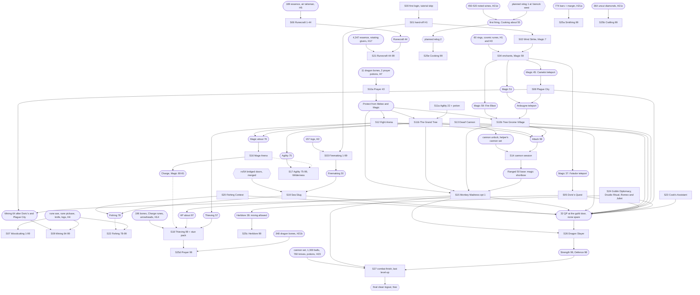

# Run order v1: the scored run, step by step

This page turns the rs/103 coordinator's provisional order v1 into the run's plan: what SCORED
does, in which order, where, with which supplies, and what each step costs in ticks logged in.
**SCORED** is the brand-new scored account (its real name never appears in this repository).
The hiscores rank by the in-world tick of the last level-up ([playtime-audit.md](playtime-audit.md),
"What this means for the run"); the record is 35,916. The helper side of every hand-off is
[SUPPLIES.md](SUPPLIES.md). Issue: cairn://p/rs/109, under cairn://p/rs/103.

The step IDs are the coordinator's (S00-S27). Splits use letter suffixes (S10a, S25c). Transition
legs are `Tff-tt` (from step ff to step tt). Five lab siblings measure what this page estimates:
cairn://p/rs/104 (legs, Agility and enchant placement), rs/105 (bones outside stuns), rs/106 (the
stun pack), rs/107 (work in the wine waits) and rs/108 (level-up costs). A later fold-in replaces
the cells marked **e**.

## How to read the numbers

Every tick figure carries a label and a source.

| Label | Meaning |
|---|---|
| **m** | measured, as the source document reports it |
| **r** | read from a script or engine line, as the source cites it |
| **i** | inferred: derived from m or r inputs, with the arithmetic here or in the source's model |
| **e** | estimated: an allowance set on this page by judgement, owned by the named lab issue |

| Tag | Source |
|---|---|
| Q§n | [quests/README.md](quests/README.md), section n |
| SK:x | `docs/speedrun/skills/x.md` (section given where it matters) |
| IL§n | [skills/interleaving.md](skills/interleaving.md) |
| TM | [skills/tick-manipulation.md](skills/tick-manipulation.md) |
| T&O | `docs/speedrun/research/travel-and-overhead.md` on cairn://p/rs/59/1/coordinator (row n, or the travel matrix) |
| WINE | `docs/speedrun/helpers/wine.md` on cairn://p/rs/41/1/coordinator |
| BONES | `docs/speedrun/helpers/bones.md` on cairn://p/rs/41/1/coordinator |
| HT | `docs/speedrun/research/competitors/hiscore-timestamps.md` on cairn://p/rs/60/1/coordinator |
| PRIM | [quests/primitives.md](quests/primitives.md) |
| SR | [speedrun/README.md](../../speedrun/README.md) (measured lib costs) |
| ARC | the main thread's arc, cairn://p/rs/main/arc |
| M0530, M0550 | main's binding notes relayed by the rs/103 coordinator on 2026-10-21 at 05:30 and 05:50; M0550's rates are "rs/97 in-page results via main, 05:50" (wired branch, local engine, visible tab) |

Travel estimates not yet measured use the T&O matrix rule: a teleport is 4 ticks (m, PRIM §4), a
glory 6 (m), running is half a tick per tile plus one, and long walks run about 28% longer than the
straight line (m, PRIM §2).

**Dialogue column.** The run uses rs/51's blind continues: `continueBurst` in
`speedrun/lib/dialogue.ts`, and the browser webclient's `clickDialogOption(..., blind)` in
`server/webclient/src/client/Client.ts` supports the flag (r). The burst column of Q§1 is mostly
inferred (recomputed or page-modelled), and no quest has yet been rehearsed in the browser client, so
**expected takes Q's fixed column and best takes its burst column**, both with Monkey Madness's
expected failures: 11,689 and 10,811 (sum of the Q§3 rows; Q§1 rounds them to ~11,690 and ~10,810).

## Headline

| Case | Total ticks | Against the record (35,916) | Basis |
|---|---|---|---|
| **Plan, expected** (knife loops gated on by the run gate, every allowance in) | **34,988** | **927 under** | section 7, line by line |
| Plan, best (best figure of every line, no allowances) | **32,105** | 3,811 under | section 7 |
| Knife gate off all night, expected (plain Woodcutting, Mining and fly fishing; bones moved onto the plain clocks) | **~37,030** | ~1,115 over | section 7, "Plain fallback" |

The plan beats the record on its expected path by under 3%. Three items each erase that margin on
their own: no dragon bones at all (+~1,700, risk R6), the knife gate off for the whole night
(+~2,040, R2) and Monkey Madness's bad-but-plausible case (+~860 beyond its expected, R5). The order
itself is not the lever any more: the transition legs total ~1,030 (i/e) and hand-offs ~100.

## 1. Run-machine setup and the run gate

The run is first person: SCORED's browser webclient in a visible tab on the Ashburn machine, the
game socket direct to the demo (`?server=`), the SDK overlay on a loopback gateway (`?gateway=`) for
the non-reactive steps, and in-page tick programs (cairn://p/rs/97) for every reactive loop (the knife
loops, the pickpocket re-click, Agility obstacles) (ARC).

**Setup (M0550).** Chrome throttles timers and `requestAnimationFrame` for a hidden or occluded tab
(minimised, remote desktop disconnected, screen locked, window covered; intensively after about 5
minutes), which slows the game loop and every in-page and overlay reaction. So, for the whole run:

- power saving and the screensaver are off;
- the remote-desktop session stays connected, and the tab stays visible and unobscured;
- Chrome is launched with `--disable-background-timer-throttling --disable-renderer-backgrounding
  --disable-backgrounding-occluded-windows`;
- everything else on the machine is shut down before the run (tenet 10 as proposed, ARC);
- the helper fleet is online on bbs and every hand-off of the first block (H1-H5) is staged before
  the first login.

**The run gate, and the knife switching rule (M0530, M0550; ARC).** The knife is on only while all
four hold, measured on the run machine from SCORED's own tab:

| | Condition | Source |
|---|---|---|
| (a) | direct in-page probe at least 58 of 60 reactions on the next tick, at the real player count | rs/86, rs/96, TM "Run-time host gate" |
| (b) | state-publication interval p90 at most 400 ms over the probe minute | rs/83, rs/102 |
| (c) | at most one catch-up per minute. The arc defines a catch-up as an interval under 150 ms immediately after one over 350 ms; M0530 words it as an interval under 200 ms. Count from raw frame arrivals, no grouping | ARC; M0530 |
| (d) | tab loop rate p10 at least about 50 loops per second | M0550 |

Otherwise the step runs its plain loop and re-probes periodically. `HostGate` in
`speedrun/lib/hostgate.ts` already does the probe, the measured-ticks-per-drop switch, re-probes while
off and the observed-slip trigger (r); conditions (b)-(d) are the path-aware gate rs/96 is adding and
are not in `hostgate.ts` on this branch yet (r: no p90 or catch-up code there). Predicted loops keep an
in-run fallback and resync on observed slips (ARC). The start time is chosen on rs/102's overnight
overrun data (R2).

## 2. Step table (a)

"Expected" and "best" here are the step's own ticks (the skill or quest figure, its own refills
included as its source counts them). The allowances (level-ups not in the figure, contention, overrun
share) are in section 6 and the totals in section 7. Hand-off IDs (H1-H23) are SUPPLIES.md's.
"Unsafe" means a logout there loses progress (Q§4 and the step's own document); every other boundary
is logout-safe, and logout is always refused within 16 ticks of combat (m, PRIM §8).

| ID | Where (tiles) | Step | Levels | Expected | Best | Supplies in, items out | Helper, hand-off | Login / logout-safe | Fallback if the fast path fails | Risks |
|---|---|---|---|---|---|---|---|---|---|---|
| S00 | Tutorial Island (3094,3106), skip lands (3222,3222) | First login, tutorial skip | - | 6 m (T&O row 1) | 6 m | in: starter kit (tinderbox, five rune types including air and mind, bronze axe, net) | none | **login 1**; safe once landed | none: without the skip (demo sets `NODE_PRODUCTION`) the plan is void, stop | the skip exists only while `map_live` is false (r, T&O row 1) |
| S01 | (3222,3222) | Hand-off H1 | - | 6 i (SR trade.ts: 4 m for 1 noted stack, 8 m for 23) | 4 m | in: H1 (staff of water, enchant runes, first ring load) | rune and jewellery giver, adjacent and requesting before S00 | safe | stock trade, 9 m (PRIM §6) | giver late costs logged-in ticks: stage H1 before S00. The starter junk is dropped during T01-02 (a drop keeps the walk queue, r, T&O row 2) |
| T01-02 | (3222,3222) to (3233,3295) | walk | | 45 i (73 tiles, matrix rule with the route factor) | 45 i | | | safe | | |
| S02 | Lumbridge chicken coop (3233,3295) | 4 Wind Strikes | Magic 1-7 | 18 m (SK:magic §1) | 18 m | in: starter-kit air and mind runes (4 each spare in H1) | none | safe | any attackable NPC nearer the landing (O3) | none |
| T02-03 | coop to the row's start | walk | | 5 e | 5 e | | | | | |
| S03 | open ground beside the coop; a 157-tile snake (any open ground works, SK:firemaking §1) | Firemaking, tinderbox line, highest tier | Firemaking 1-99 | 695 i (SK:firemaking §1: 658 model + 6 trades, trade 5-6 m) | 650 m (dropped row, 634 and 666 measured) | in: H2, 157 logs; out: ashes | woodcutter stock; dropped row paced around the 100-tick reveal, or 6 trades of 27 | safe at any light | trades (695); bank at Falador east ~735 i | dropped logs turn public after 100 ticks (r, T&O row 5); Firemaking 30 must precede S19 |
| S04 | the row's end (no bank needed) | 60 enchants: 12 sapphire, 27 emerald, 16 ruby, 5 diamond | Magic 7-59 | 192 i (SK:magic §1: 180 casts m + 4 + 8 overhead; ring trades in place of bank visits cost the same, i) | 85 i (37-59 ridden on walk legs, section 5) | in: H1 + H3 (two ring top-ups); out: 60 enchanted rings to the giver | rune and jewellery giver | safe | a booth at Draynor (192) | gates: Magic 37 before S05 (Falador teleport), 45 before S08 (Camelot), 51 by S08's end (Ardougne), 59 before S10 (Fire Blast) (r, PRIM §4, Q§4 step 0) |
| S05 | Falador teleport, Doric (2951,3451) | Doric's Quest | Mining 1-49 | 65 m (Q§3; teleport and walk included, 43 m) | 60 i | in: H4 (Doric's items, Falador runes; the Woodcutting and Mining kits ride it); out: 1 QP | quest courier at Doric | safe | - | none (no requirements, r) |
| T05-06 | Doric to the air ruins (2984,3291), into the room | Falador teleport + walk | | 55 i (SK:runecraft §6: 40-60) | 55 i | | | safe | | |
| S06 | air altar, stand (2844,4832) | Runecraft, 7 crafts of 27 | Runecraft 1-44 | 61 i (robust 8-tick schedule: 7 x 8 m, + 5 session trade) | 54 m/i (tuned 7-tick: 49 m + 5) | in: H5 (189 essence, air talisman); out: several hundred air runes, kept for teleports and Charge | 7 essence givers in the room before SCORED enters | safe (logging out in the room is free, SK:runecraft §6) | stock 15-tick cycle | 7 ticks needs the givers ahead of SCORED in the player loop; they are on another IP (O6) |
| T06-07 | portal, Falador teleport, oak tile | | | 66 i (T&O matrix ~63 + portal ~3) | 66 i | | | safe | | |
| S07 | normal trees (2912,3495) to 15; oaks from (2914,3494) 15-73; willows from (2920,3406) 73-99 (inside: oak to willow walk T07a, 50 i) | Woodcutting, in-page knife loop | Woodcutting 1-99 | **knife 3,036 i · plain 3,966 i** (SK:woodcutting §2: 3,028 / 3,958; +8 for 3 normal logs at M0550's 7.24 ticks per log against the model's ~14 total) | knife 3,036 · plain 3,966 | in: rune axe, knife, 1 normal log (H4); out: logs dropped | none (a helper may scout the oaks first) | safe at any cycle boundary | run gate fails: plain 4-tick loop (3,966); second oak and willow tiles, SK:woodcutting §6 | contention (R9); overrun bursts (R2); level-ups modelled at 1 tick (rs/108) |
| S08 | Camelot teleport in; Ardougne teleport out after reading the scroll | Plague City | Mining 49-64 | 620 m (Q§3) | 564 i | in: H6; out: 1 QP, the Ardougne teleport | quest courier | safe | - | needs Magic 45 and 51 from S04 |
| T08-09 | Ardougne landing (2661,3301) to the zoo | walk | | 38 i (T&O matrix) | 38 i | | | safe | | |
| S09 | six-rock iron cluster south of the zoo (2602-2605, 3233-3237) | Mining, in-page knife loop on the rotation | **Mining 64-99** (v1 said 49; Plague City's 2,425 base makes 3,725 base, level 64, SK:mining §2) | **knife 3,134 i · plain 3,765 i** (SK:mining §2; M0550 knife iron 3.00 ticks per ore matches) | knife 3,134 · plain 3,765 | in: rune pickaxe, knife, ~5 logs (H4); out: ore dropped | none (scout) | safe at any cycle | run gate fails: plain adjacent-rock loop (3,765); second cluster north of East Ardougne (2710-2715, 3328-3332), planner 3.74 ticks per ore against 3.00 | contention (R9); overrun (R2) |
| T09-10 | zoo to the maze entrance (2504,3191) | walk ~65 i, replacing the ~103 from the Ardougne teleport that TGV's figure already contains | | -38 i | -38 i | | | safe | | |
| S10a | maze entrance | bury 11 dragon bones | Prayer 1-43 | 21 m (SK:prayer §1) | 21 m | in: H7 | quest courier with H7 | safe | Prayer 37 (8 bones, 15 m) covers Protect from Magic only | none |
| S10b | Tree Gnome Village | warlord by Fire Blast under Protect from Melee | Attack 1-~80, Magic 59-64 | 896 m/i (Q§3) | 842 i | in: H7; out: 2 QP, spirit trees | as S10a | **unsafe**: Bolren's closing ceremony | Fire Bolt warlord 165 m (+32) | warlord at 10 HP and Defence 1 |
| T10-11 | village tree to the stronghold course | | | 10 e | 10 e | | | safe | | |
| S11a | Gnome Stronghold course | laps, then the Agility potion | Agility 1-22 (+3 boost) | 122 i (SK:agility §7) | 122 i | in: Agility potion(4) (H8) | - | safe | - | none |
| S11b | The Grand Tree | black demon by Fire Bolt | Attack to ~94, Agility 22-75, Magic to ~73 | 1,576 i (Q§3) | 1,441 i | in: H8; out: 5 QP | - | **unsafe**: trapdoor to the demon's kill | - | the demon at 28 HP |
| S12 | Fight Arena (its 74-tick way in from the Ardougne teleport is in its figure) | Fire Blast, Protect from Melee per fight | Attack 99, Thieving 1-57, Magic to ~76 | 645 i (Q§3) | 598 i | in: H9; out: 2 QP | - | **unsafe**: the arena fights | - | General Khazard at stage 12: prayer on until out of the door |
| S13 | Dwarf Cannon (starts with an Ardougne teleport, in its figure) | quest | Crafting 1-42 | 976 i (Q§3) | 920 | in: H10; out: the cannon unlock, 1 QP | - | safe | - | railing rolls vary |
| T13-14 | Lawgof to the Ardougne lever (2561,3311), Deserted Keep (3154,3924), spiders | | | 146 i (T&O row 8) | 146 i | | | safe until the Wilderness | | PK on the walk |
| S14 | poison spiders (3288,3810), Wilderness 37 | pre-MM cannon session, rune scimitar wielded, auto-retaliate off, antipoison at the first poisoning | Ranged 1-50+ | 123 m/i (113 m firing, rs/31; ~10 set-up i; Q§4 step 7) | 123 | in: H11 (cannon set, ~100 balls, scimitar, antipoison, food); out: cannon set and leftover balls back (H11r) | cannon-qualified helper at Lawgof or the lever | **unsafe**: combat, Wilderness | Battlefield of Khazard (2523,3239): ~143 i | PK at combat ~52, 42 HP, Defence 1 (R8) |
| T14-15 | walk to Wilderness 30 + glory to Edgeville (~32 i, T&O row 4); Varrock young spirit tree (3177,3506), village tree, stronghold, Narnode (~97 i, the shape of SK grand_tree step J) | | | 129 i | 129 i | H11r at the Edgeville landing | | safe after the Wilderness | | |
| S15 | Monkey Madness, reward option 1 | quest | Strength 1-~97, HP to ~97, Defence 1-~89, Ranged to ~54 | 4,077 i (Q§6: 3,897 + 180 expected failures) | 3,726 i (burst 3,546 + 180) | in: H12; out: 3 QP | - | **unsafe**: hangar puzzle's last tile to the powered hangar; the three chapter cutscenes; sigil to the Jungle Demon's kill | Q§6 failure budget | arrives at Defence 1, ~42 HP (Q open item (a); R5) |
| S16 | Mage Arena (Ardougne teleport and lever in, ~155, in its figure) | Kolodion at base ~76 under Protect from Magic | Magic 76-80/81 | 581 i (Q§3) | 574 i | in: H13 (also S17's food); out: Charge | - | **unsafe**: the arena fight | 1 magic potion if Charge would start below 80 | PK in deep Wilderness (R8) |
| T16-17 | Mage Arena (3105,3934) to the course (~2998,3930) | walk | | 70 e (~107 tiles + leaving the arena) | 70 e | | | not a pause point (Wilderness) | | PK |
| S17 | Wilderness Agility course, Wilderness 50-56 | laps, in-page obstacle program | Agility 75-99 | 4,024 i (SK:agility: 66-tick laps m; M0550 66 m) | 4,024 | in: 10-12 sharks (H13) | - | safe between laps when out of combat, but not a pause point | relay-driven laps, 74 i: 4,512 | PK (R8); falls and skeletons |
| T17-18 | lever out (~80 + 4 i, T&O row 4), Ardougne teleport, 8 tiles | | | 96 i | 96 i | | | safe | | |
| S18a | East Ardougne market knights (~2655,3305) | pickpocket, in-page re-click | Thieving 57-99 | 1,975 i (SK:thieving model; 55-99 measured 1,999 m on bbs) | 1,950 i | in: H14 (20 sharks, bone loads, Fletching stacks, Charge runes); top-ups H14.1-H14.9 | stun-pack giver beside the knights | safe at any attempt boundary | relay re-click | knights wander; M0550's L55 0.173 rolls per tick is +4% on lite, rs/82's L99 was -4%: no change taken |
| S18b | same, in stuns | bury ~196 dragon bones | Prayer 43-~85 | 0 net (the ticks count in S25d's smaller pile; top-ups in section 6) | 0 | | | | | rs/106 |
| S18c | same, in stuns | Charge, ~163 casts in ~22 stuns | Magic 80/81-99 | 0 net (IL§8: absorbed; 33 m standalone) | 0 | | | | Charge on T16-17 instead (section 5) | rs/106 |
| S18d | same, in stuns | arrowheads on headless arrows | Fletching 1-99 | 20 i (SK README: 5-20 net) | 5 i | | | | standalone 50 m (57 for the adamant-cap list) | rs/106 |
| S19 | Witchaven fishing platform (Ardougne landing, in its figure) | Sea Slug | Fishing 1-74 | 394 m (Q§3) | 340 i | in: H15; out: 1 QP | - | safe | Sheep Shearer (~68 i) for the quest point if it fails | rs/54 merged for the lite client (PR #31); the browser client's bridged doors are unrehearsed (R10) |
| S20 | Hemenster (Camelot casts in its figure) | Fishing Contest, helper carp | Fishing 74-78 | 223 m (Q§3) | 200 i | in: H16; out: 1 QP | carp helper | **unsafe**: inside the contest fence | - | the carp hand-off |
| T20-21 | glory to Karamja, ~150 tiles to the nature ruins (2868,3018) | | | 90 i (SK:runecraft §6) | 90 i | | | safe | | |
| S21 | nature altar, stand (2400,4839) | Runecraft, 161 crafts of 27 | Runecraft 44-99 | 1,293 i (161 x 8 m + 5) | 1,132 m/i (161 x 7 m + 5) | in: H17 (4,347 essence, nature talisman); out: nature runes to the helpers | ~16 or more rotating essence givers (SUPPLIES.md H17) | safe (in the room) | batches with logout-safe pauses, each pause ~3.6 expected (section 4) | giver rotation and essence stock; bucket order (O6, O7) |
| T21-22 | Lumbridge teleport, river | | | 20 i (T&O matrix) | 20 i | | | safe | | |
| S22 | Lumbridge river fly spots (3241,3248) | fly fishing, in-page knife loop | Fishing 78-99 | **knife 1,995 m/i · plain 3,410 m** (SK:fishing: knife 2,032 and 1,978 m; scaled by M0550's 4.26 against 4.28 ticks per catch) | knife 1,969 · plain 3,410 | in: H18 (fly rod, ~580 feathers; knife and log held); out: fish dropped | - | safe | run gate fails: plain 5-tick loop (3,410); Barbarian Village 9.34 base per tick against 9.83 | spot moves; overrun (R2) |
| T22-23 | river to the cook (3209,3215) | walk | | 18 i | 18 i | | | safe | | |
| S23 | Lumbridge castle kitchen | Cook's Assistant | Cooking 1-30 | 27 i (Q§3) | 22 i | in: H19; out: 1 QP | - | safe | - | none |
| S24 | glory to Draynor, Rusty Anchor (3045,3257); Falador teleport, Taverley (stone circle, Sanfew, the dungeon cauldron); Goblin Village (2957,3511); Varrock teleport (Q§4 step 12 order) | Goblin Diplomacy, Druidic Ritual, Romeo and Juliet | Crafting 42-45, Herblore 1-28 | 668 i (Q§3: 188 + 239 + 241) | 599 i | in: H20; out: 14 QP, 32 at the door | quest courier | treat as unsafe: the quests' varp scopes are unchecked (Q§4) | Sheep Shearer if a point is missing (Q§7) | chain unmeasured (Q open item (b)) |
| T24-25 | Champions' Guild (3191,3363) to Varrock west bank (3185,3436) | walk | | 38 i | 38 i | | | safe | | |
| S25 | Varrock west: booths (3185,3436), anvil (3188,3426) | the Varrock west block, five sub-steps below | | 2,239 i | 1,982 i | in: H21a-e; out: platebodies, cut gems, potions back to helpers | Smithing giver at the anvil; mule at the booth; wine giver | **planned relogs 1 and 2** | per sub-step | R6 (bones, grapes) |
| S25a | anvil (3188,3426) | platebodies, 31 trades of 24-25 bars | Smithing 1-99 | 1,147 m (SK:smithing) | 1,107 m (helper staged) | H21a | Smithing giver | safe at any trade | bank cycles, 42 ticks each m | none |
| S25b | booth | cut 364 uncut diamonds | Crafting 45-99 | 121 i (SK:crafting §7 fallback, from 42) | 121 i | H21c | mule | safe | hard leather bodies (supply-safe) | dragonstones unobtainable, so the 101 list is out (R6) |
| S25c | booth | mix the supply-safe list (guam, irit) | Herblore 28-99 | 170 i (SK:herblore §7 supply-safe) | 117 i (ranging cap list) | H21d | mule | safe | - | torstol unobtainable; wine of Zamorak one spawn (R6) |
| S25d | booth | bury 348 dragon bones in 28-bone cycles | Prayer ~85-99 | 721 i (348 / 28 x 58 m, SK:prayer §1) | 562 i (284 bones if a third bone lands per stun, IL§8; minus 26 buried in the wine waits, rs/107) | H21b | mule | safe | baby blue bones: 2.2 ticks per 30 base (BONES) | **GE dragon bones dry** (R6) |
| S25e | booth | wine fermentation, two planned relogs (WINE default sequence) | Cooking 30-99 | 80 m (WINE demo run A and projection, 75-85) | 75 m | H21e (450-520 noted unfermented wine) | wine giver beside the booth at relog 1 | relog 1 at the start, relog 2 after the first firing; the wine window is unsafe apart from those two | the deadline fallback relog (WINE) | relog tail (R1); grapes (R6) |
| S26 | Champions' Guild door (3191,3363), then Q§4 step 13's route | Dragon Slayer | Strength 99, Defence 89-98 | 941 i (Q§3) | 925 i | in: H22; out: 2 QP | - | safe (every varp permanent, r) | - | a death on Crandor (return untested) |
| T26-27 | the lair's exit teleport, glory to Edgeville, spiders | | | 164 i (T&O matrix) | 164 i | | | safe until the Wilderness | | PK |
| S27 | poison spiders (3288,3810) | cannon + defensive melee to Defence 99, then cannon + rapid rune knives, rs/91's kit | Defence 98-99, Ranged ~54-99, HP 97-99 | 1,857 i (m rates, Q§4 step 14) | 1,857 i | in: H23 | combat-kit giver | **unsafe** (combat); **the last step**: the clean logout after the last level-up is free | no kit 2,023-2,211 i; Battlefield of Khazard, ~20-25% slower | PK (R8) |
| | | **Steps and legs** (without section 6's allowances) | | **33,636** | **32,105** | | | | | |

The steps-and-legs sum is the step figures (32,506 expected, 30,983 best), the legs (1,032 both,
mostly i) and the hand-off trades outside the step figures (98 and 90, section 6).

## 3. Dependency graph (b)

Solid arrows are hard prerequisites (a script check or an item the step cannot run without). Dotted
arrows are ordering choices that save ticks. Rounded nodes are levels, items and unlocks; hexagons
are relogs and client conditions.

## 4. Login and relog plan (c)

A planned relog costs **2 ticks** on the clock (m, WINE "Relog risk": 28 of 29 demo logouts left the
world 0-2 ticks after the click, and the new session acts at its tick 1) plus a rare tail of tens of
ticks (one logout of 29 stayed 46 ticks, on the clock). It is a delayed logout, never a delayed login,
so the script cannot dodge it; the expected cost is about 2 + 46/29, **~3.6 ticks per relog** (i).
The login tick itself is not counted (T&O row 3, via playtime-audit.md). Main's rule: two planned
relogs in all, and any step that adds one must show it pays for itself (M0530).

| Event | Where | When | Cost | Notes |
|---|---|---|---|---|
| Login 1 | Tutorial Island | S00 | 0 (the login tick is not counted) | its fermentation timer fires on an empty bank at login + 20: harmless (r, WINE) |
| **Planned relog 1** | Varrock west bank | start of S25e | 2 m + tail | the wine giver is already beside the booth requesting; it doubles as the staging pause for anything S25 still lacks (arrive, log out, helpers finish staging, log in) |
| **Planned relog 2** | Varrock west bank | S25e, after the first firing's pages and the second deposit | 2 m + tail | the arming relog; no page is queued by then (WINE step 7) |
| Shortfall pause (only if needed) | any logout-safe boundary below | when the next hand-off is not staged as SCORED reaches it | ~3.6 i | pays for itself against any logged-in wait longer than ~4 ticks |
| Runecraft batches (only if the rotation cannot keep up) | nature altar room | inside S21 | ~3.6 i each | SK:runecraft's batch plan (20 givers, ~9 batches) would add ~8 relogs; the rotation in SUPPLIES.md H17 adds none |
| **Final logout** | poison spiders | after the last level-up of S27 | 0 on the score | the stamp is the level-up's tick (HT). Rows are written only at a clean logout (HT), so wait out the 16-tick combat window and log out with `logoutClean`; never drop the socket |

Two relogs is the whole planned count. Planned relogs need pages cleared and 16 ticks out of combat
before the click (WINE).

**Logout-safe pause points** (where a supply shortfall is waited out logged out, at no tick cost
beyond the relog): S01's landing tile; after S03 and after S04 (the row's end); in the air altar room
(S06); any Woodcutting cycle at the oaks or willows (S07); after S08 at the Ardougne landing; any
Mining cycle (S09); the maze entrance before S10; the stronghold after S11b; Lawgof after S13; the
Grand Tree after S15; the market (S18); after S19; Camelot after S20; the nature altar room (S21); the
river (S22); after S23; Varrock after S24; the start of S25 (merged with relog 1); after S26. **Never**
in the Wilderness (T13-14 to T14-15's glory, S16 to T17-18, T26-27, S27), inside the unsafe stretches
of section 2, or inside the wine window except at the two planned relogs.

Re-logging puts SCORED at the end of its player-loop bucket (r, SK:runecraft §4). SCORED and the
helpers are on different IPs, so this does not change their relative order (O6).

## 5. Idle-tick plan (d)

| Host | Free capacity | Planned use | Rule that binds | Open (owner) |
|---|---|---|---|---|
| Knife loops: S07, S09, S22 | none: every tick carries the knife, the button, a drop or the re-click (IL§7) | level-up dismissals only (`levelup.ts` watcher; the lock survives a page answered at once, about half a tick, TM §8) | at most 4 user events per tick (IL rule 2) | rs/105: whether Mining's respawn waits or anything else takes bones; rs/108: level-up cost |
| Plain loops, if the run gate turns the knife off | 4-tick Woodcutting: one bury per cycle, 0.213 bones per tick m; 5-tick fly fishing: 0.191 m (IL§3) | move the 348 booth bones onto these clocks (~590 ticks saved net, section 7) | bury goes in the phase-2 gap; Prayer level-ups then cost the gathering a tick each | rs/105 |
| Pickpocket stuns: S18 | ~100 stuns, ~700 usable stun ticks (IL§8) | ~196 bones (1.96 per stun m), Charge ~163 casts in ~22 stuns, Fletching ~173 rune-tier actions in ~24 stuns, 3 helper actions per tick at +2, +4, +6 (7.3 per stun m) | interleave only inside stuns; ~9-10 bone top-up trades not absorbed | rs/106: the whole pack at route levels, top-ups beside the knights |
| Walk legs | T05-06, S05's walk, T06-07, T07a: ~200 walking ticks with 20+ free slots | best case: enchants 37-59 (40 casts) instead of at S04's end | a walk click in a cast's tick stops the run; one cast slot is lost per re-click (~30 ticks); bury cannot ride a walk (`p_stopaction`) (T&O row 2) | rs/104 ("settle the enchant placement") |
| Walk legs | T13-14 (146), T14-15 (129) | alternative home for Fletching (240 actions at 4 per tick = 60 ticks), freeing stun packets for a third bone | delay-free OPHELDU keeps the walk queue (r, T&O row 2); level-up pages do not stop a queued walk (m, same) | rs/104 |
| Walk legs | T16-17 (70) | alternative home for Charge (33 ticks at 5 casts per tick, IF_BUTTON) | Charge never clears the interaction (IL§1) | rs/104, rs/106 |
| Page dismissals | everywhere | `levelup.ts` watcher; `continueBurst` on pure continue pages; two blind continues per tick through the wine pages (WINE) | never burst across a choice page | rs/108 |
| Wine waits: S25e | ~26 idle ticks at the booth (WINE: ~6 before the first firing, ~20 after relog 2) | best case: bury ~13 bones from the inventory (26 ticks off S25d) | the timer fires only with no modal open (`canAccess`), so no bank in the waits; a Prayer level-up page holds the timer until dismissed | rs/107 |
| Smithing, Runecraft, Agility, Firemaking | none (anvil-bound and delayed; altar room schedule; obstacle delays; each light moves the player) (IL§8, IL§4) | nothing | | |

## 6. Overhead model per step (e)

What sits outside the step figures. Every cell names its basis; rs/104 replaces the travel and
hand-off cells, rs/108 the level-up cells, rs/102 and rs/97 the overrun cells.

| Step | Travel (leg) | Hand-offs outside the figure | Bank visits | Level-up pages not in the figure | Relogs | Contention | Overrun-burst share | Basis |
|---|---|---|---|---|---|---|---|---|
| S00-S02 | T01-02 45 i | H1 is S01 itself (6 i / 4 m) | none | none (Wind Strike measured) | login 1: 0 | - | - | matrix rule; SR trade.ts |
| S03 | T02-03 5 e | none (6 trades inside 695) | none | in the figure (measured end to end) | - | - | - | SK:firemaking §1 |
| S04 | 0 | ring trades replace the 4 + 8 bank overhead inside 192 | none | in the figure | - | - | - | SK:magic §1 |
| S05 | 0 (in Doric's 65) | in the quest | - | in the quest | - | - | - | dorics_quest.md |
| S06 | T05-06 55 i | session trade 5 m, in the step | none | in the figure (a level-up every craft, measured) | - | - | - | SK:runecraft §2, §6 |
| S07 | T06-07 66 i; T07a 50 i | none | none | +100 e (98 levels; modelled at 1 tick, a waiting bot measured 3.4-4.4, SK:woodcutting §8) | - | +150 e (half of "a few hundred" for one site move, SK README open question 5) | +128 e | matrix rule; rs/108 |
| S08 | 0 (Camelot cast in the figure) | in the quest | - | in the quest | - | - | - | Q§3 |
| S09 | T08-09 38 i | none | none | +25 e (35 levels at ~0.5-1 tick, TM §8) | - | +150 e (same basis) | +132 e | T&O matrix; rs/108 |
| S10-S13 | T09-10 -38 i; T10-11 10 e; T11-12 and T12-13 0 (in FA's and DC's figures) | in the quest trades | - | in the quests | - | - | - | Q§3, fight_arena.md, dwarf_cannon.md |
| S14 | T13-14 146 i | H11 6 i; H11r 5 i | none | in the figure | - | - | - | T&O row 8; SR trade.ts |
| S15-S16 | T14-15 129 i; T15-16 0 (in MA's ~155) | in the quests | - | in the quests | - | - | - | T&O row 4; mage_arena.md |
| S17 | T16-17 70 e | food rides H13 | none | +24 e (24 levels) | - | - | +173 e | rs/104, rs/108 |
| S18 | T17-18 96 i | H14 8 m; bone top-ups ~9-10 x 5 = 48 i (best 8 x 5 = 40) | none | in the figure (55-99 measured run) | - | - | +83 e | IL§8; SK:prayer §5 |
| S19-S20 | 0 (in the quests' teleports) | in the quests | - | in the quests | - | - | - | sea_slug.md, fishing_contest.md |
| S21 | T20-21 90 i | session trade 5 m, in the step | none | in the figure | 0 planned (rotation) | - | - | SK:runecraft §6 |
| S22 | T21-22 20 i | H18 5 m | none | in the figure (measured segments) | - | - | +84 e | T&O matrix |
| S23-S24 | T22-23 18 i; chain legs +30 e | in the quests | - | in the quests | - | - | - | Q§4 step 12 |
| S25 | T24-25 38 i | bones 6, gems 6, herbs 6: 18 i (trade 4 m + deposit ~2 i each); Smithing's 31 trades and the wine trade are in their figures | in each figure | in each figure (measured) | **2 planned**: 2 m each inside the 80; tail +3 i | - | - | WINE; SK:prayer §7 |
| S26-S27 | T26-27 164 i | H23 8 m | none | in the figure | final logout: 0 | - | - | T&O matrix |
| Run-wide | | | | | | | | |
| Overlay relay on the non-reactive steps | | | | | | | | +200 e: rs/98's relay landed 60:0 calm and 40:20 in the 04:13 overrun minute (ARC); rs/113 removes the overlay's ~22 ms quantisation |
| Unmodelled retries | | | | | | | | +100 e: a mis-click, one dropped login (~12-14 ticks m, SR session.ts), a re-sent trade |

**The overrun-burst cost.** Main's arc carries ~600 expected for the demo's tick-overrun bursts
(ARC, rs/83's 04:13 sample, rs/85's mechanism). This page spreads it over the reactive loops in
proportion to their ticks (e): Woodcutting 128, Mining 132, Fishing 84, Thieving 83, Agility 173.
The best column carries 0. rs/102 learns how long bursts last and whether the start time avoids them.

**Totals of section 6** (expected / best): legs 1,032 / 1,032; hand-offs outside the figures 98 / 90;
level-ups 149 / 0; relog tail 3 / 0; contention 300 / 0; overrun 600 / 0; relay 200 / 0; retries
100 / 0.

## 7. Reconciled total (f)

Against the main thread's 04:20 tally (cairn://p/rs/main, table tally, ids 42-57). Each line here is
the sum of section 2's rows (and section 6's cells) that belong to it.

| Line | Tally (exp / best) | This page (exp / best) | Difference | Why |
|---|---|---|---|---|
| Quests (Package B, Druidic Ritual, MM failures) | 12,260 / 10,700 | **11,689 / 10,811** | -571 / +111 | Q§1 after rs/59's temple ladder drop: MM's trapdoor failures (+600 i) are gone, the ladder drop is -68 m and the walked zoo return +100 i, so -568, the rest rounding. The tally's 12,260 is the old success path (MM 3,865) plus the old +780 failure budget. Best: this page takes Q's burst column with the expected failures; the tally's 10,700 could not be reconstructed from the sources. Expected uses the fixed column (header) |
| Agility (122 pre-quest + 75-99) | 4,146 / 4,024 | 4,146 / 4,146 | 0 / +122 | the tally's best left out the 122 pre-quest ticks; M0550 confirms the 66-tick lap |
| Mining | 4,034 / 3,360 | 3,134 / 3,134 | -900 / -226 | the tally started at Doric's 49 and ignored Plague City's 2,425 base (SK:mining §2: 3,765 plain, 3,134 knife from 64): -269 plain, -226 knife. Expected moves to the knife (-631) because the run gates the knife on (section 1); the plain case is the fallback row below |
| Woodcutting | 3,958 / 3,028 | 3,036 / 3,036 | -922 / +8 | knife as the plan (-930); +8 for M0550's normal-tree rate (7.24 ticks per log for 3 logs against the model's ~14). M0550's willow 4.83 ticks per log matches the model's band average (2,406 knife ticks over 494 logs = 4.87, i), so no change |
| Fishing | 3,410 / 2,000 | 1,995 / 1,969 | -1,415 / -31 | knife as the plan; the two measured runs (2,032 and 1,978) scaled by M0550's 4.26 against 4.28 ticks per catch |
| Thieving | 1,975 / 1,975 | 1,975 / 1,950 | 0 / -25 | best takes SK README's 1,950-2,000 low end; M0550's L55 rate (+4%) and rs/82's L99 rate (-4%) disagree, so no change |
| Combat (cannon session + finish) | 1,857 / 1,750 | 1,980 / 1,980 | +123 / +230 | the pre-MM cannon session (113 m + ~10 set-up) was in neither the quest totals nor the tally (Q§1 says so); its legs are in the overhead line. No source read here supports a 1,750 best, so best stays at rs/91's 1,857 (O17) |
| Magic | 245 / 245 | 210 / 103 | -35 / -142 | Charge's 33 rides the stuns (IL§8; 0 net); best rides enchants 37-59 on walk legs (-107, T&O row 2, section 5) |
| Prayer | 700 / 150 | 742 / 583 | +42 / +433 | 21 at S10a plus 348 bones at the booth (721). **The tally's best 150 assumed ~348 bones in the idle ticks of 4-tick Woodcutting and 5-tick fly fishing; the knife loops have no idle ticks, so that saving holds only against those skills' plain columns and double-counts against the knife columns the same total uses** (SK README item-fed note; IL§7; main confirmed at 05:30). Best: a third bone per stun (~260 in stuns, IL§8) and 13 bones in the wine waits |
| Smithing | 1,147 / 1,107 | 1,147 / 1,107 | 0 | unchanged |
| Firemaking | 740 / 600 | 695 / 650 | -45 / +50 | SK:firemaking now folded: trades 695 (expected, since the dropped row's pacing is not built), dropped row 650 m |
| Runecraft (crafting) | 1,100 / 900 | 1,354 / 1,186 | +254 / +286 | SK:runecraft folded: 168 crafts. Expected uses the robust 8-tick schedule, because the 7-tick one needs the givers ahead of SCORED in the player loop and they are on another IP (O6); best 7. Its ~145 of travel (T05-06, T20-21) is in the overhead line |
| Fletching + Crafting + Cooking + Herblore | 370 / 285 | 391 / 318 | +21 / +33 | Fletching 20 / 5 (stuns); Crafting 121 (dragonstones unobtainable, so the diamond fallback); Cooking 80 / 75 (WINE demo); Herblore 170 (supply-safe; torstol unobtainable) / 117 |
| Overhead (legs, hand-offs, level-ups, relogs, tutorial skip, H1) | 1,500 / 900 | 1,294 / 1,132 | -206 / +232 | itemised in section 6: legs 1,032, hand-offs 104 / 94 (including H1), level-ups 149 / 0, relog tail 3 / 0, tutorial skip 6 (in no tally line before). Best keeps the legs, which are estimates until rs/104 |
| Contention and retries | 1,000 / 300 | 400 / 0 | -600 / -300 | contention 300 at the two depleting sites, retries 100; MM's failures are inside the quest line, Wind Strike (18) inside Magic |
| Demo latency and overrun | 300 / 0 | 800 / 0 | +500 / 0 | overrun bursts 600 (ARC, not in the tally) plus overlay relay 200 on the non-reactive steps |
| **Total** | **38,742 / 31,324** | **34,988 / 32,105** | **-3,754 / +781** | |

**Plain fallback** (the run gate fails all night): Woodcutting +930, Mining +631, Fishing +1,415, the
knife loops' overrun share -344, and the 348 booth bones move onto the plain 4-tick and 5-tick clocks:
-721 booth ticks, +~75 top-up trades, +~56 Prayer level-ups in the gathering loops, so ~-590 (i,
SK:prayer §5, IL§3, §5). **~37,030 expected.** Like for like, that is the number to set beside the
tally's 38,742: about 1,700 lower, mostly Plague City's Mining, the trapdoor failures that are gone,
and the itemised overhead.

**Sensitivity of the plan's expected 34,988** (each alone; i from the cited inputs):

| Change | Ticks | Basis |
|---|---|---|
| No dragon bones: Prayer from babydragon bones (30 base) | +~1,700 | BONES: 2.2 scored ticks per bone all-in; 1,331 babydragon bones against 555 dragon |
| Knife gate off all night | +~2,040 | plain fallback above |
| MM bad-but-plausible case | +~860 | Q§6: +1,040 against the +180 expected |
| Runecraft 7-tick schedule holds | -168 | SK:runecraft §2 |
| Enchants 37-59 on walk legs | -107 | section 5 |
| Herblore ranging-cap list obtainable | -53 | SK:herblore §7 |
| S26 before S25 (O2) | -16 to -38 | section 9 |
| One Wilderness death at S14 or S27 (respawn, regear, walk back) | +~200-350 e | T&O matrix; death keeps 3 items |

## 8. Risk register (g)

| # | Risk | Where | Cost | The run's response |
|---|---|---|---|---|
| R1 | **Relog tail**: a planned relog costs 2 ticks, and about 1 in 29 stays tens of ticks in the world, on the clock (46 seen) | S25e's two relogs; any shortfall pause | ~3.6 expected per relog; 46 worst seen | two planned relogs only; clear pages and leave combat 16 ticks before each click; `logoutClean` waits up to 60 ticks before reporting failure (WINE "Relog risk"); the cause is unconfirmed (the removal budget hypothesis needs the demo's own logs) |
| R2 | **Demo tick-overrun bursts**: after an overrun the next tick runs ~0-190 ms later and reactions miss (P(miss) 48% against 3.5%, rs/85); the 04:13 sample read direct 40:16:4 | every reactive loop: S07, S09, S17, S18, S22 | ~600 expected (ARC); a whole night of failed gates +~2,040 | the four-condition run gate (section 1); knife only while it holds, plain otherwise with periodic re-probes; predicted loops resync on observed slips (rs/96, rs/97, `hostgate.ts`); choose the start time on rs/102's overnight sampling |
| R3 | **Browser background throttling**: a hidden or occluded tab slows timers and rAF, so every in-page and overlay reaction (M0550) | the whole run | unbounded: a throttled tab fails the knife and slows every step | section 1 setup (flags, visible tab, remote desktop connected, power saving off); gate condition (d), loop rate p10 at least ~50 per second, checked continuously by the in-run monitor |
| R4 | **Dropped login idle**: a dead client leaves the player in the world; relaunch takes ~3.5-4.1 s, ~12-14 ticks (m, SR session.ts crash recovery), against the 500-tick no-connection timeout if nothing relaunches | anywhere | ~12-14 per drop with the watchdog; up to ~500 without | run under the watchdog and never leave a dead client to the timeout; cairn://p/rs/101 is measuring what keeps a dropped player in the world and will change the watchdog's clean-logout policy; in the Wilderness a dropped player stays attackable |
| R5 | **Monkey Madness failure budget** | S15 | expected +180 inside the quest line; bad-but-plausible +1,040; MM stays ahead of no-MM until ~5,460 over (~16 trapdoor deaths with the bar kept, 5 if lost) (Q§6) | ladder drop (33-36 m); Protect from Melee beside the guards; antipoison for the jungle spiders; prayer re-toggle every 4 ticks; walk the monkey back; open item (a): the route arrives at Defence 1 and ~42 HP, re-check at these levels before the run |
| R6 | **Supply shortfalls on the demo** | S10, S18, S25, S18d, S25b-c | dragon bones: none traded market-wide since 08:57 UTC, 0 held at 10:50 UTC (rs/41 #16); grapes 423 of 520 held (same); rune arrowheads shops cover about a tenth (SK:fletching §7); uncut dragonstones and torstol effectively unobtainable | bones: bid ladder to 20,000 (ARC), baby blue line (~98 per account-hour, rs/41 #15), adult blues from a safe spot (rs/112), 673 big bones as the floor; the run does not start until 555 dragon bones are held (+~1,700 otherwise). Grapes: 450 is the minimum (29 + 421, P(99) 99.06%), 520 the target (99.83%) (WINE). Fletching: the adamant-cap list (+7 standalone). Gems: 364 diamonds. Herbs: the supply-safe list. SUPPLIES.md marks each line |
| R7 | **Demo outage**: at 08:22 UTC on 2026-10-21, 18 fleet disconnects at once, then "Login server offline", recovered in ~6 minutes (main's open question) | anywhere | a dropped SCORED stays in the world, on the clock, up to the no-connection timeout while logins are refused (R4); a server restart without a save would roll back to the last save (autosave every 1,500 ticks, HT), which also rolls back playtime, so the cost is wall time and helper state, not score (i) | the watchdog re-logs as soon as logins are accepted; treat a rollback as a restart of the affected step from its preconditions (`runSteps` checks them); the planned clean logouts also save; the main thread decides whether an outage longer than the timeout aborts the attempt |
| R8 | **Wilderness player killers** | S14 (level 37, combat ~52, 42 HP, Defence 1), S16 (deep Wilderness), S17 (levels 50-56), S27 (level 37), and the legs T13-14, T16-17, T26-27 | a death keeps 3 items: the cannon set and the kit are lost; ~200-350 to regear and return (e) | short exposures; a helper lookout reports players in view before SCORED enters (helpers are free; no following or blocking, HELPERS.md etiquette); Protect from Melee where possible; a spare cannon set staged; fallback cannon site the Battlefield of Khazard (2523,3239): pre-MM ~143 instead of ~113, the finish ~20-25% slower (Q§7); for S17, relay or Gnome-course laps are the only alternatives (SK:agility) |
| R9 | **Contention** at the zoo iron and the Taverley oaks and willows | S09, S07 | +150 each expected, "a few hundred" per site move (SK README open question 5) | a scout helper checks the site before SCORED arrives; second sites: the iron cluster north of East Ardougne (planner 3.74 ticks per ore at respawn 13) and SK:woodcutting §6's tiles. Fishing and Thieving tolerate company (spots never deplete; nothing reserves a knight, r) |
| R10 | **Sea Slug's client dependency**: rs/54 (PR #31) fixed bridged doors in the **lite** client and merged; the run uses the browser webclient | S19 | without it the quest cannot finish; Sheep Shearer (~68 i) replaces the quest point and Fishing starts lower | rehearse S19 in the browser client before the run; if it fails there, swap in Sheep Shearer before S26 and re-cost S22 from Fishing Contest's level |
| R11 | **No spare quest point** at the Champions' Guild door: exactly 32 (Q§7) | S26 | any lost point blocks Dragon Slayer and the finish | check the quest-point count after S24 before walking to the door; Sheep Shearer (~68 i) or Imp Catcher (~94 i) is the replacement (Q§7) |
| R12 | **Runecraft schedule order**: the 7-tick cycle needs the givers processed before SCORED; the engine visits players in IP buckets, then login order (r, SK:runecraft §4) | S06, S21 | +168 if the robust schedule is needed (expected already carries it) | a pre-run two-account probe from the run machine and bbs decides 7 or 8 (O6); never run the tuned schedule unproven (half the cycles failed when the order was wrong, m) |
| R13 | **Quest steps in the browser client**: every quest figure was taken on the lite client | S05-S26 | unknown; fixed-column expected already assumes one tick per page | rehearse each quest script on the run configuration; the overlay drives them (rs/82's browser fix, rs/113) |

## 9. Ordering questions

**Settled** (with the number that settles it):

- **Cooking at Varrock west behind planned relogs, never first**: a brand-new account's first login is
  159 ticks from that bank on the demo (m, WINE), far past the login + 19 deadline.
- **Thieving after Fight Arena, Monkey Madness and the Mage Arena**: Fight Arena's 2,175 Thieving is worth
  ~865 while Thieving is low (Q§3); MM leaves HP ~97 (20 sharks suffice, SK:thieving §7); Charge must be
  unlocked to ride the stuns (IL§8).
- **Fishing after Sea Slug and Fishing Contest**: they start it at 78; on the knife cycle they still
  replace 586 and 186 ticks (Q§3), and Fishing Contest stays because dropping it costs the 32nd point
  (Q§7).
- **Herblore after Druidic Ritual**: every Herblore action needs level 3 (m, rs/37; Q§2).
- **Firemaking first**: Sea Slug checks Firemaking 30 (r, `quest_seaslug.rs2:43`); S03 does the whole
  skill before S19.
- **Doric's Quest and Plague City in either order**: the pair's Mining saving is the same (Q§2).
- **Plague City before the teleport users**: ~575 of teleport legs (i, Q§3).
- **The cannon session after Attack 99 and before Monkey Madness**: the cannon rolls the wielded style
  (r) and MM's demon needs Ranged 50 base (Q§2).
- **Mining starts at 64**, not 49 (SK:mining §2): a correction to v1's label, not to its order.
- **Dialogue column**: fixed for expected, burst for best (header).
- **Sea Slug's client fix**: rs/54 merged (lite client); the browser rehearsal is R10.

**Open** (the measurement that settles each, and its owner):

| # | Question | Current estimate | Settles it | Owner |
|---|---|---|---|---|
| O1 | S17 straight after S16, or last after S27 | after S16: T16-17 + T17-18 = ~166 i; last: S16 to S18 ~45 + spiders to the course ~150-190 = ~195-235 i (S27's ~32 exit stops being free, S17's ~84 exit becomes free). After S16 wins by ~30-70 (i) | walk both legs | rs/104 |
| O2 | S26 (Dragon Slayer) before S25 | Romeo and Juliet ends beside the guild door; doing Dragon Slayer first saves the guild-to-bank-to-guild walk, ~16-38 i depending on where the lair's exit teleport lands (not stated in dragon_slayer.md) | the lair exit tile and both walks | rs/104 |
| O3 | Wind Strike at the chicken coop or at an NPC nearer (3222,3222) | the coop costs T01-02 ~45 i; a target within ~20 tiles would save ~30 i, and the Firemaking row can go anywhere | a site check | rs/104 |
| O4 | Enchants standalone at S04 or 37-59 on the walk legs | -107 best (section 5) | the route's walking ticks with free slots | rs/104 |
| O5 | Where the ~348 bones outside the stuns go with the knife on | the booth (721) | Mining respawn waits, a plain-clock stretch, or the booth, net of top-ups | rs/105 |
| O6 | Runecraft 7- or 8-tick schedule across two IPs | 8 in expected, 7 in best (-168) | a 10-cycle tuned probe between a throwaway on the run machine and a bbs helper | unowned; proposed for rs/104 |
| O7 | Nature altar giver rotation size | ≥16 givers (SUPPLIES.md H17), no relogs | helper restock round trip on the demo | rs/41 |
| O8 | The stun pack at route levels | bones 1.96 per stun, Charge and Fletching beside them (IL§8) | one 57-99 run with the pack | rs/106 |
| O9 | Work in the wine waits | 0 in expected, -26 in best | the two-relog sequence with buries in the waits | rs/107 |
| O10 | Level-up costs inside the modelled loops | +149 e | per-level cost inside the knife and lap loops | rs/108 |
| O11 | The knife loops on the demo from Ashburn in the browser | plan expected assumes they hold under the gate | rs/95's browser-path workflow; rs/97's programs | rs/95, rs/97 |
| O12 | How long overrun bursts last, and whether the start time avoids them | ~600 e | overnight pair sampling | rs/102 |
| O13 | Dropped-login time in the world and the watchdog policy | ~12-14 per drop | the dropped-login lab check | rs/101 |
| O14 | Monkey Madness at the route's real levels (Defence 1, ~42 HP) | +180 expected failures | a run at those levels | Q open item (a) |
| O15 | Fletching in stuns or on T13-14 / T14-15 | stuns (20 expected) | the walk-leg count | rs/104, rs/106 |
| O16 | Charge in stuns or on T16-17 | stuns (0 net either way) | as O15 | rs/104, rs/106 |
| O17 | The tally's combat best of 1,750 | not found in the sources; 1,857 used | main's basis for it | main |
| O18 | The quests' way-in assumptions: T11-12, T12-13, T18-19 and T25-26 are 0 because Fight Arena, Dwarf Cannon, Sea Slug and Dragon Slayer count their own entry | 0 | the legs from the previous step's end | rs/104 |

## Sources

On this branch: [quests/README.md](quests/README.md), the per-quest documents and
[quests/primitives.md](quests/primitives.md); [skills/README.md](skills/README.md) and every
`skills/*.md` (including [interleaving.md](skills/interleaving.md) and
[tick-manipulation.md](skills/tick-manipulation.md)); [playtime-audit.md](playtime-audit.md);
[speedrun/README.md](../../speedrun/README.md) and `speedrun/lib/hostgate.ts`. On other branches:
`research/travel-and-overhead.md` (cairn://p/rs/59/1/coordinator), `HELPERS.md`, `helpers/wine.md` and
`helpers/bones.md` (cairn://p/rs/41/1/coordinator), `research/competitors/hiscore-timestamps.md`
(cairn://p/rs/60/1/coordinator). The main thread's arc (cairn://p/rs/main/arc), its 04:20 tally, and
main's notes of 05:30 and 05:50 relayed by cairn://p/rs/103/1/coordinator. Stock figures:
cairn://p/rs/41 comments 15 and 16.
