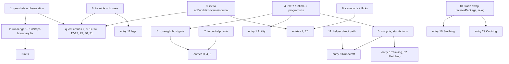

# Step manifest: every script `speedrun/run.ts` chains

This is the build list for the scored run. It has one entry per script that `speedrun/run.ts` will
chain for provisional order v1 (cairn://p/rs/103): the scored account's step scripts, the
transition legs, the helper-side scripts those steps wait on, and `run.ts` itself. The main thread
files one builder per entry. The order is **build priority**: the entry with the most ticks at
stake comes first (section 1 says how that was computed). The last section lists the shared
primitives the builders need first.

The scored account is called **SCORED** everywhere. Its real name lives only in its gitignored
`bots/<name>/bot.env`; no script, log line, commit or document names it. The sibling
`RUN-ORDER.md` carries the step table, relog plan and reconciled total for the same order.
cairn://p/rs/111 reconciled the two with the labs rs/104-108 (run-transitions, bones-placement,
stun-pack, wine-window, levelup-cost under `research/`), rs/129's supply fallbacks and rs/127's
`RESILIENCE.md`: **every step's expected and best here is RUN-ORDER.md v2's figure**, and the
moves are the same (S17 last, after S27; the bones in S07's knife loop; S18 one measured row; gems in
the wine windows).

## How to read an entry

**Step IDs** are provisional order v1's S00-S27 (cairn://p/rs/103). A quest or skill that the order
splits gets one module and one `Step` object per ID, so `S10a` was Prayer 1-43 (retired in v2: its bones ride S07) and `S10b` is Tree
Gnome Village. IDs never move: a step that changes place keeps its ID.

**Three tick figures** per entry, all on SCORED's clock (in-world ticks at 300 ms):

- **Expected** is RUN-ORDER.md v2's knife-on expected for the step. For a quest that is the
  fixed-client column with its failure budget (`quests/README.md` §3). For a knife skill it is the
  **knife** figure at rs/97's in-page rates, the column RUN-ORDER.md's headline uses while the run
  gate holds; the plain loop is the step's fallback, and RUN-ORDER.md shows the knife-off total
  beside it.
- **Best** is the fast path as measured on the direct path: the knife column, the burst-dialogue
  column, the rs/91 kit, and so on.
- **Fallback** is what the step costs when its fast path fails: for a knife skill the plain loop
  (the knife-off column). For a quest it is the stock column,
  because read-then-act through the SDK relay costs about the stock client's 2 ticks per page (a
  relay reaction lands a tick late about half the time, cairn://p/rs/86 via `skills/README.md`,
  open question 1).

**Labels**, on every figure: **measured** (a committed lab script, named), **read** (a content or
engine line), **inferred** (arithmetic or a model over measured and read inputs, basis given), and
**estimated** (a judgement made here, with no model behind it). Sources are paths under
`docs/speedrun/` unless a branch is named. `[rs/41]` means read on cairn://p/rs/41/1/coordinator,
`[rs/59]` on cairn://p/rs/59/1/coordinator, `[rs/94]` on cairn://p/rs/94/1/builder and `[rs/97]`
on cairn://p/rs/97/1/builder.

**Mode.** An entry is **in-page** when its loop reacts on the decoded tick or sends on predicted
ticks. That means an rs/97 tick program inside the browser webclient, started and awaited through
`speedrun/lib/programs.ts` [rs/97] (`startProgram`, `awaitProgram`, `runProgram`, `probeInPage`).
Everything else is **overlay-driven** through the SDK and `speedrun/lib`. The reason is the relay:
an in-process reaction landed on the next tick 60 of 60 times, and the same reaction through the
loopback gateway 32 of 60 (`LAB.md`, "Direct path and relay").

**In-page figures.** rs/97 measured its programs on its wired branch, on a local engine in a
visible tab (direct path), reported to this issue as "rs/97 in-page results via main, 05:50": probe
60 of 60; knife iron 3.00 ticks per ore (200 of 200 on the predicted tick); knife normal trees from
level 1, 7.24 ticks per log; knife willow 4.83 ticks per log; knife fly 20-99, 4.26 ticks per
catch; pickpocket at 55, 0.173 rolls per tick; Wilderness Agility 66 ticks per lap. The in-page
entries take their acceptance thresholds from these figures and start from rs/97's branch
(cairn://p/rs/97/1/builder). Two exceptions: the willow 4.83 was taken at level 99 and its gap from
the lite 4.23 is the server's chop RNG, not the client (`tick-programs.md` "Measured"; RUN-ORDER.md
O19), so entry 3's willow threshold is the 3-tick lattice at the formula's success rate; and
knife-cycle's "ticks per roll" (`rolls`, `ticksPerRoll`) counts xp events, so it is ticks per log
(RUN-ORDER.md, "How to read the numbers").

**Acceptance tests** come in two kinds. The local one runs on the lab engine at
`NODE_TICKRATE=300` (`LAB.md`; `speedrun/lab/lab.sh` or `docs/speedrun/scripts/lab.sh`), and an
in-page step runs there in a visible browser tab, because the lite client hosts no programs
(`programStatus` is null on lite). The demo one runs on rs-sdk-demo.fly.dev with a throwaway
`cairn_`-prefixed account outside the fleet's reserved ranges (the list in cairn://p/rs/101), and
never with SCORED. A demo test of an in-page loop only counts from an Ashburn vantage (the rs/86
runner); from anywhere else the network alone exceeds the reaction window. A step that needs
levels a throwaway cannot reach cheaply gets a demo test of its shared primitives and of whatever
part is level-free, and says so.

**`logoutSafe`** is the `Step` field from `speedrun/runner/step.ts`: true when SCORED can log out
right after the step and resume at the next one.

**Resumes from** (every entry): the game state `runResumable` (`speedrun/runner/resume.ts`, rs/127)
checks after a restart or a drop: the step's `done` test, its `inProgress` test and resume entry,
and any probes, from `RESILIENCE.md` section 5. Quest state comes from rs/114's
`speedrun/lib/quests.ts` and `docs/speedrun/quests/quest-state.md` (`questDone`, `questStatus`,
`questStage`, `questPoints`, `requireQuestStage(view, key, stage, {atLeast?})`, `readQuestStage`,
`journalProbe(key)`; stage tables in `speedrun/data/quest-stages.ts`; on main, PR #123). Route quest varps are not transmitted to
the client: status comes from the quest-list colours and the exact stage from a journal read, which
re-clicks if the journal has not opened within 3 ticks. The Mage Arena is not on the quest list; its
postcondition is items and messages.

## 1. Exposure and build order

**How exposure was computed.** Exposure is the entry's **expected** ticks on SCORED's clock, as
defined above: RUN-ORDER.md v2's figure for its steps. Entries are ranked by exposure. **At stake**
is fallback minus best: the ticks a good build wins over a failed fast path. Two rules place the
entries that have no exposure of their own:

- `run.ts` and its runner come first, because nothing can be accepted without them.
- Helper-side scripts (section 4) are ranked by the exposure of the step they gate. No step
  passes its demo acceptance without its helper.

**Entry numbers are stable ids**, cited by `RESILIENCE.md` section 5 and by section 4 here; the
**Rank** column is the build order. The v2 figures moved five ranks: Thieving (now 2,000 measured)
passes Fishing (now the knife's 1,995), the legs (1,382 measured) pass Runecraft and Smithing, and
Prayer (110, now inside S07) drops from 15 to 27. Re-pricing S07's knife on O19 (RUN-ORDER.md
section 9) puts Woodcutting (2,986) below Mining (3,116), so the two swap ranks 3 and 4. Pricing
S25c's two planned relogs as tab relogs (~20 ticks each, rs/164 on the twin) moves Cooking (116)
above Prayer and Crafting.

The expected column sums to **31,708** (the steps) plus the legs' **1,382**; RUN-ORDER.md section 6
adds the allowances (hand-offs outside the figures, level-up pages, contention, overrun, relay,
retries, restarts) for its **34,402** knife-on expected (31,691 best), against the record of 35,916.

**Module status** (the last column; the helper scripts and the programs the entries rely on are in
"Module status" at the end of this section) is as of this document's commit date, and rs/158 updates
it with each fold-in. Earliest plausible run date: **2026-10-23, more likely the 24th or later**
(main, 2026-10-21 14:54 PDT).

| Rank | # | Entry | Module | Steps | Expected | Best | Fallback | At stake | Mode | Code to start from | Module status |
|---|---|---|---|---|---|---|---|---|---|---|---|
| 0 | 0 | Run chain | `speedrun/run.ts`, `runner/resume.ts` | all | boundary idle 0 m (#92); restarts ~25 each (a tab relog) | 0 | | | overlay | `runner/step.ts`, `runner/resume.ts` (main) | `run.ts`: building (rs/186, held: tenet 15); `runner/step.ts`, `resume.ts` on main (#29, #104, #146) |
| 1 | 1 | Agility | `speedrun/skills/agility.ts` | S11a, S17 | 4,138 | 3,934 | 4,626 | ~690 | in-page | rs/97 `agility` program, `agility-course.ts` | lab-accepted (66 per Wilderness lap, 9 of 9; S11a 114; rs/155) |
| 2 | 2 | Monkey Madness | `speedrun/quests/monkey-madness.ts` | S15 | 4,077 | 3,726 | 4,611 | ~885 | overlay | `quest-mm-*.ts` | building (rs/185, held: tenet 15) |
| 3 | 4 | Mining | `speedrun/skills/mining.ts` | S09 | 3,116 | 3,116 | 3,765 | ~650 | in-page | rs/97 `knife-mine`, `tickmanip-mine.ts` | building (rs/153) |
| 4 | 3 | Woodcutting, with the bury | `speedrun/skills/woodcutting.ts` | S07 (+ S25b's bones) | 2,986 | 2,969 | 3,881 | ~910 | in-page | rs/97 `knife-cycle`; rs/137's bury variant; `bones-wc.ts` | building (rs/151) |
| 5 | 6 | Thieving and the stun pack | `speedrun/skills/thieving.ts` | S18 (S18b-d inside) | 2,000 | 1,908 | 1,975 + ~120 elsewhere | ~190 | in-page | rs/97 `pickpocket`; rs/132's `stunActions`; `stun-pack-thieve.ts` | building (rs/154); stun pack: building (rs/132) |
| 6 | 5 | Fishing | `speedrun/skills/fishing.ts` | S22 | 1,995 | 1,969 | 3,410 | ~1,440 | in-page | rs/97 `knife-cycle`, `tickmanip-cycle.ts` | lab-accepted (1,998 on 78-99; rs/152) |
| 7 | 7 | Combat finish | `speedrun/skills/ranged.ts` (`combatFinish`) | S27 | 1,889 | 1,829 | 2,023-2,211 | ~380 | overlay | `cannon-kit.ts` (rs/59, on main) | building (rs/186, held: tenet 15) |
| 8 | 8 | The Grand Tree | `speedrun/quests/grand-tree.ts` | S11b | 1,576 | 1,441 | 1,846 | ~405 | overlay | `quest-grandtree-full.ts` | building (rs/185, held: tenet 15) |
| 9 | 11 | Transition legs | `speedrun/runner/legs.ts` + `speedrun/lib/travel.ts` | between steps | 1,382 | 1,382 | ~1,520 i | ~140 | overlay | `run-transitions-legs.ts`, `run-transitions-lib.ts` | building (rs/186, held: tenet 15) |
| 10 | 9 | Runecraft | `speedrun/skills/runecraft.ts` | S06, S21 | 1,186 | 1,186 | ~2,530 | ~1,340 | in-page | rs/131's `rc-cycle`; `runecraft-cycle.ts` | building (rs/186, held: tenet 15); cycle: building (rs/131) |
| 11 | 10 | Smithing | `speedrun/skills/smithing.ts` | S25a | 1,147 | 1,107 | 1,330 | ~223 | overlay | `smithing-trade.ts` | building (rs/186, held: tenet 15) |
| 12 | 12 | Dwarf Cannon | `speedrun/quests/dwarf-cannon.ts` | S13 | 976 | 920 | 1,078 | ~158 | overlay | `quest-mcannon-*.ts` | building (rs/185, held: tenet 15) |
| 13 | 13 | Dragon Slayer | `speedrun/quests/dragon-slayer.ts` | S26 | 966 | 945 | 1,076 | ~131 | overlay | `quest-dragon-*.ts` | building (rs/185, held: tenet 15) |
| 14 | 14 | Tree Gnome Village | `speedrun/quests/tree-gnome-village.ts` | S10b | 896 | 842 | 1,005 | ~163 | overlay | `quest-tree-full.ts`, `quest-premm-fight.ts` | building (rs/185, held: tenet 15) |
| 15 | 16 | Firemaking | `speedrun/skills/firemaking.ts` | S03 | 695 | 650 | 735 | ~85 | overlay | `firemaking-line.ts` | building (rs/186, held: tenet 15) |
| 16 | 17 | Fight Arena | `speedrun/quests/fight-arena.ts` | S12 | 645 | 598 | 720 | ~122 | overlay | `quest-arena-run.ts` | building (rs/185, held: tenet 15) |
| 17 | 18 | Plague City | `speedrun/quests/plague-city.ts` | S08 | 620 | 564 | 737 | ~173 | overlay | `quest-plague-city-*.ts` | building (rs/185, held: tenet 15) |
| 18 | 19 | Mage Arena | `speedrun/quests/mage-arena.ts` | S16 | 581 | 574 | 606 | ~32 | overlay | `quest-magearena-*.ts` | building (rs/185, held: tenet 15) |
| 19 | 20 | Sea Slug | `speedrun/quests/sea-slug.ts` | S19 | 394 | 340 | 495 | ~155 | overlay | `quest-smallskill-seaslug.ts` | building (rs/185, held: tenet 15) |
| 20 | 21 | Romeo & Juliet | `speedrun/quests/romeo-juliet.ts` | S24 | 241 | 211 | 301 | ~90 | overlay | none (page counts only) | building (rs/185, held: tenet 15) |
| 21 | 22 | Druidic Ritual | `speedrun/quests/druidic-ritual.ts` | S24 | 239 | 220 | 284 | ~64 | overlay | none (page counts only) | building (rs/185, held: tenet 15) |
| 22 | 23 | Fishing Contest | `speedrun/quests/fishing-contest.ts` | S20 | 223 | 200 | 276 | ~76 | overlay | `quest-smallskill-fishingcompo.ts` | building (rs/185, held: tenet 15) |
| 23 | 24 | Magic (strike, enchant) | `speedrun/skills/magic.ts` | S02, S04 | 222 | 222 | ~250 | ~28 | overlay | `magic-strike.ts`, `magic-cadence.ts` | building (rs/186, held: tenet 15) |
| 24 | 25 | Goblin Diplomacy | `speedrun/quests/goblin-diplomacy.ts` | S24 | 188 | 168 | 229 | ~61 | overlay | none (page counts only) | building (rs/185, held: tenet 15) |
| 25 | 27 | Herblore | `speedrun/skills/herblore.ts` | S25e | 170 | 117 | ~200 e | ~83 | overlay | `delayfree-cycle.ts` | building (rs/186, held: tenet 15) |
| 26 | 26 | Pre-MM cannon session | `speedrun/skills/ranged.ts` (`cannonSession`) | S14 | 132 | 132 | ~162 | ~30 | overlay | `quest-premm-cannon.ts`, `ranged-cannon.ts` | building (rs/186, held: tenet 15) |
| 27 | 29 | Cooking (wine) + gems in the windows | `speedrun/skills/cooking.ts` | S25c | 116 | 111 | ~131 (kebabs, supplies not held) | ~15 | overlay | `wine-receive.ts` [rs/41], `wine-window-lab.ts` | building (rs/186, held: tenet 15) |
| 28 | 15 | Prayer (bones inside S07; the booth as fallback) | `speedrun/skills/woodcutting.ts` bury option; `speedrun/skills/prayer.ts` for the booth | S25b (S10a retired) | 95 | 65 | 735 (the booth) | ~670 | in-page with S07 | `bones-wc.ts`, `prayer-bury.ts` | bury in S07: building (rs/151, rs/162); booth: building (rs/186, held: tenet 15) |
| 29 | 28 | Crafting | `speedrun/skills/crafting.ts` | S25d | 91 | 85 | 121 (no gems in the windows) | ~36 | overlay | `delayfree-cycle.ts` | building (rs/186, held: tenet 15) |
| 30 | 30 | Doric's Quest | `speedrun/quests/dorics-quest.ts` | S05 | 65 | 60 | 90 | ~30 | overlay | `quest-smallskill-doric.ts` | building (rs/185, held: tenet 15) |
| 31 | 31 | Cook's Assistant | `speedrun/quests/cooks-assistant.ts` | S23 | 27 | 22 | 41 | ~19 | overlay | `quest-primitives-dialogue.ts` | building (rs/185, held: tenet 15) |
| 32 | 33 | Hand-off H1 | `speedrun/runner/handoff.ts` | S01 | 8 | 8 | ~10 | ~2 | overlay | `lib/trade.ts`, `mule.ts` [rs/41] | building (rs/186, held: tenet 15) |
| 33 | 34 | Tutorial skip | `speedrun/skills/start.ts` | S00 | 8 (done) | 8 | - | - | overlay | done: SCORED claimed and parked at 8 ticks; the skip for rehearsal and gate accounts measured 3 (lab) and 4 (demo) | on main, c2d9eada (#146) |
| 34 | 32 | Fletching | `speedrun/skills/fletching.ts` | S18d (inside the stun pack) | 0 | 0 | ~59 standalone | ~59 | in-page (with Thieving) | `stun-pack-thieve.ts`, `delayfree-cycle.ts` | building (rs/186, held: tenet 15); in-stun: building (rs/132) |

Every figure in the table is restated with its label and source in the entry below it. Helper-side
scripts are in section 4; the shared primitives and their build order are in section 5.

**The four findings this manifest first raised, and where they stand:**

1. **Quest state on the demo**: rs/114's `speedrun/lib/quests.ts` (quest-list status, journal
   stage, `questPoints`; merged to main as PR #123, with `speedrun/data/quest-stages.ts`).
2. **`runSteps` idled SCORED at every boundary**: fixed (#92, measured 2 ticks per boundary before
   and 0 after; main, 08:30).
3. **S09 starts at Mining 64**, not 49 (Plague City's 2,425 base): accepted by main (M0602).
4. **The tuned Runecraft cycle needs a direct-path giver**: the givers run on the Ashburn machine
   through rs/117's launcher; rs/131 builds the scored side's in-page cycle.

### Module status

**Values.** `none`: nothing is building it. `building (rs/N)`: an issue is building it, with
`held: <gate>` when its execution is held. `lab-accepted (ticks, rs/N)`: a lab pass against the
entry's acceptance, with the measured ticks. `on main (commit, #PR)`. Helper roles add one more:
`on rs/41's branch (rs/N)`, a role merged into the helper mission's branch and not on main. rs/185
(the quest modules) and rs/186 (the remaining skill modules, `run.ts`, the legs and the hand-off)
are filed under main and held until tenet 15 is answered.

**Notes on the entry column:**

- **0.** `speedrun/run.ts` does not exist; `runner/step.ts` (#29), `runner/resume.ts` (#104, with
  #146's sessionLink fix), `runner/budget.ts` and `runner/fence.ts` are on main.
- **1.** rs/155's lab pass (PR #149, open into rs/147): 9 of 9 Wilderness laps at exactly 66 at
  Agility 99 (the acceptance asks 8 of 10 at 66, +1); Gnome 1-22 measured 114 against the 122
  inferred. S17 75-99 priced at about 4,210 against 4,024 (inferred from the lab laps). The demo
  rehearsal is still to run.
- **5.** rs/152's execution 1 passed the lab on the run's band, 1,998 against 1,995 (3,338 for the
  chain from level 1). That branch was rewritten by a replay; the work is intact at store commit
  `28ad07aa` and is being re-applied, so no branch carries it yet.
- **6, 32.** rs/154 builds the pickpocket band only; the stun pack (bones, Charge and Fletching in
  the stuns) needs rs/132's stun-window actions, and entry 32's standalone module is rs/186's.
- **9.** rs/186 adopts rs/131's in-page cycle; the givers are rs/163's (helper table).
- **15.** The primary path is the bury option inside entry 3 (knife-cycle `bury` on main; the
  gate-off plain+bury is rs/162); the booth fallback `skills/prayer.ts` is rs/186's.

**Helper-side scripts (section 4).** H2-H6 are rs/41's (main's ruling).

| Helper | Gates | Module status | Notes |
|---|---|---|---|
| H1 mule, hand-off and quest-item giver | S01, every helper trade | on rs/41's branch (rs/49, #34) | the step packages and per-tile positioning (section 4) are rs/41's, no issue yet; quest items rs/126, rs/173 |
| H2 stun-pack courier | S18 | on rs/41's branch (rs/141): `bone-giver.ts`'s S18 on-request mode; the Charge and Fletching stacks building (rs/163, held: not before 15:25 PDT) | rs/163's execution 2 extends `bone-giver.ts`; there is no `stun-courier.ts` |
| H3 cannon holder | S14, S27 | on rs/41's branch (rs/125): `cannon.ts`; the hand-off lab-verified (rs/189), demo leg pending | cairn_h92 holds two sets and 1,416 balls (rs/41, 15:00 PDT); `cannon.ts` serve mode hands over a set and balls in one trade, 4 ticks on the receiver's clock in the lab; the quest gates buying and Set-up, not trading |
| H4 in-room essence giver | S06, S21 | on rs/41's branch (rs/117, rs/141): `altar-giver.ts`; the direct path building (rs/163) | `altar-giver.ts`, `altar-cue.ts`, `altar-room.ts`; rs/163's direct-path transport (PR #144; lab 21 of 21, host slot 22:05Z); there is no `rc-giver.ts`. rs/163 sized the body-altar roster at 14 givers on 15 body talismans, no keeper (0 nature talismans; a ~90-tick round trip, e; RUN-ORDER.md section 7) |
| H5 anvil helper | S25a | building (rs/188) | `anvil.ts`, new |
| H6 log-row dropper | S03 | building (rs/187) | `fm-row.ts`, new, first in rs/187's queue |
| H7 carp catcher | S20 | building (rs/173) | cairn_h97 catches the carp ahead and banks it |
| H8 wine giver | S25c | on rs/41's branch (rs/47, rs/88) | `giveWine`; acceptance is entry 29's (rs/186) |
| S07 bone givers b01-b04 | S07 | building (rs/163) | `bone-giver.ts` in the launcher on rs/41's branch (rs/141); rs/163 puts b01-b03 on the demo |

**Program and library dependencies.** The in-page programs and `speedrun/lib` changes the entries
rely on. rs/132 and rs/131 were backlog until main started both at 14:55 PDT; their
cost-if-not-built is RUN-ORDER.md's sensitivity table and stays priced there until they land.

| Dependency | Needed by | Module status | Notes |
|---|---|---|---|
| In-page program runtime, `lib/programs.ts` (rs/97) | 1, 3-6, 9 | on main, d09c2627 (#94) | |
| Host gate, `lib/hostgate.ts` | in-page entries | on main, c9a6c31b (#101) | |
| `lib/gated-program.ts` (rs/156) | 3-5 | on rs/147's branch (#138) | not on main; reaches main with rs/147's module snapshots |
| Quest state, `lib/quests.ts` (rs/114) | every quest entry, resume | on main, 85c8799a (#123) | |
| knife-cycle `bury` (rs/137) | 3, 15 (S07's bones) | on main, 9b38dbc2 (#124) | |
| knife-cycle rename and per-log stamps (rs/159) | 3, 5 | on main, c14428fc (#132) | |
| knife-cycle axe-aware p (rs/175) | 3 | on main, 6c58db8e (#151) | |
| knife-cycle plain+bury | 3, 15 | building (rs/162) | S07's gate-off fallback |
| knife-mine `bury` on `stay2` | 4 | building (rs/182) | O35, the ~85 bones placed in S09. Without it they go to the booth, **+154** (RUN-ORDER.md O35, in today's stock row, the conservative one), or ~61 more dragon bones close it with no code, as the row in force at 2026-10-23 assumes (~110 forecast by tonight) |
| `logoutClean` tab confirmation | 0, 1 (final logout), every relog | on main, c2d9eada (#146) | |
| Direct gate clean logout | the gate probe | on main, 9d26aa87 (#142), d83f2e86 (#152) | |
| In-page relog `login({inPage:true})` | 0 (restarts), 29 (the wine relogs, R17) | building (rs/174) | plus rs/183, the client's second-login hang (PR #155, open) |
| **Pickpocket stun-window actions** | 6 (S18's stun pack), 32 | **building (rs/132)** | started 14:55 PDT. Without it the stun pack fails: plain pickpocket, Charge and Fletching standalone, ~200 more bones in S07, **+~120** (RUN-ORDER.md sensitivity table) |
| **In-page Runecraft cycle** (`rc-cycle`) | 9 (S06, S21) | **building (rs/131)** | started 14:55 PDT; 7-tick tuned with the 8-tick fallback, its protocol shared with rs/163's givers. Without the tuned cycle: the robust 8-tick cycle **+168**, or the stock 15-tick cycle **+1,344** if the giver is relayed (RUN-ORDER.md sensitivity table and R12) |
| Direct-path altar giver | 9 (S06, S21) | building (rs/163) | PR #144, open; on rs/117's launcher and rs/141's givers |

## 2. The run chain

### 0. `speedrun/run.ts` and the runner (all steps)

- **Serves:** every step, S01-S27 (S00 is done), the legs between them, and the hand-offs. It holds
  the ordered `Step` list, opens SCORED's session, and chains the steps through `runResumable`.
- **Chaining contract** (`speedrun/runner/step.ts`, read): a step is `{name, preconditions(state, c),
  run(ctx), postconditions(state, c), logoutSafe}`, plus rs/127's `done(observed)`,
  `inProgress(observed)`, `resume(ctx)` and `probes` (`speedrun/runner/resume.ts`). run.ts calls
  **`runResumable`**, not `runSteps`: on every start, operator restarts included, it walks the
  manifest against the game, finds the first milestone that is not `done`, and enters the latest
  step that can start (its `resume` if `inProgress`, else `run`), so a restart resumes from game
  state (`RESILIENCE.md` section 5). A stop requested during an unsafe step waits for the next
  `logoutSafe` boundary. `fence.ts` abandons a lost attempt so it cannot act on the reconnected
  session.
- **Parameters:** `--from=<step name or index>` (overrides the first resume walk only),
  `--until=<step>`, `--client=browser` (default for the run; `lite` for lab dry runs),
  `--bot=<env name>` (the gitignored `bots/<name>/bot.env`; the name is never logged; log rows carry
  `SCORED`), `--log=<path>`, `--dry-run` (evaluate every precondition against the live state and
  stop), `--lab` (accept staff fixtures).
- **Preconditions, before SCORED's run login** (RUN-ORDER.md section 1):
  - **the host reservation**: `RUN-HOST.md` step 0 has written `~/host-reserved.json` before
    anything else started on run night, owner the run, `until` covering setup, the 9 h run bound
    and margin, so rs/83's gate history timer (rs/140) skips. run.ts refuses to start unless it is
    live and the run's own, and never disables the timer (main via rs/103);
  - **main's start conditions** (09:30): Prayer xp in hand of at least 39,938 base in any bone mix; a
    cannon set and ~1,170 cannonballs; the rune axe or main's decision to run without it; the budget
    (expected + fallback deltas in force under 35,916). run.ts reads them from the operator's
    checklist (`SUPPLIES.md` section 5); it does not count bones itself;
  - **`RUN_COMMIT` includes rs/164, main's `c2d9eada`** (#146; `RUN-HOST.md` "Credentials" and
    step 0, `git merge-base --is-ancestor c2d9eada "$RUN_COMMIT"`). c2d9eada is byte-identical to
    rs/147's 4e0e8ae4, whose code is 3ed0cd49c, the commit that ran on the twin. With it the page
    confirmed every tab logout in 222-324 ms, 0 ticks of latency, and `session.ts` no longer
    consults the gateway for a browser session, since the gateway still said `inGame: true`
    afterwards (m, rs/164 on the rehearsal twin, cairn_smoke, 20:44-20:52Z). `logoutClean` treats
    `lastDamageTick < 0` as never damaged and confirms a tab's logout through the page's own
    in-game flag over CDP (`tab.ts` `pageInGame`; r, c2d9eada). On an older commit it cannot
    confirm a logout from the browser tab, because the gateway keeps `inGame: true` with status
    `stale` (m, rs/149 on the rehearsal twin), and each relog risks up to ~60 ticks (i,
    RUN-ORDER.md R1's bound); that case is historical on any `RUN_COMMIT` at or after c2d9eada.
    The final logout is still checked on the host (`RUN-HOST.md` step 8). A precondition, not a
    line in the totals;
  - rs/117's helpers logged in before SCORED (`launcher.json` `helpersReady`);
  - a session that publishes advancing ticks (`openSession`, `waitAdvancingTick`); the watchdog
    started; the in-page runtime present (`startProgram(sdk, 'probe')` answers);
  - **the tab gate (tenet 12)** passed before any in-page step starts in its fast mode: (a) the direct
    in-page probe at least 58 of 60; (b) publication p90 reported, not a pass line; (c) at most 2
    catch-up ticks per probe minute (a failure means re-measure); (d) the tab loop rate p10 at least
    50 per second (`speedrun/lib/hostgate-verdict.ts`, `tickSteadiness`). The start time is chosen
    by a 3-5 minute gate read, not by the clock.
- **In-run pause rule** (rs/102, main 07:45): a reactive or knife step pauses when catch-ups exceed
  about 5 per minute and resumes when they fall under 1 per minute; `demo-status.ts`'s
  `restartLikely` (at least ~10 a minute for 2 minutes) triggers the same pause, never a save.
- **Run-machine setup** (a precondition the operator checks; `RUN-HOST.md`, tenet 12): power saving
  and the screensaver off; the operator's remote desktop **disconnected** for the run (live view
  instead); the tab maximised and unobscured on :10; Chrome launched with
  `--disable-background-timer-throttling --disable-renderer-backgrounding
  --disable-backgrounding-occluded-windows`. run.ts re-checks the loop rate between steps and
  refuses an in-page step's fast mode while it is low.
- **Postconditions:** total level 1,881; the final clean logout after S17's last level-up (the only
  hiscore write, `RESILIENCE.md` section 2); **the host reservation removed** after it.
- **Ticks:** run.ts adds no actions of its own. What lands on SCORED's clock:
  - **Step-boundary idle: 0** (measured: #92 fixed `runSteps`, 2 ticks per boundary before and 0
    after; main, 08:30).
  - **A demo restart**: ~21.6 ticks of relog + 3 to the resumed step (measured on the local
    engine, `RESILIENCE.md` section 6) + the step's resume overhead; 1-2 per run expected;
    progress and playtime roll back together, so the redone work is score-neutral. The relog is a
    tab relog: `session.ts` `login` re-navigates the tab, and the new session's first published
    state read client tick 20-22 against 3 for a fresh tab (m, rs/164 on the twin), so ~20 ticks
    pass before the bot sees state (i), plus the demo's 1-in-29 tail. RUN-ORDER.md carries 37.
  - **A client drop with the server up**: 3-12 ticks in the world + 2 to the resumed step with the
    watchdog (measured on the lite client, same section); in the tab the takeover is a
    re-navigated login, ~20 more (i, rs/164's twin relogs); without the watchdog 500-1,000 (rs/101).
  - **Relogs:** exactly **two planned relogs**, both in S25c, ~20 ticks each from SCORED's tab (i:
    first published state at client tick 20-22, m, rs/164 on the twin; 2 on the lite client), with
    a tail of tens about 1 time in 29 (measured, [rs/41] `helpers/wine.md`, "Relog risk"). main's
    rs/174 looks for the cause and builds the fastest relog (RUN-ORDER.md O33). **No milestone saves**
    (main, 08:55): a save relog protects 0 score ticks. Any step that adds a relog must justify it.
- **Resumes from:** walks on every start; `--from` only overrides the first walk (`RESILIENCE.md`
  section 5).
- **The run ledger** (`speedrun/runner/ledger.ts`) is **reporting only**: resume reads game state,
  never the ledger. The ledger keeps the per-step `measure` rows, the `(boundary)`, `(resume)` and
  `(drop)` rows, and a session row from the first in-world tick to the logout click.
- **Watchdog.** `startWatchdog(session)` wraps the whole run, paused around intended logouts
  (`speedrun/lib/session.ts`, `reconnect.ts`). It relaunches when the client exits, when ticks stop
  for 10, or when the gateway reports the bot dead. After a demo restart it logs in the moment logins
  are accepted, helpers first. The relaunch is a takeover login, which the engine accepts while the
  dropped player is still in the world. **Policy per cairn://p/rs/101:** never kill a client to log
  it out; leave through `logoutClean`, or a takeover when the tab is wedged. A new SCORED session
  cancels armed Runecraft givers (rs/117's cue contract), so the givers must be back in before
  SCORED.
- **Tick log.** `TickLog` JSONL (`speedrun/lib/ticks.ts`): one `measure` row per step with
  `sessionId`, `crossedSession` when the step spanned a relaunch, per-program rows from
  `ProgramStatus`, and the session row. `bun speedrun/lib/ticks.ts report <file>` prints the table.
  The check after the run is the public hiscore playtime.
- **Primitives:** `runner/step.ts`, `runner/resume.ts`, `runner/fence.ts`, `lib/session.ts`
  (`openSession`, `launchClient`, `logoutClean`, `login`, `startWatchdog`), `lib/reconnect.ts`,
  `lib/demo-status.ts`, `lib/ticks.ts`, `lib/programs.ts`, `lib/hostgate.ts`,
  `lib/hostgate-verdict.ts`, `lib/quests.ts` (`readQuestStage`, `requireQuestStage`, `questPoints`; on main, PR #123). **Missing:** the
  reservation check and removal; the start-condition checklist read; `relog` (on the [rs/41] branch
  of `session.ts`).
- **Mode:** overlay-driven. It only starts, awaits and stops.
- **Fallback:** on a precondition failure, stop at the boundary and do not improvise. On a failure
  inside an unsafe stretch, `runResumable` re-enters from game state if a step qualifies, otherwise
  it stops for the operator with every candidate's reason.
- **Acceptance, local:** `speedrun/lab/lab.sh srlab1 'speedrun/run.ts:--lab:--client=lite:--until=S04'`
  on a fresh bot. Pass: every boundary row at 0 ticks; kill the client mid-S02 and the watchdog is
  back in under 5 s and the walk resumes S02; SIGKILL the engine mid-S03 and the walk resumes from
  the checkpoint with S03's `inProgress` true; a SIGINT during an unsafe step logs out only at the
  next `logoutSafe` boundary.
- **Acceptance, reservation:** on a throwaway rehearsal, `~/host-reserved.json` exists with the run
  as owner from step 0 until the end, run.ts refuses to start without it and the gate timer's `~/gate-history` shows no read in that window; the file
  is gone after the final logout.
- **Acceptance, demo (throwaway):** S01-S04 on a throwaway (after its own tutorial skip) in the
  browser webclient through `proxy.ts` with `?server=` and `?gateway=`. Pass: the session row
  matches the public hiscore playtime after logout within 2 ticks.
- **Start from:** `speedrun/runner/resume.ts`, `speedrun/runner/step.ts`,
  `speedrun/runner/example-bank.ts`, `speedrun/lib/session.ts`.

## 3. Scored-account steps, by exposure

### 1. Agility: `speedrun/skills/agility.ts` (S11a gnome course 1-22, S17 Wilderness course 75-99)

- **Serves:** S11a, laps of the Gnome Stronghold course to 22 before The Grand Tree, whose only
  Agility check is `stat(agility) < 25` (read, `quest_grandtree.rs2:25`; an Agility potion covers
  the last 3). And S17, Wilderness course laps from 75 to 99 as the run's last step, after S27's
  combat finish (leg T27-17, 185.7 ticks measured; RUN-ORDER.md O1, `research/run-transitions.md` §4).
- **Parameters:** `course: 'gnome' | 'wilderness'`, `untilLevel` (22 / 99), `food` and `eatBelow`,
  `technique: 'react' | 'plain'` (the rs/97 program's switch), `startStep`.
- **Preconditions:** S11a: Tree Gnome Village complete (the village spirit tree reaches the
  stronghold; ledger), position at the course start (2474,3436). S17: Agility 75 from The Grand
  Tree's 7,900 base (read, `quest_grandtree.rs2:199`; `skills/agility.md` §3), ridge-gate Agility
  52 (read, `wilderness_course.rs2:2`), about 10-12 sharks (`skills/README.md`), no item worth a
  player kill. Position at the pipe (3004,3938), Wilderness levels 50-56.
- **Postconditions:** Agility 22 (S11a) or 99 (S17); food left. Items out: none.
- **Ticks:** S11a **114** (measured in the lab by rs/155, PR #149: the in-page program, Gnome 1-22
  at 300 ms; the earlier 122 was inferred, 149.4 base at 1.22 per tick from a 70.7-tick lap measured
  at 100 ms only, `skills/agility.md` §2-3). S17 expected **4,024** (inferred, `agility-model.ts
  --lap=66` over a 66-tick clean lap, measured 9 of 9 at 300 ms on bbs with the fixed lite client,
  and 9 of 9 at 66 in the page at Agility 99 in rs/155's lab pass, PR #149;
  `skills/agility.md` §1-2). Best about **3,820** (inferred: the lab fell 4 times in 39 laps
  against the model's 9, so the model reads about 5% pessimistic; `skills/agility.md` §2).
  Fallback **4,512** at the 74-tick lap a relay-driven loop would pay (inferred, same section). The
  entry total is 4,138 expected, ~3,934 best and 4,626 fallback. rs/155 priced S17 at about 4,210
  from its lab laps; RUN-ORDER.md keeps the model's 4,024.
- **Primitives:** `lib/programs.ts` `runProgram(sdk, 'agility', {course, untilLevel, food,
  eatBelow})` [rs/97]; the in-page probe before S17; `levelup` (dismissal is inside the program;
  verify); `session.logoutClean` for the post-combat 16-tick rule if attacked. **Missing:** an
  escape for a hostile player in the Wilderness (stop the program, walk south out of level 20,
  then teleport). Nothing in the program reads `nearbyPlayers`.
- **Mode:** in-page. Every obstacle pays one reaction, and that is the 66 vs 74 difference.
- **Fallback:** `technique: 'plain'` (a settle wait after each completion) when the in-page probe
  fails, priced at 74-tick laps. A fall is handled inside the program: it waits out the fail
  script, climbs out of a pit and resumes at `stones` (`agility-courses.ts` `resume`) [rs/97].
- **Acceptance, local:** a browser tab on the lab engine, `::setstat agility 99` at the pipe, then
  `runProgram(sdk, 'agility', {course:'wilderness', laps:10})`. Pass: at least 8 of 10 clean laps
  at **66 ticks** (tolerance +1). That figure is measured both on the lite client and in the page
  (rs/97 in-page results via main, 05:50). Gnome course from level 1 to 22: first
  **measure** it at 300 ms (the 70.7-tick lap is a 100 ms figure), then pass within 5% of that
  measurement and of the 122 inferred (passed: 114, rs/155).
- **Acceptance, demo (throwaway):** from Ashburn, the in-page probe at least 58 of 60, then 10
  gnome laps on a fresh throwaway (no level needed). Pass: mean lap within 1 tick of the local
  browser figure. The Wilderness course needs level 52, so it is local only.
- **Start from:** rs/97 `programs/agility.ts` and `agility-courses.ts` (gnome, barbarian and
  wilderness as data); `docs/speedrun/scripts/agility-course.ts`, `agility-model.ts`.
- **logoutSafe:** S11a yes. S17 is safe between laps out of combat but is not a pause point. It is
  the last step, so there is no leg out: after the last level-up, wait out the 16-tick combat window
  and log out with `logoutClean` (the only hiscore write; never drop the socket). A death after the
  last level-up costs nothing; log out cleanly after the respawn (RUN-ORDER.md section 4, "Final
  logout").

### 2. Monkey Madness: `speedrun/quests/monkey-madness.ts` (S15)

- **Serves:** S15, Monkey Madness with reward option 1 at Daero (35,000 Strength and Hitpoints, 20,000
  Attack and Defence, 3 QP; read, `mm_daero.rs2:294-302`).
- **Parameters:** `templeMethod: 'ladder' | 'wait'` (rs/59's ladder drop or the guard-cycle wait),
  `returnMonkey: 'walk' | 'glider'` (no glory: charged glories are unobtainable, rs/123; spirit trees delete the monkey,
  `spirit_tree.rs2:74-76`, read), `dialogue: 'burst' | 'fixed'`, `from` (a segment letter, A-Z).
- **Preconditions:** Tree Gnome Village and The Grand Tree complete (read, `king_narnode.rs2:7-10`;
  `%treequest` 9 and `%grandtree` 160, ledger). Ranged 50 **base** for the magic shortbow (read,
  `tier50.rs2:6`), from S14. Prayer 43 for both protect prayers (S07 leaves ~94). The helper trade before segment A
  (`quests/README.md` §4 step 8): gold bar, ball of wool, monkey bones, 5 bananas, magic shortbow +
  100 rune arrows, 6 prayer potions (insurance, O27), about 15 food, Varrock and Ardougne runes, a second
  antipoison(4). The puzzle needs the OPHELD send that rs/23 fixed in the lite client; rs/116 verified the
  run client's `sdk.sendUseItem` sends it (local engine; not demo-confirmed, RUN-ORDER.md R5). Arrival levels are Defence 1, ~42 HP, Strength 1 and Magic ~76 (inferred, rs/56
  timeline in `quests/README.md` §4).
- **Postconditions:** quest complete (ledger; reward xp visible: Strength ~97, Attack 99, Defence ~89
  per `quests/README.md` §2), 3 QP (20 of the 32 so far). Items out: the bow and leftover arrows
  can go back to a helper. The gree-gree is not needed later.
- **Ticks:** expected **4,077** (fixed client, with the failure budget: 3,897 success + ~180; inferred,
  `quests/README.md` §3 row, which includes rs/59's temple ladder drop at 33-36 measured and the
  walked zoo return +100 inferred). Best **3,726** (burst success path 3,546, r21 recomputation, same
  row, plus the same ~180 of expected failures; RUN-ORDER.md S15). Fallback **4,611** (stock column with failures, same row). The quest document's own split:
  travel 2,277, dialogue 826 fixed / 463 burst, interactions 250, fight 267, waits 336 (mixed
  measured, read and inferred; `quests/monkey_madness.md`, "Tick total"). The Ape Atoll hazards
  were measured at 70/70/70 and the route arrives at Defence 1 (open item (a), `quests/README.md`).
- **Primitives:** `lib/dialogue.ts` `continueBurst` with known page counts, guarded choices (rs/94
  `converse.ts`); rs/94 `act.ts` (re-send on dropped clicks), `world.ts`, `combat.ts` (fight loop
  with level-up dismissal and the protect-prayer re-engage fix); `lib/trade.ts` `receiveFrom`;
  `lib/travel.ts` (missing: teleports, gliders, Lumdo). **Missing:** a puzzle solver as a library
  function (from `quest-mm-puzzle-sim.ts`); per-segment ledger checkpoints.
- **Mode:** overlay-driven. Nothing in it is a predicted-tick loop. The Jungle Demon is fought with
  a bow from 6+ tiles, which tolerates a relay tick.
- **Logout-unsafe stretches** (`quests/README.md` §4 step 8; temporary varps `mm_cutscene_part`,
  `varp_369`, `varp_370`, `mm_guards_cooldown`, read via `quests/primitives.md` §8): the hangar
  puzzle's last tile to the powered hangar; the three chapter cutscenes; the sigil to the Jungle
  Demon kill. Each is one segment with `logoutSafe: false`.
- **Fallback:** temple ladder drop fails, then wait for the access tile on the guards' 1-tile
  wander cycle (about +600 expected for the scrum; inferred, `quests/monkey_madness.md`, "Random
  steps"). On a death, the respawn route back (about 340, inferred, same table) and a regear trade.
  If the burst fails, `continueBurst` drops to `advance` at 1 tick per page.
- **Acceptance, local:** `quest-mm-full.ts`'s segments ported into the module, run end to end at
  **route levels** (Defence 1, ~42 HP, Strength 1, Magic ~76, Ranged 50, Prayer 43) at 300 ms, 3
  runs. Pass: success-path runs within 10% of **3,897** (fixed) or 3,546 (burst client), the temple
  by ladder drop in 3 of 3 with no death, and the Jungle Demon re-run at 300 ms (it was measured
  at 100 ms only). These runs close open item (a).
- **Acceptance, demo (throwaway):** not feasible end to end, because it needs both gnome quests, Ranged
  50 and Prayer 43. The demo coverage is the shared primitives' demo tests (continueBurst landing,
  gliders and teleports in `travel.ts`, `receiveFrom`) plus the puzzle's OPHELD send from the
  browser client on any sliding puzzle the throwaway can reach.
- **Start from:** `quest-mm-full.ts` (gnome half A-G, with a `STARTS` table per segment),
  `quest-mm-atoll.ts`, `quest-mm-jail.ts`, `quest-mm-demon.ts`, `quest-mm-puzzle-sim.ts`,
  `quest-gnome-lib.ts` (being folded into `speedrun/lib` by rs/94).
- **logoutSafe:** no for the step as a whole; segment boundaries outside the three stretches are safe.

### 3. Woodcutting: `speedrun/skills/woodcutting.ts` (S07, with S25b's bones)

- **Serves:** S07, Woodcutting 1-99 near Taverley: normal trees to 15, oaks 15-73 from (2914,3494),
  willows 73-99 from (2920,3406) (`skills/woodcutting.md` §1). **It also carries S25b**: 355 dragon
  bones buried inside the knife loop, which takes Prayer to ~94 before S10b
  (`research/bones-placement.md` §2, §5). S10a is retired.
- **Parameters:** `band` table (method preset `tree` / `oak` / `willow` and its standing tile),
  `technique: 'knife' | 'plain'` (chosen by the host gate, not by hand), `bury: boolean` (the bury
  variant), `reanchor: 'xp'`, `dismiss: 'now' | 'blind' | 'none'` (knife-cycle's values, default `'now'`, r), `respawnD` (felled-tree wait, from the
  observed player count), `bones` (the giver; loads of 23).
- **Preconditions:** rune axe (H4, held at 13:10; the adamant axe is the priced fallback, +388), knife and at least
  1 normal log, Fletching 1, members world. Free inventory except the kit. Position on the band's tile.
  **The bone giver** (Ashburn, rs/117) on the next tile, (2913,3494) or (2920,3407), requesting first
  while SCORED holds 2 bones. **Tab gate (tenet 12, run.ts entry):** knife mode only while it holds;
  otherwise plain, re-probed every 500 ticks while plain (`skills/tick-manipulation.md` §5); the
  pause rule applies. The in-page program resyncs on observed slips.
- **Lost-lock window** (rs/175, #151, on main as 6c58db8e): the number of no-xp
  ticks before knife-cycle counts the lock as lost is sized from the swinging axe's p,
  `max(18, 3 * ceil(ln 0.005 / ln(1 - p)))`, so honest misses trip it under 0.5% of the time per
  lock (r, `knife-cycle.ts` at 6c58db8e). With the rune axe at S07's bands (oak 15-73,
  willow 73-99) it is **18-21 ticks**: 21 at oak 15 (p = 147/256) and at willow 73 (p = 143/256),
  18 through the rest of both bands (i, from trees.dbrow's rune bounds, oak 112/350 and willow
  56/175). A weaker axe widens it (bronze oak at WC 60: 48). Before rs/175, oak and willow used a
  fixed 18, which honest misses with a bronze axe tripped (rs/130's oak run, RUN-ORDER.md O11).
- **The bury variant** (`research/bones-placement.md` §2): on the label of roll R send `[knife on
  logs, button 8889, drop, bury]`; on R+2 send only the tree click, which lands on R+3 and rolls at
  once. Accept a trade on a roll label once the last bone is buried, then bootstrap the knife cycle
  again (5 ticks per load, roll gap 8 instead of 3).
- **Postconditions:** Woodcutting 99; Prayer about 94; axe, knife and logs kept. Items out: none.
- **Ticks:** expected **2,986**, best **2,969** knife (inferred, RUN-ORDER.md S07). Plain:
  `skills/woodcutting.md` §2's 3,958 less the model's 77 ticks of level-ups, measured 0 when the page
  is answered on the next label (`research/levelup-cost.md` §2, §6): 3,881, by band normal 14, oak
  748, willow 3,119. Knife by band: willows at `skills/tick-manipulation.md`'s lite ratio 0.765
  (2,386), because the in-page timing matches lite (`tick-programs.md` "Measured": rs/97's 4.83 per
  log at 99 was the chop RNG); oaks at 0.783 (586), the in-page knife oak at WC 60 (3.247 ticks per
  log over six runs, `skills/woodcutting.md` §9) against the model's plain 4.15 there, best 0.761
  from the fastest run (569); normal trees plain (14). Fallback **3,881** plain. The bury adds
  **95** expected / **65** best on Prayer's line (entry 15). The oak-to-willow walk (46 i) is a leg (entry 11). A move to a second site
  under contention costs "a few hundred" (estimated, `skills/README.md` open question 5).
- **In the page** (cairn://p/rs/137, merged to main as PR #124; `skills/woodcutting.md` section 9 and `tick-programs.md` on main): local engine,
  300 ms, visible tab, oak at 60, 200 rolls per run: knife + bury **0.329 bones per tick** in all
  four runs at 3.16-3.26 ticks per log (knife-cycle's `ticksPerRoll` counts xp events; at oak p = 1
  per log and per roll coincide), every bury landed, 0 resyncs; the plain knife in the same
  tab 3.20 and 3.40 (m). The bury costs the loop nothing measurable. With rs/105's trade cost, about
  0.31 bones per tick (i). The program does not trade: the step stops it, runs `receiveFrom` and
  restarts it, and that hand-off is **inferred** (rs/105 measured it on the lite client). The step
  must pass **`trees`** (the reachable oak and willow tiles) with `bury`: without it a fallen tree
  sends the click to an oak that needs a walk, each bury cancels the walk, and the rate falls to
  0.27-0.28 bones per tick at 5.2-5.5 ticks per roll (m).
- **Primitives:** `lib/programs.ts` `runProgram(sdk, 'knife-cycle', {..., bury, trees})`; `probeInPage`;
  `lib/hostgate.ts`, `hostgate-verdict.ts`. **Missing:** a program-side band change (a stop, a walk and a new start is fine); the
  forced-slip test hook (section 5, item 7).
- **Mode:** in-page.
- **Fallback:** the plain loop when the gate is off. **It cannot bury yet**: knife-cycle's `bury`
  works only with the knife technique (rs/147), so until cairn://p/rs/162 adds plain+bury (its lab
  bar: at least 0.22 bones per tick in the page with no loss of Woodcutting rate) a gate-off
  stretch's bones go to the Mining `stay2` lap if its knife holds, else the booth (RUN-ORDER.md O31).
  With rs/162: 0.230 bones per tick, 0.12-0.20 ticks per bone against the plain column (BP, lite).
  If the bury variant fails on the demo: the bones go to the Mining `stay2` lap (up to ~200, entry 4)
  and the booth (+278 in all; +640 if all at the booth).
- **Units.** Acceptance and reporting are in **ticks per expected roll as knife-cycle reports it**
  (`ticksPerExpectedRoll`, with the axe named in the result; rs/175, #151, 6c58db8e). With no axe found
  the figure is NaN; a NaN, or an axe other than the band's kit, doesn't count toward acceptance. Ticks per log is a
  second, labelled column. It needs `RUN_COMMIT` (and a lab or rehearsal checkout) at or after
  6c58db8e; on an older commit knife-cycle reports no per-roll figure on oak and willow, and they are
  weighted by `tickmanip-demo-report.ts` instead (the same 1/p per log).
- **Reference (rs/175, lab):** willow, rune axe, from WC 40, 60 logs in each of two runs: **2.84 and
  2.94 ticks per expected roll, 0 false lock-losses in 120 logs** (m, lab; rs/175, #151; its note on
  cairn://p/rs/158, 14:21 PDT, and rs/158's relay of main's summary, 14:48 PDT).
  That fits the knife's 3-tick roll cadence that S07's 2,986 assumes. Below 3 is luck at 60 logs:
  at p(40) = 103/256 the standard error is about 10% (i). It is a reference, not the acceptance run.
- **Acceptance, local:** browser tab, lab engine at 300 ms, willows at 99, rune axe: knife within 5%
  of **3.00** ticks per expected roll over 200+ logs (the 3-tick lattice), reported beside **4.36**
  per log (3/p, p(99) = 0.6875, `skills/woodcutting.md` §4); plain within 5% of **4.00** per
  expected roll (5.82 per log, 4/p). The chop RNG alone gives either figure a standard error of
  about 4% at 200 logs, so if a run misses, the gap
  histogram decides: gaps on multiples of the cycle with a fitted success per roll within two
  standard errors of 0.6875 pass, as rs/97's 4.83 run would have (`tick-programs.md`). Normal trees
  from level 1 within 5% of **7.24** per log. **Bury:** oak at 60, `trees` passed: at least **0.31 bones per tick** without trades
  (0.329 measured in the page, #124) and ticks per log within 5% of the no-bury knife in the same
  tab; then with a real helper trading 23-bone loads through stop, `receiveFrom` and restart, at
  least 0.29 bones per tick and 5 or fewer ticks per load. **Forced fallen tree:** fell the target
  tree mid-run; pass if the rate stays at or above 0.31 (the failure mode is 0.27-0.28). **Forced slip:** hold 15% of starters
  one tick: within 5% of **5.76** per log and never above plain, and 3 injected overrun minutes turn the knife
  off within one probe window.
- **Acceptance, demo (throwaway):** from Ashburn, normal trees with the starter axe, 5 rounds of 20
  logs knife and plain, alternating; then 2 rounds with the bury (any bones). Pass: probe at least 58
  of 60, knife ticks per expected roll as knife-cycle reports it, with the starter axe named
  (`tickmanip-demo-report.ts`'s weighting on a commit before 6c58db8e), within 5% of the local
  figure, and the bury keeps the 3-tick roll gaps.
- **Start from:** rs/97 `programs/knife-cycle.ts` with rs/137's bury variant; `docs/speedrun/scripts/bones-wc.ts`
  (`--mode=knifebury`), `tickmanip-cycle.ts`, `woodcutting-model.ts`.
- **logoutSafe:** yes, at band boundaries and between bone loads.

### 4. Mining: `speedrun/skills/mining.ts` (S09)

- **Serves:** S09, iron on the six-rock cluster south of the Ardougne zoo (rocks 2602-2605,
  3233-3237) on a planned rotation, **64 to 99** (finding 3: Doric's 1,300 + Plague City's 2,425 =
  3,725 base; `skills/mining.md` §1).
- **Parameters:** `steps` (the rotation as stand>rock pairs), `respawn` (13 at about 1,260 online,
  19 on a quiet server; from the public player count, `player_count.rs2:1-4` via `skills/README.md`
  open question 4), `starter: 'knife' | 'none'`, `untilLevel: 99`.
- **Lap choice by the observed respawn** (rs/158, relayed for rs/153's module): `steps` is chosen
  at each band start and on resume, not fixed to the five-rock demo lap. Read D from the observed
  respawn (an emptied rock's ticks to respawn) or from `/playercount` through
  D = floor(20 x (4000 - min(online, 2000)) / 4000) (r: `player_count.rs2`, `NumberOps.ts`'s
  integer `scale`, iron's base 20; `skills/mining.md` §4). Then take the lap whose period covers the
  D + 2 ticks a rock needs between rolls: `ceil((D + 2) / 3)` rocks at 3 ticks a move (mining.md §4).

  | Observed D | Online (r, the formula) | Lap | Knife ticks per ore |
  |---|---|---|---|
  | 13 or less | more than 1,200 | the five-rock demo lap (15 ticks) | 3.00 (m at D = 13, mining.md §4) |
  | 14-16 | 601-1,200 | the six-rock lap (mining.md §4's quiet-server steps, 18 ticks with the knife) | 3.00 (i); the five-rock lap here would give (D + 2) / 5 = 3.20-3.60 (i) |
  | 17-19 | 600 or fewer | neither holds: the six-rock lap waits one move a lap, (D + 2) / 6 = 3.17-3.50 | 3.50 m at D = 19 (mining.md:184); a seven-rock lap would hold 3.00 (i, not run, mining.md §4) |

  The ticks below are unchanged: 3,116 knife at the demo's count (D = 13).
- **Bones on the `stay2` lap** (today's 21:20 UTC stock, RUN-ORDER.md's conservative row; none on the
  forecast at 2026-10-23, whose 554 non-stun bones all fit S07; RUN-ORDER.md section 7): the ~85 babydragon
  bones past S07's ~978 ride the lap `2603,3233>2602,3233 2605,3234>2605,3235 2605,3234>2605,3233
  2602,3235>2602,3234 2602,3235>2602,3236`, one bury per lap on the east stay at 3.052 ticks per ore
  (m, lab, `research/bones-placement.md` §4), ~0.26 per bone with its share of the loads
  (H4m.1-H4m.4, SUPPLIES.md). **Missing:** `knife-mine` has no bury option (r,
  `server/webclient/src/bot/programs/knife-mine.ts`; the lab lap is `bones-mine.ts`), so the bury
  on a stay and the trade's stop and restart are unbuilt in the page (RUN-ORDER.md O35). `stay2` is a five-rock lap,
  so it applies only in the table's first band (D 13 or less); in the six-rock band the bones go to
  the booth (+1.81 each, ~+154) unless a six-rock lap with a short-entry stay is measured.
- **Preconditions:** rune pickaxe, knife and about 5 normal logs, Fletching 1; Mining 64; position on
  the rotation's first standing tile. The same host-gate rule as Woodcutting.
- **Postconditions:** Mining 99; pickaxe, knife and logs kept (no log used over 200 ores, measured,
  `skills/mining.md` §1). Items out: none.
- **Ticks:** expected and best **3,116** (knife: 3.00 ticks per ore measured with
  `tickmanip-mine.ts`, 2 × 200 ores, total 3,134 inferred, `skills/mining.md` §2; less the model's
  18 ticks of level-ups, measured 0 in the rotation, `research/levelup-cost.md` §2, §6).
  Fallback **3,765** plain (adjacent-rock "timer starter", 3.61 ticks per ore measured with
  `mining-rotation.ts`, 200 ores at emulated respawn 13; total inferred with `mining-model.ts`,
  §1; its level-up cost is unmeasured, so it keeps the model's). About **4,000** on a quiet server
  without the knife (inferred, same section). From 49, for comparison, 4,034 normal
  and 3,360 knife (inferred, `skills/mining.md` §1-2).
- **Primitives:** `runProgram(sdk, 'knife-mine', {steps, respawn, starter, untilLevel})` [rs/97];
  `probeInPage`; `HostGate`. **Missing:** the forced-slip hook; a rotation planner output as data
  (from `mining-rotation-plan.ts`) checked into the module.
- **Mode:** in-page. The ore drop, starter and run go out on R+1 and the rock click so it lands
  by R+3 (`skills/tick-manipulation.md` §5, "Mining, moving to the next rock").
- **Fallback:** `starter: 'none'`, the adjacent-rock trick ("plain only" in rs/97's `knife-mine`,
  the 3.61 cadence). Slip recovery is in the program: no xp within 6 labels, let the clock expire
  5 ticks, restart with one plain transition. Forced-slip reference: iron **3.51** ticks per ore
  with 15% of starters held, against 3.53 (measured; `skills/README.md`, open question 1). For
  contention, the second cluster north of East Ardougne (2710-2715, 3328-3332), 3.74 by the planner
  and 4.02-4.12 measured at respawn 19 without a starter (`skills/mining.md` §4).
- **Acceptance, local:** browser tab, 300 ms, respawn 13 emulated, 200 ores at 99. Pass: at most
  **3.15** ticks per ore (3.00 +5%). rs/97's program measured 3.00 with 200 of 200 on the predicted
  tick (rs/97 in-page results via main, 05:50), and rs/82's overlay loop measured 3.05 in a tab
  (`LAB.md`).
  Forced slip at 15%: at most 3.69 (3.51 +5%). Without the starter: within 5% of 3.61.
- **Acceptance, demo (throwaway):** needs Mining 15 for iron, which is cheap on a throwaway (about 61
  ticks of copper, `skills/mining.md` §2). From Ashburn: probe at least 58 of 60, then 100 iron ores
  knife against 100 adjacent-rock at the zoo cluster, at the observed player count. Pass: knife
  ticks per successful ore within 5% of the local figure at the same level and respawn.
- **Start from:** rs/97 `programs/knife-mine.ts`; `tickmanip-mine.ts`, `mining-rotation.ts`,
  `mining-rotation-plan.ts`, `mining-model.ts`, `mining-lib.ts`.
- **logoutSafe:** yes.

### 5. Fishing: `speedrun/skills/fishing.ts` (S22)

- **Serves:** S22, fly fishing at the Lumbridge river from 78 to 99, dropping each catch on the
  tick after it (`skills/fishing.md` §1).
- **Parameters:** `method: 'fly'`, `technique` (by the gate), `reanchor: 'xp'`, `dismiss: 'now'`,
  `untilLevel: 99`, standing tile (3241,3248).
- **Preconditions:** Fishing 78 (Sea Slug 7,175 + Fishing Contest 2,437 = 9,612 base; read via
  `skills/fishing.md` §1-3), fly fishing rod, about 520 feathers, knife and 1 normal log, Fletching
  1; the host-gate rule as for Woodcutting.
- **Postconditions:** Fishing 99. Items out: none (catches dropped).
- **Ticks:** expected **1,995**, best **1,969** (knife: two measured runs of 2,032 and 1,978
  from 9,612 and 9,620 base, `tickmanip-cycle.ts --mode=flylumb-knife`, `skills/fishing.md` §2,
  scaled by rs/97's in-page 4.26 against the lite 4.28 ticks per catch, M0550; level-ups inside the
  measured runs, `research/levelup-cost.md` §2). **Lab-accepted:** rs/152's execution 1 measured
  **1,998** on 78-99 in the lab (store commit 28ad07aa), so RUN-ORDER.md labels the 1,995 m (lab).
  Fallback **3,410** plain (normal 5-tick cycle;
  measured segment from 9,612 base, `fishing-rate.ts`, 673 catches at 300 ms; same section). In a visible tab, rs/82 measured 4.16 ticks per catch from 26 to 99,
  with 516 of 665 gaps at 3 (`LAB.md`). Compare the gap histogram, since ticks per catch depend on
  level.
- **Primitives:** `runProgram(sdk, 'knife-cycle', {method:'fly', ...})` [rs/97], `probeInPage`,
  `HostGate`. **Missing:** the forced-slip hook.
- **Mode:** in-page. This is the largest knife gain (`skills/tick-manipulation.md` §1).
- **Fallback:** plain fly. Forced-slip reference: **4.92** ticks per catch with 15% of starters held,
  against 3.86 on time and 6.61 plain (measured; `skills/README.md`, open question 1). Fallback
  site if the river is crowded: Barbarian Village, 9.34 base xp per tick against 9.83 (same
  section, open question 5).
- **Acceptance, local:** browser tab, 300 ms. From 20 to 99: within 5% of **4.26** ticks per catch
  (rs/97 in-page results via main, 05:50; the lite run's 2,896 ticks over 677 catches is 4.28). From
  78 to 99: within 5% of **1,995** (the mean of 1,978 and 2,032, scaled to the page), with at least 75% of gaps at 3
  (rs/82's tab measured 78%). Forced slip: at most 5.17
  ticks per catch (4.92 +5%) at 99.
- **Acceptance, demo (throwaway):** fly fishing needs level 20 (201 + 78 ticks from level 1 by the
  small net, measured and inferred, `skills/fishing.md` §2). From Ashburn: probe at least 58 of 60,
  then 150 catches knife and 150 plain. Pass: knife gap-3 share within 5 points of the local
  figure at the same level.
- **Start from:** rs/97 `knife-cycle.ts` preset `fly`; `tickmanip-cycle.ts`, `fishing-rate.ts`.
- **logoutSafe:** yes.

### 6. Thieving and the stun pack: `speedrun/skills/thieving.ts` (S18, with S18b-d inside)

- **Serves:** S18, pickpocketing Knights of Ardougne in the East Ardougne market from 57 to 99, with
  the stun pack measured end to end by rs/106 (`research/stun-pack.md`): in each stun three
  delay-free actions and a bury at offsets +2, +4 and +6 (Charge until Magic 99, then arrow actions,
  then dropping a finished lower-tier stack), knight clicks at +7 and +8, nothing on the tick after
  a bury, no xp action at +8.
- **Parameters:** `npc: 'Knight of Ardougne'`, `untilLevel: 99`, `eat: 'window'` (at or below 77
  HP, at least 4 ticks after a stun, in a success window), `forcedBelow` (6 HP, inside a stun),
  `stunActions` (the plan above; at most 4 packets per tick), `topUp` (request at k = 2, or k = 4 if
  the giver is not adjacent; when fewer than 3 bones are held; early, at 6, when the giver is far).
- **Preconditions:** Thieving 57 (Fight Arena's 2,175 base). Charge: Mage Arena stage 8, the god
  staff given (rs/114, `quests/quest-state.md`), base Magic 80. Staff of fire wielded. Load 0 (H14):
  500 blood + 500 air runes (489 needed), 4,410 headless arrows, bronze 60, iron 90, steel 135,
  mithril 1,485 arrowheads, 2 sharks, ~16 dragon bones. The trade giver (Ashburn, rs/117) within 3
  tiles at all times. HP 40+.
- **Postconditions:** Thieving 99, Magic 99, Fletching 99, Prayer 99 (~200 bones from ~94); **570
  rune arrows kept** for S27. Items out: coins and loot, to a helper.
- **Ticks:** expected **2,000**, best **1,908** (measured: three end-to-end runs from 57 to 99 with
  the pack took 1,908 / 2,098 / 1,997 at 84-93 failures, lite client, local engine,
  `stun-pack-thieve.ts`; plain 1,986, `research/stun-pack.md` §3, §11). The 12-13 top-ups are
  inside (about 0.1-0.3 each at k = 2, §5); level-up pages arrived naturally (§9). Fallback: the
  plain pickpocket at ~1,975 with the pack's work elsewhere, about +~120 (inferred, RUN-ORDER.md
  section 7).
- **Primitives:** `runProgram(sdk, 'pickpocket', {...})` [rs/97]; the `stunActions` and top-up
  extension (cairn://p/rs/132, from `stun-pack-thieve.ts`); `lib/trade.ts` with one press per offered
  item (cairn://p/rs/136).
- **Mode:** in-page.
- **Fallback:** the plain pickpocket program; the bones then go to Mining's `stay2` lap or the booth,
  and Charge and Fletching run standalone (33 and ~59 ticks).
- **Acceptance, local:** browser tab, 300 ms. At 55, within 5% of **0.173** rolls per tick (rs/97
  in-page); with the pack from 57, within 5% of **2,000** at 84-93 failures, 3.00 bones in every
  stocked stun, and 13 of 13 top-ups completed (pack-b's figures).
- **Acceptance, demo (throwaway):** Ardougne men at level 1 from Ashburn, 300 rolls. Pass: success
  gaps at 2 ticks on at least 94%, a stun-window bury landing at +2 at least 9 times in 10, and one
  top-up at k = 2 by a walking giver.
- **Start from:** rs/97 `programs/pickpocket.ts`; `docs/speedrun/scripts/stun-pack-thieve.ts`,
  `stun-pack-probe.ts`, `stun-pack-summary.ts`.
- **logoutSafe:** yes, at an attempt boundary outside a stun and never while a trade is open.

### 7. Combat finish: `speedrun/skills/ranged.ts`, `combatFinish` (S27)

- **Serves:** S27: the cannon plus defensive melee at the Wilderness poison spiders (3288,3810) until
  Defence 99, then the cannon with the mithril scimitar to Ranged 70, then the cannon plus a rapid
  **magic shortbow with rune arrows** to Ranged 99 (knives are unobtainable; rs/124). Hitpoints fills
  as a by-product. S17 now follows it (RUN-ORDER.md O1), so it is no longer the last step.
- **Parameters:** `phase` thresholds (Defence 99, Ranged 70, Ranged 99); `flickEvery: 4` (3 when
  relay-driven); potion thresholds; `site`.
- **Preconditions:** `questDone` for Dwarf Cannon (rs/114) and the cannon set (H23); ~1,100
  cannonballs; the magic shortbow (H12) and SCORED's own 570 rune arrows from S18 plus MM's
  leftovers; the mithril scimitar; ~9 ranging doses, ~3 super antipoison, 1 dose each of super
  attack and super strength, 1 antipoison(4) (H23; no glory, rs/123); 12 sharks for S17 carried
  through. Prayer ~99 (rs/91's kit flicks Protect from Melee, Ultimate Strength and Incredible
  Reflexes). Levels after Dragon Slayer: Attack 99, Strength 99, Defence gap 1,288 base, Hitpoints gap
  ~4,220.
- **Postconditions:** Ranged, Defence and Hitpoints 99. Items out: the cannon is left or picked up as
  the inventory needs; S17 needs only the sharks.
- **Ticks:** expected **1,889** (inferred: 1,857 on rs/91's measured rates, `cannon-kit-model.ts`,
  `quests/README.md` §4 step 14; the bow costs nothing against knives, measured by rs/124 at 15.77 /
  19.02 / 20.43 Ranged per tick at 70 / 85 / 99 against knives' 15.67 / 18.29 / 19.45 (relayed on
  cairn://p/rs/111, comment 19); no glory +20 and the mithril scimitar +12, inferred,
  `research/supply-fallbacks.md` §10-§11). Best **1,829** (the bow's +4-5% at 85-99 on the
  1,688-tick phase, -60 i). Fallback **2,023-2,211** without the kit.
- **Primitives:** rs/94 `combat.ts`; **missing** `speedrun/lib/cannon.ts` (set-up, reload every ~20
  ticks, pick-up) and the zero-drain flick scheduler (from `prayer-flick.ts`).
- **Mode:** overlay-driven; the flicks are the one predicted-tick part (flick every 3 through the
  relay).
- **Fallback:** no kit (2,023-2,211); if prayer runs dry, rs/91's control with Protect from Melee held.
- **Acceptance, local:** `cannon-kit.ts` configurations 3 and 4 through the module at the
  post-Dragon Slayer stats with the bow from 70. Pass: within 5% of 13.66 + 7.65 per tick in the
  melee phase and of rs/124's bow rate in the ranged phase, with prayer points flat over 400 ticks.
- **Acceptance, demo (throwaway):** not feasible (Dwarf Cannon, Attack 99, Wilderness 37).
- **Start from:** `cannon-kit.ts`, `cannon-kit-model.ts`, `prayer-flick.ts` (rs/59, on main);
  `ranged-cannon.ts`, `ranged-model.ts`.
- **logoutSafe:** no (combat, Wilderness).

### 8. The Grand Tree: `speedrun/quests/grand-tree.ts` (S11b)

- **Serves:** S11b, after the gnome laps. Black demon by Fire Bolt at 80/1/1 and 28 HP under Protect
  from Melee (`quests/README.md` §4 step 4).
- **Parameters:** `demonSpell: 'fire_bolt' | 'fire_blast'`, `dialogue: 'burst' | 'fixed'`, `from`
  (segment A-P).
- **Preconditions:** Tree Gnome Village complete; Agility at least 22 and an Agility potion (the
  check is `stat() < 25`, read); Plague City done and Magic 51 for the Ardougne teleport
  (`%elenaquest` ≥ 30, read, `teleport.rs2:22-38`); Prayer 43 (~94 from S07, so no prayer potions, `SUPPLIES.md` H7-H8); Varrock and Ardougne runes.
- **Postconditions:** `%grandtree` 160 (ledger); Agility 75; Attack +18,400, Magic +2,150 (read,
  `quest_grandtree.rs2:199-201`); 5 QP; Gnome Air (glider) available.
- **Ticks:** expected **1,576** (fixed, inferred, `quests/README.md` §3 row; black demon 153
  measured, rs/56, n=5). Best **1,441** (burst, r21). Fallback **1,846** (stock, inferred).
- **Primitives:** rs/94 `converse`, `act`, `combat` (spell fight with Protect from Melee, re-engage
  fix); `continueBurst`; `travel.ts`; `trade.receiveFrom`.
- **Mode:** overlay-driven.
- **Logout-unsafe:** from opening Glough's trapdoor to the black demon kill, because the demon
  deletes itself on logout or beyond 17 tiles (`quests/README.md` §4). Protect from Melee goes on
  before the trapdoor opens.
- **Fallback:** Fire Blast if Fire Bolt's casts run short (Magic ~64 after the warlord, unmeasured
  for the demon); `advance` page by page if the burst fails.
- **Acceptance, local:** at the route's levels, 3 runs. Pass: within 10% of 1,576 fixed (1,441 with
  burst); demon kill within 10% of 153; 0 damage under Protect from Melee (as in rs/56's 20 fights).
- **Acceptance, demo (throwaway):** the level-free opening segments (King Narnode, the first
  dialogues, the glider and spirit tree legs) on a throwaway with TGV done. Pass: within 10% of the
  local segment ticks. Doing TGV first costs a throwaway about 900 ticks, so it is optional.
- **Start from:** `quest-grandtree-full.ts`, `quest-grandtree-roots.ts`, `quest-premm-fight.ts
  blackdemon`, `quest-gnome-lib.ts`, `quest-gnome-routes.ts`.
- **logoutSafe:** yes at the end.

### 9. Runecraft: `speedrun/skills/runecraft.ts` (S06 air altar 1-44, S21 nature altar 44-99)

- **Serves:** S06, 7 crafts at the air altar; S21, 161 crafts at the nature altar. SCORED stands at
  the altar inside the room and never leaves; a giver beside it trades 27 rune essence per cycle
  (`skills/runecraft.md` §1).
- **Parameters:** `altar: 'air' | 'nature'`, `schedule: 'tuned' | 'robust'` (7 or 8 ticks), `untilLevel`;
  the cue file per rs/117's contract (`RC_CUE_DIR` under `run-machine/`, gitignored; `cue.json` with
  the anchor tick T and the next giver; the receiver identified by a hash of its name, never the name).
- **Preconditions:** the talisman (air or nature) for entry; S21 needs Runecraft 44. SCORED reaches
  the nature ruins by the Ardougne-Brimhaven ship (entry 11, T20-21; no glory). Standing tile
  (2844,4832) air or (2400,4839) nature. The givers in the room, on the run machine (rs/117), logged
  in before SCORED (`helpersReady`); for S21, the roster and the talisman keeper at the ruins
  (`research/supply-fallbacks.md` §7). Otherwise use **robust**.
- **S21's altar in force (main, 15:17 PDT): the body altar.** With 0 nature talismans held, S21 runs
  at the body altar, ruins (3052,3444) south of Edgeville, with 14 givers on 15 body talismans and no
  keeper (rs/163; supply-fallbacks.md §7: 194 crafts, 5,238 essence, +205 in every RUN-ORDER.md
  scenario row). The nature altar below is the every-line-held baseline and a sensitivity row. The
  module therefore needs `altar: 'body'` beside `'air'` and `'nature'`.
- **Postconditions:** Runecraft 44 (S06) or 99 (S21). Items out: the rune stacks.
- **Ticks:** expected and best **1,186**: S06 **54** (7 x 7 measured, 8 of 8 at air 1 with a level-up
  every craft, + a 5-tick session trade) and S21 **1,132** (161 x 7 + 5; 13 of 14 measured cycles at
  nature 44); totals inferred (`skills/runecraft.md` §1-2). Travel is in entry 11 (T05-06 61 m,
  T20-21 161.5 m). Robust schedule +168. Fallback **~2,530**, the stock 15-tick reacting cycle.
- **Primitives:** the in-page `rc-cycle` program (cairn://p/rs/131): request on T+5, accept on T+6,
  confirm and click the altar on T+7, re-anchoring on the observed craft; run.ts's Runecraft step owns
  `cue.json`, the page supplies the beacon.
- **Mode:** in-page.
- **Fallback:** robust 8-tick if the processing order is wrong; the stock reacting cycle if the program
  faults; SCORED logging out while givers restock only when it pays (~21.6 + 5 per batch, a tab relog).
- **Acceptance, local:** a browser tab for SCORED and a direct-path giver on the lab engine at 300 ms,
  nature altar at 44, 30 cycles. Pass: at least 28 of 30 at **7**, and robust at 8 in either login
  order.
- **Acceptance, demo (throwaway):** air altar on two throwaways from Ashburn, 20 cycles. Pass: at least
  18 of 20 at 7, or at 8 under robust.
- **Start from:** `runecraft-cycle.ts`, `runecraft-lib.ts`, `runecraft-model.ts`, `runecraft-probe.ts`.
- **logoutSafe:** yes between cycles.

### 10. Smithing: `speedrun/skills/smithing.ts` (S25a)

- **Serves:** S25a. On the Varrock west anvil (3188,3426), the anvil helper beside it (3187,3427)
  trades 25 bars per inventory and takes the 5 products back, and SCORED makes 5 platebodies per
  make-5 click (`skills/smithing.md` §1).
- **Parameters:** `giver`, the inventory plan (one mixed bronze/iron inventory to 34, then platebodies
  in iron 33, steel 48, mithril 68, adamant 88), `untilLevel: 99`.
- **Preconditions:** a hammer; the anvil helper staged with bars (15 bronze, 39 iron, 95 steel, 280
  mithril, 340 adamant; `skills/README.md`); position on the anvil tile.
- **Postconditions:** Smithing 99. Items out: every product back to the helper.
- **Ticks:** expected **1,147** (measured end to end, `smithing-trade.ts --from 1 --until 99`, 300 ms,
  31 inventories; the first trade waited 40 ticks on the lab helper). Best about **1,107** with the
  helper staged (inferred, `skills/smithing.md` §1). Fallback about **1,330** (bank at the Varrock
  west booth, raw packets; inferred from the measured 42-tick bank cycle, same table). About 4
  reactions per inventory (§1, "Client"); through the relay from Ashburn that is roughly +60
  (inferred: 31 inventories × 4 reactions × ~0.47, the share of relay reactions that land late,
  cairn://p/rs/86 via `LAB.md`).
- **Primitives:** `lib/trade.ts` (`receiveFrom` with `want`; SCORED also offers its 5 products, which
  `receiveFrom` does not do: it declines when its own offer is non-empty). **Missing:** a two-way
  swap primitive (`swap(sdk, partner, give, want)`) in `lib/trade.ts`; the smithing interface
  make-5 click as a library call.
- **Mode:** overlay-driven. An in-page trade-and-make program would recover the ~60 relay ticks,
  which is optional.
- **Fallback:** the bank cycle.
- **Acceptance, local:** with a staged helper, 1 to 99. Pass: within 5% of **1,107**, and a turnaround
  of at most 10 ticks per inventory (the measured 9-10).
- **Acceptance, demo (throwaway):** two throwaways at the Varrock west anvil, 5 inventories of bronze
  bars. Pass: turnaround within 1 tick of the local figure plus the measured relay share.
- **Start from:** `smithing-trade.ts`, `smithing-cycle.ts`, `smithing-model.ts`.
- **logoutSafe:** yes between inventories.

### 11. Transition legs: `speedrun/runner/legs.ts` on `speedrun/lib/travel.ts` (between steps)

- **Serves:** every move between two steps that is not inside a quest's own travel: the 25 legs of
  RUN-ORDER.md section 2 (T01-02 to T27-17, plus S24's three inner legs and T07a inside S07). A leg is
  a `Step` built from data, `leg(from, to, method)`, so legs are logged and resumable like steps.
- **Parameters:** per leg: method (spell teleport, chained run, spirit tree, lever, ship), destination
  tile and tolerance, the runes used. **No glory** (unobtainable, rs/123) and **no enchanting while
  walking** (`research/run-transitions.md` §5: ~31 slower than casting standalone and teleporting).
- **Preconditions:** the runes for the method; outside combat if the next step needs a logout
  boundary; Wilderness level at most 20 for spells (`quests/primitives.md` §4); food on T13-14,
  T14-15 and the Wilderness legs (aggressive NPCs took up to 31 of 42 HP, run-transitions.md §2);
  30 coins for the Brimhaven ship.
- **Postconditions:** within the tolerance of the destination tile.
- **Ticks:** **1,382** for the order, net of the arrival rows the quests already count (measured
  end to end except T02-03 5 i, T07a 46 i and T14-15 173.5 i; `research/run-transitions.md` §2, §4,
  §6; RUN-ORDER.md section 2 has every leg). Fallback about **1,520** (inferred: `bot.walkTo` at 0.57
  per tile against the walker's 0.51, `quests/primitives.md` §2).
- **Primitives:** `speedrun/lib/travel.ts` (**missing** in `speedrun/lib`): `teleport(spell)` (4 ticks,
  measured), `runTo(tile)` with chained clicks re-sent 3 tiles before each leg ends, doors opened on the
  way and a knife on webs (the walker of `run-transitions-lib.ts`), spirit tree, the Ardougne lever,
  Captain Barnaby's ship (13 ticks for the dialogue and ride, gangplank 3, measured).
- **Mode:** overlay-driven.
- **Fallback:** walk the route when a teleport is refused.
- **Acceptance, local:** each leg within 10% of run-transitions.md's measured mean (`run-transitions-legs.ts`
  is the catalogue; rerun a leg by its id).
- **Acceptance, demo (throwaway):** a throwaway with runes runs the level-free legs (T01-02, T06-07 from
  Falador, T21-22, T23-24 and S24's inner legs once it has the runes). Pass: within 10% of the local
  figure; record each door's state.
- **Start from:** `docs/speedrun/scripts/run-transitions-legs.ts`, `run-transitions-lib.ts`,
  `run-transitions-probe.ts`; `quest-primitives-movement.ts`, `quest-primitives-teleports.ts`,
  `quest-primitives-transport.ts`.
- **logoutSafe:** yes, except legs inside or out of the Wilderness above level 20.

### 12. Dwarf Cannon: `speedrun/quests/dwarf-cannon.ts` (S13)

- **Serves:** S13, and the same module on a helper account (the cannon holder, section 4).
- **Preconditions:** runes for 2 Ardougne and 1 Falador teleports (`quests/README.md` §4 step 6).
- **Postconditions:** quest complete (ledger), 750 Crafting, 1 QP, the right to buy the cannon (read,
  `nulodion.rs2:2` via rs/41).
- **Ticks:** expected **976** (fixed, inferred), best **920** (burst, r21), fallback **1,078** (stock,
  measured) (`quests/README.md` §3 row).
- **Primitives:** rs/94 `converse`, `act`, `world`; `continueBurst`; `travel.ts`.
- **Mode:** overlay-driven. **Logout-unsafe:** none; all varps are permanent.
- **Fallback:** `advance` page by page.
- **Acceptance, local:** `quest-mcannon-run.ts`'s route through the module, 3 runs. Pass: within 10%
  of 976 fixed (920 burst).
- **Acceptance, demo (throwaway):** feasible end to end (no level gate is recorded in
  `quests/dwarf_cannon.md`). Pass: within 10% of the local figure. That run also produces the
  cannon holder.
- **Start from:** `quest-mcannon-run.ts`, `quest-mcannon-setup.ts`.
- **logoutSafe:** yes.

### 13. Dragon Slayer: `speedrun/quests/dragon-slayer.ts` (S26)

- **Serves:** S26: the Champions' Guild door (32 QP), Oziach, the Oracle, Ice Mountain, the Duke,
  Melzar's Maze, Wormbrain, the ship, Ned, the voyage and Elvarg (`quests/README.md` §4 step 13).
- **Preconditions:** 32 QP (17 route + 4 Druidic Ritual + 11 filler; read, `champions_guild.rs2:2`);
  Monkey Madness done (Attack 99, Strength ~97, Defence ~89; rune armour needs base Defence 40,
  read); the trade of 12,000 coins, wizard's mind bomb, silk, lobster pot, unfired bowl, 3 planks, 12
  steel nails, hammer (held from H21a), the mithril scimitar (held from H11), an adamant full helm,
  amulet of strength, about 10 sharks, Varrock, Lumbridge and Falador runes, and ~114,000 coins for
  Scavvo's rune chainbody and platelegs, which SCORED buys upstairs on arrival (`SUPPLIES.md` H22;
  the rune scimitar and helm are unobtainable, rs/124; no glory, rs/123).
- **Postconditions:** quest complete; 18,650 Strength and Defence (read); 2 QP. Items out: armour can
  go back to a helper.
- **Ticks:** expected **966**, best **945**: the quest 941 (fixed, inferred, with Elvarg at ~70
  from 64-75 measured at 99, n=2) / 925 (burst, r21) (`quests/README.md` §3 row), plus Scavvo's
  purchase +15-20 and the adamant helm +5 (estimated, `research/supply-fallbacks.md` §12).
  Fallback **~1,076** (stock ~1,051, inferred, + the same 25).
- **Primitives:** rs/94 `converse`, `act`, `combat`; `continueBurst`; `travel.ts`.
- **Mode:** overlay-driven. **Logout-unsafe:** none, every varp is permanent (read). A death on
  Crandor is expensive and its return is untested.
- **Fallback:** page by page; on a death, the respawn route (untested; to be measured).
- **Acceptance, local:** `quest-dragon-*.ts` ported, at the post-MM stats, 3 runs. Pass: within 10% of
  941 for the quest (966 with Scavvo), and Elvarg within 10% of 70.
- **Acceptance, demo (throwaway):** not feasible (32 QP). Demo coverage: the shared primitives.
- **Start from:** `quest-dragon-guild.ts`, `quest-dragon-voyage.ts`, `quest-dragon-elvarg.ts`,
  `quest-dragon-lib.ts`, `quest-dragon-wreck-probe.ts`.
- **logoutSafe:** yes.

### 14. Tree Gnome Village: `speedrun/quests/tree-gnome-village.ts` (S10b)

- **Serves:** S10b; Prayer is already ~94 from S07 (S10a retired). Ardougne teleport to the
  maze; the warlord by Fire Blast at 1/1/1 and 10 HP under Protect from Melee.
- **Preconditions:** Magic 59 (Fire Blast, from S04); Plague City done (teleport); Prayer 43 (~94 from S07); the
  pre-MM trade (`SUPPLIES.md` H7, `quests/README.md` §4 step 3): 6 logs, staff of fire, amulet of
  magic, 1 Antipoison(4), 2 sharks (no prayer potions now), and Fire Blast runes for about T/5 casts per fight (the
  rune counts in `pre_mm_fights.md` look too high, flagged by rs/81).
- **Postconditions:** `%treequest` 9 (ledger); 11,450 Attack; Magic about 64; 2 QP; village spirit
  tree.
- **Ticks:** expected **896** (fixed, r21, including ~103 inferred to reach the maze and the trade;
  warlord 133 measured by Fire Blast, rs/56, n=2), best **842** (burst), fallback **1,005** (stock)
  (`quests/README.md` §3 row).
- **Primitives:** rs/94 `converse`, `act`, `combat` (spell fight); `continueBurst`; `travel.ts`;
  `trade.receiveFrom`.
- **Mode:** overlay-driven. **Logout-unsafe:** Bolren's closing ceremony until the quest scroll shows
  (`quests/README.md` §4).
- **Fallback:** Fire Bolt at Magic 51 (warlord 165 measured, n=6: +32).
- **Acceptance, local:** `quest-tree-full.ts` at route levels, 3 runs. Pass: within 10% of 896, and
  the warlord within 10% of 133.
- **Acceptance, demo (throwaway):** the maze and the first dialogues on a throwaway (no level gate).
  Pass: within 10% of the local segment.
- **Start from:** `quest-tree-full.ts`, `quest-gnome-fights.ts`, `quest-premm-fight.ts warlord`,
  `quest-gnome-setup.ts`.
- **logoutSafe:** yes at the end.

### 15. Prayer: inside S07 (S25b); `speedrun/skills/prayer.ts` for the booth fallback

- **Serves:** S25b, Prayer to about 94 by burying 355 dragon bones inside S07's knife loop (entry 3,
  `research/bones-placement.md` §2, §5). The other ~200 ride S18's stuns (entry 6). **S10a is
  retired**: Prayer 43 comes from S07, which runs before S10b. `prayer.ts` survives as the booth
  fallback (the bones there at 2.07 ticks each) and for a knife-off night with bones left over.
- **Parameters:** `bones` count, `mode: 'inline' | 'booth'`, `untilLevel`.
- **Preconditions:** inline: entry 3's. Booth: the bones in the bank at Varrock west.
- **Postconditions:** Prayer ~94 when S07 ends with every line held, 99 when S18 ends. On the 21:20
  UTC stock ~95 when S07 ends; while `knife-mine` has no bury (RUN-ORDER.md O35, open) ~98 when
  S18 ends and 99 at the booth in S25 with the ~85 past S07; once O35 closes ~96 after the Mining
  lap and 99 when S18 ends, with none at the booth. On the forecast at 2026-10-23 (~413 dragon,
  assumed) ~96 when S07 ends and 99 when S18 ends, none at the booth.
- **Ticks:** expected **95**, best **65**: 16 loads of 23 with rs/141's lab giver, 4 ticks each on
  SCORED's clock (the first 5) and refusals free (m, cairn://p/rs/141 at 732497c64), 65; +30
  inferred for the in-page stop, `receiveFrom` and restart (RUN-ORDER.md R15). rs/137 measured the
  bury itself at no cost in the page, 0.329 bones per tick (#124). On a stock that needs more bones,
  each extra bone in S07 costs ~0.26 (0.17 best), S07 holds ~978 non-stun bones, and the rest go to
  the Mining `stay2` lap and the booth (RUN-ORDER.md section 7). Knife off: **735** at the booth
  until rs/162's plain+bury exists, ~110 / ~75 with it. Fallback **735**, the 355 bones at the
  booth (58 ticks per 28-bone inventory, `skills/prayer.md` §1).
- **Primitives:** entry 3's; for the booth `lib/bank.ts` `withdrawMany` with `n:'fill'` and a blind
  bury every 2 ticks.
- **Mode:** in-page with S07; the booth is overlay-driven.
- **Fallback:** the Mining `stay2` lap (up to ~200 bones at 3.052 ticks per ore, `research/bones-placement.md`
  §4), then the booth.
- **Acceptance, local:** entry 3's bury acceptance; booth, 5 inventories at Varrock west within 58 ticks
  per inventory +5%.
- **Acceptance, demo (throwaway):** entry 3's bury rounds.
- **Start from:** rs/137's variant; `bones-wc.ts`; `prayer-bury.ts --mode=fast` for the booth.
- **logoutSafe:** yes, between loads.

### 16. Firemaking: `speedrun/skills/firemaking.ts` (S03)

- **Serves:** S03, a tinderbox line near Lumbridge, 157 logs (2 normal, 4 oak, 7 willow, 13 maple, 24
  yew, 107 magic), highest tier unlocked, on a helper-dropped row (`skills/firemaking.md` §1).
- **Parameters:** `row` (start tile and direction), `supply: 'row' | 'trade' | 'bank'`.
- **Preconditions:** a tinderbox (in the tutorial starter kit, `[rs/59] research/travel-and-overhead.md`);
  the row dropped ahead and revealed (a dropped obj is private to its dropper for 100 ticks, read,
  `WorldConfig.ts:38,115` via the same doc, row 5).
- **Postconditions:** Firemaking 99. It must pass 30 before S19 Sea Slug (read,
  `quest_seaslug.rs2:43`). Items out: none.
- **Ticks:** expected **695** with trade refills (inferred: the model's 658 + 6 trades; the dropped
  row's pacing around the 100-tick reveal is not built yet). Best **650** on the dropped row
  (measured end to end 634 and 666 with the lab's restock gaps removed). Fallback **735** banking at
  Falador east (inferred) (all `skills/firemaking.md` §1).
- **Primitives:** `act` (use tinderbox on the next log), `levelup`; `trade.receiveFrom` for the trade
  fallback.
- **Mode:** overlay-driven. Every roll is a fixed 4-tick chain, and only the refills react (§1,
  "Client").
- **Fallback:** adjacent-helper trades.
- **Acceptance, local:** a 54-log dropped row. Pass: **4.00** ticks per fire (measured) +2%, and 1 to
  99 within 5% of 650 on the row (695 by trades).
- **Acceptance, demo (throwaway):** a throwaway and a log-row helper throwaway, a 20-log normal-log
  row. Pass: 4 ticks per fire on at least 18 of 19 gaps, and nobody else's pickup broke the row.
- **Start from:** `firemaking-line.ts`, `firemaking-drop.ts`, `firemaking-supply.ts`, `firemaking-model.ts`.
- **logoutSafe:** yes.

### 17. Fight Arena: `speedrun/quests/fight-arena.ts` (S12)

- **Serves:** S12, before any Thieving training. Fire Blast at Magic ~73 under Protect from Melee for
  each fight, kept on until SCORED is out of the arena door (General Khazard attacks at stage 12).
- **Preconditions:** Magic 59 or more; Prayer 43 (~94 from S07; no potions, `SUPPLIES.md` H9); 5 coins, Ardougne runes, a few sharks
  (`quests/README.md` §4 step 5).
- **Postconditions:** quest complete; 12,175 Attack (Attack 99 with TGV and GT; read), 2,175
  Thieving (57); 2 QP.
- **Ticks:** expected **645** (fixed, inferred from page counts; the chain 281 measured at 94/1/1,
  rs/56, n=1), best **598** (burst, inferred), fallback **720** (stock, inferred) (`quests/README.md`
  §3 row).
- **Primitives:** rs/94 `combat` (the protect-prayer re-engage fix comes from this quest's lab),
  `converse`, `act`.
- **Mode:** overlay-driven. **Logout-unsafe:** the arena fights.
- **Fallback:** melee with food (the stock chain took 14 swordfish without prayer, measured, n=1).
- **Acceptance, local:** `quest-arena-run.ts --from 5 --spell fire_blast` at route levels, 3 runs.
  Pass: chain within 10% of 281 and 0 damage taken.
- **Acceptance, demo (throwaway):** the opening dialogue and the cell segment (no level gate).
- **Start from:** `quest-arena-run.ts`, `quest-premm-fight.ts`, `quest-lib.ts`.
- **logoutSafe:** yes at the end.

### 18. Plague City: `speedrun/quests/plague-city.ts` (S08)

- **Serves:** S08 (Camelot teleport in), ending by reading the magic scroll for the Ardougne teleport.
- **Preconditions:** the trade: dwellberries, 4 buckets of water, spade, rope, chocolate dust, milk,
  snape grass, Camelot runes (`quests/README.md` §4 step 2); Magic 45 for Camelot.
- **Postconditions:** `%elenaquest` ≥ 30 after the scroll (read, `teleport.rs2:22-38`); 2,425 Mining;
  1 QP.
- **Ticks:** expected **620** (fixed, measured), best **564** (burst, inferred), fallback **737** (stock,
  measured) (`quests/README.md` §3 row).
- **Primitives:** rs/94 `converse`, `act`; `continueBurst`; `travel.ts`.
- **Mode:** overlay-driven. **Logout-unsafe:** none.
- **Acceptance, local:** `quest-plague-city-lab.ts` through the module, 3 runs. Pass: within 10% of 620.
- **Acceptance, demo (throwaway):** feasible end to end (no level gate besides the teleport, which
  can be walked). Pass: within 10% of the local figure, and the Ardougne teleport casts afterwards.
- **Start from:** `quest-plague-city-lab.ts`, `quest-plague-city-segments.ts`, `quest-plague-city-routes.ts`.
- **logoutSafe:** yes.

### 19. Mage Arena: `speedrun/quests/mage-arena.ts` (S16)

- **Serves:** S16, Kolodion at base Magic ~76 under Protect from Magic, which unlocks Charge.
- **Preconditions:** base Magic at least 75 for Fire Wave (boosted check, read, `magic.rs2:22`;
  Kolodion's start check is `stat_base(magic) >= 60`); staff of fire, about 70 blood + 400 air
  runes, a knife for webs, 1 magic potion as insurance, prayer potions, Ardougne runes
  (`quests/README.md` §4 step 9).
- **Postconditions:** Charge available (ledger); base Magic 80-81 (Kolodion pays 2,787-3,129 base,
  measured, rs/52).
- **Ticks:** expected **581** (fixed, inferred upper; fight 331 measured at base 71 + potion, ~300-330
  inferred at 76), best **574** (burst), fallback **606** (stock) (`quests/README.md` §3 row).
- **Primitives:** rs/94 `combat` (spell fight, Protect from Magic), `converse`; `travel.ts` (the lever
  legs); **Charge** casting at 5 per tick belongs to S18.
- **Mode:** overlay-driven. **Logout-unsafe:** the arena fight; no teleport from the Wilderness legs, so
  leave from the cellar or chamber. S17 follows at the Wilderness course, about 100 tiles west
  (inferred from the two coordinates), so the order keeps the account in the Wilderness.
- **Fallback:** sip the magic potion if base is 74-75 at arrival; Charge from 79 needs one more sip.
- **Acceptance, local:** `quest-magearena-run.ts` at base 76, 3 runs. Pass: fight within 10% of 315
  (inferred middle) and base 80+ after it.
- **Acceptance, demo (throwaway):** not feasible (Magic 60).
- **Start from:** `quest-magearena-run.ts`, `quest-magearena-travel.ts`, `quest-magearena-charge.ts`,
  `magic-boost.ts`.
- **logoutSafe:** yes after the cellar; the step should end outside the arena.

### 20. Sea Slug: `speedrun/quests/sea-slug.ts` (S19)

- **Preconditions:** Firemaking 30 (read, `quest_seaslug.rs2:43`); swamp paste, unlit torch, Ardougne
  runes (`quests/README.md` §4 step 10). The bridged-door client fix is rs/54, made in the **lite**
  client; the browser webclient's handling of bridged doors is **unverified**. `LAB.md` notes that
  the lite client lists no locs on bridge-flagged levels.
- **Postconditions:** 7,175 Fishing (74); 1 QP.
- **Ticks:** expected **394** (fixed, measured), best **340** (burst, inferred), fallback **495**
  (stock, inferred) (`quests/README.md` §3 row).
- **Primitives:** rs/94 `converse`, `act` (loc by tile and id on bridged levels); `continueBurst`.
- **Mode:** overlay-driven. **Logout-unsafe:** none.
- **Acceptance, local:** `quest-smallskill-seaslug.ts` through the module in the **browser** client.
  Pass: within 10% of 394, with every bridged door opened.
- **Acceptance, demo (throwaway):** a throwaway at Firemaking 30 (about 30 logs). Pass: completes
  within 10% of the local figure.
- **Start from:** `quest-smallskill-seaslug.ts`, `quest-smallskill-lib.ts`, `quest-smallskill-bridge-patch.sh`.
- **logoutSafe:** yes.

### 21. Romeo & Juliet: `speedrun/quests/romeo-juliet.ts` (S24)

- **Preconditions:** the quest's items (no step list yet in `quests/quest_points.md`; to be written).
- **Postconditions:** 5 QP; SCORED in Varrock beside the Champions' Guild (`quests/README.md` §4 step 12).
- **Ticks:** expected **241**, best **211**, fallback **301** (all inferred from page counts; no
  recorded runs; `quests/README.md` §3 row).
- **Primitives and mode:** rs/94 `converse`, `act`; `continueBurst`; overlay-driven.
- **Acceptance, local:** the first measured run sets the figure; pass within 15% of 241 (wider,
  because the figure is unmeasured).
- **Acceptance, demo (throwaway):** feasible end to end; pass within 10% of the local run.
- **Start from:** nothing quest-specific; `quest-primitives-dialogue.ts` for the shape.
- **logoutSafe:** yes.

### 22. Druidic Ritual: `speedrun/quests/druidic-ritual.ts` (S24)

- **Preconditions:** raw rat meat, raw bear meat, raw beef, raw chicken (the enchanted meats are
  untradeable, so SCORED dips them itself; read, `quest_druid.obj`).
- **Postconditions:** Herblore 3+ (250 base, read, `quest_druid.rs2:3`), the only practical unlock for
  Herblore (measured, rs/37 via `quests/README.md` §1); 4 QP.
- **Ticks:** expected **239**, best **220**, fallback **284** (inferred; `quests/README.md` §3 row).
- **Primitives and mode:** as Romeo & Juliet.
- **Acceptance:** as Romeo & Juliet (15% local, 10% demo). The Taverley Dungeon leg is unchecked at
  low combat in the README, but by S24 SCORED is past Monkey Madness.
- **logoutSafe:** yes.

### 23. Fishing Contest: `speedrun/quests/fishing-contest.ts` (S20)

- **Preconditions:** a raw giant carp from the carp helper (tradeable, read, `fishing.obj:362`), a rod, 1
  bait, 5 coins, 3 Camelot casts (`quests/README.md` §4 step 11).
- **Postconditions:** 2,437 Fishing (78 with Sea Slug); 1 QP.
- **Ticks:** expected **223** (fixed, measured), best **200**, fallback **276** (inferred)
  (`quests/README.md` §3 row).
- **Primitives and mode:** rs/94 `converse`, `act`; `trade.receiveFrom`; overlay-driven.
- **Logout-unsafe:** inside the contest fence; leaving through the gate resets the contest, and a
  logout inside was not tested (same step).
- **Acceptance, local:** `quest-smallskill-fishingcompo.ts` through the module. Pass: within 10% of 223.
- **Acceptance, demo (throwaway):** feasible with a carp from a second throwaway. Pass: within 10%.
- **Start from:** `quest-smallskill-fishingcompo.ts`.
- **logoutSafe:** yes after the fence.

### 24. Magic: `speedrun/skills/magic.ts` (S02 Wind Strike 1-7, S04 enchanting 7-59)

- **Serves:** S02, Wind Strike at the Lumbridge chicken coop. S04, 60 enchants (12 sapphire, 27
  emerald, 16 ruby, 5 diamond) standing at the Firemaking row's end, with the rings delivered in three
  trades of 20 (H3). Charge 80-99 runs inside S18.
- **Parameters:** ring loads, `untilLevel: 59`.
- **Preconditions:** S02: the starter kit's air and mind runes. S04: H1's staff of water and runes
  (cosmic 60, air 81, fire 80, earth 50) and H3's ring loads; the staff of water wielded.
- **Postconditions:** Magic 7 (S02), 59 (S04; Fire Blast, the Ardougne teleport at 51). Items out: the
  enchanted jewellery to a helper.
- **Ticks:** S02 **18** (measured, 300 ms, `skills/magic.md` §1). S04 **204** (inferred: 180 cast
  ticks measured at 3 per cast, every gap 3 with level-ups closed by the cast itself,
  `research/levelup-cost.md` §2; plus 3 ring trades at 8 measured, `research/run-transitions.md` §3).
  Expected and best **222**. **Not on the walk**: the walk to Doric's with the casts riding measured
  252-258 against ~240 for casting standalone and teleporting, and 2 of 4 riding runs went wrong
  (`research/run-transitions.md` §5). Wind Strike leaves its 5 level-up pages open: answer them
  with a blind burst on the next label (0-7 ticks, `research/levelup-cost.md` §4).
- **Primitives:** spell-on-item sends; `lib/trade.ts` `receiveFrom`.
- **Mode:** overlay-driven. Enchanting is a blind 3-tick cadence; a relay-late cast costs about a tick.
- **Fallback:** a booth at Draynor.
- **Acceptance, local:** 25 diamond enchants. Pass: 25 of 25 at 3-tick spacing.
- **Acceptance, demo (throwaway):** 20 sapphire enchants from Ashburn. Pass: within 2 ticks of 60.
- **Start from:** `magic-strike.ts`, `magic-cadence.ts`.
- **logoutSafe:** yes.

### 25. Goblin Diplomacy: `speedrun/quests/goblin-diplomacy.ts` (S24)

- **Preconditions:** 3 goblin mail, orange and blue dye (`quests/README.md` §4 step 12).
- **Postconditions:** 200 Crafting (read, `quest_gobdip.rs2:62`); 5 QP. Its points are needed at the
  guild door, so it cannot share Dragon Slayer's later legs (same row).
- **Ticks:** expected **188**, best **168**, fallback **229** (inferred; `quests/README.md` §3 row).
- **Primitives, mode and acceptance:** as Romeo & Juliet.
- **logoutSafe:** yes.

### 26. Pre-MM cannon session: `speedrun/skills/ranged.ts`, `cannonSession` (S14)

- **Serves:** S14, Ranged 1 to 50 base at the Wilderness poison spiders (3288,3810), wielding the mithril
  scimitar at Attack 99 (the rune one is unobtainable, rs/124), auto-retaliate off. This is its own entry and its own `Step` (main, 05:30,
  via the rs/103 coordinator).
- **Preconditions:** Dwarf Cannon done; Attack 99 (TGV + GT + FA = 42,025 base, read); the cannon set
  and cannonballs from the cannon holder; the antipoison from S10's trade, sharks.
- **Postconditions:** Ranged at least 50 **base** (for the magic shortbow in S15). Cannon picked up
  and returned to the holder, or kept for S27.
- **Ticks:** expected and best **132** (inferred): 113 to Ranged 50 (measured, rs/31,
  `skills/ranged.md` §1), about 10 of set-up (inferred, `quests/README.md` §4 step 7) and +9 for
  the mithril scimitar in place of the rune one (inferred, `research/supply-fallbacks.md` §10).
  Fallback about **162** (rs/56's measured sessions of 151-153 to Ranged 54-57, + 9); the Battlefield
  of Khazard about 143 (RUN-ORDER.md S14). The leg in, T13-14, is the Ardougne lever and the Deserted
  Keep web, 181.5 measured with no glory (entry 11, `research/run-transitions.md` §2).
- **Primitives:** **missing** `lib/cannon.ts`; rs/94 `combat` upkeep (antipoison at the first
  poisoning).
- **Mode:** overlay-driven. **Logout-unsafe:** combat; Wilderness level 37 at 42 HP and Defence 1
  (`quests/README.md` §4 step 7).
- **Fallback:** if poisoned without antipoison, the poison takes 24-30 of 42 HP per session (measured,
  n=4); eat and continue.
- **Acceptance, local:** `quest-premm-cannon.ts` at route stats. Pass: Ranged 50 within 10% of 132.
- **Acceptance, demo (throwaway):** not feasible (Attack 99, Dwarf Cannon).
- **Start from:** `quest-premm-cannon.ts`, `ranged-cannon.ts`, `ranged-cannon-sites.ts`.
- **logoutSafe:** no.

### 27. Herblore: `speedrun/skills/herblore.ts` (S25)

- **Preconditions:** Druidic Ritual done (Herblore 3+); 245 unfinished potions and secondaries by band,
  245 vials (`skills/README.md`, Herblore row); a bank booth.
- **Postconditions:** Herblore 99. Items out: potions to a helper.
- **Ticks:** expected **170** on the supply-safe list (guam and irit unfinished potions, 418
  actions; inferred, `skills/herblore.md` section 7), best **117** on the ranging-cap list (258
  actions; inferred, same section). Torstol is unobtainable, so the measured 112 from 28 (bbs, 1
  run, the full list) is out of reach; mixed herbs cost +85 (`research/supply-fallbacks.md` §5).
  Fallback about 200 (estimated, read-then-act banking).
- **Primitives:** `bank.withdrawMany`, `bank.depositAll`; use-item-on-item at 5 per tick; `levelup` (71
  level-ups).
- **Mode:** overlay-driven (delay-free, fixed slots, blind).
- **Acceptance, local:** `delayfree-cycle.ts` Herblore band through the module. Pass: within 5% of the list's figure (117 ranging cap, 170 supply-safe; the delay-free
  rate itself is 112 from 28 on the full list).
- **Acceptance, demo (throwaway):** after Druidic Ritual on a throwaway, 2 inventories. Pass: 5
  actions per tick on at least 90% of ticks.
- **Start from:** `delayfree-cycle.ts`, `delayfree-model.ts`.
- **logoutSafe:** yes.

### 28. Crafting: `speedrun/skills/crafting.ts` (S25)

- **Preconditions:** a chisel; uncut gems by band (dragonstones are effectively unobtainable, so the
  fallback is 364 uncut diamonds; `skills/README.md`, Crafting row). Crafting 42 after Dwarf Cannon,
  or 45 after Goblin Diplomacy.
- **Postconditions:** Crafting 99. Items out: cut gems.
- **Ticks:** expected **91**, best **85**: the diamond-only supply's ~121 from 42 (dragonstones
  are unobtainable; measured 117 from 43, `skills/crafting.md` section 1) less the 107 diamonds cut in
  S25c's wine windows, 30 measured (`research/wine-window.md` §5 B, n = 3), and a further 6 inferred
  on best (§4). Fallback **121** with no gems in the windows, or about 130 (estimated) read-then-act.
  The measured 101 from 42 needs dragonstones.
- **Primitives and mode:** as Herblore; overlay-driven.
- **Acceptance:** as Herblore, against 121 for the 364 diamonds standalone (91 with 107 of them in
  the wine windows).
- **Start from:** `delayfree-cycle.ts`.
- **logoutSafe:** yes.

### 29. Cooking by wine: `speedrun/skills/cooking.ts` (S25c), with gems in the windows

- **Serves:** S25c, Cooking 30-99 by fermenting 520 unfermented wines in the bank across two
  firings, armed by the run's **two planned relogs** at Varrock west bank ([rs/41] `helpers/wine.md`,
  "Default sequence for the scored account"), with **uncut gems cut in the waits**
  (`research/wine-window.md` §5 B; 107 gems, Crafting's share).
- **Sequence** (wine-window.md §5 B): enter planned relog 1 holding at most 27 items; trade the
  noted wines; bank: deposit 29, withdraw all uncut gems (the chisel held), close, by login + 19;
  **W1** cut the load, then continue pages; first firing at login + 20; **P1** only the booth click
  and two blind continues per tick; deposit the rest of the wine and the cut gems; relog 2; **W2**
  the normal gem cycle with booth visits; second firing; **P2** keep cutting, which clears the
  Cooking pages. No bury anywhere in the window.
- **From a re-navigated tab** the bot first acts at ~login + 20 (m, rs/164 on the twin), so as built
  the bank misses login + 19 after relog 1, the first firing finds no wine, and `receiveWine`'s
  deadline relog recovers it: it banks the wine first, so the new login ferments it with no action
  (RUN-ORDER.md R17: a third relog, W1 and W2 blind, about +25 beyond the totals). The responses
  are RUN-ORDER.md O33: a relog that does not re-navigate the tab or the in-page host for the first
  19 ticks (rs/174), or the 29 deposited before relog 1.
- **Parameters:** `giver`, `split: [29, 'rest']`, `relog` (the session's `relog`), `windowWork: 'gems'`.
- **Preconditions:** SCORED at Varrock west bank at a planned relog, never in a first login; the wine
  giver beside the bank requesting; 520 noted unfermented wines (held, rs/118); the chisel and the
  gems for the windows banked from H21d; S25a, S25d and S25e done; level-up pages cleared and 16
  ticks out of combat before each relog; **`RUN_COMMIT` at or after `c2d9eada`**, main's rs/164
  commit (#146; entry 0), so `logoutClean` confirms each relog's logout from the page. The up to
  ~60 ticks of unconfirmed wait each relog risked before rs/164 (i, RUN-ORDER.md R1's bound) are
  gone on such a `RUN_COMMIT`, leaving the tab relog's ~20.
- **Postconditions:** Cooking 99; 107 more gems cut. Items out: none.
- **Ticks:** expected **116**, best **111**: WINE's demo run A and projection, 75-85, measured at
  80 / 75 with 2 ticks per relog on the lite client, plus 2 x 18 for the two planned relogs from
  SCORED's tab at ~20 each (i, rs/164's twin relogs; RUN-ORDER.md section 4). The
  gems save 30-31 ticks of Crafting at Crafting 55 (measured, wine-window.md §2, n = 3) and about 36
  later in Crafting's route (inferred, §4); that saving is booked in Crafting's figure (entry 28).
  Each relog's demo tail is ~1 in 29 of tens (measured, "Relog risk"); on the lab host the
  arming relog went out in 0 ticks in 42 of 42 with the work in the windows (wine-window.md §3).
  Fallback **131**, kebabs if the wine fails outright, whose ~340 kebab mixtures and ~340 pitta
  breads are not stocked (`SUPPLIES.md` H21c); or one more relog if the bank opens after login + 19.
- **Primitives:** `splitDelivery` and `receiveWine` in `speedrun/helpers/wine-receive.ts` [rs/41];
  `lib/trade.ts`, `lib/bank.ts`, `session.relog` [rs/41]; the gem loop from `delayfree-cycle.ts`.
- **Mode:** overlay-driven.
- **Fallback:** `receiveWine`'s deadline fallback (one clean relog); the plain sequence with no work in
  the windows (Crafting then 121).
- **Acceptance, local:** `wine-window-lab.ts --variants=plain,gems --reps=3` through the module. Pass:
  Cooking 99 in all 3, the first firing at login + 20, and the gems variant within 2 ticks of the
  measured 75-76 normalised.
- **Acceptance, demo (throwaway):** the default sequence on a throwaway receiver with a wine-maker
  throwaway, as run A. Pass: session ticks within 10% of run A.
- **Start from:** [rs/41] `speedrun/helpers/wine-receive.ts`; `docs/speedrun/scripts/wine-window-lab.ts`,
  `cooking-wine.ts`.
- **logoutSafe:** this step *is* the two planned relogs; it ends safe.

### 30. Doric's Quest: `speedrun/quests/dorics-quest.ts` (S05)

- **Preconditions:** 6 clay, 4 copper ore, 2 iron ore (`quests/README.md` §4 step 1).
- **Postconditions:** 1,300 Mining (49); 1 QP.
- **Ticks:** expected **65** (fixed, measured), best **60** (burst, inferred), fallback **90** (stock,
  measured) (`quests/README.md` §3 row).
- **Primitives and mode:** rs/94 `converse`; `continueBurst`; overlay-driven.
- **Acceptance, local:** `quest-smallskill-doric.ts` through the module. Pass: within 10% of 65.
- **Acceptance, demo (throwaway):** feasible end to end. Pass: within 10% of the local figure.
- **Start from:** `quest-smallskill-doric.ts`.
- **logoutSafe:** yes.

### 31. Cook's Assistant: `speedrun/quests/cooks-assistant.ts` (S23)

- **Preconditions:** egg, bucket of milk, pot of flour (`quests/README.md` §4 step 12).
- **Postconditions:** 300 Cooking (30), 1 QP (read, `quest_cook.rs2:89`).
- **Ticks:** expected **27**, best **22**, fallback **41** (inferred; `quests/README.md` §3 row). The
  quest's opening dialogue was measured in `quests/primitives.md` §1 (9 ticks at the floor for the
  short branch).
- **Primitives and mode:** rs/94 `converse`; overlay-driven.
- **Acceptance:** local and demo within 10% of the first measured run; feasible on a throwaway.
- **Start from:** `quest-primitives-dialogue.ts`.
- **logoutSafe:** yes.

### 32. Fletching: `speedrun/skills/fletching.ts` (inside S18)

- **Serves:** Fletching 1-99 inside S18's stuns (entry 6): arrowtips on headless arrows, 15 arrows
  per action, as the `h` actions after Charge is done.
- **Preconditions:** load 0 (H14): headless arrows 4,410, bronze 60, iron 90, steel 135, mithril 1,485;
  adamant 2,070 and rune 570 on two top-ups, each when SCORED is down to one tier.
- **Postconditions:** Fletching 99; **570 rune arrows kept** for S27.
- **Ticks:** **0** inside S18 (measured: 240 actions inside the stuns in every pack run,
  `research/stun-pack.md` §3; the 2,070 adamant + 570 rune mix is 294 actions, which fit the
  ~7.8 delay-free slots per stun beside Charge, inferred, RUN-ORDER.md section 7). Standalone
  fallback about **59** (294 actions at 5 per tick, `skills/fletching.md` §2).
- **Primitives:** the stun-pack extension of the pickpocket program (entry 6, rs/132).
- **Mode:** in-page with Thieving.
- **Acceptance, local:** with entry 6. Standalone, 1 to 99 within 5% of 59 at 5 actions per tick.
- **Acceptance, demo (throwaway):** bronze arrows for 20 ticks. Pass: 5 actions per tick on at least
  90% of ticks.
- **Start from:** `stun-pack-thieve.ts`, `delayfree-cycle.ts`.
- **logoutSafe:** with S18.

### 33. Hand-off H1: `speedrun/runner/handoff.ts` (S01)

- **Serves:** S01, the first trade at Lumbridge (3222,3222), and the receive side of every later
  package hand-off. Contents are in `SUPPLIES.md`.
- **Parameters:** `giver`, `want` (the package's item list).
- **Preconditions:** the trade giver (Ashburn, rs/117) beside SCORED, with the package prepared and
  pre-requesting. H1 carries no rings: the starter kit leaves about 10 free slots.
- **Postconditions:** the package in SCORED's inventory, with nothing given away.
- **Ticks:** **8** (measured: 4 ticks for 1 noted stack, 8 for 23, 12 of 12 at each of four staging
  tiles, `research/run-transitions.md` §3, confirming `speedrun/README.md`).
- **Primitives:** `lib/trade.ts` `receiveFrom` with `want`; `receivePackage` in [rs/41] `mule.ts`.
- **Mode:** overlay-driven.
- **Acceptance:** local, within 1 tick of 4 / 8; demo, within 1 tick of rs/49's 6.7 / 8 / 10 through a
  loopback gateway.
- **Start from:** `lib/trade.ts`, [rs/41] `mule.ts` `receivePackage`, `run-transitions-handoff.ts`.
- **logoutSafe:** yes.

### 34. Tutorial skip: `speedrun/skills/start.ts` (S00): done

- **Serves:** S00. **Done**: SCORED was claimed with the tutorial skip and parked at 8 ticks on
  2026-10-21 (main's arc, 08:40 PDT; rs/41). Its run login is S01's.
- **Ticks:** **8** (measured on the demo, already on SCORED's clock).
- **Kept for:** rehearsals and gate accounts, which need the same skip: `bot.skipTutorial()` or two
  guarded dialogue clicks; at most 7 ticks on the lab engine, 11 on the demo.
- **Lab measurement (rs/150):** **3 ticks** (m: lab, 3 of 3 runs, bgsrv-mac, `NODE_TICKRATE=300`, lite
  client, a fresh bot). The design accept and the guide talk go in one tick, the question page is
  continued the tick it shows, and a guarded "Yes please." goes the tick the choice shows. It fails
  rather than falls back if the skip is not offered. The stock `bot.skipTutorial()` measured 6.
- **Demo measurement (rs/164): 4 ticks** (m: demo, the rehearsal twin, account cairn_smoke,
  2026-10-21 20:44-20:52Z, relayed by rs/147 at 13:53 PDT), inside the demo bar of 11
  (`docs/speedrun/rehearsals/HARNESS.md` on rs/147's branch). The hiscore check: Overall reads 56
  against the tick log's 57 for the account, one apart (m, same session). SCORED's S00 stays done
  at 8; no total changes.
- **logoutSafe:** yes.

## 4. Helper-side scripts

Helper time is free on the scoreboard, but SCORED's clock runs while it waits on a helper and while
a helper's half of a scheduled cycle runs. These scripts are fleet roles (`speedrun/helpers/role.ts`
[rs/41]: `{name, produces, run(ctx)}`, run standalone with
`bun speedrun/helpers/<role>.ts <account>`). run.ts does not chain them; it requires them to be in
place before the step that needs them, and each step's precondition checks for its helper
(adjacent, named, requesting). The mule gates every hand-off, so it comes first; the rest are
ranked by the exposure of the step they gate. The stockpiling roles (woodcutter, smelter, essence,
bones, bidder, grapes, wine maker, coins) are supply, not step scripts; `SUPPLIES.md` covers them.

### H1. Hand-off giver and quest-item giver: `speedrun/helpers/mule.ts` (on rs/41's branch, rs/49)

- **Gates:** S01 and every helper trade in `quests/README.md` §4's last column, plus the S14/S27
  supplies and the S25 block. That is roughly 20-30 trades on SCORED's clock at 5-10 ticks each,
  about 150-300 in all (estimated from the README's trade list and the measured trade figures).
- **What it needs:** `serve` mode with prepared packages and a pre-request; `giveOpenTrade` (burst
  giver); the quest packages as data (`mule-demo-packages.json` is the shape). **Missing:** packages
  for every step in `SUPPLIES.md`; positioning at each hand-off tile (the mule stands at Varrock west
  by default, so each package needs a courier trip to the step's tile, timed so the giver is beside
  SCORED when the step starts).
- **Acceptance:** demo, the receiver ticks above (6.7 / 8 / 10) for 1 / 10 / 20 stacks at a tile away
  from Varrock west.

### H2. Stun-pack courier: `speedrun/helpers/bone-giver.ts`, S18 on-request mode (on rs/41's branch, rs/141; the Charge and Fletching stacks building, rs/163)

- **Gates:** S18 (exposure ~2,040). It stands beside the knights with bone loads (21-24 per load) and
  the Charge and Fletching stacks, and trades in a success window about every 12 stuns, 9-10 times
  (`skills/interleaving.md` §8).
- **Builds on:** `bone-giver.ts`'s S18 on-request mode (rs/141, merged on rs/41's branch), which
  rs/163 extends to carry the Charge and Fletching stacks; `mule.ts` `giveOpenTrade`, `lib/trade.ts`
  `give`. There is no separate `stun-courier.ts`. cairn://p/rs/106 measured the top-up cost at route
  levels.
- **Acceptance:** local, a top-up inside a success window at most 5 ticks (the trade floor) without
  breaking the next 2-tick success gap.

### H3. Cannon holder: `speedrun/helpers/cannon.ts` (on rs/41's branch, rs/125; serve mode, rs/189)

- **Gates:** S14 and S27 (exposure 1,857 + ~140). Only an account that has done Dwarf Cannon can buy
  the cannon from Nulodion (read, `nulodion.rs2:1-5`), and the ammo mould is untradeable
  (`quests/README.md` §4 step 7). The parts and the balls trade to anyone; only Set-up on the base
  needs the quest (`cannon_setup.rs2`; `helpers/cannon.md`). So a helper does the quest, buys the
  sets and makes the balls, and trades the set to SCORED.
- **Status:** `cannon.ts` is on rs/41's branch (rs/125); cairn_h92 holds two sets and 1,416
  cannonballs (rs/41, 15:00 PDT).
- **Built (rs/189):** `cannon.ts` with `serve`: the set plus N balls from the bank, stand on the
  step's tile, find SCORED by name hash (the cue or `serve.receiver`), keep a request standing
  (`bone-giver.ts requestUntilOpen`), one trade (`lib/trade.ts give`); `returnTile` takes it back
  for H11r. Each hand-off is recorded in `ctx.state`, so a restart never gives it twice.
- **Acceptance:** demo, a throwaway that has completed Dwarf Cannon receives a set and balls in one
  trade. **Lab, met** (`speedrun/lab/cannon-handoff.ts`, receiver quest state set by staff command):
  one trade, 4 ticks on the receiver's clock, Set-up works for the quest-complete receiver only.
  Demo: pending.

### H4. In-room essence giver: `speedrun/helpers/altar-giver.ts` (on rs/41's branch, rs/117 and rs/141; the direct path building, rs/163)

- **Gates:** S06 and S21 (exposure 1,330, at stake ~1,340). It stands beside SCORED inside the altar
  room with 27 essence per cycle and sends its half of the schedule on predicted ticks: request on
  T+5, offer all and accept on T+6, confirm on T+7 (`skills/runecraft.md` §4). One giver is enough
  per cycle ("a second helper does not help", same section), but a giver holds only 27, so givers
  rotate out to restock from a mule outside.
- **Hard requirement:** a direct path from Ashburn (finding 4). Today's helpers are lite clients
  relayed from bbs, which lands packets 2-3 ticks late (`LAB.md`). The giver's half is
  `altar-giver.ts` with `altar-cue.ts` and `altar-room.ts` (rs/117, rs/141); **rs/163** builds the
  direct-path transport (lab 21 of 21; host slot 22:05Z). There is no `rc-giver.ts`. With 0 nature
  talismans held, every scenario row runs S21 at the body altar (RUN-ORDER.md section 7): 14 givers on 15
  body talismans, no keeper (rs/163, on an estimated ~90-tick round trip that its execution 2
  measures).
- **Builds on:** `runecraft-cycle.ts`'s helper side, `runecraft-lib.ts`; essence from [rs/41]
  `essence.ts`.
- **Acceptance:** as entry 9.

### H5. Anvil helper: `speedrun/helpers/anvil.ts` (new; building, rs/188)

- **Gates:** S25a (exposure 1,147). It stands on (3187,3427), offers the next 25 bars and accepts
  SCORED's 5 products in the same trade, about 31 times (`skills/smithing.md` §1).
- **Builds on:** `smithing-trade.ts`'s helper side; bars from [rs/41] `smelter.ts`.
- **Acceptance:** local, a turnaround of at most 10 ticks with the helper's side scripted from this
  module (the 40-tick first-trade wait in the measured run was the lab helper's own setup).

### H6. Log-row dropper: `speedrun/helpers/fm-row.ts` (new; building, rs/187, first in its queue)

- **Gates:** S03 (exposure 650). It drops the 157 logs in row order ahead of SCORED, paced around the
  100-tick private window so each log is revealed when SCORED reaches it and not long before
  (anyone can take a revealed log; `skills/firemaking.md` §6).
- **Builds on:** `firemaking-drop.ts`; logs from [rs/41] `woodcutter.ts`.
- **Acceptance:** as entry 16; no gap over 4 ticks caused by a missing log.

### H7. Carp catcher: `speedrun/helpers/carp.ts` (building, rs/173)

- **Gates:** S20 (exposure 223). It enters the contest itself and leaves before its third catch with
  a raw giant carp, then trades it (`quests/README.md` §4 step 11). A drop-and-pickup saves about 4-7
  ticks over a trade (inferred, `[rs/59] research/travel-and-overhead.md`, ranked row 5).
- **Acceptance:** demo, a throwaway produces a carp and hands it over.

### H8. Wine giver: `speedrun/helpers/wine.ts` `giveWine` (on rs/41's branch, rs/47 and rs/88)

- **Gates:** S25c (exposure ~80). It waits until SCORED is in sight after the planned relog
  (`waitForPlayer`; the lib's `openTrade` gives up after 5 ticks without a sighting) and gives the
  noted wines in one slot ([rs/41] `helpers/wine.md`).
- **Acceptance:** as entry 29.

## 5. Shared primitives the builders need first

In build order. An item is listed where the first entry that needs it would otherwise block.

1. **Quest-state observation** (blocks every quest entry, and resume). `BotWorldState` has no varps
   and no quest points (`sdk/types.ts`), and `::getvar` is staff-only. The client already holds the
   varps (the browser `StateCollector` reads `c.var` for prayers [rs/97]), so the cleanest fix is to
   publish a small whitelist of quest varps from the bot layer. That is a client change, so it is
   main's call (tenet: no `sdk/` edits without need). Until then, each quest's postcondition is
   proved by observable effects (reward xp, the quest-complete scroll, items) and recorded in the
   ledger.
2. **Run ledger and the runner's boundary fix** (`speedrun/runner/ledger.ts`, and `runSteps` in
   `speedrun/runner/step.ts`): the persisted resume point and quest stages; checking pre- and
   postconditions on the current tick's state; a session-level tick row.
3. **rs/94's library** merged: `act.ts` (clicks with re-send), `world.ts` (queries), `converse.ts`
   (whole conversations with guarded pages and level-up handling), `combat.ts` (the fight loop with
   rs/12's level-up fix and rs/56's protect-prayer re-engage fix) [rs/94]. Every quest entry and
   both cannon entries use them. A `converse` mode that bursts known runs of continue pages through
   `continueBurst` is still missing; the burst column depends on it.
4. **rs/97's runtime and `speedrun/lib/programs.ts`** merged, with the in-page probe (entries 1, 3-6, 9).
5. **The run-night tab gate** in `lib/hostgate.ts`: an in-page loop runs its fast mode only when the
   direct probe reads at least 58 of 60, publication p90 is at most 400 ms over the probe minute,
   there is at most 1 catch-up (< 200 ms) per minute, and the tab loop rate p10 is at least about
   50 loops per second (main, 05:50). Otherwise it runs plain and re-probes periodically. The gate
   reads `probeInPage` and `ProgramStatus.frames` / `publish` [rs/97]. A loop-rate measure is not
   among the published fields read here (`maxTickMs` is the slowest `onTick`, not a loop rate), so
   rs/97 or the gate needs to add one. rs/96 added the direct-path verdict, and rs/102 measures how
   long overrun bursts last. The run-machine setup in the `run.ts` entry is what keeps the loop
   rate up.
6. **Missing in-page programs:** `rc-cycle` (entry 9, both halves, tuned and robust schedules), and
   the pickpocket `stunActions` extension (entries 6 and 32). Optional: a trade-and-make program for
   Smithing, a blind-cadence program for enchanting, a flick program for the combat finish.
7. **A forced-slip test hook** in `knife-cycle` and `knife-mine` (hold a share of starters one tick,
   as the lab's `--hold`), so the acceptance tests can reproduce the 5.76 / 4.92 / 3.51 references.
8. **`speedrun/lib/travel.ts`** (entry 11) and per-step lab fixtures generated from each step's
   preconditions (`speedrun/lab/setup.ts` today has `::tele` / `::give` / `::setstat`), so a local
   acceptance run can start any step.
9. **`speedrun/lib/cannon.ts`** and the zero-drain flick scheduler (entries 7 and 26).
10. **`lib/trade.ts` additions:** a two-way `swap` (Smithing), and moving `receivePackage` and
    `relog` from the rs/41 branch to main.
11. **A direct-path transport for helpers** (H4, and optionally H5).
12. **Browser-client checks before the quests that needed lite-client fixes:** the Monkey Madness
    puzzle's OPHELD send (rs/23) and bridged doors for Sea Slug (rs/54).

