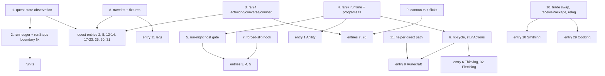

# Step manifest: every script `speedrun/run.ts` chains

This is the build list for the scored run. It has one entry per script that `speedrun/run.ts` will
chain for provisional order v1 (cairn://p/rs/103): the scored account's step scripts, the
transition legs, the helper-side scripts those steps wait on, and `run.ts` itself. The main thread
files one builder per entry. The order is **build priority**: the entry with the most ticks at
stake comes first (section 1 says how that was computed). The last section lists the shared
primitives the builders need first.

The scored account is called **SCORED** everywhere. Its real name lives only in its gitignored
`bots/<name>/bot.env`; no script, log line, commit or document names it. The sibling
`RUN-ORDER.md` carries the step table, relog plan and reconciled total for the same order.
cairn://p/rs/111 reconciled the two with the labs rs/104-108 (run-transitions, bones-placement,
stun-pack, wine-window, levelup-cost under `research/`), rs/129's supply fallbacks and rs/127's
`RESILIENCE.md`: **every step's expected and best here is RUN-ORDER.md v2's figure**, and the
moves are the same (S17 last, after S27; the bones in S07's knife loop; S18 one measured row; gems in
the wine windows).

## How to read an entry

**Step IDs** are provisional order v1's S00-S27 (cairn://p/rs/103). A quest or skill that the order
splits gets one module and one `Step` object per ID, so `S10a` is Prayer 1-43 and `S10b` is Tree
Gnome Village.

**Three tick figures** per entry, all on SCORED's clock (in-world ticks at 300 ms):

- **Expected** is RUN-ORDER.md v2's knife-on expected for the step. For a quest that is the
  fixed-client column with its failure budget (`quests/README.md` §3). For a knife skill it is the
  **knife** figure at rs/97's in-page rates, the column RUN-ORDER.md's headline uses while the run
  gate holds; the plain loop is the step's fallback, and RUN-ORDER.md shows the knife-off total
  beside it.
- **Best** is the fast path as measured on the direct path: the knife column, the burst-dialogue
  column, the rs/91 kit, and so on.
- **Fallback** is what the step costs when its fast path fails: for a knife skill the plain loop
  (the knife-off column). For a quest it is the stock column,
  because read-then-act through the SDK relay costs about the stock client's 2 ticks per page (a
  relay reaction lands a tick late about half the time, cairn://p/rs/86 via `skills/README.md`,
  open question 1).

**Labels**, on every figure: **measured** (a committed lab script, named), **read** (a content or
engine line), **inferred** (arithmetic or a model over measured and read inputs, basis given), and
**estimated** (a judgement made here, with no model behind it). Sources are paths under
`docs/speedrun/` unless a branch is named. `[rs/41]` means read on cairn://p/rs/41/1/coordinator,
`[rs/59]` on cairn://p/rs/59/1/coordinator, `[rs/94]` on cairn://p/rs/94/1/builder and `[rs/97]`
on cairn://p/rs/97/1/builder.

**Mode.** An entry is **in-page** when its loop reacts on the decoded tick or sends on predicted
ticks. That means an rs/97 tick program inside the browser webclient, started and awaited through
`speedrun/lib/programs.ts` [rs/97] (`startProgram`, `awaitProgram`, `runProgram`, `probeInPage`).
Everything else is **overlay-driven** through the SDK and `speedrun/lib`. The reason is the relay:
an in-process reaction landed on the next tick 60 of 60 times, and the same reaction through the
loopback gateway 32 of 60 (`LAB.md`, "Direct path and relay").

**In-page figures.** rs/97 measured its programs on its wired branch, on a local engine in a
visible tab (direct path), reported to this issue as "rs/97 in-page results via main, 05:50": probe
60 of 60; knife iron 3.00 ticks per ore (200 of 200 on the predicted tick); knife normal trees from
level 1, 7.24 ticks per log; knife willow 4.83 ticks per log; knife fly 20-99, 4.26 ticks per
catch; pickpocket at 55, 0.173 rolls per tick; Wilderness Agility 66 ticks per lap. The in-page
entries take their acceptance thresholds from these figures and start from rs/97's branch
(cairn://p/rs/97/1/builder).

**Acceptance tests** come in two kinds. The local one runs on the lab engine at
`NODE_TICKRATE=300` (`LAB.md`; `speedrun/lab/lab.sh` or `docs/speedrun/scripts/lab.sh`), and an
in-page step runs there in a visible browser tab, because the lite client hosts no programs
(`programStatus` is null on lite). The demo one runs on rs-sdk-demo.fly.dev with a throwaway
`cairn_`-prefixed account outside the fleet's reserved ranges (the list in cairn://p/rs/101), and
never with SCORED. A demo test of an in-page loop only counts from an Ashburn vantage (the rs/86
runner); from anywhere else the network alone exceeds the reaction window. A step that needs
levels a throwaway cannot reach cheaply gets a demo test of its shared primitives and of whatever
part is level-free, and says so.

**`logoutSafe`** is the `Step` field from `speedrun/runner/step.ts`: true when SCORED can log out
right after the step and resume at the next one.

**Resumes from** (every entry): the game state `runResumable` (`speedrun/runner/resume.ts`, rs/127)
checks after a restart or a drop: the step's `done` test, its `inProgress` test and resume entry,
and any probes, from `RESILIENCE.md` section 5. Quest state comes from rs/114's
`speedrun/lib/quests.ts` and `docs/speedrun/quests/quest-state.md` (`questDone`, `questStatus`,
`questStage`, `questPoints`, `requireQuestStage(view, key, stage, {atLeast?})`, `readQuestStage`,
`journalProbe(key)`; PR #123, **pending rs/114's merge**). Route quest varps are not transmitted to
the client: status comes from the quest-list colours and the exact stage from a journal read, which
re-clicks if the journal has not opened within 3 ticks. The Mage Arena is not on the quest list; its
postcondition is items and messages.

## 1. Exposure and build order

**How exposure was computed.** Exposure is the entry's **expected** ticks on SCORED's clock, as
defined above: RUN-ORDER.md v2's figure for its steps. Entries are ranked by exposure. **At stake**
is fallback minus best: the ticks a good build wins over a failed fast path. Two rules place the
entries that have no exposure of their own:

- `run.ts` and its runner come first, because nothing can be accepted without them.
- Helper-side scripts (section 4) are ranked by the exposure of the step they gate. No step
  passes its demo acceptance without its helper.

**Entry numbers are stable ids**, cited by `RESILIENCE.md` section 5 and by section 4 here; the
**Rank** column is the build order. The v2 figures moved five ranks: Thieving (now 2,000 measured)
passes Fishing (now the knife's 1,995), the legs (1,382 measured) pass Runecraft and Smithing, and
Prayer (110, now inside S07) drops from 15 to 27.

The expected column sums to **32,099** (the steps) plus the legs' **1,382**; RUN-ORDER.md section 6
adds the allowances (hand-offs outside the figures, level-up pages, contention, overrun, relay,
retries, restarts) for its **34,766** knife-on expected (32,099 best), against the record of 35,916.

| Rank | # | Entry | Module | Steps | Expected | Best | Fallback | At stake | Mode | Code to start from |
|---|---|---|---|---|---|---|---|---|---|---|
| 0 | 0 | Run chain | `speedrun/run.ts`, `runner/resume.ts` | all | boundary idle 0 m (#92); restarts ~7 each | 0 | | | overlay | `runner/step.ts`, `runner/resume.ts` (main) |
| 1 | 1 | Agility | `speedrun/skills/agility.ts` | S11a, S17 | 4,146 | 3,942 | 4,634 | ~690 | in-page | rs/97 `agility` program, `agility-course.ts` |
| 2 | 2 | Monkey Madness | `speedrun/quests/monkey-madness.ts` | S15 | 4,077 | 3,726 | 4,611 | ~885 | overlay | `quest-mm-*.ts` |
| 3 | 3 | Woodcutting, with the bury | `speedrun/skills/woodcutting.ts` | S07 (+ S25b's bones) | 3,390 | 3,390 | 3,881 | ~490 | in-page | rs/97 `knife-cycle`; rs/137's bury variant; `bones-wc.ts` |
| 4 | 4 | Mining | `speedrun/skills/mining.ts` | S09 | 3,116 | 3,116 | 3,765 | ~650 | in-page | rs/97 `knife-mine`, `tickmanip-mine.ts` |
| 5 | 6 | Thieving and the stun pack | `speedrun/skills/thieving.ts` | S18 (S18b-d inside) | 2,000 | 1,908 | 1,975 + ~130 elsewhere | ~200 | in-page | rs/97 `pickpocket`; rs/132's `stunActions`; `stun-pack-thieve.ts` |
| 6 | 5 | Fishing | `speedrun/skills/fishing.ts` | S22 | 1,995 | 1,969 | 3,410 | ~1,440 | in-page | rs/97 `knife-cycle`, `tickmanip-cycle.ts` |
| 7 | 7 | Combat finish | `speedrun/skills/ranged.ts` (`combatFinish`) | S27 | 1,889 | 1,829 | 2,023-2,211 | ~380 | overlay | `cannon-kit.ts` (rs/59, on main) |
| 8 | 8 | The Grand Tree | `speedrun/quests/grand-tree.ts` | S11b | 1,576 | 1,441 | 1,846 | ~405 | overlay | `quest-grandtree-full.ts` |
| 9 | 11 | Transition legs | `speedrun/runner/legs.ts` + `speedrun/lib/travel.ts` | between steps | 1,382 | 1,382 | ~1,520 i | ~140 | overlay | `run-transitions-legs.ts`, `run-transitions-lib.ts` |
| 10 | 9 | Runecraft | `speedrun/skills/runecraft.ts` | S06, S21 | 1,186 | 1,186 | ~2,530 | ~1,340 | in-page | rs/131's `rc-cycle`; `runecraft-cycle.ts` |
| 11 | 10 | Smithing | `speedrun/skills/smithing.ts` | S25a | 1,147 | 1,107 | 1,330 | ~223 | overlay | `smithing-trade.ts` |
| 12 | 12 | Dwarf Cannon | `speedrun/quests/dwarf-cannon.ts` | S13 | 976 | 920 | 1,078 | ~158 | overlay | `quest-mcannon-*.ts` |
| 13 | 13 | Dragon Slayer | `speedrun/quests/dragon-slayer.ts` | S26 | 966 | 945 | 1,076 | ~131 | overlay | `quest-dragon-*.ts` |
| 14 | 14 | Tree Gnome Village | `speedrun/quests/tree-gnome-village.ts` | S10b | 896 | 842 | 1,005 | ~163 | overlay | `quest-tree-full.ts`, `quest-premm-fight.ts` |
| 15 | 16 | Firemaking | `speedrun/skills/firemaking.ts` | S03 | 695 | 650 | 735 | ~85 | overlay | `firemaking-line.ts` |
| 16 | 17 | Fight Arena | `speedrun/quests/fight-arena.ts` | S12 | 645 | 598 | 720 | ~122 | overlay | `quest-arena-run.ts` |
| 17 | 18 | Plague City | `speedrun/quests/plague-city.ts` | S08 | 620 | 564 | 737 | ~173 | overlay | `quest-plague-city-*.ts` |
| 18 | 19 | Mage Arena | `speedrun/quests/mage-arena.ts` | S16 | 581 | 574 | 606 | ~32 | overlay | `quest-magearena-*.ts` |
| 19 | 20 | Sea Slug | `speedrun/quests/sea-slug.ts` | S19 | 394 | 340 | 495 | ~155 | overlay | `quest-smallskill-seaslug.ts` |
| 20 | 21 | Romeo & Juliet | `speedrun/quests/romeo-juliet.ts` | S24 | 241 | 211 | 301 | ~90 | overlay | none (page counts only) |
| 21 | 22 | Druidic Ritual | `speedrun/quests/druidic-ritual.ts` | S24 | 239 | 220 | 284 | ~64 | overlay | none (page counts only) |
| 22 | 23 | Fishing Contest | `speedrun/quests/fishing-contest.ts` | S20 | 223 | 200 | 276 | ~76 | overlay | `quest-smallskill-fishingcompo.ts` |
| 23 | 24 | Magic (strike, enchant) | `speedrun/skills/magic.ts` | S02, S04 | 222 | 222 | ~250 | ~28 | overlay | `magic-strike.ts`, `magic-cadence.ts` |
| 24 | 25 | Goblin Diplomacy | `speedrun/quests/goblin-diplomacy.ts` | S24 | 188 | 168 | 229 | ~61 | overlay | none (page counts only) |
| 25 | 27 | Herblore | `speedrun/skills/herblore.ts` | S25e | 170 | 117 | ~200 e | ~83 | overlay | `delayfree-cycle.ts` |
| 26 | 26 | Pre-MM cannon session | `speedrun/skills/ranged.ts` (`cannonSession`) | S14 | 132 | 132 | ~162 | ~30 | overlay | `quest-premm-cannon.ts`, `ranged-cannon.ts` |
| 27 | 15 | Prayer (bones inside S07; the booth as fallback) | `speedrun/skills/woodcutting.ts` bury option; `speedrun/skills/prayer.ts` for the booth | S25b (S10a retired) | 110 | 80 | 735 (the booth) | ~655 | in-page with S07 | `bones-wc.ts`, `prayer-bury.ts` |
| 28 | 28 | Crafting | `speedrun/skills/crafting.ts` | S25d | 91 | 85 | 121 (no gems in the windows) | ~36 | overlay | `delayfree-cycle.ts` |
| 29 | 29 | Cooking (wine) + gems in the windows | `speedrun/skills/cooking.ts` | S25c | 80 | 75 | ~131 | ~56 | overlay | `wine-receive.ts` [rs/41], `wine-window-lab.ts` |
| 30 | 30 | Doric's Quest | `speedrun/quests/dorics-quest.ts` | S05 | 65 | 60 | 90 | ~30 | overlay | `quest-smallskill-doric.ts` |
| 31 | 31 | Cook's Assistant | `speedrun/quests/cooks-assistant.ts` | S23 | 27 | 22 | 41 | ~19 | overlay | `quest-primitives-dialogue.ts` |
| 32 | 33 | Hand-off H1 | `speedrun/runner/handoff.ts` | S01 | 8 | 8 | ~10 | ~2 | overlay | `lib/trade.ts`, `mule.ts` [rs/41] |
| 33 | 34 | Tutorial skip | `speedrun/skills/start.ts` | S00 | 8 (done) | 8 | - | - | overlay | done: SCORED claimed and parked at 8 ticks |
| 34 | 32 | Fletching | `speedrun/skills/fletching.ts` | S18d (inside the stun pack) | 0 | 0 | ~59 standalone | ~59 | in-page (with Thieving) | `stun-pack-thieve.ts`, `delayfree-cycle.ts` |

Every figure in the table is restated with its label and source in the entry below it. Helper-side
scripts are in section 4; the shared primitives and their build order are in section 5.

**The four findings this manifest first raised, and where they stand:**

1. **Quest state on the demo**: rs/114's `speedrun/lib/quests.ts` (quest-list status, journal
   stage, `questPoints`; PR #123, pending its merge).
2. **`runSteps` idled SCORED at every boundary**: fixed (#92, measured 2 ticks per boundary before
   and 0 after; main, 08:30).
3. **S09 starts at Mining 64**, not 49 (Plague City's 2,425 base): accepted by main (M0602).
4. **The tuned Runecraft cycle needs a direct-path giver**: the givers run on the Ashburn machine
   through rs/117's launcher; rs/131 builds the scored side's in-page cycle.

## 2. The run chain

### 0. `speedrun/run.ts` and the runner (all steps)

- **Serves:** every step, S00-S27, the legs between them, and the hand-offs. It holds the ordered
  `Step` list, opens SCORED's session, and chains the steps.
- **Chaining contract** (`speedrun/runner/step.ts`, read): a step is `{name, preconditions(state, c),
  run(ctx), postconditions(state, c), logoutSafe}`. `runSteps(session, steps, {log, c, from,
  shouldStop, logout})` takes a fresh tick and checks the preconditions, failing before `run`. It
  runs the step inside `measure`, takes the next tick and checks the postconditions; a failure is
  logged and fatal. After a `logoutSafe` step, if a stop was requested (SIGINT by default), it
  calls `logoutClean` and returns `resumeAt`. A stop during an unsafe step waits for the next safe
  boundary.
- **Parameters:** `--from=<step name or index>` (resume point; `resolveStart`), `--until=<step>`,
  `--client=browser` (default for the run; `lite` for lab dry runs), `--bot=<env name>` (the
  gitignored `bots/<name>/bot.env`; the name is never logged; log rows carry `SCORED`),
  `--log=<path>`, `--dry-run` (evaluate every precondition against the live state and stop),
  `--lab` (accept staff fixtures).
- **Preconditions:** a session that publishes advancing ticks (`openSession`, `waitAdvancingTick`);
  watchdog started; the in-page runtime present when the client is the browser (
  `startProgram(sdk, 'probe')` answers); the **tab gate** passed (section 5, item 5) before any
  in-page step starts in its fast mode. The gate has four conditions: the direct in-page probe at
  least 58 of 60; publication p90 at most 400 ms over the probe minute; at most 1 catch-up interval
  (< 200 ms) per minute; and a tab loop rate p10 of at least about 50 loops per second (main,
  05:50, via the rs/103 coordinator).
- **Run-machine setup** (a precondition the operator checks before S00; main, 05:50): power saving
  and the screensaver off; the remote-desktop session kept connected; the tab visible and
  unobscured; Chrome launched with `--disable-background-timer-throttling
  --disable-renderer-backgrounding --disable-backgrounding-occluded-windows`. Chrome throttles
  hidden or occluded tabs, and intensively after about 5 minutes, which would stall every in-page
  program. run.ts re-checks the loop rate between steps and refuses an in-page step's fast mode
  while it is low.
- **Postconditions:** total level 1,881. The tick log closed with a session-level row (below).
- **Ticks:** run.ts adds no actions of its own, but three things land on SCORED's clock.
  - **Step-boundary idle.** `runSteps` calls `nextTick` before the preconditions and again after
    `run`, and `nextTick` waits for a tick strictly after the current one (`lib/wait.ts`, read). So
    SCORED stands idle for about 1-2 ticks between steps, and those ticks fall outside every
    `measure` row: about 50-100 over the ~28 steps and ~25 legs (inferred from the read code).
    **Fix in the runner** (a `speedrun/runner/step.ts` change, section 5): check preconditions on
    the latest published state when it is from the current tick, and let the next step's first
    sends go out in the tick the previous step's last effect was observed. Only a postcondition
    that depends on the last action's effect should wait for it.
  - **Crash recovery.** A watchdog relaunch after `kill -9` was back in the world in 3.5-4.1 s, and
    the dropped player stayed in the world about 12-14 ticks meanwhile (measured,
    `lab/measure-session.ts`, `speedrun/README.md` "session.ts"). A dropped login with nothing to
    relaunch it stayed in the world about **4,600** unobserved ticks on the demo (cairn://p/rs/101,
    the rs/72 incident). rs/101 owns the measured drop-to-leave figures and the watchdog policy.
  - **Relogs.** The plan has **exactly two planned relogs**, both in the wine step (S25c). Each
    costs about 2 ticks, with a tail of tens of ticks about 1 time in 29 (measured, 29 demo
    relogs, one at 46 ticks; [rs/41] `helpers/wine.md`, "Relog risk"). That tail is on the
    scored clock and no timing removes it. **Any step that adds a relog must justify it against
    that figure.** An operator stop at a `logoutSafe` boundary is not a planned relog, but it
    costs the same.
- **Resume at step.** `runSteps` returns `resumeAt` after a clean stop, but nothing persists it, and
  the quest preconditions cannot be checked on the demo (finding 1). run.ts therefore needs a
  **run ledger** (`speedrun/runner/ledger.ts`, missing). It writes
  `speedrun/runs/<runId>.ledger.json` after every step and every quest segment: the step and
  segment completed, the quest stages SCORED reached, and the observed levels, inventory, equipment
  and tile. `--from` defaults to the ledger's next step, and each step's preconditions read the
  ledger for quest state and live state for everything observable. Long quests expose their
  segments as resumable sub-steps (`S15.H`), the way `quest-mm-full.ts` has a `STARTS` table per
  segment. A crash inside a logout-unsafe stretch resumes at that stretch's first segment.
- **Watchdog.** `startWatchdog(session)` wraps the whole run, paused around intended logouts
  (`speedrun/lib/session.ts`). It relaunches when the client exits, when ticks stop for 10, or when
  the gateway reports the bot dead (read). The relaunch is a takeover login, which the engine
  accepts while the dropped player is still in the world (measured, 3 of 3, `speedrun/README.md`).
  **Policy per cairn://p/rs/101:** never kill a client to log it out. Leave the world through
  `logoutClean`, or through a takeover login when the tab is wedged, so the character leaves within
  the relog budget and not after the server's idle timeout. For the browser client the relaunch
  opens a fresh tab at `browserUrl(env)`. `awaitProgram`'s `staleMs` (20 ticks) rejects a wedged
  page first, so the step fails cleanly and the watchdog takes over.
- **Tick log.** `TickLog` JSONL (`speedrun/lib/ticks.ts`): one `measure` row per step with
  `sessionId`, and `crossedSession` when the step spanned a relaunch (its ticks are then a lower
  bound). run.ts adds two things: a **session row** from the first in-world tick to the logout
  click, so boundary ticks are counted, and per-program rows from `ProgramStatus`. Those carry the
  counters, `skippedTicks`, `deferred`, `frames` and `publish` summaries, and are what the host
  gate and the fold-in read. `bun speedrun/lib/ticks.ts report <file>` prints the table. The
  check after the run is the public hiscore playtime.
- **Primitives:** `runner/step.ts`, `lib/session.ts` (`openSession`, `launchClient`, `logoutClean`,
  `login`, `startWatchdog`), `lib/ticks.ts` (`measure`, `report`), `lib/programs.ts` [rs/97],
  `lib/hostgate.ts`. **Missing:** the run ledger; the quest-state observation; the boundary fix in
  `runSteps`; `relog` (on the [rs/41] branch of `session.ts`, not on main); the browser-tab
  relaunch path under rs/101's policy.
- **Mode:** overlay-driven. It only starts, awaits and stops.
- **Fallback:** on a precondition failure, stop at the boundary with the ledger written and do not
  improvise. On a run failure inside an unsafe stretch, re-run from that stretch's first segment
  if the ledger and the live state allow it, otherwise stop for the operator.
- **Acceptance, local:** `speedrun/lab/lab.sh srlab1 'speedrun/run.ts:--lab:--client=lite:--from=S00:--until=S02'`
  on a fresh bot. Pass: three steps logged, and the session row's ticks minus the sum of the step
  rows is **at most 1 tick per boundary** after the boundary fix (2 before it). Then kill the
  client mid-S02. The watchdog must be back in the world in under 5 s (3.5-4.1 s measured), and
  `--from` (from the ledger) must resume S02 with its preconditions true. Then a SIGINT during an
  unsafe step must log out only at the next `logoutSafe` boundary.
- **Acceptance, demo (throwaway):** S00-S02 on a brand-new throwaway in the browser webclient
  through `proxy.ts` with `?server=` and `?gateway=`. Pass: the session row matches the public
  hiscore playtime after logout within 2 ticks, and one deliberate SIGINT stop and resume costs at
  most 2 + 2 ticks beyond the steps (the relog figure above).
- **Start from:** `speedrun/runner/step.ts`, `speedrun/runner/example-bank.ts`, `speedrun/lib/session.ts`.

## 3. Scored-account steps, by exposure

### 1. Agility: `speedrun/skills/agility.ts` (S11a gnome course 1-22, S17 Wilderness course 75-99)

- **Serves:** S11a, laps of the Gnome Stronghold course to 22 before The Grand Tree, whose only
  Agility check is `stat(agility) < 25` (read, `quest_grandtree.rs2:25`; an Agility potion covers
  the last 3). And S17, Wilderness course laps from 75 to 99 right after the Mage Arena.
- **Parameters:** `course: 'gnome' | 'wilderness'`, `untilLevel` (22 / 99), `food` and `eatBelow`,
  `technique: 'react' | 'plain'` (the rs/97 program's switch), `startStep`.
- **Preconditions:** S11a: Tree Gnome Village complete (the village spirit tree reaches the
  stronghold; ledger), position at the course start (2474,3436). S17: Agility 75 from The Grand
  Tree's 7,900 base (read, `quest_grandtree.rs2:199`; `skills/agility.md` §3), ridge-gate Agility
  52 (read, `wilderness_course.rs2:2`), about 10-12 sharks (`skills/README.md`), no item worth a
  player kill. Position at the pipe (3004,3938), Wilderness levels 50-56.
- **Postconditions:** Agility 22 (S11a) or 99 (S17); food left. Items out: none.
- **Ticks:** S11a **122** (inferred: 149.4 base at 1.22 per tick, from a 70.7-tick lap measured at
  100 ms only; `skills/agility.md` §2-3). S17 expected **4,024** (inferred, `agility-model.ts
  --lap=66` over a 66-tick clean lap, measured 9 of 9 at 300 ms on bbs with the fixed lite client;
  `skills/agility.md` §1-2). Best about **3,820** (inferred: the lab fell 4 times in 39 laps
  against the model's 9, so the model reads about 5% pessimistic; `skills/agility.md` §2).
  Fallback **4,512** at the 74-tick lap a relay-driven loop would pay (inferred, same section). The
  entry total is 4,146 expected, ~3,945 best and 4,634 fallback.
- **Primitives:** `lib/programs.ts` `runProgram(sdk, 'agility', {course, untilLevel, food,
  eatBelow})` [rs/97]; the in-page probe before S17; `levelup` (dismissal is inside the program;
  verify); `session.logoutClean` for the post-combat 16-tick rule if attacked. **Missing:** an
  escape for a hostile player in the Wilderness (stop the program, walk south out of level 20,
  then teleport). Nothing in the program reads `nearbyPlayers`.
- **Mode:** in-page. Every obstacle pays one reaction, and that is the 66 vs 74 difference.
- **Fallback:** `technique: 'plain'` (a settle wait after each completion) when the in-page probe
  fails, priced at 74-tick laps. A fall is handled inside the program: it waits out the fail
  script, climbs out of a pit and resumes at `stones` (`agility-courses.ts` `resume`) [rs/97].
- **Acceptance, local:** a browser tab on the lab engine, `::setstat agility 99` at the pipe, then
  `runProgram(sdk, 'agility', {course:'wilderness', laps:10})`. Pass: at least 8 of 10 clean laps
  at **66 ticks** (tolerance +1). That figure is measured both on the lite client and in the page
  (rs/97 in-page results via main, 05:50). Gnome course from level 1 to 22: first
  **measure** it at 300 ms (the 70.7-tick lap is a 100 ms figure), then pass within 5% of that
  measurement and of the 122 inferred.
- **Acceptance, demo (throwaway):** from Ashburn, the in-page probe at least 58 of 60, then 10
  gnome laps on a fresh throwaway (no level needed). Pass: mean lap within 1 tick of the local
  browser figure. The Wilderness course needs level 52, so it is local only.
- **Start from:** rs/97 `programs/agility.ts` and `agility-courses.ts` (gnome, barbarian and
  wilderness as data); `docs/speedrun/scripts/agility-course.ts`, `agility-model.ts`.
- **logoutSafe:** S11a yes. S17 no: it ends in level 50+ Wilderness, so the step's last segment is
  the exit, and the leg out is part of the step.

### 2. Monkey Madness: `speedrun/quests/monkey-madness.ts` (S15)

- **Serves:** S15, Monkey Madness with reward option 1 at Daero (35,000 Strength and Hitpoints, 20,000
  Attack and Defence, 3 QP; read, `mm_daero.rs2:294-302`).
- **Parameters:** `templeMethod: 'ladder' | 'wait'` (rs/59's ladder drop or the guard-cycle wait),
  `returnMonkey: 'walk' | 'glider' | 'glory'` (spirit trees delete the monkey,
  `spirit_tree.rs2:74-76`, read), `dialogue: 'burst' | 'fixed'`, `from` (a segment letter, A-Z).
- **Preconditions:** Tree Gnome Village and The Grand Tree complete (read, `king_narnode.rs2:7-10`;
  `%treequest` 9 and `%grandtree` 160, ledger). Ranged 50 **base** for the magic shortbow (read,
  `tier50.rs2:6`), from S14. Prayer 43 for both protect prayers. The helper trade before segment A
  (`quests/README.md` §4 step 8): gold bar, ball of wool, monkey bones, 5 bananas, magic shortbow +
  100 rune arrows, 4-6 prayer potions, about 15 food, Varrock and Ardougne runes, a second
  antipoison(4). The puzzle needs the OPHELD send that rs/23 fixed **in the lite client**; that the
  browser webclient sends it too is **unverified** and must be checked before this step is
  accepted. Arrival levels are Defence 1, ~42 HP, Strength 1 and Magic ~76 (inferred, rs/56
  timeline in `quests/README.md` §4).
- **Postconditions:** quest complete (ledger; reward xp visible: Strength ~97, Attack 99, Defence ~89
  per `quests/README.md` §2), 3 QP (20 of the 32 so far). Items out: the bow and leftover arrows
  can go back to a helper. The gree-gree is not needed later.
- **Ticks:** expected **4,077** (fixed client, with the failure budget: 3,897 success + ~180; inferred,
  `quests/README.md` §3 row, which includes rs/59's temple ladder drop at 33-36 measured and the
  walked zoo return +100 inferred). Best **3,546** (burst, success path, r21 recomputation, same
  row). Fallback **4,611** (stock column with failures, same row). The quest document's own split:
  travel 2,277, dialogue 826 fixed / 463 burst, interactions 250, fight 267, waits 336 (mixed
  measured, read and inferred; `quests/monkey_madness.md`, "Tick total"). The Ape Atoll hazards
  were measured at 70/70/70 and the route arrives at Defence 1 (open item (a), `quests/README.md`).
- **Primitives:** `lib/dialogue.ts` `continueBurst` with known page counts, guarded choices (rs/94
  `converse.ts`); rs/94 `act.ts` (re-send on dropped clicks), `world.ts`, `combat.ts` (fight loop
  with level-up dismissal and the protect-prayer re-engage fix); `lib/trade.ts` `receiveFrom`;
  `lib/travel.ts` (missing: teleports, gliders, Lumdo). **Missing:** a puzzle solver as a library
  function (from `quest-mm-puzzle-sim.ts`); per-segment ledger checkpoints.
- **Mode:** overlay-driven. Nothing in it is a predicted-tick loop. The Jungle Demon is fought with
  a bow from 6+ tiles, which tolerates a relay tick.
- **Logout-unsafe stretches** (`quests/README.md` §4 step 8; temporary varps `mm_cutscene_part`,
  `varp_369`, `varp_370`, `mm_guards_cooldown`, read via `quests/primitives.md` §8): the hangar
  puzzle's last tile to the powered hangar; the three chapter cutscenes; the sigil to the Jungle
  Demon kill. Each is one segment with `logoutSafe: false`.
- **Fallback:** temple ladder drop fails, then wait for the access tile on the guards' 1-tile
  wander cycle (about +600 expected for the scrum; inferred, `quests/monkey_madness.md`, "Random
  steps"). On a death, the respawn route back (about 340, inferred, same table) and a regear trade.
  If the burst fails, `continueBurst` drops to `advance` at 1 tick per page.
- **Acceptance, local:** `quest-mm-full.ts`'s segments ported into the module, run end to end at
  **route levels** (Defence 1, ~42 HP, Strength 1, Magic ~76, Ranged 50, Prayer 43) at 300 ms, 3
  runs. Pass: success-path runs within 10% of **3,897** (fixed) or 3,546 (burst client), the temple
  by ladder drop in 3 of 3 with no death, and the Jungle Demon re-run at 300 ms (it was measured
  at 100 ms only). These runs close open item (a).
- **Acceptance, demo (throwaway):** not feasible end to end, because it needs both gnome quests, Ranged
  50 and Prayer 43. The demo coverage is the shared primitives' demo tests (continueBurst landing,
  gliders and teleports in `travel.ts`, `receiveFrom`) plus the puzzle's OPHELD send from the
  browser client on any sliding puzzle the throwaway can reach.
- **Start from:** `quest-mm-full.ts` (gnome half A-G, with a `STARTS` table per segment),
  `quest-mm-atoll.ts`, `quest-mm-jail.ts`, `quest-mm-demon.ts`, `quest-mm-puzzle-sim.ts`,
  `quest-gnome-lib.ts` (being folded into `speedrun/lib` by rs/94).
- **logoutSafe:** no for the step as a whole; segment boundaries outside the three stretches are safe.

### 3. Woodcutting: `speedrun/skills/woodcutting.ts` (S07)

- **Serves:** S07, Woodcutting 1-99 near Taverley: normal trees to 15, oaks 15-73 from (2914,3494),
  willows 73-99 from (2920,3406) (`skills/woodcutting.md` §1).
- **Parameters:** `band` table (method preset `tree` / `oak` / `willow` and its standing tile),
  `technique: 'knife' | 'plain'` (chosen by the host gate, not by hand), `reanchor: 'xp'`,
  `dismiss: 'now'`, `keepProducts`, `respawnD` (felled-tree wait, from the observed player count).
- **Preconditions:** rune axe (any level, `skills/woodcutting.md` §1), knife and at least 1 normal
  log, Fletching 1, members world (the demo is one, `fly.toml:23`). Free inventory except the kit.
  Position on the band's tile. **Tab gate (main, 05:30 and 05:50, via the rs/103 coordinator):**
  knife mode only when the direct in-page probe reads at least **58 of 60**, state publication p90
  is at most **400 ms** over the probe minute, there is at most **1 catch-up interval (< 200 ms) per
  minute**, and the tab loop rate p10 is at least about **50 loops per second**. Otherwise plain, re-probed periodically (every 500 ticks while plain,
  `skills/tick-manipulation.md` §5). The in-page program resyncs on observed slips (rs/96, rs/97,
  rs/102).
- **Postconditions:** Woodcutting 99; axe, knife and logs kept (the knife loop consumes no logs in
  steady state; measured, all 10 logs kept over 150 willow logs, `skills/tick-manipulation.md` §1).
  Items out: none (products are dropped).
- **Ticks:** expected **3,958** (normal 4-tick cycle, demo respawn D=20; inferred,
  `woodcutting-model.ts`, 400 simulated runs; `skills/woodcutting.md` §2). Best **3,028** (inferred:
  ×0.765, the knife ratio measured on willows at 99, 5.53 to 4.23 ticks per log, `tickmanip-cycle.ts`;
  applying it to oak is inferred; `skills/woodcutting.md` §2). **In the page the knife measured
  4.83 ticks per willow log** against the lite client's 4.23 (rs/97 in-page results via main,
  05:50). At that ratio (4.83 / 5.53 = 0.873) the best is about **3,460** (inferred), and the knife
  is worth about 500 rather than 930. The fold-in (rs/111) should take the in-page figure and ask
  rs/97 why willows lose about 0.6 ticks per log in the page when iron and fly match the lite
  client. Fallback 3,958, plus a few hundred
  for one move to a second site under contention (estimated in `skills/README.md`, open question 5).
  Quiet server: 4,001 normal and 3,061 knife (inferred, same table).
- **Primitives:** `lib/programs.ts` `runProgram(sdk, 'knife-cycle', {method, technique, untilLevel,
  reanchor, dismiss})` [rs/97]; `probeInPage`; `lib/hostgate.ts` (`HostGate`, which needs the
  run-night rule, section 5 item 5). **Missing:** a program-side band change (oak to willow at 73
  means a stop, a walk and a new start; fine as three steps in the module); the forced-slip test
  hook (section 5, item 7).
- **Mode:** in-page. The starter goes out on R+1 and the target click must land in the tick after
  the roll (`skills/tick-manipulation.md` §5).
- **Fallback:** plain loop through the same program (`technique: 'plain'`) when the gate is off.
  The program re-anchors itself on a roll seen off phase. A late starter costs about one plain
  cycle and does not lose the lock (read, `cut_logs.rs2:83-85`; measured by holding 15% of
  starters a tick: willows **5.76** ticks per log against 5.03 on time and 5.84 plain;
  `skills/README.md`, open question 1).
- **Acceptance, local:** browser tab, lab engine at 300 ms, willows at 99: knife within 5% of **4.83**
  ticks per log, rs/97's in-page figure (and the target is 4.23, the lite figure, if rs/97 finds
  the gap), over 200+ logs; plain within 5% of 5.53. Normal trees from level 1: within 5% of
  **7.24** ticks per log (in-page). **Forced slip:** hold 15% of starters
  one tick. Pass: within 5% of **5.76** and never above plain, plus a second run with 3 injected
  overrun minutes (publication gaps > 400 ms followed by a < 200 ms catch-up) where the gate turns
  the knife off within one probe window. Oaks 65-74: within 5% of the measured **8.41** base xp
  per tick (`skills/woodcutting.md` §2).
- **Acceptance, demo (throwaway):** from Ashburn, a throwaway with the starter bronze axe at normal
  trees, 5 rounds of 20 logs knife and plain, alternating (the shape of the demo relay run in
  `skills/README.md`, open question 1). Pass: in-page probe at least 58 of 60, and knife ticks per
  expected roll within 5% of the local figure at the same level and tree.
- **Start from:** rs/97 `programs/knife-cycle.ts` (presets `tree`, `oak`, `willow`); `tickmanip-cycle.ts`,
  `woodcutting-chop.ts --click predict`, `woodcutting-model.ts`.
- **logoutSafe:** yes, at band boundaries.

### 4. Mining: `speedrun/skills/mining.ts` (S09)

- **Serves:** S09, iron on the six-rock cluster south of the Ardougne zoo (rocks 2602-2605,
  3233-3237) on a planned rotation, **64 to 99** (finding 3: Doric's 1,300 + Plague City's 2,425 =
  3,725 base; `skills/mining.md` §1).
- **Parameters:** `steps` (the rotation as stand>rock pairs), `respawn` (13 at about 1,260 online,
  19 on a quiet server; from the public player count, `player_count.rs2:1-4` via `skills/README.md`
  open question 4), `starter: 'knife' | 'none'`, `untilLevel: 99`.
- **Preconditions:** rune pickaxe, knife and about 5 normal logs, Fletching 1; Mining 64; position on
  the rotation's first standing tile. The same host-gate rule as Woodcutting.
- **Postconditions:** Mining 99; pickaxe, knife and logs kept (no log used over 200 ores, measured,
  `skills/mining.md` §1). Items out: none.
- **Ticks:** expected **3,765** (adjacent-rock "timer starter", 3.61 ticks per ore measured with
  `mining-rotation.ts`, 200 ores at emulated respawn 13; total inferred with `mining-model.ts`;
  `skills/mining.md` §1). Best **3,134** (knife, 3.00 ticks per ore measured with
  `tickmanip-mine.ts`, 2 × 200 ores; total inferred; same section). Fallback about **4,000** on a
  quiet server without the knife (inferred, same section). From 49, for comparison, 4,034 normal
  and 3,360 knife (inferred, `skills/mining.md` §1-2).
- **Primitives:** `runProgram(sdk, 'knife-mine', {steps, respawn, starter, untilLevel})` [rs/97];
  `probeInPage`; `HostGate`. **Missing:** the forced-slip hook; a rotation planner output as data
  (from `mining-rotation-plan.ts`) checked into the module.
- **Mode:** in-page. The ore drop, starter and run go out on R+1 and the rock click so it lands
  by R+3 (`skills/tick-manipulation.md` §5, "Mining, moving to the next rock").
- **Fallback:** `starter: 'none'`, the adjacent-rock trick ("plain only" in rs/97's `knife-mine`,
  the 3.61 cadence). Slip recovery is in the program: no xp within 6 labels, let the clock expire
  5 ticks, restart with one plain transition. Forced-slip reference: iron **3.51** ticks per ore
  with 15% of starters held, against 3.53 (measured; `skills/README.md`, open question 1). For
  contention, the second cluster north of East Ardougne (2710-2715, 3328-3332), 3.74 by the planner
  and 4.02-4.12 measured at respawn 19 without a starter (`skills/mining.md` §4).
- **Acceptance, local:** browser tab, 300 ms, respawn 13 emulated, 200 ores at 99. Pass: at most
  **3.15** ticks per ore (3.00 +5%). rs/97's program measured 3.00 with 200 of 200 on the predicted
  tick (rs/97 in-page results via main, 05:50), and rs/82's overlay loop measured 3.05 in a tab
  (`LAB.md`).
  Forced slip at 15%: at most 3.69 (3.51 +5%). Without the starter: within 5% of 3.61.
- **Acceptance, demo (throwaway):** needs Mining 15 for iron, which is cheap on a throwaway (about 61
  ticks of copper, `skills/mining.md` §2). From Ashburn: probe at least 58 of 60, then 100 iron ores
  knife against 100 adjacent-rock at the zoo cluster, at the observed player count. Pass: knife
  ticks per successful ore within 5% of the local figure at the same level and respawn.
- **Start from:** rs/97 `programs/knife-mine.ts`; `tickmanip-mine.ts`, `mining-rotation.ts`,
  `mining-rotation-plan.ts`, `mining-model.ts`, `mining-lib.ts`.
- **logoutSafe:** yes.

### 5. Fishing: `speedrun/skills/fishing.ts` (S22)

- **Serves:** S22, fly fishing at the Lumbridge river from 78 to 99, dropping each catch on the
  tick after it (`skills/fishing.md` §1).
- **Parameters:** `method: 'fly'`, `technique` (by the gate), `reanchor: 'xp'`, `dismiss: 'now'`,
  `untilLevel: 99`, standing tile (3241,3248).
- **Preconditions:** Fishing 78 (Sea Slug 7,175 + Fishing Contest 2,437 = 9,612 base; read via
  `skills/fishing.md` §1-3), fly fishing rod, about 520 feathers, knife and 1 normal log, Fletching
  1; the host-gate rule as for Woodcutting.
- **Postconditions:** Fishing 99. Items out: none (catches dropped).
- **Ticks:** expected **3,410** (normal 5-tick cycle; measured segment from 9,612 base,
  `fishing-rate.ts`, 673 catches at 300 ms; `skills/fishing.md` §2). Best **1,978-2,032** (knife,
  two measured runs from 9,612 and 9,620 base, `tickmanip-cycle.ts --mode=flylumb-knife`; same
  section). Fallback 3,410. In a visible tab, rs/82 measured 4.16 ticks per catch from 26 to 99,
  with 516 of 665 gaps at 3 (`LAB.md`). Compare the gap histogram, since ticks per catch depend on
  level.
- **Primitives:** `runProgram(sdk, 'knife-cycle', {method:'fly', ...})` [rs/97], `probeInPage`,
  `HostGate`. **Missing:** the forced-slip hook.
- **Mode:** in-page. This is the largest knife gain (`skills/tick-manipulation.md` §1).
- **Fallback:** plain fly. Forced-slip reference: **4.92** ticks per catch with 15% of starters held,
  against 3.86 on time and 6.61 plain (measured; `skills/README.md`, open question 1). Fallback
  site if the river is crowded: Barbarian Village, 9.34 base xp per tick against 9.83 (same
  section, open question 5).
- **Acceptance, local:** browser tab, 300 ms. From 20 to 99: within 5% of **4.26** ticks per catch
  (rs/97 in-page results via main, 05:50; the lite run's 2,896 ticks over 677 catches is 4.28). From
  78 to 99: within 5% of **2,005** (the mean of 1,978 and 2,032), with at least 75% of gaps at 3
  (rs/82's tab measured 78%). Forced slip: at most 5.17
  ticks per catch (4.92 +5%) at 99.
- **Acceptance, demo (throwaway):** fly fishing needs level 20 (201 + 78 ticks from level 1 by the
  small net, measured and inferred, `skills/fishing.md` §2). From Ashburn: probe at least 58 of 60,
  then 150 catches knife and 150 plain. Pass: knife gap-3 share within 5 points of the local
  figure at the same level.
- **Start from:** rs/97 `knife-cycle.ts` preset `fly`; `tickmanip-cycle.ts`, `fishing-rate.ts`.
- **logoutSafe:** yes.

### 6. Thieving and the stun pack: `speedrun/skills/thieving.ts` (S18)

- **Serves:** S18, pickpocketing Knights of Ardougne in the East Ardougne market from 57 to 99, with
  the stun pack: dragon bones buried in stuns, Charge 80-99 and Fletching (rune-tier actions)
  inside the stun windows, and top-up trades beside the knights (`skills/interleaving.md` §8,
  "Stun allocation on rs/3's Package B route").
- **Parameters:** `npc: 'Knight of Ardougne'`, `untilLevel: 99`, `eat: 'window'`, `food`,
  `eatBelow`, `forcedBelow`, and for the pack `stunActions` (bones at stun +2, +4, +6; Charge casts;
  fletch actions; at most 5 packets per tick) and `topUpEvery` (about 12 stuns).
- **Preconditions:** Thieving 57 (Fight Arena's 2,175 base, read via `skills/thieving.md` §1). Base
  Magic 80 for Charge (after the Mage Arena; `skills/magic.md` §1). Charge runes (about 490 blood +
  490 air; the staff can stand in for air), about 21-24 dragon bones per load, arrowheads and
  headless arrows, about 15-20 sharks (`skills/README.md`). HP 40+.
- **Postconditions:** Thieving 99, Magic 99 (Charge), Fletching 99 if the stun pack carries the whole
  route. Prayer raised by about 196 bones. Items out: coins and loot, to a helper or the bank.
- **Ticks:** Thieving expected **~2,040**: 1,975 (inferred, `thieving-model.ts`, from 57) plus about
  9-10 top-up trades at 5-9 each (~65, inferred, `skills/interleaving.md` §8). Best about 2,000: the
  run from 57 measured **1,952** at 100 ms (1 run, `thieving-pickpocket.ts`), and 55 to 99 measured
  **1,999** at 300 ms on bbs (1 run; `skills/thieving.md` §1). Fallback: the pickpocket cadence does
  not depend on latency because it clicks blindly every tick (`skills/thieving.md` §1), so a
  failed stun pack leaves Thieving at ~1,975 but moves **~470-490** standalone ticks of bones,
  Charge and Fletching to other steps (inferred, `skills/interleaving.md` §8).
- **Primitives:** `runProgram(sdk, 'pickpocket', {...})` [rs/97]; `lib/trade.ts` `receiveFrom` for
  top-ups in the success windows. **Missing:** rs/97's `pickpocket` program has no stun-window
  actions (its parameters are `npc`, `option`, `rolls`, `untilLevel`, `maxTicks`, `every`, `eat`,
  `food`, `heal`, `forcedBelow`, `eatBelow`). The stun pack needs a `stunActions` extension that
  sends the bury, Charge and fletch packets inside the stun and keeps the 2-tick success cadence
  (section 5, item 6). cairn://p/rs/106 measures the pack at route levels.
- **Mode:** in-page. The 2-tick re-click and the stun-window packets are on predicted ticks.
- **Fallback:** the plain pickpocket program with no stun actions. The bones then go to S25b and the
  Charge casts to a bank booth (33 ticks at 5 per tick, measured by rs/20 via `skills/magic.md` §1).
- **Acceptance, local:** browser tab, 300 ms. At 55, within 5% of **0.173** rolls per tick (rs/97
  in-page results via main, 05:50; lite 0.167); at 99, 0.35 rolls per tick (rs/82's tab, `LAB.md`). 57 to 99 within 5% of
  **1,975** with no stun actions. With the stun pack, rs/106's measured figures within 5%: at least
  1.96 bones per stun (measured, `skills/interleaving.md` §8) and no loss of the 2-tick success gap
  (at least 94% of success gaps at 2, against the tab's 170 of 181 at 55).
- **Acceptance, demo (throwaway):** knights need Thieving 55, which a throwaway can reach in about 641
  ticks (inferred, `skills/thieving.md` §2). Cheaper: Ardougne men at level 1 from Ashburn, 300
  rolls. Pass: success gaps at 2 ticks on at least 94% (the cadence is the same rule for every
  target), and a stun-window bury lands at stun +2 at least 9 times in 10.
- **Start from:** rs/97 `programs/pickpocket.ts`; `thieving-pickpocket.ts`, `interleave-thieve.ts`,
  `thieving-model.ts`.
- **logoutSafe:** yes, outside a stun (a stun is a delay, and logout waits while the player is
  delayed, `quests/primitives.md` §8).

### 7. Combat finish: `speedrun/skills/ranged.ts`, `combatFinish` (S27)

- **Serves:** S27, the last step: the cannon plus defensive melee at the Wilderness poison spiders
  (3288,3810) until Defence 99, then the cannon with the rune scimitar to Ranged 70, then the cannon
  plus rapid rune knives to Ranged 99. Hitpoints fills as a by-product (`quests/README.md` §4 step
  14).
- **Parameters:** `phase` thresholds (Defence 99, Ranged 70, Ranged 99); `flickEvery: 4` (3 when
  relay-driven, below); potion thresholds (super attack and super strength kept above half boost);
  `knives` per withdraw; `site`.
- **Preconditions:** Dwarf Cannon complete (ledger) and the cannon set from the cannon holder
  (section 4); about 1,000-1,300 cannonballs, up to about 760 rune knives, rune scimitar, about 9
  ranging doses, about 3 super antipoison, 1 dose each of super attack and super strength, a glory,
  1 antipoison(4) (`skills/README.md`, Ranged row). Prayer 43 at least (rs/91's kit flicks Protect
  from Melee, Ultimate Strength and Incredible Reflexes). Levels after Dragon Slayer: Attack 99,
  Strength 99, Defence gap 1,288 base, Hitpoints gap ~4,220 (`quests/README.md` §1, §6).
- **Postconditions:** Ranged, Defence and Hitpoints 99: total level 1,881. The run's last level-up is
  the score, so no exit leg is needed (`[rs/59] research/travel-and-overhead.md`, ranked row 4).
- **Ticks:** expected and best **1,857** (inferred from measured rates: 168 to Defence 99 at 13.66
  Ranged + 7.65 Defence per tick, then 1,688 to Ranged 99 at 21.95 Ranged per tick at 85;
  `cannon-kit-model.ts`; `quests/README.md` §4 step 14; `[rs/59] research/helper-fed-and-combat.md`
  §3). Fallback **2,023-2,211** without the kit (inferred from rs/31's rates, or rs/91's control;
  same step).
- **Primitives:** rs/94 `combat.ts` (fight loop, upkeep of prayer, potions and food); `lib/bank.ts`
  not used (no bank in the Wilderness). **Missing:** `speedrun/lib/cannon.ts` (set-up in about 5
  steps, reload every ~20 ticks, pick-up; from `ranged-cannon.ts` and `cannon-kit.ts`). A zero-drain
  flick scheduler (from `prayer-flick.ts` [rs/59]; each toggle runs `p_clearpendingaction`, so the
  attack is re-sent blind, `skills/ranged.md` §1).
- **Mode:** overlay-driven. The cannon's sweep and the knife clock are server timers, and the reload
  and retarget tolerate a relay tick. The flicks are the one predicted-tick part: drain runs from a
  5-tick timer, so a 4-tick flick that slips one tick risks a point. Through the relay, flick every
  3 ticks (an extra packet, within the 5 per tick). An in-page `flick` program is optional.
- **Fallback:** no kit (2,023-2,211). If prayer runs dry, fall back to rs/91's control with Protect
  from Melee held and potions sipped.
- **Acceptance, local:** `cannon-kit.ts` configurations 3 and 4 re-run through the module at the
  post-Dragon Slayer stats. Pass: within 5% of the measured 13.66 + 7.65 per tick (melee phase) and
  21.95 Ranged per tick at 85 (knives phase), with prayer points flat over 400 ticks.
- **Acceptance, demo (throwaway):** not feasible (needs Dwarf Cannon, Attack 99 and Wilderness level
  37). Demo coverage comes from the cannon-holder helper's demo test (section 4).
- **Start from:** `cannon-kit.ts`, `cannon-kit-model.ts`, `prayer-flick.ts` [rs/59]; `ranged-cannon.ts`,
  `ranged-model.ts`.
- **logoutSafe:** no (combat, Wilderness); it is the last step.

### 8. The Grand Tree: `speedrun/quests/grand-tree.ts` (S11b)

- **Serves:** S11b, after the gnome laps. Black demon by Fire Bolt at 80/1/1 and 28 HP under Protect
  from Melee (`quests/README.md` §4 step 4).
- **Parameters:** `demonSpell: 'fire_bolt' | 'fire_blast'`, `dialogue: 'burst' | 'fixed'`, `from`
  (segment A-P).
- **Preconditions:** Tree Gnome Village complete; Agility at least 22 and an Agility potion (the
  check is `stat() < 25`, read); Plague City done and Magic 51 for the Ardougne teleport
  (`%elenaquest` ≥ 30, read, `teleport.rs2:22-38`); Prayer 43 and the prayer potions from S10's
  trade; Varrock and Ardougne runes.
- **Postconditions:** `%grandtree` 160 (ledger); Agility 75; Attack +18,400, Magic +2,150 (read,
  `quest_grandtree.rs2:199-201`); 5 QP; Gnome Air (glider) available.
- **Ticks:** expected **1,576** (fixed, inferred, `quests/README.md` §3 row; black demon 153
  measured, rs/56, n=5). Best **1,441** (burst, r21). Fallback **1,846** (stock, inferred).
- **Primitives:** rs/94 `converse`, `act`, `combat` (spell fight with Protect from Melee, re-engage
  fix); `continueBurst`; `travel.ts`; `trade.receiveFrom`.
- **Mode:** overlay-driven.
- **Logout-unsafe:** from opening Glough's trapdoor to the black demon kill, because the demon
  deletes itself on logout or beyond 17 tiles (`quests/README.md` §4). Protect from Melee goes on
  before the trapdoor opens.
- **Fallback:** Fire Blast if Fire Bolt's casts run short (Magic ~64 after the warlord, unmeasured
  for the demon); `advance` page by page if the burst fails.
- **Acceptance, local:** at the route's levels, 3 runs. Pass: within 10% of 1,576 fixed (1,441 with
  burst); demon kill within 10% of 153; 0 damage under Protect from Melee (as in rs/56's 20 fights).
- **Acceptance, demo (throwaway):** the level-free opening segments (King Narnode, the first
  dialogues, the glider and spirit tree legs) on a throwaway with TGV done. Pass: within 10% of the
  local segment ticks. Doing TGV first costs a throwaway about 900 ticks, so it is optional.
- **Start from:** `quest-grandtree-full.ts`, `quest-grandtree-roots.ts`, `quest-premm-fight.ts
  blackdemon`, `quest-gnome-lib.ts`, `quest-gnome-routes.ts`.
- **logoutSafe:** yes at the end.

### 9. Runecraft: `speedrun/skills/runecraft.ts` (S06 air altar 1-44, S21 nature altar 44-99)

- **Serves:** S06, 7 crafts at the air altar; S21, 161 crafts at the nature altar. SCORED stands at
  the altar inside the room and never leaves; a helper beside it trades 27 rune essence per cycle
  (`skills/runecraft.md` §1).
- **Parameters:** `altar: 'air' | 'nature'`, `schedule: 'tuned' | 'robust'` (7 or 8 ticks),
  `giver` (the helper's display name), `untilLevel`.
- **Preconditions:** the talisman (air or nature; tradeable) for entry; S21 needs Runecraft 44 and a
  charged glory to Karamja. Standing tile (2844,4832) air or (2400,4839) nature. The in-room
  helper inside the room and on a direct path. The **tuned** schedule also needs the helper
  processed before SCORED in the tick ("helper first", `skills/runecraft.md` §4; the lab sets that
  order by login order, `runecraft-lab.sh`); otherwise use **robust**.
- **Postconditions:** Runecraft 44 (S06) or 99 (S21). Items out: the rune stacks (air, nature) stay
  in one slot each, or go to a helper. Talisman kept.
- **Ticks:** expected and best **1,330**: crafting 1,176 at 7 ticks (49 air + 1,127 nature;
  measured cycle, 8 of 8 at air 1 and 13 of 14 at nature 44, totals inferred; `skills/runecraft.md`
  §1-2) plus about 150 of travel (inferred, same doc §6). Robust schedule 1,344 + 150 = 1,494
  (inferred, §2). Fallback **~2,670**, the stock SDK's 15-tick reacting cycle (2,520 + 150;
  measured cycle, inferred total, §2). Busy-host caveat: measured on the Mac at load 11-18.
- **Primitives:** **Missing in-page program** `rc-cycle`. rs/97 registers only `probe`,
  `knife-cycle`, `knife-mine`, `pickpocket` and `agility` [rs/97 `programs/index.ts`]. The scored
  side sends the trade request on T+5, accepts on T+6, confirms and clicks the altar on T+7,
  re-anchoring on the observed craft. `lib/trade.ts`'s pure `decideReceiver` can supply the
  confirm-screen safety check.
- **Mode:** in-page. It is a blind schedule whose packets must each land on their tick, which the
  relay's 2-3 ticks would break (`skills/runecraft.md`, "Client"). The helper side has the same
  constraint (finding 4).
- **Fallback:** the robust 8-tick schedule if the processing order is wrong; the stock reacting cycle
  (15) if the page program faults; helpers outside the room (25 ticks per cycle, 4,200 for nature;
  measured, §2) only as a last resort.
- **Acceptance, local:** a browser tab for SCORED and a direct-path helper on the lab engine at 300
  ms, nature altar at 44, 30 cycles. Pass: at least 28 of 30 cycles at **7** (measured 13 of 14),
  and robust at 8 in either login order.
- **Acceptance, demo (throwaway):** air altar on two throwaways (an air talisman, essence from the
  helper stock), both from Ashburn on the direct path, 20 cycles. Pass: at least 18 of 20 at 7, or
  at 8 under robust.
- **Start from:** `runecraft-cycle.ts` (`--mode=tuned|robust`, two bots), `runecraft-lib.ts`,
  `runecraft-model.ts`, `runecraft-probe.ts`.
- **logoutSafe:** yes between cycles.

### 10. Smithing: `speedrun/skills/smithing.ts` (S25a)

- **Serves:** S25a. On the Varrock west anvil (3188,3426), the anvil helper beside it (3187,3427)
  trades 25 bars per inventory and takes the 5 products back, and SCORED makes 5 platebodies per
  make-5 click (`skills/smithing.md` §1).
- **Parameters:** `giver`, the inventory plan (one mixed bronze/iron inventory to 34, then platebodies
  in iron 33, steel 48, mithril 68, adamant 88), `untilLevel: 99`.
- **Preconditions:** a hammer; the anvil helper staged with bars (15 bronze, 39 iron, 95 steel, 280
  mithril, 340 adamant; `skills/README.md`); position on the anvil tile.
- **Postconditions:** Smithing 99. Items out: every product back to the helper.
- **Ticks:** expected **1,147** (measured end to end, `smithing-trade.ts --from 1 --until 99`, 300 ms,
  31 inventories; the first trade waited 40 ticks on the lab helper). Best about **1,107** with the
  helper staged (inferred, `skills/smithing.md` §1). Fallback about **1,330** (bank at the Varrock
  west booth, raw packets; inferred from the measured 42-tick bank cycle, same table). About 4
  reactions per inventory (§1, "Client"); through the relay from Ashburn that is roughly +60
  (inferred: 31 inventories × 4 reactions × ~0.47, the share of relay reactions that land late,
  cairn://p/rs/86 via `LAB.md`).
- **Primitives:** `lib/trade.ts` (`receiveFrom` with `want`; SCORED also offers its 5 products, which
  `receiveFrom` does not do: it declines when its own offer is non-empty). **Missing:** a two-way
  swap primitive (`swap(sdk, partner, give, want)`) in `lib/trade.ts`; the smithing interface
  make-5 click as a library call.
- **Mode:** overlay-driven. An in-page trade-and-make program would recover the ~60 relay ticks,
  which is optional.
- **Fallback:** the bank cycle.
- **Acceptance, local:** with a staged helper, 1 to 99. Pass: within 5% of **1,107**, and a turnaround
  of at most 10 ticks per inventory (the measured 9-10).
- **Acceptance, demo (throwaway):** two throwaways at the Varrock west anvil, 5 inventories of bronze
  bars. Pass: turnaround within 1 tick of the local figure plus the measured relay share.
- **Start from:** `smithing-trade.ts`, `smithing-cycle.ts`, `smithing-model.ts`.
- **logoutSafe:** yes between inventories.

### 11. Transition legs: `speedrun/runner/legs.ts` on `speedrun/lib/travel.ts` (between steps)

- **Serves:** every move between two steps that is not inside a quest's own travel. A leg is a `Step`
  built from data, `leg(from, to, method)`, so legs are logged and resumable like steps. The legs
  deserve one module because there are about 25 of them and they share every primitive.
- **Parameters:** per leg: method (spell teleport, glory, chained run, spirit tree, glider, lever),
  destination tile and tolerance, the runes or jewellery used, `enchantWhileWalking` (S04's rings).
- **Preconditions:** the runes or charges for the method; outside combat if the next step needs a
  logout boundary; Wilderness level at most 20 for spells and 30 for the glory (measured,
  `quests/primitives.md` §4).
- **Postconditions:** within the tolerance of the destination tile.
- **Ticks:** about **1,000** for the whole order (estimated: the v1 legs priced on the travel matrix
  of `[rs/59] research/travel-and-overhead.md`, at a cast of 4 measured or a glory of 6 measured
  plus 0.5 per Chebyshev tile, with real routes about 28% longer as measured once in
  `quests/primitives.md` §2). Best about 800 (estimated, at the matrix's straight-line lower
  bounds). Fallback about 1,300 (estimated: `bot.walkTo` at 0.57 per tile, measured, same §2).
  cairn://p/rs/104 measures every leg; its figures replace these in the fold-in.
- **Primitives:** **missing** `speedrun/lib/travel.ts`: `teleport(spell)` (4 ticks, measured),
  `glory(dest)` (6, measured), `runTo(tile)` with chained clicks re-sent 3 tiles before each
  leg ends (84-85 ticks for 165 tiles, measured, `quests/primitives.md` §2), spirit tree, glider (13,
  measured), the Ardougne lever, and the walk's "skill while running" hook (a cast never re-clicks
  the walk in its own tick; `[rs/59] research/travel-and-overhead.md`, ranked row 2).
- **Mode:** overlay-driven.
- **Fallback:** walk the route when a teleport is refused.
- **Acceptance, local:** each leg within 10% of rs/104's measured figure.
- **Acceptance, demo (throwaway):** a throwaway with runes runs the level-free legs (Lumbridge to
  Varrock west, the Falador teleport to Taverley, the Ardougne teleport legs once it has Plague City
  are optional). Pass: within 10% of the local figure. The demo measured 159 ticks for a new
  account's walk from Lumbridge to Varrock west bank ([rs/41] `helpers/wine.md`, "Where the Cooking
  step goes").
- **Start from:** `quest-primitives-movement.ts`, `quest-primitives-teleports.ts`,
  `quest-primitives-transport.ts`, `travel-walk-enchant.ts` [rs/59], `quest-magearena-travel.ts`.
- **logoutSafe:** yes, except legs inside or out of the Wilderness above level 20.

### 12. Dwarf Cannon: `speedrun/quests/dwarf-cannon.ts` (S13)

- **Serves:** S13, and the same module on a helper account (the cannon holder, section 4).
- **Preconditions:** runes for 2 Ardougne and 1 Falador teleports (`quests/README.md` §4 step 6).
- **Postconditions:** quest complete (ledger), 750 Crafting, 1 QP, the right to buy the cannon (read,
  `nulodion.rs2:2` via rs/41).
- **Ticks:** expected **976** (fixed, inferred), best **920** (burst, r21), fallback **1,078** (stock,
  measured) (`quests/README.md` §3 row).
- **Primitives:** rs/94 `converse`, `act`, `world`; `continueBurst`; `travel.ts`.
- **Mode:** overlay-driven. **Logout-unsafe:** none; all varps are permanent.
- **Fallback:** `advance` page by page.
- **Acceptance, local:** `quest-mcannon-run.ts`'s route through the module, 3 runs. Pass: within 10%
  of 976 fixed (920 burst).
- **Acceptance, demo (throwaway):** feasible end to end (no level gate is recorded in
  `quests/dwarf_cannon.md`). Pass: within 10% of the local figure. That run also produces the
  cannon holder.
- **Start from:** `quest-mcannon-run.ts`, `quest-mcannon-setup.ts`.
- **logoutSafe:** yes.

### 13. Dragon Slayer: `speedrun/quests/dragon-slayer.ts` (S26)

- **Serves:** S26: the Champions' Guild door (32 QP), Oziach, the Oracle, Ice Mountain, the Duke,
  Melzar's Maze, Wormbrain, the ship, Ned, the voyage and Elvarg (`quests/README.md` §4 step 13).
- **Preconditions:** 32 QP (17 route + 4 Druidic Ritual + 11 filler; read, `champions_guild.rs2:2`);
  Monkey Madness done (Attack 99, Strength ~97, Defence ~89; rune armour needs base Defence 40,
  read); the trade of 12,000 coins, wizard's mind bomb, silk, lobster pot, unfired bowl, 3 planks, 12
  steel nails, hammer, rune scimitar, rune full helm, chainbody and platelegs, amulet of strength,
  about 10 sharks, glory, Varrock, Lumbridge and Falador runes (same step).
- **Postconditions:** quest complete; 18,650 Strength and Defence (read); 2 QP. Items out: armour can
  go back to a helper.
- **Ticks:** expected **941** (fixed, inferred, with Elvarg at ~70 from 64-75 measured at 99, n=2),
  best **925** (burst, r21), fallback **~1,051** (stock, inferred) (`quests/README.md` §3 row).
- **Primitives:** rs/94 `converse`, `act`, `combat`; `continueBurst`; `travel.ts`.
- **Mode:** overlay-driven. **Logout-unsafe:** none, every varp is permanent (read). A death on
  Crandor is expensive and its return is untested.
- **Fallback:** page by page; on a death, the respawn route (untested; to be measured).
- **Acceptance, local:** `quest-dragon-*.ts` ported, at the post-MM stats, 3 runs. Pass: within 10% of
  941, and Elvarg within 10% of 70.
- **Acceptance, demo (throwaway):** not feasible (32 QP). Demo coverage: the shared primitives.
- **Start from:** `quest-dragon-guild.ts`, `quest-dragon-voyage.ts`, `quest-dragon-elvarg.ts`,
  `quest-dragon-lib.ts`, `quest-dragon-wreck-probe.ts`.
- **logoutSafe:** yes.

### 14. Tree Gnome Village: `speedrun/quests/tree-gnome-village.ts` (S10b)

- **Serves:** S10b, right after Prayer 43 is buried (S10a) from the same trade. Ardougne teleport to the
  maze; the warlord by Fire Blast at 1/1/1 and 10 HP under Protect from Melee.
- **Preconditions:** Magic 59 (Fire Blast, from S04); Plague City done (teleport); Prayer 43; the
  pre-MM trade (`quests/README.md` §4 step 3): 6 logs, staff of fire, amulet of magic, 2 Prayer
  potion(4), 1 Antipoison(4), 2 sharks, and Fire Blast runes for about T/5 casts per fight (the
  rune counts in `pre_mm_fights.md` look too high, flagged by rs/81).
- **Postconditions:** `%treequest` 9 (ledger); 11,450 Attack; Magic about 64; 2 QP; village spirit
  tree.
- **Ticks:** expected **896** (fixed, r21, including ~103 inferred to reach the maze and the trade;
  warlord 133 measured by Fire Blast, rs/56, n=2), best **842** (burst), fallback **1,005** (stock)
  (`quests/README.md` §3 row).
- **Primitives:** rs/94 `converse`, `act`, `combat` (spell fight); `continueBurst`; `travel.ts`;
  `trade.receiveFrom`.
- **Mode:** overlay-driven. **Logout-unsafe:** Bolren's closing ceremony until the quest scroll shows
  (`quests/README.md` §4).
- **Fallback:** Fire Bolt at Magic 51 (warlord 165 measured, n=6: +32).
- **Acceptance, local:** `quest-tree-full.ts` at route levels, 3 runs. Pass: within 10% of 896, and
  the warlord within 10% of 133.
- **Acceptance, demo (throwaway):** the maze and the first dialogues on a throwaway (no level gate).
  Pass: within 10% of the local segment.
- **Start from:** `quest-tree-full.ts`, `quest-gnome-fights.ts`, `quest-premm-fight.ts warlord`,
  `quest-gnome-setup.ts`.
- **logoutSafe:** yes at the end.

### 15. Prayer: `speedrun/skills/prayer.ts` (S10a 11 bones, S25b the remaining bones)

- **Serves:** S10a, 11 dragon bones buried for Prayer 43 before the warlord. S25b, the bones not
  buried in Thieving stuns, about 348 (555 - 11 - 196; `skills/interleaving.md` §8). Where those
  should go is cairn://p/rs/105's question, and cairn://p/rs/107 tests the wine step's idle bank
  ticks for them.
- **Parameters:** `bones` count, `mode: 'booth' | 'inline'`, `untilLevel`.
- **Preconditions:** the bones (from TGV's trade in S10a; from the mule at Varrock west in S25b); a
  bank booth for S25b.
- **Postconditions:** Prayer 43 (S10a), 99 by the end of S25b. Items out: none.
- **Ticks:** S10a **21** (measured, rs/33 `prayer-bury.ts`, via `quests/pre_mm_fights.md` §2). S25b
  expected **~721** (inferred: 348 bones at the measured 58 ticks per 28-bone inventory including
  the bank visit; `skills/prayer.md` §1). Best about **150** for S25b if the bones ride plain
  gathering clocks (inferred, ~150-220 for Prayer's whole remainder; `skills/README.md`, Prayer
  row); that holds only against the normal columns. Fallback **1,151** for the whole 555 if the stun
  pack also fails (inferred, same row).
- **Primitives:** `lib/bank.ts` `withdrawMany` with `n:'fill'`, `levelup` watcher (67 level-ups, each
  dismissed in the tick of the next bury, `skills/prayer.md` §1).
- **Mode:** overlay-driven. The buries go out blind every 2 ticks with one reaction per inventory.
- **Fallback:** the stock SDK calls, 59 ticks per inventory (measured, same section).
- **Acceptance, local:** 5 inventories at Varrock west. Pass: at most **58 ticks** per inventory +5%.
- **Acceptance, demo (throwaway):** 2 inventories of any bones at Varrock west. Pass: at most 2 ticks
  per bury plus one bank visit within 1 tick of the local figure.
- **Start from:** `prayer-bury.ts --mode=fast`.
- **logoutSafe:** yes.

### 16. Firemaking: `speedrun/skills/firemaking.ts` (S03)

- **Serves:** S03, a tinderbox line near Lumbridge, 157 logs (2 normal, 4 oak, 7 willow, 13 maple, 24
  yew, 107 magic), highest tier unlocked, on a helper-dropped row (`skills/firemaking.md` §1).
- **Parameters:** `row` (start tile and direction), `supply: 'row' | 'trade' | 'bank'`.
- **Preconditions:** a tinderbox (in the tutorial starter kit, `[rs/59] research/travel-and-overhead.md`);
  the row dropped ahead and revealed (a dropped obj is private to its dropper for 100 ticks, read,
  `WorldConfig.ts:38,115` via the same doc, row 5).
- **Postconditions:** Firemaking 99. It must pass 30 before S19 Sea Slug (read,
  `quest_seaslug.rs2:43`). Items out: none.
- **Ticks:** expected **650** (dropped row; measured end to end 634 and 666 with the lab's restock gaps
  removed; model 658; `skills/firemaking.md` §1). Best **634** (measured). Fallback **695** with trade
  refills (inferred) or **735** banking at Falador east (inferred) (same section).
- **Primitives:** `act` (use tinderbox on the next log), `levelup`; `trade.receiveFrom` for the trade
  fallback.
- **Mode:** overlay-driven. Every roll is a fixed 4-tick chain, and only the refills react (§1,
  "Client").
- **Fallback:** adjacent-helper trades.
- **Acceptance, local:** a 54-log dropped row. Pass: **4.00** ticks per fire (measured) +2%, and 1 to
  99 within 5% of 650.
- **Acceptance, demo (throwaway):** a throwaway and a log-row helper throwaway, a 20-log normal-log
  row. Pass: 4 ticks per fire on at least 18 of 19 gaps, and nobody else's pickup broke the row.
- **Start from:** `firemaking-line.ts`, `firemaking-drop.ts`, `firemaking-supply.ts`, `firemaking-model.ts`.
- **logoutSafe:** yes.

### 17. Fight Arena: `speedrun/quests/fight-arena.ts` (S12)

- **Serves:** S12, before any Thieving training. Fire Blast at Magic ~73 under Protect from Melee for
  each fight, kept on until SCORED is out of the arena door (General Khazard attacks at stage 12).
- **Preconditions:** Magic 59 or more; Prayer 43 and potions; 5 coins, Ardougne runes, a few sharks
  (`quests/README.md` §4 step 5).
- **Postconditions:** quest complete; 12,175 Attack (Attack 99 with TGV and GT; read), 2,175
  Thieving (57); 2 QP.
- **Ticks:** expected **645** (fixed, inferred from page counts; the chain 281 measured at 94/1/1,
  rs/56, n=1), best **598** (burst, inferred), fallback **720** (stock, inferred) (`quests/README.md`
  §3 row).
- **Primitives:** rs/94 `combat` (the protect-prayer re-engage fix comes from this quest's lab),
  `converse`, `act`.
- **Mode:** overlay-driven. **Logout-unsafe:** the arena fights.
- **Fallback:** melee with food (the stock chain took 14 swordfish without prayer, measured, n=1).
- **Acceptance, local:** `quest-arena-run.ts --from 5 --spell fire_blast` at route levels, 3 runs.
  Pass: chain within 10% of 281 and 0 damage taken.
- **Acceptance, demo (throwaway):** the opening dialogue and the cell segment (no level gate).
- **Start from:** `quest-arena-run.ts`, `quest-premm-fight.ts`, `quest-lib.ts`.
- **logoutSafe:** yes at the end.

### 18. Plague City: `speedrun/quests/plague-city.ts` (S08)

- **Serves:** S08 (Camelot teleport in), ending by reading the magic scroll for the Ardougne teleport.
- **Preconditions:** the trade: dwellberries, 4 buckets of water, spade, rope, chocolate dust, milk,
  snape grass, Camelot runes (`quests/README.md` §4 step 2); Magic 45 for Camelot.
- **Postconditions:** `%elenaquest` ≥ 30 after the scroll (read, `teleport.rs2:22-38`); 2,425 Mining;
  1 QP.
- **Ticks:** expected **620** (fixed, measured), best **564** (burst, inferred), fallback **737** (stock,
  measured) (`quests/README.md` §3 row).
- **Primitives:** rs/94 `converse`, `act`; `continueBurst`; `travel.ts`.
- **Mode:** overlay-driven. **Logout-unsafe:** none.
- **Acceptance, local:** `quest-plague-city-lab.ts` through the module, 3 runs. Pass: within 10% of 620.
- **Acceptance, demo (throwaway):** feasible end to end (no level gate besides the teleport, which
  can be walked). Pass: within 10% of the local figure, and the Ardougne teleport casts afterwards.
- **Start from:** `quest-plague-city-lab.ts`, `quest-plague-city-segments.ts`, `quest-plague-city-routes.ts`.
- **logoutSafe:** yes.

### 19. Mage Arena: `speedrun/quests/mage-arena.ts` (S16)

- **Serves:** S16, Kolodion at base Magic ~76 under Protect from Magic, which unlocks Charge.
- **Preconditions:** base Magic at least 75 for Fire Wave (boosted check, read, `magic.rs2:22`;
  Kolodion's start check is `stat_base(magic) >= 60`); staff of fire, about 70 blood + 400 air
  runes, a knife for webs, 1 magic potion as insurance, prayer potions, Ardougne runes
  (`quests/README.md` §4 step 9).
- **Postconditions:** Charge available (ledger); base Magic 80-81 (Kolodion pays 2,787-3,129 base,
  measured, rs/52).
- **Ticks:** expected **581** (fixed, inferred upper; fight 331 measured at base 71 + potion, ~300-330
  inferred at 76), best **574** (burst), fallback **606** (stock) (`quests/README.md` §3 row).
- **Primitives:** rs/94 `combat` (spell fight, Protect from Magic), `converse`; `travel.ts` (the lever
  legs); **Charge** casting at 5 per tick belongs to S18.
- **Mode:** overlay-driven. **Logout-unsafe:** the arena fight; no teleport from the Wilderness legs, so
  leave from the cellar or chamber. S17 follows at the Wilderness course, about 100 tiles west
  (inferred from the two coordinates), so the order keeps the account in the Wilderness.
- **Fallback:** sip the magic potion if base is 74-75 at arrival; Charge from 79 needs one more sip.
- **Acceptance, local:** `quest-magearena-run.ts` at base 76, 3 runs. Pass: fight within 10% of 315
  (inferred middle) and base 80+ after it.
- **Acceptance, demo (throwaway):** not feasible (Magic 60).
- **Start from:** `quest-magearena-run.ts`, `quest-magearena-travel.ts`, `quest-magearena-charge.ts`,
  `magic-boost.ts`.
- **logoutSafe:** yes after the cellar; the step should end outside the arena.

### 20. Sea Slug: `speedrun/quests/sea-slug.ts` (S19)

- **Preconditions:** Firemaking 30 (read, `quest_seaslug.rs2:43`); swamp paste, unlit torch, Ardougne
  runes (`quests/README.md` §4 step 10). The bridged-door client fix is rs/54, made in the **lite**
  client; the browser webclient's handling of bridged doors is **unverified**. `LAB.md` notes that
  the lite client lists no locs on bridge-flagged levels.
- **Postconditions:** 7,175 Fishing (74); 1 QP.
- **Ticks:** expected **394** (fixed, measured), best **340** (burst, inferred), fallback **495**
  (stock, inferred) (`quests/README.md` §3 row).
- **Primitives:** rs/94 `converse`, `act` (loc by tile and id on bridged levels); `continueBurst`.
- **Mode:** overlay-driven. **Logout-unsafe:** none.
- **Acceptance, local:** `quest-smallskill-seaslug.ts` through the module in the **browser** client.
  Pass: within 10% of 394, with every bridged door opened.
- **Acceptance, demo (throwaway):** a throwaway at Firemaking 30 (about 30 logs). Pass: completes
  within 10% of the local figure.
- **Start from:** `quest-smallskill-seaslug.ts`, `quest-smallskill-lib.ts`, `quest-smallskill-bridge-patch.sh`.
- **logoutSafe:** yes.

### 21. Romeo & Juliet: `speedrun/quests/romeo-juliet.ts` (S24)

- **Preconditions:** the quest's items (no step list yet in `quests/quest_points.md`; to be written).
- **Postconditions:** 5 QP; SCORED in Varrock beside the Champions' Guild (`quests/README.md` §4 step 12).
- **Ticks:** expected **241**, best **211**, fallback **301** (all inferred from page counts; no
  recorded runs; `quests/README.md` §3 row).
- **Primitives and mode:** rs/94 `converse`, `act`; `continueBurst`; overlay-driven.
- **Acceptance, local:** the first measured run sets the figure; pass within 15% of 241 (wider,
  because the figure is unmeasured).
- **Acceptance, demo (throwaway):** feasible end to end; pass within 10% of the local run.
- **Start from:** nothing quest-specific; `quest-primitives-dialogue.ts` for the shape.
- **logoutSafe:** yes.

### 22. Druidic Ritual: `speedrun/quests/druidic-ritual.ts` (S24)

- **Preconditions:** raw rat meat, raw bear meat, raw beef, raw chicken (the enchanted meats are
  untradeable, so SCORED dips them itself; read, `quest_druid.obj`).
- **Postconditions:** Herblore 3+ (250 base, read, `quest_druid.rs2:3`), the only practical unlock for
  Herblore (measured, rs/37 via `quests/README.md` §1); 4 QP.
- **Ticks:** expected **239**, best **220**, fallback **284** (inferred; `quests/README.md` §3 row).
- **Primitives and mode:** as Romeo & Juliet.
- **Acceptance:** as Romeo & Juliet (15% local, 10% demo). The Taverley Dungeon leg is unchecked at
  low combat in the README, but by S24 SCORED is past Monkey Madness.
- **logoutSafe:** yes.

### 23. Fishing Contest: `speedrun/quests/fishing-contest.ts` (S20)

- **Preconditions:** a raw giant carp from the carp helper (tradeable, read, `fishing.obj:362`), a rod, 1
  bait, 5 coins, 3 Camelot casts (`quests/README.md` §4 step 11).
- **Postconditions:** 2,437 Fishing (78 with Sea Slug); 1 QP.
- **Ticks:** expected **223** (fixed, measured), best **200**, fallback **276** (inferred)
  (`quests/README.md` §3 row).
- **Primitives and mode:** rs/94 `converse`, `act`; `trade.receiveFrom`; overlay-driven.
- **Logout-unsafe:** inside the contest fence; leaving through the gate resets the contest, and a
  logout inside was not tested (same step).
- **Acceptance, local:** `quest-smallskill-fishingcompo.ts` through the module. Pass: within 10% of 223.
- **Acceptance, demo (throwaway):** feasible with a carp from a second throwaway. Pass: within 10%.
- **Start from:** `quest-smallskill-fishingcompo.ts`.
- **logoutSafe:** yes after the fence.

### 24. Magic: `speedrun/skills/magic.ts` (S02 Wind Strike 1-7, S04 enchanting 7-59)

- **Serves:** S02, Wind Strike at the Lumbridge chicken coop. S04, 60 enchants (12 sapphire, 27
  emerald, 16 ruby, 5 diamond), at a booth or inside walking legs. Charge 80-99 runs inside S18.
- **Parameters:** `mode: 'booth' | 'walk'`, ring counts, `untilLevel: 59`.
- **Preconditions:** S02: air and mind runes (or the starter kit's runes) and the H1 hand-off. S04: the
  rings, 60 cosmic, 81 air, 80 fire, 50 earth, staffs of water and fire (`skills/README.md`, Magic
  row).
- **Postconditions:** Magic 7 (S02), 59 (S04; Fire Blast, the Ardougne teleport at 51). Items out:
  the enchanted jewellery to a helper.
- **Ticks:** S02 **18** (measured, 300 ms, `skills/magic.md` §1). S04 about **192**: about 4 for the
  first withdraw, 180 for 60 casts at 3 ticks each, 8 for 2 bank visits (measured parts, inferred
  total, same section). Best about 110 for both (estimated: about 100 cast ticks moved into walking
  legs, from the measured mechanism in `[rs/59] research/travel-and-overhead.md` ranked row 2).
  Fallback **~245**, the magic.md headline including a standalone Charge.
- **Primitives:** `bank.withdrawMany`; spell-on-item sends; `travel.ts`'s walk hook for `mode:'walk'`.
- **Mode:** overlay-driven. Enchanting is a blind 3-tick cadence; a relay-late cast costs about a tick
  each time. An in-page cadence program is optional.
- **Fallback:** booth mode.
- **Acceptance, local:** 25 diamond enchants. Pass: 25 of 25 at 3-tick spacing (measured in
  `travel-walk-enchant.ts`), standing and walking.
- **Acceptance, demo (throwaway):** 20 sapphire enchants at a booth from Ashburn. Pass: within 2 ticks
  of 60.
- **Start from:** `magic-strike.ts`, `magic-bank.ts`, `magic-cadence.ts`, `travel-walk-enchant.ts` [rs/59].
- **logoutSafe:** yes.

### 25. Goblin Diplomacy: `speedrun/quests/goblin-diplomacy.ts` (S24)

- **Preconditions:** 3 goblin mail, orange and blue dye (`quests/README.md` §4 step 12).
- **Postconditions:** 200 Crafting (read, `quest_gobdip.rs2:62`); 5 QP. Its points are needed at the
  guild door, so it cannot share Dragon Slayer's later legs (same row).
- **Ticks:** expected **188**, best **168**, fallback **229** (inferred; `quests/README.md` §3 row).
- **Primitives, mode and acceptance:** as Romeo & Juliet.
- **logoutSafe:** yes.

### 26. Pre-MM cannon session: `speedrun/skills/ranged.ts`, `cannonSession` (S14)

- **Serves:** S14, Ranged 1 to 50 base at the Wilderness poison spiders (3288,3810), wielding the rune
  scimitar at Attack 99, auto-retaliate off. This is its own entry and its own `Step` (main, 05:30,
  via the rs/103 coordinator).
- **Preconditions:** Dwarf Cannon done; Attack 99 (TGV + GT + FA = 42,025 base, read); the cannon set
  and cannonballs from the cannon holder; the antipoison from S10's trade, sharks.
- **Postconditions:** Ranged at least 50 **base** (for the magic shortbow in S15). Cannon picked up
  and returned to the holder, or kept for S27.
- **Ticks:** expected **~123-153**: 113 to Ranged 50 (measured, rs/31, `skills/ranged.md` §1) plus
  about 10 of set-up (inferred, `quests/README.md` §4 step 7), and rs/56's measured sessions of
  151-153 to Ranged 54-57. Best **113** (measured). Fallback about 153 (measured). The ~164-tick
  leg in (glory to Edgeville and the run north; inferred, `[rs/59] research/travel-and-overhead.md`,
  travel matrix) is a leg in entry 11.
- **Primitives:** **missing** `lib/cannon.ts`; rs/94 `combat` upkeep (antipoison at the first
  poisoning).
- **Mode:** overlay-driven. **Logout-unsafe:** combat; Wilderness level 37 at 42 HP and Defence 1
  (`quests/README.md` §4 step 7).
- **Fallback:** if poisoned without antipoison, the poison takes 24-30 of 42 HP per session (measured,
  n=4); eat and continue.
- **Acceptance, local:** `quest-premm-cannon.ts` at route stats. Pass: Ranged 50 within 10% of 123.
- **Acceptance, demo (throwaway):** not feasible (Attack 99, Dwarf Cannon).
- **Start from:** `quest-premm-cannon.ts`, `ranged-cannon.ts`, `ranged-cannon-sites.ts`.
- **logoutSafe:** no.

### 27. Herblore: `speedrun/skills/herblore.ts` (S25)

- **Preconditions:** Druidic Ritual done (Herblore 3+); 245 unfinished potions and secondaries by band,
  245 vials (`skills/README.md`, Herblore row); a bank booth.
- **Postconditions:** Herblore 99. Items out: potions to a helper.
- **Ticks:** expected and best **112** from 28 (measured, bbs, 1 run; `skills/README.md`). Fallback
  about 150 (estimated, read-then-act banking).
- **Primitives:** `bank.withdrawMany`, `bank.depositAll`; use-item-on-item at 5 per tick; `levelup` (71
  level-ups).
- **Mode:** overlay-driven (delay-free, fixed slots, blind).
- **Acceptance, local:** `delayfree-cycle.ts` Herblore band through the module. Pass: within 5% of 112.
- **Acceptance, demo (throwaway):** after Druidic Ritual on a throwaway, 2 inventories. Pass: 5
  actions per tick on at least 90% of ticks.
- **Start from:** `delayfree-cycle.ts`, `delayfree-model.ts`.
- **logoutSafe:** yes.

### 28. Crafting: `speedrun/skills/crafting.ts` (S25)

- **Preconditions:** a chisel; uncut gems by band (dragonstones are effectively unobtainable, so the
  fallback is 364 uncut diamonds; `skills/README.md`, Crafting row). Crafting 42 after Dwarf Cannon,
  or 45 after Goblin Diplomacy.
- **Postconditions:** Crafting 99. Items out: cut gems.
- **Ticks:** expected **101** from 42 (measured, bbs). Best about 95 from 45 (estimated). Fallback
  about 121 on the diamond-only supply (inferred, `skills/README.md`) or about 130 (estimated)
  read-then-act.
- **Primitives and mode:** as Herblore; overlay-driven.
- **Acceptance:** as Herblore, against 101.
- **Start from:** `delayfree-cycle.ts`.
- **logoutSafe:** yes.

### 29. Cooking by wine: `speedrun/skills/cooking.ts` (S25c)

- **Serves:** S25c, Cooking 1-99 by fermenting about 450 unfermented wines in the bank across two
  firings, armed by the run's **two planned relogs** at Varrock west bank ([rs/41]
  `helpers/wine.md`, "Default sequence for the scored account").
- **Parameters:** `giver`, `split: [29, 'rest']`, `relog` (the session's `relog`).
- **Preconditions:** SCORED standing at Varrock west bank at a planned relog, never in the first login
  (a fresh account cannot reach a bank in 19 ticks; same doc, "Where the Cooking step goes"); the
  wine giver beside the bank requesting a trade; at least 450 noted unfermented wines (520 is the
  target: P(99) 99.8%, same doc); level-up pages cleared before each relog.
- **Postconditions:** Cooking 99. Items out: none.
- **Ticks:** expected about **80** from the planned relog's click to the last page (75-85; inferred
  from the measured demo run A, [rs/41] `helpers/wine.md`, "Demo timeline"). Best **45** active ticks
  (measured, lab T9, 3 runs: 45, 47, 51). Each relog adds about 2 with a ~1-in-29 tail of tens
  (measured, "Relog risk"). Fallback **131**, kebabs if grapes run short (`skills/README.md`, Cooking
  row), or one more relog if the bank opens after login + 19.
- **Primitives:** `splitDelivery` and `receiveWine` in `speedrun/helpers/wine-receive.ts` [rs/41]: the
  scored side already exists, so import it rather than copying it. `lib/trade.ts` `receiveFrom`,
  `lib/bank.ts`, `session.relog` [rs/41].
- **Mode:** overlay-driven. The deadline is the bank opening by login + 19, with slack.
- **Fallback:** `receiveWine`'s deadline fallback (one clean relog); kebabs.
- **Acceptance, local:** lab T9's shape through the module, 3 runs. Pass: Cooking 99 in all 3 and
  active ticks at most 51 +10%.
- **Acceptance, demo (throwaway):** the default sequence on a throwaway receiver with a wine-maker
  throwaway, as run A (`wine-handoff.ts --mode=split`). Pass: session ticks within 10% of run A.
- **Start from:** [rs/41] `speedrun/helpers/wine-receive.ts`, `wine-common.ts`, `wine-ferment.ts`;
  `docs/speedrun/scripts/cooking-wine.ts`.
- **logoutSafe:** this step *is* the two planned relogs; it ends safe.

### 30. Doric's Quest: `speedrun/quests/dorics-quest.ts` (S05)

- **Preconditions:** 6 clay, 4 copper ore, 2 iron ore (`quests/README.md` §4 step 1).
- **Postconditions:** 1,300 Mining (49); 1 QP.
- **Ticks:** expected **65** (fixed, measured), best **60** (burst, inferred), fallback **90** (stock,
  measured) (`quests/README.md` §3 row).
- **Primitives and mode:** rs/94 `converse`; `continueBurst`; overlay-driven.
- **Acceptance, local:** `quest-smallskill-doric.ts` through the module. Pass: within 10% of 65.
- **Acceptance, demo (throwaway):** feasible end to end. Pass: within 10% of the local figure.
- **Start from:** `quest-smallskill-doric.ts`.
- **logoutSafe:** yes.

### 31. Cook's Assistant: `speedrun/quests/cooks-assistant.ts` (S23)

- **Preconditions:** egg, bucket of milk, pot of flour (`quests/README.md` §4 step 12).
- **Postconditions:** 300 Cooking (30), 1 QP (read, `quest_cook.rs2:89`).
- **Ticks:** expected **27**, best **22**, fallback **41** (inferred; `quests/README.md` §3 row). The
  quest's opening dialogue was measured in `quests/primitives.md` §1 (9 ticks at the floor for the
  short branch).
- **Primitives and mode:** rs/94 `converse`; overlay-driven.
- **Acceptance:** local and demo within 10% of the first measured run; feasible on a throwaway.
- **Start from:** `quest-primitives-dialogue.ts`.
- **logoutSafe:** yes.

### 32. Fletching: `speedrun/skills/fletching.ts` (inside S18)

- **Serves:** Fletching 1-99 by attaching arrowheads to headless arrows, 15 arrows per action and 5
  actions per tick, with the rune-tier actions inside pickpocket stuns.
- **Preconditions:** 3,600 headless arrows; arrowheads by tier (2,595 rune, scarce; adamant from 60
  costs about 9 extra ticks; `skills/fletching.md` §1).
- **Postconditions:** Fletching 99.
- **Ticks:** standalone **50** (measured, 1 run, bbs; `skills/fletching.md` §1). Expected net about
  **15** with the rune tier's ~35 ticks in stuns (inferred, ~5-20; `skills/README.md`, Fletching
  row). Fallback 50.
- **Primitives:** the stun-pack extension of the pickpocket program (entry 6); `bank` not needed
  (everything stacks).
- **Mode:** in-page with Thieving for the stun share; the standalone part can be overlay-driven.
- **Acceptance, local:** 1 to 99 standalone. Pass: within 5% of 50, with 5 actions on at least 49 of
  50 xp ticks (measured 49 of 49).
- **Acceptance, demo (throwaway):** bronze arrows for 20 ticks. Pass: 5 actions per tick on at least
  90% of ticks.
- **Start from:** `delayfree-cycle.ts`.
- **logoutSafe:** yes.

### 33. Hand-off H1: `speedrun/runner/handoff.ts` (S01)

- **Serves:** S01, the first trade at Lumbridge (3222,3222) from the mule, and the receive side of
  every later package hand-off. Contents are in `SUPPLIES.md` (cairn://p/rs/109).
- **Parameters:** `giver`, `want` (the package's item list).
- **Preconditions:** the mule beside SCORED, with the package prepared and pre-requesting
  ([rs/41] `helpers/mule.md`).
- **Postconditions:** the package in SCORED's inventory, with nothing given away.
- **Ticks:** expected about **8** (measured, our receiver against our giver: 4 ticks for 1 noted stack,
  8 for 23; `speedrun/README.md`, "trade.ts"). Demo, receiver ticks through a loopback gateway: 6.7,
  8 and 10 for 1, 10 and 20 stacks (measured, rs/49 via the rs/41 coordinator's notice of
  2026-10-20 22:10).
- **Primitives:** `lib/trade.ts` `receiveFrom` with `want`; `receivePackage` in [rs/41] `mule.ts`.
- **Mode:** overlay-driven.
- **Acceptance:** local, within 1 tick of 4/8; demo, within 1 tick of 6.7/8/10.
- **Start from:** `lib/trade.ts`, [rs/41] `mule.ts` `receivePackage`.
- **logoutSafe:** yes.

### 34. Tutorial skip: `speedrun/skills/start.ts` (S00)

- **Serves:** S00, the first login of a brand-new account and the tutorial skip, landing at (3222,3222)
  in Lumbridge with the starter kit (read, `tutorial.rs2:295-310`; `[rs/59] research/travel-and-overhead.md`,
  ranked row 1).
- **Preconditions:** an account that has never logged in. The demo still offers the skip, because
  `NODE_PRODUCTION` is unset and `map_live` is false (read, same row): check that the guide's first
  page offers it.
- **Postconditions:** at (3222,3222); starter kit in the inventory; side tabs present.
- **Ticks:** **6** (measured, `travel-walk-enchant.ts`, 1 run, 300 ms, bgsrv-mac). On the demo a new
  account skipped by its tick 11 ([rs/41] `helpers/wine.md`, "Where the Cooking step goes").
- **Primitives:** `bot.skipTutorial()` (stock SDK) or two guarded dialogue clicks.
- **Mode:** overlay-driven.
- **Fallback:** none that saves the run. If the skip is not offered, stop: the full tutorial costs far
  more than the 547 ticks the old account already carried (same row).
- **Acceptance, local:** a fresh lab bot. Pass: at most 7 ticks.
- **Acceptance, demo (throwaway):** a fresh throwaway's first login. Pass: at most 11 ticks, and the
  hiscore playtime after logout in single digits plus the logout.
- **logoutSafe:** yes.

## 4. Helper-side scripts

Helper time is free on the scoreboard, but SCORED's clock runs while it waits on a helper and while
a helper's half of a scheduled cycle runs. These scripts are fleet roles (`speedrun/helpers/role.ts`
[rs/41]: `{name, produces, run(ctx)}`, run standalone with
`bun speedrun/helpers/<role>.ts <account>`). run.ts does not chain them; it requires them to be in
place before the step that needs them, and each step's precondition checks for its helper
(adjacent, named, requesting). The mule gates every hand-off, so it comes first; the rest are
ranked by the exposure of the step they gate. The stockpiling roles (woodcutter, smelter, essence,
bones, bidder, grapes, wine maker, coins) are supply, not step scripts; `SUPPLIES.md` covers them.

### H1. Hand-off giver and quest-item giver: `speedrun/helpers/mule.ts` (exists, rs/49)

- **Gates:** S01 and every helper trade in `quests/README.md` §4's last column, plus the S14/S27
  supplies and the S25 block. That is roughly 20-30 trades on SCORED's clock at 5-10 ticks each,
  about 150-300 in all (estimated from the README's trade list and the measured trade figures).
- **What it needs:** `serve` mode with prepared packages and a pre-request; `giveOpenTrade` (burst
  giver); the quest packages as data (`mule-demo-packages.json` is the shape). **Missing:** packages
  for every step in `SUPPLIES.md`; positioning at each hand-off tile (the mule stands at Varrock west
  by default, so each package needs a courier trip to the step's tile, timed so the giver is beside
  SCORED when the step starts).
- **Acceptance:** demo, the receiver ticks above (6.7 / 8 / 10) for 1 / 10 / 20 stacks at a tile away
  from Varrock west.

### H2. Stun-pack courier: `speedrun/helpers/stun-courier.ts` (missing)

- **Gates:** S18 (exposure ~2,040). It stands beside the knights with bone loads (21-24 per load) and
  the Charge and Fletching stacks, and trades in a success window about every 12 stuns, 9-10 times
  (`skills/interleaving.md` §8).
- **Builds on:** `mule.ts` `giveOpenTrade`, `lib/trade.ts` `give`. cairn://p/rs/106 measures the
  top-up cost at route levels.
- **Acceptance:** local, a top-up inside a success window at most 5 ticks (the trade floor) without
  breaking the next 2-tick success gap.

### H3. Cannon holder: `speedrun/helpers/cannon.ts` (missing)

- **Gates:** S14 and S27 (exposure 1,857 + ~140). Only an account that has done Dwarf Cannon can buy
  the cannon from Nulodion (read, `nulodion.rs2:2`, via the rs/41 supply list), and the ammo mould
  is untradeable (`quests/README.md` §4 step 7). So a helper runs `speedrun/quests/dwarf-cannon.ts`
  first, buys the set, makes or holds the cannonballs (about 1,000-1,300), and trades the set to
  SCORED.
- **Acceptance:** demo, a throwaway completes Dwarf Cannon, buys a set and hands it over in one trade.

### H4. In-room essence giver: `speedrun/helpers/rc-giver.ts` (missing)

- **Gates:** S06 and S21 (exposure 1,330, at stake ~1,340). It stands beside SCORED inside the altar
  room with 27 essence per cycle and sends its half of the schedule on predicted ticks: request on
  T+5, offer all and accept on T+6, confirm on T+7 (`skills/runecraft.md` §4). One giver is enough
  per cycle ("a second helper does not help", same section), but a giver holds only 27, so givers
  rotate out to restock from a mule outside.
- **Hard requirement:** a direct path from Ashburn (finding 4). Today's helpers are lite clients
  relayed from bbs, which lands packets 2-3 ticks late (`LAB.md`). **Missing:** a direct-path
  transport for a helper (rs/86's in-process engine websocket, or a second browser page running an
  rs/97 program), and the giver's half as a program.
- **Builds on:** `runecraft-cycle.ts`'s helper side, `runecraft-lib.ts`; essence from [rs/41]
  `essence.ts`.
- **Acceptance:** as entry 9.

### H5. Anvil helper: `speedrun/helpers/anvil.ts` (missing)

- **Gates:** S25a (exposure 1,147). It stands on (3187,3427), offers the next 25 bars and accepts
  SCORED's 5 products in the same trade, about 31 times (`skills/smithing.md` §1).
- **Builds on:** `smithing-trade.ts`'s helper side; bars from [rs/41] `smelter.ts`.
- **Acceptance:** local, a turnaround of at most 10 ticks with the helper's side scripted from this
  module (the 40-tick first-trade wait in the measured run was the lab helper's own setup).

### H6. Log-row dropper: `speedrun/helpers/fm-row.ts` (missing)

- **Gates:** S03 (exposure 650). It drops the 157 logs in row order ahead of SCORED, paced around the
  100-tick private window so each log is revealed when SCORED reaches it and not long before
  (anyone can take a revealed log; `skills/firemaking.md` §6).
- **Builds on:** `firemaking-drop.ts`; logs from [rs/41] `woodcutter.ts`.
- **Acceptance:** as entry 16; no gap over 4 ticks caused by a missing log.

### H7. Carp catcher: `speedrun/helpers/carp.ts` (missing)

- **Gates:** S20 (exposure 223). It enters the contest itself and leaves before its third catch with
  a raw giant carp, then trades it (`quests/README.md` §4 step 11). A drop-and-pickup saves about 4-7
  ticks over a trade (inferred, `[rs/59] research/travel-and-overhead.md`, ranked row 5).
- **Acceptance:** demo, a throwaway produces a carp and hands it over.

### H8. Wine giver: `speedrun/helpers/wine.ts` `giveWine` (exists, rs/47 and rs/88)

- **Gates:** S25c (exposure ~80). It waits until SCORED is in sight after the planned relog
  (`waitForPlayer`; the lib's `openTrade` gives up after 5 ticks without a sighting) and gives the
  noted wines in one slot ([rs/41] `helpers/wine.md`).
- **Acceptance:** as entry 29.

## 5. Shared primitives the builders need first

In build order. An item is listed where the first entry that needs it would otherwise block.

1. **Quest-state observation** (blocks every quest entry, and resume). `BotWorldState` has no varps
   and no quest points (`sdk/types.ts`), and `::getvar` is staff-only. The client already holds the
   varps (the browser `StateCollector` reads `c.var` for prayers [rs/97]), so the cleanest fix is to
   publish a small whitelist of quest varps from the bot layer. That is a client change, so it is
   main's call (tenet: no `sdk/` edits without need). Until then, each quest's postcondition is
   proved by observable effects (reward xp, the quest-complete scroll, items) and recorded in the
   ledger.
2. **Run ledger and the runner's boundary fix** (`speedrun/runner/ledger.ts`, and `runSteps` in
   `speedrun/runner/step.ts`): the persisted resume point and quest stages; checking pre- and
   postconditions on the current tick's state; a session-level tick row.
3. **rs/94's library** merged: `act.ts` (clicks with re-send), `world.ts` (queries), `converse.ts`
   (whole conversations with guarded pages and level-up handling), `combat.ts` (the fight loop with
   rs/12's level-up fix and rs/56's protect-prayer re-engage fix) [rs/94]. Every quest entry and
   both cannon entries use them. A `converse` mode that bursts known runs of continue pages through
   `continueBurst` is still missing; the burst column depends on it.
4. **rs/97's runtime and `speedrun/lib/programs.ts`** merged, with the in-page probe (entries 1, 3-6, 9).
5. **The run-night tab gate** in `lib/hostgate.ts`: an in-page loop runs its fast mode only when the
   direct probe reads at least 58 of 60, publication p90 is at most 400 ms over the probe minute,
   there is at most 1 catch-up (< 200 ms) per minute, and the tab loop rate p10 is at least about
   50 loops per second (main, 05:50). Otherwise it runs plain and re-probes periodically. The gate
   reads `probeInPage` and `ProgramStatus.frames` / `publish` [rs/97]. A loop-rate measure is not
   among the published fields read here (`maxTickMs` is the slowest `onTick`, not a loop rate), so
   rs/97 or the gate needs to add one. rs/96 added the direct-path verdict, and rs/102 measures how
   long overrun bursts last. The run-machine setup in the `run.ts` entry is what keeps the loop
   rate up.
6. **Missing in-page programs:** `rc-cycle` (entry 9, both halves, tuned and robust schedules), and
   the pickpocket `stunActions` extension (entries 6 and 32). Optional: a trade-and-make program for
   Smithing, a blind-cadence program for enchanting, a flick program for the combat finish.
7. **A forced-slip test hook** in `knife-cycle` and `knife-mine` (hold a share of starters one tick,
   as the lab's `--hold`), so the acceptance tests can reproduce the 5.76 / 4.92 / 3.51 references.
8. **`speedrun/lib/travel.ts`** (entry 11) and per-step lab fixtures generated from each step's
   preconditions (`speedrun/lab/setup.ts` today has `::tele` / `::give` / `::setstat`), so a local
   acceptance run can start any step.
9. **`speedrun/lib/cannon.ts`** and the zero-drain flick scheduler (entries 7 and 26).
10. **`lib/trade.ts` additions:** a two-way `swap` (Smithing), and moving `receivePackage` and
    `relog` from the rs/41 branch to main.
11. **A direct-path transport for helpers** (H4, and optionally H5).
12. **Browser-client checks before the quests that needed lite-client fixes:** the Monkey Madness
    puzzle's OPHELD send (rs/23) and bridged doors for Sea Slug (rs/54).

