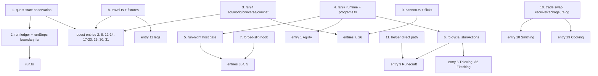

# Step manifest: every script `speedrun/run.ts` chains

This is the build list for the scored run. It has one entry per script that `speedrun/run.ts` will
chain for provisional order v1 (cairn://p/rs/103): the scored account's step scripts, the
transition legs, the helper-side scripts those steps wait on, and `run.ts` itself. The main thread
files one builder per entry. The order is **build priority**: the entry with the most ticks at
stake comes first (section 1 says how that was computed). The last section lists the shared
primitives the builders need first. Every program parameter named here is checked against the
program's `createX.params` declaration on the run-commit floor (entry 0), and a module's lab
acceptance counts only on a page built from that floor.

The scored account is called **SCORED** everywhere. Its real name lives only in its gitignored
`bots/<name>/bot.env`; no script, log line, commit or document names it. The sibling
`RUN-ORDER.md` carries the step table, relog plan and reconciled total for the same order.
cairn://p/rs/111 reconciled the two with the labs rs/104-108 (run-transitions, bones-placement,
stun-pack, wine-window, levelup-cost under `research/`), rs/129's supply fallbacks and rs/127's
`RESILIENCE.md`: **every step's expected and best here is RUN-ORDER.md v2's figure**, and the
moves are the same (S17 last, after S27; the bones in S07's knife loop; S18 one measured row; gems in
the wine windows).

## How to read an entry

**Step IDs** are provisional order v1's S00-S27 (cairn://p/rs/103). A quest or skill that the order
splits gets one module and one `Step` object per ID, so `S10a` was Prayer 1-43 (retired in v2: its bones ride S07) and `S10b` is Tree
Gnome Village. IDs never move: a step that changes place keeps its ID.

**Three tick figures** per entry, all on SCORED's clock (in-world ticks at 300 ms):

- **Expected** is RUN-ORDER.md v2's knife-on expected for the step. For a quest that is the
  fixed-client column with its failure budget (`quests/README.md` §3). For a knife skill it is the
  **knife** figure at rs/97's in-page rates, the column RUN-ORDER.md's headline uses while the run
  gate holds; the plain loop is the step's fallback, and RUN-ORDER.md shows the knife-off total
  beside it.
- **Best** is the fast path as measured on the direct path: the knife column, the burst-dialogue
  column, the rs/91 kit, and so on. A quest's burst column is slightly conservative: rs/200 measured
  its burst mode 1-2 ticks under the corrected `1 + ceil((k-1)/5)` rule (Cook's Assistant's start
  6-7 against 8, the Grand Tree's Narnode start net ~11 against 13; `speedrun/lab/quests/dialogue-burst.ts`,
  n = 3 each), because a run of k pages after an option or state page costs ceil(k/5) and a run
  followed by a state page +1, so each quest child's `dialogue: 'both'` measurement supersedes the
  column for its entry, with no re-price until then (the rule is in `quests/*.md`, rs/185's).
- **Fallback** is what the step costs when its fast path fails: for a knife skill the plain loop
  (the knife-off column). For a quest it is the stock column,
  because read-then-act through the SDK relay costs about the stock client's 2 ticks per page (a
  relay reaction lands a tick late about half the time, cairn://p/rs/86 via `skills/README.md`,
  open question 1).

**Labels**, on every figure: **measured** (a committed lab script, named), **read** (a content or
engine line), **inferred** (arithmetic or a model over measured and read inputs, basis given), and
**estimated** (a judgement made here, with no model behind it). Sources are paths under
`docs/speedrun/` unless a branch is named. `[rs/41]` means read on cairn://p/rs/41/1/coordinator,
`[rs/59]` on cairn://p/rs/59/1/coordinator, `[rs/94]` on cairn://p/rs/94/1/builder and `[rs/97]`
on cairn://p/rs/97/1/builder.

**Timing (run-wide; main, 20:59 PDT).** Every cue-timed hand-off, helper login or helper action is
timed on **observed game ticks** (the tick stream or `TICKMON`), never on wall-clock multiples of
300 ms: the Runecraft givers' cue (entry 9, HS4), the anvil's `cue.json` (HS5), the Firemaking
droppers (S03, HS6), the bone givers' load timing (H4.1-H4.n) and any `T0 + n ms` launch in run.ts. A
deadline that stands for a tick count keys off observed ticks; wall clock appears only as an idle
bound, no new tick for N ticks' worth of time scaled by the configured tick length (on the floor
since #209's `tickClock`, 4fe2d0a8). The demo has
been seen at 0.34-0.37 s a tick, where a wall-clock cue lands early by about (1 - 0.30/actual) of
its delay and a deadline fires early (RUN-ORDER.md R23).

**Run mode (rs/280; RUN-ORDER.md O45).** Run on is the scored account's default (main, 21:32 PDT): rs/280's
`ensureRunOn` turns the toggle on after every login and relog (`option_run` is not saved), with a
per-step opt-out for lab A/B only. The lever is ~0: every walk the shared walker sends and every
op-click approach already carries the ctrl-run flag (`tempRun`), so locs, ground items, obstacles
and the first leg to an NPC run at 2 tiles a tick with the toggle off (m, rs/280). The toggle matters
only where the engine moves the player without a fresh ctrl-run route: its own re-path to a moving
NPC or player target after `tempRun` clears (`Player.ts:744`), and content `p_walk`. Each module
owner lists the places in its step that depend on one of those two; the lists are in the status
column and RUN-ORDER.md O45.

**Mode.** An entry is **in-page** when its loop reacts on the decoded tick or sends on predicted
ticks. That means an rs/97 tick program inside the browser webclient, started and awaited through
`speedrun/lib/programs.ts` [rs/97] (`startProgram`, `awaitProgram`, `runProgram`, `probeInPage`).
Everything else is **overlay-driven** through the SDK and `speedrun/lib`. The reason is the relay:
an in-process reaction landed on the next tick 60 of 60 times, and the same reaction through the
loopback gateway 32 of 60 (`LAB.md`, "Direct path and relay").

**In-page figures.** rs/97 measured its programs on its wired branch, on a local engine in a
visible tab (direct path), reported to this issue as "rs/97 in-page results via main, 05:50": probe
60 of 60; knife iron 3.00 ticks per ore (200 of 200 on the predicted tick); knife normal trees from
level 1, 7.24 ticks per log; knife willow 4.83 ticks per log; knife fly 20-99, 4.26 ticks per
catch; pickpocket at 55, 0.173 rolls per tick; Wilderness Agility 66 ticks per lap. The in-page
entries take their acceptance thresholds from these figures and start from rs/97's branch
(cairn://p/rs/97/1/builder). Two exceptions: the willow 4.83 was taken at level 99 and its gap from
the lite 4.23 is the server's chop RNG, not the client (`tick-programs.md` "Measured"; RUN-ORDER.md
O19), so entry 3's willow threshold is the 3-tick lattice at the formula's success rate; and
knife-cycle's "ticks per roll" (`rolls`, `ticksPerRoll`) counts xp events, so it is ticks per log
(RUN-ORDER.md, "How to read the numbers").

**Acceptance tests** come in two kinds. The local one runs on the lab engine at
`NODE_TICKRATE=300` (`LAB.md`; `speedrun/lab/lab.sh` or `docs/speedrun/scripts/lab.sh`), and an
in-page step runs there in a visible browser tab, because the lite client hosts no programs
(`programStatus` is null on lite). The demo one runs on rs-sdk-demo.fly.dev with a throwaway
`cairn_`-prefixed account outside the fleet's reserved ranges (the list in cairn://p/rs/101), and
never with SCORED. A demo test of an in-page loop only counts from an Ashburn vantage (the rs/86
runner); from anywhere else the network alone exceeds the reaction window. A step that needs
levels a throwaway cannot reach cheaply gets a demo test of its shared primitives and of whatever
part is level-free, and says so.

**`logoutSafe`** is the `Step` field from `speedrun/runner/step.ts`: true when SCORED can log out
right after the step and resume at the next one.

**Resumes from** (every entry): the game state `runResumable` (`speedrun/runner/resume.ts`, rs/127)
checks after a restart or a drop: the step's `done` test, its `inProgress` test and resume entry,
and any probes, from `RESILIENCE.md` section 5. Quest state comes from rs/114's
`speedrun/lib/quests.ts` and `docs/speedrun/quests/quest-state.md` (`questDone`, `questStatus`,
`questStage`, `questPoints`, `requireQuestStage(view, key, stage, {atLeast?})`, `readQuestStage`,
`journalProbe(key)`; stage tables in `speedrun/data/quest-stages.ts`; on main, PR #123). Route quest varps are not transmitted to
the client: status comes from the quest-list colours and the exact stage from a journal read, which
re-clicks if the journal has not opened within 3 ticks. The Mage Arena is not on the quest list; its
postcondition is items and messages.

## 1. Exposure and build order

**How exposure was computed.** Exposure is the entry's **expected** ticks on SCORED's clock, as
defined above: RUN-ORDER.md v2's figure for its steps. Entries are ranked by exposure. **At stake**
is fallback minus best: the ticks a good build wins over a failed fast path. Two rules place the
entries that have no exposure of their own:

- `run.ts` and its runner come first, because nothing can be accepted without them.
- Helper-side scripts (section 4) are ranked by the exposure of the step they gate. No step
  passes its demo acceptance without its helper.

**Entry numbers are stable ids**, cited by `RESILIENCE.md` section 5 and by section 4 here; the
**Rank** column is the build order. The v2 figures moved five ranks: Thieving (now 2,000 measured)
passes Fishing (now the knife's 1,995), the legs (1,382 measured) pass Runecraft and Smithing, and
Prayer (110, now inside S07) drops from 15 to 27. Re-pricing S07's knife on O19 (RUN-ORDER.md
section 9) puts Woodcutting (2,986) below Mining (3,116), so the two swap ranks 3 and 4. rs/174's fixed
tab relog (~2 ticks each, on the twin) returns Cooking to 80, below Prayer and Crafting, where it
stood before rs/164's ~20. Fold-in 11 moved the twelve quests' way-in travel into the legs (840.5;
RUN-ORDER.md O6): the legs (2,222.5) pass Thieving, Fishing, Combat and the Grand Tree, Dragon
Slayer passes Dwarf Cannon, Magic passes Fishing Contest and Herblore passes Goblin Diplomacy. Fold-in 11's part 5 takes the ~82
of Goblin Diplomacy's standalone travel that the legs already carried off its row (to 61), so the
cannon session, Prayer, Crafting and Cooking pass it. Fold-in 13 adds S15's measured H to M (+352),
so Monkey Madness (4,429) passes Agility (4,327) for rank 1.

The expected column sums to **31,315** (the steps) plus the legs' **2,198.5**; RUN-ORDER.md section 6
adds the allowances (hand-offs outside the figures, level-up pages, contention, overrun, relay,
retries, restarts) for its **34,798.5** knife-on expected (31,876.5 best), against the record of 35,916.

**Module status** (the last column; the helper scripts and the programs the entries rely on are in
"Module status" at the end of this section) is as of this document's commit date, and rs/158 updates
it with each fold-in. Earliest plausible run date: **2026-10-23, more likely the 24th or later**
(main, 2026-10-21 14:54 PDT).

| Rank | # | Entry | Module | Steps | Expected | Best | Fallback | At stake | Mode | Code to start from | Module status |
|---|---|---|---|---|---|---|---|---|---|---|---|
| 0 | 0 | Run chain | `speedrun/run.ts`, `runner/resume.ts` | all | boundary idle 0 m (#92); restarts ~5 each (an in-page relog, ~2, rs/174) | 0 | | | overlay | `runner/step.ts`, `runner/resume.ts` (main) | `run.ts`: building (rs/186, held: tenet 15); `runner/step.ts`, `resume.ts` on main (#29, #104, #146) |
| 1 | 2 | Monkey Madness | `speedrun/quests/monkey-madness.ts` | S15 | 4,429 | 4,026 | 4,963 | ~937 | overlay | `quest-mm-*.ts` | **H-M lab-proven end to end, N-Z unrun** (A-G run; H-M 3 of 3, 1,466 m; N-Z being written by rs/201); run mode: no `p_walk`, re-paths at the Monkey Child (O) and the zoo (T), lever ~0 (r, rs/201) |
| 2 | 1 | Agility | `speedrun/skills/agility.ts` | S11a, S17 | 4,327 | 3,934 | 4,626 | ~690 | in-page | rs/97 `agility` program, `agility-course.ts` | lab-accepted (66 per Wilderness lap, 9 of 9; S11a 114; S17 75-85 858; rs/155); run mode 0 on both courses (m, rs/270) |
| 3 | 4 | Mining | `speedrun/skills/mining.ts` | S09 | 3,116 | 3,116 | 3,775 | ~659 | in-page | rs/97 `knife-mine`, `tickmanip-mine.ts` | **on main, 4235a9e7 (#220; rs/260's snapshot of rs/230's lab-accepted module, rs/147's branch at 59ec3933)**, with `selfStarter` (plain 3.62) and `beforeRestart`; `stay2` bury (#159, rs/182) and restart fix (e5d8a058, #170; rs/207) on main; gate `measureDrops` 120 by the default, its explicit value pending rs/259 |
| 4 | 3 | Woodcutting, with the bury | `speedrun/skills/woodcutting.ts` | S07 (+ S25b's bones) | 3,027 | 2,969 | 4,025 (4,121 without #165, history) | ~1,090 | in-page | rs/97 `knife-cycle`; rs/137's bury variant; `bones-wc.ts` | building (rs/211; on rs/147's branch, changing with rs/236; rs/151 closed); gate-off plain + bury on main (rs/162, 3dfc217f, #165); gate `measureDrops` 120 explicit (rs/261, building); run mode 0 (m, rs/261) |
| 5 | 11 | Transition legs | `speedrun/runner/legs.ts` + `speedrun/lib/travel.ts` | between steps | 2,198.5 | 2,198.5 | ~2,340 i | ~140 | overlay | `run-transitions-legs.ts`, `run-transitions-lib.ts` | lab-measured (PR #198, open; rs/198 for rs/186); its walker, `lib/travel.ts`, on main, 0658e896 (#200) |
| 6 | 6 | Thieving and the stun pack | `speedrun/skills/thieving.ts` | S18 (S18b-d inside) | 2,000 | 1,908 | 1,975 + ~120 elsewhere | ~190 | in-page | rs/97 `pickpocket`; rs/132's `stunActions`; `stun-pack-thieve.ts` | building (rs/154, parked under the 2-4 child limit); stun pack: lab-accepted (bury, charge, arrows; rs/132); top-ups ~0 with the courier on a side tile (rs/279, lab); rs/290's opt-in idle re-send building |
| 7 | 5 | Fishing | `speedrun/skills/fishing.ts` | S22 | 1,995 | 1,969 | 3,410 | ~1,440 | in-page | rs/97 `knife-cycle`, `tickmanip-cycle.ts` | on main, 22552bf4 (#197; rs/231); lab-accepted (1,998 on 78-99; rs/152); gate `measureDrops` 120 explicit (#221) |
| 8 | 7 | Combat finish | `speedrun/skills/ranged.ts` (`combatFinish`) | S27 | 1,972 | 1,946 | 1,997 (the bow from 70); 2,023-2,211 without the kit | ~265 | overlay | `cannon-kit.ts` (rs/59, on main) | on main, 8a741554 (#212, rs/252's snapshot); lab-accepted (S27 1,972 i on the module's rates, S14 118 m; rs/199, PR #207); lab is the final tier (a demo test is not feasible); run mode ~0, at most ~9 on S27's melee phase (m/i, rs/196) |
| 9 | 8 | The Grand Tree | `speedrun/quests/grand-tree.ts` | S11b | 1,493 | 1,403 | 1,763 | ~360 | overlay | `quest-grandtree-full.ts` | building (rs/202 under rs/185); **lab: 3 of 3 full A-to-P runs at SCORED's levels** (1,403 / 1,504 / 1,422) |
| 10 | 9 | Runecraft | `speedrun/skills/runecraft.ts` | S06, S21 | 1,192 | 1,192 | ~5,220 | ~4,030 | in-page | rs/131's `rc-cycle`; `runecraft-cycle.ts` | **on main, 1514f47a (#222; rs/268's snapshot of rs/196's module, rs/186's branch at 0c349da6)**, the run-commit floor; **lab-accepted, with a partial demo confirmation** (9/9 tuned on the real server, n small; the 20-cycle demo acceptance pending); **lab-accepted (rs/196, module 3f02f336, relay path (lab): nature at 44 tuned 30/30 at 29 x 7, robust 30/30 at 29 x 8; S06 7/7 at 6 x 7, 58)**; the tuned nature run confirmed on the direct path, 30/30 at 29 x 7 (rs/196, 3b161c12); pending: the auto rule's 'handled before SCORED' field (entry 9); cycle: on main, 23ea9f77 (#178) |
| 11 | 10 | Smithing | `speedrun/skills/smithing.ts` | S25a | 1,065 | 1,028 | 1,330 | ~302 | overlay | `smithing-trade.ts` | building (rs/186, held: tenet 15) |
| 12 | 13 | Dragon Slayer | `speedrun/quests/dragon-slayer.ts` | S26 | 969 | 908 | 1,079 | ~171 | overlay | `quest-dragon-*.ts` | building (rs/258 under rs/185); run mode: no `p_walk`, re-paths at ten moving NPCs and the six maze monsters, lever ~0 (r, rs/258) |
| 13 | 12 | Dwarf Cannon | `speedrun/quests/dwarf-cannon.ts` | S13 | 855 | 799 | 957 | ~158 | overlay | `quest-mcannon-*.ts` | building (rs/257 under rs/185); run mode: no `p_walk`, re-paths at Lawgof (A, C, E, H, J, L) and Nulodion (K), lever ~0 (r, rs/257) |
| 14 | 14 | Tree Gnome Village | `speedrun/quests/tree-gnome-village.ts` | S10b | 793 | 739 | 902 | ~163 | overlay | `quest-tree-full.ts`, `quest-premm-fight.ts` | building (rs/185, held: tenet 15) |
| 15 | 16 | Firemaking | `speedrun/skills/firemaking.ts` | S03 | 681 | 650 | 735 | ~85 | overlay | `firemaking-line.ts` | on main, 4cc468e0 (#205; rs/244); **demo-measured**, 681 m (rs/269, cairn_burns) |
| 16 | 17 | Fight Arena | `speedrun/quests/fight-arena.ts` | S12 | 571 | 524 | 646 | ~122 | overlay | `quest-arena-run.ts` | building (rs/185, held: tenet 15) |
| 17 | 18 | Plague City | `speedrun/quests/plague-city.ts` | S08 | 491 | 435 | 608 | ~173 | overlay | `quest-plague-city-*.ts` | building (rs/185, held: tenet 15) |
| 18 | 19 | Mage Arena | `speedrun/quests/mage-arena.ts` | S16 | 425 | 418 | 448 | ~30 | overlay | `quest-magearena-*.ts` | building (rs/185, held: tenet 15) |
| 19 | 20 | Sea Slug | `speedrun/quests/sea-slug.ts` | S19 | 361 | 307 | 462 | ~155 | overlay | `quest-smallskill-seaslug.ts` | building (rs/185, held: tenet 15) |
| 20 | 21 | Romeo & Juliet | `speedrun/quests/romeo-juliet.ts` | S24 | 241 | 211 | 301 | ~90 | overlay | none (page counts only) | building (rs/185, held: tenet 15) |
| 21 | 22 | Druidic Ritual | `speedrun/quests/druidic-ritual.ts` | S24 | 239 | 220 | 284 | ~64 | overlay | none (page counts only) | building (rs/185, held: tenet 15) |
| 22 | 24 | Magic (strike, enchant) | `speedrun/skills/magic.ts` | S02, S04 | 222 | 222 | ~250 | ~28 | overlay | `magic-strike.ts`, `magic-cadence.ts` | building (rs/186, held: tenet 15) |
| 23 | 23 | Fishing Contest | `speedrun/quests/fishing-contest.ts` | S20 | 181 | 158 | 234 | ~76 | overlay | `quest-smallskill-fishingcompo.ts` | building (rs/185, held: tenet 15) |
| 24 | 27 | Herblore | `speedrun/skills/herblore.ts` | S25e | 170 | 117 | ~200 e | ~83 | overlay | `delayfree-cycle.ts` | building (rs/186, held: tenet 15) |
| 25 | 26 | Pre-MM cannon session | `speedrun/skills/ranged.ts` (`cannonSession`) | S14 | 118 | 104 | ~162 | ~58 | overlay | `quest-premm-cannon.ts`, `ranged-cannon.ts` | on main, 8a741554 (#212, rs/252's snapshot); lab-accepted (S27 1,972 i on the module's rates, S14 118 m; rs/199, PR #207); lab is the final tier (a demo test is not feasible) |
| 26 | 15 | Prayer (bones inside S07; the booth as fallback) | `speedrun/skills/woodcutting.ts` bury option; `speedrun/skills/prayer.ts` for the booth | S25b (S10a retired) | 95 | 65 | 735 (the booth) | ~670 | in-page with S07 | `bones-wc.ts`, `prayer-bury.ts` | bury in S07: building (rs/211); gate-off plain + bury on main (rs/162, 3dfc217f, #165); booth: building (rs/186, held: tenet 15) |
| 27 | 28 | Crafting | `speedrun/skills/crafting.ts` | S25d | 91 | 85 | 121 (no gems in the windows) | ~36 | overlay | `delayfree-cycle.ts` | building (rs/186, held: tenet 15) |
| 28 | 29 | Cooking (wine) + gems in the windows | `speedrun/skills/cooking.ts` | S25c | 80 | 75 | ~131 (kebabs, supplies not held) | ~56 | overlay | `wine-receive.ts` [rs/41], `wine-window-lab.ts` | building (rs/186, held: tenet 15) |
| 29 | 25 | Goblin Diplomacy | `speedrun/quests/goblin-diplomacy.ts` | S24 | 61 | 41 | 102 | ~61 | overlay | none (page counts only) | building (rs/185, held: tenet 15) |
| 30 | 30 | Doric's Quest | `speedrun/quests/dorics-quest.ts` | S05 | 22 | 17 | 43 | ~26 | overlay | `quest-smallskill-doric.ts` | building (rs/185, held: tenet 15) |
| 31 | 31 | Cook's Assistant | `speedrun/quests/cooks-assistant.ts` | S23 | 17 | 12 | 31 | ~19 | overlay | `quest-primitives-dialogue.ts` | building (rs/185, held: tenet 15) |
| 32 | 33 | Hand-off H1 | `speedrun/runner/handoff.ts` | S01 | 8 | 8 | ~10 | ~2 | overlay | `lib/trade.ts`, `mule.ts` [rs/41] | building (rs/186, held: tenet 15) |
| 33 | 34 | Tutorial skip | `speedrun/skills/start.ts` | S00 | 8 (done) | 8 | - | - | overlay | done: SCORED claimed and parked at 8 ticks; the skip for rehearsal and gate accounts measured 3 (lab) and 4 (demo) | on main, c2d9eada (#146) |
| 34 | 32 | Fletching | `speedrun/skills/fletching.ts` | S18d (inside the stun pack) | 0 | 0 | ~59 standalone | ~59 | in-page (with Thieving) | `stun-pack-thieve.ts`, `delayfree-cycle.ts` | building (rs/186, held: tenet 15); in-stun: lab-accepted (arrows; rs/132), plugged into rs/154's module by rs/186 |

Every figure in the table is restated with its label and source in the entry below it. Helper-side
scripts are in section 4; the shared primitives and their build order are in section 5.

**The four findings this manifest first raised, and where they stand:**

1. **Quest state on the demo**: rs/114's `speedrun/lib/quests.ts` (quest-list status, journal
   stage, `questPoints`; merged to main as PR #123, with `speedrun/data/quest-stages.ts`).
2. **`runSteps` idled SCORED at every boundary**: fixed (#92, measured 2 ticks per boundary before
   and 0 after; main, 08:30).
3. **S09 starts at Mining 64**, not 49 (Plague City's 2,425 base): accepted by main (M0602).
5. **Arrival levels** (rs/185's audit, 20:50 PDT, under main's 20:39 PDT rule): **no gap** in ten entries: Fight
   Arena, Plague City, Mage Arena, Sea Slug, Romeo & Juliet, Druidic Ritual, Fishing Contest, Goblin
   Diplomacy, Doric's and Cook's (no level check, or SCORED at or above the lab's levels, r). The
   gaps are in entries 8 (the glider-crash jogres, ruled), 13 (Elvarg in mithril, +40 i) and 14
   (two Khazard commanders, Protect from Melee). Every Protect rule (entries 8, 14 and 26's flick)
   toggles at a stand or on a click tick: the prayer button cancels a walk in progress
   (`clearPendingAction`; rs/241's Agility finding), and each toggle's tick cost is pending its
   module's lab runs.
4. **The tuned Runecraft cycle needs a direct-path giver**: the givers run on SCORED's machine, the
   Ashburn machine chosen at the gate (RUN-HOST.md steps 4 and 5a), through rs/117's launcher; rs/131 builds the scored side's in-page cycle.

### Module status

**Values.** `none`: nothing is building it. `building (rs/N)`: an issue is building it, with
`held: <gate>` when its execution is held. `lab-accepted (ticks, rs/N)`: a lab pass against the
entry's acceptance, with the measured ticks. `on main (commit, #PR)`. Helper roles add one more:
`on rs/41's branch (rs/N)`, a role merged into the helper mission's branch and not on main. rs/185
(the quest modules) and rs/186 (the remaining skill modules, `run.ts`, the legs and the hand-off)
are filed under main and held until tenet 15 is answered.

**Notes on the entry column:**

- **0.** `speedrun/run.ts` does not exist; `runner/step.ts` (#29), `runner/resume.ts` (#104, with
  #146's sessionLink fix), `runner/budget.ts` and `runner/fence.ts` are on main.
- **1.** rs/155's lab pass (PR #149, open into rs/147): 9 of 9 Wilderness laps at exactly 66 at
  Agility 99 (the acceptance asks 8 of 10 at 66, +1); Gnome 1-22 measured 114 against the 122
  inferred. S17 75-99 adopted at 4,213: 75-85 measured 858 end to end in the lab chain, 85-99
  3,355 inferred from it (RUN-ORDER.md S17). The demo rehearsal is still to run.
- **2.** **H-M lab-proven end to end, N-Z unrun** (A-G run; rs/201 ran H to M 3 of 3 at route
  levels, 1,466 against the fixed column's 1,114, +352 in the expected; N-Z being written by rs/201);
  ~1,211 of the 4,429 is estimated (entry 2).
- **3.** rs/211 builds the module (rs/151 is closed), including the bury-in-willows rule for a
  gate-off stretch, on rs/162's plain + bury (on main as 3dfc217f, #165, inside the run-commit floor; entry 3).
  A module is present on rs/147's branch and is changing with rs/236's opt-ins (knife-cycle
  `waitRespawn`, the probe's `dirs`) and their lab before it goes to main.
- **4.** The module is on main, 4235a9e7 (#220): rs/260's snapshot of rs/230's lab-accepted
  `mining.ts` (rs/147's branch at 59ec3933; rs/153 and rs/212 before it), with knife-mine's
  `selfStarter` and gated-program's `beforeRestart`, inside the run-commit floor. Its explicit gate
  `measureDrops` is pending rs/259 (120 by the library default until then; RUN-ORDER.md R21). The
  restart fix is on main (e5d8a058, #170); `knife-mine`'s `stay2` bury is on main (#159, rs/182); the in-page plain
  loop measured 4.00 ticks per ore (rs/153), and 3.62 with knife-mine's `selfStarter` (rs/230), the
  fallback in force (entry 4).
- **5.** rs/152's execution 1 passed the lab on the run's band, 1,998 against 1,995 (3,338 for the
  chain from level 1). That branch was rewritten by a replay; the work is intact at store commit
  `28ad07aa` and is being re-applied, so no branch carries it yet. `fishing.ts` is on main with rs/231's
  Fishing snapshot, 22552bf4 (#197), inside the run-commit floor; S22 stays 1,998 m (lab).
- **6, 32.** rs/154 builds the Thieving module (parked under the operator's 2-4 child limit,
  resuming after Fishing, Woodcutting and Mining); the stun pack (bones, Charge and Fletching in the
  stuns) runs on rs/132's stun-window actions, lab-accepted for bury, Charge and arrows and on main
  (6e86a656, #163). rs/186
  plugs Fletching into rs/154's module, and entry 32's standalone module is rs/186's.
- **9.** On main, 1514f47a (#222): rs/268's snapshot of rs/196's lab-accepted module (rs/186's
  branch at 0c349da6); lab-accepted, with a partial demo confirmation (9 of 9 tuned turns on the
  real server, rs/196; the 20-cycle demo acceptance pending a retry once the givers' banks are
  topped up). Lab-accepted (rs/196): S06 58 in two runs; 30-cycle runs at 7 on the body and nature
  altars with givers first, robust at 8 in either login order; resume and fault recovery measured
  (entry 9). rs/186 adopts rs/131's in-page cycle; the givers are rs/163's (helper table). Pending:
  the auto rule's switch to a 'handled before SCORED' field (entry 9). Its first lab runs used rs/131's
  `rc-cycle` at 06c68a90, which differs from 23ea9f77 only by #177's `params` declaration line;
  rs/196 re-confirmed it on a page built from the base carrying 23ea9f77 (module 3f02f336, rs/163's
  givers e4f60121, lab 300 ms; on the **relay path**, since the launcher read no `path` from the role
  options, entry 9), so it is **lab-accepted on the floor**, and its tuned nature run is confirmed on
  the direct path (entry 9).
- **16.** On main, 4cc468e0 (#205): rs/244's snapshot of rs/228's lab-gated module, with its test.
  **Demo-measured**: rs/269's cairn_burns ran S03 at 681 on the demo, the first whole step measured
  end to end there (entry 16).
- **15.** The primary path is the bury option inside entry 3 (knife-cycle `bury` on main; the
  gate-off plain + bury is rs/162's, lab-measured and on main as 3dfc217f, #165); the booth fallback `skills/prayer.ts` is rs/186's.

**Helper-side scripts (section 4).** They are numbered **HS1-HS8** (helper script), so that a bare H-number always means a SUPPLIES.md hand-off (H1-H23, H4.x, H14.x): "H4" is the S05 hand-off at Doric's, served by the trade giver (HS1), and "HS4" is the in-room essence giver. HS2-HS6 are rs/41's (main's ruling).

| Helper | Gates | Module status | Notes |
|---|---|---|---|
| HS1 mule, hand-off and quest-item giver | S01, every helper trade | on rs/41's branch (rs/49, #34) | the step packages and per-tile positioning (section 4) are rs/41's, no issue yet; quest items rs/126, rs/173 |
| HS2 stun-pack courier | S18 | on rs/41's branch (rs/141): `bone-giver.ts`'s S18 on-request mode; the Charge and Fletching stacks building (rs/163, held: not before 15:25 PDT) | rs/163's execution 2 extends `bone-giver.ts`; there is no `stun-courier.ts` |
| HS3 cannon holder | S14, S27 | on rs/41's branch (rs/125): `cannon.ts`; the hand-off verified in the lab and on the demo (rs/189) | cairn_h92 holds two sets and 1,416 balls (rs/41, 15:00 PDT); `cannon.ts` serve mode hands over a set and balls in one trade: 4 ticks on the receiver's clock in the lab, 6 on the demo with h92 as the quest-complete receiver; the quest gates buying and Set-up, not trading |
| HS4 in-room essence giver | S06, S21 | on rs/41's branch (rs/117, rs/141): `altar-giver.ts`; the direct path building (rs/163) | `altar-giver.ts`, `altar-cue.ts`, `altar-room.ts`; rs/163's direct-path transport (PR #144; lab 21 of 21, host slot 22:05Z); there is no `rc-giver.ts`. rs/163 sized the body-altar roster at 22 givers on 23 body talismans, no keeper, on a measured 139-142-tick restock round trip (m, lab, 16:17 PDT), with 0 nature talismans held; the earlier 14 givers rested on a ~90-tick estimate (RUN-ORDER.md section 7) |
| HS5 anvil helper | S25a | building (rs/188) | `anvil.ts`, new |
| HS6 log-row dropper | S03 | building (rs/187) | `fm-row.ts`, new, first in rs/187's queue |
| HS7 carp catcher | S20 | building (rs/173) | cairn_h97 catches the carp ahead and banks it |
| HS8 wine giver | S25c | on rs/41's branch (rs/47, rs/88) | `giveWine`; acceptance is entry 29's (rs/186) |
| S07 bone givers b01-b04 | S07 | building (rs/163) | `bone-giver.ts` in the launcher on rs/41's branch (rs/141); rs/163 puts b01-b03 on the demo |

**Program and library dependencies.** The in-page programs and `speedrun/lib` changes the entries
rely on. rs/132 and rs/131 were backlog until main started both at 14:55 PDT; their
cost-if-not-built is RUN-ORDER.md's sensitivity table and stays priced there until they land.

| Dependency | Needed by | Module status | Notes |
|---|---|---|---|
| In-page program runtime, `lib/programs.ts` (rs/97) | 1, 3-6, 9 | on main, d09c2627 (#94) | |
| Host gate, `lib/hostgate.ts` | in-page entries | on main, c9a6c31b (#101); **`measureDrops` default 120 on main, 148788c5 (#221; rs/262)** | The measured switch-off holds plain for `measuredOffTicks` (3,000); at the old default of 30 drops it fired on luck (RUN-ORDER.md R21: 1 of 5 lab Woodcutting chains switched twice, ~850 ticks; 0 in 4 at 120). Main's ruling (20:08 PDT): every run-day module passes an explicit `measureDrops` sized to its success chance. **Per module:** Woodcutting (3) 120 explicit (rs/261, building); Fishing (5) 120 explicit on each fly band (on main, #221); Mining (4) 120 by the default, its explicit value pending rs/259 (nearly safe at 64-99: every iron roll succeeds). Thieving (6), Agility (1) and Firemaking (16) do not use the gate |
| `lib/gated-program.ts` (rs/156) | 3-5 | on main, 22552bf4 (#197) | reached main with rs/231's Fishing snapshot |
| `lib/travel.ts`, the shared walker with the stall fix | 11 | on main, 0658e896 (#200) | five `speedrun/lib` files, byte-identical from rs/198's f0e76192; `STALL_TICKS = 20`: a walk that stalls returns `ok: false` instead of throwing; inside the run-commit floor |
| `lib/display.ts` (rs/232's `frontWindows`, `grabFrame`, `frameShows`) | RUN-HOST.md steps 5 and 5a (the live-frame pass line) | on main, 5d22252d (#208) | gate tooling, not a floor item (main); with #213's `lib/tab.ts` window helpers (c4b79f17), `screenshotTab` among them |
| Quest state, `lib/quests.ts` (rs/114) | every quest entry, resume | on main, 85c8799a (#123) | |
| knife-cycle `bury` (rs/137) | 3, 15 (S07's bones) | on main, 9b38dbc2 (#124) | |
| knife-cycle rename and per-log stamps (rs/159) | 3, 5 | on main, c14428fc (#132) | |
| knife-cycle axe-aware p (rs/175) | 3 | on main, 6c58db8e (#151) | |
| knife-cycle plain + bury | 3, 15 | **on main, 3dfc217f (#165; rs/162)**; lab-measured | S07's gate-off fallback: `technique: 'plain'` with `bury` and `trees`, no new key; willow 0.226 bones a tick with trades at 3.89 per expected roll, oak 60-75 0.195 at 4.29 (m, lab; entry 3). The knife-off line in force; inside the run-commit floor (`RUN-HOST.md` "Credentials"); before it, knife-cycle refused `bury` with the plain technique |
| knife-mine `bury` on `stay2` | 4 | on main, #159 (rs/182; merged 15:52 PDT) | O35, closed: the ~85 bones placed in S09 on today's stock (the conservative row), at most +0.02 a Mining ore and ~0.21 ticks a bone in trades (m, lab). Where it cannot fire they go to the booth, **+119** against the lap (RUN-ORDER.md section 7); ~61 more dragon bones also close it, as the row in force assumes |
| knife-mine `selfStarter` (plain trick takes the next rock as timer starter) | 4 | **on main, 4235a9e7 (#220; rs/230's module, rs/260's snapshot)** | lab plain + `selfStarter` 3.62 ticks per ore on the five-rock lap at D = 13 (150 ores, 0 slips) and 3.61 at D = 15 (200), six-rock 3.83 at D = 19 (m, lab, rs/230); S09's plain fallback 4,170 to 3,775, -395 on a knife-off night (entry 4). A page must declare it, or knife-mine faults at start |
| knife-mine depleted-rock restart fix | 4 | on main, e5d8a058 (#170; rs/207) | 3 of 3 depletion restarts fault at +1 tick; post-respawn laps 3.00 per ore, 200 of 200 (m, lab). Any S09 knife (re)start then waits out the respawn, +13 plus the start; a `RUN_COMMIT` requirement (RUN-ORDER.md R18) |
| `logoutClean` tab confirmation | 0, 1 (final logout), every relog | on main, c2d9eada (#146) | |
| Direct gate clean logout | the gate probe | on main, 9d26aa87 (#142), d83f2e86 (#152) | |
| `relog(session)` (in page by default, `RelogResult.tickBase`/`via`) and the navigated relog's socket-close fix | 0 (restarts), 29 (the wine relogs, R17) | **on main, efdbe2e2 (#164; rs/174)**, inside the run-commit floor; lab-accepted on the twin and after a lab engine kill | first SDK state at login + 1 in page or navigated, the bank at + 3 to + 6 (m); an in-page attempt that does not get in is retried by navigating, at the same ticks; the client's second-login hang (rs/183) is on main, #155 |
| **Pickpocket stun-window actions** | 6 (S18's stun pack), 32 | **on main, 6e86a656 (#163; rs/132); lab-accepted (bury, charge, arrows; a3646a67)** | 300 rolls each at 300 ms on bgsrv-mac: no Thieving cost in the page (RUN-ORDER.md O8). The stun pack failing (plain pickpocket, Charge and Fletching standalone, ~200 more bones in S07, **+~120**, RUN-ORDER.md sensitivity table) is now a demo risk only. The opt-in 'idle while an interface is open' mode is on main, `idleOnInterface: true` (declared in b6950915), with top-ups in the program as a `player` stun action (entry 6) |
| **In-page Runecraft cycle** (`rc-cycle`) | 9 (S06, S21) | **on main, 23ea9f77 (#178; rs/131); lab-measured**, inside the run-commit floor (entry 0) | 7.00 ticks per craft with the givers handled first and 8.00 on the robust fallback, 30 crafts each, no lost trades (m, lab, rs/131); its protocol shared with rs/163's givers. Without the tuned cycle: the robust 8-tick cycle **+168**, or the stock reacting cycle, measured at **31 ticks a craft** on the run commit today (rs/196), **+~4,030** on the nature altar's crafts (+~4,820 at the body altar's), if the giver is relayed or the program faults (RUN-ORDER.md R12); **9 a cycle** once 3042ae95's change reaches main (rs/267's `lib/trade.ts` `openTrade` with the altar giver: a net patch on rs/41's mission branch, not on main, no PR yet) (m, lab, rs/267), +~320 on the nature plan and +~400 on the body plan (i) |
| Direct-path altar giver | 9 (S06, S21) | building (rs/163) | PR #144, open; on rs/117's launcher and rs/141's givers |

## 2. The run chain

### 0. `speedrun/run.ts` and the runner (all steps)

- **Serves:** every step, S01-S27 (S00 is done), the legs between them, and the hand-offs. It holds
  the ordered `Step` list, opens SCORED's session, and chains the steps through `runResumable`.
- **Chaining contract** (`speedrun/runner/step.ts`, read): a step is `{name, preconditions(state, c),
  run(ctx), postconditions(state, c), logoutSafe}`, plus rs/127's `done(observed)`,
  `inProgress(observed)`, `resume(ctx)` and `probes` (`speedrun/runner/resume.ts`). run.ts calls
  **`runResumable`**, not `runSteps`: on every start, operator restarts included, it walks the
  manifest against the game, finds the first milestone that is not `done`, and enters the latest
  step that can start (its `resume` if `inProgress`, else `run`), so a restart resumes from game
  state (`RESILIENCE.md` section 5). A stop requested during an unsafe step waits for the next
  `logoutSafe` boundary. `fence.ts` abandons a lost attempt so it cannot act on the reconnected
  session.
- **Parameters:** `--from=<step name or index>` (overrides the first resume walk only),
  `--until=<step>`, `--client=browser` (default for the run; `lite` for lab dry runs),
  `--bot=<env name>` (the gitignored `bots/<name>/bot.env`; the name is never logged; log rows carry
  `SCORED`), `--log=<path>`, `--dry-run` (evaluate every precondition against the live state and
  stop), `--lab` (accept staff fixtures).
- **Preconditions, before SCORED's run login** (RUN-ORDER.md section 1):
  - **the host reservation**: `RUN-HOST.md` step 0 has written `~/host-reserved.json` before
    anything else started on run night, owner the run, `until` covering setup, the 9 h run bound
    and margin, so rs/83's gate history timer (rs/140) skips. run.ts refuses to start unless it is
    live and the run's own, and never disables the timer (main via rs/103);
  - **main's start conditions** (09:30): Prayer xp in hand of at least 39,938 base in any bone mix; a
    cannon set and ~1,270 cannonballs; the rune axe or main's decision to run without it; the budget
    (expected + fallback deltas in force under 35,916). run.ts reads them from the operator's
    checklist (`SUPPLIES.md` section 5); it does not count bones itself;
  - **`RUN_COMMIT` includes rs/164, main's `c2d9eada`** (#146; `RUN-HOST.md` "Credentials" and
    step 0; the floor below contains it). c2d9eada is byte-identical to
    rs/147's 4e0e8ae4, whose code is 3ed0cd49c, the commit that ran on the twin. With it the page
    confirmed every tab logout in 222-324 ms, 0 ticks of latency, and `session.ts` no longer
    consults the gateway for a browser session, since the gateway still said `inGame: true`
    afterwards (m, rs/164 on the rehearsal twin, cairn_smoke, 20:44-20:52Z). `logoutClean` treats
    `lastDamageTick < 0` as never damaged and confirms a tab's logout through the page's own
    in-game flag over CDP (`tab.ts` `pageInGame`; r, c2d9eada). On an older commit it cannot
    confirm a logout from the browser tab, because the gateway keeps `inGame: true` with status
    `stale` (m, rs/149 on the rehearsal twin), and each relog risks up to ~60 ticks (i,
    RUN-ORDER.md R1's bound); that case is historical on any `RUN_COMMIT` at or after c2d9eada.
    The final logout is still checked on the host (`RUN-HOST.md` step 8). A precondition, not a
    line in the totals;
  - **`RUN_COMMIT` at or after the run-commit floor, `4fe2d0a8`** (#209, rs/246: one idle timeout,
    `tickClock`, for every tick-keyed wait, `maxTicks` on observed ticks and only `IDLE_TICKS`, 20
    ticks of silence, in wall clock; RUN-ORDER.md R23; one check, `git merge-base --is-ancestor
    4fe2d0a8 "$RUN_COMMIT"`, `RUN-HOST.md` "Credentials"). Its history holds 1514f47a (#222, rs/268's
    snapshot of rs/196's Runecraft step module, entry 9), 148788c5 (#221, rs/262: `HostGate`'s
    `measureDrops` default 120, fishing's explicit 120; RUN-ORDER.md R21), 4235a9e7 (#220, rs/260's
    snapshot of rs/230's Mining module: `mining.ts`, knife-mine's `selfStarter`, gated-program's
    `beforeRestart`; entry 4), 8a741554 (#212, rs/252's snapshot of rs/199's combat step module,
    entries 7 and 26), 0658e896 (#200, the shared walker `lib/travel.ts`,
    entry 11), 73a6a8a3 (#210, fleet snapshot 2), 4cc468e0 (#205, rs/244's Firemaking snapshot, entry 16), 22552bf4 (#197, rs/231's Fishing snapshot: `fishing.ts`,
    knife-cycle's `untilXp`, `followSpot` and `dropEach` declared, `lib/gated-program.ts` and `xp.ts`,
    entry 5), 23ea9f77 (#178, rs/131's `rc-cycle`, entry 9), efdbe2e2 (#164, rs/174's socket-close fix behind the ~2-tick relog), c2d9eada
    (#146, above), e5d8a058 (#170, rs/207:
    `knife-mine` faults instead of slipping on a depleted rock, entry 4), 6e86a656 (#163, rs/132's
    stun actions, after #159's `stay2` bury, entry 4), 3dfc217f (#165, rs/162's plain + bury, the
    knife-off line in force, entry 3), b6950915 (#177: a program faults at start on a parameter key
    it does not declare, so each entry's program keys are the program's declared names) and
    834f376b (#176, rs/210's tick-cadence monitor). Pending, each moving the floor when it lands: rs/147's Agility
    snapshot (agility's `untilLevel`, entry 1, RUN-ORDER.md O40), PR #218 (rs/241's `eatAt: 'land'`,
    entry 1), rs/267's PR (`lib/trade.ts` `openTrade`
    with the altar giver: the Runecraft stock rung at 9 a cycle and a busy partner's retry at ~2,
    entry 9), rs/276 (the
    tick monitor's late count against observed intervals and gated-program's pause in observed
    ticks, R23; it changes a run-night pass line), rs/243's Thieving snapshot
    (pickpocket's `stopWhenFoodBelow` and `retargetTicks`, entry 6) and PR #198 (rs/198's
    `runner/legs.ts`, entry 11); #198 and #218 have PR numbers so far. Gate tooling on main, not floor
    items: 5d22252d (#208, `lib/display.ts`) and c4b79f17 (#213, `lib/tab.ts` window helpers);
  - **the login cap**: our simultaneous demo logins, summed across every host, at most 100 with a
    working cap of 80, counted before SCORED logs in (main, 15:35 PDT; `RUN-HOST.md` step 7;
    `SUPPLIES.md`, "Peak concurrent logins");
  - rs/117's helpers logged in before SCORED (`launcher.json` `helpersReady`);
  - a session that publishes advancing ticks (`openSession`, `waitAdvancingTick`); the watchdog
    started; the in-page runtime present (`startProgram(sdk, 'probe')` answers);
  - **the tab gate (tenet 12)** passed before any in-page step starts in its fast mode: (a) the direct
    in-page probe at least 58 of 60; (b) publication p90 reported, not a pass line; (c) at most 2
    catch-up ticks per probe minute (a failure means re-measure); (d) the tab loop rate p10 at least
    50 per second (`speedrun/lib/hostgate-verdict.ts`, `tickSteadiness`). The start time is chosen
    by a 3-5 minute gate read, not by the clock, taken on both Ashburn machines in the same minute,
    which also chooses the machine (RUN-HOST.md step 5a; tenet 17).
- **In-run pause rule** (rs/102, main 07:45): a reactive or knife step pauses when catch-ups exceed
  about 5 per minute and resumes when they fall under 1 per minute; `demo-status.ts`'s
  `restartLikely` (at least ~10 a minute for 2 minutes) triggers the same pause, never a save.
- **Run-machine setup** (a precondition the operator checks; `RUN-HOST.md`, tenet 12): power saving
  and the screensaver off; the operator's remote desktop **disconnected** for the run (live view
  instead); the tab maximised and unobscured on :10; Chrome launched with
  `--disable-background-timer-throttling --disable-renderer-backgrounding
  --disable-backgrounding-occluded-windows`. run.ts re-checks the loop rate between steps and
  refuses an in-page step's fast mode while it is low.
- **Postconditions:** total level 1,881; the final clean logout after S17's last level-up (the only
  hiscore write, `RESILIENCE.md` section 2); **the host reservation removed** after it.
- **Ticks:** run.ts adds no actions of its own. What lands on SCORED's clock:
  - **Step-boundary idle: 0** (measured: #92 fixed `runSteps`, 2 ticks per boundary before and 0
    after; main, 08:30).
  - **A demo restart**: ~2 ticks of relog + 3 to the resumed step (measured on the local
    engine, `RESILIENCE.md` section 6) + the step's resume overhead; 1-2 per run expected;
    progress and playtime roll back together, so the redone work is score-neutral. The relog is a
    tab relog, `relog(session)` with no options (in page by default, `inPage: opts.inPage ?? true`, falling back to the navigating relog when the page cannot log itself in; `inPage: false` forces navigation; #164, efdbe2e2; each relog logs `RelogResult`'s `tickBase` and `via`, so `loginTick - tickBase` is its cost and `via` the path that ran): with rs/174's fix
    (`tab.ts` `reloadOrOpenTab` closes the old page's gateway socket before navigating) the first SDK
    state is at login + 1 on either path (m, rs/174 on the twin against the demo; ~20 before the fix,
    m, rs/164), and the relog after a real restart is measured too: with the engine SIGKILLed
    under a logged-in tab, `reconnectAfterOutage` with `login: (s, t) => login(s, { attempts: 1,
    timeoutMs: t, inPage: true })` got back in the page 2.0 s after the replacement engine was ready,
    first attempt, session tick 2 on return, no gateway takeover (m, lab, rs/174). The outage itself
    costs SCORED nothing on the clock. RUN-ORDER.md carries 8.
  - **A client drop with the server up**: 3-12 ticks in the world + 2 to the resumed step with the
    watchdog (measured on the lite client, same section); in the tab the takeover is a
    re-navigated login, ~2 more with rs/174's fix (m, twin); without the watchdog 500-1,000 (rs/101).
  - **Relogs:** exactly **two planned relogs**, both in S25c, ~2 ticks each from SCORED's tab by
    `relog(session)`, in page by default with navigation the fallback (m, rs/174 on the twin: first SDK state
    at login + 1, the bank open at + 3 in page and + 3 to + 6 navigated; the client's second-login
    fix is on main, #155), with a tail of tens about 1 time in 29 (measured, [rs/41]
    `helpers/wine.md`, "Relog risk"). **No milestone saves**
    (main, 08:55): a save relog protects 0 score ticks. Any step that adds a relog must justify it.
- **Resumes from:** walks on every start; `--from` only overrides the first walk (`RESILIENCE.md`
  section 5).
- **The run ledger** (`speedrun/runner/ledger.ts`) is **reporting only**: resume reads game state,
  never the ledger. The ledger keeps the per-step `measure` rows, the `(boundary)`, `(resume)` and
  `(drop)` rows, and a session row from the first in-world tick to the logout click.
- **Watchdog.** `startWatchdog(session)` wraps the whole run, paused around intended logouts
  (`speedrun/lib/session.ts`, `reconnect.ts`). It relaunches when the client exits, when ticks stop
  for 10, or when the gateway reports the bot dead. After a demo restart it logs in the moment logins
  are accepted, helpers first. The relaunch is a takeover login, which the engine accepts while the
  dropped player is still in the world. **Policy per cairn://p/rs/101:** never kill a client to log
  it out; leave through `logoutClean`, or a takeover when the tab is wedged. A new SCORED session
  cancels armed Runecraft givers (rs/117's cue contract), so the givers must be back in before
  SCORED.
- **Tick log.** `TickLog` JSONL (`speedrun/lib/ticks.ts`): one `measure` row per step with
  `sessionId`, `crossedSession` when the step spanned a relaunch, per-program rows from
  `ProgramStatus`, and the session row. `bun speedrun/lib/ticks.ts report <file>` prints the table.
  The check after the run is the public hiscore playtime.
- **Primitives:** `runner/step.ts`, `runner/resume.ts`, `runner/fence.ts`, `lib/session.ts`
  (`openSession`, `launchClient`, `logoutClean`, `login`, `startWatchdog`), `lib/reconnect.ts`,
  `lib/demo-status.ts`, `lib/ticks.ts`, `lib/programs.ts`, `lib/hostgate.ts`,
  `lib/hostgate-verdict.ts`, `lib/quests.ts` (`readQuestStage`, `requireQuestStage`, `questPoints`; on main, PR #123). **Missing:** the
  reservation check and removal; the start-condition checklist read; `relog` (on the [rs/41] branch
  of `session.ts`).
- **Mode:** overlay-driven. It only starts, awaits and stops.
- **Fallback:** on a precondition failure, stop at the boundary and do not improvise. On a failure
  inside an unsafe stretch, `runResumable` re-enters from game state if a step qualifies, otherwise
  it stops for the operator with every candidate's reason.
- **Acceptance, local:** `speedrun/lab/lab.sh srlab1 'speedrun/run.ts:--lab:--client=lite:--until=S04'`
  on a fresh bot. Pass: every boundary row at 0 ticks; kill the client mid-S02 and the watchdog is
  back in under 5 s and the walk resumes S02; SIGKILL the engine mid-S03 and the walk resumes from
  the checkpoint with S03's `inProgress` true; a SIGINT during an unsafe step logs out only at the
  next `logoutSafe` boundary.
- **Acceptance, reservation:** on a throwaway rehearsal, `~/host-reserved.json` exists with the run
  as owner from step 0 until the end, run.ts refuses to start without it and the gate timer's `~/gate-history` shows no read in that window; the file
  is gone after the final logout.
- **Acceptance, demo (throwaway):** S01-S04 on a throwaway (after its own tutorial skip) in the
  browser webclient through `proxy.ts` with `?server=` and `?gateway=`. Pass: the session row
  matches the public hiscore playtime after logout within 2 ticks.
- **Start from:** `speedrun/runner/resume.ts`, `speedrun/runner/step.ts`,
  `speedrun/runner/example-bank.ts`, `speedrun/lib/session.ts`.

## 3. Scored-account steps, by exposure

### 1. Agility: `speedrun/skills/agility.ts` (S11a gnome course 1-22, S17 Wilderness course 75-99)

- **Serves:** S11a, laps of the Gnome Stronghold course to 22 before The Grand Tree, whose only
  Agility check is `stat(agility) < 25` (read, `quest_grandtree.rs2:25`). **S11a drinks nothing**:
  S11b drinks the Agility potion at segment M's climb (entry 8), because a boost falls one level per
  100 ticks (read, `stat.rs2:45-56`, `[timer,stat_boost_restore]` set at login, `login.rs2:36`) and
  the climb comes ~1,100 ticks after S11a ends. And S17, Wilderness course laps from 75 to 99 as the run's last step, after S27's
  combat finish (leg T27-17, 185.7 ticks measured; RUN-ORDER.md O1, `research/run-transitions.md` §4).
- **Parameters:** `course: 'gnome' | 'wilderness'`, `untilLevel` (22 / 99), `food` and `eatBelow`,
  `eatGap` and `eatAt: 'land' | 'any'` (rs/241's PR #218, building; the module passes `eatGap: 3,
  eatAt: 'land'` by default), `technique: 'react' | 'plain'` (the rs/97 program's switch), `startStep`.
- **Preconditions:** S11a: Tree Gnome Village complete (the village spirit tree reaches the
  stronghold; ledger), position at the course start (2474,3436). S17: Agility 75 from The Grand
  Tree's 7,900 base (read, `quest_grandtree.rs2:199`; `skills/agility.md` §3), ridge-gate Agility
  52 (read, `wilderness_course.rs2:2`), about 10-12 sharks (`skills/README.md`), no item worth a
  player kill. Position at the pipe (3004,3938), Wilderness levels 50-56.
- **Postconditions:** Agility 22 (S11a) or 99 (S17); food left. Items out: none.
- **Ticks:** S11a **114** (measured in the lab by rs/155, PR #149: the in-page program, Gnome 1-22
  at 300 ms; the earlier 122 was inferred, 149.4 base at 1.22 per tick from a 70.7-tick lap measured
  at 100 ms only, `skills/agility.md` §2-3). S17 expected **4,213** at rs/155's lab pace: 75-85
  **858 measured** end to end in its chain from level 1 (the in-page program at 300 ms, level-crossing
  tick to level-crossing tick, laps only, at 10 HP with eats; `rehearsals/agility.md` §1 on rs/155's
  branch, PR #149), 85-99 **3,355 inferred** (`agility-model.ts --lap=66`'s 3,078 scaled by the
  chain's 52-85 against the model, 1,999 / 1,830 = 1.09). The 66-tick clean lap is measured 9 of 9 at
  300 ms on bbs with the fixed lite client and 9 of 9 in the page at Agility 99 (rs/155); the
  model's 4,024 is history (`skills/agility.md` §1-2). Best about **3,820** (inferred: the lab fell 4 times in 39 laps
  against the model's 9, so the model reads about 5% pessimistic; `skills/agility.md` §2).
  Fallback **4,512** at the 74-tick lap a relay-driven loop would pay (inferred, same section). The
  entry total is 4,327 expected, ~3,934 best and 4,626 fallback.
- **S17 at SCORED's stats** (rs/241, m, lab, bgsrv-ub, 300 ms, the in-page `agility` program, one
  sample; `docs/speedrun/rehearsals/agility.md` section 6 on rs/241's branch at 2cf6fc15): Agility
  75, HP 99, Defence 98, Prayer 99, protect off, 12 laps at 70.3 a lap (66 clean and one log-fall
  lap of ~109); skeletons took 6 HP and falls 15 over the 12, no eats, 99 to 84. One sample, so S17
  is not re-priced from it; the row keeps rs/155's lab pace. **No Protect from Melee** (RUN-ORDER.md
  O34, settled): at 10 HP, 67.8 a lap off, 337 flicked (all 43 points drained anyway), 117 on near
  the skeletons, 253 held, because the prayer button cancels the walk to the next obstacle.
- **Food in S17:** HP drifts about -1.25 a lap with no eats, and S17 is roughly 60 laps, so SCORED
  would fall under the 60-HP player-killer line around lap 30. The module eats a shark when HP is
  below 60 (`eatBelow: 60`; about 2-3 sharks over the step, 20 HP each), not to a fixed eat line;
  the 12 sharks in H23 stay as the margin against player killers. **An eat costs 0 ticks with
  `eatAt: 'land'`** (rs/241's PR #218, commits bdbd4ed265 and 55c60217fb; building, not on main,
  and **pending for the run-commit floor**, entry 0): the program eats only on the obstacle-click
  tick, just before the click, so it cannot cancel a walk. Measured (rs/270; lab, bgsrv-ub, 300 ms,
  page built from a9298868; `rehearsals/agility.md` section 6.5 at 291727b8 on
  agent/rs-270-builder-0): at the log balance from 13 tiles a click alone took 16 ticks to the xp,
  3 of 3; an eat 3 ticks into the walk **lost the obstacle** every time, because `OpHeldHandler`'s
  `clearPendingAction` (`OpHeldHandler.ts:55`) drops the interaction, not the walk, and nothing
  happened in 40 ticks; an eat sent just before the click took 16, 0 extra. With an eat due at every
  chance, `eatAt: 'land'` ran 10 laps at exactly 66 and `eatAt: 'any'` 4 obstacles in 278 ticks with
  two 40-tick timeouts. At S17's arrival stats (Agility 75, HP 99, Defence 98, protect off, eat line
  98, `eatGap: 3, eatAt: 'land'`, 15 timed laps) every eat lap cost exactly what its fall alone
  costs (m). The engine also drops an eat while an obstacle script holds the player
  (`OpHeldHandler.ts:16`), so a held-window eat heals nothing (r). **Without the option** (a run
  commit lacking #218) an eat during an approach costs the 40-tick `stepTimeout`: 0-40 per eat,
  0-120 over the 2-3 eats (rs/241's 14 laps, section 6.1: laps without an eat exactly 66, all 5
  eats in the two fall laps, 113 with 2 and 160 with 3 and one 40-tick timeout; RUN-ORDER.md
  sensitivity table).
- **Falls are S17's real variance** (m, rs/270): +16 per stones fall, about +75 per rope-swing fall.
  rs/270's 15 laps drew 6 falls (80.3 a lap) against 1 in 12 in rs/241's run, so the fall rate at
  Agility 75-85 is the open number; a wider sample is requested of rs/270, and S17 is not re-priced
  from 15 laps. The 75-85 band's 858 m already carries rs/155's chain's falls.
- **Primitives:** `lib/programs.ts` `runProgram(sdk, 'agility', {course, untilLevel, food,
  eatBelow})` [rs/97] (`untilLevel` is **declared in the program at 2f1b15de (rs/147's branch), pending main** with
  rs/147's Agility snapshot, which waits on main's sign-off of four default-changing program fixes
  and the Agility part-2 lab; until it is on the run commit, a page from b6950915 (#177) on faults at
  start; RUN-ORDER.md O40); the in-page probe before S17; `levelup` (dismissal is inside the program;
  verify); `session.logoutClean` for the post-combat 16-tick rule if attacked. **Missing:** an
  escape for a hostile player in the Wilderness (stop the program, walk south out of level 20,
  then teleport). Nothing in the program reads `nearbyPlayers`.
- **Mode:** in-page. Every obstacle pays one reaction, and that is the 66 vs 74 difference.
- **Fallback:** `technique: 'plain'` (a settle wait after each completion) when the in-page probe
  fails, priced at 74-tick laps. S11a laps on to 25 (+37 inferred, `skills/agility.md:142-143, 303`)
  only if S11b has no potion. A fall is handled inside the program: it waits out the fail
  script, climbs out of a pit and resumes at `stones` (`agility-courses.ts` `resume`) [rs/97].
- **Acceptance, local:** a browser tab on the lab engine, `::setstat agility 99` at the pipe, then
  `runProgram(sdk, 'agility', {course:'wilderness', laps:10})`. Pass: at least 8 of 10 clean laps
  at **66 ticks** (tolerance +1). That figure is measured both on the lite client and in the page
  (rs/97 in-page results via main, 05:50). Gnome course from level 1 to 22: first
  **measure** it at 300 ms (the 70.7-tick lap is a 100 ms figure), then pass within 5% of that
  measurement and of the 122 inferred (passed: 114, rs/155).
- **Acceptance, demo (throwaway):** from Ashburn, the in-page probe at least 58 of 60, then 10
  gnome laps on a fresh throwaway (no level needed). Pass: mean lap within 1 tick of the local
  browser figure. The Wilderness course needs level 52, so it is local only.
- **Start from:** rs/97 `programs/agility.ts` and `agility-courses.ts` (gnome, barbarian and
  wilderness as data); `docs/speedrun/scripts/agility-course.ts`, `agility-model.ts`.
- **logoutSafe:** S11a yes. S17 is safe between laps out of combat but is not a pause point. It is
  the last step, so there is no leg out: after the last level-up, wait out the 16-tick combat window
  and log out with `logoutClean` (the only hiscore write; never drop the socket). A death after the
  last level-up costs nothing; log out cleanly after the respawn (RUN-ORDER.md section 4, "Final
  logout").

### 2. Monkey Madness: `speedrun/quests/monkey-madness.ts` (S15)

- **Serves:** S15, Monkey Madness with reward option 1 at Daero (35,000 Strength and Hitpoints, 20,000
  Attack and Defence, 3 QP; read, `mm_daero.rs2:294-302`).
- **Parameters:** `templeMethod: 'ladder' | 'wait'` (rs/59's ladder drop or the guard-cycle wait),
  `returnMonkey: 'walk' | 'glider'` (no glory: charged glories are unobtainable, rs/123; spirit trees delete the monkey,
  `spirit_tree.rs2:74-76`, read; the glider needs 30 coins, trivial, carried only if the lab picks it, rs/41), `dialogue: 'burst' | 'fixed'`, `from` (a segment letter, A-Z).
- **Preconditions:** Tree Gnome Village and The Grand Tree complete (read, `king_narnode.rs2:7-10`;
  `%treequest` 9 and `%grandtree` 160, ledger). Ranged 50 **base** for the magic shortbow (read,
  `tier50.rs2:6`), from S14. Prayer 43 for both protect prayers (S07 leaves ~94). The helper trade before segment A
  (`quests/README.md` §4 step 8): gold bar, ball of wool, monkey bones, 5 bananas, magic shortbow +
  100 rune arrows, **2 prayer potions**, **sharks in the freed slots (9 at the floor)**, Varrock and
  Ardougne runes, a second antipoison(4). **H12 is superseded and provisional** (`SUPPLIES.md` H12;
  RUN-ORDER.md O37): in rs/201's lab chains of segments H to M (played as a human at 42 HP and
  Defence 1), the kit as first written, 6 prayer potions and so only 5 sharks, **died in 3 of 3**,
  each with all 24 doses unused; 2 prayer potions and 9 sharks **survived 3 of 3**, ending on 0-2
  sharks, using ~70 of the base 94 prayer points plus 4-5 doses and 1 antipoison drink (m, lab).
  **Main's kit rule (20:33 PDT):** size H12 for 3 of 3 clean chains with margin, not for chains
  ending on 0-2 sharks; 2 potions and 9 sharks is the floor, and the final shark count comes from
  rs/201's N-to-Q and demon (X) measurements (pending; rs/185 reports end-of-chain shark counts
  through Q). If the inventory cannot carry the margin, a higher Hitpoints or Defence level before
  MM is priced against the order (RUN-ORDER.md O43). **Inventory census: 2 free slots at segment J**
  for the dentures and the mould (a full pack gets nothing from the crates). The unstackables are
  ~30 slots with the bow and arrows worn, before the rune stacks, the items already held and the
  untradeable quest items. H12 can be split or
  moved only at the Grand Tree in segment C or D (no helper reaches the hangar or the atoll), in
  rs/158's order: fewer sharks and doses, a two-way trade at C or D, a Grand Tree bank deposit. The
  gold bar is not made yet (cairn_h20 mines and smelts it); the wool and monkey bones come from
  rs/173's far set (rs/41). The puzzle needs the OPHELD send that rs/23 fixed in the lite client; rs/116 verified the
  run client's `sdk.sendUseItem` sends it (local engine; not demo-confirmed, RUN-ORDER.md R5). Arrival levels are Defence 1, ~42 HP, Strength 1 and Magic ~76 (inferred, rs/56
  timeline in `quests/README.md` §4).
- **Postconditions:** quest complete (ledger; reward xp visible: Strength ~97, Attack 99, Defence ~89
  per `quests/README.md` §2), 3 QP (20 of the 32 so far). Items out: the bow and leftover arrows
  can go back to a helper. The gree-gree is not needed later.
- **Status: H-M lab-proven end to end, N-Z unrun** (A-G run). The Ape Atoll half (segments H-Z,
  ~3,300 of ~4,400 stock ticks) is written and lab-proven 3 of 3 from H to M (rs/201, 1,466 m); N to
  Z has never been scripted or run as one route (rs/185). rs/201 writes it fresh, segment by
  segment, lab-proven 3 of 3, and sends measured ticks per segment to rs/158. It is the run date's
  critical path (RUN-ORDER.md O36).
- **Ticks:** expected **4,429** (fixed client, with the failure budget: `quests/README.md` §3's
  4,077, 3,897 success + ~180, with segments H to M as measured: **1,466 measured** end to end, lab,
  300 ms, route levels, fixed dialogue, chains 1,438 / 1,414 / 1,546 with 0 ticks between segments
  (rs/201's ledger, cairn://p/rs/201, corrected 20:25 PDT), against the fixed column's 1,114 for H to
  M (H 88, I 70, J 114, K 374, L 86, M 382; rs/185): **+352**, the jail yard's patrol wait,
  summoned knockout guards and protect prayers in town. The rest: ~1,752 inferred (the gnome half as
  played, the atoll segments outside H-M measured one at a time, the trade and the failures) and
  ~1,211 estimated (the atoll rows outside H-M that `quests/monkey_madness.md` tags R, T or I, never
  measured), RUN-ORDER.md S15; the §3 row includes rs/59's temple ladder drop at 33-36 measured and
  the walked zoo return +100 inferred). Best **4,026** (burst success path 3,546, r21 recomputation,
  same row, plus the same ~180 of expected failures, with H to M at its fastest chain, 1,414, +300;
  RUN-ORDER.md S15). Fallback **4,963** (stock column with failures, same row, +352, inferred).
  Per segment (rs/201, means): H jail1 172, I garkor 60, J cellar 318 (one chain 392: a summoned
  guard's knockout, ~+110 a recurrence), K dungeon1 434, L amulet 97, M jail2 385; the two dungeon
  passes ran 6 of 6 without a death under Protect from Melee with the 9-shark kit. R5's bad case
  stays +860 beyond the expected, whole on N to Z (RUN-ORDER.md R5). The quest document's own split:
  travel 2,277, dialogue 826 fixed / 463 burst, interactions 250, fight 267, waits 336 (mixed
  measured, read and inferred; `quests/monkey_madness.md`, "Tick total"). The Ape Atoll hazards
  were measured at 70/70/70 and the route arrives at Defence 1 (open item (a), `quests/README.md`).
- **Primitives:** `lib/dialogue.ts` `continueBurst` with known page counts, guarded choices (rs/94
  `converse.ts`); rs/94 `act.ts` (re-send on dropped clicks), `world.ts`, `combat.ts` (fight loop
  with level-up dismissal and the protect-prayer re-engage fix); `lib/trade.ts` `receiveFrom`;
  `lib/travel.ts` (missing: teleports, gliders, Lumdo). **Missing:** a puzzle solver as a library
  function (from `quest-mm-puzzle-sim.ts`); per-segment ledger checkpoints.
- **Mode:** overlay-driven. Nothing in it is a predicted-tick loop. The Jungle Demon is fought with
  a bow from 6+ tiles, which tolerates a relay tick.
- **Logout-unsafe stretches** (`quests/README.md` §4 step 8; temporary varps `mm_cutscene_part`,
  `varp_369`, `varp_370`, `mm_guards_cooldown`, read via `quests/primitives.md` §8): the hangar
  puzzle's last tile to the powered hangar; the three chapter cutscenes; the sigil to the Jungle
  Demon kill. Each is one segment with `logoutSafe: false`.
- **Fallback:** temple ladder drop fails, then wait for the access tile on the guards' 1-tile
  wander cycle (about +600 expected for the scrum; inferred, `quests/monkey_madness.md`, "Random
  steps"). On a death, the respawn route back (about 340, inferred, same table) and a regear trade.
  If the burst fails, `continueBurst` drops to `advance` at 1 tick per page.
- **Acceptance, local:** `quest-mm-full.ts`'s segments ported into the module, run end to end at
  **route levels** (Defence 1, ~42 HP, Strength 1, Magic ~76, Ranged 50, Prayer 43) at 300 ms, 3
  runs. Pass: success-path runs within 10% of **3,897** (fixed) or 3,546 (burst client), the temple
  by ladder drop in 3 of 3 with no death, and the Jungle Demon re-run at 300 ms (it was measured
  at 100 ms only). These runs close open item (a).
- **Acceptance, demo (throwaway):** not feasible end to end, because it needs both gnome quests, Ranged
  50 and Prayer 43. The demo coverage is the shared primitives' demo tests (continueBurst landing,
  gliders and teleports in `travel.ts`, `receiveFrom`) plus the puzzle's OPHELD send from the
  browser client on any sliding puzzle the throwaway can reach.
- **Start from:** `quest-mm-full.ts` (gnome half A-G, with a `STARTS` table per segment),
  `quest-mm-atoll.ts`, `quest-mm-jail.ts`, `quest-mm-demon.ts`, `quest-mm-puzzle-sim.ts`,
  `quest-gnome-lib.ts` (being folded into `speedrun/lib` by rs/94).
- **logoutSafe:** no for the step as a whole; segment boundaries outside the three stretches are safe.

### 3. Woodcutting: `speedrun/skills/woodcutting.ts` (S07, with S25b's bones)

- **Serves:** S07, Woodcutting 1-99 near Taverley: normal trees to 15, oaks 15-73 from (2914,3494),
  willows 73-99 from (2920,3406) (`skills/woodcutting.md` §1). **It also carries S25b**: 355 dragon
  bones buried inside the knife loop, which takes Prayer to ~94 before S10b
  (`research/bones-placement.md` §2, §5). S10a is retired.
- **Parameters:** to knife-cycle, per band of the module's band table (the standing tile is the
  module's): `method` (the preset `tree` / `oak` / `willow`), `trees` (the band's reachable tiles, on
  oak and willow), `untilLevel` (the band end), `technique: 'knife' | 'plain'` (chosen by the host gate, not by hand), `bury: boolean` (the bury
  variant), `reanchor: 'xp'`, `dismiss: 'now' | 'blind' | 'none'` (knife-cycle's values, default `'now'`, r), `respawnD` (module-side only, not a knife-cycle key: felled-tree wait, from the
  observed player count), `bones` (the giver; loads of 23; the step's trades, not a program key).
- **Preconditions:** rune axe (H4, held at 13:10; the adamant axe is the priced fallback, +394), knife and at least
  1 normal log, Fletching 1, members world. Free inventory except the kit. Position on the band's tile.
  **The bone giver** (Ashburn, rs/117) on the next tile, (2913,3494) or (2920,3407), requesting first
  while SCORED holds 2 bones. **Tab gate (tenet 12, run.ts entry):** knife mode only while it holds;
  otherwise plain, re-probed every 500 ticks while plain (`skills/tick-manipulation.md` §5); the
  pause rule applies. The in-page program resyncs on observed slips.
- **Lost-lock window** (rs/175, #151, on main as 6c58db8e): the number of no-xp
  ticks before knife-cycle counts the lock as lost is sized from the swinging axe's p,
  `max(18, 3 * ceil(ln 0.005 / ln(1 - p)))`, so honest misses trip it under 0.5% of the time per
  lock (r, `knife-cycle.ts` at 6c58db8e). With the rune axe at S07's bands (oak 15-73,
  willow 73-99) it is **18-21 ticks**: 21 at oak 15 (p = 147/256) and at willow 73 (p = 143/256),
  18 through the rest of both bands (i, from trees.dbrow's rune bounds, oak 112/350 and willow
  56/175). A weaker axe widens it (bronze oak at WC 60: 48). Before rs/175, oak and willow used a
  fixed 18, which honest misses with a bronze axe tripped (rs/130's oak run, RUN-ORDER.md O11).
- **The bury variant** (`research/bones-placement.md` §2): on the label of roll R send `[knife on
  logs, button 8889, drop, bury]`; on R+2 send only the tree click, which lands on R+3 and rolls at
  once. Accept a trade on a roll label once the last bone is buried, then bootstrap the knife cycle
  again (5 ticks per load, roll gap 8 instead of 3).
- **Postconditions:** Woodcutting 99; Prayer about 94; axe, knife and logs kept. Items out: none.
- **Ticks:** expected **3,027**, best **2,969** knife (inferred, RUN-ORDER.md S07). Expected rolls
  by band (r: the demo's level table and the rune axe's catch chance;
  `docs/speedrun/scripts/s07-knife-off.ts`, which reproduces rs/162's sums of 1/p): oak 15-73
  185.4, willow 73-99 778.8. Knife by band: willows at `skills/tick-manipulation.md`'s lite ratio
  0.765 on the model's plain 3,119 (2,386, 3.06 per expected roll), because the in-page timing
  matches lite (`tick-programs.md` "Measured": rs/97's 4.83 per log at 99 was the chop RNG). **Oaks
  627**: knife + bury from WC 15 reached L72 in 600 ticks (177.4 expected rolls, m, lab, rs/162),
  and the last 8.0 rolls at that run's 3.38 (600 / 177.4) add 27 (i). That replaces 586 (0.783 of
  the model's 748, the in-page knife oak at WC 60, 3.247 ticks per log over six runs,
  `skills/woodcutting.md` §9, taken below 60 too): +41, past rs/158's ~30-tick threshold. The lab's
  oak respawn (D ~29 at ~2 online) is slower than the demo's (~20), worth ~12 of the 627 (i,
  §2's 812 against 796). Best keeps 569 (0.761, the fastest WC 60 run). Normal trees plain (14).
  **Fallback 4,025** in force, the plain loop with rs/162's plain + bury (#165, on main as 3dfc217f;
  below). Plain alone **4,121** at the in-page rates (rs/162, m, lab, rune axe; the fallback before
  #165, history): oak 15-73 plain alone
  891 (600 from WC 15 to L67, 126.4 expected rolls, and the other 59.0 at the WC 60-75 run's 4.93,
  i) and willow 73-99 at the WC 88-93 run's 4.13 per expected roll over the band (i), 3,216, plus
  normal 14. The lite model's 3,881 (§2's 3,958 less the model's 77 ticks of level-ups, measured 0
  when the page is answered on the next label, `research/levelup-cost.md` §2, §6) took drops as
  free; the in-page plain loop loses ticks to its full-inventory drop. With the bury, **4,025**: the 355
  bones ride the willow band's first ~1,570 ticks at 3.89, the rest at 4.13. The bury adds **95**
  expected / **65** best on Prayer's line (entry 15), knife on or off. The oak-to-willow walk (46 i) is a leg (entry 11). A move to a second site
  under contention costs "a few hundred" (estimated, `skills/README.md` open question 5).
- **In the page** (cairn://p/rs/137, merged to main as PR #124; `skills/woodcutting.md` section 9 and `tick-programs.md` on main): local engine,
  300 ms, visible tab, oak at 60, 200 rolls per run: knife + bury **0.329 bones per tick** in all
  four runs at 3.16-3.26 ticks per log (knife-cycle's `ticksPerRoll` counts xp events; at oak p = 1
  per log and per roll coincide), every bury landed, 0 resyncs; the plain knife in the same
  tab 3.20 and 3.40 (m). The bury costs the loop nothing measurable. With rs/105's trade cost, about
  0.31 bones per tick (i). The program does not trade: the step stops it, runs `receiveFrom` and
  restarts it, and that hand-off is **inferred** (rs/105 measured it on the lite client). The step
  must pass **`trees`** (the reachable oak and willow tiles) with `bury`: without it a fallen tree
  sends the click to an oak that needs a walk, each bury cancels the walk, and the rate falls to
  0.27-0.28 bones per tick at 5.2-5.5 ticks per roll (m).
- **rs/162's lab** (PR #165, on main as 3dfc217f; local engine at 300 ms, a visible tab on bgsrv-mac, probe 60/60, rune
  axe, 600 ticks a run, `::give` top-ups; per-roll figures weighted by the sum of 1/p at each log's
  level; `tick-programs.md` "Measured" on #165, `tickprog-measure.ts oak|tav-willow
  --technique=plain --bury`). The trades are not in the figures; rs/105's 5 ticks per 25-bone load
  gives the "with trades" column (i).

  | Band | Technique | Logs a tick | Ticks per expected roll | Bones a tick (with trades, i) |
  |---|---|---|---|---|
  | Oak, WC 60-75 | knife | 0.314 | 3.18 | - |
  | | knife + bury | 0.304 | 3.28 | 0.329 (0.309) |
  | | plain | 0.203 | 4.93 | - |
  | | plain + bury (two runs) | 0.235, 0.231 | 4.26, 4.32 | 0.205, 0.201 (0.197, 0.194) |
  | Willow, WC 88-93 (p 0.633-0.656) | knife | 0.200 | 3.22 | - |
  | | knife + bury | 0.213 | 3.02 | 0.329 (0.309) |
  | | plain | 0.155 | 4.13 | - |
  | | plain + bury (two runs) | 0.161, 0.168 | 3.97, 3.81 | 0.240, 0.235 (0.229, 0.224) |
  | Oak from WC 15 (one session; p 0.574 at 15 to 1.000 by 60) | knife (to L71, 46 level-ups) | 0.261 | 3.57 | - |
  | | knife + bury (to L72, 47) | 0.276 | 3.39 | 0.329 (0.309) |
  | | plain (to L67, 42) | 0.191 | 4.76 | - |
  | | plain + bury (to L62, 37) | 0.140 | 6.30 | 0.143 (0.139) |

  **Knife-on cross-check (no change):** knife + bury measured **3.28** ticks per expected roll on
  oak at WC 60-75 and **3.02** on willow at 88-93 (m, lab, one run each), at **0.329** bones a tick
  in both. That agrees with S07's basis: oak's in-page knife at WC 60, 3.247 per log (p is 1 there,
  so per log is per roll), and willow at the lite ratio, 0.765 x 3,119 / 778.8 = 3.06 per expected
  roll (i). Where the oak band differs is below 60, and the Ticks above take the run from WC 15. At
  that density a level-up costs knife + bury neither a tick nor a bone (198 of 198 buried; gaps of 3
  or honest misses).
- **Primitives:** `lib/programs.ts` `runProgram(sdk, 'knife-cycle', {..., bury, trees})`; `probeInPage`;
  `lib/hostgate.ts`, `hostgate-verdict.ts`. **Missing:** a program-side band change (a stop, a walk and a new start is fine); the
  forced-slip test hook (section 5, item 7).
- **Mode:** in-page.
- **Fallback:** the plain loop when the gate is off, **4,025** with the bury (Ticks). rs/162's plain
  + bury is on main (3dfc217f, #165, inside the run-commit floor, entry 0) and lab-measured (above);
  on a commit before it knife-cycle refused `bury` on the plain loop, and a gate-off stretch's bones
  went to the Mining `stay2` lap if its knife held, else the booth (4,121 here and 735 on Prayer's
  line, history; RUN-ORDER.md O31). The step selects `technique: 'plain'` with `bury` and `trees`. There
  is no new key: the gated loop flips only `technique`, so the step passes `bury` and `trees` to
  both techniques. Against rs/158's bar (at least 0.22 bones a tick in the page with no loss of
  Woodcutting rate), **willow passes**: 0.240 / 0.235 bones a tick at 3.97 / 3.81 per expected roll,
  against the plain loop's 4.13. **Oak falls short**: 0.205 / 0.201 at WC 60-75, at 4.26 / 4.32
  against 4.93. On a level-up the page shows the level-up dialogue on R+1, and the cycle answers it
  with a dismiss and a click, giving up that cycle's bone (15 level-ups in 600 ticks at WC 60-75);
  burying through the dialogue stalled the chop until the no-xp restart, so it was reverted. The
  level-up share is the band's, not a lab artefact, and rs/158 accepts oak as measured and prices it
  at the measured rate. Woodcutting is no slower with the bury than the plain loop alone, which loses
  ticks to its full-inventory drop. **The rule (rs/158):** bury in the willow band (~0.226 bones a
  tick with trades over ~3,030 ticks, ~686 bones), and in oak only from WC 60 if the willow band
  cannot hold them (~0.195, ~88), **never below WC 50**: from WC 15 plain + bury measured 0.143
  bones a tick at 6.30 per expected roll, ~1.7 Woodcutting ticks a bone (31 expected rolls lost for
  86 bones), only just under the booth's 2.07, with 6-8 unexplained chop stalls per 600 ticks (open
  in #165); measured and not used. The module passes `bury` only in those stretches (a stop and
  restart at a band or level boundary, as the band change already is). The oak rates were measured
  at WC 60-75 only; below 60 level-ups come more often, so oak's bones a tick there are lower (i).
  rs/211 builds the rule. Prayer's knife-off line is the
  same 95 / 65 of trades and restarts (entry 15); RUN-ORDER.md section 7 prices each scenario row's
  bones to the booth ("Knife off, by scenario row"). If the bury variant fails on the demo: the bones go to the Mining `stay2` lap (up to ~200, entry 4)
  and the booth (+278 in all; +640 if all at the booth).
- **Units.** Acceptance and reporting are in **ticks per expected roll as knife-cycle reports it**
  (`ticksPerExpectedRoll`, with the axe named in the result; rs/175, #151, 6c58db8e). With no axe found
  the figure is NaN; a NaN, or an axe other than the band's kit, doesn't count toward acceptance. Ticks per log is a
  second, labelled column. It needs `RUN_COMMIT` (and a lab or rehearsal checkout) at or after
  6c58db8e; on an older commit knife-cycle reports no per-roll figure on oak and willow, and they are
  weighted by `tickmanip-demo-report.ts` instead (the same 1/p per log).
- **Corroborating chains (rs/261's analysis of rs/236's lab chains; a corroborating note, not the
  shape of S07, and no re-price: no bury and other trees).** Lab, bgsrv-mac, 300 ms, one player
  online so D = 29, rune axe carried, bury off.
  - **Rimmington oaks and Draynor-west willows, chains c2-c6:** willow 73-99 **2,391-2,583** ticks,
    3.05-3.22 per expected roll, or 2.96-3.11 without the respawn waits (60-86 ticks of waits a band);
    oak 15-73 **612-653**. **The fitted success is 1.3-3.6% under the formula in all five chains**,
    systematic; rs/261 reads it (i) as a felled tree costing the knife a cycle while it moves to the
    next tree.
  - **Taverley, S07's own stands** (03:31-03:50Z; code 010e477b with the Taverley default,
    `measureDrops` 120, `waitRespawn` and the probe's `dirs`; default stats, rune axe in the pack):
    willow 73-99 **2,394** (knife 3.053 per expected roll; 2.954 without 77 ticks of respawn waits);
    oak 15-73 **658** (3.437 per roll; 3.124 without 58 ticks of waits at the lab's D = 29). No gate
    switch-off in either band at 120 drops, 0 slips, 0 resyncs (RUN-ORDER.md R21). From Lumbridge
    3,416 in all (walks 277 + 61, normal trees 1-15 22), the rehearsal's shape, not S07's.
  - **Against S07:** its willow is priced at 3.06 per expected roll (2,386) and its oak at 627, so
    the willow corroborates; the oak's 612-658 sits around 627, and the row already carries the lab's
    slower oak respawn (~12 of the 627).
  - **The felled-tree term (i, a model term, not carried separately):** about 0.84 extra cycles
    (~2.5 ticks) per expected fell, from the capped-success oak 60-73 band across six chains (19, 8,
    1, 6, 14 and 18 extra cycles over 105 logs, against ~13 expected fells): roughly 25-35 ticks over
    oak and 60-80 over willow, already absorbed by S07's lite ratio. It cannot yet be told apart
    from respawn waits ending on the lattice; a `fells` counter in knife-cycle would separate them
    (not requested).
- **Reference (rs/175, lab):** willow, rune axe, from WC 40, 60 logs in each of two runs: **2.84 and
  2.94 ticks per expected roll, 0 false lock-losses in 120 logs** (m, lab; rs/175, #151; its note on
  cairn://p/rs/158, 14:21 PDT, and rs/158's relay of main's summary, 14:48 PDT).
  That fits the knife's 3-tick roll cadence that S07's knife figure assumes. Below 3 is luck at 60 logs:
  at p(40) = 103/256 the standard error is about 10% (i). It is a reference, not the acceptance run.
- **Acceptance, local:** browser tab, lab engine at 300 ms, willows at 99, rune axe: knife within 5%
  of **3.00** ticks per expected roll over 200+ logs (the 3-tick lattice), reported beside **4.36**
  per log (3/p, p(99) = 0.6875, `skills/woodcutting.md` §4); plain within 5% of **4.00** per
  expected roll (5.82 per log, 4/p). The chop RNG alone gives either figure a standard error of
  about 4% at 200 logs, so if a run misses, the gap
  histogram decides: gaps on multiples of the cycle with a fitted success per roll within two
  standard errors of 0.6875 pass, as rs/97's 4.83 run would have (`tick-programs.md`). Normal trees
  from level 1 within 5% of **7.24** per log. **Bury:** oak at 60, `trees` passed: at least **0.31 bones per tick** without trades
  (0.329 measured in the page, #124) and ticks per log within 5% of the no-bury knife in the same
  tab; then with a real helper trading 23-bone loads through stop, `receiveFrom` and restart, at
  least 0.29 bones per tick and 5 or fewer ticks per load. **Forced fallen tree:** fell the target
  tree mid-run; pass if the rate stays at or above 0.31 (the failure mode is 0.27-0.28). **Forced slip:** hold 15% of starters
  one tick: within 5% of **5.76** per log and never above plain, and 3 injected overrun minutes turn the knife
  off within one probe window.
- **Acceptance, demo (throwaway):** from Ashburn, normal trees with the starter axe, 5 rounds of 20
  logs knife and plain, alternating; then 2 rounds with the bury (any bones). Pass: probe at least 58
  of 60, knife ticks per expected roll as knife-cycle reports it, with the starter axe named
  (`tickmanip-demo-report.ts`'s weighting on a commit before 6c58db8e), within 5% of the local
  figure, and the bury keeps the 3-tick roll gaps.
- **Start from:** rs/97 `programs/knife-cycle.ts` with rs/137's bury variant; `docs/speedrun/scripts/bones-wc.ts`
  (`--mode=knifebury`), `tickmanip-cycle.ts`, `woodcutting-model.ts`.
- **logoutSafe:** yes, at band boundaries and between bone loads.

### 4. Mining: `speedrun/skills/mining.ts` (S09)

- **Serves:** S09, iron on the six-rock cluster south of the Ardougne zoo (rocks 2602-2605,
  3233-3237) on a planned rotation, **64 to 99** (finding 3: Doric's 1,300 + Plague City's 2,425 =
  3,725 base; `skills/mining.md` §1).
- **Parameters:** `steps` (the rotation as stand>rock pairs), `respawn` (13 at about 1,260 online,
  19 on a quiet server; from the public player count, `player_count.rs2:1-4` via `skills/README.md`
  open question 4), `starter: 'knife' | 'none'`, `untilLevel: 99`.
- **Lap choice by the observed respawn** (rs/158, relayed for the module, now rs/212's): `steps` is chosen
  at each band start and on resume, not fixed to the five-rock demo lap. Read D from the observed
  respawn (an emptied rock's ticks to respawn) or from `/playercount` through
  D = floor(20 x (4000 - min(online, 2000)) / 4000) (r: `player_count.rs2`, `NumberOps.ts`'s
  integer `scale`, iron's base 20; `skills/mining.md` §4). Then take the lap whose period covers the
  D + 2 ticks a rock needs between rolls: `ceil((D + 2) / 3)` rocks at 3 ticks a move (mining.md §4).

  | Observed D, by knife-mine's rule 3n >= D (n rocks) | Online (r, the formula) | Lap | Knife ticks per ore | Plain ticks per ore (with `selfStarter`) |
  |---|---|---|---|---|
  | 15 or less | more than 800 | the five-rock demo lap (15 ticks) | 3.00 (m at D = 13, mining.md §4; 3.04 without `selfStarter` and 3.00 with it, 150 ores each, 0 slips, rs/230); **3.02 at D = 15** (150 ores, 0 slips, one 6-tick gap; m, lab, rs/230) | **3.62** at D = 13 (150 ores, 0 slips, 59 tricks) and 3.61 at D = 15 (200); 3.99 without the option (m, lab, rs/230) |
  | 16-18 | 201-800 | the six-rock lap (18 ticks with the knife) | 3.00 (m at D = 15, 150 ores, rs/230; holds to D = 18 by the rule, i) | not measured; at most D = 19's 3.83 (i: a shorter respawn waits less) |
  | 19 or more | 200 or fewer | neither holds | six-rock **3.50** at D = 19 (120 ores, 0 slips; m, lab, rs/230); five-rock **4.16** at D = 19 (a 9-tick wait once a lap, m, rs/230) | six-rock **3.83** at D = 19 (100 ores, 0 slips; the lite script's 3.84), 4.17 without the option (m, lab, rs/230) |

  **The rule is measured** (rs/230, Mining part 3; lab, bgsrv-mac, 300 ms, player count pinned in
  content, page built from rs/147's branch after 23ea9f77), replacing rs/153's conservative table
  (D at most 13 for five rocks, 14-16 for six). The engine sets D from the online count
  (`player_count.rs2`); the usual ~1,600 online is D = 12, so the 3,116 knife ticks and nothing in
  force move (RUN-ORDER.md O39, settled). **Plain with `selfStarter` is the in-force fallback**
  (on main, 4235a9e7, #220): the declared opt-in lets knife-mine's plain trick take the next rock as
  the timer starter (golden default unchanged). Without it the trick refused that rock, which on the
  five-rock lap is the only live one beside two of the five stands, so plain never tricked (4.00, 20
  ticks a lap); with it, it tricks on those two transitions, 18 ticks a lap, **3.62** at D = 13 (m,
  lab, rs/230; `rehearsals/mining.md` section 2 on rs/147's branch at 59ec3933). The module passes
  it on every iron band; it is inert under the knife. S09's knife-off figure is re-priced on it
  (RUN-ORDER.md fold-in 13): 4,170 to 3,775.
- **Bones on the `stay2` lap** (today's 21:20 UTC stock, RUN-ORDER.md's conservative row; none on the
  forecast at 2026-10-23, whose 554 non-stun bones all fit S07; RUN-ORDER.md section 7): the ~85
  babydragon bones past S07's ~978 ride the lap `2603,3233>2602,3233 2605,3234>2605,3235
  2605,3234>2605,3233 2602,3235>2602,3234 2602,3235>2602,3236`, one bury per lap on the east stay.
  **`knife-mine`'s `bury` is on main** (#159, rs/182; lab, interleaved, Mining 64, respawn 13, 200
  ores a run, m): 3.026 against 3.036 ticks per ore in the first pair (p = 0.55); over three runs
  each, the five-rock lap 3.000 / 3.124 / 3.015 (1 slip in 600) against `stay2` + bury 3.041 / 3.026
  / 3.041 (0 slips), so at most **+0.021 an ore** (the upper figure, p = 0.11 one-sided, not
  significant; 0.010 faster with the slip counted); 0.066 bones a tick, ~205 over S09; the trades
  ~0.21 ticks a bone (H4m.1-H4m.4, SUPPLIES.md). Limits: `stay2` only; only while iron respawns in
  13 ticks or less (a quieter world skips the bone), so in the six-rock band the bones go to the
  booth (+1.75 each) unless a six-rock lap with a short-entry stay is measured; inert under the
  plain technique, so a gate-off stretch of S09 leaves its bones for the bank.
- **The `stay2` rule** (rs/158 from rs/182): S09 runs `stay2` **only while bones overflow S07**, in a
  segment of about 5 ores per bone, then goes back to the five-rock lap. That is one more `steps`
  entry per segment in the module, with no program change. 85 bones are ~425 ores, ~+9 ticks at the
  upper figure (i); the mid-band lap switch is not measured. Each lap switch is a knife restart, which
  waits out the respawn (~+13) plus a start (rs/207, below), so the ~85-bone case adds ~2 switches,
  ~+30 (i), on top of the ~+9. Against the booth it breaks even at ~17 overflow bones (i: ~30 /
  (2.07 - 0.32)); above that, `stay2` wins.
- **Knife (re)starts and rs/207.** A depleted iron rock (`rocks.loc` 450-453, still op1 Mine) passed
  the program's start check, so a (re)start during depletion slipped forever (rs/153's 19620b53).
  **rs/207** (on main as e5d8a058, #170) makes it fault: 3 of
  3 depletion restarts fault at +1 tick, and post-respawn laps run at 3.00 per ore, 200 of 200 (m,
  lab; main, 16:12 PDT). On a running lap 4 of 5 rotation rocks are depleted at any moment, so any
  knife (re)start in S09 (a relog, a lock loss, rs/156's switch from measuring back to the knife,
  each `stay2` and five-rock lap switch) waits out the respawn (13 ticks at respawn 13) or faults:
  **+13 plus the start cost** each (i). Measured since (rs/230, D = 13, a forced measured
  switch-off): the restart after 30 knife ores found 1 of 5 rocks live and waited **13 ticks (= D)**,
  then plain ran 120 ores with 0 slips; after a re-probe of 20 ticks or more the lap is already live
  and the wait is **0** (7 of 7). So a switch that follows mining costs +D, a re-probe's return the
  start alone. The module waits for every lap rock before each start: `ironBand` before each
  `runGatedProgram` call (relog, resume, respawn change) and gated-program's opt-in `beforeRestart`
  before every start after the first (on main, #220). The step's resume waits for a live rock rather
  than retrying. Without rs/207 the knife cadence is lost for the rest of the step, up to ~+1,054
  (RUN-ORDER.md R18), so `RUN_COMMIT` must be at or after e5d8a058 (the run-commit floor covers it;
  entry 0).
- **Preconditions:** rune pickaxe, knife and about 5 normal logs, Fletching 1; Mining 64; position on
  the rotation's first standing tile. The same host-gate rule as Woodcutting.
- **Postconditions:** Mining 99; pickaxe, knife and logs kept: **no log used over 1,050 ores in the page**
  (10 logs at the start and 10 at the end over 3,184 knife ticks on `stay2` with `bury`, no Fletching
  xp, 3.033 ticks per ore; one-sided 95% upper bound 0.94 logs per 1,000 knife ticks; m, lab, rs/226;
  `skills/mining.md` section 7 "Logs over a long lap" and `speedrun/lab/measure-mine-logs.ts`, PR
  pending). knife-mine's ore drop on the same label clears the weak fletch queue the tick it would
  fire, so about 5 logs is enough and no log margin applies. rs/230's chain agrees: 0 logs burned in
  3,493 knife ticks from creation and in 14 knife runs of ~7,000 knife ticks (m, lab; it reads the
  kit as needing 1-2), so the ~5 stand. Items out: none.
- **Ticks:** expected and best **3,116** (knife: 3.00 ticks per ore measured with
  `tickmanip-mine.ts`, 2 × 200 ores, total 3,134 inferred, `skills/mining.md` §2; less the model's
  18 ticks of level-ups, measured 0 in the rotation, `research/levelup-cost.md` §2, §6).
  rs/230's chain from creation ran the 63-99 band at 3.012 per ore, 1,048 ores, 0 slips, at D = 15
  (m, lab; default stats, so it corroborates the 3,116 without relabelling it).
  Fallback **3,775** plain (best 3,765): the in-page plain loop with `selfStarter` measured **3.62**
  ticks per ore at D = 13 and 3.61 at D = 15 at Mining 99 (rs/230, above; success is 100% from 63,
  so it holds over 64-99), so (3,765 - 17.5) x 3.62 / 3.61 + 17.5 = 3,775 with the model's
  unmeasured level-up cost kept (inferred). The lite client's 3,765 is the adjacent-rock "timer
  starter" at 3.61 ticks per ore (`mining-rotation.ts`, 200 ores at emulated respawn 13,
  `mining-model.ts` §1), which the page now matches. Without the option the in-page plain loop
  measured **4.00** (rs/153's lab via rs/147, 15:46 PDT), 4,170, the fallback before #220. About **4,000** on a quiet server
  without the knife (inferred, same section). From 49, for comparison, 4,034 normal
  and 3,360 knife (inferred, `skills/mining.md` §1-2).
- **Primitives:** `runProgram(sdk, 'knife-mine', {steps, respawn, starter, untilLevel})` [rs/97];
  `probeInPage`; `HostGate`. **Missing:** the forced-slip hook; a rotation planner output as data
  (from `mining-rotation-plan.ts`) checked into the module.
- **Mode:** in-page. The ore drop, starter and run go out on R+1 and the rock click so it lands
  by R+3 (`skills/tick-manipulation.md` §5, "Mining, moving to the next rock").
- **Fallback:** `starter: 'none'`, the in-page plain loop with `selfStarter` at 3.62 ("plain only" in
  rs/97's `knife-mine`, with the option; 4.00 without it). Slip recovery is in the program: no xp within 6 labels, let the clock expire
  5 ticks, restart with one plain transition. Forced-slip reference: iron **3.51** ticks per ore
  with 15% of starters held, against 3.53 (measured; `skills/README.md`, open question 1). For
  contention, the second cluster north of East Ardougne (2710-2715, 3328-3332), 3.74 by the planner
  and 4.02-4.12 measured at respawn 19 without a starter (`skills/mining.md` §4).
- **Acceptance, local:** browser tab, 300 ms, respawn 13 emulated, 200 ores at 99. Pass: at most
  **3.15** ticks per ore (3.00 +5%). rs/97's program measured 3.00 with 200 of 200 on the predicted
  tick (rs/97 in-page results via main, 05:50), and rs/82's overlay loop measured 3.05 in a tab
  (`LAB.md`).
  Forced slip at 15%: at most 3.69 (3.51 +5%). Without the starter, with `selfStarter`: within 5% of 3.62 (rs/230); without the option, 4.00
  (rs/153's in-page plain).
- **Acceptance, demo (throwaway):** needs Mining 15 for iron, which is cheap on a throwaway (about 61
  ticks of copper, `skills/mining.md` §2). From Ashburn: probe at least 58 of 60, then 100 iron ores
  knife against 100 adjacent-rock at the zoo cluster, at the observed player count. Pass: knife
  ticks per successful ore within 5% of the local figure at the same level and respawn.
- **Start from:** rs/97 `programs/knife-mine.ts`; `tickmanip-mine.ts`, `mining-rotation.ts`,
  `mining-rotation-plan.ts`, `mining-model.ts`, `mining-lib.ts`.
- **logoutSafe:** yes.

### 5. Fishing: `speedrun/skills/fishing.ts` (S22)

- **Serves:** S22, fly fishing at the Lumbridge river from 78 to 99, dropping each catch on the
  tick after it (`skills/fishing.md` §1).
- **Parameters:** `method: 'fly'`, `technique` (by the gate), `reanchor: 'xp'`, `dismiss: 'now'`,
  `untilLevel: 99`, start tile (3241,3248): `followSpot` walks among the north and south tiles, so
  the tile is where it starts, not a fixed tile (rs/195's write-up, 7c841f92). The net band (rs/211's `fishing.ts`) also passes
  `followSpot`, `dropEach` and `untilXp`, declared on main since 22552bf4 (#197, rs/231's Fishing
  snapshot, inside the run-commit floor).
- **Preconditions:** Fishing 78 (Sea Slug 7,175 + Fishing Contest 2,437 = 9,612 base; read via
  `skills/fishing.md` §1-3), fly fishing rod, about 520 feathers, knife and **10 normal logs**,
  Fletching 1 (the log margin, SUPPLIES.md "Log margin for knife loops": the loop leaves the fletch
  queue standing, and rs/195's attempt fletched its 5 starter logs into arrow shafts by level 97, 1
  log per 513 active knife ticks; m, demo, one attempt; the module carries 10 and H18 delivers them); the host-gate rule as for Woodcutting.
- **Postconditions:** Fishing 99. Items out: none (catches dropped).
- **Ticks:** expected **1,995**, best **1,969** (knife: two measured runs of 2,032 and 1,978
  from 9,612 and 9,620 base, `tickmanip-cycle.ts --mode=flylumb-knife`, `skills/fishing.md` §2,
  scaled by rs/97's in-page 4.26 against the lite 4.28 ticks per catch, M0550; level-ups inside the
  measured runs, `research/levelup-cost.md` §2). **Lab-accepted:** rs/152's execution 1 measured
  **1,998** on 78-99 in the lab (store commit 28ad07aa), so RUN-ORDER.md labels the 1,995 m (lab).
  Fallback **3,410** plain (normal 5-tick cycle;
  measured segment from 9,612 base, `fishing-rate.ts`, 673 catches at 300 ms; same section). In a visible tab, rs/82 measured 4.16 ticks per catch from 26 to 99,
  with 516 of 665 gaps at 3 (`LAB.md`). Compare the gap histogram, since ticks per catch depend on
  level.
- **Hazard: the spider guard.** The module carries a guard for an aggressive spider that attacks
  while fishing (10 ticks for one escape, measured; fights of 45-99 ticks in the lab before combat
  passed 5; rs/195). The spider (combat 2) is cowardly by content rule and hunts no player above
  combat 4, so at SCORED's combat in S22 the expected attacks, and the cost, are **0**: rs/195 saw
  no guard engagement in 78-99 on the demo or in either lab band. The guard is off by default; rs/220
  tracks the bot layer attributing the spider's hit to the fishing spot.
- **The gate's switch-off:** each fly band passes `measureDrops: 120` (on main, #221; RUN-ORDER.md
  R21). cairn_casts' demo had 0 measured switch-offs; its one knife-to-plain change, at tick 3,060,
  was log exhaustion (rs/147's read of `rehearsals/fishing-evidence.json`), so no false fire is in
  S22's figures.
- **Primitives:** `runProgram(sdk, 'knife-cycle', {method:'fly', ...})` [rs/97], `probeInPage`,
  `HostGate`. **Missing:** the forced-slip hook.
- **Mode:** in-page. This is the largest knife gain (`skills/tick-manipulation.md` §1).
- **Fallback:** plain fly. Forced-slip reference: **4.92** ticks per catch with 15% of starters held,
  against 3.86 on time and 6.61 plain (measured; `skills/README.md`, open question 1). Fallback
  site if the river is crowded: Barbarian Village, 9.34 base xp per tick against 9.83 (same
  section, open question 5).
- **Acceptance, local:** browser tab, 300 ms. From 20 to 99: within 5% of **4.26** ticks per catch
  (rs/97 in-page results via main, 05:50; the lite run's 2,896 ticks over 677 catches is 4.28). From
  78 to 99: within 5% of **1,995** (the mean of 1,978 and 2,032, scaled to the page), with at least 75% of gaps at 3
  (rs/82's tab measured 78%). Forced slip: at most 5.17
  ticks per catch (4.92 +5%) at 99.
- **Acceptance, demo (throwaway):** fly fishing needs level 20 (201 + 78 ticks from level 1 by the
  small net, measured and inferred, `skills/fishing.md` §2). From Ashburn: probe at least 58 of 60,
  then 150 catches knife and 150 plain. Pass: knife gap-3 share within 5 points of the local
  figure at the same level.
- **Start from:** rs/97 `knife-cycle.ts` preset `fly`; `tickmanip-cycle.ts`, `fishing-rate.ts`.
- **logoutSafe:** yes.

### 6. Thieving and the stun pack: `speedrun/skills/thieving.ts` (S18, with S18b-d inside)

- **Serves:** S18, pickpocketing Knights of Ardougne in the East Ardougne market from 57 to 99, with
  the stun pack measured end to end by rs/106 (`research/stun-pack.md`): in each stun three
  delay-free actions and a bury at offsets +2, +4 and +6 (Charge until Magic 99, then arrow actions,
  then dropping a finished lower-tier stack), knight clicks at +7 and +8, nothing on the tick after
  a bury, no xp action at +8.
- **Parameters:** `npc: 'Knight of Ardougne'`, `untilLevel: 99`, `eat: 'window'` (at or below 77
  HP, at least 4 ticks after a stun, in a success window), `forcedBelow` (6 HP, inside a stun),
  `stunActions` (the plan above; at most 4 packets per tick), `idleOnInterface: true`, and the top-up as
  a `player` stun action placed first in `stunActions` and gated with `fewer` (request at k = 2, or k = 4 if
  the giver is not adjacent; when fewer than 3 bones are held; early, at 6, when the giver is far).
  **The top-up contract** (accepted by main, 19:28 PDT; rs/243 built it in `thieving.ts`, Thieving
  part 2). **By default the program idles on the trade interface:** the `player` stun action sends
  the request at stun + 2 and owns that tick, the program sends nothing until the trade opens, and
  with `idleOnInterface: true` nothing while it is open, so the step module accepts only the two
  trade screens (offer and confirm), at a cost of 0 in S18's row, inside the stun; rs/106's trades
  completed at + 7 or + 8, and the + 9 click lands on T + 11, the attempt. **The fallback stops the
  program and restarts it within + 9 ticks of the trade** (`pickpocket` otherwise clicks the knight on
  every tick, stun ticks included, and that click closes an open trade): +9 a top-up, about **+117**
  if all ~13 (H14.1-H14.13) fall back (RUN-ORDER.md sensitivity table). **Superseded by rs/279's lab** (m, 300 ms, Thieving 57-99, tree 27c493f6): the cause of the missed top-ups was the giver's tile, not the code. The engine's player op uses rectangle reach (`GameMap.reachedEntity`) and a stunned SCORED cannot step round a corner, so a top-up costs **~0 in either mode with the courier on a side tile**: idle 9 of 10 (one unexplained miss), restart 10 of 10 at +0.30. **Idle stays the default.** Restart mode also needs rs/273's re-send fix (pending: before it, the request at + 0 fell inside the stun's two `p_delay(0)` ticks and was dropped, 0 trades). The band totals (1,870-2,010) are single runs driven by the failure count, so S18's total is not re-priced from them. The one idle miss with a side tile (at 1471: the request fired, the courier never saw 'wishes to trade') is named and unexplained; **rs/290** (building, opt-in) re-sends at + 3 inside `REQUEST_HOLD` and becomes the default only if its lab passes (RUN-ORDER.md R24). The program's new keys
  `stopWhenFoodBelow` and `retargetTicks` are declared, with a packet-fingerprint golden test,
  **pending rs/243's snapshot** (on the floor's pending list, entry 0). A top-up stun buries nothing either way (rs/132, `pickpocket.ts` doc comment at
  e5f83a36).
- **Preconditions:** Thieving 57 (Fight Arena's 2,175 base). Charge: Mage Arena stage 8, the god
  staff given (rs/114, `quests/quest-state.md`), base Magic 80. Staff of fire wielded. Load 0 (H14):
  500 blood + 500 air runes (489 needed), 4,410 headless arrows, bronze 60, iron 90, steel 135,
  mithril 1,485 arrowheads, 2 sharks, ~16 dragon bones. **The top-up courier** (rs/41's `bone-giver.ts`
  on-request mode, Ashburn) **holds an orthogonally adjacent tile of SCORED at each due stun + 2**,
  never a diagonal corner and never 2-3 tiles away (its current `follow: 3` / `walkNear(receiver, 1)`
  allows both, losing about 1 in 3 top-ups; the fix is rs/267's, pending on the helpers' deployed
  commit; RUN-ORDER.md R24). HP 40+.
- **Postconditions:** Thieving 99, Magic 99, Fletching 99, Prayer 99 (~200 bones from ~94); **570
  rune arrows kept** for S27. Items out: coins and loot, to a helper.
- **Ticks:** expected **2,000**, best **1,908** (measured: three end-to-end runs from 57 to 99 with
  the pack took 1,908 / 2,098 / 1,997 at 84-93 failures, lite client, local engine,
  `stun-pack-thieve.ts`; plain 1,986, `research/stun-pack.md` §3, §11). The 12-13 top-ups are
  inside (about 0.1-0.3 each at k = 2, §5; ~0 each with the courier on a side tile, rs/279); level-up pages arrived naturally (§9). rs/132's in-page lab (bgsrv-mac, 300 ms, level 55 held, 300
  rolls each, m) shows the pack costs no Thieving time in the page: plain 0.1785 rolls a tick against
  bury+charge 0.1656, the gap being the success draw (0.640 against 0.600; at the predicted 0.607
  both come to 0.168, against #94's 0.173); 3.00 bones and 8.04 Charges a stun; with arrows, 7.97
  arrow actions and 2.98 bones a stun; 0 refused, costly or dry. The 2,000 stands. Fallback: the
  plain pickpocket at ~1,975 with the pack's work elsewhere, about +~120 (inferred, RUN-ORDER.md
  section 7).
- **Primitives:** `runProgram(sdk, 'pickpocket', {...})` [rs/97]; rs/132's `stunActions` (bury, charge,
  arrows, templates), `stunWindow` (default [2, 7]) and `stunPerTick` (default 4), off by default,
  **lab-accepted for bury, Charge and arrows** (a3646a67 and its arrows run; RUN-ORDER.md O8); `lib/trade.ts` with one press per offered
  item (cairn://p/rs/136).
- **Mode:** in-page.
- **Fallback:** the plain pickpocket program; the bones then go to Mining's `stay2` lap or the booth,
  and Charge and Fletching run standalone (33 and ~59 ticks). With rs/132's lab acceptance this is a
  demo risk only.
- **Acceptance, local:** browser tab, 300 ms. At 55, within 5% of **0.173** rolls per tick (rs/97
  in-page); with the pack from 57, within 5% of **2,000** at 84-93 failures, 3.00 bones in every
  stocked stun, and 13 of 13 top-ups completed (pack-b's figures).
- **Acceptance, demo (throwaway):** Ardougne men at level 1 from Ashburn, 300 rolls. Pass: success
  gaps at 2 ticks on at least 94%, a stun-window bury landing at +2 at least 9 times in 10, and one
  top-up at k = 2 by a walking giver.
- **Start from:** rs/97 `programs/pickpocket.ts`; `docs/speedrun/scripts/stun-pack-thieve.ts`,
  `stun-pack-probe.ts`, `stun-pack-summary.ts`.
- **logoutSafe:** yes, at an attempt boundary outside a stun and never while a trade is open.

### 7. Combat finish: `speedrun/skills/ranged.ts`, `combatFinish` (S27)

- **Serves:** S27: the cannon plus defensive melee with the mithril scimitar at the Wilderness poison
  spiders (3288,3810) until Defence 99 (214 ticks: Defence is off the critical path, rs/199), then the cannon plus a rapid
  **magic shortbow with rune arrows** to Ranged 99, the bow on as soon as Defence reaches 99, the
  module's default (knives are unobtainable; rs/124). Hitpoints fills
  as a by-product. S17 now follows it (RUN-ORDER.md O1), so it is no longer the last step.
- **Parameters:** `phase` thresholds (Defence 99, Ranged 99) and `FINISH.bowFrom` (default 50, the
  bow's requirement, so the bow goes on when Defence reaches 99; 70 is the old plan); `flickEvery: 4` (3 when
  relay-driven); potion thresholds; `site`.
- **Preconditions:** `questDone` for Dwarf Cannon (rs/114) and the cannon set (H23); **1,200
  cannonballs**, the hand-off and the gate (rs/199: ~1,110 used, 0.6 a tick meleeing and 0.5-0.6 with
  the bow); the magic shortbow (H12) and SCORED's own 570 rune arrows from S18 plus MM's leftovers
  (~540 used, 0.32 a bow tick; gate 550); the mithril scimitar; H23's potions (rs/199 measured, per
  400 ticks: 1 super antipoison dose, 1 dose each of super attack and super strength while meleeing,
  1-3 ranging doses, no sharks; no glory, rs/123); 12 sharks for S17 carried
  through. Prayer ~99 (rs/91's kit flicks Protect from Melee, Ultimate Strength and Incredible
  Reflexes). Levels after Dragon Slayer: Attack 99, Strength 99, Defence gap 1,288 base, Hitpoints gap
  ~4,220.
- **Postconditions:** Ranged, Defence and Hitpoints 99. Items out: the cannon is left or picked up as
  the inventory needs; S17 needs only the sharks.
- **Ticks:** expected **1,972** (inferred from rates measured through the module, rs/199, PR #207;
  `docs/speedrun/skills/ranged.md` §1 on its branch; RUN-ORDER.md RG), with the bow from Defence's
  close: rs/199 priced the switch from one start (Defence 99, Ranged 67), Ranged 67 to 70 in 55.3
  firing ticks with the bow (47, 54, 65, the gear switch included) against 85.0 with the scimitar
  (73, 98, 84), about -25 on the route. With the bow from 70 it is **1,997**: `cannon-kit-model.ts`
  plan (e) at each window's mid-level Ranged gives 1,987 of fighting, the cannon with the mithril
  scimitar from Ranged 50 to 70, 287 (12.30 Ranged a tick at 55, 13.80 at 85), and the bow 70-99,
  1,700 (18.24 / 20.14 / 22.02 at 70 / 85 / 99), plus ~10 of set-up and pick-up. The 1,889 it replaces
  took the cannon at 13.66 (measured at 85) over Ranged 55-66, where it runs 12.3, and carried the
  mithril scimitar's +12, which goes now that Defence is off the critical path. Hitpoints fills as a
  by-product (~5,400 against ~4,220). One of three scimitar windows lost 3 prayer points (98 to
  95), the first melee slip seen; the bow runs were flat. Best **1,946** (the same model with each
  bow window at its measured upper end: 85 at 20.85, the highest of its three windows,
  19.82-20.85; 70 and 99 are single windows). Fallback **1,997** with the bow from 70, and
  **2,023-2,211** without the kit (rs/91's and rs/31's knife figures).
- **Primitives:** rs/94 `combat.ts`; `speedrun/lib/cannon.ts` (set-up, reload every ~20 ticks,
  pick-up) and the zero-drain flick scheduler (`speedrun/lib/flick.ts`, from `prayer-flick.ts`): rs/199's, lab-accepted,
  on main as 8a741554 (#212, rs/252's snapshot), with `FINISH.bowFrom = 50` (`speedrun/skills/ranged.ts`),
  which S27's 1,972 assumes.
- **Mode:** overlay-driven; the flicks are the one predicted-tick part (flick every 3 through the
  relay).
- **Fallback:** no kit (2,023-2,211); if prayer runs dry, rs/91's control with Protect from Melee held.
- **Acceptance, local:** `cannon-kit.ts` configurations 3 and 4 through the module at the
  post-Dragon Slayer stats. Pass: within 5% of the module's measured melee phase, **13.80 Ranged +
  6.02 Defence a tick** at Ranged 85 with the mithril scimitar and no glory (rs/199), and of rs/124's
  bow rate in the ranged phase, with prayer points flat over 400 ticks. The bar was rs/91's 13.66 +
  7.65 with the rune scimitar and glory; rs/199's module reproduced rs/91's kit at 13.09 + 8.45 with
  that weapon, so the Defence gap is the weapon's and is off the critical path (Defence closes in
  214 ticks, inside the cannon's Ranged 50-70 stretch). Its bow ran above rs/124's (18.24 / 20.14 /
  22.02 against 15.77 / 19.02 / 20.43).
- **Acceptance, demo (throwaway):** not feasible (Dwarf Cannon, Attack 99, Wilderness 37).
- **Start from:** `cannon-kit.ts`, `cannon-kit-model.ts`, `prayer-flick.ts` (rs/59, on main);
  `ranged-cannon.ts`, `ranged-model.ts`.
- **logoutSafe:** no (combat, Wilderness).

### 8. The Grand Tree: `speedrun/quests/grand-tree.ts` (S11b)

- **Serves:** S11b, after the gnome laps, **from the Grand Tree door (2465,3489)**, its arrival tile:
  the village spirit tree and the run to the door are T10-11 (entry 11; RUN-ORDER.md O6). Black demon by Fire Bolt at 80/1/1 and 28 HP under Protect
  from Melee (`quests/README.md` §4 step 4).
- **Parameters:** `demonSpell: 'fire_bolt' | 'fire_blast'`, `dialogue: 'burst' | 'fixed'`, `from`
  (segment A-P).
- **Preconditions:** Tree Gnome Village complete; Agility at least 22 and H8's Agility potion(4),
  received at the Grand Tree door (2465,3489) through `kitFrom` at the first segment and drunk in
  the tick or two before segment M's climb (the check is boosted `stat() < 25`, read,
  `quest_grandtree.rs2:25`; a boost drunk earlier falls one level per 100 ticks, `stat.rs2:45-56`);
  on a refused climb, another dose (4 doses, 3 retries). **9 free slots at segment L, counted after
  H8's items** (the translation book, the scroll, the journal, the lumber order, Glough's key and 4
  twigs, none deleted before M). Plague City done and Magic 51 for the Ardougne teleport
  (`%elenaquest` ≥ 30, read, `teleport.rs2:22-38`); on a refused Ardougne teleport, read the magic
  scroll if it is held and cast again, a hard error only if it is not held; Prayer 43 (~94 from S07, so no prayer potions, `SUPPLIES.md` H7-H8); Varrock and Ardougne runes.
- **Postconditions:** `%grandtree` 160 (ledger); Agility 75; Attack +18,400, Magic +2,150 (read,
  `quest_grandtree.rs2:199-201`); 5 QP; Gnome Air (glider) available.
- **Ticks:** expected **1,493** (measured and inferred): rs/202's **3 of 3 full A-to-P runs** (lab,
  300 ms, fixed dialogue, SCORED's S11b levels, the real `travel.ts`): **1,403 / 1,504 / 1,422, mean
  1,443** (m), with segment P at its expected **104** (inferred) in place of the runs' 54: P is the
  Daconia root search, 33 ticks in two runs (root 10, first in the search order) and 96 in one (root
  5), and the model's 104 is its expected cost over a random root. Measured from the arrival tile:
  segment A has no travel (the fixture starts on the door tile; A's 73 is the door, Narnode's talk
  with his trapdoor walk and two objboxes), as RUN-ORDER.md O6 has it. Per segment (means): A 73, B
  178, C 158.7, D 41.7, E 51.7, F 21.3, G 38.7, H 47.7, I 141, J 157, K 130, L 62.3, M 52, N1 31, N2
  121.3, O 83.7, P 54 (the draw). B and C on the real `travel.ts`: 178 against 184 inferred, 158-159
  against 141 (+13%). Best **1,403** (m, the fastest run). Fallback **~1,763** (stock, inferred: the
  stock column's 270 of extra dialogue over the fixed on the measured figure). No burst figure yet
  (the conversations carry no shapes), so the burst column is unchanged; 1,528.5 / 1,393.5 i before.
- **The fight and the kit** (rs/202, m): the demon (N2) 113-127 ticks, 20-24 casts, 0 damage, prayer
  21-24, staff of fire worn; across 13 lab Fire Bolt kills 113-163 ticks and 20-30 casts, so 35 chaos
  runes cover it (5 spare at the worst seen). The climb: 1 dose, 0 refusals in every run. Free slots:
  18 at S11b's start with H8 held and 14 at L (the 9-slot precondition is met). **The scroll read**
  (S08's acceptance, the `%elenaquest` 29 variant): the first Ardougne teleport is refused with 'You
  haven't learnt how to cast this spell yet.'; reading the scroll shows two pages and removes it; the
  second cast lands. Segment B ran 187 with the read against 178 without (entry 18).
- **Primitives:** rs/94 `converse`, `act`, `combat` (spell fight with Protect from Melee, re-engage
  fix); `continueBurst`; `travel.ts`; `trade.receiveFrom`.
- **Mode:** overlay-driven.
- **Logout-unsafe:** from opening Glough's trapdoor to the black demon kill, because the demon
  deletes itself on logout or beyond 17 tiles (`quests/README.md` §4). Protect from Melee goes on
  before the trapdoor opens.
- **Module rule: Protect from Melee from boarding the glider to the shipyard gate** (rs/202, m, lab).
  The jogres at the Karamja glider crash were never priced; unprotected, they killed SCORED in **3
  of 11** lab runs at its arrival stats. With the prayer on from boarding to the shipyard gate, **0
  HP lost in 10 of 10 runs**, for 4-7 prayer points. The black demon does not attack first (m), and
  the jungle spiders took at most 4 HP. The tick cost of the toggle is pending (rs/202). **Arrival
  levels checked** (rs/202's audit, main's 20:39 PDT rule): Attack 80, Strength 1, Defence 1, HP 28,
  Magic 64, Prayer 94, Agility 22, with **no level gap**. The final A-to-P runs re-price S11b in a
  later fold-in. The prayer button cancels a walk in progress (`clearPendingAction`; rs/241's Agility
  finding), so the module toggles at a stand or on a click tick. **Measured** (rs/202, the A-to-P
  runs): every toggle is sent standing still; on takes 1 tick (before the glider at I, before the
  trapdoor at N1); off at the shipyard gate takes 4, because the first click is dropped while the
  gate's scene holds the player and `setPrayer` re-sends after 3; no walk was cancelled. The
  Karamja crash cost 0 HP and 4 prayer points in every run, segment I 141 each time.
- **Fallback:** Fire Blast if Fire Bolt's casts run short (Magic ~64 after the warlord, unmeasured
  for the demon; ~31 Fire Bolt casts, 31 chaos and 93 air with the staff of fire wielded, fit inside
  H7, and rs/202's lab records the casts); `advance` page by page if the burst fails; no Agility
  potion at all, S11a laps to 25 (+37, entry 1).
- **Acceptance, local:** at the route's levels, 3 runs. Pass: within 10% of 1,528.5 fixed (1,393.5 with
  burst), counted from the Grand Tree door; demon kill within 10% of 153; 0 damage under Protect from Melee (as in rs/56's 20 fights).
- **Acceptance, demo (throwaway):** the level-free opening segments (King Narnode, the first
  dialogues, the glider and spirit tree legs) on a throwaway with TGV done. Pass: within 10% of the
  local segment ticks. Doing TGV first costs a throwaway about 900 ticks, so it is optional.
- **Start from:** `quest-grandtree-full.ts`, `quest-grandtree-roots.ts`, `quest-premm-fight.ts
  blackdemon`, `quest-gnome-lib.ts`, `quest-gnome-routes.ts`.
- **logoutSafe:** yes at the end.

### 9. Runecraft: `speedrun/skills/runecraft.ts` (S06 air altar 1-44, S21 nature altar 44-99)

- **Serves:** S06, 7 crafts at the air altar; S21, 161 crafts at the nature altar. SCORED stands at
  the altar inside the room and never leaves; a giver beside it trades 27 rune essence per cycle
  (`skills/runecraft.md` §1).
- **Parameters:** `altar: 'air' | 'nature'` (the module's option: the ruins, tile and talisman; not
  forwarded as rc-cycle's own `altar`, which is the altar object's name pattern, default `^altar$`:
  every Runecraft altar is named Altar, r, `runecraft.loc`), `schedule: 'tuned' | 'robust'` (7 or 8
  ticks) and `untilLevel`, both rc-cycle's;
  the cue file per rs/117's contract (`RC_CUE_DIR` under `run-machine/`, gitignored; `cue.json` with
  the anchor tick T and the next giver; the receiver identified by a hash of its name, never the name).
  rs/196's module keeps `altar` module-side, as its band room (stand tile, talisman, rune, entry tile),
  and passes rc-cycle only `{...programParams, untilLevel | untilXp, schedule, givers}`, so
  rc-cycle's own `altar` stays at `^altar$`.
- **Preconditions:** the talisman (air or nature) for entry; S21 needs Runecraft 44. SCORED reaches
  the nature ruins by the Ardougne-Brimhaven ship (entry 11, T20-21; no glory). Standing tile
  (2844,4832) air or (2400,4839) nature. The givers in the room, on the run machine (rs/117), logged
  in before SCORED (`helpersReady`); for S21, the roster and the talisman keeper at the ruins
  (`research/supply-fallbacks.md` §7). Otherwise use **robust**. **The step checks that SCORED's
  talisman actually dropped on entry** (rs/196): a silently ignored drop leaves 26 free slots and
  fails every later trade on every rung; it caused the earlier unexplained fresh-boot run. In 1 of 2
  body-altar lab runs (rs/267) the check stopped S21's entry ('the body talisman is still held
  after 3 drops'). rs/196 diagnosed it from the server as **a lab artefact**: the account had been
  staged off Tutorial Island by a staff teleport, which leaves every side tab hidden (`tutorial.rs2`
  `start_tutorial`), so the inventory click was ignored. It cannot occur after S00, whose skip opens
  every tab: with the lab staging through S00, 10 of 10 fresh-account runs (5 body, 5 nature)
  dropped the talisman first try (the lab script fixed at 77013df9 on the mission branch), and in the
  twin demo (04:26Z, the nature altar) it dropped first try (`runecraft.md` section 9 at 6f517e1d on
  the mission branch). The module keeps the refusal as a guard, and its message names the cause (the
  lab-staging rule, "How to read an entry").
- **S21's altar in force (main, 15:17 PDT): the body altar.** With 0 nature talismans held, S21 runs
  at the body altar, ruins (3052,3444) south of Edgeville, with 22 givers on 23 body talismans and no
  keeper (m, lab, rs/163, 16:17 PDT: a 139-142-tick restock round trip from Edgeville bank, N =
  ceil(142 / 7) + 1, 12 of 12 turns at 7 ticks, so S21's ticks do not change; supply-fallbacks.md §7: 194 crafts, 5,238 essence; +142 in every RUN-ORDER.md
  scenario row, SF's +231 of crafts with the body route's shorter legs measured by rs/198). The nature altar below is the every-line-held baseline and a sensitivity row; the
  module takes `altar: 'body'` as well.
- **Postconditions:** Runecraft 44 (S06) or 99 (S21). Items out: the rune stacks; S06's air runes
  are dropped on T06-07 (below). The drop stays: a hand-back would cost ~5 ticks on SCORED's clock to
  save a purchase made off the clock (rs/196), and `swap()` was considered for it and rejected.
- **Ticks:** expected and best **1,192**: S06 **58**, measured in the lab (rs/196: 7 of 7 given, 6
  gaps of 7, 58 in two runs; relay path (lab), RUN-ORDER.md RCM), and S21 **1,134** (161 x 7 + ~7, inferred from
  measured parts). Under the program a session of N crafts takes 7N ticks: the first trade's 7 (8
  robust; the old 5 was the lite trade) and N - 1 gaps of 7 (30-cycle runs, 30 of 30 given: body and
  nature with givers first, 29 gaps of 7, 210 ticks). The step adds ~5-9 outside the program, the
  walk from where the ruins drop SCORED (3-4 tiles) to the stand tile, with the last craft's
  level-up dialog inside the craft's delay: 217 against 210, and 58 against 49 for S06. The body
  altar in force adds 33 crafts at the same 7 and its own shorter legs (+142, RUN-ORDER.md section 7),
  which these per-step parts do not change. Travel is in entry 11 (T05-06 61 m; T20-21 158 m to the nature altar, 69.3 m to the body altar in force, rs/198).
  Robust schedule +1 a craft, +168 (66 for S06 with SCORED first, m). A clean logout between cycles
  plus the resume walk costs ~2 in-world ticks (m). Fallback **~5,220 on the run commit today**, the stock reacting cycle at its measured **31 ticks a craft** (m, lab,
  rs/196: 4 runs of 9 crafts each after two forced program faults; every reacting receive took
  exactly 30 except the first, which looks like the giver's stock window, rs/163 looking at it): S06
  ~220 and S21 ~5,000 at the nature altar's 161 crafts, ~6,000 at the body altar's 194, the plan in
  force (i; a sensitivity, not a section 7 line). **Once 3042ae95's change reaches main (rs/267's `lib/trade.ts` `openTrade` with the altar giver: a net patch on rs/41's mission branch, not on main, no PR yet) the stock rung is 9 a
  cycle** (m, lab, 300 ms, nature 44, rs/267: 8 of 8 gaps at 9; each stock trade 8 ticks from SCORED's
  first click, the rung's first 5), so the whole step on stock is ~1,512 for S06 + S21 on the nature
  plan (161 x 9 + 7 x 9) and ~1,809 on the body plan in force (194 x 9 + 7 x 9) (i); **the body altar measured at the same 9 a cycle** (m, lab, bgsrv-mac, 300 ms, Runecraft 44, `runecraft-accept.ts --altar=body --cycles=12 --junk-after=3 --junk-clear-stock --path=direct`, three direct-path givers on the body room's tiles, rs/267's tree 915e2958 on ecf82f31: stock gaps 8 x 9, the first stock trade 5 then 8 x 8, step 181, 12 of 12 trades given), so the body plan's figure rests on a measured body rung; the 31-a-cycle
  figures apply until 3042ae95's change is on main (pending for the floor, entry 0). The rungs: tuned 7 (in force),
  robust 8 (+1 a craft), stock 31 today and 9 with rs/267.
- **Lab (rs/196, RUN-ORDER.md RCM; relay path (lab), every run below):** auto with givers first chose tuned (29 x 7, step 217 on nature
  and 215 on body); robust ran 29 x 8 in either login order (step 247); auto with SCORED first chose
  robust, 29 x 8. **Resume:** a page reload after 8 crafts was resumed by `runResumable`, and the
  remaining 12 ran at 7, the resumed first trade again at 7 (m). **Fault:** with 6 trades forced to fail, the program restarted robust and recovered at 8 a craft (m).
  **On the floor** (rs/196: a page built from the base carrying `rc-cycle` at 23ea9f77, module
  3f02f336, rs/163's givers e4f60121, lab 300 ms): nature at 44, tuned auto, 30/30
  at 29 x 7 (218 step ticks); nature at 44, robust with SCORED handled first, 30/30 at 29 x 8 (248);
  S06 air 1 to 44, 7/7 at 6 x 7, 58 ticks.
- **Path: relay in the lab, confirmed direct for the tuned nature run.** Every module figure above,
  and the stock rung's, ran on the **relay path**: the lab script set the givers' `path` in role
  options, but the launcher reads it only from the account entry, so it defaulted to relay (rs/196;
  the fix is with rs/186). On the loopback lab engine the relay and direct tables are identical, so
  the numbers stand. The first direct-path figure (m, lab, bgsrv-mac, 300 ms, rs/196's mission
  branch at 3b161c12, the launcher logging `direct` for all 3 givers): nature 44, auto with givers
  first chose tuned, **30/30 crafts at 29 x 7, step 218, first craft 7**, identical to the relay
  figure. **Partial demo confirmation** (rs/196, the real server, rs-sdk-demo.fly.dev, from the
  twin; mission 3b161c12, the launcher logging `direct` for givers h70-h72, co-located and logged in
  first): **9 of 9 blind turns gave, all tuned and giver-first, in-batch gaps 7 and 7, first craft
  7** (m, demo). It stopped at 9 cycles on essence supply (the banks held ~180 against 540), so it is
  not the 20-cycle acceptance. No turn missed with the twin's tick monitor showing 24-52 late ticks
  a minute (p90 ~200 ms), counts taken before #226's observed-period fix and likely inflated by a
  slow tick. The 20-cycle demo acceptance waits for a retry once rs/41 banks at least 189 essence
  per giver. rs/131's processing-order runs
  (RUN-ORDER.md R12) are a separate measurement and keep their labels.
- **The auto rule and placement:** the module's auto rule picks tuned for givers that logged in
  before SCORED, which is right for the plan of record: every giver on SCORED's machine, one address
  group, logged in first (main, 16:35 PDT; RUN-ORDER.md R12, measured by rs/131). Only the
  lower-group alternative (givers on the other Ashburn machine, logged in after SCORED) would need
  rs/196's 'handled before SCORED' field and a cross-machine cue; until both exist that alternative
  is not used, and S21's 7-tick pricing does not depend on them.
- **S06's air runes:** SCORED drops the 594 air runes S06 makes (crafts at Runecraft 1, 20, 28, 34,
  37, 40 and 43, floor(level / 11) + 1 a essence, r, `runecraft.rs2`) on T06-07, ~1-2 ticks (i;
  rs/158's decision). S21 refuses to start while they are held, because a 27-essence trade plus the
  talisman fills every slot, and keeping them would cost a slot in every S07 bone load (23 to 22, ~2
  more loads). If a two-way trade primitive lands (rs/201's H12 needs one too), handing the stack to a
  helper at an existing hand-off replaces the drop (`SUPPLIES.md`, the air rune line).
- **Primitives:** the in-page `rc-cycle` program (cairn://p/rs/131; on main, 23ea9f77, #178): request on T+5, accept on T+6,
  confirm and click the altar on T+7, re-anchoring on the observed craft; run.ts's Runecraft step owns
  `cue.json`, the page supplies the beacon.
- **Mode:** in-page.
- **Fallback:** robust 8-tick if the processing order is wrong; the stock reacting cycle if the program faults (31 a craft on the run commit today, 9 once 3042ae95's change reaches main; both measured); SCORED logging out while givers restock only when it pays (~3.6 + 5 per batch, a tab relog with rs/174's fix).
- **Acceptance, local:** a browser tab for SCORED and a direct-path giver on the lab engine at 300 ms,
  nature altar at 44, 30 cycles. Pass: at least 28 of 30 at **7**, and robust at 8 in either login
  order.
- **Acceptance, demo (throwaway):** air altar on two throwaways from Ashburn, 20 cycles. Pass: at least
  18 of 20 at 7, or at 8 under robust.
- **Start from:** `runecraft-cycle.ts`, `runecraft-lib.ts`, `runecraft-model.ts`, `runecraft-probe.ts`.
- **logoutSafe:** yes between cycles.

### 10. Smithing: `speedrun/skills/smithing.ts` (S25a)

- **Serves:** S25a. On the Varrock west anvil (3188,3426), the anvil helper beside it (3187,3427)
  trades 25 bars per inventory and takes the 5 products back, and SCORED makes 5 platebodies per
  make-5 click (`skills/smithing.md` §1).
- **Parameters:** `giver`, the inventory plan (one mixed bronze/iron inventory to 34, then platebodies
  in iron 33, steel 48, mithril 68, adamant 88), `untilLevel: 99`.
- **Preconditions:** a hammer; the anvil helper staged with bars (15 bronze, 39 iron, 95 steel, 280
  mithril, 340 adamant; `skills/README.md`); position on the anvil tile; the `ANVIL_CONTRACT` with HS5
  (data in `smithing.ts`, agreed with rs/188); `run.ts` publishing `cue.json` (the receiver hash)
  with seq 0's plan before SCORED reaches the anvil.
- **Postconditions:** Smithing 99. Items out: every product back to the helper.
- **Ticks:** expected **1,065** (measured, lab: rs/197's module with a scripted HS5 stand-in, 31
  inventories; RUN-ORDER.md SM). Best **1,028** (measured, lab: rs/197's module with rs/188's real
  HS5, `speedrun/helpers/anvil.ts` at ab8b90fb, 1 to 99 including the final hand-back, 32 trades, 0
  retries; rs/188's own runs were 1,024 and 1,058). These replace 1,147 / 1,107, whose 1,147
  (`smithing-trade.ts --from 1 --until 99`) carried 40 ticks of the old lab helper's set-up. Fallback about **1,330** (bank at the Varrock
  west booth, raw packets; inferred from the measured 42-tick bank cycle, same table). About 4
  reactions per inventory (§1, "Client"); through the relay from Ashburn that is roughly +60
  (inferred: 31 inventories × 4 reactions × ~0.47, the share of relay reactions that land late,
  cairn://p/rs/86 via `LAB.md`). The demo leg is still to run, so the relay estimate stays +60 (e).
- **Primitives:** `lib/trade.ts` (`receiveFrom` with `want`; SCORED also offers its 5 products, which
  `receiveFrom` does not do: it declines when its own offer is non-empty); the two-way swap
  (`swap(sdk, partner, give, want)`) in `lib/trade.ts` and the smithing interface make-5 click as a
  library call: building (rs/197).
- **Mode:** overlay-driven. An in-page trade-and-make program would recover the ~60 relay ticks,
  which is optional.
- **Fallback:** the bank cycle.
- **Acceptance, local:** with the real HS5, 1 to 99. Pass: within 5% of **1,028**, and at most 10
  ticks per inventory without a level-up backlog (9 normally; 11-15 when several items cross a
  level, an engine floor, `skills/smithing.md` §6).
- **Acceptance, demo (throwaway):** two throwaways at the Varrock west anvil, 5 inventories of bronze
  bars. Pass: turnaround within 1 tick of the local figure plus the measured relay share.
- **Start from:** `smithing-trade.ts`, `smithing-cycle.ts`, `smithing-model.ts`.
- **logoutSafe:** yes between inventories.

### 11. Transition legs: `speedrun/runner/legs.ts` on `speedrun/lib/travel.ts` (between steps)

- **Serves:** every move between two steps, **including the way into each quest up to its arrival
  tile**: travel into a quest belongs wholly to this module, and every quest module starts at its
  arrival tile (RUN-ORDER.md O6; rs/185 and rs/186, 17:20 PDT). That is the 25 legs of RUN-ORDER.md
  section 2 (T01-02 to T27-17, plus S24's three inner legs and T07a inside S07). A leg is
  a `Step` built from data, `leg(from, to, method)`, so legs are logged and resumable like steps.
- **Parameters:** per leg: method (spell teleport, chained run, spirit tree, lever, ship), destination
  tile and tolerance, the runes used. **No glory** (unobtainable, rs/123) and **no enchanting while
  walking** (`research/run-transitions.md` §5: ~31 slower than casting standalone and teleporting).
- **Preconditions:** the runes for the method; outside combat if the next step needs a logout
  boundary; Wilderness level at most 20 for spells (`quests/primitives.md` §4); food on T13-14,
  T14-15 and the Wilderness legs (aggressive NPCs took up to 31 of 42 HP, run-transitions.md §2);
  30 coins for the Brimhaven ship on the nature plan; on the body plan in force T20-21 is a Falador
  teleport (1 water, 3 air, 1 law) and no coins (H16). **No run energy to manage:** the engine
  defaults `NODE_INFINITE_RUN` to true (`server/engine/src/util/Environment.ts:47`) and
  `Player.ts`'s `updateEnergy()` (line 755) then pins run energy at 10,000 (r). The demo's
  `fly.toml` does not set it (read), so it is on there by inference, which matches rs/163's "run
  energy did not drain" on the demo (SUPPLIES.md H4.1-H4.n). The legs and the bone givers' trips are
  bound by their paths, not by energy, and an energy potion is worth 0. Infinite run keeps energy full
  but does not turn running on (`Player.ts:755-757`); `travel.ts` sends every walk with the run flag
  (`travel.ts:693, 721, 763`), which the measured ~2 tiles a tick confirm, so the leg rows stand, and
  rs/280 turns the toggle on after every login (O45).
- **Postconditions:** within the tolerance of the destination tile.
- **Ticks:** **2,198.5** for the order, the twelve way-in legs at their whole ticks (1,382 until
  fold-in 11 netted them against the arrival rows the quests counted; the 840.5 moved here, O6).
  Every leg is measured end to end: `research/run-transitions.md` §2, §4, §6, and rs/198's lab
  legs through this module (m (lab), PR #198 at 3c6cd2ae, open; RUN-ORDER.md LG), which RUN-ORDER.md
  takes where RT had none (T02-03 4, T07a 58, T14-15 174), where the quest documents' read figures
  stood (T12-13 101.5, T15-16 143.5, T19-20 39.5) and where it differs from RT by 2 or more (T06-07
  79, T20-21 158, T25-26 41.5); RUN-ORDER.md section 2 has every leg. The body plan in force (S21)
  runs T20-21 by Falador teleport to the body ruins, 69.3 m, and T21-22 from the body room, 32.7 m
  (rs/198). Fallback about **2,340** (inferred: the 1,520 for the legs as
  netted before, `bot.walkTo` at 0.57 per tile against the walker's 0.51, `quests/primitives.md` §2,
  plus the twelve arrival rows at their quest documents' stock figures, 846.5, most of them timed
  with `bot.walkTo` already).
- **Primitives:** `speedrun/lib/travel.ts` (rs/198; **on main, 0658e896, #200**, byte-identical from
  f0e76192; `legs.ts` itself is still PR #198): `teleport(spell)` (4 ticks,
  measured), `runTo(tile)` with chained clicks re-sent 3 tiles before each leg ends, doors opened on the
  way and a knife on webs (the walker of `run-transitions-lib.ts`), spirit tree, the Ardougne lever,
  Captain Barnaby's ship (13 ticks for the dialogue and ride, gangplank 3, measured). **Stall rule:**
  a leg whose walk stalls for 20 ticks (`STALL_TICKS = 20`) returns `ok: false` to the runner rather
  than throwing (#200).
- **Mode:** overlay-driven.
- **Fallback:** walk the route when a teleport is refused.
- **Acceptance, local:** each leg within 10% of run-transitions.md's measured mean (`run-transitions-legs.ts`
  is the catalogue; rerun a leg by its id). **The twelve way-in legs** each end on their quest's
  arrival tile, inside the destination tolerance, within 10% of their RUN-ORDER.md section 2 row:
  T04-05 at Doric (2952,3451); T07-08 at Edmond (2568,3334); T09-10 at Elkoy, the maze entrance
  (2504,3191); T10-11 at the Grand Tree door (2465,3489), by the gnome course (S11a between its two
  parts); T11-12 at Lady Servil (2566,3199); T12-13 at Commander Lawgof (2571,3463); T15-16 in
  Kolodion's cellar (2543,4713); T18-19 at Caroline (2716,3302); T19-20 at (2820,3486), tolerance 1, beside the Fishing
  Contest tunnel stairs (the stairs loc, (2820,3484), cannot be reached); T22-23 at the Lumbridge cook (3209,3215); T23-24 at the Rusty Anchor
  (3045,3257); T25-26 at the Champions' Guild door (3191,3364). rs/198's lab pass
  measured every leg (m, lab, PR #198; RUN-ORDER.md "Changes since 71baa3a9"), all inside 10% of
  run-transitions.md except T12-13, T07a and T22-23 (door state: 21 with Lumbridge Castle's three
  doors closed, 15 open).
- **Acceptance, demo (throwaway):** a throwaway with runes runs the level-free legs (T01-02, T06-07 from
  Falador, T21-22, T23-24 and S24's inner legs once it has the runes). Pass: within 10% of the local
  figure; record each door's state.
- **Start from:** `docs/speedrun/scripts/run-transitions-legs.ts`, `run-transitions-lib.ts`,
  `run-transitions-probe.ts`; `quest-primitives-movement.ts`, `quest-primitives-teleports.ts`,
  `quest-primitives-transport.ts`.
- **logoutSafe:** yes, except legs inside or out of the Wilderness above level 20.

### 12. Dwarf Cannon: `speedrun/quests/dwarf-cannon.ts` (S13)

- **Serves:** S13, **from Commander Lawgof (2571,3463)**, its arrival tile: the Ardougne teleport and
  the 189-tile walk there are T12-13 (entry 11; RUN-ORDER.md O6); and the same module on a helper
  account (the cannon holder, section 4), after its own way in.
- **Preconditions:** runes for 2 Ardougne and 1 Falador teleports (`quests/README.md` §4 step 6), one
  Ardougne of them for the way in (T12-13).
- **Postconditions:** quest complete (ledger), 750 Crafting, 1 QP, the right to buy the cannon (read,
  `nulodion.rs2:2` via rs/41).
- **Ticks:** expected **855** (fixed, inferred), best **799** (burst, r21), fallback **957** (stock,
  measured): `quests/README.md` §3 row's 976 / 920 / 1,078 less step 1's 121, the Ardougne teleport
  and the walk to Lawgof, which are T12-13's. **Advance notice (rs/257, inferred, not in the
  expected):** at SCORED's arrival levels, Crafting and Smithing 1, the railings succeed 24% of the
  time against the 45% priced and the shed rolls 53% against 99% (`railings.rs2:78`,
  `mcannon_broken_cannon.rs2:90-97`), so ~1,080-1,100 (+230-245) until rs/257's lab rows price it
  (RUN-ORDER.md section 7, "The quest block's go/no-go figure"). Food: the sharks come through H10
  from helper stock, sized at the measured damage x1.5 (main, 20:39 PDT).
- **Primitives:** rs/94 `converse`, `act`, `world`; `continueBurst`; `travel.ts`.
- **Mode:** overlay-driven. **Logout-unsafe:** none; all varps are permanent.
- **Fallback:** `advance` page by page.
- **Acceptance, local:** `quest-mcannon-run.ts`'s route through the module, 3 runs. Pass: within 10%
  of 855 fixed (799 burst), counted from Lawgof's tile.
- **Acceptance, demo (throwaway):** feasible end to end (no level gate is recorded in
  `quests/dwarf_cannon.md`). Pass: within 10% of the local figure. That run also produces the
  cannon holder.
- **Start from:** `quest-mcannon-run.ts`, `quest-mcannon-setup.ts`.
- **logoutSafe:** yes.

### 13. Dragon Slayer: `speedrun/quests/dragon-slayer.ts` (S26)

- **Serves:** S26, **from the Champions' Guild door (3191,3364)**, its arrival tile (the run from the
  Varrock west booth is T25-26, entry 11; RUN-ORDER.md O6): the door (32 QP), Oziach, the Oracle, Ice Mountain, the Duke,
  Melzar's Maze, Wormbrain, the ship, Ned, the voyage and Elvarg (`quests/README.md` §4 step 13).
- **Preconditions:** 32 QP (17 route + 4 Druidic Ritual + 11 filler; read, `champions_guild.rs2:2`);
  Monkey Madness done (Attack 99, Strength ~97, Defence ~89; rune armour needs base Defence 40,
  read); the trade of 12,000 coins, wizard's mind bomb, silk, lobster pot, unfired bowl, 3 planks, 12
  steel nails, hammer (held from H21a), the mithril scimitar (held from H11), an adamant full helm,
  amulet of strength, about 10 sharks, Varrock, Lumbridge and Falador runes, and ~114,000 coins for
  Scavvo's rune chainbody and platelegs, which SCORED buys upstairs on arrival (`SUPPLIES.md` H22;
  the rune scimitar and helm are unobtainable, rs/124; no glory, rs/123).
- **Postconditions:** quest complete; 18,650 Strength and Defence (read); 2 QP. Items out: armour can
  go back to a helper.
- **Ticks:** expected **969**, best **908**, **lab table pending (rs/258)**: the quest 904 (fixed,
  inferred, with Elvarg at ~70 from 64-75 measured at 99 with a **rune** scimitar, n=2) / 888 (burst,
  r21): `quests/README.md` §3 row's 941 / 925 less segment 1, the Varrock teleport and walk to the
  guild door, 37 inferred, which is T25-26's; plus Scavvo's purchase +15-20 (estimated, re-priced
  with rs/258's table) and the adamant helm +5 (estimated, `research/supply-fallbacks.md` §12); plus
  **Elvarg in mithril, +40 (inferred), the expected case** (main, 20:52 PDT): SCORED fights with the
  mithril scimitar, hit chance ~0.55 and max hit 16 against rune's 0.65 and 20 at Attack 99 and
  Strength 97 (`combat.rs2:7`, `player_combat.rs2:53-65`, `scimitars.obj`; rs/258's pre-lab
  estimate, ~110 ticks for Elvarg's 120 HP against ~74), until rs/258's measured fight replaces it.
  Best keeps the rune scimitar, the upside if h61's GE bid fills (~-40). Fallback **~1,079** (stock
  ~1,014, inferred, + the same 25 + 40). **Pending notes, not in the expected:** Melzar's Maze by the
  entrance room's ladder, which drops the player into the chest room (`ladders.rs2:83-85`), ~30
  against the 259 inferred, -229 (i, verified in the lab before it is priced); the guild to Oziach
  without a glory, a ~180-tile walk, +72 (i, until measured).
- **Scavvo's stock** (RUN-ORDER.md R22): one shared rune chainbody and one pair of platelegs
  (`champions_guild.inv`, r). SCORED buys them upstairs on arrival; **at stock 0 the module takes
  the cheaper of** waiting for the restock (the engine's restock timer) or going on in mithril (the
  measured fight), both carried as sensitivities pending rs/258, and it checks stock and fails loudly
  otherwise. No 32-QP helper exists (rs/41).
- **A death on Crandor** (r, rs/258): death keeps the three priciest items (`death.rs2`: the rune
  platelegs, chainbody and adamant helm); the scimitar, amulet, shield, sharks and coins drop and
  expire in 200 ticks (`lootdrop.constant`); the Karamja wall opens from outside only after it has
  been opened from Crandor (`crandor.rs2`, `%dragon_wall`). So the return is the ship again (the Duke
  for a new shield, Ned re-hired, the hull patched again), with a **helper re-supply** of a weapon,
  food, 3 planks, 12 nails and a hammer; rs/258 builds it as the Elvarg segment's resume path and
  measures it once.
- **Primitives:** rs/94 `converse`, `act`, `combat`; `continueBurst`; `travel.ts`.
- **Mode:** overlay-driven. **Logout-unsafe:** none, every varp is permanent (read). A death on
  Crandor is expensive and its return is untested.
- **Fallback:** page by page; on a death, the respawn route (untested; to be measured).
- **Acceptance, local:** `quest-dragon-*.ts` ported, at the post-MM stats (99/97/89, mithril scimitar
  and adamant helm), 3 runs. Pass: within 10% of 944 for the quest (969 with Scavvo), counted from
  the guild door, and Elvarg within 10% of ~110 (the mithril estimate) until rs/258's table sets it.
- **Acceptance, demo (throwaway):** not feasible (32 QP). Demo coverage: the shared primitives.
- **Start from:** `quest-dragon-guild.ts`, `quest-dragon-voyage.ts`, `quest-dragon-elvarg.ts`,
  `quest-dragon-lib.ts`, `quest-dragon-wreck-probe.ts`.
- **logoutSafe:** yes.

### 14. Tree Gnome Village: `speedrun/quests/tree-gnome-village.ts` (S10b)

- **Serves:** S10b; Prayer is already ~94 from S07 (S10a retired). **From Elkoy, the maze entrance
  (2504,3191)**, its arrival tile: the run there from the zoo is T09-10 (entry 11; RUN-ORDER.md O6);
  the warlord by Fire Blast at 1/1/1 and 10 HP under Protect from Melee.
- **Preconditions:** Magic 59 (Fire Blast, from S04); Plague City done (teleport); **Prayer at least 43
  at S10b's start, met** (an ordering check, main 20:52 PDT: Prayer is priced inside S07, whose bury,
  S25b, ends at ~94 before S10b, which is why S10a is retired; RUN-ORDER.md rows S25b and S10a); the
  pre-MM trade (`SUPPLIES.md` H7, `quests/README.md` §4 step 3): 6 logs, staff of fire, amulet of
  magic, 1 Antipoison(4), 2 sharks (no prayer potions now), and Fire Blast runes for about T/5 casts per fight (the
  rune counts in `pre_mm_fights.md` look too high, flagged by rs/81).
- **Postconditions:** `%treequest` 9 (ledger); 11,450 Attack; Magic about 64; 2 QP; village spirit
  tree.
- **Ticks:** expected **793** (fixed, r21, including the trade; warlord 133 measured by Fire Blast,
  rs/56, n=2), best **739** (burst), fallback **902** (stock): `quests/README.md` §3 row's 896 / 842 /
  1,005 less its ~103 inferred to reach the maze from the Ardougne teleport, which T09-10 replaces.
- **Primitives:** rs/94 `converse`, `act`, `combat` (spell fight); `continueBurst`; `travel.ts`;
  `trade.receiveFrom`.
- **Protect from Melee from the crumbled wall to the ladder down** (approved, main 20:52 PDT): two
  Khazard commanders stand on that stretch (r, `quest_tree.rs2:56-65, 71-75`); ~9 prayer points, ~0
  ticks (i). The prayer button cancels a walk in progress (`clearPendingAction`; rs/241's Agility
  finding), so the module toggles at a stand or on a click tick; the toggle's tick cost is pending
  the lab runs. The rule is also in `quests/README.md` §4 step 3 (rs/185, bfb9ca72).
- **Mode:** overlay-driven. **Logout-unsafe:** Bolren's closing ceremony until the quest scroll shows
  (`quests/README.md` §4).
- **Fallback:** Fire Bolt at Magic 51 (warlord 165 measured, n=6: +32).
- **Acceptance, local:** `quest-tree-full.ts` at route levels, **Attack, Strength and Defence 1 and 10
  HP** (SCORED's arrival; not `quest-gnome-setup.ts`'s 70/70/70), 3 runs. Pass: within 10% of 793,
  counted from the maze entrance, and the warlord within 10% of 133. The first run also settles the
  wolves, giant and ogre that spawn 8-16 tiles from the maze route and would hunt combat 43 (rs/185,
  open), reported as m.
- **Acceptance, demo (throwaway):** the maze and the first dialogues on a throwaway (no level gate).
  Pass: within 10% of the local segment.
- **Start from:** `quest-tree-full.ts`, `quest-gnome-fights.ts`, `quest-premm-fight.ts warlord`,
  `quest-gnome-setup.ts`.
- **logoutSafe:** yes at the end.

### 15. Prayer: inside S07 (S25b); `speedrun/skills/prayer.ts` for the booth fallback

- **Serves:** S25b, Prayer to about 94 by burying 355 dragon bones inside S07's knife loop (entry 3,
  `research/bones-placement.md` §2, §5). The other ~200 ride S18's stuns (entry 6). **S10a is
  retired**: Prayer 43 comes from S07, which runs before S10b. `prayer.ts` survives as the booth
  fallback (the bones there at 2.07 ticks each) and for a knife-off night with bones left over.
- **Parameters:** `bones` count, `mode: 'inline' | 'booth'`, `untilLevel`.
- **Preconditions:** inline: entry 3's. Booth: the bones in the bank at Varrock west.
- **Postconditions:** Prayer ~94 when S07 ends with every line held, 99 when S18 ends. On the 21:20
  UTC stock ~95 when S07 ends, ~96 after the Mining lap (`knife-mine`'s bury, on main, #159;
  RUN-ORDER.md O35, closed) and 99 when S18 ends, with none at the booth; if the Mining bury cannot
  fire, ~98 when S18 ends and 99 at the booth in S25 with the ~85 past S07. On the forecast at 2026-10-23 (~413 dragon,
  assumed) ~96 when S07 ends and 99 when S18 ends, none at the booth.
- **Ticks:** expected **95**, best **65**: 16 loads of 23 with rs/141's lab giver, 4 ticks each on
  SCORED's clock (the first 5) and refusals free (m, cairn://p/rs/141 at 732497c64), 65; +30
  inferred for the in-page stop, `receiveFrom` and restart (RUN-ORDER.md R15). rs/137 measured the
  bury itself at no cost in the page, 0.329 bones per tick (#124). On a stock that needs more bones,
  each extra bone in S07 costs ~0.26 (0.17 best), S07 holds ~978 non-stun bones, and the rest go to
  the Mining `stay2` lap and the booth (RUN-ORDER.md section 7). Knife off: **95 / 65** (rs/162's
  plain + bury, on main as 3dfc217f, #165), the same loads' trades and restarts, with the
  bury riding the plain loop's willow band at no Woodcutting cost (entry 3); 735 at the booth before
  #165 (history). Fallback **735**, the 355 bones at the
  booth (58 ticks per 28-bone inventory, `skills/prayer.md` §1).
- **Primitives:** entry 3's; for the booth `lib/bank.ts` `withdrawMany` with `n:'fill'` and a blind
  bury every 2 ticks.
- **Mode:** in-page with S07; the booth is overlay-driven.
- **Fallback:** the Mining `stay2` lap (up to ~200 bones at 3.052 ticks per ore, `research/bones-placement.md`
  §4), then the booth.
- **Acceptance, local:** entry 3's bury acceptance; booth, 5 inventories at Varrock west within 58 ticks
  per inventory +5%.
- **Acceptance, demo (throwaway):** entry 3's bury rounds.
- **Start from:** rs/137's variant; `bones-wc.ts`; `prayer-bury.ts --mode=fast` for the booth.
- **logoutSafe:** yes, between loads.

### 16. Firemaking: `speedrun/skills/firemaking.ts` (S03)

- **Serves:** S03, a tinderbox line near Lumbridge, 157 logs (2 normal, 4 oak, 7 willow, 13 maple, 24
  yew, 107 magic), highest tier unlocked, on a helper-dropped row (`skills/firemaking.md` §1).
- **Parameters:** `row` (start tile and direction), `supply: 'row' | 'trade' | 'bank'`.
- **Preconditions:** a tinderbox (in the tutorial starter kit, `[rs/59] research/travel-and-overhead.md`);
  the row dropped ahead and revealed (a dropped obj is private to its dropper for 100 ticks, read,
  `WorldConfig.ts:38,115` via the same doc, row 5). **The droppers are in the world before the cue
  and use `cueAt: 'seen'`** (counting from the observed tick) until rs/41's child measures the
  observed tick period: `cueAt: 'written'` converts wall time into ticks at 300 ms and starts early
  on a slow demo (RUN-ORDER.md R23). The step's launch waits on a dropper's observed tick, never on
  T0 + n x 300 ms.
- **Postconditions:** Firemaking 99. It must pass 30 before S19 Sea Slug (read,
  `quest_seaslug.rs2:43`). Items out: none.
- **Ticks:** expected **681, measured on the demo** (rs/269's cairn_burns, 2026-10-22 03:43-03:47Z,
  ~1,700-1,790 online; the six droppers at 2 logins per host; the gate 60/60 direct and 58/60
  in-page; `rehearsals/firemaking.md` on rs/147's line, rs/269 at 2480e3b4). The session ran 683
  ticks from a parked login: 2 from the login to the step, 21 fixed before the first light, and 660
  of line (157 logs, 8 failed rolls against 7.58 expected; the first roll 3 ticks after the attempt,
  then 4 a roll); the hiscore read 690 (#1), against the model's median 669. **~665 (inferred)** from
  a parked login once the launch waits on a dropper's observed tick (`speedrun/tools/tick-wait.ts`):
  the harness launched at T0 + 75 x 300 ms of wall clock on a demo ticking at 0.34-0.37 s, so the
  login landed ~20 ticks before log 0 turned public and the first light went at tick 23, not ~3
  (RUN-ORDER.md R23); from a standing start the fixed cost is ~5 with the launch on observed ticks.
  **The line rate is confirmed on the demo**: per band (ticks / fires / failures) 1-15 12 / 2 / 4,
  15-30 32 / 4 / 4, 30-45 28 / 7 / 0, 45-60 52 / 13 / 0, 60-75 96 / 24 / 0, 75-99 428 / 107 / 0,
  **exactly 4.00 ticks a log from 30 to 99 with strangers standing on the row**: no stolen logs,
  slips or resends (m). `firemaking.ts`'s `failures` over-counts (13 against 8 real) through its
  `lost` path; rs/269 fixes it before S03 reports from it. The 695 before was the trade refills'
  (inferred: the model's 658 + 6 trades). The dropped row's pacing is built (HS6, `helpers/fm-row.md`:
  two lab runs of 157 logs, 658 ticks first to last fire, no gap waiting on a log). **An eastward row
  costs nothing** (rs/269, m, demo): after each light the player steps back onto the previous fire
  (`firemaking.rs2` `push_player` pushes west first; the `fire` loc is `blockwalk=no`), yet 78 east
  and 78 west logs both ran at exactly 4.000 ticks per clean log, both lap turns took 4 ticks, and
  every chained light went at R+2 with 0 slips; the cadence is the script's 4-tick roll clock. No
  route change; the only effect is 1 tick less slack for a late light on east-row logs. Best **650** on the dropped row
  (measured end to end 634 and 666 with the lab's restock gaps removed). Fallback **735** banking at
  Falador east (inferred) (all `skills/firemaking.md` §1).
- **Primitives:** `act` (use tinderbox on the next log), `levelup`; `trade.receiveFrom` for the trade
  fallback.
- **Mode:** overlay-driven. Every roll is a fixed 4-tick chain, and only the refills react (§1,
  "Client").
- **Fallback:** adjacent-helper trades.
- **Acceptance, local:** a 54-log dropped row. Pass: **4.00** ticks per fire (measured) +2%, and 1 to
  99 within 5% of 650 on the row (695 by trades).
- **Acceptance, demo (throwaway):** a throwaway and a log-row helper throwaway, a 20-log normal-log
  row. Pass: 4 ticks per fire on at least 18 of 19 gaps, and nobody else's pickup broke the row.
- **Start from:** `firemaking-line.ts`, `firemaking-supply.ts`, `firemaking-model.ts`; the row from HS6
  `speedrun/helpers/fm-row.ts` (its lab driver `speedrun/lab/fm-row.ts` runs `firemaking-line.ts
  --mode=ground` as the stand-in). The 2-row snake's lap turn costs 5 ticks per lap (`helpers/fm-row.md`).
- **logoutSafe:** yes.

### 17. Fight Arena: `speedrun/quests/fight-arena.ts` (S12)

- **Serves:** S12, before any Thieving training, **from Lady Servil (2566,3199)**, its arrival tile
  (the Ardougne teleport and run there are T11-12, entry 11; RUN-ORDER.md O6). Fire Blast at Magic ~73 under Protect from Melee for
  each fight, kept on until SCORED is out of the arena door (General Khazard attacks at stage 12).
- **Preconditions:** Magic 59 or more; Prayer 43 (~94 from S07; no potions, `SUPPLIES.md` H9); 5 coins, Ardougne runes, a few sharks
  (`quests/README.md` §4 step 5).
- **Postconditions:** quest complete; 12,175 Attack (Attack 99 with TGV and GT; read), 2,175
  Thieving (57); 2 QP.
- **Ticks:** expected **571** (fixed, inferred from page counts; the chain 281 measured at 94/1/1,
  rs/56, n=1), best **524** (burst, inferred), fallback **646** (stock, inferred): `quests/README.md`
  §3 row's 645 / 598 / 720 less the 74 inferred way in (`fight_arena.md` step 0b), which is T11-12's.
- **Primitives:** rs/94 `combat` (the protect-prayer re-engage fix comes from this quest's lab),
  `converse`, `act`.
- **Mode:** overlay-driven. **Logout-unsafe:** the arena fights.
- **Fallback:** melee with food (the stock chain took 14 swordfish without prayer, measured, n=1).
- **Acceptance, local:** `quest-arena-run.ts --from 5 --spell fire_blast` at route levels, 3 runs.
  Pass: chain within 10% of 281 and 0 damage taken; the quest's own ticks are counted from Lady
  Servil's tile.
- **Acceptance, demo (throwaway):** the opening dialogue and the cell segment (no level gate).
- **Start from:** `quest-arena-run.ts`, `quest-premm-fight.ts`, `quest-lib.ts`.
- **logoutSafe:** yes at the end.

### 18. Plague City: `speedrun/quests/plague-city.ts` (S08)

- **Serves:** S08, **from Edmond (2568,3334)**, its arrival tile: the Camelot teleport and the
  248-tile run there are T07-08 (entry 11; RUN-ORDER.md O6); ending by reading the magic scroll for
  the Ardougne teleport.
- **Preconditions:** the trade: dwellberries, 4 buckets of water, spade, rope, chocolate dust, milk,
  snape grass, Camelot runes (`quests/README.md` §4 step 2); Magic 45 for Camelot.
- **Postconditions:** `%elenaquest` ≥ 30 after the scroll (read, `teleport.rs2:22-38`); 2,425 Mining;
  1 QP.
- **Ticks:** expected **491** (fixed, measured), best **435** (burst, inferred), fallback **608** (stock,
  measured): `quests/README.md` §3 row's 620 / 564 / 737 less the 129 inferred travel to Edmond
  (`plague_city.md` "Tick total", whose 608 is the stock figure without it), which is T07-08's.
- **Primitives:** rs/94 `converse`, `act`; `continueBurst`; `travel.ts`.
- **Mode:** overlay-driven. **Logout-unsafe:** none.
- **Acceptance, local:** `quest-plague-city-lab.ts` through the module, 3 runs. Pass: within 10% of 491,
  counted from Edmond's tile, and **the scroll read observed** by the magic scroll leaving the inventory and its message, not by
  the quest tab, which shows the quest complete at `%elenaquest` 29 while the teleport needs 30
  (read, `quest.constant:23`, `teleport.rs2:35`). The observable in the 29 variant (rs/202, m, the
  Grand Tree's segment B): the first Ardougne teleport is refused with 'You haven't learnt how to
  cast this spell yet.'; reading the scroll shows two pages and removes it; the second cast lands.
- **Acceptance, demo (throwaway):** feasible end to end (no level gate besides the teleport, which
  can be walked). Pass: within 10% of the local figure, and the Ardougne teleport casts afterwards.
- **Start from:** `quest-plague-city-lab.ts`, `quest-plague-city-segments.ts`, `quest-plague-city-routes.ts`.
- **logoutSafe:** yes.

### 19. Mage Arena: `speedrun/quests/mage-arena.ts` (S16)

- **Serves:** S16, **from Kolodion's cellar (2543,4713)**, its arrival tile (the Ardougne teleport,
  lever, Keep webs and ladder are T15-16, entry 11; RUN-ORDER.md O6): Kolodion at base Magic ~76 under
  Protect from Magic, which unlocks Charge.
- **Preconditions:** base Magic at least 75 for Fire Wave (boosted check, read, `magic.rs2:22`;
  Kolodion's start check is `stat_base(magic) >= 60`); staff of fire, about 70 blood + 400 air
  runes, a knife for webs, 1 magic potion as insurance, prayer potions, Ardougne runes
  (`quests/README.md` §4 step 9).
- **Postconditions:** Charge available (ledger); base Magic 80-81 (Kolodion pays 2,787-3,129 base,
  measured, rs/52).
- **Ticks:** expected **425** (fixed, inferred upper; fight 331 measured at base 71 + potion, ~300-330
  inferred at 76), best **418** (burst), fallback **448** (stock): `quests/README.md` §3 row's 581 /
  574 / 606 less the travel in, 156 in the fixed and burst columns and 158 in the stock column
  (`mage_arena.md` "Tick total"), which is T15-16's.
- **Primitives:** rs/94 `combat` (spell fight, Protect from Magic), `converse`; `travel.ts` (the lever
  legs); **Charge** casting at 5 per tick belongs to S18.
- **Mode:** overlay-driven. **Logout-unsafe:** the arena fight; no teleport from the Wilderness legs, so
  leave from the cellar or chamber. S17 follows at the Wilderness course, about 100 tiles west
  (inferred from the two coordinates), so the order keeps the account in the Wilderness.
- **Fallback:** sip the magic potion if base is 74-75 at arrival; Charge from 79 needs one more sip.
- **Acceptance, local:** `quest-magearena-run.ts` at base 76, 3 runs. Pass: fight within 10% of 315
  (inferred middle) and base 80+ after it; the quest's own ticks are counted from the cellar.
- **Acceptance, demo (throwaway):** not feasible (Magic 60).
- **Start from:** `quest-magearena-run.ts`, `quest-magearena-travel.ts`, `quest-magearena-charge.ts`,
  `magic-boost.ts`.
- **logoutSafe:** yes after the cellar; the step should end outside the arena.

### 20. Sea Slug: `speedrun/quests/sea-slug.ts` (S19)

- **Serves:** S19, **from Caroline (2716,3302)** in Witchaven, its arrival tile: the run from the
  Ardougne market knights is T18-19 (entry 11; RUN-ORDER.md O6).
- **Preconditions:** Firemaking 30 (read, `quest_seaslug.rs2:43`); swamp paste, unlit torch, Ardougne
  runes (`quests/README.md` §4 step 10). The bridged-door client fix is rs/54, made in the **lite**
  client; the browser webclient's handling of bridged doors is **unverified**. `LAB.md` notes that
  the lite client lists no locs on bridge-flagged levels.
- **Postconditions:** 7,175 Fishing (74); 1 QP.
- **Ticks:** expected **361** (fixed, measured), best **307** (burst, inferred), fallback **462**
  (stock, inferred): `quests/README.md` §3 row's 394 / 340 / 495 less its 33 of travel, the Ardougne
  teleport and the 29-tick run (`sea_slug.md` steps 1-2), which T18-19 replaces.
- **Primitives:** rs/94 `converse`, `act` (loc by tile and id on bridged levels); `continueBurst`.
- **Mode:** overlay-driven. **Logout-unsafe:** none.
- **Acceptance, local:** `quest-smallskill-seaslug.ts` through the module in the **browser** client.
  Pass: within 10% of 361, counted from Caroline's tile, with every bridged door opened.
- **Acceptance, demo (throwaway):** a throwaway at Firemaking 30 (about 30 logs). Pass: completes
  within 10% of the local figure.
- **Start from:** `quest-smallskill-seaslug.ts`, `quest-smallskill-lib.ts`, `quest-smallskill-bridge-patch.sh`.
- **logoutSafe:** yes.

### 21. Romeo & Juliet: `speedrun/quests/romeo-juliet.ts` (S24)

- **Preconditions:** the quest's items (no step list yet in `quests/quest_points.md`; to be written).
- **Postconditions:** 5 QP; SCORED in Varrock beside the Champions' Guild (`quests/README.md` §4 step 12).
- **Ticks:** expected **241**, best **211**, fallback **301** (all inferred from page counts; no
  recorded runs; `quests/README.md` §3 row).
- **Primitives and mode:** rs/94 `converse`, `act`; `continueBurst`; overlay-driven.
- **Acceptance, local:** the first measured run sets the figure; pass within 15% of 241 (wider,
  because the figure is unmeasured).
- **Acceptance, demo (throwaway):** feasible end to end; pass within 10% of the local run.
- **Start from:** nothing quest-specific; `quest-primitives-dialogue.ts` for the shape.
- **logoutSafe:** yes.

### 22. Druidic Ritual: `speedrun/quests/druidic-ritual.ts` (S24)

- **Preconditions:** raw rat meat, raw bear meat, raw beef, raw chicken (the enchanted meats are
  untradeable, so SCORED dips them itself; read, `quest_druid.obj`).
- **Postconditions:** Herblore 3+ (250 base, read, `quest_druid.rs2:3`), the only practical unlock for
  Herblore (measured, rs/37 via `quests/README.md` §1); 4 QP.
- **Ticks:** expected **239**, best **220**, fallback **284** (inferred; `quests/README.md` §3 row).
- **Primitives and mode:** as Romeo & Juliet.
- **Acceptance:** as Romeo & Juliet (15% local, 10% demo). The Taverley Dungeon leg is unchecked at
  low combat in the README, but by S24 SCORED is past Monkey Madness.
- **logoutSafe:** yes.

### 23. Fishing Contest: `speedrun/quests/fishing-contest.ts` (S20)

- **Serves:** S20, **from (2820,3486), beside the Fishing Contest tunnel stairs** (the stairs loc,
  (2820,3484), cannot be reached), its arrival tile: the Camelot teleport and the run east are T19-20
  (entry 11; RUN-ORDER.md O6).
- **Preconditions:** a raw giant carp from the carp helper (tradeable, read, `fishing.obj:362`), a rod, 1
  bait, 5 coins, 3 Camelot casts, the first of them T19-20's (`quests/README.md` §4 step 11).
- **Postconditions:** 2,437 Fishing (78 with Sea Slug); 1 QP.
- **Ticks:** expected **181** (fixed, measured), best **158**, fallback **234** (inferred):
  `quests/README.md` §3 row's 223 / 200 / 276 less steps 1-2's 42, the Camelot teleport 4 and the
  run east 36-40 (`fishing_contest.md`), which are T19-20's.
- **Primitives and mode:** rs/94 `converse`, `act`; `trade.receiveFrom`; overlay-driven.
- **Logout-unsafe:** inside the contest fence; leaving through the gate resets the contest, and a
  logout inside was not tested (same step).
- **Acceptance, local:** `quest-smallskill-fishingcompo.ts` through the module. Pass: within 10% of 181,
  counted from (2820,3486).
- **Acceptance, demo (throwaway):** feasible with a carp from a second throwaway. Pass: within 10%.
- **Start from:** `quest-smallskill-fishingcompo.ts`.
- **logoutSafe:** yes after the fence.

### 24. Magic: `speedrun/skills/magic.ts` (S02 Wind Strike 1-7, S04 enchanting 7-59)

- **Serves:** S02, Wind Strike at the Lumbridge chicken coop. S04, 60 enchants (12 sapphire, 27
  emerald, 16 ruby, 5 diamond) standing at the Firemaking row's end, with the rings delivered in three
  trades of 20 (H3). Charge 80-99 runs inside S18.
- **Parameters:** ring loads, `untilLevel: 59`.
- **Preconditions:** S02: the starter kit's air and mind runes. S04: H1's staff of water and runes
  (cosmic 60, air 81, fire 80, earth 50) and H3's ring loads; the staff of water wielded.
- **Postconditions:** Magic 7 (S02), 59 (S04; Fire Blast, the Ardougne teleport at 51). Items out: the
  enchanted jewellery to a helper.
- **Ticks:** S02 **18** (measured, 300 ms, `skills/magic.md` §1). S04 **204** (inferred: 180 cast
  ticks measured at 3 per cast, every gap 3 with level-ups closed by the cast itself,
  `research/levelup-cost.md` §2; plus 3 ring trades at 8 measured, `research/run-transitions.md` §3).
  Expected and best **222**. **Not on the walk**: the walk to Doric's with the casts riding measured
  252-258 against ~240 for casting standalone and teleporting, and 2 of 4 riding runs went wrong
  (`research/run-transitions.md` §5). Wind Strike leaves its 5 level-up pages open: answer them
  with a blind burst on the next label (0-7 ticks, `research/levelup-cost.md` §4).
- **Primitives:** spell-on-item sends; `lib/trade.ts` `receiveFrom`.
- **Mode:** overlay-driven. Enchanting is a blind 3-tick cadence; a relay-late cast costs about a tick.
- **Fallback:** a booth at Draynor.
- **Acceptance, local:** 25 diamond enchants. Pass: 25 of 25 at 3-tick spacing.
- **Acceptance, demo (throwaway):** 20 sapphire enchants from Ashburn. Pass: within 2 ticks of 60.
- **Start from:** `magic-strike.ts`, `magic-cadence.ts`.
- **logoutSafe:** yes.

### 25. Goblin Diplomacy: `speedrun/quests/goblin-diplomacy.ts` (S24)

- **Serves:** S24's first quest, **from the Rusty Anchor bartender (3045,3257)**, its arrival tile:
  the Falador teleport and the run there are T23-24 (entry 11; RUN-ORDER.md O6).
- **Preconditions:** 3 goblin mail, orange and blue dye (`quests/README.md` §4 step 12).
- **Postconditions:** 200 Crafting (read, `quest_gobdip.rs2:62`); 5 QP. Its points are needed at the
  guild door, so it cannot share Dragon Slayer's later legs (same row).
- **Ticks:** expected **61**, best **41**, fallback **102** (inferred): `quests/README.md` §3 row's
  188 / 168 / 229 less the ~127 of travel in that standalone figure (`quests/quest_points.md`
  lines 147-150: the Falador teleport and the walk to the Rusty Anchor, then the bartender to Goblin
  Village), all of which T23-24 (90 m) and S24's inner legs (`L24a`, `L24b`) carry (entry 11). Until
  fold-in 11's part 5 it took off only the ~45 of the Dragon Slayer route, which S24 cannot use, so
  ~82 was counted twice (rs/185, via rs/158, 19:52 PDT). `goblin-diplomacy.ts` (rs/185) measures it
  from the arrival tile.
- **Primitives, mode and acceptance:** as Romeo & Juliet (local within 15% of 61, counted from the Rusty Anchor).
- **logoutSafe:** yes.

### 26. Pre-MM cannon session: `speedrun/skills/ranged.ts`, `cannonSession` (S14)

- **Serves:** S14, Ranged 1 to 50 base at the Wilderness poison spiders (3288,3810), wielding the mithril
  scimitar at Attack 99 (the rune one is unobtainable, rs/124), auto-retaliate off. This is its own entry and its own `Step` (main, 05:30,
  via the rs/103 coordinator).
- **Preconditions:** Dwarf Cannon done; Attack 99 (TGV + GT + FA = 42,025 base, read); the cannon set
  and 100 cannonballs from the cannon holder (65-72 used, rs/199), received through
  `helpers/cannon-receiver.ts`, which `run.ts` calls (rs/186), not the Ranged module; the antipoison from S10's trade,
  sharks.
- **Postconditions:** Ranged at least 50 **base** (for the magic shortbow in S15). Cannon picked up
  and returned to the holder, or kept for S27.
- **Ticks:** expected **118** (measured, lab, through rs/199's module, PR #207; RUN-ORDER.md RG:
  n = 4 from the step's start with the cannon set-up, 104, 124, 116 and 128; pick-up +1; prayer flat
  under the flick, no deaths, one antipoison dose, the cannon never dry), best **104** (the fastest
  run). They replace 132 (inferred: 113 to Ranged 50 measured by rs/31, ~10 of set-up and +9 for
  the mithril scimitar).
  Fallback about **162** (rs/56's measured sessions of 151-153 to Ranged 54-57, + 9); the Battlefield
  of Khazard about 143 (RUN-ORDER.md S14). The leg in, T13-14, is the Ardougne lever and the Deserted
  Keep web, 181.5 measured with no glory (entry 11, `research/run-transitions.md` §2).
- **Primitives:** `lib/cannon.ts` (rs/199's, on main as 8a741554, #212); rs/94 `combat` upkeep (antipoison at the first
  poisoning).
- **Mode:** overlay-driven. **Logout-unsafe:** combat; Wilderness level 37 at 42 HP and Defence 1
  (`quests/README.md` §4 step 7). **The flick's toggles:** the prayer button cancels a walk in
  progress (`clearPendingAction`; rs/241's Agility finding), so each toggle goes at a stand or on a
  click tick; its tick cost is pending the module's lab runs (S14's 118 m already carries the flick).
- **Fallback:** if poisoned without antipoison, the poison takes 24-30 of 42 HP per session (measured,
  n=4); eat and continue.
- **Acceptance, local:** `quest-premm-cannon.ts` at route stats. Pass: Ranged 50 within 10% of 118.
- **Acceptance, demo (throwaway):** not feasible (Attack 99, Dwarf Cannon).
- **Start from:** `quest-premm-cannon.ts`, `ranged-cannon.ts`, `ranged-cannon-sites.ts`.
- **logoutSafe:** no.

### 27. Herblore: `speedrun/skills/herblore.ts` (S25)

- **Preconditions:** Druidic Ritual done (Herblore 3+); 245 unfinished potions and secondaries by band,
  245 vials (`skills/README.md`, Herblore row); a bank booth.
- **Postconditions:** Herblore 99. Items out: potions to a helper.
- **Ticks:** expected **170** on the supply-safe list (guam and irit unfinished potions, 418
  actions; inferred, `skills/herblore.md` section 7), best **117** on the ranging-cap list (258
  actions; inferred, same section). Torstol is unobtainable, so the measured 112 from 28 (bbs, 1
  run, the full list) is out of reach; mixed herbs cost +85 (`research/supply-fallbacks.md` §5).
  Fallback about 200 (estimated, read-then-act banking).
- **Primitives:** `bank.withdrawMany`, `bank.depositAll`; use-item-on-item at 5 per tick; `levelup` (71
  level-ups).
- **Mode:** overlay-driven (delay-free, fixed slots, blind).
- **Acceptance, local:** `delayfree-cycle.ts` Herblore band through the module. Pass: within 5% of the list's figure (117 ranging cap, 170 supply-safe; the delay-free
  rate itself is 112 from 28 on the full list).
- **Acceptance, demo (throwaway):** after Druidic Ritual on a throwaway, 2 inventories. Pass: 5
  actions per tick on at least 90% of ticks.
- **Start from:** `delayfree-cycle.ts`, `delayfree-model.ts`.
- **logoutSafe:** yes.

### 28. Crafting: `speedrun/skills/crafting.ts` (S25)

- **Preconditions:** a chisel; uncut gems by band (dragonstones are effectively unobtainable, so the
  fallback is 364 uncut diamonds; `skills/README.md`, Crafting row). Crafting 42 after Dwarf Cannon,
  or 45 after Goblin Diplomacy.
- **Postconditions:** Crafting 99. Items out: cut gems.
- **Ticks:** expected **91**, best **85**: the diamond-only supply's ~121 from 42 (dragonstones
  are unobtainable; measured 117 from 43, `skills/crafting.md` section 1) less the 107 diamonds cut in
  S25c's wine windows, 30 measured (`research/wine-window.md` §5 B, n = 3), and a further 6 inferred
  on best (§4). Fallback **121** with no gems in the windows, or about 130 (estimated) read-then-act.
  The measured 101 from 42 needs dragonstones.
- **Primitives and mode:** as Herblore; overlay-driven.
- **Acceptance:** as Herblore, against 121 for the 364 diamonds standalone (91 with 107 of them in
  the wine windows).
- **Start from:** `delayfree-cycle.ts`.
- **logoutSafe:** yes.

### 29. Cooking by wine: `speedrun/skills/cooking.ts` (S25c), with gems in the windows

- **Serves:** S25c, Cooking 30-99 by fermenting 520 unfermented wines in the bank across two
  firings, armed by the run's **two planned relogs** at Varrock west bank ([rs/41] `helpers/wine.md`,
  "Default sequence for the scored account"), with **uncut gems cut in the waits**
  (`research/wine-window.md` §5 B; 107 gems, Crafting's share).
- **Sequence** (wine-window.md §5 B): enter planned relog 1 holding at most 27 items; trade the
  noted wines; bank: deposit 29, withdraw all uncut gems (the chisel held), close, by login + 19;
  **W1** cut the load, then continue pages; first firing at login + 20; **P1** only the booth click
  and two blind continues per tick; deposit the rest of the wine and the cut gems; relog 2; **W2**
  the normal gem cycle with booth visits; second firing; **P2** keep cutting, which clears the
  Cooking pages. No bury anywhere in the window.
- **The tab relog** is `relog(session)` with no options (in page by default, `inPage: opts.inPage ?? true`, falling back to the navigating relog when the page cannot log itself in; `inPage: false` forces navigation; #164, efdbe2e2; each relog logs `RelogResult`'s `tickBase` and `via`, so `loginTick - tickBase` is its cost and `via` the path that ran): with rs/174's
  fix the first SDK state is at login + 1 and the bank opens at login + 3 in page, + 3 to + 6
  navigated (m, rs/174 on the twin against the demo; RUN-ORDER.md section 4), inside login + 19. A
  navigated relog on a run commit without rs/174's socket-close fix pays the twin's ~19-tick gateway
  takeover (first state at + 19 to + 20), so `RUN_COMMIT` must include it (entry 0). If the deadline
  is missed anyway, `receiveWine`'s deadline relog recovers it: it banks the wine first, so the new
  login ferments it with no action (RUN-ORDER.md R17, low-likelihood). Depositing the 29 before
  relog 1 is not needed.
- **Parameters:** `giver`, `split: [29, 'rest']`, `relog` (`relog(session)` with no options: in page, navigation as the fallback), `windowWork: 'gems'`.
- **Preconditions:** SCORED at Varrock west bank at a planned relog, never in a first login; the wine
  giver beside the bank requesting; 520 noted unfermented wines (held, rs/118); the chisel and the
  gems for the windows banked from H21d; S25a, S25d and S25e done; level-up pages cleared and 16
  ticks out of combat before each relog; **`RUN_COMMIT` at or after `c2d9eada`**, main's rs/164
  commit (#146; entry 0), so `logoutClean` confirms each relog's logout from the page. The up to
  ~60 ticks of unconfirmed wait each relog risked before rs/164 (i, RUN-ORDER.md R1's bound) are
  gone on such a `RUN_COMMIT`; the tab relog's ~2 also needs rs/174's merge commit (entry 0).
- **Postconditions:** Cooking 99; 107 more gems cut. Items out: none.
- **Ticks:** expected **80**, best **75**: WINE's demo run A and projection, 75-85, measured with 2
  ticks per relog on the lite client; a tab relog with rs/174's fix measured ~2 on the twin
  (RUN-ORDER.md section 4), so fold-in 3's + 2 x 18 is undone. The
  gems save 30-31 ticks of Crafting at Crafting 55 (measured, wine-window.md §2, n = 3) and about 36
  later in Crafting's route (inferred, §4); that saving is booked in Crafting's figure (entry 28).
  Each relog's demo tail is ~1 in 29 of tens (measured, "Relog risk"); on the lab host the
  arming relog went out in 0 ticks in 42 of 42 with the work in the windows (wine-window.md §3).
  Fallback **131**, kebabs if the wine fails outright, whose ~340 kebab mixtures and ~340 pitta
  breads are not stocked (`SUPPLIES.md` H21c); or one more relog if the bank opens after login + 19.
- **Primitives:** `splitDelivery` and `receiveWine` in `speedrun/helpers/wine-receive.ts` [rs/41];
  `lib/trade.ts`, `lib/bank.ts`, `session.relog` [rs/41]; the gem loop from `delayfree-cycle.ts`.
- **Mode:** overlay-driven.
- **Fallback:** `receiveWine`'s deadline fallback (one clean relog); the plain sequence with no work in
  the windows (Crafting then 121).
- **Acceptance, local:** `wine-window-lab.ts --variants=plain,gems --reps=3` through the module. Pass:
  Cooking 99 in all 3, the first firing at login + 20, and the gems variant within 2 ticks of the
  measured 75-76 normalised.
- **Acceptance, demo (throwaway):** the default sequence on a throwaway receiver with a wine-maker
  throwaway, as run A. Pass: session ticks within 10% of run A.
- **Start from:** [rs/41] `speedrun/helpers/wine-receive.ts`; `docs/speedrun/scripts/wine-window-lab.ts`,
  `cooking-wine.ts`.
- **logoutSafe:** this step *is* the two planned relogs; it ends safe.

### 30. Doric's Quest: `speedrun/quests/dorics-quest.ts` (S05)

- **Serves:** S05, **from Doric (2952,3451)**, its arrival tile: the Falador teleport and the run north
  are T04-05 (entry 11; RUN-ORDER.md O6).
- **Preconditions:** 6 clay, 4 copper ore, 2 iron ore (`quests/README.md` §4 step 1).
- **Postconditions:** 1,300 Mining (49); 1 QP.
- **Ticks:** expected **22** (fixed, measured), best **17** (burst, inferred), fallback **43** (stock,
  measured): `quests/README.md` §3 row's 65 / 60 / 90 less its travel, 43 fixed and burst and 47 stock
  (`dorics_quest.md` "Tick total"), which is T04-05's.
- **Primitives and mode:** rs/94 `converse`; `continueBurst`; overlay-driven.
- **Acceptance, local:** `quest-smallskill-doric.ts` through the module. Pass: within 10% of 22,
  counted from Doric's tile.
- **Acceptance, demo (throwaway):** feasible end to end. Pass: within 10% of the local figure.
- **Start from:** `quest-smallskill-doric.ts`.
- **logoutSafe:** yes.

### 31. Cook's Assistant: `speedrun/quests/cooks-assistant.ts` (S23)

- **Serves:** S23, **from the cook (3209,3215)**, its arrival tile: the Lumbridge teleport and the
  run are T22-23 (entry 11; RUN-ORDER.md O6).
- **Preconditions:** egg, bucket of milk, pot of flour (`quests/README.md` §4 step 12).
- **Postconditions:** 300 Cooking (30), 1 QP (read, `quest_cook.rs2:89`).
- **Ticks:** expected **17**, best **12**, fallback **31** (inferred): `quests/README.md` §3 row's 27 /
  22 / 41 less its ~10 of travel, the Lumbridge teleport 4 and 12 tiles (`quests/quest_points.md`),
  which T22-23 carries. The
  quest's opening dialogue was measured in `quests/primitives.md` §1 (9 ticks at the floor for the
  short branch).
- **Primitives and mode:** rs/94 `converse`; overlay-driven.
- **Acceptance:** local and demo within 10% of the first measured run from the cook's tile; feasible
  on a throwaway.
- **Start from:** `quest-primitives-dialogue.ts`.
- **logoutSafe:** yes.

### 32. Fletching: `speedrun/skills/fletching.ts` (inside S18)

- **Serves:** Fletching 1-99 inside S18's stuns (entry 6): arrowtips on headless arrows, 15 arrows
  per action, as the `h` actions after Charge is done.
- **Preconditions:** load 0 (H14): headless arrows 4,410, bronze 60, iron 90, steel 135, mithril 1,485;
  adamant 2,070 and rune 570 on two top-ups, each when SCORED is down to one tier.
- **Postconditions:** Fletching 99; **570 rune arrows kept** for S27.
- **Ticks:** **0** inside S18 (measured: 240 actions inside the stuns in every pack run,
  `research/stun-pack.md` §3; the 2,070 adamant + 570 rune mix is 294 actions, which fit the
  ~7.8 delay-free slots per stun beside Charge, inferred, RUN-ORDER.md section 7). Standalone
  fallback about **59** (294 actions at 5 per tick, `skills/fletching.md` §2).
- **Primitives:** the stun-pack extension of the pickpocket program (entry 6, rs/132).
- **Mode:** in-page with Thieving.
- **Acceptance, local:** with entry 6. Standalone, 1 to 99 within 5% of 59 at 5 actions per tick.
- **Acceptance, demo (throwaway):** bronze arrows for 20 ticks. Pass: 5 actions per tick on at least
  90% of ticks.
- **Start from:** `stun-pack-thieve.ts`, `delayfree-cycle.ts`.
- **logoutSafe:** with S18.

### 33. Hand-off H1: `speedrun/runner/handoff.ts` (S01)

- **Serves:** S01, the first trade at Lumbridge (3222,3222), and the receive side of every later
  package hand-off. Contents are in `SUPPLIES.md`.
- **Parameters:** `giver`, `want` (the package's item list).
- **Preconditions:** the trade giver (Ashburn, rs/117) beside SCORED, with the package prepared and
  pre-requesting. H1 carries no rings: the starter kit leaves about 10 free slots.
- **Postconditions:** the package in SCORED's inventory, with nothing given away.
- **Ticks:** **8** (measured: 4 ticks for 1 noted stack, 8 for 23, 12 of 12 at each of four staging
  tiles, `research/run-transitions.md` §3, confirming `speedrun/README.md`).
- **Primitives:** `lib/trade.ts` `receiveFrom` with `want`; `receivePackage` in [rs/41] `mule.ts`.
- **Mode:** overlay-driven.
- **Acceptance:** local, within 1 tick of 4 / 8; demo, within 1 tick of rs/49's 6.7 / 8 / 10 through a
  loopback gateway.
- **Start from:** `lib/trade.ts`, [rs/41] `mule.ts` `receivePackage`, `run-transitions-handoff.ts`.
- **logoutSafe:** yes.

### 34. Tutorial skip: `speedrun/skills/start.ts` (S00): done

- **Serves:** S00. **Done**: SCORED was claimed with the tutorial skip and parked at 8 ticks on
  2026-10-21 (main's arc, 08:40 PDT; rs/41). Its run login is S01's.
- **Ticks:** **8** (measured on the demo, already on SCORED's clock).
- **Kept for:** rehearsals and gate accounts, which need the same skip: `bot.skipTutorial()` or two
  guarded dialogue clicks; at most 7 ticks on the lab engine, 11 on the demo.
- **Lab measurement (rs/150):** **3 ticks** (m: lab, 3 of 3 runs, bgsrv-mac, `NODE_TICKRATE=300`, lite
  client, a fresh bot). The design accept and the guide talk go in one tick, the question page is
  continued the tick it shows, and a guarded "Yes please." goes the tick the choice shows. It fails
  rather than falls back if the skip is not offered. The stock `bot.skipTutorial()` measured 6.
- **Demo measurement (rs/164): 4 ticks** (m: demo, the rehearsal twin, account cairn_smoke,
  2026-10-21 20:44-20:52Z, relayed by rs/147 at 13:53 PDT), inside the demo bar of 11
  (`docs/speedrun/rehearsals/HARNESS.md` on rs/147's branch). The hiscore check: Overall reads 56
  against the tick log's 57 for the account, one apart (m, same session). SCORED's S00 stays done
  at 8; no total changes.
- **logoutSafe:** yes.

## 4. Helper-side scripts

Helper time is free on the scoreboard, but SCORED's clock runs while it waits on a helper and while
a helper's half of a scheduled cycle runs. These scripts are fleet roles (`speedrun/helpers/role.ts`
[rs/41]: `{name, produces, run(ctx)}`, run standalone with
`bun speedrun/helpers/<role>.ts <account>`). run.ts does not chain them; it requires them to be in
place before the step that needs them, and each step's precondition checks for its helper
(adjacent, named, requesting). The mule gates every hand-off, so it comes first; the rest are
ranked by the exposure of the step they gate. The stockpiling roles (woodcutter, smelter, essence,
bones, bidder, grapes, wine maker, coins) are supply, not step scripts; `SUPPLIES.md` covers them.

### HS1. Hand-off giver and quest-item giver: `speedrun/helpers/mule.ts` (on rs/41's branch, rs/49)

- **Gates:** S01 and every helper trade in `quests/README.md` §4's last column, plus the S14/S27
  supplies and the S25 block. That is roughly 20-30 trades on SCORED's clock at 5-10 ticks each,
  about 150-300 in all (estimated from the README's trade list and the measured trade figures).
- **What it needs:** `serve` mode with prepared packages and a pre-request; `giveOpenTrade` (burst
  giver); the quest packages as data (`mule-demo-packages.json` is the shape). **Missing:** packages
  for every step in `SUPPLIES.md`; positioning at each hand-off tile (the mule stands at Varrock west
  by default, so each package needs a courier trip to the step's tile, timed so the giver is beside
  SCORED when the step starts).
- **Acceptance:** demo, the receiver ticks above (6.7 / 8 / 10) for 1 / 10 / 20 stacks at a tile away
  from Varrock west.
- **Open: `preRequest()`** re-sends a request every 15 s of wall clock without checking for an open
  trade, which closes the trade it lands on (rs/285). The exposure is under 5% a hand-off and a hit
  costs ~4-8 ticks, at most ~10 over the run (e, rs/41's reading of `mule.ts:600-761`; RUN-ORDER.md
  R25). rs/267 moves it onto the shared `decideRequest` rule in game ticks, a net-patch commit on
  rs/41's branch (pending), which must be on the helpers' deployed commit before the giver serves
  SCORED. **H4's package is the giver's entire inventory when it trades** (rs/267's staging rule in
  the run-machine package config).

### HS2. Stun-pack courier: `speedrun/helpers/bone-giver.ts`, S18 on-request mode (on rs/41's branch, rs/141; the Charge and Fletching stacks building, rs/163)

- **Gates:** S18 (exposure ~2,040). It stands beside the knights with bone loads (21-24 per load) and
  the Charge and Fletching stacks, and trades in a success window about every 12 stuns, 9-10 times
  (`skills/interleaving.md` §8).
- **Builds on:** `bone-giver.ts`'s S18 on-request mode (rs/141, merged on rs/41's branch), which
  rs/163 extends to carry the Charge and Fletching stacks; `mule.ts` `giveOpenTrade`, `lib/trade.ts`
  `give`. There is no separate `stun-courier.ts`. cairn://p/rs/106 measured the top-up cost at route
  levels.
- **Acceptance:** local, a top-up inside a success window at most 5 ticks (the trade floor) without
  breaking the next 2-tick success gap.

### HS3. Cannon holder: `speedrun/helpers/cannon.ts` (on rs/41's branch, rs/125; serve mode, rs/189)

- **Gates:** S14 and S27 (exposure 1,857 + ~140). Only an account that has done Dwarf Cannon can buy
  the cannon from Nulodion (read, `nulodion.rs2:1-5`), and the ammo mould is untradeable
  (`quests/README.md` §4 step 7). The parts and the balls trade to anyone; only Set-up on the base
  needs the quest (`cannon_setup.rs2`; `helpers/cannon.md`). So a helper does the quest, buys the
  sets and makes the balls, and trades the set to SCORED.
- **Status:** `cannon.ts` is on rs/41's branch (rs/125); cairn_h92 holds two sets and 1,416
  cannonballs (rs/41, 15:00 PDT).
- **Built (rs/189):** `cannon.ts` with `serve`: the set plus N balls from the bank, stand on the
  step's tile, find SCORED by name hash (the cue or `serve.receiver`), keep a request standing
  (`bone-giver.ts requestUntilOpen`), one trade (`lib/trade.ts give`); `returnTile` takes it back
  for H11r. Each hand-off is recorded in `ctx.state`, so a restart never gives it twice.
- **Acceptance:** demo, a throwaway that has completed Dwarf Cannon receives a set and balls in one
  trade. **Lab, met** (`speedrun/lab/cannon-handoff.ts`, receiver quest state set by staff command):
  one trade, 4 ticks on the receiver's clock, Set-up works for the quest-complete receiver only.
  **Demo, met** (2026-10-22 01:00 UTC, the spare set and 100 balls, a round trip with a fresh
  cairn_h93): one trade each way. Leg 2 is the acceptance: cairn_h93 served the load back and
  cairn_h92, quest complete, received it in **6 ticks on its own clock**. Leg 1 (h92 to h93) took
  8 ticks on h93's clock, which is likely inflated by the stand-in receiver's measurement: it
  counts the holder's request only once it is on its own tile, so it missed the request sent
  while it walked in, clicked after its 30-tick wait, and the 8 likely include walking to the
  holder. h92's bank was unchanged across the leg (`helpers/cannon.md`, Demo leg).

### HS4. In-room essence giver: `speedrun/helpers/altar-giver.ts` (on rs/41's branch, rs/117 and rs/141; the direct path building, rs/163)

- **Gates:** S06 and S21 (exposure 1,330, at stake ~1,340). It stands beside SCORED inside the altar
  room with 27 essence per cycle and sends its half of the schedule on predicted ticks: request on
  T+5, offer all and accept on T+6, confirm on T+7 (`skills/runecraft.md` §4). One giver is enough
  per cycle ("a second helper does not help", same section), but a giver holds only 27, so givers
  rotate out to restock from a mule outside.
- **Hard requirement:** a direct path from Ashburn (finding 4). Today's helpers are lite clients
  relayed from bbs, which lands packets 2-3 ticks late (`LAB.md`). The giver's half is
  `altar-giver.ts` with `altar-cue.ts` and `altar-room.ts` (rs/117, rs/141); **rs/163** builds the
  direct-path transport (lab 21 of 21; host slot 22:05Z). There is no `rc-giver.ts`. With 0 nature
  talismans held, every scenario row runs S21 at the body altar (RUN-ORDER.md section 7): 22 givers on 23
  body talismans, no keeper (m, lab, rs/163, 16:17 PDT: a 139-142-tick restock round trip, mean
  140.8, n = 9, essence by a staff give in the lab, 6 ticks of headroom before N = 23).
- **Builds on:** `runecraft-cycle.ts`'s helper side, `runecraft-lib.ts`; essence from [rs/41]
  `essence.ts`.
- **Acceptance:** as entry 9.

### HS5. Anvil helper: `speedrun/helpers/anvil.ts` (exists, rs/188)

- **Gates:** S25a (exposure 1,065). It stands on (3187,3427), offers the next 25 bars and accepts
  SCORED's 5 products in the same trade, about 31 times (`skills/smithing.md` §1).
- **Builds on:** `smithing-trade.ts`'s helper side (now this role); bars from [rs/41] `smelter.ts`.
- **Acceptance:** local, a turnaround of at most 10 ticks with the helper's side scripted from this
  module (the 40-tick first-trade wait in the measured run was the lab helper's own setup).
- **Measured (rs/188, `helpers/anvil.md`):** two full routes, 1 to 99 in 1,024 ticks, 31 trades,
  none failed, restocking at the booth. Screens to bars 3 ticks on every trade. Turnaround 8-10
  on 26 of 30 trades (mean 8.9); trades 1-4 ran 11-12, with the helper's request already standing:
  queued level-up pages open one per tick after the make chain and ahead of SCORED's trade
  interaction, about a tick per item that crossed a level (an engine floor, traced by rs/197).

### HS6. Log-row dropper: `speedrun/helpers/fm-row.ts` (exists, rs/187, lab-accepted)

- **Gates:** S03 (exposure 650). It drops the 157 logs in row order ahead of SCORED, paced around the
  100-tick private window so each log is revealed when SCORED reaches it and not long before
  (anyone can take a revealed log; `skills/firemaking.md` §6).
- **Builds on:** `firemaking-drop.ts` (now the role and `speedrun/lab/fm-row.ts`); logs from [rs/41]
  `woodcutter.ts`.
- **Acceptance:** as entry 16; no gap over 4 ticks caused by a missing log. Met in the lab, two runs:
  0 such gaps, no log public more than 48 ticks before SCORED wanted it (`helpers/fm-row.md`). Not
  tick-exact; the run machine only for its `cue` start. Open: the coop row, bank restocks. **Demo:**
  six droppers at 2 logins per host carried S03 to 681 (rs/269), with no log stolen. **Run day:** in
  the world before the cue and on `cueAt: 'seen'` until rs/41's child measures the observed tick
  period (`cueAt: 'written'`'s `cueTick`, fm-row.ts:350, starts ~15% early at 0.35 s a tick;
  RUN-ORDER.md R23).

### HS7. Carp catcher: `speedrun/helpers/carp.ts` (building, rs/173)

- **Gates:** S20 (exposure 223). It enters the contest itself and leaves before its third catch with
  a raw giant carp, then trades it (`quests/README.md` §4 step 11). A drop-and-pickup saves about 4-7
  ticks over a trade (inferred, `[rs/59] research/travel-and-overhead.md`, ranked row 5).
- **Acceptance:** demo, a throwaway produces a carp and hands it over.

### HS8. Wine giver: `speedrun/helpers/wine.ts` `giveWine` (on rs/41's branch, rs/47 and rs/88)

- **Gates:** S25c (exposure ~80). It waits until SCORED is in sight after the planned relog
  (`waitForPlayer`; the lib's `openTrade` gives up after 5 ticks without a sighting) and gives the
  noted wines in one slot ([rs/41] `helpers/wine.md`).
- **Acceptance:** as entry 29.

## 5. Shared primitives the builders need first

In build order. An item is listed where the first entry that needs it would otherwise block.

1. **Quest-state observation** (blocks every quest entry, and resume). `BotWorldState` has no varps
   and no quest points (`sdk/types.ts`), and `::getvar` is staff-only. The client already holds the
   varps (the browser `StateCollector` reads `c.var` for prayers [rs/97]), so the cleanest fix is to
   publish a small whitelist of quest varps from the bot layer. That is a client change, so it is
   main's call (tenet: no `sdk/` edits without need). Until then, each quest's postcondition is
   proved by observable effects (reward xp, the quest-complete scroll, items) and recorded in the
   ledger.
2. **Run ledger and the runner's boundary fix** (`speedrun/runner/ledger.ts`, and `runSteps` in
   `speedrun/runner/step.ts`): the persisted resume point and quest stages; checking pre- and
   postconditions on the current tick's state; a session-level tick row.
3. **rs/94's library** merged: `act.ts` (clicks with re-send), `world.ts` (queries), `converse.ts`
   (whole conversations with guarded pages and level-up handling), `combat.ts` (the fight loop with
   rs/12's level-up fix and rs/56's protect-prayer re-engage fix) [rs/94]. Every quest entry and
   both cannon entries use them. A `converse` mode that bursts known runs of continue pages through
   `continueBurst` is still missing; the burst column depends on it.
4. **rs/97's runtime and `speedrun/lib/programs.ts`** merged, with the in-page probe (entries 1, 3-6, 9).
5. **The run-night tab gate** in `lib/hostgate.ts`: an in-page loop runs its fast mode only when the
   direct probe reads at least 58 of 60, publication p90 is at most 400 ms over the probe minute,
   there is at most 1 catch-up (< 200 ms) per minute, and the tab loop rate p10 is at least about
   50 loops per second (main, 05:50). Otherwise it runs plain and re-probes periodically. The gate
   reads `probeInPage` and `ProgramStatus.frames` / `publish` [rs/97]. A loop-rate measure is not
   among the published fields read here (`maxTickMs` is the slowest `onTick`, not a loop rate), so
   rs/97 or the gate needs to add one. rs/96 added the direct-path verdict, and rs/102 measures how
   long overrun bursts last. The run-machine setup in the `run.ts` entry is what keeps the loop
   rate up.
6. **In-page programs, both on main:** `rc-cycle` (entry 9, tuned and robust schedules; 23ea9f77,
   #178) and the pickpocket `stunActions` extension (entries 6 and 32; 6e86a656, #163). Optional: a trade-and-make program for
   Smithing, a blind-cadence program for enchanting, a flick program for the combat finish.
7. **A forced-slip test hook** in `knife-cycle` and `knife-mine` (hold a share of starters one tick,
   as the lab's `--hold`), so the acceptance tests can reproduce the 5.76 / 4.92 / 3.51 references.
8. **`speedrun/lib/travel.ts`** (entry 11) and per-step lab fixtures generated from each step's
   preconditions (`speedrun/lab/setup.ts` today has `::tele` / `::give` / `::setstat`), so a local
   acceptance run can start any step.
9. **`speedrun/lib/cannon.ts`** and the zero-drain flick scheduler (entries 7 and 26).
10. **`lib/trade.ts` additions:** a two-way `swap` (Smithing), and moving `receivePackage` and
    `relog` from the rs/41 branch to main.
11. **A direct-path transport for helpers** (HS4, and optionally HS5).
12. **Browser-client checks before the quests that needed lite-client fixes:** the Monkey Madness
    puzzle's OPHELD send (rs/23) and bridged doors for Sea Slug (rs/54).

