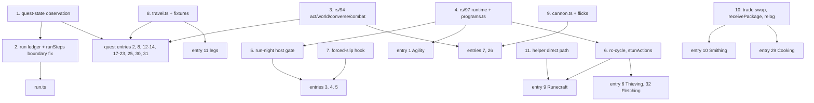

# Step manifest: every script `speedrun/run.ts` chains

This is the build list for the scored run. It has one entry per script that `speedrun/run.ts` will
chain for provisional order v1 (cairn://p/rs/103): the scored account's step scripts, the
transition legs, the helper-side scripts those steps wait on, and `run.ts` itself. The main thread
files one builder per entry. The order is **build priority**: the entry with the most ticks at
stake comes first (section 1 says how that was computed). The last section lists the shared
primitives the builders need first. Every program parameter named here is checked against the
program's `createX.params` declaration on the run-commit floor (entry 0), and a module's lab
acceptance counts only on a page built from that floor.

The scored account is called **SCORED** everywhere. Its real name lives only in its gitignored
`bots/<name>/bot.env`; no script, log line, commit or document names it. The sibling
`RUN-ORDER.md` carries the step table, relog plan and reconciled total for the same order.
cairn://p/rs/111 reconciled the two with the labs rs/104-108 (run-transitions, bones-placement,
stun-pack, wine-window, levelup-cost under `research/`), rs/129's supply fallbacks and rs/127's
`RESILIENCE.md`: **every step's expected and best here is RUN-ORDER.md v2's figure**, and the
moves are the same (S17 last, after S27; the bones in S07's knife loop; S18 one measured row; gems in
the wine windows). The **inventory ledger** at the end is the single source for what SCORED holds at each step and
hand-off, which `speedrun/tools/slot-ledger.ts` checks against every step's free-slot need.

## How to read an entry

**Wall time at 400 ms (fold-in 28's audit).** The demo has ticked at 400 ms since 2026-10-22 19:56:29Z (RUN-ORDER.md R42), and every figure here is in ticks unless it says otherwise. A wall-time figure that converts to ticks is restated at 400 ms beside its 300 ms value: mule1's timed re-request every 15 s, ~37.5 ticks (~50 at 300 ms); an unanswered request re-sent after 8 s, ~20 ticks (~27); `gated-program.ts`'s 60 s pause, 150 ticks (200); the demo's 0.34-0.37 s ticks of 2026-10-22 ~03:4xZ, a 300 ms-era reading. Every other wall-time figure (engine stalls, relog and restart seconds, refill and ramp minutes, lab wall clocks, the gate's probe minutes, 150 ticks a minute now against 200) is **a 300 ms reading** where it was measured before 19:56:29Z and is dated where it was measured after; the run's wall clock is ticks x 0.4 s (~3.9 h on the row in force).

**Step IDs** are provisional order v1's S00-S27 (cairn://p/rs/103). A quest or skill that the order
splits gets one module and one `Step` object per ID, so `S10a` was Prayer 1-43 (retired in v2: its bones ride S07) and `S10b` is Tree
Gnome Village. IDs never move: a step that changes place keeps its ID.

**Lab host (main's rule, fold-in 23).** fedora (bginf-halo)'s lab engine stalls 14-40 s and then resumes 1 tick
later, so every measured figure whose runs were on fedora (bginf-halo) carries '(fedora (bginf-halo))' beside its citation, and
a failure seen only on fedora (bginf-halo) never reverts a row from m on its own (RUN-ORDER.md, "How to read the
numbers", which also carries fold-in 30's rule: a 2026-10-22 lab figure's host label is the executor its batch named, pending each `uname -n` re-check).

**Three tick figures** per entry, all on SCORED's clock (in-world ticks at 300 ms):

- **Expected** is RUN-ORDER.md v2's knife-on expected for the step. For a quest it is the **burst**
  figure with its failure budget (fold-in 14; main's ruling, 2026-10-21 23:52 PDT, after rs/287's demo
  validation on the lite client): the module's measured burst where one exists, else
  `quests/README.md` §3's burst column, on the fixed figure's basis. The fixed figure is the step's
  fallback if burst fails (`continueBurst` drops to `advance`, 1 tick a page), and each entry gives it. For a knife skill it is the
  **knife** figure at rs/97's in-page rates, the column RUN-ORDER.md's headline uses while the run
  gate holds; the plain loop is the step's fallback, and RUN-ORDER.md shows the knife-off total
  beside it.
- **Best** is the fast path as measured on the direct path: the knife column, the rs/91 kit, and so
  on; for a quest, a measured case faster than the burst expected where one exists (S13, S15, S26),
  else the expected itself. A quest's burst column is slightly conservative: rs/200 measured
  its burst mode 1-2 ticks under the corrected `1 + ceil((k-1)/5)` rule (Cook's Assistant's start
  6-7 against 8, the Grand Tree's Narnode start net ~11 against 13; `speedrun/lab/quests/dialogue-burst.ts`,
  n = 3 each), because a run of k pages after an option or state page costs ceil(k/5) and a run
  followed by a state page +1, so each quest child's `dialogue: 'both'` measurement supersedes the
  column for its entry, with no re-price until then (the rule is in `quests/*.md`, rs/185's).
- **Fallback** is what the step costs when its fast path fails: for a knife skill the plain loop
  (the knife-off column). For a quest the Fallback column is the stock column (the fixed figure,
  burst's own fallback, is in each entry and in RUN-ORDER.md's quest rows),
  because read-then-act through the SDK relay costs about the stock client's 2 ticks per page (a
  relay reaction lands a tick late about half the time, cairn://p/rs/86 via `skills/README.md`,
  open question 1).

**Labels**, on every figure: **measured** (a committed lab script, named), **read** (a content or
engine line), **inferred** (arithmetic or a model over measured and read inputs, basis given), and
**estimated** (a judgement made here, with no model behind it). Sources are paths under
`docs/speedrun/` unless a branch is named. `[rs/41]` means read on cairn://p/rs/41/1/coordinator,
`[rs/59]` on cairn://p/rs/59/1/coordinator, `[rs/94]` on cairn://p/rs/94/1/builder and `[rs/97]`
on cairn://p/rs/97/1/builder.

**Timing (run-wide; main, 20:59 PDT).** Every cue-timed hand-off, helper login or helper action is
timed on **observed game ticks** (the tick stream or `TICKMON`), never on wall-clock multiples of
300 ms: the Runecraft givers' cue (entry 9, HS4), the anvil's `cue.json` (HS5), the Firemaking
droppers (S03, HS6), the bone givers' load timing (H4.1-H4.n) and any `T0 + n ms` launch in run.ts. A
deadline that stands for a tick count keys off observed ticks; wall clock appears only as an idle
bound, no new tick for N ticks' worth of time scaled by the configured tick length (on the floor
since #209's `tickClock`, 4fe2d0a8, inside the floor cae93456). The demo has
been seen at 0.34-0.37 s a tick (a 300 ms-era reading), where a wall-clock cue lands early by about (1 - 0.30/actual) of
its delay and a deadline fires early (RUN-ORDER.md R23).

**Lab staging (rs/196's finding; rs/284's guard, on main as #233).** A fresh lab account is staged
through S00 (`tutorial_complete`), never teleported off Tutorial Island: a brand-new account's first
login on the island clears every side tab (`tutorial.rs2` `start_tutorial`), a staff teleport never
restores them, and the account's **side-tab clicks** are then dropped silently. On a hidden-tab
account the server drops item ops and item use, spells cast from the magic tab, prayer toggles, the
run toggle and combat-style buttons; modals (bank, shop, trade, dialogue) are unaffected
(`Player.isComponentVisible`). The exposure needs all three of: the account's first login on that
engine's save data (a new name, slot or engine); staging off the island by `::tele` instead of S00;
and side-tab clicks afterwards. A rerun on the same engine is unaffected, because the second login
restores the tabs. The guard is on main (#233): `speedrun/lab/setup.ts` `tele()` and `mustTele()`
refuse on Tutorial Island (start.ts's `onTutorialIsland`, pointing at S00's `tutorialSkip`), and lab
scripts that stage fresh accounts go through the skip. **No relabels** (rs/284's report): no row in
force rests on an exposed script. S25a is priced from rs/197's module (`smithing-trade.ts` fed only
the superseded 1,147 and the ~1,330 bank fallback, a sensitivity); the `combat-rate.ts` ogre rate in
`skills/ranged.md`:143 sits in no row; `runes-lab.ts` and `measure-dragons.ts` feed no SCORED
figure; and Runecraft's counted rows each carry `talismanDrops` 1 or could not have completed with
hidden tabs, while its givers leave the tutorial through `bot.skipTutorial()` (rs/196; entry 9's
talisman-drop stop was this artefact).

**Run mode (rs/280; RUN-ORDER.md O45).** Run on is the scored account's default (main, 21:32 PDT): rs/280's
`lib/run-mode.ts` (on main as #234, d0461244, inside the run-commit floor) turns it on by default after every login, relog, resume and S00
(`option_run` is not saved), best effort, confirmed from state and recorded, never fatal on the scored path; it is strict only
for the lab opt-out `Step.running: false` (main, 01:15 PDT). The lever is ~0: every walk the shared walker sends and every
op-click approach already carries the ctrl-run flag (`tempRun`), so locs, ground items, obstacles
and the first leg to an NPC run at 2 tiles a tick with the toggle off (m, rs/280). The toggle matters
only where the engine moves the player without a fresh ctrl-run route: its own re-path to a moving
NPC or player target after `tempRun` clears (`Player.ts:744`), and content `p_walk`. Each module
owner lists the places in its step that depend on one of those two; the lists are in the status
column and RUN-ORDER.md O45.

**Mode.** An entry is **in-page** when its loop reacts on the decoded tick or sends on predicted
ticks. That means an rs/97 tick program inside the browser webclient, started and awaited through
`speedrun/lib/programs.ts` [rs/97] (`startProgram`, `awaitProgram`, `runProgram`, `probeInPage`).
Everything else is **overlay-driven** through the SDK and `speedrun/lib`. The reason is the relay:
an in-process reaction landed on the next tick 60 of 60 times, and the same reaction through the
loopback gateway 32 of 60 (`LAB.md`, "Direct path and relay").

**User actions per tick (fold-in 31).** **At most 5 successful user actions a tick; the 6th applies next tick** (m, rs/507 on the demo, 2026-10-22 23:27Z at T = 400, and the lab: drags of N = 5 / 6 / 8 in one write landed 5/0, 5/1 and 5/3 the same tick / the next, 3 of 3 on both; 20 client events a tick; the excess carries to the next tick in order and nothing is dropped; `demo-latency.md` section 6 'Decode cap', rs/507's PR into rs/83; and m on continues, rs/396's 20:52Z Aereck re-check, every five-page burst in one tick, a continue being a USER_EVENT counted only on success, `ResumePauseButton.ts:5`, `NetworkPlayer.ts:141`). It is the fork's cap (`ClientGameProtCategory.ts:6`). rs/466's 4 of 5 Charges on one tick was relay straddling, not a cap, so Charge holds. No row moves for it, and every 4-per-tick figure drafted for fold-in 31 is a closed note, 'cap measured at 5': the quests' dialogue bursts (+23, bound 59, rs/185's count), S18's Superheat cast tick (5 actions, the cast last), S25c's first bank burst (+1) and S27's fletching at `PER_TICK 5` (+14). RUN-ORDER.md 'How to read the numbers' carries the same rule.

**In-page figures.** rs/97 measured its programs on its wired branch, on a local engine in a
visible tab (direct path), reported to this issue as "rs/97 in-page results via main, 05:50": probe
60 of 60; knife iron 3.00 ticks per ore (200 of 200 on the predicted tick); knife normal trees from
level 1, 7.24 ticks per log; knife willow 4.83 ticks per log; knife fly 20-99, 4.26 ticks per
catch; pickpocket at 55, 0.173 rolls per tick; Wilderness Agility 66 ticks per lap. The in-page
entries take their acceptance thresholds from these figures and start from rs/97's branch
(cairn://p/rs/97/1/builder). Two exceptions: the willow 4.83 was taken at level 99 and its gap from
the lite 4.23 is the server's chop RNG, not the client (`tick-programs.md` "Measured"; RUN-ORDER.md
O19), so entry 3's willow threshold is the 3-tick lattice at the formula's success rate; and
knife-cycle's "ticks per roll" (`rolls`, `ticksPerRoll`) counts xp events, so it is ticks per log
(RUN-ORDER.md, "How to read the numbers").

**Acceptance tests** come in two kinds. The local one runs on the lab engine at
`NODE_TICKRATE=300` (`LAB.md`; `speedrun/lab/lab.sh` or `docs/speedrun/scripts/lab.sh`), and an
in-page step runs there in a visible browser tab, because the lite client hosts no programs
(`programStatus` is null on lite). The demo one runs on rs-sdk-demo.fly.dev with a throwaway
`cairn_`-prefixed account outside the fleet's reserved ranges (the list in cairn://p/rs/101), and
never with SCORED. A demo test of an in-page loop only counts from an Ashburn vantage (the rs/86
runner); from anywhere else the network alone exceeds the reaction window. A step that needs
levels a throwaway cannot reach cheaply gets a demo test of its shared primitives and of whatever
part is level-free, and says so.

**`logoutSafe`** is the `Step` field from `speedrun/runner/step.ts`: true when SCORED can log out
right after the step and resume at the next one.

**Resumes from** (every entry): the game state `runResumable` (`speedrun/runner/resume.ts`, rs/127)
checks after a restart or a drop: the step's `done` test, its `inProgress` test and resume entry,
and any probes, from `RESILIENCE.md` section 5. Quest state comes from rs/114's
`speedrun/lib/quests.ts` and `docs/speedrun/quests/quest-state.md` (`questDone`, `questStatus`,
`questStage`, `questPoints`, `requireQuestStage(view, key, stage, {atLeast?})`, `readQuestStage`,
`journalProbe(key)`; stage tables in `speedrun/data/quest-stages.ts`; on main, PR #123). Route quest varps are not transmitted to
the client: status comes from the quest-list colours and the exact stage from a journal read, which
re-clicks if the journal has not opened within 3 ticks. The Mage Arena is not on the quest list; its
postcondition is items and messages.

## 1. Exposure and build order

**How exposure was computed.** Exposure is the entry's **expected** ticks on SCORED's clock, as
defined above: RUN-ORDER.md v2's figure for its steps. Entries are ranked by exposure. **At stake**
is fallback minus best: the ticks a good build wins over a failed fast path. Two rules place the
entries that have no exposure of their own:

- `run.ts` and its runner come first, because nothing can be accepted without them.
- Helper-side scripts (section 4) are ranked by the exposure of the step they gate. No step
  passes its demo acceptance without its helper.

**Entry numbers are stable ids**, cited by `RESILIENCE.md` section 5 and by section 4 here; the
**Rank** column is the build order. The v2 figures moved five ranks: Thieving (now 2,000 measured)
passes Fishing (now the knife's 1,995), the legs (1,382 measured) pass Runecraft and Smithing, and
Prayer (110, now inside S07) drops from 15 to 27. Re-pricing S07's knife on O19 (RUN-ORDER.md
section 9) puts Woodcutting (2,986) below Mining (3,116), so the two swap ranks 3 and 4. rs/174's fixed
tab relog (~2 ticks each, on the twin) returns Cooking to 80, below Prayer and Crafting, where it
stood before rs/164's ~20. Fold-in 11 moved the twelve quests' way-in travel into the legs (840.5;
RUN-ORDER.md O6): the legs (2,222.5) pass Thieving, Fishing, Combat and the Grand Tree, Dragon
Slayer passes Dwarf Cannon, Magic passes Fishing Contest and Herblore passes Goblin Diplomacy. Fold-in 11's part 5 takes the ~82
of Goblin Diplomacy's standalone travel that the legs already carried off its row (to 61), so the
cannon session, Prayer, Crafting and Cooking pass it. Fold-in 13 adds S15's measured H to M (+352),
so Monkey Madness (4,429) passed Agility (4,327) for rank 1; fold-in 15's N to P, the rope pin and segment X (+335) put it at 4,764. Fold-in 15 also measures Dragon Slayer (1,380), which passes
Runecraft and Smithing for rank 10, and Dwarf Cannon (1,130), which passes Smithing for rank 12. Fold-in 17's railing recount (~968 in burst) drops Dwarf Cannon back below Smithing, to rank 13.

The expected column sums to **31,599.4** (the steps, fold-in 34: S07's first bone load +1.5; 31,597.9 at fold-in 31; 31,283.8 written until then; 31,258.1 at fold-in 24, 31,212.5 at fold-in 23's final statement, 31,351.8 at its first statement, 31,391.8 at fold-in 22, 31,312.8 at fold-in 20, 31,250.8 at fold-in 18, 31,408 before fold-in 17, 32,287 before fold-in 14 moved every quest's expected to its burst figure) plus the legs' **2,283.3** (fold-in 33: the leg-row drops, +2 e on seven legs and +3 i on T01-02, rs/546; 2,266.3 at fold-in 31; 2,214.0 at fold-in 23's first statement, 2,223.6 at fold-in 22, 2,224.2 at fold-in 20, 2,209.5 before its T05-06 on its browser figure); RUN-ORDER.md section 6
adds the allowances (hand-offs outside the figures, level-up pages, contention, overrun, relay,
retries, restarts) for its **35,188.4** knife-on expected (32,662.9 best; fold-in 36, -0.6 / -1: H13 at the pooled browser 8.7, best 8, its drop mode on main as #470; fold-in 34, +1.5 / +1: S07's first bone load; fold-in 33, +15: the legs' +17 less T06-07's air-rune drop retired from the hand-offs), against the record of 35,916.

**Module status** (the last column; the helper scripts and the programs the entries rely on are in
"Module status" at the end of this section) is as of this document's commit date, and rs/158 updates
it with each fold-in. Earliest plausible run date: **2026-10-23, more likely the 24th or later**
(main, 2026-10-21 14:54 PDT).

| Rank | # | Entry | Module | Steps | Expected | Best | Fallback | At stake | Mode | Code to start from | Module status |
|---|---|---|---|---|---|---|---|---|---|---|---|
| 0 | 0 | Run chain | `speedrun/run.ts`, `runner/resume.ts` | all | boundary idle 0 m (#92); restarts ~5 each (an in-page relog, ~2, rs/174) | 0 | | | overlay | `runner/step.ts`, `runner/resume.ts` (main) | `run.ts`: building (rs/393's run.ts plan, with rs/186); `runner/step.ts`, `resume.ts` on main (#29, #104, #146) |
| 1 | 2 | Monkey Madness | `speedrun/quests/monkey-madness.ts` | S15 | 4,790.5 | 4,565.7 | 5,298 | ~1,073 | overlay | `quest-mm-*.ts` | **On its fixed basis since fold-in 31** (the module's default is fixed and `steps()` refuses burst, `monkey-madness.ts:74, 2922`; rs/185): 4,790.5 / 4,565.7, the burst row history; burst dialogue is rs/513's, unpriced until adopted (RUN-ORDER.md section 7's levers). **A-Z not yet chained clean** (fold-in 20, RUN-ORDER.md R37: rs/201's first A-Z chains on H12's floor 0 of 3, two atoll deaths out of food by N or O, one lab stall; a death is unpriced; the start condition is **the kit gate**: 3 clean A-Z chains off fedora (bginf-halo) with exactly the kit, then once on the browser client, each ending its last eating segment with at least 1 shark unused and HP never below 10 (main, fold-in 23); if rs/201 shows no antipoison drunk in any chain, the antipoison(4) comes out, the 16th shark goes in, and the gate re-runs on that kit; rs/201's execution 4; **chain 1 of 3 failed it**, fold-in 24: rs/201 execution 5, A-Z 4,664 m, 0 deaths, all 15 sharks eaten, HP down to 6 in O and 9 in P; rs/201 exec 7 at Defence 37 failed it too (fold-in 25: 0 sharks left at R's end in both clean chains; the kit emptied on overheal from eating below 30; the dungeon's direct damage not reducible by Defence or prayer); the next gate three A-Z chains at Defence 1 on the eat rule 'below 10 + each segment's max 3-tick damage, no top-up eats', O43a off (no saving at Defence 37), (c) O43b only if it fails; the rope pin ~392 on measured parts (rs/201 exec 7); (a) the antipoison off struck (chain 1 drank all 4 doses by K) and (d) H12h withdrawn as not available, RUN-ORDER.md R37; HP exactly 10 in J, N and R, so no HP margin in H-R); **H-Z lab-proven, segment by segment, 3 of 3 each** (A-G measured in chain 1, 490 against ~480 i, and H-Z 4,174 against 4,170.8 m, fold-in 24; H-M 1,466 m; N, O, P 117 / 388 / 454 m; Q to Z 59 / 403 / 163 / 120 / 319 / 14 / 96 / 323.8 / 175 / 73 m; fold-in 19); run mode: no `p_walk`, re-paths at the Monkey Child (O) and the zoo (T), lever ~0 (r, rs/201) |
| 2 | 1 | Agility | `speedrun/skills/agility.ts` | S11a, S17 | 4,228 | 3,934 | 4,626 | ~690 | in-page | rs/97 `agility` program, `agility-course.ts` | **on main, cae93456 (#245; rs/300's snapshot)**; lab-accepted (66 per Wilderness lap, 9 of 9; S11a 114; rs/155); S17 4,114 on the engine's fall roll, 66 the clean-lap floor (rs/270; cairn_jumps' demo run continues as rs/295); run mode 0 on both courses (m, rs/270) |
| 3 | 4 | Mining | `speedrun/skills/mining.ts` | S09 | 3,157 | 3,148 | 3,775 | ~627 | in-page | rs/97 `knife-mine`, `tickmanip-mine.ts` | **on main, 4235a9e7 (#220; rs/260's snapshot of rs/230's lab-accepted module, rs/147's branch at 59ec3933)**, with `selfStarter` (plain 3.62) and `beforeRestart`; `stay2` bury (#159, rs/182) and restart fix (e5d8a058, #170; rs/207) on main; gate `measureDrops` 120 explicit (rs/259, 314989e9); **demo-measured** (rs/259's cairn_rocks: 3.019 per xp ore uncontested); on main with rs/298 (#242, inside the floor 811e9eb2: 3fa6fbe4's ore drop and 314989e9) |
| 4 | 3 | Woodcutting, with the bury | `speedrun/skills/woodcutting.ts` | S07 (+ S25b's bones) | 3,054.5 | 2,970 | 4,026.5 (4,122.5 without #165, history) | ~1,090 | in-page | rs/97 `knife-cycle`; rs/137's bury variant; `bones-wc.ts` | **on main** (#243, de3a4944: rs/297's snapshot of cairn_chops' raced module, inside the run-commit floor; rs/211 and rs/236 before it; rs/151 closed); gate-off plain + bury on main (rs/162, 3dfc217f, #165); gate `measureDrops` 120 explicit (rs/261, on main with #243); run mode 0 (m, rs/261); **the knife demo-measured** (rs/261's cairn_chops, hiscore 3,329; S07 at its luck-free 3,053); **on main, de3a4944 (#243; rs/297's snapshot as cairn_chops raced it, knife-cycle's `waitRespawn` declared)** |
| 5 | 11 | Transition legs | `speedrun/runner/legs.ts` + `speedrun/lib/travel.ts` | between steps | 2,283.3 | 2,200.2 | ~2,340 i | ~140 | overlay | `run-transitions-legs.ts`, `run-transitions-lib.ts` | **on main, PR #238** (rs/291's snapshot of rs/198's module for rs/186, merge 5a70e4e6): `legs.ts` and its test, `tools/demo-legs.ts`, `measure-legs.ts`, `measure-ardougne-handoff.ts`, `ticks.ts`'s `travel` rows, run-transitions.md section 10; lab-measured and demo-checked (h55); its walker, `lib/travel.ts`, on main, 0658e896 (#200); rs/294's forcemove door fix on main (#240); both inside the floor cae93456 |
| 6 | 6 | Thieving and the stun pack | `speedrun/skills/thieving.ts` | S18 (S18b-d inside) | 2,026 | 1,925 | 1,975 + ~120 elsewhere | ~190 | in-page | rs/97 `pickpocket`; rs/132's `stunActions`; `stun-pack-thieve.ts` | **on main** (#244, 6804061a: rs/301's Thieving S18 module options, with rs/243's `stopWhenFoodBelow`, `retargetTicks` and the top-up contract; rs/154 before it); top-up on main (`openMaxTicks` / `maxTicks`, the same deadline); **stun pack built (0efc315c, rs/324), lab acceptance pending rs/335** (browser, 57-99, against rs/317's 2,056): on main, `thieving.ts:639` still throws 'stun pack not implemented' (RUN-ORDER.md R31); rs/132's program side lab-accepted (bury, charge, arrows); **demo-confirmed program behaviour** (rs/315, cairn_steals; no re-price); browser: no change for the client (rs/317, phase 1); top-ups ~0 with the courier on a side tile (rs/279, lab); rs/290's opt-in idle re-send building; **Superheat in every stocked stun on main, bfbac17f (#327; rs/375), and in the expected since fold-in 23** |
| 7 | 5 | Fishing | `speedrun/skills/fishing.ts` | S22 | 1,995 | 1,969 | 3,410 | ~1,440 | in-page | rs/97 `knife-cycle`, `tickmanip-cycle.ts` | on main, 22552bf4 (#197; rs/231); lab-accepted (1,998 on 78-99; rs/152); gate `measureDrops` 120 explicit (#221) |
| 8 | 7 | Combat finish | `speedrun/skills/ranged.ts` (`combatFinish`) | S27 | 1,972 | 1,946 | 1,997 (the bow from 70); 2,023-2,211 without the kit | ~265 | overlay | `cannon-kit.ts` (rs/59, on main) | on main, 8a741554 (#212, rs/252's snapshot); lab-accepted (S27 1,972 i on the module's rates, S14 118 m; rs/199, PR #207); lab is the final tier (a demo test is not feasible); run mode ~0, at most ~9 on S27's melee phase (m/i, rs/196) |
| 9 | 8 | The Grand Tree | `speedrun/quests/grand-tree.ts` | S11b | 1,352 | 1,259 | 1,763 | ~374 | overlay | `quest-grandtree-full.ts` | **on main** (#235, 2ee27d2b, rs/281's snapshot of rs/202's module; the door wait removed with #267, rs/334), inside the run-commit floor; **lab: 3 of 3 full A-to-P runs at SCORED's levels** (1,403 / 1,504 / 1,422) |
| 10 | 13 | Dragon Slayer | `speedrun/quests/dragon-slayer.ts` | S26 | 1,338.3 | 1,299 | ~1,490 | ~186 | overlay | `quest-dragon-*.ts` | **browser-accepted** (rs/378, the Ashburn twin, local lab engine, burst, ff300a82; fold-in 24: 1,338.3 m (browser), a per-segment composition, best 1,299, chain 2; B's Guildmaster position +37 in 1 of 5 B runs, rs/185); **on main, 9ecf5f7c (#303; rs/377's snapshot of rs/185 at 86a83471), inside the run-commit floor** (fold-in 22): lab-accepted on lite (fixed 1,321 / burst 1,292); its browser pass waits on rs/309, then **rs/378** from the twin; **lab: rs/258's pinned rerun, 6 of 6 from the arrival tile, burst 1,293 / fixed 1,322 (m), with the amulet drop**; the browser acceptance (O51) to come; run mode: no `p_walk`, re-paths at ten moving NPCs and the six maze monsters, lever ~0 (r, rs/258) |
| 11 | 9 | Runecraft | `speedrun/skills/runecraft.ts` | S06, S21 | 1,196 | 1,196 | ~5,220 | ~4,030 | in-page | rs/131's `rc-cycle`; `runecraft-cycle.ts` | **on main, 1514f47a (#222; rs/268's snapshot of rs/196's module, rs/186's branch at 0c349da6)**, inside the run-commit floor; **lab- and demo-accepted** (the 20-cycle demo acceptance: rs/196, 12:26-12:33Z, 20 of 20 given, 13 of 13 in-batch gaps at 7, step 626; fold-in 22; a partial confirmation, 9/9 tuned, before); **lab-accepted (rs/196, module 3f02f336, relay path (lab): nature at 44 tuned 30/30 at 29 x 7, robust 30/30 at 29 x 8; S06 7/7 at 6 x 7, 58)**; the tuned nature run confirmed on the direct path, 30/30 at 29 x 7 (rs/196, 3b161c12); **browser-confirmed for arrival** (rs/196, 6 of 6 by the real leg, `--arrive=leg`, e2d47293: S06 60 / 60 / 60, body 10 cycles 82 / 83 / 82; fold-in 20); 30 of 30 at 29 x 7 under #287's reader fix; pending: the auto rule's 'handled before SCORED' field (entry 9); main's `runecraft-accept.ts` carries rs/330's `--path=direct` fix (812c766f) since #288 (rs/362, 4bdebcd5, inside the floor), with `runecraft.md` section 9 labelling each run relay or direct; rs/267's body stock-rung lab ran on the pre-fix copy, so it stays relay (lab), direct re-measure pending; the per-band load and the stock rung's opt-in on main with #288; cycle: on main, 23ea9f77 (#178) |
| 12 | 10 | Smithing | `speedrun/skills/smithing.ts` | S25a | 940 | 903 | 1,330 | ~302 | overlay | `smithing-trade.ts` | **on main (#230)**, with `lib/trade.ts` `swap()` and `anvil.ts`'s restock and off-tile fixes; the demo attempt inconclusive (rs/197, entry 10) |
| 13 | 12 | Dwarf Cannon | `speedrun/quests/dwarf-cannon.ts` | S13 | 917.9 | 810 | ~1,128 | ~167 | overlay | `quest-mcannon-*.ts` | **browser-accepted, final** (rs/370, bgsrv-mac, rs/185's 8dcb54e6, module 6dee54fc, fixed and burst pass; fold-in 25 execution 2: no change; **browser-accepted on main's code**, #372, 36edbf1d, fold-in 28: re-priced on the browser basis, 917.9 / 810, i, B at the browser's per-try midpoint; pre-rs/411; segment I's `replyAfter` fix on main with #372); **on main, 425c7047 (#299; rs/373's snapshot of rs/185 at 3502672e)**, inside the run-commit floor: lab 6 of 6 at SCORED's real levels (rs/257), the demo complete on cairn_dc01; **the browser pass waits on rs/309, then rs/370**; built by rs/257 under rs/185; **lab: 3 runs a mode at SCORED's levels, 1,137 fixed / 999 burst** (rs/257); **execution 2's railing recount**: the formula rate, B at 25.2 tries (rs/257, fold-in 17); run mode: no `p_walk`, re-paths at Lawgof (A, C, E, H, J, L) and Nulodion (K), lever ~0 (r, rs/257) |
| 14 | 14 | Tree Gnome Village | `speedrun/quests/tree-gnome-village.ts` | S10b | 678 | 665 | 902 | ~237 | overlay | `quest-tree-full.ts`, `quest-premm-fight.ts` | **browser-confirmed** (rs/391, bgsrv-mac local lab, burst, rs/185's 9d5f841e; fold-in 25 execution 2: one A-N chain passed at 707, no re-price; pre-rs/411; segment H at its lite 74, **fix on main (#389)**, rs/481, fold-in 28; accepted on both clients, rs/457 at rs/185's bc51940c, bgsrv-mac: lite 74 / 70 / 70, browser 76 / 70 / 74; the risk line closed, B met; a browser A-N chain 673, the price 678 / 665 standing); **on main, fe1fd23e (#312; rs/390's snapshot of rs/342's module, #311 on rs/185's branch)**: lab-accepted on lite (rs/342, 3 runs a mode from Elkoy at SCORED's arrival levels: burst 678, fixed 719, the warlord 113.7 by Fire Blast; fold-in 22); the browser pass **rs/391**, behind rs/309 |
| 15 | 16 | Firemaking | `speedrun/skills/firemaking.ts` | S03 | 661.3 | 657 | 735 | ~85 | overlay | `firemaking-line.ts` | on main, 4cc468e0 (#205; rs/244), with the inferred-fire counter (#229); **demo-measured**, 681 m (rs/269, cairn_burns); **demo-accepted (module), on main as #263** (200909b4, rs/326, inside the floor): rs/186 under rs/158's pass rule, rs/245's PR #241 merged into rs/186 as 1cb8ef67, 20 of 20 lit, every one of the 19 gaps exactly 4 ticks a roll (9 failed rolls), no slip, resend, refusal or skip (firemaking.md section 9) |
| 16 | 17 | Fight Arena | `speedrun/quests/fight-arena.ts` | S12 | 526.2 | 499 | 646 | ~114 | overlay | `quest-arena-run.ts` | **on main, f659c074 (#324; rs/406)**, inside the run-commit floor; **lab-accepted on lite** (rs/379, under rs/185; fedora (bginf-halo), 6 of 6 from the arrival tile: burst 532, fixed 557.3, 0 damage, m; fold-in 23); the cell keys dropped at K's exit; the exit census measured, 14 used, S13 starting with 11 free after H10 (RUN-ORDER.md O46, closed); browser-accepted (rs/401, fold-in 28), B at 37 on #419's door fix since fold-in 31 (rs/484, -7) |
| 17 | 18 | Plague City | `speedrun/quests/plague-city.ts` | S08 | 402.7 | 399 | 608 | ~222 | overlay | `quest-plague-city-*.ts` | **on main, bf3e7ce3 (#329; rs/412's snapshot of rs/185 at 00575670)**, inside the run-commit floor; lab-accepted on lite (rs/400, 6 of 6; fold-in 23); **browser-accepted** (rs/413, bgsrv-mac, 400 ms, 390 / 398 / 393 + H6's 9: 402.7, best 399; fold-in 31; off the burst-fails line); the demo pending |
| 18 | 19 | Mage Arena | `speedrun/quests/mage-arena.ts` | S16 | 382 | 336 | 448 | ~66 | overlay | `quest-magearena-*.ts` | **on main, 23f93a66 (#332; rs/417's snapshot of rs/185 at 8ee81569)**, inside the run-commit floor; A-F lab-accepted (rs/371, bgsrv-ub; fold-in 23); the browser re-run pending |
| 19 | 20 | Sea Slug | `speedrun/quests/sea-slug.ts` | S19 | 311.0 | 304 | 462 | ~151 | overlay | `quest-smallskill-seaslug.ts` | **browser-accepted** (rs/414 execution 2, bgsrv-ub, local lab engine, 3 of 3 from Caroline's tile, tree 289d61b7; fold-in 24: 311.0 m (browser) against a same-engine lite control of 304); lab-measured on lite before, 6 of 6 (fold-in 23); **on main, 54f6767e (#343; rs/431's snapshot)**: the run-commit floor (fold-in 24) |
| 20 | 21 | Romeo & Juliet | `speedrun/quests/romeo-juliet.ts` | S24 | 274 | 260 | 301 | ~27 | overlay | `speedrun/lab/quests/romeo-juliet.ts` (rs/416) | **browser-measured** (rs/416, bgsrv-mac, burst, n = 1, the webclient from tree 349da9f4 with rs/416's files at ec4f1b36; fold-in 25: 274 m (browser)); lab-measured on lite, 3 of 3 a mode (fixed 300, burst 265.3, best 260); on rs/186's branch as 76703cf3, wired by run.ts as a real step; pending for the floor with S24's snapshot (entry 0) |
| 21 | 22 | Druidic Ritual | `speedrun/quests/druidic-ritual.ts` | S24 | 196 | 195 | 284 | ~88 | overlay | `speedrun/lab/quests/druidic-ritual.ts` (rs/416) | **browser-measured** (rs/416, bgsrv-mac, burst, n = 1, the webclient from tree 349da9f4 with rs/416's ff09774e; fold-in 25: 196 m (browser), a fresh door); lab-measured on lite, 3 of 3 a mode (the route's fresh door: fixed 209, burst 195.3; means 208 / 193.3); the browser-only prison-door reply fault fixed in the module; on rs/186's branch as 76703cf3, wired by run.ts; pending for the floor with S24's snapshot, **with the door-reply fix via lib/world's `replyAfter`** (rs/186; entry 0) |
| 22 | 24 | Magic (strike, enchant) | `speedrun/skills/magic.ts` | S02, S04 | 213 | 208 | ~231 | ~23 | overlay | `magic-strike.ts`, `magic-cadence.ts` | **on main as #255** (acec0aec, rs/316, inside the floor); **browser client, lab: S02 20.3 m (best 17), S04 192.7 m (best 191)** (rs/285, fold-in 17); on lite before: S02 14 m (12 / 12 / 12 / 17 in the lab, 17 on the demo; best 12); **demo-confirmed for the enchant cadence** (cairn_m01: 20 sapphire enchants in 60 ticks, 19 of 19 gaps at 3); S04 191 m (lab, 2 of 2) with `handBack: 'keep'`, the last 20 rings to H4's swap |
| 23 | 23 | Fishing Contest | `speedrun/quests/fishing-contest.ts` | S20 | 319 | 318 | 376 | ~62 | overlay | `quest-smallskill-fishingcompo.ts` | **lab-accepted on lite** (rs/388, rs/185's module 5bd450ad on **the self route**, 6 of 6 from the arrival tile: burst 314, fixed 327.3, m; fold-in 23); the helper carp is untradeable; merged into rs/185's branch as **PR #317**, **on main as #320** (f71978ca, rs/399's snapshot, the run-commit floor; fold-in 23); **browser-accepted** (fold-in 30: rs/396, the Ashburn twin's local lab engine, `--client=browser`, 300 ms, tree 89e5979d, 3 runs a mode: the A-N burst chain 318 / 319 / 320 against lite's 314, +1.6%, no segment over +10%; 'browser lab; no real-server run') |
| 24 | 27 | Herblore | `speedrun/skills/herblore.ts` | S25e | 167 | 167 | ~200 e | ~33 | overlay | `delayfree-cycle.ts` | **lab-accepted** (rs/302, browser, n = 3: 167 from Herblore 28, 90 of 90 work ticks at 5 events, 0 overBudget; fold-in 22); **on main as #325** (3daddf0c, rs/407's snapshot of rs/186 at 8c2af40c, inside the run-commit floor; fold-in 23), the row staying 167 m; **demo-accepted** (rs/302, cairn_h85, a browser tab on the rehearsal twin, the demo world, 14:08-14:09Z, 28 attack mixes, Herblore 63-66, the Falador west booth, m: 12 program ticks for 2 inventories (6.0 each against L1's 5.47, +9.7% with the first reset visit), overBudget 0, 6 of 6 work ticks landed on the next tick; recorded at a152aeab on rs/186's branch; fold-in 23) |
| 25 | 26 | Pre-MM cannon session | `speedrun/skills/ranged.ts` (`cannonSession`) | S14 | 118 | 104 | ~162 | ~58 | overlay | `quest-premm-cannon.ts`, `ranged-cannon.ts` | on main, 8a741554 (#212, rs/252's snapshot); lab-accepted (S27 1,972 i on the module's rates, S14 118 m; rs/199, PR #207); lab is the final tier (a demo test is not feasible) |
| 26 | 15 | Prayer (bones inside S07; the booth as fallback) | `speedrun/skills/woodcutting.ts` bury option; `speedrun/skills/prayer.ts` for the booth | S25b (S10a retired) | 145 | 115 | 735 (the booth) | ~670 | in-page with S07 | `bones-wc.ts`, `prayer-bury.ts` | bury in S07: on main (knife-cycle's `bury`, #124, through `woodcutting.ts`, #243 and #293); gate-off plain + bury on main (rs/162, 3dfc217f, #165); booth: **lab-accepted on both clients** (rs/395, 58.0 a 28-bone inventory on lite and the browser, m; fold-in 23), **on main, 7315c6d7 (#326; rs/408)**, inside the run-commit floor |
| 27 | 28 | Crafting | `speedrun/skills/crafting.ts` | S25d | 91 | 85 | 121 (no gems in the windows) | ~36 | overlay | `delayfree-cycle.ts` | **on main, c8ea24da (#302; rs/380's snapshot of rs/186 at 95f0aeac), inside the run-commit floor**, with the item-cycle program and `stow`; **lab-accepted** (263 m on the leather route, browser, 3 of 3; rs/359) and **demo-accepted** (rs/359, 11:25Z: cairn_h80, browser, 26 bodies, 7 ticks a turnaround against the lab's 7.03 and the bar's 7.7, event peak 5, overBudget 0, a clean page-confirmed logout) |
| 28 | 29 | Cooking (wine) + gems in the windows | `speedrun/skills/cooking.ts` | S25c | 81 | 77 | ~131 (kebabs, supplies not held) | ~54 | overlay | `wine-receive.ts` [rs/41], `wine-window-lab.ts` | **on main, 881fa6a4 (#315; rs/394's snapshot of rs/186 at 7a0bb76e), inside the run-commit floor**, with item-cycle's opt-in `mixed` loads for W2 and P2 (`stow` on main with #302); **lab-accepted** (rs/339, `cooking-accept.ts`, browser, 77 / 85 / 81, m, at the route's 520 wines, Cooking 30 (the run's start), Crafting 96, 107 gems; slots m; fold-in 22); **demo-accepted on mechanics** (rs/339, the rehearsal twin's browser tab, 13:20-13:28Z: both relogs in page at 1 tick, 0 logout latency, the bank by login + 11 against + 19, both firings at + 20; the 52-wine demo's 73 ticks check mechanics only) |
| 29 | 25 | Goblin Diplomacy | `speedrun/quests/goblin-diplomacy.ts` | S24 | 22 | 20 | 102 | ~80 | overlay | `speedrun/lab/quests/goblin-diplomacy.ts` (rs/416) | **browser-measured** (rs/416, bgsrv-mac, burst, n = 1, the webclient from tree 349da9f4 with rs/416's files at ec4f1b36; fold-in 25: 22 m (browser)); lab-measured on lite, 3 of 3 a mode (fixed 51.7, burst 21.3, best 20); on rs/186's branch as 76703cf3, wired by run.ts; pending for the floor with S24's snapshot (entry 0) |
| 30 | 30 | Doric's Quest | `speedrun/quests/dorics-quest.ts` | S05 | 17 | 17 | 43 | ~26 | overlay | `quest-smallskill-doric.ts` | **rs/530's rerun on the shared completion helper** (candidate d946cb34) matches the accepted 18 normal / 11 fast on lite and 11 on the browser: no price change, pending rs/185's merge (fold-in 31); **browser-accepted** (rs/416, bgsrv-mac, burst, tree 349da9f4 with rs/416's ec4f1b36; fold-in 25: 11 from arrival, equal to lite); lab-measured on lite, 3 of 3 each mode (fold-in 23); on rs/186's branch as 644525c3, wired into run.ts, its snapshot to main pending (entry 0) |
| 31 | 31 | Cook's Assistant | `speedrun/quests/cooks-assistant.ts` | S23 | 12 | 12 | 31 | ~19 | overlay | `quest-primitives-dialogue.ts` | **browser-accepted** (rs/416, bgsrv-mac, burst, tree 349da9f4 with rs/416's ec4f1b36; fold-in 25: 12 from arrival, equal to lite); lab-measured on lite (fold-in 23); on rs/186's branch as 644525c3, wired into run.ts, its snapshot to main pending (entry 0) |
| 32 | 33 | Hand-offs (H1 and every H row) | `speedrun/runner/handoff.ts` | S01 | 8 | 8 | ~10 | ~2 | overlay | `lib/trade.ts`, `mule.ts` [rs/41] | **on main (#285, 272f2ab6, rs/357), lab and demo accepted** (H1 7 ticks against 8.42 on the demo, rs/355; lab H1 5, H13 out and back 6, lite and browser, rs/320); run.ts's wiring pending (rs/186) |
| 33 | 34 | Tutorial skip | `speedrun/skills/start.ts` | S00 | 8 (done) | 8 | - | - | overlay | done: SCORED claimed and parked at 8 ticks; the skip for rehearsal and gate accounts measured 3 (lab) and 4 (demo) | on main, c2d9eada (#146) |
| 34 | 32 | Fletching | `speedrun/skills/fletching.ts` | S18d (inside the stun pack) | 0 | 0 | ~61 standalone | ~59 | in-page (with Thieving) | `stun-pack-thieve.ts`, `delayfree-cycle.ts` | **S18d's finish, +9 (i), in S18's row since fold-in 31** (rs/147's model: Fletching 97 at ~75 Superheat stuns on the scored stock; chain.ts:551-552 runs `S18d-fallback` under `whenNeeded`; rs/522's rune-tier fix a start condition); standalone fallback: **on main as #366, a8e31d61** (rs/448, from rs/409's module; lab 61 against the 61.95 bar; fold-in 25), **demo-accepted, reduced** (rs/186, bbs, cairn_h97, 30 actions, all landed; fold-in 25); in-stun: lab-accepted (arrows; rs/132), plugged into rs/154's module by rs/186 |

Every figure in the table is restated with its label and source in the entry below it. Helper-side
scripts are in section 4; the shared primitives and their build order are in section 5.

**The four findings this manifest first raised, and where they stand:**

1. **Quest state on the demo**: rs/114's `speedrun/lib/quests.ts` (quest-list status, journal
   stage, `questPoints`; merged to main as PR #123, with `speedrun/data/quest-stages.ts`).
2. **`runSteps` idled SCORED at every boundary**: fixed (#92, measured 2 ticks per boundary before
   and 0 after; main, 08:30).
3. **S09 starts at Mining 64**, not 49 (Plague City's 2,425 base): accepted by main (M0602).
5. **Arrival levels** (rs/185's audit, 20:50 PDT, under main's 20:39 PDT rule): **no gap** in ten entries: Fight
   Arena, Plague City, Mage Arena, Sea Slug, Romeo & Juliet, Druidic Ritual, Fishing Contest, Goblin
   Diplomacy, Doric's and Cook's (no level check, or SCORED at or above the lab's levels, r). The
   gaps are in entries 8 (the glider-crash jogres, ruled), 13 (Elvarg in mithril, +40 i) and 14
   (two Khazard commanders, Protect from Melee). Every Protect rule (entries 8, 14 and 26's flick)
   toggles at a stand or on a click tick: the prayer button cancels a walk in progress
   (`clearPendingAction`; rs/241's Agility finding), and each toggle's tick cost is pending its
   module's lab runs.
4. **The tuned Runecraft cycle needs a direct-path giver**: the givers run on SCORED's machine, the
   Ashburn machine chosen at the gate (RUN-HOST.md steps 4 and 5a), through rs/117's launcher; rs/131 builds the scored side's in-page cycle.

### Module status

**Values.** `none`: nothing is building it. `building (rs/N)`: an issue is building it, with
`held: <gate>` when its execution is held. `lab-accepted (ticks, rs/N)`: a lab pass against the
entry's acceptance, with the measured ticks. `on main (commit, #PR)`. Helper roles add one more:
`on rs/41's branch (rs/N)`, a role merged into the helper mission's branch and not on main. rs/185
(the quest modules) and rs/186 (the remaining skill modules, `run.ts`, the legs and the hand-off)
are filed under main and held until tenet 15 is answered.

**Notes on the entry column:**

- **0.** `speedrun/run.ts` does not exist; `runner/step.ts` (#29), `runner/resume.ts` (#104, with
  #146's sessionLink fix), `runner/budget.ts` and `runner/fence.ts` are on main.
- **1.** **On main** with rs/300's snapshot (#245, cae93456, inside the run-commit floor; O40 closed). rs/155's lab pass (PR #149, open into rs/147): 9 of 9 Wilderness laps at exactly 66 at
  Agility 99 (the acceptance asks 8 of 10 at 66, +1); Gnome 1-22 measured 114 against the 122
  inferred. S17 75-99 at 4,114 (i): the engine's fall roll with rs/270's measured lap and fall
  costs, cross-checked by its level crossings (948 m for 76-85) and rs/155's 858 m (RUN-ORDER.md S17). The demo rehearsal is still to run.
- **2.** **H-P lab-proven end to end, Q-Z unrun** (A-G run; rs/201 ran H to M 3 of 3 at route
  levels, 1,466 against the fixed column's 1,114, and N, O and P 3 of 3 chained at the kit floor, 117 /
  388 / 454 against 83 / 197 / 374; Q-Z being written by rs/201); ~882 of the 4,764 is estimated (entry 2).
- **3.** **On main** with rs/297's snapshot (#243, de3a4944, inside the run-commit floor): `woodcutting.ts` as
  cairn_chops raced it on the demo (S07's knife at its luck-free 3,053), knife-cycle's opt-in `waitRespawn`
  declared; `kit-return.ts` was not carried (it is not on S07's path). Before it, rs/211 built the module
  (rs/151 is closed), including the bury-in-willows rule for a
  gate-off stretch, on rs/162's plain + bury (on main as 3dfc217f, #165, inside the run-commit floor; entry 3).
  A module is present on rs/147's branch and is changing with rs/236's opt-ins (knife-cycle
  `waitRespawn`, the probe's `dirs`) and their lab before it goes to main.
- **4.** The module is on main, 4235a9e7 (#220): rs/260's snapshot of rs/230's lab-accepted
  `mining.ts` (rs/147's branch at 59ec3933; rs/153 and rs/212 before it), with knife-mine's
  `selfStarter` and gated-program's `beforeRestart`, inside the run-commit floor. Its gate
  `measureDrops` is explicit at 120 (rs/259, 314989e9, on main with rs/298, #242, with 3fa6fbe4's ore drop before every band start; RUN-ORDER.md R21, R27). The
  restart fix is on main (e5d8a058, #170); `knife-mine`'s `stay2` bury is on main (#159, rs/182); the in-page plain
  loop measured 4.00 ticks per ore (rs/153), and 3.62 with knife-mine's `selfStarter` (rs/230), the
  fallback in force (entry 4).
- **5.** rs/152's execution 1 passed the lab on the run's band, 1,998 against 1,995 (3,338 for the
  chain from level 1). That branch was rewritten by a replay; the work is intact at store commit
  `28ad07aa` and is being re-applied, so no branch carries it yet. `fishing.ts` is on main with rs/231's
  Fishing snapshot, 22552bf4 (#197), inside the run-commit floor; S22 stays 1,998 m (lab).
- **6, 32.** **On main** with rs/301's snapshot (#244, 6804061a, inside the run-commit floor): `thieving.ts` with tests,
  `measure-thieving.ts`, `thieving-sim.ts`, pickpocket's declared `stopWhenFoodBelow` and `retargetTicks`,
  two approved defaults (`eatBelow` floored at `forcedBelow` + 1; banknotes not food) and `trade.ts`'s
  opt-ins for the restart fallback; the courier's side tile stays pending via rs/41's fleet snapshot 3
  (RUN-ORDER.md R24). Before it, rs/154 built the Thieving module (parked under the operator's 2-4 child limit,
  resuming after Fishing, Woodcutting and Mining); the stun pack (bones, Charge and Fletching in the
  stuns) runs on rs/132's stun-window actions, lab-accepted for bury, Charge and arrows and on main
  (6e86a656, #163). rs/186
  plugs Fletching into rs/154's module, and entry 32's standalone module is rs/186's.
- **9.** On main, 1514f47a (#222): rs/268's snapshot of rs/196's lab-accepted module (rs/186's
  branch at 0c349da6); lab- and demo-accepted (the 20-cycle demo acceptance on the real server from the
  twin, rs/196, 20 of 20 given, every in-batch gap at 7; fold-in 22; 9 of 9 tuned turns before). Lab-accepted (rs/196): S06 58 in two runs at 27 a load, 60 twice at 26 (rs/186 and rs/196, fold-in 17); 30-cycle runs at 7 on the body and nature
  altars with givers first, robust at 8 in either login order; resume and fault recovery measured
  (entry 9). rs/186 adopts rs/131's in-page cycle; the givers are rs/163's (helper table). Pending:
  the auto rule's switch to a 'handled before SCORED' field (entry 9). Its first lab runs used rs/131's
  `rc-cycle` at 06c68a90, which differs from 23ea9f77 only by #177's `params` declaration line;
  rs/196 re-confirmed it on a page built from the base carrying 23ea9f77 (module 3f02f336, rs/163's
  givers e4f60121, lab 300 ms; on the **relay path**, since the launcher read no `path` from the role
  options, entry 9), so it is **lab-accepted on the floor**, and its tuned nature run is confirmed on
  the direct path (entry 9).
- **16.** On main, 4cc468e0 (#205): rs/244's snapshot of rs/228's lab-gated module, with its test.
  **Demo-measured**: rs/269's cairn_burns ran S03 at 681 on the demo, the first whole step measured
  end to end there (entry 16). The inferred-fire counter is on main too (#229, inside the floor).
- **15.** The primary path is the bury option inside entry 3 (knife-cycle `bury` on main; the
  gate-off plain + bury is rs/162's, lab-measured and on main as 3dfc217f, #165); the booth fallback `skills/prayer.ts` is rs/186's.

**Helper-side scripts (section 4).** They are numbered **HS1-HS8** (helper script), so that a bare H-number always means a SUPPLIES.md hand-off (H1-H23, H4.x, H14.x): "H4" is the S05 hand-off at Doric's, served by the trade giver (HS1), and "HS4" is the in-room essence giver. HS2-HS6 are rs/41's (main's ruling).

| Helper | Gates | Module status | Notes |
|---|---|---|---|
| HS1 mule, hand-off and quest-item giver | S01, every helper trade | on rs/41's branch (rs/49, #34) | the step packages and per-tile positioning (section 4) are rs/41's, no issue yet; quest items rs/126, rs/173 |
| HS2 stun-pack courier | S18 | on rs/41's branch (rs/141): `bone-giver.ts`'s S18 on-request mode; the Charge and Fletching stacks building (rs/163, held: not before 15:25 PDT) | rs/163's execution 2 extends `bone-giver.ts`; there is no `stun-courier.ts` |
| HS3 cannon holder | S14, S27 | on rs/41's branch (rs/125): `cannon.ts`; the hand-off verified in the lab and on the demo (rs/189) | cairn_h92 holds two sets and 1,416 balls (rs/41, 15:00 PDT); `cannon.ts` serve mode hands over a set and balls in one trade: 4 ticks on the receiver's clock in the lab, 6 on the demo with h92 as the quest-complete receiver; the quest gates buying and Set-up, not trading |
| HS4 in-room essence giver | S06, S21 | on rs/41's branch (rs/117, rs/141): `altar-giver.ts`; the direct path building (rs/163) | `altar-giver.ts`, `altar-cue.ts`, `altar-room.ts`; rs/163's direct-path transport (PR #144; lab 21 of 21, host slot 22:05Z); there is no `rc-giver.ts`. rs/163 sized the body-altar roster at 22 givers on 23 body talismans, no keeper, on a measured restock round trip, 140-143 ticks on real bank withdrawals (m, lab, rs/383, n = 12; 139-142 by a staff give, rs/163, 16:17 PDT, before), with 0 nature talismans held; the earlier 14 givers rested on a ~90-tick estimate (RUN-ORDER.md section 7) |
| HS5 anvil helper | S25a | building (rs/188) | `anvil.ts`, new |
| HS6 log-row dropper | S03 | building (rs/187) | `fm-row.ts`, new, first in rs/187's queue |
| HS7 carp catcher | S20 | **retired** (fold-in 22) | the raw giant carp is `tradeable=no` (`fishing.obj:378`), so S20 runs the self route (entry 23); questitems' carp set (rs/173, #310) is not used by the run |
| HS8 wine giver | S25c | on rs/41's branch (rs/47, rs/88) | `giveWine`; acceptance is entry 29's (rs/186) |
| S07 bone givers b01-b04 | S07 | building (rs/163) | `bone-giver.ts` in the launcher on rs/41's branch (rs/141); rs/163 puts b01-b03 on the demo |

**Program and library dependencies.** The in-page programs and `speedrun/lib` changes the entries
rely on. rs/132 and rs/131 were backlog until main started both at 14:55 PDT; their
cost-if-not-built is RUN-ORDER.md's sensitivity table and stays priced there until they land.

| Dependency | Needed by | Module status | Notes |
|---|---|---|---|
| In-page program runtime, `lib/programs.ts` (rs/97) | 1, 3-6, 9 | on main, d09c2627 (#94) | |
| Host gate, `lib/hostgate.ts` | in-page entries | on main, c9a6c31b (#101); **`measureDrops` default 120 on main, 148788c5 (#221; rs/262)** | The measured switch-off holds plain for `measuredOffTicks` (3,000); at the old default of 30 drops it fired on luck (RUN-ORDER.md R21: 1 of 5 lab Woodcutting chains switched twice, ~850 ticks; 0 in 4 at 120). Main's ruling (20:08 PDT): every run-day module passes an explicit `measureDrops` sized to its success chance. **Per module:** Woodcutting (3) 120 explicit (rs/261, building); Fishing (5) 120 explicit on each fly band (on main, #221); Mining (4) 120 explicit (rs/259, 314989e9: `GATE_MEASURE_DROPS`, tested; on main with rs/298, #242): all three knife modules explicit at 120. Thieving (6), Agility (1) and Firemaking (16) do not use the gate |
| `lib/gated-program.ts` (rs/156) | 3-5 | on main, 22552bf4 (#197) | reached main with rs/231's Fishing snapshot |
| `lib/travel.ts`, the shared walker with the stall fix | 11 | on main, 0658e896 (#200) | five `speedrun/lib` files, byte-identical from rs/198's f0e76192; `STALL_TICKS = 20`: a walk that stalls returns `ok: false` instead of throwing; inside the run-commit floor |
| `lib/display.ts` (rs/232's `frontWindows`, `grabFrame`, `frameShows`) | RUN-HOST.md steps 5 and 5a (the live-frame pass line) | on main, 5d22252d (#208) | gate tooling, not a floor item (main); with #213's `lib/tab.ts` window helpers (c4b79f17), `screenshotTab` among them |
| `speedrun/tools/run-gate.ts` (rs/247: the run-day gate on both Ashburn machines, the choice, and the gate-to-run `handoff` with main's five recording rulings as hard checks) | RUN-HOST.md (fold-in 12's); RUN-ORDER.md R20 | on main, b1a2765d (#216) | gate tooling, not a floor item, like #208 and #213 (fold-in 25, rs/158) |
| `speedrun/tools/run-gate.ts` follow-ups (rs/440: the twin default, `--prefer`, GATE labels, the scene / locs / tile report lines, rs-claim's source and `install.sh`) | RUN-HOST.md (fold-in 12's) | on main, d02c094f (#350) | gate tooling, not a floor item, beside #216 (fold-in 25, rs/158) |
| Quest state, `lib/quests.ts` (rs/114) | every quest entry, resume | on main, 85c8799a (#123) | |
| knife-cycle `bury` (rs/137) | 3, 15 (S07's bones) | on main, 9b38dbc2 (#124) | |
| knife-cycle rename and per-log stamps (rs/159) | 3, 5 | on main, c14428fc (#132) | |
| knife-cycle axe-aware p (rs/175) | 3 | on main, 6c58db8e (#151) | |
| knife-cycle plain + bury | 3, 15 | **on main, 3dfc217f (#165; rs/162)**; lab-measured | S07's gate-off fallback: `technique: 'plain'` with `bury` and `trees`, no new key; willow 0.226 bones a tick with trades at 3.89 per expected roll, oak 60-75 0.195 at 4.29 (m, lab; entry 3). The knife-off line in force; inside the run-commit floor (`RUN-HOST.md` "Credentials"); before it, knife-cycle refused `bury` with the plain technique |
| knife-mine `bury` on `stay2` | 4 | on main, #159 (rs/182; merged 15:52 PDT) | O35, closed: the ~85 bones placed in S09 on today's stock (the conservative row), at most +0.02 a Mining ore and ~0.21 ticks a bone in trades (m, lab). Where it cannot fire they go to the booth, **+119** against the lap (RUN-ORDER.md section 7); ~61 more dragon bones also close it, as the row in force assumes |
| knife-mine `selfStarter` (plain trick takes the next rock as timer starter) | 4 | **on main, 4235a9e7 (#220; rs/230's module, rs/260's snapshot)** | lab plain + `selfStarter` 3.62 ticks per ore on the five-rock lap at D = 13 (150 ores, 0 slips) and 3.61 at D = 15 (200), six-rock 3.83 at D = 19 (m, lab, rs/230); S09's plain fallback 4,170 to 3,775, -395 on a knife-off night (entry 4). A page must declare it, or knife-mine faults at start |
| knife-mine depleted-rock restart fix | 4 | on main, e5d8a058 (#170; rs/207) | 3 of 3 depletion restarts fault at +1 tick; post-respawn laps 3.00 per ore, 200 of 200 (m, lab). Any S09 knife (re)start then waits out the respawn, +13 plus the start; a `RUN_COMMIT` requirement (RUN-ORDER.md R18) |
| `logoutClean` tab confirmation | 0, 1 (final logout), every relog | on main, c2d9eada (#146) | |
| Direct gate clean logout | the gate probe | on main, 9d26aa87 (#142), d83f2e86 (#152) | |
| `relog(session)` (in page by default, `RelogResult.tickBase`/`via`) and the navigated relog's socket-close fix | 0 (restarts), 29 (the wine relogs, R17) | **on main, efdbe2e2 (#164; rs/174)**, inside the run-commit floor; lab-accepted on the twin and after a lab engine kill | first SDK state at login + 1 in page or navigated, the bank at + 3 to + 6 (m); an in-page attempt that does not get in is retried by navigating, at the same ticks; the client's second-login hang (rs/183) is on main, #155 |
| **Pickpocket stun-window actions** | 6 (S18's stun pack), 32 | **on main, 6e86a656 (#163; rs/132); lab-accepted (bury, charge, arrows; a3646a67)** | 300 rolls each at 300 ms on bgsrv-mac: no Thieving cost in the page (RUN-ORDER.md O8). The stun pack failing (plain pickpocket, Charge and Fletching standalone, ~200 more bones in S07, +~120 on full Charge and the bury, history; **+~177 (i) with Superheat on**, fold-in 24, RUN-ORDER.md sensitivity table) is now a demo risk only. The opt-in 'idle while an interface is open' mode is on main, `idleOnInterface: true` (declared in b6950915), with top-ups in the program as a `player` stun action (entry 6) |
| **In-page Runecraft cycle** (`rc-cycle`) | 9 (S06, S21) | **on main, 23ea9f77 (#178; rs/131); lab-measured**, inside the run-commit floor (entry 0) | 7.00 ticks per craft with the givers handled first and 8.00 on the robust fallback, 30 crafts each, no lost trades (m, lab, rs/131); its protocol shared with rs/163's givers. Without the tuned cycle: the robust 8-tick cycle **+168**, or the stock reacting cycle, measured at **31 ticks a craft** on the run commit today (rs/196), **+~4,030** on the nature altar's crafts (+~4,820 at the body altar's), if the giver is relayed or the program faults (RUN-ORDER.md R12); **9 a cycle on the floor** (m, lab, rs/267; rs/267's `openTrade` on main with #266, e4f5a9f5's net in place of 3042ae95's patch, and the stock receive's opt-in, `noReplyTicks: DROPPED_TICKS` and `openMaxTicks: 30`, with #288, rs/362, 4bdebcd5), +~320 on the nature plan and +~400 on the body plan (i); 31 a cycle without that opt-in, on no commit at or after the floor |
| Runecraft follow-up: `skills/runecraft.ts`'s per-band load and the stock rung's opt-in, `helpers/essence.ts` on observed ticks | 9 (S06, S21) | **on main, 4bdebcd5 (#288; rs/362's snapshot of rs/186's 306923ff)**, inside the run-commit floor | S06 at 26 a load (`S06_LOAD`; S21 stays at 27); the stock rung's receive passes `noReplyTicks: DROPPED_TICKS` and `openMaxTicks: 30`, so the stock fallback is 9 a cycle on the floor (m, lab, rs/267; 31 without it, rs/196); `runecraft-accept.ts`'s `--path=direct` fix (rs/330, 812c766f); `runecraft.md` section 9 and run-transitions.md section 10 corrected |
| `lib/travel.ts` door-start fix | 8, 11 and every quest entry | **on main, 66edfe82 (#289; rs/343)**, inside the run-commit floor | a door under the player at a run's start is never 'behind', so a run that must go back out through it no longer stalls ~25 ticks: S13's J 28.7 fixed / 20.3 burst on the fix against 54 / 45 before (m, rs/257); the Grand Tree's door segments hold rs/299's figures with 0 re-entries; T02-03 and T25-26 stay sensitivities until re-measured; S26's segments re-measured on it, 1-3 ticks each, no stall (rs/258) (RUN-ORDER.md R32) |
| S18's Charge on boosted Magic, `stunPack.sipForCharge` | 6 | **on main, ab39cdae (#290; rs/366's snapshot of rs/361)**, inside the run-commit floor | boosted Magic 80, or base 79 with one magic-potion dose drunk before the band's first program run, outside every stun; correctness only (SCORED leaves S16 at 81) |
| FreshMessages, the in-page programs' message reader, keeps every message of a tick | 1, 3-6, 9, 16 (every in-page program) | **on main, 2e7aed21 (#287; rs/356)**, inside the run-commit floor | no behaviour change on S18 (rs/363: 0 of 647 decision lines behind another line; 2,011 band ticks, normalised 1,907); RUN-ORDER.md R34, closed |
| `woodcutting.ts` `bones.lastLoad` / CLI `boneLastLoad` | 3 (S07's last bone load), T07-08 | **on main, b4b93cc7 (#293; rs/354, rs/333's work)**, inside the run-commit floor | opt-in; the giver side (rs/329's `finalExtras` and `finalN`) on main with fleet snapshot 4 (#310), so S07's end takes the 0-tick path; H4e's 4-tick hand-back swap is the documented fallback (+5 i); **`bones.group`** (rs/436, **on main as #357, d35ec6e3**, inside the run-commit floor; fold-in 25): CLI `boneGroup=cairn_b01,...,b04`, `boneServerWait` 400 observed ticks, each load from the group's server (`awaitBoneServer`), the scored config `bones: { group: [b01..b04], lastLoad: 21 }` with `dropAxe: true` (`handBack: true` refused with a group); lab 7 of 7 loads in rotation at 4 ticks a load (`woodcutting.md` section 9) |
| Firemaking's message reader through the SDK's ChatHistory | 16 (S03) | **on main, 4dfe80c0 (#297; rs/364)**, inside the run-commit floor | `msgKey` kept only the first message of each tick; on the fix S03's browser re-lab ran 647 / 663 / 683 (2, 6 and 11 failed rolls), every gap 4 an attempt apart from the two known lap turns, laps 2-3 at 4.000, no lost logs or waits: S03 stays 681 m (demo) (m, rs/364); RUN-ORDER.md R34, closed |
| Crafting S25d and the item-cycle in-page program, with `stow` | 28 (S25d), 29 (S25c's stow) | **on main, c8ea24da (#302; rs/380's snapshot of rs/186 at 95f0aeac)**, inside the run-commit floor | `skills/crafting.ts` and its test, `lab/crafting-accept.ts`, `crafting.md`, the in-page `item-cycle` program and `lib/item-cycle.ts`, byte-identical; `herblore.ts` and its test only as crafting's import (S25e not lab-accepted then; the Herblore module whole with #325, fold-in 23); the opt-in `mixed` loads S25c's W2 and P2 cut are not in it; they reached main with #315 (881fa6a4) |
| Dwarf Cannon step module and `segments.ts`'s slot helpers (`QuestItem`, `slotNeed`, `slotsCover`, `freeSlots`, `INVENTORY_SLOTS`) | 12 (S13); the quest modules' slot checks | **on main, 425c7047 (#299; rs/373's snapshot of rs/185 at 3502672e, #286)**, inside the run-commit floor | the module, its tests, lab runner and demo driver, byte-identical; `act.ts` and `quests.ts` untouched; rs/258's credit-past-`until` `slotNeed` change was not in it and came with #303 |
| The ledger's item identity: `slot-ledger.ts`'s `NAME @ID`, `NAME(*)` and `<placeholder>`, `runner/handoff.ts` by id or family, `lib/items.ts` `objName` / `noteOf`, `lib/trade.ts` `offerSatisfies` | 33 (every hand-off); the inventory ledger | **on main, 2fb76a38 (#305; rs/381's snapshot of rs/186 at 9a161cf2, rs/365 at 4f300e35)**, inside the run-commit floor | accepts the old and the new forms; fold-in 21 wrote this manifest's ledger rows in the new ones (`NAME @ID`, `NAME(*)`, `<placeholder>`), and they walk 89 of 89 under it, row for row as before; `helpers/mule.ts` uses `offerSatisfies` as the one want rule |
| Dragon Slayer step module and `segments.ts` whole, with rs/258's `slotNeed` (a slot credited past `until`; `QuestItem.item` an `ItemPattern`) | 13 (S26); the quest modules' slot checks | **on main, 9ecf5f7c (#303; rs/377's snapshot of rs/185 at 86a83471)**, inside the run-commit floor | lab-accepted on lite (rs/258: fixed 1,321 / burst 1,292); a QuestItem's `until` is where the item actually leaves the pack, all of a stack; the browser pass waits on rs/309, then rs/378 from the twin |
| Fleet snapshot 4 (rs/386 at 499f3968) | 3 (S07's last load), 6 and HS2 (S18's courier), 9 (the altar givers) | **on main, merge cdfeda80 (#310)**, inside the run-commit floor | rs/330's courier half (0afa58d4: the walk result no longer awaited among the knights, the `carry` / `once` list, the multi-item top-up ask in `altar-cue.ts`); rs/329's `finalExtras` / `finalN`, so S07's end takes the 0-tick path (RUN-ORDER.md section 6); the altar givers skip a giver after a failed turn until it reports ready (rs/330); the hides and chest roles (rs/350, rs/372); questitems' far and carp sets (rs/173) |
| Run order snapshot 14 (rs/384) | these documents | **on main, merge c9aa282a (#307)** | fold-in 20's documents; no run code |
| Tree Gnome Village step module and `lib/combat.ts` (`COMBAT_SPELLS` / `CombatSpell`) | 14 (S10b); 8 (S11b's spell table) | **on main, fe1fd23e (#312; rs/390's snapshot of rs/185 at 2c0931b9, after #311)**, inside the run-commit floor | lab-accepted on lite (rs/342: fixed 719 / burst 678, the warlord 113.7); the Fire Bolt / Fire Blast table moved verbatim out of grand-tree.ts, no behaviour change; the browser pass rs/391, behind rs/309 |
| The cue scope contract (`CueScope`, `scopeError`, `scopeOption`, `cueAddresses`, `CueWatcher` in `helpers/altar-cue.ts`; every reader role's required `scope`) and S21's rune hand-back | 9 (S06, S21), 33, HS2-HS5 and the S07 bone givers | **on main, 2538b7d8 (#313; rs/389's snapshot via rs/186 at caf2217e)**, inside the run-commit floor | rs/383's readers and the runes-only giver (ab53bc5d, 29 paths) and rs/196's runecraft.ts writer with the hand-back, `--arrive=leg` and `--hand-back` (8a43bd7d, 4 paths), byte-identical; families altar, bone, courier, anvil and cannon; an unscoped cue refused, no legacy path; rs/41 restarts the fleet once on 2538b7d8, with fleet snapshot 4 and the scoped readers together; the run.ts writer is rs/186's and pending for the floor (RUN-ORDER.md R38) |
| S18's courier step half: `thieving.ts`'s `topUpAsk`, the top-up's load size written to the cue dir | 6 (S18), 32; HS2 | **on main, df332771 (#314; rs/392)**, inside the run-commit floor | with fleet snapshot 4's courier half (#310) the courier reads each top-up's size from the ask; RUN-ORDER.md R24's two fixes are both on the floor |
| Cooking S25c: `skills/cooking.ts` and its test, `lab/cooking-accept.ts`, `cooking.md`; `helpers/wine.ts` and `wine-receive.ts` with their tests; `lib/trade.ts`'s `resendTicks`; `runner/step.ts`'s `tickBase`; the item-cycle program's `mixed` loads | 29 (S25c), HS8 | **on main, 881fa6a4 (#315; rs/394's snapshot of rs/186 at 7a0bb76e)**, inside the run-commit floor | byte-identical, the webclient's item-cycle program whole; `lib/item-cycle.ts` and its test take Cooking's change only (c8ea24da..14b1f173: `held`, `bank`, `mixed`, `clearTicks`), without rs/302's planRoute recalibration (the Herblore module's, on main with #325); entry 29 lab-accepted at the route's 520 wines (77 / 85 / 81, m) and demo-accepted on mechanics (rs/339) |
| The shared layer on the browser client (rs/309): the SDK's `scene_loading` refusal with `sceneReady` and `player.teleportTick`; act.ts's jump guard for act, talkTo, travel and S00; `travel.ts`'s `passGate` for the Gnome Stronghold gate, with agility.ts's gate legs | every quest entry, 1, 2, 8, 11, 34 | **on main, c4e2a681 (#321; rs/309)**, inside the run-commit floor | per fault (rs/309, bgsrv-ub, 300 ms): an unbuilt-region click no longer reports success; the click after a forced move re-sent once off the held `p_teleport` tick (the Narnode talk 2-3 ticks, lite 25/25, browser 3/3); an answered click never re-sent on idle ticks (the lever 0 re-sends, n = 1); `passGate` on a fresh browser account's first pass (n = 2); the object-click dialogue was not a dialogue fault (e67edee1, rs/295's 'Stuck at' case); the browser legs on it: T05-06 64-65, T14-15 3 of 3 (178-181), T10-11 21 (RUN-ORDER.md R29, R36, R39) |
| Fleet snapshot 5 (rs/41 at b79f93c7) | 3 (S07's bone givers), 9 (the body roster), 27 (the herb line), HS2 | **on main, merge e3dff143 (#322)**, inside the run-commit floor | rs/383's bone givers taking turns (`turnOrder`, RUN-ORDER.md O53's helper side) and the body roster on real withdrawals (SUPPLIES H17's 140-143); underground.ts's Taverley boxes and ladder; the brew role; bbs.sh's address and host key from the environment; rs/387's Edgeville herb line; rs/403 (H11r's `serve.returnExtras`) is not in it, but in fleet snapshot 6 (rs/421, 52b3c06e), deployed on 32627a55 |
| Fishing Contest step module (S20) | 23 (S20) | **on main, f71978ca (#320; rs/399's snapshot of rs/185 at fd18ac02, PR #317)**, inside the run-commit floor | lab-accepted on lite on the self route (rs/388: burst 314, fixed 327.3, m); `fishing_contest.md`'s untradeable carp and measured step table; on main's own shared layer; the browser re-run rs/396 |
| Herblore S25e's acceptance: `lab/herblore-accept.ts`, `herblore.md` and tests; `lib/item-cycle.ts`'s planRoute recalibration (`freePagesPerLoad`); the tick monitor's `overBudget` per minute | 27 (S25e) | **on main, 3daddf0c (#325; rs/407's snapshot of rs/186 at 8c2af40c)**, inside the run-commit floor | entry 27 lab-accepted (167 m, browser, n = 3) and demo-accepted (rs/302 on cairn_h85; the demo's +9.7% a named part of RUN-ORDER.md section 6's 800); the recalibration is an estimate only (`expectedTicks`), no program change |
| S18's Superheat stun action: `thieving.ts`'s `stunPack.superheat`, the ore in the top-up ask, `stun-actions.ts` | 6 (S18), HS2 | **on main, bfbac17f (#327; rs/375)**, inside the run-commit floor | 2 casts a stocked stun at +2 / +5, no click on the cast tick; in the expected since fold-in 23 (main), run.ts passing `superheat: true` (rs/393) |
| Fight Arena step module (S12) | 17 (S12) | **on main, f659c074 (#324; rs/406's snapshot of rs/185 at 25a7a0b5)**, inside the run-commit floor | lab-accepted on lite (rs/379, fedora (bginf-halo): burst 532, fixed 557.3); the cell keys dropped at K's exit |
| Prayer booth fallback (S25b), `skills/prayer.ts`; `ranged.ts`'s H11r swap text | 15 (S25b), 7 | **on main, 7315c6d7 (#326; rs/408's snapshot of rs/186 at 57f54e89)**, inside the run-commit floor | 58 a 28-bone inventory on lite and the browser against a 60.9 bar, 3 browser starts from the arrival at 58 (m, bgsrv-mac, rs/395); a fallback, not on the route |
| Plague City step module (S08) | 18 (S08) | **on main, bf3e7ce3 (#329; rs/412's snapshot of rs/185 at 00575670, PR #328)**, inside the run-commit floor | lab-accepted on lite (rs/400, 6 of 6: burst 386, fixed 415 with H6's trade); the exit drops inside S08 |
| Mage Arena step module (S16), with the shared quest lab runner's fix | 19 (S16) | **on main, 23f93a66 (#332; rs/417's snapshot of rs/185 at 8ee81569, PR #330)**, inside the run-commit floor | A-F lab-accepted (rs/371, lab, bgsrv-ub: burst 382, best 336, fixed 414); the Fire Blast guard and the blood >= 90, death >= 25 start check; the browser re-run pending |
| Docs snapshot 16: fold-in 23's RUN-ORDER.md, STEP-MANIFEST.md and SUPPLIES.md | - | **on main, edb90bff (#338; rs/426's snapshot of rs/158's branch at 9f873c9e)**, inside the run-commit floor | docs only |
| Fleet snapshot 7: `lib/underground.ts`'s Edgeville climb-out (with `fake-underground.ts` and its tests), the bone and dragon helpers, HELPERS.md | 33 (the helpers) | **on main, 7da08916 (#341; rs/428's fleet snapshot 7, the merge of edb90bff and a31ab46d)**, inside the run-commit floor (fold-in 24) | no bot bundle or SDK change, so no step figure moves |
| Sea Slug step module (S19): `quests/sea-slug.ts`, its test and lab driver, `sea_slug.md`; `lib/converse.ts`'s opt-in `expect: 'interrupt'` (the default unchanged) and `lib/world.ts`'s `replyAfter` | 20 (S19) | **on main, 54f6767e (#343; rs/431's snapshot, squashed on 7da08916)**: the run-commit floor (main named it; fold-in 24) | browser-accepted (rs/414 execution 2, bgsrv-ub, 3 of 3, 311.0 m); no bundle or SDK change |
| The legs snapshot: `slashWeb` past the message cursor, `world.ts` `messagesAfter`, `lab/leg-trace.ts`, `measure-legs.ts` | 11, 28 | **on main, 486d0811 (#331; rs/419's snapshot of rs/186 at 2dad729a)**, inside the run-commit floor | T15-16 and T26-27 priced on it (rs/308's phase 2, fold-in 23); without it, RUN-ORDER.md's webs sensitivity |
| ClickGuard follow-up (rs/411): one 6-tick silence bound for every world click including teleport casts, counted from the server tick the click reached; reply reads past the cursor (`replyAfter`); combat never answers a click; auto-retaliate off at every login, relog and resume (`lib/session.ts`) | 0 (every login and relog), every module's clicks | **on main, aa3f012c (#361)**, inside the run-commit floor | without rs/411's three segment-H commits (d683a6bd, 43dff60b, ef65fe1b), which rs/481 landed as #389 (fold-in 28) |
| sdk's `walkStepToward`: a walk started during a scene rebuild waits for `sceneReady` and re-sends once instead of returning 'stuck' (rs/485) | every `bot.walkTo` caller on the browser (runecraft.ts's altar entry first; RUN-ORDER.md R29) | **on main, c7eae140 (#398)**, inside the run-commit floor (a0374dd1 since fold-in 31) | the start condition met (fold-in 28) |
| The Grand Tree's root search through `replyAfter` (the browser stamping fix), its test and lab fixtures | 8 (S11b's segment P) | **on main, 8f201736 (#396; rs/486, byte-identical from rs/185 @1b82b9f6, rs/405)**, inside the run-commit floor | the last module message-stamp fix off the list (fold-in 28) |
| Tree Gnome Village's segment-H fix: rs/411 execution 3's act.ts fight and page rules, their act.test.ts cases and world.ts's ConfigKind (`git diff d683a6bd^ ef65fe1b`) | 14 (S10b's H), every module's clicks | **on main, 4eb6b94b (#389; rs/481)**, the run-commit floor | lite H 3/3 with it, 1/3 without (rs/457); accepted on both clients (rs/457 at bc51940c, bgsrv-mac: browser 76 / 70 / 74), B met (fold-in 28) |
| Dwarf Cannon's click replies through `replyAfter` (the railings, the crate and the shed), its browser-stamping regression test, lab fixtures with auto-retaliate off, `dwarf_cannon.md`'s browser record | 12 (S13) | **on main, 36edbf1d (#372; rs/456's snapshot of rs/185 at a11a8200, PR #367)**, the run-commit floor | rs/370's browser acceptance; the ~86-tick miss a browser read cost is gone (fold-in 28) |
| Fleet snapshot 10 (rs/505): rs/475's launcher cue gate (`standalone.ts` CueGate, `loginOn` / `stopOn`; roster.ts's `loginOn {S21, altar}`), rs/483's mule carried mode (H12o), rs/459's courier `sideTiles`, rs/443's mule1 cue directory | 9 (S21's givers), 33 (H12o, the mule rows), HS1, HS2 | **on main, merge 8078c747 (#409)**, merged onto d4a75da9, inside the run-commit floor | S21's launcher condition (b) met on main; (a) pending rs/491's follow-up (fold-in 31) |
| The gate's tick limits as fractions of T (`tick-rule.ts`: a catch-up under 1/2 T right after one over 7/6 T; (b)'s report line 4/3 T), shared by `hostgate-verdict.ts` and the page's `frames.ts` (rs/471) | 0 (the gate, tenet 12) | **on main, a4456c73 (#385)**, inside the run-commit floor; it changes the served bot bundle | the bundle rebuilt on both machines (RUN-HOST.md step 0; fold-in 31) |
| `travel.ts`'s one door path on both clients (rs/484's browser door-stall fix, landed by rs/516) | 11 (the legs), 17 (S12's B), every quest's doors | **on main, a0374dd1 (#419)**, inside the run-commit floor | S12's B 37 on the browser against 44 (rs/484, m, bgsrv-mac, 400 ms; fold-in 31) |
| S18's rune-tier fix (rs/522): `topUpAsk` asks for the rune tips on the top-up after the adamant's; fletching.ts:16 corrected | 6 (S18), 32 (S18d) | **on main, 835049bf (#439)**, inside the run-commit floor (fold-in 36; outside 22f1ef3b, which predates it) | accepted by rs/158 (lab, headless browser, bgsrv-mac, 400 ms, the scored stock, n = 1: band 2,066 against 2,017, rune tips at stun 45); RUN-ORDER.md R50 closed (fold-in 31) |
| rs/83's snapshot: the decode-cap probe (rs/507), the probe's socket-loss fix (rs/472), the gate's pathCheck (rs/474) | 0 (the gate's tooling) | **on main, 22f1ef3b (#433)**, the run-commit floor; nothing the run executes changes | main 18:4x (fold-in 31) |
| Snapshot 21 (rs/535): entry 0's line at 8aafca21 | - | on main, c09b3ed6 (#434) | docs, not a floor move (fold-in 31) |
| The 400 ms timing (rs/470, landed by rs/524): `DEMO_TICK_MS` = 400, N-tick deadlines in observed ticks, `idleBoundMs({ticks, period})`, one `TickPeriod` estimator, `session.period`, resume.ts's stall bound in observed ticks, the helper and lab sites | 0 (every tick-keyed wait), 33 (the helpers) | **on main, 8aafca21 (#428)**, inside the run-commit floor; no bot-bundle change | the knife loops pass at 400 against 300 (rs/470, m, lab, bgsrv-mac, cf79f713: 'tick rate holds (lab)', RUN-ORDER.md R42; fold-in 31) |
| Docs snapshot 20: fold-in 30's RUN-ORDER.md, STEP-MANIFEST.md and SUPPLIES.md, with `r8-deaths.ts` | - | on main, dcbd35b0 (#426) | docs only, not a floor move (fold-in 31) |
| Rune pins, `speedrun/tools/rune-pins.ts` (every rune consumer's declared use against the inventory ledger) | the ledger's rune rows | on main, dae514a1 (#378) | tooling, not a floor move (fold-in 28) |
| The hiscore `titleTicks` (all three Time title forms read as `{ ticks, tickMs? }`; observe, upstream-watch and rehearse read through it) | RUN-HOST.md's hiscore reads | on main, 87d39451 (#379) | tooling, not a floor move (fold-in 28) |
| Docs snapshot 22: fold-in 31's documents (rs/541, rs/158's 2e63d777) | - | on main, merge ddcad356 (#443) | docs only, not a floor move (fold-in 36) |
| Docs snapshot 23: fold-in 32's documents (rs/545, rs/158's f2f30366) | - | on main, merge 78bb7186 (#447) | docs only, not a floor move (fold-in 36) |
| Fleet snapshot 11 (rs/555 at 076d174e): rs/491's two S21 launcher conditions (`standalone.ts`, `lab/launcher-cue.ts`), h45's carried packages and the mule ledger (`mule-ledger.ts`, `mule.ts`), rs/526's R8 kits (`r8-package.ts`), `bank-read.ts`, `brew.ts`, `quest-helper.ts`, `altar-cue.ts`, `lib/death-keep.ts`, `lib/items.ts`, `tools/slot-ledger.ts`, HELPERS.md and the helper pages | 9 (S21's givers), 33 (the helpers, H12o), R8's kits | **on main, merge ee75d700 (#451)**, inside the run-commit floor (fold-in 36) | a start condition, met (fold-in 35); S21's launcher conditions (a) and (b) both on main |
| Docs snapshot 24: fold-in 33's documents with H23's knife row (rs/568, rs/158's c8f2f7eb) | 33 (H23) | on main, merge 67339760 (#458) | docs; H23's knife row is the ledger half of the knife pair, its leg half T22-23's drop in #457 (fold-in 35) |
| `sdk/actions-helpers.ts`'s walkTo fallback past the client's in-tick refusal (rs/564, rs/186 @01304312), its test | every scored browser `bot.walkTo` (S15 K and M first) | **on main, a1ce2209 (#459)**, inside the run-commit floor (fold-in 36) | browser-accepted by rs/556 (bgsrv-ub, 400 ms: K 3 of 3, M 3 of 3, S06, T10-11, T14-15 3 of 3); an `sdk/` change, so RUN-HOST.md step 0 rebuilds the served bundle |
| B: `mining.exit` `done` stays true after S09 off every S09 site (rs/558) | 4 (S09), every re-run after H7 | **on main, e7da5bc5 (#453)**, inside the run-commit floor (fold-in 36) | a start condition, met (fold-in 35) |
| The Monkey Madness step module (S15) and its lab driver, the gate commit 8e02fecc byte-identical (rs/561), G's scorpion fix and U's 631f5ed6 inside it | 2 (S15) | **on main, d62b78aa (#455)**, inside the run-commit floor (fold-in 36) | the kit gate met on 8e02fecc (three clean A-Z chains); a start condition, met (fold-in 35) |
| The run chain: `speedrun/run.ts`, `runner/*`, `lab/dress-rehearsal.ts`, travel's `beforeHop`, the leg-row drops and woodcutting's S07 cue session (rs/563, rs/186 @84c0c9a6, byte-identical), with the five small quests and the lab callers its tests pin | 0 (run.ts, every step), 11 (the legs' drops), 3 (S07's first load) | **on main, 41b2b7a9 (#457)**, inside the run-commit floor (fold-in 36) | run.ts and chain.ts on main for the first time; T22-23's knife drop at `legs.ts:478`, so the knife pair with #458 is complete; a start condition, met (fold-in 35) |
| The Grand Tree's tree-door crossing around the 6-tick open race (rs/536, rs/521 dfae255a63), its test and lab driver | 8 (S11b) | **on main, 36d29bf9 (#436)**, inside the run-commit floor (fold-in 36) | a start condition, met (fold-in 35) |
| Docs snapshot 25: fold-in 34's documents (rs/573, rs/158's 32ef05d6) | - | on main, merge e64c864e (#461) | docs only, not a floor move (fold-in 36) |
| rs/560's resume-gap fixes (rs/572, via rs/185 be4f9a60): Dwarf Cannon's cast() landing radius (K), the Grand Tree's M inProgress, Fishing Contest's M Camelot radius, `lab/quests/resume-gap.ts` | 12 (S13), 8 (S11b), 23 (S20) | **on main, 4ec69af6 (#463)**, inside the run-commit floor (fold-in 36) | each window now a manual restart (fold-in 35) |
| A: a placed hand-off's `done` stays true once the band after it consumes what it brought (rs/562 A, rs/576), with rs/546's run.ts signal shutdown; 7 files from rs/186 @8289e389 | 33 (every hand-off), 0 (run.ts) | **on main, 11353fbe (#462)**, inside the run-commit floor (fold-in 36) | a start condition, met (fold-in 35); `HandOffRecord` and `handoffs.json` with it |
| The socket-drop recovery (rs/511 via rs/547, rs/580) and `cueStop(S27)` above T27-17 (rs/562 C), with `tools/relog-now.ts`; 16 files from rs/186 @34d0ecf4 | 0 (every drop and relog), 7 (S27), 11 (T27-17) | **on main, 86e7aa37 (#466)**, inside the run-commit floor (fold-in 36) | floor items, met (fold-in 35); the ~24-25-tick dropped-session line current |
| Monkey Madness follow-ups (c) and (d) (rs/575, rs/185 f9ce39fa, byte-identical): T's minder re-pick and cage let-out, U and N's resume, the browser landing-frame scans | 2 (S15) | **on main, ee2d92b6 (#467)**, inside the run-commit floor (fold-in 36) | the S15 module condition fully met; T ~+9 / ~+28 and N's landing ~+120 priced (fold-in 35) |
| H13's drop mode and the plan-time untradeable refusal (#441's bcf83f52) re-derived on main ee2d92b6, `slotPlan` inside `handOffRoom` (rs/567), with this manifest's H13 `drop` rows and `out` grammar sentence | 33 (H13), 19 (S16's kit) | **on main, fb8265e5 (#470)**, inside the run-commit floor (fold-in 36) | the last code start condition, met; R51 closed; H13 at 8.7 m (rs/567's lab, bgsrv-mac, 400 ms, 3 of 3, 8 / 8 / 8 on both clients) |
| Monkey Madness follow-up (b) (rs/582, rs/185 19462917, byte-identical): P's final stop in a `finally`; a receive left open declined and closed | 2 (S15's P), 33 (H12o-P) | **on main, 8de672c1 (#472)**, inside the run-commit floor (fold-in 36) | a floor item, met; P's +128 / +44 measured lines current; no h45 residual on SCORED's address |
| Docs snapshot 26: fold-in 35's documents (rs/587, rs/158's 51822d7f, merged onto 8de672c1) | - | on main, merge 372febf4 (#473) | docs only, not a floor move (fold-in 36) |
| Direct-path altar giver | 9 (S06, S21) | building (rs/163) | PR #144, open; on rs/117's launcher and rs/141's givers |

## 2. The run chain

### 0. `speedrun/run.ts` and the runner (all steps)

- **Serves:** every step, S01-S27 (S00 is done), the legs between them, and the hand-offs. It holds
  the ordered `Step` list, opens SCORED's session, and chains the steps through `runResumable`.
- **Chaining contract** (`speedrun/runner/step.ts`, read): a step is `{name, preconditions(state, c),
  run(ctx), postconditions(state, c), logoutSafe}`, plus rs/127's `done(observed)`,
  `inProgress(observed)`, `resume(ctx)` and `probes` (`speedrun/runner/resume.ts`). run.ts calls
  **`runResumable`**, not `runSteps`: on every start, operator restarts included, it walks the
  manifest against the game, finds the first milestone that is not `done`, and enters the latest
  step that can start (its `resume` if `inProgress`, else `run`), so a restart resumes from game
  state (`RESILIENCE.md` section 5). A stop requested during an unsafe step waits for the next
  `logoutSafe` boundary. `fence.ts` abandons a lost attempt so it cannot act on the reconnected
  session.
- **Parameters:** `--from=<step name or index>` (overrides the first resume walk only),
  `--until=<step>`, `--client=browser` (default for the run; `lite` for lab dry runs),
  `--bot=<env name>` (the gitignored `bots/<name>/bot.env`; the name is never logged; log rows carry
  `SCORED`), `--log=<path>`, `--dry-run` (evaluate every precondition against the live state and
  stop), `--lab` (accept staff fixtures).
- **Auto-retaliate is off at every login, relog and resume** (#361, `lib/session.ts`, inside the run-commit floor; fold-in 28): the session sets it as it sets run-on, and every step module starts its fights explicitly (`fight()` attacks; rs/185's audit at 26ecea35, r), so nothing on the route waits on a retaliation; Monkey Madness's gate chains have run with it off since 11:41 (rs/185, m). Residual (i): a zombie in K's or P's dungeon corridors can stall a walk with nothing attacking it (RUN-ORDER.md S15).
- **Preconditions, before SCORED's run login** (RUN-ORDER.md section 1):
  - **the host reservation**: `RUN-HOST.md` step 0 has written `~/host-reserved.json` before
    anything else started on run night, owner the run, `until` covering setup, the 9 h run bound
    and margin, so rs/83's gate history timer (rs/140) skips. run.ts refuses to start unless it is
    live and the run's own, and never disables the timer (main via rs/103);
  - **main's start conditions** (09:30): Prayer xp in hand of at least 39,938 base in any bone mix; a
    cannon set and ~1,270 cannonballs; the rune axe or main's decision to run without it; the budget
    (expected + fallback deltas in force under 35,916); and since fold-in 22, rs/309 on the floor with
    T14-15 passing 3 of 3 on the browser client (RUN-ORDER.md R39). run.ts reads them from the operator's
    checklist (`SUPPLIES.md` section 5); it does not count bones itself;
  - **`RUN_COMMIT` includes rs/164, main's `c2d9eada`** (#146; `RUN-HOST.md` "Credentials" and
    step 0; the floor below contains it). c2d9eada is byte-identical to
    rs/147's 4e0e8ae4, whose code is 3ed0cd49c, the commit that ran on the twin. With it the page
    confirmed every tab logout in 222-324 ms, 0 ticks of latency, and `session.ts` no longer
    consults the gateway for a browser session, since the gateway still said `inGame: true`
    afterwards (m, rs/164 on the rehearsal twin, cairn_smoke, 20:44-20:52Z). `logoutClean` treats
    `lastDamageTick < 0` as never damaged and confirms a tab's logout through the page's own
    in-game flag over CDP (`tab.ts` `pageInGame`; r, c2d9eada). On an older commit it cannot
    confirm a logout from the browser tab, because the gateway keeps `inGame: true` with status
    `stale` (m, rs/149 on the rehearsal twin), and each relog risks up to ~60 ticks (i,
    RUN-ORDER.md R1's bound); that case is historical on any `RUN_COMMIT` at or after c2d9eada.
    The final logout is still checked on the host (`RUN-HOST.md` step 8). A precondition, not a
    line in the totals;
  - **`RUN_COMMIT` at or after the run-commit floor, `22f1ef3b`**; demo tick at the freeze: `tickMs=400` (fold-in 33: kept at 22f1ef3b, no later hash sent; the final hash, taken from main's log and never typed, lands between 02:00 and 05:00 PDT, possibly as a one-line floor snapshot; #433, rs/83's snapshot on top of 8aafca21: tests, docs, rs/83's gate files and rs/472's probe fix, nothing the run executes changing; main 18:4x, fold-in 31, superseding 8aafca21 (#428; written on main by floor-line snapshot 21, #434), a0374dd1, d4a75da9, c7eae140, 4eb6b94b, 36edbf1d, aa3f012c, dd225788, a8e31d61, 5f08dc03, 069a8690, d35ec6e3, 54f6767e,
    7da08916, 23f93a66, bf3e7ce3, 7315c6d7, f659c074, bfbac17f, 3daddf0c, f71978ca, c4e2a681 and 881fa6a4). **This line is the floor's
    single source** (main's ruling, fold-in 23): (1) main names each floor in its messages at the merge;
    this line on main is written by the next docs snapshot to main, a fold-in of rs/158's if one lands
    within ~1 h of the move, otherwise a one-line doc child main files under itself (titled 'floor line
    ->' and the hash; the line only, squashed); no thread commits to main directly. (2) RUN-HOST.md's
    step 0 hard-checks that this line on origin/main equals the floor main last named and that
    `RUN_COMMIT` is at or after it; a mismatch is a stop. run.ts's preflight fetches this line from GitHub's main live, not from the local checkout (rs/186 read the code; main 16:2x, fold-in 30), so the line that counts is the one on main at preflight time and the machines' checkout needs no particular documents commit for it: the run commit must be at or after the floor, and the line on main must name the floor main last named; a documents snapshot carries it there (step 0's hard stop already checks this). (3) The floor freezes on run eve: the last
    floor is named at least 2 h before the gate series and the final fold-in writes it; after the freeze
    no merge moves the floor without a line update in the same window. (4) run.ts's gate reads only this
    line, through rs/393's `lib/run-floor.ts` (`parseRunFloor`; on rs/186's mission branch since d546dd61, rs/393's run.ts chain landed there whole; 71cde490 on rs/393's branch before; not yet
    on main): it matches the backticked `RUN_COMMIT`, the words 'at or after the run-commit floor,' and
    the backticked short hash, refuses a missing line or a token that is not a commit hash, and refuses
    a second distinct hash written in that shape anywhere in this file. (5) The demo tick at the freeze is written beside the hash as the field tickMs= followed by the milliseconds, in a code span, at the freeze with the floor (400 since the demo's 19:56:29Z restart; fold-in 25), and run.ts's preflight refuses to start if the feed's tickMs differs (rs/186 and rs/393; a floor-pending item). So the shape stays exactly as
    above, and every other floor reference in these documents points here. The check is `git merge-base --is-ancestor` of that hash against
    `$RUN_COMMIT` (`RUN-HOST.md` "Credentials"). Its newest entries are #433 (22f1ef3b, full hash 22f1ef3b37aede1788e2aaaa757f76f2e2a9c215, main naming it at 18:4x: rs/83's snapshot, `docs/speedrun/scripts/decode-cap-probe.ts` (rs/507), `demo-latency-probe.ts`'s socket-loss fix (rs/472) and the gate's pathCheck (rs/474: `host-gate-feed.ts`, `host-gate-read.sh`), with their tests, fixtures and hiscore pages; nothing the run executes changes; fold-in 31), #434 (c09b3ed6, snapshot 21, rs/535: this line at 8aafca21, rs/158's e7475902; docs), #219 (ff3acb60, rs/193: load-sensitive tests bounded by measured cost, the speedrun login fake's race), #418 (9e1ff4a4: rehearse.ts's hiscore check waits for the logout save) and #394 (35e3c538: start.test.ts tick by tick), tests and tooling, none a floor move; then #428 (8aafca21, full hash 8aafca216f11d96096aa2c1990b2a1b353fb4022, main naming it at 17:5x: rs/524's landing of rs/470's 400 ms timing from rs/186 @a0b92843, 57 paths, 45 byte-identical and 12 with only a0b92843's hunks applied onto main's copies: `DEMO_TICK_MS` = 400, a deadline of N ticks counted in observed ticks, the silence detectors as `idleBoundMs({ticks, period})`, one `TickPeriod` estimator and `session.period`, resume.ts's stall bound in observed ticks, and the helper and lab sites on the same rule (the knife loops at 400 against 300, RUN-ORDER.md R42's engine-change row); no `server/webclient` path, so the served bot bundle is unchanged, and the helper files it touches (`speedrun/helpers`) run on the fleet from the restart that deploys it; fold-in 31), #426 (dcbd35b0, docs snapshot 20: fold-in 30's documents, rs/158's b6a49fa1) is docs, not a floor move; then #419 (a0374dd1, full hash a0374dd1f6bfec127c5726ef62239f4f984dcc17, main naming it at 16:4x: rs/516's landing of rs/484's browser door-stall fix from rs/186 @9835347e, three files byte-identical: `travel.ts` gives both clients one door path (a closed door on the route within reach is opened on any built tick; nothing is decided and no loc click sent from a mid-rebuild frame; `openDoorOnRoute` needs a built frame before it counts a door open), `travel.test.ts` and run-transitions.md section 10's walker paragraph; S12's B 37 on the browser against 44 before it (rs/484, m, bgsrv-mac, 400 ms), RUN-ORDER.md S12 and R29; entries 11 and 17; fold-in 31), #385 (a4456c73, full hash a4456c7383a9a26dc2bf6d3144a9dfa0b06c2ee7, rs/471: the gate's catch-up and tick-p90 limits as fractions of the tick length T, one rule, `server/webclient/src/bot/programs/tick-rule.ts`, for `speedrun/lib/hostgate-verdict.ts` and the page's `frames.ts`; it changes the served bot bundle, so both machines rebuild it, RUN-HOST.md step 0; tenet 12's (b) and (c), RUN-HOST.md step 6; fold-in 31) and #409 (merge 8078c747, full hash 8078c747db440c73e6ea0acf891feb2c59b9a339, fleet snapshot 10, rs/505, merged onto d4a75da9: rs/475's launcher cue gate, `standalone.ts`'s CueGate (`loginOn` keeps an account logged out until its scope opens, `stopOn` logs it out on its scope's stop), with roster.ts's `loginOn {S21, altar}` on every altar giver; rs/483's mule carried mode for H12o; rs/459's courier `sideTiles`; rs/443's mule1 cue directory and the wine stand-in's wait; rs/383's trade-and-return rehearsal option, off on the run; rs/466's demo quest driver and Charge probe; entries 9 and 33, HS1 and HS2; fold-in 31); #406 (22321b29, the demo-server skill) is docs, not a floor move; then #404 (d4a75da9, full hash d4a75da9b78467b6f278bc8f5ba0598688c4138e, main naming it at 16:3x: rs/487, rs/464's #397 carried onto main after fold-in 28: the quest modules' rune tables (`RUNE_USE` in Dragon Slayer, Dwarf Cannon, Fight Arena, Fishing Contest, the Grand Tree, Mage Arena and Tree Gnome Village, on `lib/travel.ts`'s shared rune-use helpers) and Mage Arena's `AIR_RUNES` 550, Fire Wave's guarded worst case then the fallback's Blasts, so S16's rune pin is pinned by main's code and rune-pins has 0 pending; entry 19; fold-in 30); #405 (7e0b8548, docs snapshot 19, rs/492) is docs and #401 (9c901e03, rs/83's snapshot: the host-gate wrapper, the demo-latency sections, bundle-compare) tooling, neither a floor move; then #398 (c7eae140, full hash c7eae140dc4ef1e4a83ea1e9810a4cf7b313d997, main naming it at 15:1x: rs/485, sdk's `walkStepToward` waiting for `sceneReady` and re-sending once on a scene_loading walk instead of returning 'stuck'; RUN-ORDER.md R29 and its start condition, met; fold-in 28), #396 (8f201736, full hash 8f2017366cc84439f503754e5641e3cef041c4ee, rs/486: the Grand Tree's root search reading its click reply through `replyAfter`, the browser stamping fix, with its test and lab fixtures, byte-identical from rs/185 @1b82b9f6, rs/405; entry 8; fold-in 28), #389 (4eb6b94b, full hash 4eb6b94b50ea2d246b34cc086fa453dfab7499ab, main naming it at 14:2x: rs/481's squash on 36edbf1d of rs/411 execution 3's three commits, `git diff d683a6bd^ ef65fe1b`: d683a6bd, act.ts's fight rule (a fight is also the player's block or defend animation or an attacker beside them, latched per send) and page rule (a page answers a click only when it is neither an interrupt nor another NPC's chat), 43dff60b and ef65fe1b, their act.test.ts cases, and world.ts's ConfigKind; Tree Gnome Village's segment-H fix truly on main; fold-in 28), #372 (36edbf1d, full hash 36edbf1d9e1c623ba8fe61990c7bdf505f502ad6, main naming it at 13:5x: rs/456's byte-identical squash of rs/370's PR #367 on 27e559ce: Dwarf Cannon S13's click replies all through `replyAfter` (the railings, the crate and the shed), a browser-stamping regression test, lab fixtures with auto-retaliate off and `dwarf_cannon.md`'s browser record; entry 12; followed by #389; fold-in 28), #361 (aa3f012c, full hash aa3f012c55be7b01ba55baca2176e1ab0422df2b, main naming it at 13:3x: rs/411's ClickGuard follow-up, one 6-tick silence bound for every world click including teleport casts, counted from the server tick the click reached, reply reads past the cursor through `replyAfter`, combat never answering a click, and **auto-retaliate off at login** (`lib/session.ts`); it left out rs/411's three segment-H commits, d683a6bd, 43dff60b and ef65fe1b, which rs/481 landed as #389; fold-in 28); #378 (dae514a1, rune pins) and #379 (87d39451, the hiscore `titleTicks`) are tooling and #386 (27e559ce, docs snapshot 18, rs/476) docs, none a floor move; then #376 (dd225788, full hash dd225788933f87fc62a873951e00326e9bca2985, main naming it at 13:4x: rs/458, fleet snapshot 9, the merge on a8e31d61: mule1's packages built from the ledger, the mule cue directory and the cue rule, step = the hand-off id (2c38a339), the thread and nails stacking fix, the enchant and wine round-trip helpers, the bone-type order and rs/383's final-giver fix (9fe6c9fd), and `runner/handoff.ts`'s `gameName` export; the H12 mule config deploys with rs/41's next fleet restart; #377, 2ec58839, rs/460's hiscore scraper parsing 'seconds of game time', is tooling and not a floor move; fold-in 25), #366 (a8e31d61, rs/448: Fletching's standalone fallback, entry 32, from rs/186 at de440887: `lib/arrows.ts`, `skills/fletching.ts`, item-cycle's `fill` option with eight default-stream goldens; it changes the browser bundle, and main verified the eight goldens on fedora (bginf-halo), so the Herblore, Crafting and Cooking rows hold; fold-in 25), #371 (5f08dc03, rs/311, rs/340 and rs/435: S09's contested-rock fallback with the combat `safeFrom` gate including the mid-band rule, so the combat >= 43 precondition is code, `mining.md` section 11, and the docs rider `stun-pack.md` sections 15 and 17 and `stun-pack-shortfall.ts`; fold-in 25), #362 (069a8690, rs/444: `crafting.ts` `craftingHandoffXp` and `cooking.ts` `windowPlan` from H21d's staged gems; fold-in 25) and #357 (d35ec6e3, rs/436: S07's bone loads from the four-giver rotation, `bones.group` with a server per load, the S07 bone cue written by `woodcutting.ts`; fold-in 25), each named the floor by main in turn; #350 (d02c094f, rs/440) is gate tooling, not a floor move; then #343 (54f6767e, rs/431's Sea Slug S19 module squashed on 7da08916: `quests/sea-slug.ts`, its test and lab driver, `sea_slug.md`, `lib/converse.ts`'s opt-in `expect: 'interrupt'` with the default unchanged, `lib/world.ts`'s `replyAfter`; no bundle or SDK change; entry 20; fold-in 24), #341 (7da08916, rs/428's fleet snapshot 7, the merge of edb90bff and a31ab46d: `lib/underground.ts`'s Edgeville climb-out and HELPERS.md, no bot bundle or SDK change; fold-in 24), #338 (edb90bff, rs/426's docs snapshot 16, fold-in 23's three files), #332 (23f93a66, rs/417: Mage Arena S16 byte-identical from rs/185 at
    8ee81569, PR #330, rs/371: `quests/mage-arena.ts` and its test, `lab/quests/mage-arena.ts`, and the
    shared quest lab runner's fix, steps built once a run and the dialogue memory reset before each;
    entry 19) and #331 (486d0811, rs/419: the legs snapshot from rs/186 at 2dad729a, rs/308:
    `slashWeb` reading web replies past the message cursor, `world.ts`'s `messagesAfter`,
    `lab/leg-trace.ts`, `measure-legs.ts` on both clients, run-transitions.md section 10's browser phases
    1-2 and crafting.md's rs/350 hard-leather line; entries 11 and 28), then bf3e7ce3's #329 (rs/412: Plague
    City S08 byte-identical from rs/185 at 00575670, PR #328, rs/400: `quests/plague-city.ts` and its
    test, its lab runner, `plague_city.md`'s measured table; entry 18), #326 (7315c6d7, rs/408: the Prayer
    booth fallback S25b from rs/186 at 57f54e89, `skills/prayer.ts` and its test, `lab/prayer-accept.ts`,
    `prayer.md` section 9, and `ranged.ts`'s `CANNON_HANDOFF.S14.out` text describing H11r as a swap
    carrying Monkey Madness's bow and arrows; entry 15), #324 (f659c074, rs/406: Fight Arena S12
    byte-identical from rs/185 at 25a7a0b5; entry 17) and #327 (bfbac17f, rs/375: `thieving.ts`'s
    `stunPack.superheat` with ore in the top-up ask, `stun-actions.ts`, `stun-pack.md` section 16; entry 6),
    then 3daddf0c's #325 (rs/407: Herblore
    S25e's acceptance snapshot from rs/186 at 8c2af40c, `lab/herblore-accept.ts`, `herblore.md` and tests;
    `lib/item-cycle.ts`'s planRoute recalibration, `freePagesPerLoad`, one tick per queued level-up page past
    the first, an estimate only; the tick monitor's `overBudget` on the per-minute line; entry 27), then
    f71978ca's #320 (rs/399: Fishing Contest S20
    byte-identical from rs/185 at fd18ac02, PR #317 merged, rs/388: `quests/fishing-contest.ts` and its test,
    its lab runner and probe, and `fishing_contest.md`'s untradeable carp and the self route's measured step
    table, on main's own shared layer; entry 23), then #322 (merge e3dff143, fleet snapshot 5, rs/41 at
    b79f93c7: underground.ts's Taverley boxes and ladder, the brew helpers, bbs.sh's address from the
    environment, rs/383's bone givers taking turns (`turnOrder`) and the body roster on real withdrawals,
    rs/387's Edgeville herb line; not rs/403, which is in fleet snapshot 6 (rs/421, 52b3c06e), deployed on 32627a55; entries 3, 9 and 27),
    then c4e2a681's #321 (rs/309: the shared layer on the browser client:
    no click on an unbuilt region reports success (the SDK refuses with `scene_loading`; `sceneReady` and
    `player.teleportTick` published), one jump rule for act, talkTo, travel and S00 (settle before the first
    click after a jump, re-send a refused send, re-send an unanswered post-jump click once, an answered click
    never re-sent on idle ticks), and the shared Gnome Stronghold gate helper, `travel.ts`'s `passGate`,
    agility.ts's failed legs trying the gate through it; entries 0, 1, 2, 8, 11 and 34, RUN-ORDER.md R29, R36
    and R39), then 881fa6a4's #315 (rs/394: Cooking S25c byte-identical from rs/186 at 7a0bb76e, `skills/cooking.ts` and its test, `lab/cooking-accept.ts`, `cooking.md`, `helpers/wine.ts` and `wine-receive.ts` with their tests, `lib/trade.ts`'s `resendTicks`, `runner/step.ts`'s `tickBase` and the webclient's item-cycle program with its `mixed` load, all whole; `lib/item-cycle.ts` and its test take Cooking's change only, c8ea24da..14b1f173 (`held`, `bank`, `mixed`, `clearTicks`), without rs/302's planRoute recalibration; entry 29), then df332771's #314 (rs/392: rs/330's S18 courier step half, the Thieving module's `topUpAsk` writing the top-up's load size (sized per `research/stun-pack.md` section 5) to the cue dir when the trade opens; entry 6, RUN-ORDER.md R24), then 2538b7d8's #313 (rs/389: the cue scope contract in one snapshot via rs/186 at caf2217e,
    rs/383's helper readers and S21's runes-only giver byte-identical from ab53bc5d (29 paths) and
    rs/196's runecraft.ts writer with the S21 hand-back, `--arrive=leg` and `--hand-back`,
    byte-identical from 8a43bd7d (4 paths); entries 9 and 33, RUN-ORDER.md R38; rs/41 restarts the fleet once on 2538b7d8, with fleet snapshot 4 and the scoped readers together; the run.ts writer is rs/186's and pending for the floor), then fe1fd23e's #312 (rs/390: the Tree Gnome Village (S10b) step module byte-identical from
    rs/185 at 2c0931b9, after #311: `quests/tree-gnome-village.ts` and its test, its lab runner, and
    `lib/combat.ts` and `quests/grand-tree.ts` whole, rs/342's `COMBAT_SPELLS` / `CombatSpell`, the Fire
    Bolt / Fire Blast table moved verbatim out of grand-tree.ts with no behaviour change; entry 14),
    #303 (9ecf5f7c, rs/377: Dragon Slayer (S26) byte-identical from rs/185 at 86a83471,
    `quests/dragon-slayer.ts` and its test, its lab runner and `dragon-slayer-lab.sh`, and
    `quests/segments.ts` whole with rs/258's `slotNeed`, a slot credited past `until`, where a
    QuestItem's `until` is where the item actually leaves the pack, all of a stack; lab-accepted on
    lite, fixed 1,321 / burst 1,292; entry 13), #310 (merge cdfeda80, fleet snapshot 4, rs/386 at
    499f3968: rs/330's courier half, the walk result no longer awaited among the knights, the `carry`
    / `once` list and the multi-item ask in `altar-cue.ts`; rs/329's `finalExtras` / `finalN`, so
    S07's end takes the 0-tick path; the altar givers' skip after a failed turn; the hides and chest
    roles; questitems' far and carp sets; entries 3, 6, 9 and HS2) and #307 (merge c9aa282a, rs/384's
    snapshot 14: these documents at fold-in 20; no run code), then 2fb76a38's #305 ( rs/381: the ledger's item identity from rs/186 at 9a161cf2, rs/365 at
    4f300e35: `slot-ledger.ts` parses `NAME @ID`, `NAME(*)` and `<placeholder>` entries, `runner/handoff.ts`
    matches by id or family, `lib/items.ts` gains `objName` and `noteOf`, and `lib/trade.ts`'s
    `offerSatisfies` is the one want rule, `helpers/mule.ts` using it; `trade.ts` carries rs/365's delta
    only; the inventory ledger's rows stay by game name with ids in notes until fold-in 21 converts them,
    and the hand-offs match by exact name until then, parity-pinned; the manifest walks 89 rows, 89 pass
    under #305's walker as under the old one), #299 (425c7047, rs/373: the Dwarf Cannon (S13) step module, byte-identical from rs/185 at
    3502672e (#286): the module, its tests, lab runner and demo driver, and `segments.ts` as rs/185 has it,
    with `QuestItem`, `slotNeed`, `slotsCover`, `freeSlots` and `INVENTORY_SLOTS`; `act.ts` and `quests.ts`
    untouched; rs/258's credit-past-`until` `slotNeed` change is not in it and comes with rs/377; entry 12),
    #302 (c8ea24da, rs/380: Crafting S25d from rs/186 at 95f0aeac, byte-identical: `skills/crafting.ts` and
    its test, `lab/crafting-accept.ts`, `crafting.md`, the item-cycle in-page program and its driver
    (`lib/item-cycle.ts` with `stow`, `programs.ts`'s `ProgramName`), and `herblore.ts` with its test only
    as crafting's import, S25e not lab-accepted; entries 28 and 29) and #301 (6e01dd72, rs/374's snapshot
    13: these documents at fold-in 19; no run code), then 4dfe80c0's #297 (rs/364: Firemaking's S03 reads game messages through the SDK's ChatHistory
    rule, `msgKey` having kept only the first message of each tick, and `measure-mine-logs.ts` the same; the
    browser re-lab ran 647 / 663 / 683 with no change in pace, so S03 stays 681 m (demo); entry 16, RUN-ORDER.md
    R34's Firemaking half, closed), #293 (b4b93cc7, rs/354: `woodcutting.ts` `bones.lastLoad` and the CLI's `boneLastLoad=21`,
    opt-in, rs/333's work from rs/147; the module side of T07-08's 0-tick path, entry 3, whose giver side
    reaches main with fleet snapshot 4), #295 (7094837c, rs/368's snapshot 12: these documents at fold-in
    18 and slot-ledger.test.ts's zero-failing test made hard; no run code), #287 (2e7aed21, rs/356:
    FreshMessages delivers every message of a tick's publication, sharing the SDK's ChatHistory rule;
    measured with no effect on S18, rs/363; RUN-ORDER.md R34, closed), #290 (ab39cdae, rs/366's snapshot
    of rs/361: S18's Charge precondition on boosted Magic 80 and `stunPack.sipForCharge`; entry 6), #289
    (66edfe82, rs/343: a door under the player at a run's start is never 'behind', so a run that must go
    back out through it no longer stalls; RUN-ORDER.md R32) and #288 (4bdebcd5, rs/362, the Runecraft
    follow-up from rs/186's 306923ff: runecraft.ts's per-band load with S06 at 26, the stock rung's receive
    opted into `noReplyTicks: DROPPED_TICKS` and `openMaxTicks: 30`, so entry 9's stock fallback is 9 a
    cycle on the floor; `essence.ts` on observed ticks, rs/275's part A; `runecraft-accept.ts`'s
    `--path=direct` fix, 812c766f, with `runecraft.md` section 9 relabelling each run relay or direct;
    run-transitions.md section 10's landing sentence corrected; entry 9), then 272f2ab6's #285 (rs/357: `runner/handoff.ts`, entry 33; nothing calls it until run.ts does, its wiring
    pending with rs/186), #283 (rs/353, be1c4b22: rehearse.ts's measurement and record kinds,
    `kit-return.ts`, `gate-tab.ts`, and a default-off `stopIf` on `travel.ts` and `trade.ts`) and #284
    (rs/358, 9a618557: the `route: false` opt-in on object, NPC and ground-item clicks, routed by
    default; the runtime counts 2 events for a routed op and publishes `overBudget` per tick on the
    status rows and TICKMON; packets byte-identical for every program on main, the five in-page
    programs' reported counts rising; RUN-ORDER.md R30), then 050abf1c's #280 (rs/351: `thieving.ts`'s `stunPack`, idle the default and restart selectable, its
    tests, the pack's lab mode and `research/stun-pack.md` sections 13-14, byte-identical to rs/147's
    335ba794 and 3967006b; entry 6; RUN-ORDER.md R31 closed), then ad820c85's #277 (rs/337: `lib/wait.ts` gains an optional observed-tick `idle` bound, default
    unchanged, and S00's landing wait uses `LANDING_IDLE_TICKS` = 100; entry 34), then bb08bba0's #275
    (rs/338: `tools/slot-ledger.ts` with its test and fixtures, the `NAME to N [K]` top-up grammar,
    `ranged.ts`'s S14 and S27 and `smithing.ts`'s S25a free-slot preconditions as reason strings, and
    smithing's `giveBack` for H21a; the Inventory ledger, entries 7, 10 and 26), then 9698b70a's #267 (rs/334's snapshot of rs/299's PR #265: `grand-tree.ts` drops `leaveTree`'s one-tick door wait, #240 carrying the exit; and aereck-burst's redundant loopback refusal removed, `sessionGateway` the one guard; entry 8), then 200909b4's #263 (200909b4, rs/326's Firemaking snapshot: rs/245's demo-accepted module, PR #241 into rs/186 as 1cb8ef67; entry 16) and #266 (merge commit fc0b1568, fleet snapshot 3, rs/327: rs/267's single trade-click rule, `noReplyTicks` defaulting to never re-sending with an opt-in re-send after 2 ticks at adjacent sites, and rs/279's S18 side-tile fix for the bone giver; RUN-ORDER.md R24 and R25; it left skills/runecraft.ts out, hence rs/283 below), then d60cee33's #264 (rs/325's snapshot of rs/319's slot-ledger fixes for S07 Woodcutting and S09 Mining, from rs/147 ff20721f; entries 3 and 4, whose text fold-in 18 carries), then d0461244's #234 (rs/280: run on by default after every login, relog, resume and S00, `lib/run-mode.ts`, best effort and recorded, never fatal on the scored path, strict only for the lab opt-out `Step.running: false`; `lib/world.ts` owns `onTutorialIsland`; RUN-ORDER.md O45), #254 (71529b1b, rs/272's melee-rate write-up, docs and lab only; O44, closed), #250 (7cc8afac, rs/312: `openSession` refuses a demo world without a loopback or direct gateway, `allowRelay` a warned opt-out that no caller uses; the precondition of S00 and entry 34), #255 (acec0aec, rs/316's snapshot of rs/186's Magic module at 86051a14: `magic.ts` S02 and S04 with `dropAtStrikeExit`, `handBack: 'keep'` and `RING_CONTRACT.where`; entry 24), #249 (58f98e28, rs/313: Father Aereck's fixed-against-burst dialogue driver), #235 (2ee27d2b, rs/281's Grand Tree snapshot with rs/202's door-exit workaround, marked removable; the floor also carries #240's fix; entry 8) and #247 (173b6992, rs/305: labMain leaves Tutorial Island before the first fixture), then cae93456's
    #245 (rs/300, the Agility S11a/S17 snapshot: `skills/agility.ts` and its test with
    `untilLevel` and `eatAt: 'land'`, `programs/agility.ts` with every module key declared, rs/155's four
    accepted default fixes, `startStep: 'auto'`, the pitExit click-by-id fallback and the `FAIL_RE`
    export, `agility-courses.ts`, `agility-model.ts` and `rehearsals/agility.md`; entry 1; RUN-ORDER.md O40,
    closed), then 6804061a's #244 (rs/301, the Thieving S18 module options, carrying rs/243's work: `thieving.ts` with
    tests, `measure-thieving.ts`, `thieving-sim.ts`, pickpocket's `stopWhenFoodBelow` and `retargetTicks`
    declared with a default-identical golden test; two approved defaults, `eatBelow` floored at
    `forcedBelow` + 1 and banknotes not counted as food; `trade.ts`'s opt-in `byTick`, `noReplyTicks` and
    `TRADE_SENT_RE`, `swap()` untouched; rs/254's sail re-talk after 12 quiet ticks; food = cake and
    shark; entry 6), then de3a4944's #243 (rs/297, the Woodcutting S07 snapshot as cairn_chops raced it: `woodcutting.ts` and its
    test, the lab driver and findings, knife-cycle's opt-in `waitRespawn` declared; `kit-return.ts`
    deliberately not carried, not being on S07's path; entry 3), then 811e9eb2's #242 (rs/298, the Mining S09 snapshot: `mining.ts`'s `dropOres` before every iron-band start
    and restart, 3fa6fbe4, and `GATE_MEASURE_DROPS` 120, 314989e9, with `rehearsals/mining.md` section 10,
    cairn_rocks' demo run; entry 4, RUN-ORDER.md R21 and R27), then e392933e's #240 (rs/294, the `travel.ts` forcemove door fix: a dropped click is re-sent at the first
    idle tick, and a stall never reopens the door just passed; entries 8 and 11) and #238 (rs/291's
    legs module, 5a70e4e6: `runner/legs.ts`, run-transitions.md section 10; entry 11). Its history holds
    31bdff73 (main, 22:24 PDT), whose own newest entries were #232 (the quest shared layer: `converse`'s burst mode and interrupts, `useOn`,
    `setPrayer`, `segments.ts`, `lab/quests/run.ts` and `ticks.ts`'s note rows; every quest entry),
    #229 (the Firemaking inferred-fire counter, entry 16), #230 (Smithing S25a, `lib/trade.ts`
    `swap()`, and `anvil.ts`'s restock and off-tile fixes; entry 10), #226 (the tick monitor measured
    on the observed period, `TICKMON` gaining `periodMs=`, and gated-program's pause at
    ceil(60000 / period); RUN-ORDER.md R23) and #233 (the lab staging guard: `tele()` and
    `mustTele()` refuse on Tutorial Island; "How to read an entry"), then 4fe2d0a8
    (#209, rs/246: one idle timeout, `tickClock`, for every tick-keyed wait, `maxTicks` on observed
    ticks and only `IDLE_TICKS`, 20 ticks of silence, in wall clock; R23), 1514f47a (#222, rs/268's
    snapshot of rs/196's Runecraft step module, entry 9), 148788c5 (#221, rs/262: `HostGate`'s
    `measureDrops` default 120, fishing's explicit 120; RUN-ORDER.md R21), 4235a9e7 (#220, rs/260's
    snapshot of rs/230's Mining module: `mining.ts`, knife-mine's `selfStarter`, gated-program's
    `beforeRestart`; entry 4), 8a741554 (#212, rs/252's snapshot of rs/199's combat step module,
    entries 7 and 26), 0658e896 (#200, the shared walker `lib/travel.ts`,
    entry 11), 73a6a8a3 (#210, fleet snapshot 2), 4cc468e0 (#205, rs/244's Firemaking snapshot, entry 16), 22552bf4 (#197, rs/231's Fishing snapshot: `fishing.ts`,
    knife-cycle's `untilXp`, `followSpot` and `dropEach` declared, `lib/gated-program.ts` and `xp.ts`,
    entry 5), 23ea9f77 (#178, rs/131's `rc-cycle`, entry 9), efdbe2e2 (#164, rs/174's socket-close fix behind the ~2-tick relog), c2d9eada
    (#146, above), e5d8a058 (#170, rs/207:
    `knife-mine` faults instead of slipping on a depleted rock, entry 4), 6e86a656 (#163, rs/132's
    stun actions, after #159's `stay2` bury, entry 4), 3dfc217f (#165, rs/162's plain + bury, the
    knife-off line in force, entry 3), b6950915 (#177: a program faults at start on a parameter key
    it does not declare, so each entry's program keys are the program's declared names) and
    834f376b (#176, rs/210's tick-cadence monitor). **The attempt-1 list is RUN-ORDER.md section 1's 'Start conditions for attempt 1'** (main 18:4x via rs/158, fold-in 31), the one place it is kept (fold-in 36: its 'Status at fold-in 36' names what is met on main at 372febf4, #451, #453, #455, #457 with #458, #436, #459, #462, #463, #466, #467 and #470, every code start condition, the floor item #472, and the one condition still open, fleet snapshot 12 with the mule multi-location delivery; fold-in 35: rs/567, fleet snapshot 12 and the delivery still open at ee2d92b6; fold-in 33: the hard line is naming the final run commit by 12:00Z, 12:30Z absolute, for the 13:00Z freeze, 09:00Z main's checkpoint; added there: rs/563 (the run-chain snapshot; main has no run.ts or chain.ts today), the Monkey Madness module snapshot (rs/561; the kit gate met on 8e02fecc, the browser A-Z with rs/513), the leg-row drops (rs/546 via rs/186), A (hand-off `done` monotonic, rs/562) and B (`mining.exit` `done` monotonic, rs/558); floor items beside it: C (`cueStop(S27)` shadowing T27-17, rs/562), rs/562's other parts, rs/564 (the `sdk/` snapshot), rs/560's five resume gaps, rs/547 (rs/511's successor) and S15's follow-up (c)); the items below are this list's history, each now either there or after attempt 1. Pending, each moving the floor when it lands, and main names each new floor (main's list, 04:4x PDT, with rs/158's): **the run.ts cue writer** (rs/186's: before each step whose helpers read a cue, run.ts writes a fresh cue with that step's scope, no stop; the readers, runecraft.ts's writer and S21's hand-back are on main with #313; entry 33, RUN-ORDER.md R38); **rs/185's quest snapshots**: Monkey Madness (after its clean chains) and the five small quests (**rs/416**: S05 Doric's Quest and S23 Cook's Assistant on rs/186's mission branch as 644525c3 and wired into run.ts, their snapshot to main pending, at 17 burst / 24 fixed and 12 / 19; **S24's three quests**, Goblin Diplomacy, Druidic Ritual and Romeo & Juliet, on the same branch as 76703cf3 and wired by run.ts as real steps, so only S15 and S19 remain stand-ins in run.ts, **pending with Druidic Ritual's door-reply fix via lib/world's `replyAfter`**: rs/186 lands the fix only once the module calls `replyAfter` (one cursor rule across modules), so S24's snapshot to main carries it, and the three stay on this list until that snapshot merges (rs/158, main 10:3x; fold-in 25); rs/416's browser chains done, 492 m (browser, n = 1), fold-in 25); the quest modules on main are the Grand Tree, Dwarf Cannon, Dragon Slayer, Tree Gnome Village, Fishing Contest, Fight Arena, Plague City, Mage Arena and Sea Slug (#343, 54f6767e, fold-in 24); **rs/437** (two harness findings; of rs/434's items the only one not on main: rs/436 is #357, and the `stun-pack.md` line-284 correction (4,410 / 2,070 / 570) and sections 15 and 17 are on main with #371, 5f08dc03; fold-in 25 execution 2); **rs/352** (the idle top-up re-send: built, off by default; `topUp.resend` off on S18's row, rs/158's ruling, fold-in 25; S18 runs without it); **the `mule` cue family: H10's, H12's and H22's `to N` rows served from the cue** (fold-in 25: mule1's reader rs/429 **on main with fleet snapshot 8** (rs/438, merge c9472897, rs/429 as af1cffb4; main 4bfc4f7d; fold-in 25); pending, the scope's step = the hand-off id for mule in **fleet snapshot 9, **on main as #376 (dd225788)**, (the contract committed as 2c38a339 on rs/41's branch: step = the hand-off id, the package requested via the cue only, no separate file)** (rs/443, on ff0dc396, with a distinct-cue test); SCORED's ask writer **rs/393** in `runner/handoff.ts`, general to every `to N` row; until both halves are on main and deployed, each row's drop-then-fixed fallback, H12's since fold-in 24); **the fleet restart deploying fleet snapshot 9** (rs/458, on main as #376, dd225788, the floor: mule1's ledger-built packages, the mule cue rule (2c38a339) and rs/443's thread and nails fix are on main, with the giver group's last load, rs/383's 9fe6c9fd, for S07's 0-tick end; the H12 mule config deploys with rs/41's next fleet restart, and until then, and until rs/393's ask writer is on main, the drop-then-fixed fallbacks on H10, H12 and H22 and H4e's 4-tick end stay in force; fold-in 25 execution 2); **rs/393's ask writer** (SCORED's half of the mule top-ups); **run.ts's tickMs preflight** (rs/186 and rs/393: run.ts refuses to start if the demo feed's tickMs differs from the floor-freeze value on entry 0's line; main 13:1x, fold-in 25); **the Superheat insurance's standalone S18e** (rs/147, issue pending: for S18 short of blood runes on attempts 2-3; the stun action itself is on main with #327, rs/375; RUN-ORDER.md R35); **the H13 cellar route's two pieces**, for the cellar plan only, deadline 09:00Z (fold-in 30; SUPPLIES H13): rs/185's cellar mode (**rs/488**) and the cellar helpers' login trigger (**rs/490**, under rs/186, beside H12o's: run.ts's own addressed cue to cairn_h41 and cairn_h52 right after S07's step ends, and its check that both are parked in the cellar by S12's start, sending the other with a warning if one is not; the cue format agreed with rs/491); **S21's two launcher start conditions** (main 15:3x via rs/186, fold-in 30; owner rs/491, under rs/41; run.ts's lab checks for both in rs/490, under rs/186, on rs/393's run.ts work as landed on rs/186's branch, d546dd61; RUN-ORDER.md section 1): (a) with the cued helper families deliberately logged out, `standalone.ts`'s 'helpers ready' counts 'waiting for cue' as ready, without which S21's givers all get the robust schedule and run.ts's start gate refuses (**pending rs/491's follow-up**, ad783848 on rs/41's branch, in fleet snapshot 11), and (b) the launcher logs a giver out on an `{S21, altar}` segment stop, without which S21's hand-back finds no runes-only giver (**on main with #409**, rs/475's cue gate `stopOn`, inside the floor since fold-in 31; rs/491's follow-up narrows the logout to the scope's final stop, `final: true`, which rs/490 writes on each family's last stop and on abort, or a later scope's cue); **rs/491's fleet snapshot 11**, if filed by 09:00Z (the only floor move main expects before the freeze; main 15:3x, fold-in 31); and **rs/345** is merged (PR #291: rehearsal and gate accounts only, not a floor item; entry 34). Off the list since fold-in 31, inside the floor: rs/524 (#428, 8aafca21: rs/470's 400 ms timing), fleet snapshot 10 (#409, merge 8078c747: rs/475's launcher cue gate, rs/459's `sideTiles`, rs/483's carried mode), rs/471's tick-scaled gate rule (#385, a4456c73) and rs/484's door-stall fix (#419, a0374dd1, rs/516's merge of rs/484's measured fix). Off the list since fold-in 30, inside the floor: rs/464 and rs/487 (#404, d4a75da9, the floor: every quest module's rune table and S16's `AIR_RUNES` 550 on main's code). Off the list since fold-in 28, inside the floor: rs/485 (#398, c7eae140, the floor at fold-in 28: the start condition met), the Grand Tree's message-stamp fix (#396, 8f201736, rs/486), rs/411 (#361, aa3f012c: #321's ClickGuard follow-up, the six shared message-stamp sites under the one-cursor rule and the click-layer follow-ups, the +10 spell re-send, rs/308, and the silence bound from the server tick the click reached, rs/345; every browser figure measured before it stands, tagged 'pre-rs/411', RUN-ORDER.md R29), its three segment-H commits (#389, 4eb6b94b, rs/481: lite H 1 of 3 without them, 3 of 3 with, rs/457) and Dwarf Cannon's message-stamp fix (#372, 36edbf1d, rs/456). Off the list since fold-in 25, inside the floor: fleet snapshot 9, rs/458 (#376, dd225788), rs/436 (#357, d35ec6e3), rs/444 (#362, 069a8690), the Mining-fallback snapshot with rs/435 and rs/360's combat-43 precondition (#371, 5f08dc03) and rs/448 with rs/409's Fletching fallback (#366, a8e31d61). Off the list since fold-in 15, all inside the floor: rs/403 and rs/421 (fleet snapshot 6 (rs/421) on main as merge 52b3c06e, carrying rs/403's `serve.returnExtras`, the cannon-receiver stand-in and `keepFood`; the fleet restarted on main 32627a55 at ~16:44Z with HEAD verified (rs/41), so the cannon helper's two-way trade is deployed; H11r the two-way swap since fold-in 23; the merge is not a floor move), rs/419 (#331, the webs fix and the leg tools) and rs/417 (#332, Mage Arena), fold-in 23; rs/281 (#235), rs/316 (#255), rs/312 (#250), rs/280 (#234), rs/325 (#264), rs/267's two pieces with fleet snapshot 3 (rs/327, #266), rs/326 (#263), rs/334 (#267), rs/338 (#275, the slot-ledger snapshot), rs/337 (#277), rs/351 (#280, the stun pack; rs/335's browser acceptance) rs/358's `route: false` and event accounting (#284, 9a618557), rs/353 (#283, be1c4b22) and rs/357 (#285, 272f2ab6, `runner/handoff.ts`); since fold-in 19, rs/362 (#288), rs/343 (#289), rs/361 by rs/366's snapshot (#290), rs/356 (#287), rs/354 (#293), rs/368's snapshot 12 (#295) and rs/364 (#297); since fold-in 20, rs/374's snapshot 13 (#301), rs/380 (#302: entry 28, item-cycle and `stow`) rs/373 (#299: entry 12, one of rs/185's quest snapshots) and rs/381 (#305: rs/365's id grammar, accepting the old and the new forms; fold-in 21 converts the rows fold-in 18 annotated with obj ids, the unfinished potions, the torches, the monkey bones, the greegree, the bucket of water and the potion give-backs); since fold-in 22, rs/377 (#303: entry 13), fleet snapshot 4 (#310, rs/386), rs/384's snapshot 14 (#307), rs/390 (#312: entry 14), rs/389 (#313: the cue scope contract and S21's hand-back) and rs/392 (#314: the courier step half); since fold-in 23, rs/394 (#315: entry 29, with item-cycle's `mixed` loads) rs/309 (#321: the shared browser layer), fleet snapshot 5 (#322), rs/399 (#320: entry 23), rs/407 (#325: entry 27, the Herblore module), rs/375's PR (#327: Superheat), rs/406 (#324: entry 17), rs/408 (#326: entry 15) and rs/412 (#329: entry 18; the floor). Gate tooling on main, not floor
    items: 5d22252d (#208, `lib/display.ts`), c4b79f17 (#213, `lib/tab.ts` window helpers) b1a2765d (#216, `speedrun/tools/run-gate.ts`) and d02c094f (#350, rs/440's run-gate.ts follow-ups), fold-in 25;
  - **the login cap**: our simultaneous demo logins, summed across every host, at most 100 with a
    working cap of 80, counted before SCORED logs in (main, 15:35 PDT; `RUN-HOST.md` step 7;
    `SUPPLIES.md`, "Peak concurrent logins");
  - rs/117's helpers logged in before SCORED (`launcher.json` `helpersReady`);
  - a session that publishes advancing ticks (`openSession`, `waitAdvancingTick`); the watchdog
    started; the in-page runtime present (`startProgram(sdk, 'probe')` answers);
  - **the tab gate (tenet 12)** passed before any in-page step starts in its fast mode: (a) the direct
    in-page probe at least 58 of 60; (b) publication p90 reported, not a pass line; (c) at most 2
    catch-up ticks per probe minute (a failure means re-measure); (d) the tab loop rate p10 at least
    50 per second (`speedrun/lib/hostgate-verdict.ts`, `tickSteadiness`). The start time is chosen
    by a 3-5 minute gate read, not by the clock, taken on both Ashburn machines in the same minute,
    which also chooses the machine (RUN-HOST.md step 5a; tenet 17).
- **In-run pause rule** (rs/102, main 07:45): a reactive or knife step pauses when catch-ups exceed
  about 5 per minute and resumes when they fall under 1 per minute; `demo-status.ts`'s
  `restartLikely` (at least ~10 a minute for 2 minutes) triggers the same pause, never a save.
- **Run-machine setup** (a precondition the operator checks; `RUN-HOST.md`, tenet 12): power saving
  and the screensaver off; the operator's remote desktop **disconnected** for the run (live view
  instead); the tab maximised and unobscured on :10; Chrome launched with
  `--disable-background-timer-throttling --disable-renderer-backgrounding
  --disable-backgrounding-occluded-windows`. run.ts re-checks the loop rate between steps and
  refuses an in-page step's fast mode while it is low.
- **Postconditions:** total level 1,881; the final clean logout after S17's last level-up (the only
  hiscore write, `RESILIENCE.md` section 2); **the host reservation removed** after it.
- **Ticks:** run.ts adds no actions of its own. What lands on SCORED's clock:
  - **Step-boundary idle: 0** (measured: #92 fixed `runSteps`, 2 ticks per boundary before and 0
    after; main, 08:30).
  - **A demo restart**: ~2 ticks of relog + 3 to the resumed step (measured on the local
    engine, `RESILIENCE.md` section 6) + the step's resume overhead; 1-2 per run expected;
    progress and playtime roll back together, so the redone work is score-neutral. The relog is a
    tab relog, `relog(session)` with no options (in page by default, `inPage: opts.inPage ?? true`, falling back to the navigating relog when the page cannot log itself in; `inPage: false` forces navigation; #164, efdbe2e2; each relog logs `RelogResult`'s `tickBase` and `via`, so `loginTick - tickBase` is its cost and `via` the path that ran): with rs/174's fix
    (`tab.ts` `reloadOrOpenTab` closes the old page's gateway socket before navigating) the first SDK
    state is at login + 1 on either path (m, rs/174 on the twin against the demo; ~20 before the fix,
    m, rs/164), and the relog after a real restart is measured too: with the engine SIGKILLed
    under a logged-in tab, `reconnectAfterOutage` with `login: (s, t) => login(s, { attempts: 1,
    timeoutMs: t, inPage: true })` got back in the page 2.0 s after the replacement engine was ready,
    first attempt, session tick 2 on return, no gateway takeover (m, lab, rs/174). The outage itself
    costs SCORED nothing on the clock. RUN-ORDER.md carries 8.
  - **A client drop with the server up**: 3-12 ticks in the world + 2 to the resumed step with the
    watchdog (measured on the lite client, same section); in the tab the takeover is a
    re-navigated login, ~2 more with rs/174's fix (m, twin); without the watchdog 500-1,000 (rs/101).
  - **Relogs:** exactly **two planned relogs**, both in S25c, ~2 ticks each from SCORED's tab by
    `relog(session)`, in page by default with navigation the fallback (m, rs/174 on the twin: first SDK state
    at login + 1, the bank open at + 3 in page and + 3 to + 6 navigated; the client's second-login
    fix is on main, #155), with a tail of tens about 1 time in 29 (measured, [rs/41]
    `helpers/wine.md`, "Relog risk"). **No milestone saves**
    (main, 08:55): a save relog protects 0 score ticks. Any step that adds a relog must justify it.
- **Resumes from:** walks on every start; `--from` only overrides the first walk (`RESILIENCE.md`
  section 5).
- **The run ledger** (`speedrun/runner/ledger.ts`) is **reporting only**: resume reads game state,
  never the ledger. The ledger keeps the per-step `measure` rows, the `(boundary)`, `(resume)` and
  `(drop)` rows, and a session row from the first in-world tick to the logout click.
- **Watchdog.** `startWatchdog(session)` wraps the whole run, paused around intended logouts
  (`speedrun/lib/session.ts`, `reconnect.ts`). It relaunches when the client exits, when ticks stop
  for 10, or when the gateway reports the bot dead. After a demo restart it logs in the moment logins
  are accepted, helpers first. The relaunch is a takeover login, which the engine accepts while the
  dropped player is still in the world. **Policy per cairn://p/rs/101:** never kill a client to log
  it out; leave through `logoutClean`, or a takeover when the tab is wedged. A new SCORED session
  cancels armed Runecraft givers (rs/117's cue contract), so the givers must be back in before
  SCORED.
- **Tick log.** `TickLog` JSONL (`speedrun/lib/ticks.ts`): one `measure` row per step with
  `sessionId`, `crossedSession` when the step spanned a relaunch, per-program rows from
  `ProgramStatus`, and the session row. `bun speedrun/lib/ticks.ts report <file>` prints the table.
  The check after the run is the public hiscore playtime.
- **Primitives:** `runner/step.ts`, `runner/resume.ts`, `runner/fence.ts`, `lib/session.ts`
  (`openSession`, `launchClient`, `logoutClean`, `login`, `relog`, `startWatchdog`), `lib/reconnect.ts`,
  `lib/demo-status.ts`, `lib/ticks.ts`, `lib/programs.ts`, `lib/hostgate.ts`,
  `lib/hostgate-verdict.ts`, `lib/quests.ts` (`readQuestStage`, `requireQuestStage`, `questPoints`; on main, PR #123). **Missing:** the
  reservation check and removal; the start-condition checklist read. (`relog` is on main in `lib/session.ts`; listed missing until
  fold-in 23, rs/393 via rs/158.)
- **Mode:** overlay-driven. It only starts, awaits and stops.
- **Fallback:** on a precondition failure, stop at the boundary and do not improvise. On a failure
  inside an unsafe stretch, `runResumable` re-enters from game state if a step qualifies, otherwise
  it stops for the operator with every candidate's reason.
- **Acceptance, local:** `speedrun/lab/lab.sh srlab1 'speedrun/run.ts:--lab:--client=lite:--until=S04'`
  on a fresh bot. Pass: every boundary row at 0 ticks; kill the client mid-S02 and the watchdog is
  back in under 5 s and the walk resumes S02; SIGKILL the engine mid-S03 and the walk resumes from
  the checkpoint with S03's `inProgress` true; a SIGINT during an unsafe step logs out only at the
  next `logoutSafe` boundary.
- **Acceptance, reservation:** on a throwaway rehearsal, `~/host-reserved.json` exists with the run
  as owner from step 0 until the end, run.ts refuses to start without it and the gate timer's `~/gate-history` shows no read in that window; the file
  is gone after the final logout.
- **Acceptance, demo (throwaway):** S01-S04 on a throwaway (after its own tutorial skip) in the
  browser webclient through `proxy.ts` with `?server=` and `?gateway=`. Pass: the session row
  matches the public hiscore playtime after logout within 2 ticks.
- **Start from:** `speedrun/runner/resume.ts`, `speedrun/runner/step.ts`,
  `speedrun/runner/example-bank.ts`, `speedrun/lib/session.ts`.

## 3. Scored-account steps, by exposure

### 1. Agility: `speedrun/skills/agility.ts` (S11a gnome course 1-22, S17 Wilderness course 75-99)

- **Serves:** S11a, laps of the Gnome Stronghold course to 22 before The Grand Tree, whose only
  Agility check is `stat(agility) < 25` (read, `quest_grandtree.rs2:25`). **S11a drinks nothing**:
  S11b drinks the Agility potion at segment M's climb (entry 8), because a boost falls one level per
  100 ticks (read, `stat.rs2:45-56`, `[timer,stat_boost_restore]` set at login, `login.rs2:36`) and
  the climb comes ~1,100 ticks after S11a ends. And S17, Wilderness course laps from 75 to 99 as the run's last step, after S27's
  combat finish (leg T27-17, 185.7 ticks measured; RUN-ORDER.md O1, `research/run-transitions.md` §4).
- **Parameters:** `course: 'gnome' | 'wilderness'`, `untilLevel` (22 / 99), `food` and `eatBelow`,
  `eatGap` and `eatAt: 'land' | 'any'` (the program's opt-in, f95f9558, rs/241's work; the module passes
  `eatGap: 3, eatAt: 'land'` by default, a9298868, rs/270; both on main with rs/300's
  Agility snapshot, #245), `technique: 'react' | 'plain'` (the rs/97 program's switch), `startStep`.
- **Preconditions:** S11a: Tree Gnome Village complete (the village spirit tree reaches the
  stronghold; ledger), position at the course start (2474,3436). S17: Agility 75 from The Grand
  Tree's 7,900 base (read, `quest_grandtree.rs2:199`; `skills/agility.md` §3), ridge-gate Agility
  52 (read, `wilderness_course.rs2:2`), about 10-12 sharks (`skills/README.md`), no item worth a
  player kill. Position at the pipe (3004,3938), Wilderness levels 50-56.
- **Postconditions:** Agility 22 (S11a) or 99 (S17); food left. Items out: none.
- **Ticks:** S11a **114** (measured in the lab by rs/155, PR #149: the in-page program, Gnome 1-22
  at 300 ms; the earlier 122 was inferred, 149.4 base at 1.22 per tick from a 70.7-tick lap measured
  at 100 ms only, `skills/agility.md` §2-3). S17 expected **4,114** (inferred: the engine's fall roll with
  the measured lap and fall costs; rs/270, `rehearsals/agility.md` §6.7 at f439bc7f on
  agent/rs-270-builder-0): `stat_random(agility, lo, 250)`, lo 200 for the rope swing and the log and
  180 for the stones (`wilderness_course.rs2`), a fall 7.1% a try at 75 and 2.3% at 99 on the rope and
  log, 9.0% and 2.3% on the stones (r); falls cost stones +16, log +47, rope +75, and the lap is 66 (m);
  `agility-model.ts --lap=66 --sim` over 20,000 runs gives 75-85 1,051 (sd 80), 85-99 3,128 (sd 109),
  75-99 4,114 (sd 142), laps and falls only. Level crossings 76 to 85 measured mean 948 over 12-13
  laps (~1,020 with a lap for 75 to 76), against 1,051 (m). It replaces 4,213 at rs/155's lab pace
  (75-85 858 measured, `rehearsals/agility.md` §1 on rs/155's branch; 85-99 3,355 inferred). The 66-tick clean lap is measured 9 of 9 at
  300 ms on bbs with the fixed lite client and 9 of 9 in the page at Agility 99 (rs/155); the
  model's 4,024 is history (`skills/agility.md` §1-2). Best about **3,820** (inferred: the lab fell 4 times in 39 laps
  against the model's 9, `skills/agility.md` §2; about 2.1 sd under the simulated 4,114, kept as
  the best basis).
  Fallback **4,512** at the 74-tick lap a relay-driven loop would pay (inferred, same section). The
  entry total is 4,228 expected, ~3,934 best and 4,626 fallback.
- **S17 at SCORED's stats** (rs/241, m, lab, bgsrv-ub, 300 ms, the in-page `agility` program, one
  sample; `docs/speedrun/rehearsals/agility.md` section 6 on rs/241's branch at 2cf6fc15): Agility
  75, HP 99, Defence 98, Prayer 99, protect off, 12 laps at 70.3 a lap (66 clean and one log-fall
  lap of ~109); skeletons took 6 HP and falls 15 over the 12, no eats, 99 to 84. One sample, so S17
  is not re-priced from it; the row keeps rs/155's lab pace. **No Protect from Melee** (RUN-ORDER.md
  O34, settled): at 10 HP, 67.8 a lap off, 337 flicked (all 43 points drained anyway), 117 on near
  the skeletons, 253 held, because the prayer button cancels the walk to the next obstacle.
- **Food in S17:** HP drifts about -1.25 a lap with no eats, and S17 is roughly 60 laps, so SCORED
  would fall under the 60-HP player-killer line around lap 30. The module eats a shark when HP is
  below 60 (`eatBelow: 60`; about 2-3 sharks over the step, 20 HP each), not to a fixed eat line;
  the 12 sharks in H23 stay as the margin against player killers. **An eat costs 0 ticks with
  `eatAt: 'land'`** (the program's opt-in, f95f9558, rs/241's work, and the module default, a9298868,
  rs/270; **on main with rs/300's Agility snapshot, #245, inside the
  run-commit floor**, entry 0; the PR first cited for them was closed unmerged): the program eats only on the obstacle-click
  tick, just before the click, so it cannot cancel a walk. Measured (rs/270; lab, bgsrv-ub, 300 ms,
  page built from a9298868; `rehearsals/agility.md` section 6.5 at 291727b8 on
  agent/rs-270-builder-0): at the log balance from 13 tiles a click alone took 16 ticks to the xp,
  3 of 3; an eat 3 ticks into the walk **lost the obstacle** every time, because `OpHeldHandler`'s
  `clearPendingAction` (`OpHeldHandler.ts:55`) drops the interaction, not the walk, and nothing
  happened in 40 ticks; an eat sent just before the click took 16, 0 extra. With an eat due at every
  chance, `eatAt: 'land'` ran 10 laps at exactly 66 and `eatAt: 'any'` 4 obstacles in 278 ticks with
  two 40-tick timeouts. At S17's arrival stats (Agility 75, HP 99, Defence 98, protect off, eat line
  98, `eatGap: 3, eatAt: 'land'`, 15 timed laps) every eat lap cost exactly what its fall alone
  costs (m). The engine also drops an eat while an obstacle script holds the player
  (`OpHeldHandler.ts:16`), so a held-window eat heals nothing (r). **Without the option** (a run
  commit without the snapshot) an eat during an approach costs the 40-tick `stepTimeout`: 0-40 per eat,
  0-120 over the 2-3 eats (rs/241's 14 laps, section 6.1: laps without an eat exactly 66, all 5
  eats in the two fall laps, 113 with 2 and 160 with 3 and one 40-tick timeout; RUN-ORDER.md
  sensitivity table).
- **Falls are S17's whole variance** (m, rs/270): by obstacle at S17's arrival stats (5 runs of 75 to
  85, 69 laps, 63 timed; `rehearsals/agility.md` §6.6), stones 0.058 falls a lap at +16, the log 0.043
  at +47, the rope swing 0.072 at +75, the pipe and rocks 0, the costs adding (66 + 75 + 16 = 157):
  ~8.4 ticks a lap expected, ~74 a lap at 75-85 (i), and the engine roll above prices the rest.
  **66 is the floor for a clean lap** (m, rs/270, a per-tick trace of 3 clean laps at 99, all 66;
  §6.8 at 721654c8): 19 walking ticks and 47 script ticks (pipe 17: 10 tiles in 5, script 12; rope
  swing 7: 1 tile, script 6; stones 15: 3 tiles in 2, arrivedelay 1, six 2-tick jumps; log 17: 14
  tiles in 7, then a teleport and 8 forced tiles; rocks 10: 8 tiles in 4, arrivedelay 1, climb 4).
  Each click lands on the tick after the xp shows, and a click during an obstacle's delay is dropped
  (`OpLocHandler.ts`, 'cannot interact while delayed'); every approach runs at 2 tiles a tick and each
  script fixes its own start tile, so there is no route lever. **The competitor-lap question is
  closed**: stunagile's 6,772 is the 21st percentile of the simulated S17 distribution (fewer falls),
  not a faster lap (§6.8).
- **rs/300, on main as #245** (inside the run-commit floor cae93456): main's `programs/agility.ts` declares
  every key the module sends (`untilLevel`, `eatGap`, `eatAt`, `restockBelow`, `protect*`, `pauseFor`,
  `playerRadius`, `threat*`), so O40 is closed. It carries rs/155's four default-behaviour changes, signed
  off by main: a death faults the run; the pit ladder retries every 12 ticks; an underground start
  climbs out first; and more result fields; with `startStep: 'auto'`, the pitExit click-by-id fallback
  and the `FAIL_RE` export.
- **Primitives:** `lib/programs.ts` `runProgram(sdk, 'agility', {course, untilLevel, food,
  eatBelow})` [rs/97] (`untilLevel` is **declared in the program at 2f1b15de (rs/147's branch), pending main** with
  rs/300's Agility snapshot, on main as #245 inside the floor, so a page from the floor no longer
  faults at start (RUN-ORDER.md O40, closed)); the in-page probe before S17; `levelup` (dismissal is inside the program;
  verify); `session.logoutClean` for the post-combat 16-tick rule if attacked. **Missing:** an
  escape for a hostile player in the Wilderness (stop the program, walk south out of level 20,
  then teleport). Nothing in the program reads `nearbyPlayers`.
- **Mode:** in-page. Every obstacle pays one reaction, and that is the 66 vs 74 difference.
- **Fallback:** `technique: 'plain'` (a settle wait after each completion) when the in-page probe
  fails, priced at 74-tick laps. S11a laps on to 25 (+37 inferred, `skills/agility.md:142-143, 303`)
  only if S11b has no potion. A fall is handled inside the program: it waits out the fail
  script, climbs out of a pit and resumes at `stones` (`agility-courses.ts` `resume`) [rs/97].
- **Acceptance, local:** a browser tab on the lab engine, `::setstat agility 99` at the pipe, then
  `runProgram(sdk, 'agility', {course:'wilderness', laps:10})`. Pass: at least 8 of 10 clean laps
  at **66 ticks** (tolerance +1). That figure is measured both on the lite client and in the page
  (rs/97 in-page results via main, 05:50). Gnome course from level 1 to 22: first
  **measure** it at 300 ms (the 70.7-tick lap is a 100 ms figure), then pass within 5% of that
  measurement and of the 122 inferred (passed: 114, rs/155).
- **Acceptance, demo (throwaway):** from Ashburn, the in-page probe at least 58 of 60, then 10
  gnome laps on a fresh throwaway (no level needed). Pass: mean lap within 1 tick of the local
  browser figure. The Wilderness course needs level 52, so it is local only.
- **Start from:** rs/97 `programs/agility.ts` and `agility-courses.ts` (gnome, barbarian and
  wilderness as data); `docs/speedrun/scripts/agility-course.ts`, `agility-model.ts`.
- **logoutSafe:** S11a yes. S17 is safe between laps out of combat but is not a pause point. It is
  the last step, so there is no leg out: after the last level-up, wait out the 16-tick combat window
  and log out with `logoutClean` (the only hiscore write; never drop the socket). A death after the
  last level-up costs nothing; log out cleanly after the respawn (RUN-ORDER.md section 4, "Final
  logout").

### 2. Monkey Madness: `speedrun/quests/monkey-madness.ts` (S15)

- **Serves:** S15, Monkey Madness with reward option 1 at Daero (35,000 Strength and Hitpoints, 20,000
  Attack and Defence, 3 QP; read, `mm_daero.rs2:294-302`).
- **Parameters:** `templeMethod: 'ladder' | 'wait'` (rs/59's ladder drop or the guard-cycle wait),
  `returnMonkey: 'walk' | 'glider'` (no glory: charged glories are unobtainable, rs/123; spirit trees delete the monkey,
  `spirit_tree.rs2:74-76`, read; the glider needs 30 coins, trivial, carried only if the lab picks it, rs/41), `dialogue: 'burst' | 'fixed'`, `from` (a segment letter, A-Z).
- **Preconditions:** Tree Gnome Village and The Grand Tree complete (read, `king_narnode.rs2:7-10`;
  `%treequest` 9 and `%grandtree` 160, ledger). Ranged 50 **base** for the magic shortbow (read,
  `tier50.rs2:6`), from S14. Prayer 43 for both protect prayers (S07 leaves ~94). The helper trade before segment A
  (`quests/README.md` §4 step 8): gold bar, ball of wool, monkey bones, magic shortbow + 200 rune arrows,
  Varrock and Ardougne runes, a second antipoison(4) (poison on the atoll comes from wildlife hits (severity 4 or 7, applied even when Protect from Melee zeroes the damage) and the dungeon's spikes and spears (severity 3); the archers never start one (r, rs/185, fold-in 23)), and main's kit (fold-in 23): **H12 = 15 sharks + 4 prayer potion(4)** (main, fold-in 23; the 16-shark kit overflows by 1 slot in A-D, rs/201's slot table), the royal seal dropped **right after B** (only Caranock at B and Lumdo at G read it, Lumdo with a no-seal branch: `mm_caranock.rs2:50`, `mm_lumdo.rs2:39`), bananas picked from the atoll trees in O's wait (rs/201, 3 of 3, bgsrv-mac, at no slot cost: O sets 1-4 sharks down at the aunt's wait tile, picks the 5 bananas and takes every shark back after the hand-in; **precondition** (main's ruling, fold-in 23): the sharks set down are back in the pack within 80 ticks, because the engine reveals dropped items to every player after 100; each lab run records the ground time, and rs/185 prices a no-drop alternative; segment O not re-priced, its 388 standing until the A-Z chains report), vials dropped as drunk, an eat-for-room rule before J's crate searches when the pack is full; **H12m dropped** (no trade point reaches A-D's overflow); **the margin is an acceptance check** on rs/201's 3 clean chains (at least 1 shark unused after the last eating segment, HP never below 10), else O43 is priced; the counts pending those chains (a return to 16 sharks if the antipoison(4) comes off, rs/201 checking). **Chain 1 of 3 failed the kit gate** (fold-in 24; rs/201 execution 5, bgsrv-mac, lab, lite, fixed dialogue, H12's 15 sharks + 4 prayer potion(4), no top-up): A-Z 4,664 m, 0 deaths; all 15 sharks eaten, the last in R; HP down to 6 in O and 9 in P, below the floor of 10, and exactly 10 in J, N and R, so the kit has no HP margin anywhere in H-R; 14 of the 16 doses drunk; the pack at 27-28 from A through K, so the J-K peak sets the food the kit can carry; the chain confirms S15's row (H-Z 4,174 against 4,170.8 m; A-G 490 against ~480 i), and S15 is re-priced only from all three chains (rs/201's chains 2-3; rs/158); the remedies in RUN-ORDER.md R37's order: rs/201 exec 7 failed the gate too, at Defence 37 (fold-in 25: clean chains a and b 4,799 and 4,953, **0 sharks left at R's end in both**; chain c failed in N on a rope approach from a diagonal tile, being fixed; the kit emptied on overheal from eating below 30, ~3.5-4.3 sharks a chain, and the dungeon's direct `damage_player` is not reducible by Defence or prayer, rs/185); the gate is 3 of 3 clean A-Z chains, each with at least 1 shark left and HP at least 10 throughout, so start condition (2) is unmet and the kit stays 15 + 4 (fold-in 25 execution 2: **gate not passed**, 2 of 3 on the ruled kit (a later 12:45 round void, a module bug), 15 sharks + 4 prayer potion(4) + super antipoison(4) x1, the kit at the gate's edge; main's levers before O43b, H12o the atoll top-up among them; R37); **the next gate: three A-Z chains at the route's real state (Defence 1, O43a off) on an eat rule, below 10 + each segment's max damage in any 3-tick window, no top-up eats** (0 ticks, priced from exec 7's logs; ~3 sharks left at R's end expected, i), plus antipoison before each dungeon pass and trap-tile stepping if added (main, 11:4x; **The gate chains' eat thresholds** (rs/201 exec 7's logs; fold-in 25): eat below H 27, I 22, J 29, K 33, L 12, M 21, N 23, O 19, P 24, Q 10, R 16 (20 outside H-R), from the max 3-tick damage over six chains; no top-up eats; Defence 1; the super antipoison(4) tested in them); **O43a (defensive casting) is off: rs/201 exec 7 at Defence 37 showed no saving (15 of 15 sharks eaten, as at Defence 1)**; (c) O43b, Hitpoints or Defence training, 1,500-7,000, the last resort only if the eat rule fails ((d), H12h, not available: no helper can reach the Stronghold hangar without Daero's blindfold (SUPPLIES H12), and the pack is 27-28 full through K, so it would buy at most ~1 shark; withdrawn; (a), the antipoison(4) out for a 16th shark, struck: chain 1 drank all 4 antipoison doses by the end of K (H 1, J 2, K 1; the poison from wildlife hits and dungeon traps), unless chains 2-3 drink none; rs/158).
  Before (fold-in 20-22): 5 bananas, **2 prayer potions** and **sharks in the freed slots (9 at the
  floor)**. **H12 was superseded and provisional** (`SUPPLIES.md` H12;
  RUN-ORDER.md O37): in rs/201's lab chains of segments H to M (played as a human at 42 HP and
  Defence 1), the kit as first written, 6 prayer potions and so only 5 sharks, **died in 3 of 3**,
  each with all 24 doses unused; 2 prayer potions and 9 sharks **survived 3 of 3**, ending on 0-2
  sharks, using ~70 of the base 94 prayer points plus 4-5 doses and 1 antipoison drink (m, lab).
  **Main's kit rule (20:33 PDT):** size H12 for 3 of 3 clean chains with margin, not for chains
  ending on 0-2 sharks; 2 potions and 9 sharks is the floor, and the final shark count comes from
  rs/201's N-to-Q and demon (X) measurements (pending; rs/185 reports end-of-chain shark counts
  through Q). Over N to P the floor kit held: sharks 8 to 5-7 over N and O and 5-9 left at P's end,
  HP 21-24, prayer 44-46 with 5 of 8 doses left, and P from a pinned start ended on 3-4 doses (m,
  rs/201); the prayer potions stay at the floor until the demon's chains measure dose use at 300 ms
  (no third: the demon kill costs ~60 points and P leaves 44-47 with 3-5 doses; rs/201's demon chains,
  2 of 3 kills, the third out of its 100 arrows and dead, so H12 carries **200 rune arrows** and the module
  fails fast on an empty quiver). At the Grand Tree swap SCORED wields the bow and quivers the arrows (on
  until the gree-gree at R) and hands back the staff of fire, the mithril scimitar and any S14 leftovers
  in the same `swap()`. rs/201's per-segment counts peak at 26 of 28 with the bow worn; the S14
  carry-over is checked by fold-in 16's inventory table. If the inventory cannot carry the margin, a higher Hitpoints or Defence level before
  MM is priced against the order (RUN-ORDER.md O43). **Inventory census: 2 free slots at segment J**
  for the dentures and the mould (a full pack gets nothing from the crates). The unstackables are
  ~30 slots with the bow and arrows worn, before the rune stacks, the items already held and the
  untradeable quest items. H12 can be split or
  moved only at the Grand Tree in segment C or D (no helper reaches the hangar or the atoll), in
  rs/158's order: fewer sharks and doses, a two-way trade at C or D (`lib/trade.ts` `swap()`, on main,
  #230), a Grand Tree bank deposit. The
  gold bar is not made yet (cairn_h20 mines and smelts it); the wool and monkey bones come from
  rs/173's far set (rs/41). The puzzle needs the OPHELD send that rs/23 fixed in the lite client; rs/116 verified the
  run client's `sdk.sendUseItem` sends it (local engine; not demo-confirmed, RUN-ORDER.md R5). Arrival levels are Defence 1, ~42 HP, Strength 1 and Magic ~76 (inferred, rs/56
  timeline in `quests/README.md` §4).
- **Postconditions:** quest complete (ledger; reward xp visible: Strength ~97, Attack 99, Defence ~89
  per `quests/README.md` §2; **checked against rs/201's measured rewards**, fold-in 19: +35,000 Strength,
  +35,000 Hitpoints, +20,000 Attack and +20,000 Defence, HP 42 to 97 at route levels (m); on the engine's
  curve (`Player.ts` `levelExperience`) Strength 1 to 97 and Defence 1 to 89, Attack already 99 from
  TGV, GT and FA (42,025 base), so S26's Strength 99 / Defence 98, S27's Defence gap 1,288 base and
  Hitpoints gap ~4,220 and S27's HP 97-99 all hold (i): no mismatch), 3 QP (20 of the 32 so far). Items out (the inventory ledger): at the Grand Tree swap (H12)
  SCORED wields the bow, quivers the arrows and hands back the staff of fire, the mithril scimitar, the
  knife, the Fight Arena coins and the dead death and chaos runes; it leaves holding the seal, the mould
  and the sigil (dropped on T15-16; `quest_mm`, none deleted) and Narnode's 10,000 coins and 3 diamonds
  (back at H13, with the bow, the leftover rune arrows, the amulet of magic and the antipoisons); the
  gree-gree is dropped at S16's start. **Y's exit need is 4 free slots** with no coin stack held, 3
  with one: `mm_narnode.rs2:91` refuses below 3, and the coins take their own slot (computed by
  `slotNeed`; rs/201). **The gree-gree hides the magic tab** (`quest_mm.rs2`
  `mm_greegree_transmogrify`: `if_settab(null, ^tab_magic)`, restored on unequip, `equip.rs2:100-106`),
  so the server drops every spell click while it is worn (lab: casts as a monkey timed out, as a human
  they landed in 4 ticks): every teleport in S15 is cast with it off, T and Y unequipping first (1
  free slot). Settled (rs/201's audit): rope pins fall only in segment N, N's and O's preconditions
  require SCORED human and the gree-gree first goes on in R, so the pin escape's Varrock cast is never
  made disguised; prayers still work as a monkey (R's Protect from Melee, measured). The backpack monkey's chatter fires
  whenever SCORED stands still, so it is dismissed at the tree ladder (fixed in the module, rs/201).
  With a yew shortbow the Jungle Demon (X) averaged 360 against 316 on the magic shortbow (3 of 3; a
  note only: the magic shortbows are held, 3 attempts, rs/346).
- **Status (fold-in 19): H-Z lab-proven, segment by segment, 3 of 3 each** (A-G run; the gnome half is
  next from rs/201; **G measured** after the Waydar-intro fix, 90-92, 91 m (fedora (bginf-halo)), fold-in 23). **A-Z chain 1 of 3 on main's kit** (fold-in 24, rs/201 execution 5): A-Z 4,664 m, A-G 490 against ~480 i and H-Z 4,174 against 4,170.8 m, so the row stands until all three chains report; it failed the kit gate (RUN-ORDER.md R37). The Ape Atoll half (segments H-Z, ~3,300 of ~4,400 stock ticks) is written and
  measured end to end (rs/201, lab, 300 ms, route levels, fixed dialogue): H to M 1,466 m, N 117, O 388,
  P 454, Q 59, R 403, S 163, T 120, U 319, V 14, W 96, X 323.8, Y 175 and Z 73. **W leaves Awowogei's
  hall by Elder Guard 2, who talks only from the doorway's inner tile (2802,2759)**: from deeper in the hall
  the server's approach stops two tiles short and no dialogue opens (`mm_elder_guard.rs2:19-25`, rs/201's
  module). **Y** casts the Varrock teleport straight from the arena (Narnode needs only mm_main 6,
  `mm_narnode.rs2:14`), then Varrock's young tree, the village tree to the Stronghold and Narnode; its exit
  uses `slotsCover` (4 free without a coin stack, 3 with one). No food or doses in Y and Z. It is the run
  date's critical path until A-G is measured with the rest (RUN-ORDER.md O36).
- **State (fold-in 28; RUN-ORDER.md R37):** gate not passed; the 13:34 round 1 of 3 (chain c 5,105, 8 sharks spare after R; two fails from module faults, O's talk wrap overriding the zone rule and H12o-P's no_response on SCORED's side), the 848063bb round without rs/411 and no kit verdict; next round on aa3f012c with all levers: the corridor's Protect-from-Melee zone rule (Monkey Guards, `mm_religious_guard`, level 167, x 2786-2798, z 2774-2792, floors 0-1), eat thresholds by location (corridor J 39, K 34, N 29, O 31; elsewhere H 27, I 22, J 25, K 26, L 12, M 21, N 23, O 24, P 25, Q 12, R 16; A-G 20), the pre-dose, H12o-P and H12o-M; J's crate approached from (2768,2769) by single-tile walks with a hard abort on entering the Sleeping Monkey zone (x 2762-2767, z 2767-2772); O43b only if that round still dies with both legs. **rs/201 exec 8's module changes** (5b58cae9..0a7062d5 on rs/185's bc51940c; text only, no totals; fold-in 28): (1) **prayer by tile** (`tilePrayer`): Protect from Melee in the aunt's box and within 6 tiles of a religious guard, unless a posted archer also reaches the tile; Protect from Missiles everywhere else; toggles only when standing; (2) **the eat thresholds are one column everywhere** (J 25, K 26, N 23, O 24, ...), the corridor column gone; (3) **the H12o receive legs at M and P** wait up to 30 ticks for the helper and 10 for SCORED idle, try once more, then move on, logged: **a sensitivity of up to ~40 a leg if the helper is absent, the top-up lost**; (4) H12o-M offers SCORED's free slots less one. 
- **Ticks:** expected **4,790.5**, best 4,565.7 (fold-in 31: the fixed basis, Monkey Madness never having run burst; RUN-ORDER.md S15); before, on the burst basis, **4,439.5** (fold-in 28: H12o's two legs, H12o-M and H12o-P, +4 each, on best too, 4,277.7; RUN-ORDER.md S15; 4,431.5 before, burst, fold-in 25: the rope pin at ~392 a pin on measured parts, rs/201 exec 7, 130.7 in the expected at 1 in 3, +5.7 here, on best (4,269.7) and on fixed (4,782.5); 4,425.8 before, fold-in 23: **segment G measured** after rs/201's Waydar-intro fix, **90-92 ticks, 91 m (fedora (bginf-halo))** (rs/201, 3 chains, lab, fixed dialogue) against `monkey_madness.md`'s stock 153 (G's two chapter-1 rows, 11 + 52 and 90; the row carried the gnome half as ~478 i without G apart, so G's part is the document's 153 and A-F's ~325); the fixed row 4,838.8 to 4,776.8, the burst row taking the fixed column's -62 on fold-in 14's rule; best 4,264 kept, rs/201 having sent no burst figure for G. 4,487.8 in fold-in 19: H to Z measured segment by segment, 3 of 3 each, V 14, W 96, Y 175 and Z 73 the new four (rs/201); the fixed row built from its parts, 4,170.8 m for H to Z + the gnome half ~478 i + the trade 5 + the failures 60 + the rope pin 125 = 4,838.8, rs/158's ruling, rs/201's stock column not being the row's basis for V to Z; the burst row the fixed column's +128 on fold-in 14's rule; best 4,264, V to Z at their fastest runs, +113; RUN-ORDER.md S15. 4,359.8 in fold-in 18 (burst, fold-in 14, with X at 323.8, Q, R and S measured since fold-in 17 and **T and U since fold-in 18**: T 105 / 134 / 122, mean 120 against stock 124, -4, best -19; U, the `walk` zoo return, 310 / 338 / 310, mean 319 against 365, -46, best -55; rs/201, lab, 300 ms, 3 of 3 each, 0 damage, no food or doses; best 4,151, fixed fallback 4,710.8; Q 59, R 403 and S 163, m, rs/201 execution 2, 3 of 3 chained, +9 against the fixed column's 86 / 389 / 141; measured, inferred and estimated: §3's burst 3,726 with the fixed column's measured deltas below, +687; H to M 1,394 and O 365 inferred, the measured 1,466 and 388 less 72 and 23 of dialogue pages at the burst rule; N 117, P 454, X 323.8 and R 403 measured, no dialogue; Q 38 and S 135 inferred at the burst rule; 1,297.8 measured, ~2,639 inferred, ~473 estimated; RUN-ORDER.md S15). Fixed fallback **4,838.8** (fold-in 19, built from the parts as above; 4,710.8 in fold-in 18, 4,760.8 before it; fixed client, with the failure budget: `quests/README.md` §3's 4,077, 3,897
  success + ~180, with segments H to P as measured, **2,425 measured** end to end, lab, 300 ms, route
  levels, fixed dialogue, the kit floor; rs/201's ledger, cairn://p/rs/201, against rs/185's fixed
  column): H to M 1,466 against 1,114, +352 (chains 1,438 / 1,414 / 1,546; the jail yard's patrol
  wait, summoned knockout guards and protect prayers in town); N 117 against 83, +34; O 388, the
  six-run mean (402 / 403 / 413 and 404 / 365 / 340), against 197, +191, whose ~90 chained-only ticks
  are a phase cost (the fixed-dialogue talks nearly fill the aunt's ~54-tick safe window, so the
  bananas talk slipped to her next loop, +100-126); P 454 (456 / 458 / 448 and 449, no deaths)
  against 374, +80. The failure budget: the aunt retired (6 of 6 clean), 180 to 60, -120; the rope pin
  at 1 in 3 chains, ~375 a pin (wait 50 ticks, then a Varrock teleport; the way back ~320, inferred),
  +~125 (inferred, rs/185, 23:15 PDT; +90 before); **~392 a pin since fold-in 25** (the module now recovers instead of failing: N waits 50 ticks (constant), casts the spare Varrock teleport (~4, m), and O begins with the way back (the Varrock spirit tree, the village, the Stronghold, Daero, Waydar, Lumdo, the ravine knockout), resumable from any of seven places on it (unit-tested); O from the Varrock landing with the way back 683 (m, n = 1, clean) against O from its normal start 345 (m, exec 5), +338; the way back to the atoll landing alone 188 (m, n = 1); 50 + 4 + 338 = 392; 0 sharks and 0 doses used, HP 42 to 28 (rs/201 exec 7, bgsrv-mac lab, 300 ms, route levels, fixed dialogue); chain b of exec 7's gate chains recovered from a pin in 51 + a way back of 190), +130.7. Segment X, the sigil and the Jungle Demon: 323.8 (n = 5, fold-in 17: 350 / 347 / 250 on 200 rune arrows,
  rs/201 execution 2, and 342 / 330 on 100; m) against fixed 311, +12.8 (+25 at n = 2, rs/185, 23:52 PDT); the demon's bad-case piece retired. The rest: ~1,397 inferred (the gnome half as played,
  the atoll segments outside H-P measured one at a time, the trade, the expected failures and the rope
  pin) and ~882 estimated (the atoll rows outside H-P that `quests/monkey_madness.md` tags R, T or I,
  never measured); RUN-ORDER.md S15. Best **4,225** (burst success path 3,546, r21 recomputation, plus
  the same expected failures, with H to M at its fastest chain, 1,414, +300, and N, O and P at their
  fastest, 116, 340 and 448, with the same -120 and +125, and X at its fastest kill, 250, -80 in fold-in 17; +274 in fold-in 15 with X at 330). O's burst (~236-300, inferred, to be
  measured) is a lever on the best case only. Fallback **~5,298** (stock column with failures, +352 and
  +335, inferred). Per segment (rs/201, means): H jail1 172, I garkor 60, J cellar 318 (one chain 392: a
  summoned guard's knockout, ~+110 a recurrence), K dungeon1 434, L amulet 97, M jail2 385, N 117, O
  388, P 454; the dungeon has run 0 deaths in 9 passes at the kit floor under Protect from Melee. **R5's
  bad case beyond the expected is ~+370** (rs/185, 23:20 PDT): the demon's 120 (the quest document's,
  until rs/201's 300 ms demon chains, 2 of 3 kills so far with segments of 342 and 330, keep it until 3 clean kills with 200 arrows) plus ~250 for a pin (a pin's ~375 less its 125 in the
  expected); the death after a rope pin
  (~340) is retired (rs/185, 23:15 PDT; P from a pinned start passed 2 of 2, 441 and 460), unless main
  overrules (RUN-ORDER.md R5). **The rope-pin rule:** wait 50 ticks, then a Varrock teleport (3 of 3 in
  4 ticks; waiting freed 1 of 3 and a relog 0 of 3, logout being refused in combat; m, rs/201: 9 pins
  in 55 climbs); H12 carries a spare Varrock teleport for it (SUPPLIES.md H12).
  The quest document's own split: travel 2,277, dialogue 826 fixed / 463 burst, interactions 250, fight
  267, waits 336 (mixed measured, read and inferred; `quests/monkey_madness.md`, "Tick total").
- **Primitives:** `lib/dialogue.ts` `continueBurst` with known page counts, guarded choices (rs/94
  `converse.ts`); rs/94 `act.ts` (re-send on dropped clicks), `world.ts`, `combat.ts` (fight loop
  with level-up dismissal and the protect-prayer re-engage fix); `lib/trade.ts` `receiveFrom`;
  `lib/travel.ts` (missing: teleports, gliders, Lumdo). **Missing:** a puzzle solver as a library
  function (from `quest-mm-puzzle-sim.ts`); per-segment ledger checkpoints.
- **Mode:** overlay-driven. Nothing in it is a predicted-tick loop. The Jungle Demon is fought with
  a bow from 6+ tiles, which tolerates a relay tick.
- **Logout-unsafe stretches** (`quests/README.md` §4 step 8; temporary varps `mm_cutscene_part`,
  `varp_369`, `varp_370`, `mm_guards_cooldown`, read via `quests/primitives.md` §8): the hangar
  puzzle's last tile to the powered hangar; the three chapter cutscenes; the sigil to the Jungle
  Demon kill. Each is one segment with `logoutSafe: false`.
- **The zoo return and the browser client** (RUN-ORDER.md R29): **closed on #321** (c4e2a681, the run-commit
  floor; rs/309's shared `passGate`, a fresh browser account's first pass, n = 2; fold-in 23). Before it, with `returnMonkey: 'walk'`, the default,
  the monkey is walked in from the Ardougne zoo through the Gnome Stronghold south gate (spirit trees and
  teleports destroy it), where Femi's first-visit dialogue fires, and on the browser client `advance()`
  does not continue a dialogue a loc op opened (rs/147's cairn_jumps), until rs/309's shared-layer fix
  lands. `returnMonkey: 'glider'` (Barnaby to Brimhaven, Gandius's glider; +30 coins in H12) avoids the
  gate; rs/201's execution 2 measures both. The module's acceptance on the browser client is O51.
- **Fallback:** temple ladder drop fails, then wait for the access tile on the guards' 1-tile
  wander cycle (about +600 expected for the scrum; inferred, `quests/monkey_madness.md`, "Random
  steps"). On a death, the respawn route back (about 340, inferred, same table) and a regear trade.
  If the burst fails, `continueBurst` drops to `advance` at 1 tick per page.
- **Acceptance, local:** `quest-mm-full.ts`'s segments ported into the module, run end to end at
  **route levels** (Defence 1, ~42 HP, Strength 1, Magic ~76, Ranged 50, Prayer 43) at 300 ms, 3
  runs. Pass: success-path runs within 10% of **3,897** (fixed) or 3,546 (burst client), the temple
  by ladder drop in 3 of 3 with no death, and the Jungle Demon re-run at 300 ms (it was measured
  at 100 ms only). These runs close open item (a).
- **Acceptance, demo (throwaway):** not feasible end to end, because it needs both gnome quests, Ranged
  50 and Prayer 43. The demo coverage is the shared primitives' demo tests (continueBurst landing,
  gliders and teleports in `travel.ts`, `receiveFrom`) plus the puzzle's OPHELD send from the
  browser client on any sliding puzzle the throwaway can reach.
- **Start from:** `quest-mm-full.ts` (gnome half A-G, with a `STARTS` table per segment),
  `quest-mm-atoll.ts`, `quest-mm-jail.ts`, `quest-mm-demon.ts`, `quest-mm-puzzle-sim.ts`,
  `quest-gnome-lib.ts` (being folded into `speedrun/lib` by rs/94).
- **logoutSafe:** no for the step as a whole; segment boundaries outside the three stretches are safe.

### 3. Woodcutting: `speedrun/skills/woodcutting.ts` (S07, with S25b's bones)

- **Serves:** S07, Woodcutting 1-99 near Taverley: normal trees to 15, oaks 15-73 from (2914,3494),
  willows 73-99 from (2920,3406) (`skills/woodcutting.md` §1). **It also carries S25b**: 355 dragon
  bones buried inside the knife loop, which takes Prayer to ~94 before S10b
  (`research/bones-placement.md` §2, §5). S10a is retired.
- **Parameters:** to knife-cycle, per band of the module's band table (the standing tile is the
  module's): `method` (the preset `tree` / `oak` / `willow`), `trees` (the band's reachable tiles, on
  oak and willow), `untilLevel` (the band end), `technique: 'knife' | 'plain'` (chosen by the host gate, not by hand), `bury: boolean` (the bury
  variant), `reanchor: 'xp'`, `dismiss: 'now' | 'blind' | 'none'` (knife-cycle's values, default `'now'`, r), `respawnD` (module-side only, not a knife-cycle key: felled-tree wait, from the
  observed player count), `bones` (the giver; loads of 23; the step's trades, not a program key).
- **Preconditions:** rune axe (from **H4k** at the normal trees, (2912,3495), as S07 starts, with the rune pickaxe, a knife and 6 logs; held at 13:10, on cairn_h90; the adamant axe is the priced fallback, +394), knife and at least
  1 normal log, Fletching 1, members world. Free inventory except the kit. Position on the band's tile.
  **The bone giver** (Ashburn, rs/117) on the next tile, (2913,3494) or (2920,3407), requesting first
  while SCORED holds 2 bones. **Tab gate (tenet 12, run.ts entry):** knife mode only while it holds;
  otherwise plain, re-probed every 500 ticks while plain (`skills/tick-manipulation.md` §5); the
  pause rule applies. The in-page program resyncs on observed slips.
- **Lost-lock window** (rs/175, #151, on main as 6c58db8e): the number of no-xp
  ticks before knife-cycle counts the lock as lost is sized from the swinging axe's p,
  `max(18, 3 * ceil(ln 0.005 / ln(1 - p)))`, so honest misses trip it under 0.5% of the time per
  lock (r, `knife-cycle.ts` at 6c58db8e). With the rune axe at S07's bands (oak 15-73,
  willow 73-99) it is **18-21 ticks**: 21 at oak 15 (p = 147/256) and at willow 73 (p = 143/256),
  18 through the rest of both bands (i, from trees.dbrow's rune bounds, oak 112/350 and willow
  56/175). A weaker axe widens it (bronze oak at WC 60: 48). Before rs/175, oak and willow used a
  fixed 18, which honest misses with a bronze axe tripped (rs/130's oak run, RUN-ORDER.md O11).
- **The bury variant** (`research/bones-placement.md` §2): on the label of roll R send `[knife on
  logs, button 8889, drop, bury]`; on R+2 send only the tree click, which lands on R+3 and rolls at
  once. Accept a trade on a roll label once the last bone is buried, then bootstrap the knife cycle
  again (5 ticks per load, roll gap 8 instead of 3).
- **Postconditions:** Woodcutting 99; **Prayer 95 or more**, the staged target (main, 05:2x PDT: combat
  43 at S09 is a hard precondition in every scenario; 30,264.5 base on the engine curve; 96 on the row
  in force, and 157 more babydragon bones with every line held); the knife and 1 normal log kept (`keepProducts: 1`, every
  oak and willow band starting by dropping normal logs past 1, 0 ticks); T07-08's Camelot runes held.
  Items out: the rune axe, **dropped by `dropAxe` at 0 ticks**, the last bone load carrying the runes
  (21 bones, law 1 and air 5: rs/329's `finalExtras`, on main with fleet snapshot 4, #310, and
  rs/333's `bones.lastLoad`, on main with #293, rs/354; fold-in 22); the fallback is H4e's swap
  (`woodcutting:hand-back`, 4 ticks, +5 i) (rs/319, d60cee33; the inventory ledger's H4.x, S07 last
  load and T07-08). **S07's end, staged** (rs/383, lab 7 of 7; `helpers/bone-giver.md` 'Taking turns' at 86ea3e16; rs/158's ruling, fold-in 25): **cairn_b04's bank holds T07-08's Camelot runes (1 law, 5 air)**, one set, with `finalExtras` on b04's launcher entry; all four givers carry `trades` = S07's load count; b04 carries the runes on every trip (23 bones + 2 rune stacks fits) and serves the group's last load (21 bones + the runes). The no-cost end still needs rs/329's giver code (the fleet snapshot carrying 86ea3e16; with #348, fleet snapshot 9, rs/458, on main as #376, dd225788) and rs/436's `woodcutting.ts` (#357) both on main; until the fleet restart deploys it, the 4-tick axe-back trade (H4e) stays in force (no totals move, rs/158: a +5 i the rows do not carry). **Staging, attempt 1** (rs/383 on the 17:52Z stock; rs/158's ruling, fold-in 25): target **Prayer 99, 39,938 base** (every bone in S07, Superheat in force); on **251 dragon held** (h55 88, h56 126, h61 37) that is 980 bones (251 dragon and 729 babydragon), staged as **42 loads (964 bones, inside S07's ~978)** plus **16 babydragon on H4m** for S09's `stay2` lap bury (the fallback hand-offs table; H4p's kit stays fixed); each dragon bone arriving before staging removes 2.4 babydragon, and at ~290 dragon the overflow vanishes; each giver fills its load dragon first from its own bank (rs/383's priority list in `bone-giver.ts`, lab test pending, a floor item once on main), so every dragon bone is buried however the rotation falls. Counts: **238 dragon held at 10:43 PDT**, 251 at 17:52Z (10:52 PDT); forecast ~290 at 18:00 and ~320 at 21:00 PDT; 380 is not reachable today from farming alone (rs/41). **rs/436, built** (rs/147; on main's head 05932a73, its PR to main next, a floor item; `woodcutting.md` section 9, 'The giver group'; fold-in 25): `bones.group` (CLI `boneGroup=cairn_b01,...,b04`, `boneServerWait` 400 observed ticks) takes each load from the group's server (`awaitBoneServer`), refusing clearly if no server answers within the bound, the single-giver path unchanged; the scored config `bury: true`, `bones: { group: [b01..b04], lastLoad: 21 }`, `dropAxe: true`, with `handBack: true` refused beside a group; once the last load's runes are in, the band asks for no more loads and chops on without bones (a run-relevant fix). Lab (bgsrv-mac, 4 givers): 6 of 6 and 7 of 7 loads in rotation, **4 ticks a load** (5 on the first and on the runes load), no stall, ~7.5 band ticks around a load, the 7th load b04's 21 bones + runes. The S07 cue's writer is `woodcutting.ts`, in force since rs/436 is on main (#357; rs/186's one-writer rule); the giver side's group last load depends on rs/383's #348, in fleet snapshot 9 (rs/458, on main as #376, dd225788, with rs/383's final-giver fix 9fe6c9fd), so S07's 0-tick end deploys with rs/41's next fleet restart and H4e stays the fallback in force until then.
- **Ticks:** expected **3,054.5**, best **2,970** knife (RUN-ORDER.md S07; fold-in 34: S07's first bone load waits 1-2 ticks for the givers to publish in this run's S07 cue session, +1.5 i / +1, rs/563 with rs/147's approval, on 3,053 / 2,969, the band figures below). **The knife on the demo** (rs/261's
  cairn_chops, 2026-10-22 04:03-04:22Z, 1,732-1,782 online, 0.332 s a tick, Rimmington oaks and
  Draynor-west willows, rune axe, no bury, `measureDrops` 120; hiscore 3,329, #1;
  `rehearsals/woodcutting.md`): oak 15-73 605 ticks (knife 584, 174 logs, 3.151 per expected roll,
  fitted success 0.923 against the formula's 0.939, 21 probe ticks), willow 73-99 2,464 (knife 2,401,
  494 logs, 3.089, 0.630 against 0.636, 63 probe ticks, 2 slips), no respawn waits. Split into the
  model (3 x the expected rolls), the luck (the lattice less the model) and the client loss (the
  knife less the lattice): oak model 556, luck +10, client +18; willow 73-85 646, +103, +35; 85-99
  1,686, -77, +8. **Expected = the luck-free figure**, 556 + 18 + 21 = ~595 for oak and 2,332 + 49 +
  63 = ~2,444 for willow, with the normal trees' 14: **3,053** (m (demo) for the client loss, the
  probes and the lattice; i for the roll model), against 3,027 on the lab's basis below and the raw
  draw's 3,083. Best keeps 2,969. The 60-86 respawn-wait ticks a willow band in the lab do not apply
  at the demo's player count. Before (inferred): Expected rolls
  by band (r: the demo's level table and the rune axe's catch chance;
  `docs/speedrun/scripts/s07-knife-off.ts`, which reproduces rs/162's sums of 1/p): oak 15-73
  185.4, willow 73-99 778.8. Knife by band: willows at `skills/tick-manipulation.md`'s lite ratio
  0.765 on the model's plain 3,119 (2,386, 3.06 per expected roll), because the in-page timing
  matches lite (`tick-programs.md` "Measured": rs/97's 4.83 per log at 99 was the chop RNG). **Oaks
  627**: knife + bury from WC 15 reached L72 in 600 ticks (177.4 expected rolls, m, lab, rs/162),
  and the last 8.0 rolls at that run's 3.38 (600 / 177.4) add 27 (i). That replaces 586 (0.783 of
  the model's 748, the in-page knife oak at WC 60, 3.247 ticks per log over six runs,
  `skills/woodcutting.md` §9, taken below 60 too): +41, past rs/158's ~30-tick threshold. The lab's
  oak respawn (D ~29 at ~2 online) is slower than the demo's (~20), worth ~12 of the 627 (i,
  §2's 812 against 796). Best keeps 569 (0.761, the fastest WC 60 run). Normal trees plain (14).
  **Fallback 4,026.5** in force (4,025 + the first bone load's 1.5, fold-in 34), the plain loop with rs/162's plain + bury (#165, on main as 3dfc217f;
  below). Plain alone **4,121** at the in-page rates (rs/162, m, lab, rune axe; the fallback before
  #165, history): oak 15-73 plain alone
  891 (600 from WC 15 to L67, 126.4 expected rolls, and the other 59.0 at the WC 60-75 run's 4.93,
  i) and willow 73-99 at the WC 88-93 run's 4.13 per expected roll over the band (i), 3,216, plus
  normal 14. The lite model's 3,881 (§2's 3,958 less the model's 77 ticks of level-ups, measured 0
  when the page is answered on the next label, `research/levelup-cost.md` §2, §6) took drops as
  free; the in-page plain loop loses ticks to its full-inventory drop. With the bury, **4,025**: the 355
  bones ride the willow band's first ~1,570 ticks at 3.89, the rest at 4.13. The bury adds **95**
  expected / **65** best on Prayer's line (entry 15), knife on or off. The oak-to-willow walk (46 i) is a leg (entry 11). A move to a second site
  under contention costs "a few hundred" (estimated, `skills/README.md` open question 5).
- **In the page** (cairn://p/rs/137, merged to main as PR #124; `skills/woodcutting.md` section 9 and `tick-programs.md` on main): local engine,
  300 ms, visible tab, oak at 60, 200 rolls per run: knife + bury **0.329 bones per tick** in all
  four runs at 3.16-3.26 ticks per log (knife-cycle's `ticksPerRoll` counts xp events; at oak p = 1
  per log and per roll coincide), every bury landed, 0 resyncs; the plain knife in the same
  tab 3.20 and 3.40 (m). The bury costs the loop nothing measurable. With rs/105's trade cost, about
  0.31 bones per tick (i). The program does not trade: the step stops it, runs `receiveFrom` and
  restarts it, and that hand-off is **inferred** (rs/105 measured it on the lite client). The step
  must pass **`trees`** (the reachable oak and willow tiles) with `bury`: without it a fallen tree
  sends the click to an oak that needs a walk, each bury cancels the walk, and the rate falls to
  0.27-0.28 bones per tick at 5.2-5.5 ticks per roll (m).
- **rs/162's lab** (PR #165, on main as 3dfc217f; local engine at 300 ms, a visible tab on bgsrv-mac, probe 60/60, rune
  axe, 600 ticks a run, `::give` top-ups; per-roll figures weighted by the sum of 1/p at each log's
  level; `tick-programs.md` "Measured" on #165, `tickprog-measure.ts oak|tav-willow
  --technique=plain --bury`). The trades are not in the figures; rs/105's 5 ticks per 25-bone load
  gives the "with trades" column (i).

  | Band | Technique | Logs a tick | Ticks per expected roll | Bones a tick (with trades, i) |
  |---|---|---|---|---|
  | Oak, WC 60-75 | knife | 0.314 | 3.18 | - |
  | | knife + bury | 0.304 | 3.28 | 0.329 (0.309) |
  | | plain | 0.203 | 4.93 | - |
  | | plain + bury (two runs) | 0.235, 0.231 | 4.26, 4.32 | 0.205, 0.201 (0.197, 0.194) |
  | Willow, WC 88-93 (p 0.633-0.656) | knife | 0.200 | 3.22 | - |
  | | knife + bury | 0.213 | 3.02 | 0.329 (0.309) |
  | | plain | 0.155 | 4.13 | - |
  | | plain + bury (two runs) | 0.161, 0.168 | 3.97, 3.81 | 0.240, 0.235 (0.229, 0.224) |
  | Oak from WC 15 (one session; p 0.574 at 15 to 1.000 by 60) | knife (to L71, 46 level-ups) | 0.261 | 3.57 | - |
  | | knife + bury (to L72, 47) | 0.276 | 3.39 | 0.329 (0.309) |
  | | plain (to L67, 42) | 0.191 | 4.76 | - |
  | | plain + bury (to L62, 37) | 0.140 | 6.30 | 0.143 (0.139) |

  **Knife-on cross-check (no change):** knife + bury measured **3.28** ticks per expected roll on
  oak at WC 60-75 and **3.02** on willow at 88-93 (m, lab, one run each), at **0.329** bones a tick
  in both. That agrees with S07's basis: oak's in-page knife at WC 60, 3.247 per log (p is 1 there,
  so per log is per roll), and willow at the lite ratio, 0.765 x 3,119 / 778.8 = 3.06 per expected
  roll (i). Where the oak band differs is below 60, and the Ticks above take the run from WC 15. At
  that density a level-up costs knife + bury neither a tick nor a bone (198 of 198 buried; gaps of 3
  or honest misses).
- **Primitives:** `lib/programs.ts` `runProgram(sdk, 'knife-cycle', {..., bury, trees})`; `probeInPage`;
  `lib/hostgate.ts`, `hostgate-verdict.ts`. **Missing:** a program-side band change (a stop, a walk and a new start is fine); the
  forced-slip test hook (section 5, item 7).
- **Mode:** in-page.
- **Fallback:** the plain loop when the gate is off, **4,026.5** with the bury (Ticks; 4,025 before fold-in 34's first-load wait). rs/162's plain
  + bury is on main (3dfc217f, #165, inside the run-commit floor, entry 0) and lab-measured (above);
  on a commit before it knife-cycle refused `bury` on the plain loop, and a gate-off stretch's bones
  went to the Mining `stay2` lap if its knife held, else the booth (4,121 here and 735 on Prayer's
  line, history; RUN-ORDER.md O31). The step selects `technique: 'plain'` with `bury` and `trees`. There
  is no new key: the gated loop flips only `technique`, so the step passes `bury` and `trees` to
  both techniques. Against rs/158's bar (at least 0.22 bones a tick in the page with no loss of
  Woodcutting rate), **willow passes**: 0.240 / 0.235 bones a tick at 3.97 / 3.81 per expected roll,
  against the plain loop's 4.13. **Oak falls short**: 0.205 / 0.201 at WC 60-75, at 4.26 / 4.32
  against 4.93. On a level-up the page shows the level-up dialogue on R+1, and the cycle answers it
  with a dismiss and a click, giving up that cycle's bone (15 level-ups in 600 ticks at WC 60-75);
  burying through the dialogue stalled the chop until the no-xp restart, so it was reverted. The
  level-up share is the band's, not a lab artefact, and rs/158 accepts oak as measured and prices it
  at the measured rate. Woodcutting is no slower with the bury than the plain loop alone, which loses
  ticks to its full-inventory drop. **The rule (rs/158):** bury in the willow band (~0.226 bones a
  tick with trades over ~3,030 ticks, ~686 bones), and in oak only from WC 60 if the willow band
  cannot hold them (~0.195, ~88), **never below WC 50**: from WC 15 plain + bury measured 0.143
  bones a tick at 6.30 per expected roll, ~1.7 Woodcutting ticks a bone (31 expected rolls lost for
  86 bones), only just under the booth's 2.07, with 6-8 unexplained chop stalls per 600 ticks (open
  in #165); measured and not used. The module passes `bury` only in those stretches (a stop and
  restart at a band or level boundary, as the band change already is). The oak rates were measured
  at WC 60-75 only; below 60 level-ups come more often, so oak's bones a tick there are lower (i).
  rs/211 builds the rule. Prayer's knife-off line is the
  same 95 / 65 of trades and restarts (entry 15); RUN-ORDER.md section 7 prices each scenario row's
  bones to the booth ("Knife off, by scenario row"). If the bury variant fails on the demo: the bones go to the Mining `stay2` lap (up to ~200, entry 4)
  and the booth (+278 in all; +640 if all at the booth).
- **Units.** Acceptance and reporting are in **ticks per expected roll as knife-cycle reports it**
  (`ticksPerExpectedRoll`, with the axe named in the result; rs/175, #151, 6c58db8e). With no axe found
  the figure is NaN; a NaN, or an axe other than the band's kit, doesn't count toward acceptance. Ticks per log is a
  second, labelled column. It needs `RUN_COMMIT` (and a lab or rehearsal checkout) at or after
  6c58db8e; on an older commit knife-cycle reports no per-roll figure on oak and willow, and they are
  weighted by `tickmanip-demo-report.ts` instead (the same 1/p per log).
- **Corroborating chains (rs/261's analysis of rs/236's lab chains; a corroborating note, not the
  shape of S07, and no re-price: no bury and other trees).** Lab, bgsrv-mac, 300 ms, one player
  online so D = 29, rune axe carried, bury off.
  - **Rimmington oaks and Draynor-west willows, chains c2-c6:** willow 73-99 **2,391-2,583** ticks,
    3.05-3.22 per expected roll, or 2.96-3.11 without the respawn waits (60-86 ticks of waits a band);
    oak 15-73 **612-653**. **The fitted success is 1.3-3.6% under the formula in all five chains**,
    systematic; rs/261 reads it (i) as a felled tree costing the knife a cycle while it moves to the
    next tree.
  - **Taverley, S07's own stands** (03:31-03:50Z; code 010e477b with the Taverley default,
    `measureDrops` 120, `waitRespawn` and the probe's `dirs`; default stats, rune axe in the pack):
    willow 73-99 **2,394** (knife 3.053 per expected roll; 2.954 without 77 ticks of respawn waits);
    oak 15-73 **658** (3.437 per roll; 3.124 without 58 ticks of waits at the lab's D = 29). No gate
    switch-off in either band at 120 drops, 0 slips, 0 resyncs (RUN-ORDER.md R21). From Lumbridge
    3,416 in all (walks 277 + 61, normal trees 1-15 22), the rehearsal's shape, not S07's.
  - **Against S07:** its willow is priced at 3.06 per expected roll (2,386) and its oak at 627, so
    the willow corroborates; the oak's 612-658 sits around 627, and the row already carries the lab's
    slower oak respawn (~12 of the 627).
  - **The felled-tree term (i, a model term, not carried separately):** about 0.84 extra cycles
    (~2.5 ticks) per expected fell, from the capped-success oak 60-73 band across six chains (19, 8,
    1, 6, 14 and 18 extra cycles over 105 logs, against ~13 expected fells): roughly 25-35 ticks over
    oak and 60-80 over willow, already absorbed by S07's lite ratio. It cannot yet be told apart
    from respawn waits ending on the lattice; a `fells` counter in knife-cycle would separate them
    (not requested).
- **Reference (rs/175, lab):** willow, rune axe, from WC 40, 60 logs in each of two runs: **2.84 and
  2.94 ticks per expected roll, 0 false lock-losses in 120 logs** (m, lab; rs/175, #151; its note on
  cairn://p/rs/158, 14:21 PDT, and rs/158's relay of main's summary, 14:48 PDT).
  That fits the knife's 3-tick roll cadence that S07's knife figure assumes. Below 3 is luck at 60 logs:
  at p(40) = 103/256 the standard error is about 10% (i). It is a reference, not the acceptance run.
- **Acceptance, local:** browser tab, lab engine at 300 ms, willows at 99, rune axe: knife within 5%
  of **3.00** ticks per expected roll over 200+ logs (the 3-tick lattice), reported beside **4.36**
  per log (3/p, p(99) = 0.6875, `skills/woodcutting.md` §4); plain within 5% of **4.00** per
  expected roll (5.82 per log, 4/p). The chop RNG alone gives either figure a standard error of
  about 4% at 200 logs, so if a run misses, the gap
  histogram decides: gaps on multiples of the cycle with a fitted success per roll within two
  standard errors of 0.6875 pass, as rs/97's 4.83 run would have (`tick-programs.md`). Normal trees
  from level 1 within 5% of **7.24** per log. **Bury:** oak at 60, `trees` passed: at least **0.31 bones per tick** without trades
  (0.329 measured in the page, #124) and ticks per log within 5% of the no-bury knife in the same
  tab; then with a real helper trading 23-bone loads through stop, `receiveFrom` and restart, at
  least 0.29 bones per tick and 5 or fewer ticks per load. **Forced fallen tree:** fell the target
  tree mid-run; pass if the rate stays at or above 0.31 (the failure mode is 0.27-0.28). **Forced slip:** hold 15% of starters
  one tick: within 5% of **5.76** per log and never above plain, and 3 injected overrun minutes turn the knife
  off within one probe window.
- **Acceptance, demo (throwaway):** from Ashburn, normal trees with the starter axe, 5 rounds of 20
  logs knife and plain, alternating; then 2 rounds with the bury (any bones). Pass: probe at least 58
  of 60, knife ticks per expected roll as knife-cycle reports it, with the starter axe named
  (`tickmanip-demo-report.ts`'s weighting on a commit before 6c58db8e), within 5% of the local
  figure, and the bury keeps the 3-tick roll gaps.
- **Start from:** rs/97 `programs/knife-cycle.ts` with rs/137's bury variant; `docs/speedrun/scripts/bones-wc.ts`
  (`--mode=knifebury`), `tickmanip-cycle.ts`, `woodcutting-model.ts`.
- **logoutSafe:** yes, at band boundaries and between bone loads.

### 4. Mining: `speedrun/skills/mining.ts` (S09)

- **Serves:** S09, iron on the six-rock cluster south of the Ardougne zoo (rocks 2602-2605,
  3233-3237) on a planned rotation, **64 to 99** (finding 3: Doric's 1,300 + Plague City's 2,425 =
  3,725 base; `skills/mining.md` §1).
- **Parameters:** `steps` (the rotation as stand>rock pairs), `respawn` (13 at about 1,260 online,
  19 on a quiet server; from the public player count, `player_count.rs2:1-4` via `skills/README.md`
  open question 4), `starter: 'knife' | 'none'`, `untilLevel: 99`.
- **Lap choice by the observed respawn** (rs/158, relayed for the module, now rs/212's): `steps` is chosen
  at each band start and on resume, not fixed to the five-rock demo lap. Read D from the observed
  respawn (an emptied rock's ticks to respawn) or from `/playercount` through
  D = floor(20 x (4000 - min(online, 2000)) / 4000) (r: `player_count.rs2`, `NumberOps.ts`'s
  integer `scale`, iron's base 20; `skills/mining.md` §4). Then take the lap whose period covers the
  D + 2 ticks a rock needs between rolls: `ceil((D + 2) / 3)` rocks at 3 ticks a move (mining.md §4).

  | Observed D, by knife-mine's rule 3n >= D (n rocks) | Online (r, the formula) | Lap | Knife ticks per ore | Plain ticks per ore (with `selfStarter`) |
  |---|---|---|---|---|
  | 15 or less | more than 800 | the five-rock demo lap (15 ticks) | 3.00 (m at D = 13, mining.md §4; 3.04 without `selfStarter` and 3.00 with it, 150 ores each, 0 slips, rs/230); **3.02 at D = 15** (150 ores, 0 slips, one 6-tick gap; m, lab, rs/230) | **3.62** at D = 13 (150 ores, 0 slips, 59 tricks) and 3.61 at D = 15 (200); 3.99 without the option (m, lab, rs/230) |
  | 16-18 | 201-800 | the six-rock lap (18 ticks with the knife) | 3.00 (m at D = 15, 150 ores, rs/230; holds to D = 18 by the rule, i) | not measured; at most D = 19's 3.83 (i: a shorter respawn waits less) |
  | 19 or more | 200 or fewer | neither holds | six-rock **3.50** at D = 19 (120 ores, 0 slips; m, lab, rs/230); five-rock **4.16** at D = 19 (a 9-tick wait once a lap, m, rs/230) | six-rock **3.83** at D = 19 (100 ores, 0 slips; the lite script's 3.84), 4.17 without the option (m, lab, rs/230) |

  **The rule is measured** (rs/230, Mining part 3; lab, bgsrv-mac, 300 ms, player count pinned in
  content, page built from rs/147's branch after 23ea9f77), replacing rs/153's conservative table
  (D at most 13 for five rocks, 14-16 for six). The engine sets D from the online count
  (`player_count.rs2`); the usual ~1,600 online is D = 12, so the 3,116 knife ticks and nothing in
  force move (RUN-ORDER.md O39, settled). **Plain with `selfStarter` is the in-force fallback**
  (on main, 4235a9e7, #220): the declared opt-in lets knife-mine's plain trick take the next rock as
  the timer starter (golden default unchanged). Without it the trick refused that rock, which on the
  five-rock lap is the only live one beside two of the five stands, so plain never tricked (4.00, 20
  ticks a lap); with it, it tricks on those two transitions, 18 ticks a lap, **3.62** at D = 13 (m,
  lab, rs/230; `rehearsals/mining.md` section 2 on rs/147's branch at 59ec3933). The module passes
  it on every iron band; it is inert under the knife. S09's knife-off figure is re-priced on it
  (RUN-ORDER.md fold-in 13): 4,170 to 3,775.
- **Bones on the `stay2` lap** (today's 21:20 UTC stock, RUN-ORDER.md's conservative row; none on the
  forecast at 2026-10-23, whose 554 non-stun bones all fit S07; RUN-ORDER.md section 7): the ~85
  babydragon bones past S07's ~978 ride the lap `2603,3233>2602,3233 2605,3234>2605,3235
  2605,3234>2605,3233 2602,3235>2602,3234 2602,3235>2602,3236`, one bury per lap on the east stay.
  **`knife-mine`'s `bury` is on main** (#159, rs/182; lab, interleaved, Mining 64, respawn 13, 200
  ores a run, m): 3.026 against 3.036 ticks per ore in the first pair (p = 0.55); over three runs
  each, the five-rock lap 3.000 / 3.124 / 3.015 (1 slip in 600) against `stay2` + bury 3.041 / 3.026
  / 3.041 (0 slips), so at most **+0.021 an ore** (the upper figure, p = 0.11 one-sided, not
  significant; 0.010 faster with the slip counted); 0.066 bones a tick, ~205 over S09; the trades
  ~0.21 ticks a bone (H4m.1-H4m.4, SUPPLIES.md). Limits: `stay2` only; only while iron respawns in
  13 ticks or less (a quieter world skips the bone), so in the six-rock band the bones go to the
  booth (+1.75 each) unless a six-rock lap with a short-entry stay is measured; inert under the
  plain technique, so a gate-off stretch of S09 leaves its bones for the bank.
- **The `stay2` rule** (rs/158 from rs/182): S09 runs `stay2` **only while bones overflow S07**, in a
  segment of about 5 ores per bone, then goes back to the five-rock lap. That is one more `steps`
  entry per segment in the module, with no program change. 85 bones are ~425 ores, ~+9 ticks at the
  upper figure (i); the mid-band lap switch is not measured. Each lap switch is a knife restart, which
  waits out the respawn (~+13) plus a start (rs/207, below), so the ~85-bone case adds ~2 switches,
  ~+30 (i), on top of the ~+9. Against the booth it breaks even at ~17 overflow bones (i: ~30 /
  (2.07 - 0.32)); above that, `stay2` wins.
- **Knife (re)starts and rs/207.** A depleted iron rock (`rocks.loc` 450-453, still op1 Mine) passed
  the program's start check, so a (re)start during depletion slipped forever (rs/153's 19620b53).
  **rs/207** (on main as e5d8a058, #170) makes it fault: 3 of
  3 depletion restarts fault at +1 tick, and post-respawn laps run at 3.00 per ore, 200 of 200 (m,
  lab; main, 16:12 PDT). On a running lap 4 of 5 rotation rocks are depleted at any moment, so any
  knife (re)start in S09 (a relog, a lock loss, rs/156's switch from measuring back to the knife,
  each `stay2` and five-rock lap switch) waits out the respawn (13 ticks at respawn 13) or faults:
  **+13 plus the start cost** each (i). Measured since (rs/230, D = 13, a forced measured
  switch-off): the restart after 30 knife ores found 1 of 5 rocks live and waited **13 ticks (= D)**,
  then plain ran 120 ores with 0 slips; after a re-probe of 20 ticks or more the lap is already live
  and the wait is **0** (7 of 7). So a switch that follows mining costs +D, a re-probe's return the
  start alone. The module waits for every lap rock before each start: `ironBand` before each
  `runGatedProgram` call (relog, resume, respawn change) and gated-program's opt-in `beforeRestart`
  before every start after the first (on main, #220). The step's resume waits for a live rock rather
  than retrying. Without rs/207 the knife cadence is lost for the rest of the step, up to ~+1,054
  (RUN-ORDER.md R18), so `RUN_COMMIT` must be at or after e5d8a058 (the run-commit floor covers it;
  entry 0).
- **Preconditions:** the rune pickaxe and 1 normal log from H4p at S09's start (6 free: the 2 kit slots
  and the band's 4; rs/319, d60cee33), the knife and S07's kept log, so 2 normal logs, Fletching 1; **combat 43 or more, hard in every scenario** (main, 05:2x PDT:
  Prayer 95 from S07 with Defence 1, HP 10 and Magic 59; `mining.ts` refuses under `auto` or an explicit
  ardougneNorth, `SITES.ardougneNorth.safeFrom`, **rs/360**, built (last clean commit 300468c5, with tests: under `auto` or a list naming ardougneNorth both iron bands refuse with 'combat 42 < 43: the contested-rock fallback has no safe site (brown bears at ardougneNorth)'), reaching main with rs/147's Mining fallback snapshot;
  the 42 threshold is content: brown bears, combat 21, attack combat 42 or less); Mining 64; position on
  the rotation's first standing tile. The same host-gate rule as Woodcutting.
- **Postconditions:** Mining 99; the knife kept, and `mining.exit` drops every pickaxe, log and leftover
  ore, gem or arrow shaft at 99 (0 ticks, rs/319): **no log used over 1,050 ores in the page**
  (10 logs at the start and 10 at the end over 3,184 knife ticks on `stay2` with `bury`, no Fletching
  xp, 3.033 ticks per ore; one-sided 95% upper bound 0.94 logs per 1,000 knife ticks; m, lab, rs/226;
  `skills/mining.md` section 7 "Logs over a long lap" and `speedrun/lab/measure-mine-logs.ts`, PR
  pending). knife-mine's ore drop on the same label clears the weak fletch queue the tick it would
  fire, so about 5 logs is enough and no log margin applies. rs/230's chain agrees: 0 logs burned in
  3,493 knife ticks from creation and in 14 knife runs of ~7,000 knife ticks (m, lab; it reads the
  kit as needing 1-2), so 2 are enough (rs/318 ruling 1: S07's kept log and H4p's). Items out: the
  pickaxe and the logs, dropped at the exit.
- **Ticks:** expected **3,157**, best **3,148** (knife). **On the demo** (rs/259's cairn_rocks to 99, m-demo): the
  uncontested knife ran **3.019 ticks per xp ore over 647 ores** (637 gaps of 3, 4 of 6, 0 slips), respawn
  11-12 at 1,534-1,744 online with the five-rock lap at 3.00 throughout, the gate 20/20 with 0 catch-ups at
  every band start, late starters 0.38 per 100 ores as in the lab; level-up dialogs cost nothing visible, and
  the logout at 99 landed on the last step's end tick, confirmed in 334 ms. Expected = 1,035 xp ores from 64
  ((39,938.3 - 3,725) / 35 base) x 3.019 + **one band start of ~32** (`mining.iron-63`: the first in-page
  gate probe after a login, ~30, and ~2 to the first ore), 3,157 (i on the m-demo rate). Best = the model's
  ~1,039 rolls (the gem-table roll included) at the 3.00 floor + the same start, 3,148. Extra starts are R-row
  costs: a relog ~22, a slip's re-probe 20, a respawn-change restart ~14 with no probe, a measured switch +D
  (RUN-ORDER.md R18). The demo run's own band, 3,172 for 1,047 ores, is not taken: its contested restarts cut
  it into more segments (R26). The rehearsal as a whole reached 99 in 4,322 ticks by the log (4,317 on the hiscore), a
  whole-account figure from creation, not a record and not S09's shape. **A full pack** stalled that band at 92 after 4-5 restarts, each leaving its
  last ore; 3fa6fbe4 drops leftover ores before every band start and restart (R27; on main with rs/298, #242; `rehearsals/mining.md` section 10). Before (the
  lab's basis, 3,116 for both): 3.00 ticks per ore measured with
  `tickmanip-mine.ts`, 2 × 200 ores, total 3,134 inferred, `skills/mining.md` §2; less the model's
  18 ticks of level-ups, measured 0 in the rotation, `research/levelup-cost.md` §2, §6).
  rs/230's chain from creation ran the 63-99 band at 3.012 per ore, 1,048 ores, 0 slips, at D = 15
  (m, lab; default stats, so it corroborates the 3,116 without relabelling it).
  Fallback **3,775** plain (best 3,765): the in-page plain loop with `selfStarter` measured **3.62**
  ticks per ore at D = 13 and 3.61 at D = 15 at Mining 99 (rs/230, above; success is 100% from 63,
  so it holds over 64-99), so (3,765 - 17.5) x 3.62 / 3.61 + 17.5 = 3,775 with the model's
  unmeasured level-up cost kept (inferred). The lite client's 3,765 is the adjacent-rock "timer
  starter" at 3.61 ticks per ore (`mining-rotation.ts`, 200 ores at emulated respawn 13,
  `mining-model.ts` §1), which the page now matches. Without the option the in-page plain loop
  measured **4.00** (rs/153's lab via rs/147, 15:46 PDT), 4,170, the fallback before #220. About **4,000** on a quiet server
  without the knife (inferred, same section). From 49, for comparison, 4,034 normal
  and 3,360 knife (inferred, `skills/mining.md` §1-2).
- **Primitives:** `runProgram(sdk, 'knife-mine', {steps, respawn, starter, untilLevel})` [rs/97];
  `probeInPage`; `HostGate`. **Missing:** the forced-slip hook; a rotation planner output as data
  (from `mining-rotation-plan.ts`) checked into the module.
- **Mode:** in-page. The ore drop, starter and run go out on R+1 and the rock click so it lands
  by R+3 (`skills/tick-manipulation.md` §5, "Mining, moving to the next rock").
- **Fallback:** `starter: 'none'`, the in-page plain loop with `selfStarter` at 3.62 ("plain only" in
  rs/97's `knife-mine`, with the option; 4.00 without it). Slip recovery is in the program: no xp within 6 labels, let the clock expire
  5 ticks, restart with one plain transition. Forced-slip reference: iron **3.51** ticks per ore
  with 15% of starters held, against 3.53 (measured; `skills/README.md`, open question 1). For
  contention, the second cluster north of East Ardougne (2710-2715, 3328-3332), 3.74 by the planner
  and 4.02-4.12 measured at respawn 19 without a starter (`skills/mining.md` §4). **The zoo contested by
  other teams** (RUN-ORDER.md R26; m-demo, rs/259: waves of 7-10 accounts for ~40 of ~70 minutes,
  ~70-100 ticks an interruption, ~335 that night): **rs/311** (in place of rs/286, whose branch could not be materialized) builds detection in the module and an
  alternate 3.00-an-ore circuit by rule, with the switch lab-measured; the zoo stays the default, and
  the north cluster was held by another group on the demo too.
- **Acceptance, local:** browser tab, 300 ms, respawn 13 emulated, 200 ores at 99. Pass: at most
  **3.15** ticks per ore (3.00 +5%). rs/97's program measured 3.00 with 200 of 200 on the predicted
  tick (rs/97 in-page results via main, 05:50), and rs/82's overlay loop measured 3.05 in a tab
  (`LAB.md`).
  Forced slip at 15%: at most 3.69 (3.51 +5%). Without the starter, with `selfStarter`: within 5% of 3.62 (rs/230); without the option, 4.00
  (rs/153's in-page plain).
- **Acceptance, demo (throwaway):** needs Mining 15 for iron, which is cheap on a throwaway (about 61
  ticks of copper, `skills/mining.md` §2). From Ashburn: probe at least 58 of 60, then 100 iron ores
  knife against 100 adjacent-rock at the zoo cluster, at the observed player count. Pass: knife
  ticks per successful ore within 5% of the local figure at the same level and respawn.
- **Start from:** rs/97 `programs/knife-mine.ts`; `tickmanip-mine.ts`, `mining-rotation.ts`,
  `mining-rotation-plan.ts`, `mining-model.ts`, `mining-lib.ts`.
- **logoutSafe:** yes.

### 5. Fishing: `speedrun/skills/fishing.ts` (S22)

- **Serves:** S22, fly fishing at the Lumbridge river from 78 to 99, dropping each catch on the
  tick after it (`skills/fishing.md` §1).
- **Parameters:** `method: 'fly'`, `technique` (by the gate), `reanchor: 'xp'`, `dismiss: 'now'`,
  `untilLevel: 99`, start tile (3241,3248): `followSpot` walks among the north and south tiles, so
  the tile is where it starts, not a fixed tile (rs/195's write-up, 7c841f92). The net band (rs/211's `fishing.ts`) also passes
  `followSpot`, `dropEach` and `untilXp`, declared on main since 22552bf4 (#197, rs/231's Fishing
  snapshot, inside the run-commit floor).
- **Preconditions:** Fishing 78 (Sea Slug 7,175 + Fishing Contest 2,437 = 9,612 base; read via
  `skills/fishing.md` §1-3), fly fishing rod, about 520 feathers, knife and **10 normal logs**,
  Fletching 1 (the log margin, SUPPLIES.md "Log margin for knife loops": the loop leaves the fletch
  queue standing, and rs/195's attempt fletched its 5 starter logs into arrow shafts by level 97, 1
  log per 513 active knife ticks; m, demo, one attempt; the module carries 10 and H18 delivers them); the host-gate rule as for Woodcutting.
- **Postconditions:** Fishing 99. Items out: none (catches dropped).
- **Ticks:** expected **1,995**, best **1,969** (knife: two measured runs of 2,032 and 1,978
  from 9,612 and 9,620 base, `tickmanip-cycle.ts --mode=flylumb-knife`, `skills/fishing.md` §2,
  scaled by rs/97's in-page 4.26 against the lite 4.28 ticks per catch, M0550; level-ups inside the
  measured runs, `research/levelup-cost.md` §2). **Lab-accepted:** rs/152's execution 1 measured
  **1,998** on 78-99 in the lab (store commit 28ad07aa), so RUN-ORDER.md labels the 1,995 m (lab).
  Fallback **3,410** plain (normal 5-tick cycle;
  measured segment from 9,612 base, `fishing-rate.ts`, 673 catches at 300 ms; same section). In a visible tab, rs/82 measured 4.16 ticks per catch from 26 to 99,
  with 516 of 665 gaps at 3 (`LAB.md`). Compare the gap histogram, since ticks per catch depend on
  level.
- **Hazard: the spider guard.** The module carries a guard for an aggressive spider that attacks
  while fishing (10 ticks for one escape, measured; fights of 45-99 ticks in the lab before combat
  passed 5; rs/195). The spider (combat 2) is cowardly by content rule and hunts no player above
  combat 4, so at SCORED's combat in S22 the expected attacks, and the cost, are **0**: rs/195 saw
  no guard engagement in 78-99 on the demo or in either lab band. The guard is off by default; rs/220
  tracks the bot layer attributing the spider's hit to the fishing spot.
- **The gate's switch-off:** each fly band passes `measureDrops: 120` (on main, #221; RUN-ORDER.md
  R21). cairn_casts' demo had 0 measured switch-offs; its one knife-to-plain change, at tick 3,060,
  was log exhaustion (rs/147's read of `rehearsals/fishing-evidence.json`), so no false fire is in
  S22's figures.
- **Primitives:** `runProgram(sdk, 'knife-cycle', {method:'fly', ...})` [rs/97], `probeInPage`,
  `HostGate`. **Missing:** the forced-slip hook.
- **Mode:** in-page. This is the largest knife gain (`skills/tick-manipulation.md` §1).
- **Fallback:** plain fly. Forced-slip reference: **4.92** ticks per catch with 15% of starters held,
  against 3.86 on time and 6.61 plain (measured; `skills/README.md`, open question 1). Fallback
  site if the river is crowded: Barbarian Village, 9.34 base xp per tick against 9.83 (same
  section, open question 5).
- **Acceptance, local:** browser tab, 300 ms. From 20 to 99: within 5% of **4.26** ticks per catch
  (rs/97 in-page results via main, 05:50; the lite run's 2,896 ticks over 677 catches is 4.28). From
  78 to 99: within 5% of **1,995** (the mean of 1,978 and 2,032, scaled to the page), with at least 75% of gaps at 3
  (rs/82's tab measured 78%). Forced slip: at most 5.17
  ticks per catch (4.92 +5%) at 99.
- **Acceptance, demo (throwaway):** fly fishing needs level 20 (201 + 78 ticks from level 1 by the
  small net, measured and inferred, `skills/fishing.md` §2). From Ashburn: probe at least 58 of 60,
  then 150 catches knife and 150 plain. Pass: knife gap-3 share within 5 points of the local
  figure at the same level.
- **An unexplained observation (rs/396, 2026-10-22; not a risk row):** a netting attempt at Catherby on h55 (Fishing 1) caught nothing in 600 ticks on the real server, undiagnosed, where the same step took 124 in the lab; SCORED reaches S20 at about Fishing 74 from Sea Slug, so nothing here or in S20 is priced from it.
- **Start from:** rs/97 `knife-cycle.ts` preset `fly`; `tickmanip-cycle.ts`, `fishing-rate.ts`.
- **logoutSafe:** yes.

### 6. Thieving and the stun pack: `speedrun/skills/thieving.ts` (S18, with S18b-d inside)

- **Serves:** S18, pickpocketing Knights of Ardougne in the East Ardougne market from 57 to 99, with
  the stun pack measured end to end by rs/106 (`research/stun-pack.md`): in each stun three
  delay-free actions and a bury at offsets +2, +4 and +6 (Charge until Magic 99, then arrow actions,
  then dropping a finished lower-tier stack), knight clicks at +7 and +8, nothing on the tick after
  a bury, no xp action at +8.
- **Parameters:** `npc: 'Knight of Ardougne'`, `untilLevel: 99`, `eat: 'window'` (at or below 77
  HP, at least 4 ticks after a stun, in a success window), `forcedBelow` (6 HP, inside a stun),
  `stunActions` (the plan above; at most 4 packets per tick), `idleOnInterface: true`, and the top-up as
  a `player` stun action placed first in `stunActions` and gated with `fewer` (request at k = 2, or k = 4 if
  the giver is not adjacent; when fewer than 3 bones are held; early, at 6, when the giver is far).
  **The top-up contract** (accepted by main, 19:28 PDT; rs/243 built it in `thieving.ts`, Thieving
  part 2). **By default the program idles on the trade interface:** the `player` stun action sends
  the request at stun + 2 and owns that tick, the program sends nothing until the trade opens, and
  with `idleOnInterface: true` nothing while it is open, so the step module accepts only the two
  trade screens (offer and confirm), at a cost of 0 in S18's row, inside the stun; rs/106's trades
  completed at + 7 or + 8, and the + 9 click lands on T + 11, the attempt. **The fallback stops the
  program and restarts it within + 9 ticks of the trade** (`pickpocket` otherwise clicks the knight on
  every tick, stun ticks included, and that click closes an open trade): +9 a top-up, about **+117**
  if all ~13 (H14.1-H14.13) fall back (RUN-ORDER.md sensitivity table). **Superseded by rs/279's lab** (m, 300 ms, Thieving 57-99, tree 27c493f6): the cause of the missed top-ups was the giver's tile, not the code. The engine's player op uses rectangle reach (`GameMap.reachedEntity`) and a stunned SCORED cannot step round a corner, so a top-up costs **~0 in either mode with the courier on a side tile**: idle 9 of 10 (one unexplained miss), restart 10 of 10 at +0.30. **Idle stays the default.** Restart mode also needs rs/273's re-send fix (on main, #244, as `trade.ts`'s opt-in `byTick`, `noReplyTicks` and `TRADE_SENT_RE`: before it, the request at + 0 fell inside the stun's two `p_delay(0)` ticks and was dropped, 0 trades). The band totals (1,870-2,010) are single runs driven by the failure count, so S18's total is not re-priced from them. The one idle miss with a side tile (at 1471: the request fired, the courier never saw 'wishes to trade') is named and unexplained; **rs/290** (building, opt-in) re-sends at + 3 inside `REQUEST_HOLD` and becomes the default only if its lab passes (RUN-ORDER.md R24). The program's new keys
  `stopWhenFoodBelow` and `retargetTicks` are declared, with a packet-fingerprint golden test,
  **on main with rs/301's Thieving S18 options snapshot, #244, which carries rs/243's work** (inside the run-commit floor, entry 0). A top-up stun buries nothing either way (rs/132, `pickpocket.ts` doc comment at
  e5f83a36).
- **The Superheat option** (rs/375, opt-in, default off; fold-in 22): `stunPack.superheat` { casts 1|2 (default 2), oreBelow (default casts) }: preconditions as reasons (Magic 43 boosted, nature runes, staff of fire or 4 fire runes, ore for a cast); Charge's checks apply only while its runes are held; ore top-up `topup:ore` on +2; the program needs stun-actions' `tick2` / `skipClick` / item `op` (a page before it faults at start). **Status: on main, bfbac17f (#327), in the expected since fold-in 23; lab-accepted on the browser** (rs/375, browser, bgsrv-mac, 300 ms, 2 runs a config; `research/stun-pack.md` section 16 on agent/rs-375-builder at 484ed163: 2 casts a stocked stun at +2 / +5, slip +0.22 ± 0.17 a stun over 302 stuns; RUN-ORDER.md section 7's sensitivity row, ~-58 i, and R35). **in the expected since fold-in 23** (main's ruling: rs/375's PR on main as bfbac17f, #327, and H14's ore load staged for attempt 1, rs/331's direct read of cairn_mule2's bank, 13:02Z: nature 518, iron ore 454, copper 36, tin 36, with 60 nature, 52 iron and 6 + 6 copper and tin of margin coming for three attempts); S18's blood is 444-447 (148-149 Charges), 489 at full Charge and bury before.
- **Preconditions:** Thieving 57 (Fight Arena's 2,175 base). Charge: Mage Arena stage 8, the god
  staff given (rs/114, `quests/quest-state.md`), Magic 80 **boosted**, as the engine checks it (`stat(magic)`, `magic.rs2:22`), or base 79 with a magic potion held: the module's `stunPack.sipForCharge` (default on, rs/361) drinks one dose before the band's first program run, outside every stun, so the stun schedule is unchanged; the +4 keeps Charge open at least 300 ticks and base 80 is at most 4 casts (two stocked stuns) away (about 1 tick, once, at base 79 only; on the route SCORED arrives at base 81 after S16, so this is correctness, not a run need; rs/361, on main with #290, rs/366's snapshot, ab39cdae, inside the floor). Staff of fire wielded. Load 0 (H14):
  500 blood + 500 air runes (444-447 needed with Superheat in every stocked stun, fold-in 23; 489 at full Charge and bury), 4,560 headless arrows (4,410 + the adamant margin's 150, fold-in 20), bronze 60, iron 90, steel 135,
  mithril 1,485 arrowheads, 2 sharks, nature runes ~180 and load 0's ore (copper 7, tin 7; no bones since fold-in 23). **The top-up courier** (rs/41's `bone-giver.ts`
  on-request mode, Ashburn) **holds an orthogonally adjacent tile of SCORED at each due stun + 2**,
  never a diagonal corner and never 2-3 tiles away (its current `follow: 3` / `walkNear(receiver, 1)`
  allows both, losing about 1 in 3 top-ups; the fix is rs/267's, pending on the helpers' deployed
  commit; RUN-ORDER.md R24). HP 40+.
- **Status (fold-in 18): the stun pack on main (#280, 050abf1c, rs/351), lab-accepted on the browser
  (rs/335: restart normalised 1,942, idle 1,990; `research/stun-pack.md` section 14, 3967006b).** Charge on
  boosted Magic, with one sip at base 79 when a potion is carried, is **rs/361** (on main with #290, ab39cdae; correctness
  only: SCORED reaches S16 at Magic 77 and leaves at 81, RUN-ORDER.md R33, closed). SCORED runs the default `idle` (rs/335's rerun: 2,052 band ticks, 449 / 89, walk
  overhead 0.33 ticks a roll, inside section 6's per-knight 0.16-0.47; top-up stuns 11.80 against
  12.62); S18 stays 2,000 / 1,908. **rs/363's re-lab with the message-reader fix** (#287, rs/356's 605198d9; browser, idle
  with the stun pack; fold-in 19): **2,011 band ticks, normalised 1,907**; top-ups 23 due, 23 fired, 23 completed, 0 corners;
  Magic 99, Fletching 99, 214 bones; every pick, failure, stun and eat line first in its tick (0 of 647 behind
  another line), so the old and new readers fed the program identical inputs: no behaviour change, and the row
  stands (m, rs/363). **The message-keyed counts are lower bounds** (rs/147, fold-in 25): band ticks, the 'fired' top-up counts (rs/335's 21 and 18, rs/363's 23) and the corner and side-tile tallies do not depend on chat lines, so they stand; the **'completed' top-up counts** (rs/363's 23 completed, rs/335's) **and rs/279's side-tile success counts** (idle 9 of 10, restart 10 of 10; the corner-allowed idle 11 of 17 and restart 10 of 15) went through measure-thieving.ts's message-keyed matching, which may under-read when a trade line shares a tick, so **they are lower bounds: the true completion rates are at least those reported**. Fresh completed counts come from rs/352's four acceptance arms on the fixed readers (pending; the reader fix, courierRole reading chat through ChatHistory, is 71c86565 on rs/147's branch). Its faster band is knight wander, a tail of +83 over the 1,824 floor against +118 and +166 in
  rs/335's runs. Bones 201 in idle, the plan's ~200. Fletching reached 99 inside the
  stuns in idle (240 arrow actions); a low-failure run can end one level short, at most 2 actions and
  ~1 tick (i). **A top-up stun costs 0.65-0.73 ticks on the browser** (lite 0.1-0.3), ~17 top-ups,
  **~+11 i, not in the expected** (the row's lite basis sits above the browser's normalised figure).
  Giver tile at the 25 due top-ups: side 21, corner 0, further 4 (none fired, by design); one
  side-tile request opened no trade and the next stun covered it, the 1-in-~20 miss rs/279 saw.
- **Status (fold-in 17):** the helper top-up is on main (main's `thieving.ts` top-up now uses `openMaxTicks` / `maxTicks`, with the same deadline); **the stun pack is built (rs/324's work, 0efc315c on rs/147's branch, 1,799 tests pass), lab acceptance pending rs/335** (browser client, 57-99, against rs/317's 2,056, normalised 1,981, and lite's 1,906-1,992), reaching main through a Thieving snapshot; until then `skills/thieving.ts:639` on main throws 'stun pack not implemented' (RUN-ORDER.md R31). rs/324's scope: `stunPack` declared and off by default; bury, Charge and arrows appended as stun actions after `topUpAction`; a refusal at start without Magic 80, Mage Arena stage 8, the supplies, or the giver on a side tile; restart mode covered. **Demo:** rs/315's cairn_steals (twin, 07:16-07:36Z; `rehearsals/thieving.md`, tip 2ff8814d) confirms the program's behaviour, 0 catch-ups, the 2-tick minimum on 88% of success gaps, reaction p90 2 ms, the last level-up and the logout free; no re-price (its 10-HP band on cake is not the run's shape; 36 forced eats against the sim's 16.4, ~+110 the model does not carry, to be checked if the HP plan changes). **Browser:** rs/317's phase 1, no change for the client (RUN-ORDER.md R30).
- **Postconditions:** Thieving 99, Magic 99, Fletching 99, Prayer 99 (~200 babydragon bones from 96 on the row in force, 92 with every line held); **570
  rune arrows kept** for S27, quivered. Items out (the inventory ledger): the finished lower tiers, the
  knights' coins and loot, the sharks and the blood runes, back at H15's swap (P1).
- **Ticks:** expected **2,000**, best **1,908** (measured: three end-to-end runs from 57 to 99 with
  the pack took 1,908 / 2,098 / 1,997 at 84-93 failures, lite client, local engine,
  `stun-pack-thieve.ts`; plain 1,986, `research/stun-pack.md` §3, §11). The 12-13 top-ups are
  inside (about 0.1-0.3 each at k = 2, §5; ~0 each with the courier on a side tile, rs/279); level-up pages arrived naturally (§9). rs/132's in-page lab (bgsrv-mac, 300 ms, level 55 held, 300
  rolls each, m) shows the pack costs no Thieving time in the page: plain 0.1785 rolls a tick against
  bury+charge 0.1656, the gap being the success draw (0.640 against 0.600; at the predicted 0.607
  both come to 0.168, against #94's 0.173); 3.00 bones and 8.04 Charges a stun; with arrows, 7.97
  arrow actions and 2.98 bones a stun; 0 refused, costly or dry. The 2,000 stands. Fallback: the
  plain pickpocket at ~1,975 with the pack's work elsewhere, about +~120 (inferred, RUN-ORDER.md
  section 7).
- **Primitives:** `runProgram(sdk, 'pickpocket', {...})` [rs/97]; rs/132's `stunActions` (bury, charge,
  arrows, templates), `stunWindow` (default [2, 7]) and `stunPerTick` (default 4), off by default,
  **lab-accepted for bury, Charge and arrows** (a3646a67 and its arrows run; RUN-ORDER.md O8); `lib/trade.ts` with one press per offered
  item (cairn://p/rs/136).
- **Mode:** in-page.
- **Fallback:** the plain pickpocket program; the bones then go to Mining's `stay2` lap or the booth,
  and Charge and Fletching run standalone (33 and ~59 ticks). With rs/132's lab acceptance this is a
  demo risk only.
- **Acceptance, local:** browser tab, 300 ms. At 55, within 5% of **0.173** rolls per tick (rs/97
  in-page); with the pack from 57, within 5% of **2,000** at 84-93 failures, 3.00 bones in every
  stocked stun, and 13 of 13 top-ups completed (pack-b's figures).
- **Acceptance, demo (throwaway):** Ardougne men at level 1 from Ashburn, 300 rolls. Pass: success
  gaps at 2 ticks on at least 94%, a stun-window bury landing at +2 at least 9 times in 10, and one
  top-up at k = 2 by a walking giver.
- **Start from:** rs/97 `programs/pickpocket.ts`; `docs/speedrun/scripts/stun-pack-thieve.ts`,
  `stun-pack-probe.ts`, `stun-pack-summary.ts`.
- **logoutSafe:** yes, at an attempt boundary outside a stun and never while a trade is open.

### 7. Combat finish: `speedrun/skills/ranged.ts`, `combatFinish` (S27)

- **Serves:** S27: the cannon plus defensive melee with the mithril scimitar at the Wilderness poison
  spiders (3288,3810) until Defence 99 (214 ticks: Defence is off the critical path, rs/199), then the cannon plus a rapid
  **magic shortbow with rune arrows** to Ranged 99, the bow on as soon as Defence reaches 99, the
  module's default (knives are unobtainable; rs/124). Hitpoints fills
  as a by-product. S17 now follows it (RUN-ORDER.md O1), so it is no longer the last step.
- **Parameters:** `phase` thresholds (Defence 99, Ranged 99) and `FINISH.bowFrom` (default 50, the
  bow's requirement, so the bow goes on when Defence reaches 99; 70 is the old plan); `flickEvery: 4` (3 when
  relay-driven); potion thresholds; `site`.
- **Preconditions:** `questDone` for Dwarf Cannon (rs/114) and the cannon set (H23); **1,200
  cannonballs**, the hand-off and the gate (rs/199: ~1,110 used, 0.6 a tick meleeing and 0.5-0.6 with
  the bow); the magic shortbow (H12) and SCORED's own 570 rune arrows from S18 plus MM's leftovers
  (~540 used, 0.32 a bow tick; gate 550); the mithril scimitar; H23's potions (rs/199 measured, per
  400 ticks: 1 super antipoison dose, 1 dose each of super attack and super strength while meleeing,
  1-3 ranging doses, no sharks; no glory, rs/123); 12 sharks for S17 carried
  through. Prayer ~99 (rs/91's kit flicks Protect from Melee, Ultimate Strength and Incredible
  Reflexes). Levels after Dragon Slayer: Attack 99, Strength 99, Defence gap 1,288 base, Hitpoints gap
  ~4,220. **Slots** (`ranged.ts` `slotNeed`): the step refuses unless its free slots cover what it
  takes into the pack: 4 for the pick-up if the cannon is already placed (a held set frees its own 4
  at set-up), and 1 for a worn shield the two-handed magic shortbow takes off (`bows.obj`
  `wearpos2=lefthand`) unless rune arrows held in the pack free a slot going to the quiver. On the
  route (the anti-dragon shield worn, S18's 570 rune arrows in the pack, H23's set held) that is 0.
- **Postconditions:** Ranged, Defence and Hitpoints 99. Items out: the cannon is left or picked up as
  the inventory needs; S17 needs only the sharks.
- **Ticks:** expected **1,972** (inferred from rates measured through the module, rs/199, PR #207;
  `docs/speedrun/skills/ranged.md` §1 on its branch; RUN-ORDER.md RG), with the bow from Defence's
  close: rs/199 priced the switch from one start (Defence 99, Ranged 67), Ranged 67 to 70 in 55.3
  firing ticks with the bow (47, 54, 65, the gear switch included) against 85.0 with the scimitar
  (73, 98, 84), about -25 on the route. With the bow from 70 it is **1,997**: `cannon-kit-model.ts`
  plan (e) at each window's mid-level Ranged gives 1,987 of fighting, the cannon with the mithril
  scimitar from Ranged 50 to 70, 287 (12.30 Ranged a tick at 55, 13.80 at 85), and the bow 70-99,
  1,700 (18.24 / 20.14 / 22.02 at 70 / 85 / 99), plus ~10 of set-up and pick-up. The 1,889 it replaces
  took the cannon at 13.66 (measured at 85) over Ranged 55-66, where it runs 12.3, and carried the
  mithril scimitar's +12, which goes now that Defence is off the critical path. Hitpoints fills as a
  by-product (~5,400 against ~4,220). One of three scimitar windows lost 3 prayer points (98 to
  95), the first melee slip seen; the bow runs were flat. Best **1,946** (the same model with each
  bow window at its measured upper end: 85 at 20.85, the highest of its three windows,
  19.82-20.85; 70 and 99 are single windows). Fallback **1,997** with the bow from 70, and
  **2,023-2,211** without the kit (rs/91's and rs/31's knife figures).
- **Primitives:** rs/94 `combat.ts`; `speedrun/lib/cannon.ts` (set-up, reload every ~20 ticks,
  pick-up) and the zero-drain flick scheduler (`speedrun/lib/flick.ts`, from `prayer-flick.ts`): rs/199's, lab-accepted,
  on main as 8a741554 (#212, rs/252's snapshot), with `FINISH.bowFrom = 50` (`speedrun/skills/ranged.ts`),
  which S27's 1,972 assumes.
- **Mode:** overlay-driven; the flicks are the one predicted-tick part (flick every 3 through the
  relay).
- **Fallback:** no kit (2,023-2,211); if prayer runs dry, rs/91's control with Protect from Melee held.
- **Acceptance, local:** `cannon-kit.ts` configurations 3 and 4 through the module at the
  post-Dragon Slayer stats. Pass: within 5% of the module's measured melee phase, **13.80 Ranged +
  6.02 Defence a tick** at Ranged 85 with the mithril scimitar and no glory (rs/199), and of rs/124's
  bow rate in the ranged phase, with prayer points flat over 400 ticks. The bar was rs/91's 13.66 +
  7.65 with the rune scimitar and glory; rs/199's module reproduced rs/91's kit at 13.09 + 8.45 with
  that weapon, so the Defence gap is the weapon's and is off the critical path (Defence closes in
  214 ticks, inside the cannon's Ranged 50-70 stretch). Its bow ran above rs/124's (18.24 / 20.14 /
  22.02 against 15.77 / 19.02 / 20.43).
- **Acceptance, demo (throwaway):** not feasible (Dwarf Cannon, Attack 99, Wilderness 37).
- **Start from:** `cannon-kit.ts`, `cannon-kit-model.ts`, `prayer-flick.ts` (rs/59, on main);
  `ranged-cannon.ts`, `ranged-model.ts`.
- **logoutSafe:** no (combat, Wilderness).

### 8. The Grand Tree: `speedrun/quests/grand-tree.ts` (S11b)

- **Serves:** S11b, after the gnome laps, **from the Grand Tree door (2465,3489)**, its arrival tile:
  the village spirit tree and the run to the door are T10-11 (entry 11; RUN-ORDER.md O6). Black demon by Fire Bolt at 80/1/1 and 28 HP under Protect
  from Melee (`quests/README.md` §4 step 4).
- **Parameters:** `demonSpell: 'fire_bolt' | 'fire_blast'`, `dialogue: 'burst' | 'fixed'`, `from`
  (segment A-P).
- **Preconditions:** Tree Gnome Village complete; Agility at least 22 and H8's Agility potion(4),
  received at the Grand Tree door (2465,3489) through `kitFrom` at the first segment and drunk in
  the tick or two before segment M's climb (the check is boosted `stat() < 25`, read,
  `quest_grandtree.rs2:25`; a boost drunk earlier falls one level per 100 ticks, `stat.rs2:45-56`);
  on a refused climb, another dose (4 doses, 3 retries). **9 free slots at segment L, counted after
  H8's items** (the translation book, the scroll, the journal, the lumber order, Glough's key and 4
  twigs, none deleted before M). Plague City done and Magic 51 for the Ardougne teleport
  (`%elenaquest` ≥ 30, read, `teleport.rs2:22-38`); on a refused Ardougne teleport, read the magic
  scroll if it is held and cast again, a hard error only if it is not held; Prayer 43 (~94 from S07, so no prayer potions, `SUPPLIES.md` H7-H8); Varrock and Ardougne runes.
- **Postconditions:** `%grandtree` 160 (ledger); Agility 75; Attack +18,400, Magic +2,150 (read,
  `quest_grandtree.rs2:199-201`); 5 QP; Gnome Air (glider) available.
- **Ticks:** expected **1,352** (burst, **browser-accepted**, fold-in 28: rs/405's browser chains, A-O at their mean 1,248 plus P at its expected 104; best **1,259**, the fastest chain; RUN-ORDER.md S11b; 1,389 before, burst, fold-in 14; measured and inferred: rs/202's burst chain below, P at its expected 104). Fixed fallback **1,493** (measured and inferred): rs/202's **3 of 3 full A-to-P runs** (lab,
  300 ms, fixed dialogue, SCORED's S11b levels, the real `travel.ts`): **1,403 / 1,504 / 1,422, mean
  1,443** (m), with segment P at its expected **104** (inferred) in place of the runs' 54: P is the
  Daconia root search, 33 ticks in two runs (root 10, first in the search order) and 96 in one (root
  5), and the model's 104 is its expected cost over a random root. Measured from the arrival tile:
  segment A has no travel (the fixture starts on the door tile; A's 73 is the door, Narnode's talk
  with his trapdoor walk and two objboxes), as RUN-ORDER.md O6 has it. Per segment (means): A 73, B
  178, C 158.7, D 41.7, E 51.7, F 21.3, G 38.7, H 47.7, I 141, J 157, K 130, L 62.3, M 52, N1 31, N2
  121.3, O 83.7, P 54 (the draw). B and C on the real `travel.ts`: 178 against 184 inferred, 158-159
  against 141 (+13%). Best **~1,389**, the expected (m/i: rs/202's one burst A-to-P chain, 1,433, 0 failed bursts, every shape held, with P
  at 148 on a drawn root 14, re-based to P's expected 104; n = 1; per segment A 56, B 171, C 148, D 36,
  E 49, F 14, G 39, H 40, I 115, J 153, K 126, L 49, M 53, N1 28, N2 132, O 76, P 148; 1,403 m, the
  fastest fixed run, before). Fallback **~1,763** (stock, inferred: the stock column's 270 of extra
  dialogue over the fixed on the measured figure); 1,528.5 / 1,393.5 i before fold-in 13. **The door
  exit:** the Grand Tree door exit (segments D, G, K and M): rs/202's one-tick wait is **removed, on main (#267, rs/334; rs/299)**, and #240's walker fix (rs/294's `travel.ts` forcemove door fix) carries the exit: 24 of 24 exits passed (D, G, K and M, 3 normal and 3 fast runs each, 0 re-entries) within 0-3 ticks of the wait (rs/299, m, lab, 300 ms, S11b fixture levels, on d0461244), so nothing re-prices (no leg row starts with a forced move through that door, i). **The first click after the door's forced move is dropped** (rs/299, m, lab): on 11 of 13 Narnode-talk entries (segments A, C, E and L) SCORED stood 17-19 ticks on (2465,3493) before the talk went, and 2 landed in 2-3 ticks; J's ladder entry stalled 7 (rs/202's earlier chains show it only sometimes): **a sensitivity of +~40-60 a run (i), closed on #321** (rs/309's talk-click re-send after a forced move: the Narnode talk leaves the landing in 2-3 ticks, lite 25/25, browser 3/3; fold-in 23; R29). Beside the row, not taken: one fast-dialogue A-to-P run took 1,523 (P on root 15), ~1,460 with P at its expected 104, against 1,389 (n = 1; the dropped clicks explain most of the gap); segment F's 'no route' click at the top of the tree failed one earlier run, a lite-client flake unrelated to the change.
- **The fight and the kit** (rs/202, m): the demon (N2) 113-127 ticks, 20-24 casts, 0 damage, prayer
  21-24, staff of fire worn; across 13 lab Fire Bolt kills 113-163 ticks and 20-30 casts, so 35 chaos
  runes cover it (5 spare at the worst seen). The climb: 1 dose, 0 refusals in every run. Free slots:
  18 at S11b's start with H8 held and 14 at L (the 9-slot precondition is met). **The scroll read**
  (S08's acceptance, the `%elenaquest` 29 variant): the first Ardougne teleport is refused with 'You
  haven't learnt how to cast this spell yet.'; reading the scroll shows two pages and removes it; the
  second cast lands. Segment B ran 187 with the read against 178 without (entry 18).
- **Primitives:** rs/94 `converse`, `act`, `combat` (spell fight with Protect from Melee, re-engage
  fix); `continueBurst`; `travel.ts`; `trade.receiveFrom`.
- **Mode:** overlay-driven.
- **Logout-unsafe:** from opening Glough's trapdoor to the black demon kill, because the demon
  deletes itself on logout or beyond 17 tiles (`quests/README.md` §4). Protect from Melee goes on
  before the trapdoor opens.
- **Module rule: Protect from Melee from boarding the glider to the shipyard gate** (rs/202, m, lab).
  The jogres at the Karamja glider crash were never priced; unprotected, they killed SCORED in **3
  of 11** lab runs at its arrival stats. With the prayer on from boarding to the shipyard gate, **0
  HP lost in 10 of 10 runs**, for 4-7 prayer points. The black demon does not attack first (m), and
  the jungle spiders took at most 4 HP. The tick cost of the toggle is pending (rs/202). **Arrival
  levels checked** (rs/202's audit, main's 20:39 PDT rule): Attack 80, Strength 1, Defence 1, HP 28,
  Magic 64, Prayer 94, Agility 22, with **no level gap**. The final A-to-P runs re-price S11b in a
  later fold-in. The prayer button cancels a walk in progress (`clearPendingAction`; rs/241's Agility
  finding), so the module toggles at a stand or on a click tick. **Measured** (rs/202, the A-to-P
  runs): every toggle is sent standing still; on takes 1 tick (before the glider at I, before the
  trapdoor at N1); off at the shipyard gate takes 4, because the first click is dropped while the
  gate's scene holds the player and `setPrayer` re-sends after 3; no walk was cancelled. The
  Karamja crash cost 0 HP and 4 prayer points in every run, segment I 141 each time.
- **Fallback:** Fire Blast if Fire Bolt's casts run short (Magic ~64 after the warlord, unmeasured
  for the demon; ~31 Fire Bolt casts, 31 chaos and 93 air with the staff of fire wielded, fit inside
  H7, and rs/202's lab records the casts); `advance` page by page if the burst fails; no Agility
  potion at all, S11a laps to 25 (+37, entry 1).
- **Acceptance, local:** at the route's levels, 3 runs. Pass: within 10% of 1,493 fixed (~1,389 with
  burst), counted from the Grand Tree door; demon kill within 10% of 153; 0 damage under Protect from Melee (as in rs/56's 20 fights).
- **Acceptance, demo (throwaway):** the level-free opening segments (King Narnode, the first
  dialogues, the glider and spirit tree legs) on a throwaway with TGV done. Pass: within 10% of the
  local segment ticks. Doing TGV first costs a throwaway about 900 ticks, so it is optional.
- **Start from:** `quest-grandtree-full.ts`, `quest-grandtree-roots.ts`, `quest-premm-fight.ts
  blackdemon`, `quest-gnome-lib.ts`, `quest-gnome-routes.ts`.
- **logoutSafe:** yes at the end.

### 9. Runecraft: `speedrun/skills/runecraft.ts` (S06 air altar 1-44, S21 nature altar 44-99)

- **Serves:** S06, 7 crafts at the air altar; S21, 161 crafts at the nature altar. SCORED stands at
  the altar inside the room and never leaves; a giver beside it trades 27 rune essence per cycle
  (`skills/runecraft.md` §1).
- **Parameters:** `altar: 'air' | 'nature'` (the module's option: the ruins, tile and talisman; not
  forwarded as rc-cycle's own `altar`, which is the altar object's name pattern, default `^altar$`:
  every Runecraft altar is named Altar, r, `runecraft.loc`), `schedule: 'tuned' | 'robust'` (7 or 8
  ticks) and `untilLevel`, both rc-cycle's;
  the cue file per rs/117's contract (`RC_CUE_DIR` under `run-machine/`, gitignored; `cue.json` with
  the anchor tick T and the next giver; the receiver identified by a hash of its name, never the name).
  rs/196's module keeps `altar` module-side, as its band room (stand tile, talisman, rune, entry tile),
  and passes rc-cycle only `{...programParams, untilLevel | untilXp, schedule, givers}`, so
  rc-cycle's own `altar` stays at `^altar$`.
- **The cue scope contract** (main's floor ruling; rs/186's final wording, agreed with rs/41; **on
  main as #313, 2538b7d8, the run-commit floor**; fold-in 22): Every cue.json carries a required `scope: {step, family}`; runecraft.ts writes {S06|S21, altar} on every session, the stock rung and the S21 hand-back included. A helper acts on a cue, `stop` included, only when its scope matches its own (`cueAddresses`/CueWatcher); a cue without a scope is refused. S21's hand-back comes from a runes-only giver (talisman + 1 law, 3 air, 1 earth), lab 3/3, 8 ticks from the last craft to the runes. The demo passed on the twin (20/20 given, 13/13 in-batch gaps at 7). It closes rs/330's finding that S06's `stop` would also end S07's bone
  givers b01-b04 and the S18 courier (RUN-ORDER.md R38). Wording checked against the code on main at 2538b7d8: `CUE_FAMILIES` is altar, bone, courier, anvil and cannon (`helpers/altar-cue.ts`), each reader role's `scope` option is checked against the families it serves (`scopeOption`), a cue without a scope addresses nobody and is refused with no legacy path, and runecraft.ts opens each band's cue addressed to `{step: band.id, family: 'altar'}`. **A sixth family, `mule`** (fold-in 25; rs/41's, rs/429 at 029c6825 on rs/41's branch): mule.ts serves the `to N` rows (H10's `shark to 8`, H12's `shark to 15`, H22's `shark to 10` with `coins to 126000`) from an ask scoped to the family, which SCORED writes on the first open-trade frame (rs/393). **The scope contract, agreed by rs/186 and rs/41:** 'step = the step id for altar, bone, courier, anvil and cannon; the hand-off id for mule' (e.g. `{step: 'H12', family: 'mule'}`); request mode reads the cue's scope, no second channel; rs/443 builds it with a distinct-cue test. Every mule1 hand-off is served **by name from the cue scope** (run.ts names the package before each one), queue order being the fallback. The reader is **on main with fleet snapshot 8** (rs/438, merge c9472897, rs/429 as af1cffb4; main 4bfc4f7d; fold-in 25). **Pending for the floor:** the hand-off-id scope in fleet snapshot 9, **on main as #376 (dd225788)**, (the contract committed as 2c38a339 on rs/41's branch: step = the hand-off id, the package requested via the cue only, no separate file) (on ff0dc396, rs/443's mule ledger), and rs/393's writer; until both halves are on main and deployed, each `to N` row keeps its drop-then-fixed fallback (SUPPLIES H10, H12, H22). **One writer per helper step's cue, module or run.ts's chain, never both** (rs/186, main 11:5x; fold-in 25): S07 {bone}: `woodcutting.ts` (in force: rs/436 on main as #357, d35ec6e3); S06 / S21 {altar}: `runecraft.ts`; S18 {courier}: run.ts (`thieving.ts` writes none); the mule rows {Hx, mule} and the cannon {S14 / S27, cannon}: run.ts via `handoff.ts`; S25a {anvil}: run.ts unless `smithing.ts` turns out to write its own (pending rs/186); rs/393 adds a test that each helper step has exactly one writer. **Cue layout** (rs/186, fold-in 25): mule1 has its own cue directory, `<cueRoot>/mule`, which run.ts writes (one session per hand-off, scope {Hx, mule}; on main with fleet snapshot 9, #376); every other helper family shares the main cue directory, one writer per helper step.
- **Preconditions:** the talisman (air or nature) for entry; S21 needs Runecraft 44. **S06's slots** (rs/196's census, m/r, lab 300 ms; rs/158's rulings, 23:2x PDT): as routed SCORED held 14 other items and the air stack, 13 free against 27, so the step refused at its start (0 crafts with the check bypassed). Fixed by rule: drops at 0 ticks on the way (the body and water runes on T01-02, the mind runes at S02's exit, the tinderbox and leftover earth at S04's exit, Doric's 180 coins on T05-06), H4 without water or kits (the kits at H4k, S07), and **26-essence loads** (7 x 26 still reaches 44, `lib/xp.ts`; H5 182), **confirmed** (rs/186 and rs/196, m, lab: 7 of 7 crafts at 7 ticks, the step 60 twice; rc-cycle and the giver need no code); S06's ticks are **60** (fold-in 17; 58 at 27 a load before, 59 measured with the target inventory); fallback, a law-rune trade after the last craft, +5 i. SCORED reaches
  the nature ruins by the Ardougne-Brimhaven ship (entry 11, T20-21; no glory). Standing tile
  (2844,4832) air or (2400,4839) nature. The givers in the room, on the run machine (rs/117), logged
  in before SCORED (`helpersReady`); for S21, the roster and the talisman keeper at the ruins
  (`research/supply-fallbacks.md` §7). Otherwise use **robust**. **The step checks that SCORED's
  talisman actually dropped on entry** (rs/196): a silently ignored drop leaves 26 free slots and
  fails every later trade on every rung; it caused the earlier unexplained fresh-boot run. In 1 of 2
  body-altar lab runs (rs/267) the check stopped S21's entry ('the body talisman is still held
  after 3 drops'). rs/196 diagnosed it from the server as **a lab artefact**: the account had been
  staged off Tutorial Island by a staff teleport, which leaves every side tab hidden (`tutorial.rs2`
  `start_tutorial`), so the inventory click was ignored. It cannot occur after S00, whose skip opens
  every tab: with the lab staging through S00, 10 of 10 fresh-account runs (5 body, 5 nature)
  dropped the talisman first try (the lab script fixed at 77013df9 on the mission branch), and in the
  twin demo (04:26Z, the nature altar) it dropped first try (`runecraft.md` section 9 at 6f517e1d on
  the mission branch). The module keeps the refusal as a guard, and its message names the cause (the
  lab-staging rule, "How to read an entry").
- **S21's altar in force (main, 15:17 PDT): the body altar.** With 0 nature talismans held, S21 runs
  at the body altar, ruins (3052,3444) south of Edgeville, with 22 givers on 23 body talismans and no
  keeper (m, lab, rs/163, 16:17 PDT: a 139-142-tick restock round trip from Edgeville bank, N =
  ceil(142 / 7) + 1, 12 of 12 turns at 7 ticks, so S21's ticks do not change; supply-fallbacks.md §7: 194 crafts, 5,238 essence; +143.0 in every RUN-ORDER.md
  scenario row, SF's +231 of crafts with the body route's shorter legs measured by rs/198). The nature altar below is the every-line-held baseline and a sensitivity row; the
  module takes `altar: 'body'` as well. **T21-22's runes (H17e)** come back after the last craft from
  **a runes-only hand-back trip**: the giver's body talisman and 1 law, 3 air and 1 earth, no essence,
  because a talisman plus 27 essence fills 28 slots. The giver is **cairn_t19** (roster slot 18; the
  spare that replaces it if t19 is refused; no 23rd account, rs/41), **216 essence + the Lumbridge
  runes**: the body roster serves in strict rotation, oldest-ready first, the ~140-tick round trip under each giver's 154-tick wait, so delivery k goes to slot k mod 22 and the 194 end on t18 (rs/383); t19 makes 8 essence trades, then the runes-only trip (~140 ticks on the same route as the essence round trip, arriving ready with its talisman and the Lumbridge runes, never named for essence; rs/383), starting after
  delivery 173 and arriving as the last craft lands. SCORED names it in rs/196's stock turn carrying
  `items` and trades exactly the runes. Staging: t19 banks 216 essence, 21 x 243 + 216 = 5,319
  against 5,238, and t20-t22 each keep one spare load for a rotation shift from missed turns (rs/41,
  rs/331). **Measured** (rs/196, lab, bgsrv-mac, 300 ms, browser, body at 44, in cairn_t19's role, 3 of 3: every hand-back first try, **8 ticks (m) from the last craft's frame to the Lumbridge runes in the pack**, part of it the last craft's own delay, which T21-22's teleport would wait out anyway, so the net beside the leg about 3-4 (i); the crafts before it held 7, 5 of 5 gaps a run): **+4 (i) on S21** (fold-in 22; +5 i, fold-in 18's price, before). SCORED's side
  is on rs/186's branch (023d8842) and the helper half on agent/rs-383-builder-0
  (`docs/speedrun/helpers/altar-giver.md`, 'The hand-back (S21's end)'); both on main with #313
  (2538b7d8, inside the floor).
- **Postconditions:** Runecraft 44 (S06) or 99 (S21). Items out: the rune stacks; S06's air runes
  are dropped on T06-07 (below). The drop stays: a hand-back would cost ~5 ticks on SCORED's clock to
  save a purchase made off the clock (rs/196), and `swap()` was considered for it and rejected.
- **Ticks:** expected and best **1,192**: S06 **58**, measured in the lab (rs/196: 7 of 7 given, 6
  gaps of 7, 58 in two runs; relay path (lab), RUN-ORDER.md RCM), and S21 **1,134** (161 x 7 + ~7, inferred from
  measured parts). Under the program a session of N crafts takes 7N ticks: the first trade's 7 (8
  robust; the old 5 was the lite trade) and N - 1 gaps of 7 (30-cycle runs, 30 of 30 given: body and
  nature with givers first, 29 gaps of 7, 210 ticks). The step adds ~5-9 outside the program, the
  walk from where the ruins drop SCORED (3-4 tiles) to the stand tile, with the last craft's
  level-up dialog inside the craft's delay: 217 against 210, and 58 against 49 for S06. The body
  altar in force adds 33 crafts at the same 7 and its own shorter legs (+143.0, RUN-ORDER.md section 7),
  which these per-step parts do not change. Travel is in entry 11 (T05-06 64.5 m on the browser on #321 (74.1 before, rs/308), 61 lite; T20-21 158 m to the nature altar, 69.3 m to the body altar in force on the browser on c4e2a681 (rs/308's phase 2, fold-in 23; 74.7 before, fold-in 22), 69.3 lite; rs/308 and rs/198).
  Robust schedule +1 a craft, +168 (66 for S06 with SCORED first, m). A clean logout between cycles
  plus the resume walk costs ~2 in-world ticks (m). Fallback **~5,220 on the run commit today**, the stock reacting cycle at its measured **31 ticks a craft** (m, lab,
  rs/196: 4 runs of 9 crafts each after two forced program faults; every reacting receive took
  exactly 30 except the first, which looks like the giver's stock window, rs/163 looking at it): S06
  ~220 and S21 ~5,000 at the nature altar's 161 crafts, ~6,000 at the body altar's 194, the plan in
  force (i; a sensitivity, not a section 7 line). **Once 3042ae95's change reaches main (rs/267's `lib/trade.ts` `openTrade` with the altar giver: a net patch on rs/41's mission branch, not on main, no PR yet) the stock rung is 9 a
  cycle** (m, lab, 300 ms, nature 44, rs/267: 8 of 8 gaps at 9; each stock trade 8 ticks from SCORED's
  first click, the rung's first 5), so the whole step on stock is ~1,512 for S06 + S21 on the nature
  plan (161 x 9 + 7 x 9) and ~1,809 on the body plan in force (194 x 9 + 7 x 9) (i); **the body altar measured at the same 9 a cycle** (**on the floor**: the stock receive's opt-in, `noReplyTicks: DROPPED_TICKS` and `openMaxTicks: 30`, is on main with #288 (rs/362, 4bdebcd5), and rs/267's `openTrade` with #266; the rung was confirmed under the single trade-click rule (m, lab, rs/267: nature, Runecraft 44, 300 ms, 8 gaps of 9, the first stock trade 6 and then 8 each, the step 179); without the opt-in, under the library's no-re-send default, it would read ~31, which no commit at or after the floor runs.) (m, **relay (lab); direct re-measure pending**, bgsrv-mac, 300 ms, Runecraft 44, `runecraft-accept.ts --altar=body --cycles=12 --junk-after=3 --junk-clear-stock --path=direct`, three givers on the body room's tiles: until rs/330's fix 812c766f that driver's `--path=direct` silently ran on the relay, `path` sitting in the role options, and this run used the pre-fix copy (rs/186; `runecraft.md` section 9 on rs/186's branch); relay and direct have matched wherever both were measured, so no tick changes; rs/267's tree 915e2958 on ecf82f31: stock gaps 8 x 9, the first stock trade 5 then 8 x 8, step 181, 12 of 12 trades given), so the body plan's figure rests on a measured body rung; the 31-a-cycle
  figures apply until 3042ae95's change is on main (pending for the floor, entry 0). The rungs: tuned 7 (in force),
  robust 8 (+1 a craft), stock 31 today and 9 with rs/267.
- **Lab (rs/196, RUN-ORDER.md RCM; relay path (lab), every run below):** auto with givers first chose tuned (29 x 7, step 217 on nature
  and 215 on body); robust ran 29 x 8 in either login order (step 247); auto with SCORED first chose
  robust, 29 x 8. **Resume:** a page reload after 8 crafts was resumed by `runResumable`, and the
  remaining 12 ran at 7, the resumed first trade again at 7 (m). **Fault:** with 6 trades forced to fail, the program restarted robust and recovered at 8 a craft (m).
  **On the floor** (rs/196: a page built from the base carrying `rc-cycle` at 23ea9f77, module
  3f02f336, rs/163's givers e4f60121, lab 300 ms): nature at 44, tuned auto, 30/30
  at 29 x 7 (218 step ticks); nature at 44, robust with SCORED handled first, 30/30 at 29 x 8 (248);
  S06 air 1 to 44, 7/7 at 6 x 7, 58 ticks. **Under #287's message-reader fix** (rs/196, m, lab,
  browser, direct-path givers; fold-in 20): 30 of 30 crafts, 29 gaps of 7, step 218, all giver-first,
  0 late, identical to the pre-fix figure (RUN-ORDER.md R34, closed). **Browser-confirmed for
  arrival** (rs/196, m, lab, bgsrv-mac, browser client, direct givers logged in first; e2d47293
  `runecraft-accept.ts --arrive=leg`; fold-in 20): **6 of 6 under the browser arrival standard**,
  arriving by the real leg (`runLeg`), not a staged click tile. S06 air 1-44 ran 60 / 60 / 60, 7 of 7
  given, gaps of 7, the first craft at +7, the talisman dropped first try, identical to the row's 60;
  the body altar at 44, 10 cycles, ran 82 / 83 / 82, 10 of 10. The legs it arrived by measured above
  their lite figures, T05-06 75.7 / 75 and T20-21 (body) 71.0 / 70, re-priced in entry 11 and
  RUN-ORDER.md section 7.
- **Path: relay in the lab, confirmed direct for the tuned nature run.** Every module figure above,
  and the stock rung's, ran on the **relay path**: the lab script set the givers' `path` in role
  options, but the launcher reads it only from the account entry, so it defaulted to relay (rs/196;
  the fix is with rs/186). On the loopback lab engine the relay and direct tables are identical, so
  the numbers stand. The first direct-path figure (m, lab, bgsrv-mac, 300 ms, rs/196's mission
  branch at 3b161c12, the launcher logging `direct` for all 3 givers): nature 44, auto with givers
  first chose tuned, **30/30 crafts at 29 x 7, step 218, first craft 7**, identical to the relay
  figure. **Partial demo confirmation** (rs/196, the real server, rs-sdk-demo.fly.dev, from the
  twin; mission 3b161c12, the launcher logging `direct` for givers h70-h72, co-located and logged in
  first): **9 of 9 blind turns gave, all tuned and giver-first, in-batch gaps 7 and 7, first craft
  7** (m, demo). It stopped at 9 cycles on essence supply (the banks held ~180 against 540), so it is
  not the 20-cycle acceptance. No turn missed with the twin's tick monitor showing 24-52 late ticks
  a minute (p90 ~200 ms), counts taken before #226's observed-period fix and likely inflated by a
  slow tick. The 20-cycle demo acceptance has since passed (fold-in 22; 'Acceptance, demo' below). rs/131's processing-order runs
  (RUN-ORDER.md R12) are a separate measurement and keep their labels.
- **The auto rule and placement:** the module's auto rule picks tuned for givers that logged in
  before SCORED, which is right for the plan of record: every giver on SCORED's machine, one address
  group, logged in first (main, 16:35 PDT; RUN-ORDER.md R12, measured by rs/131). Only the
  lower-group alternative (givers on the other Ashburn machine, logged in after SCORED) would need
  rs/196's 'handled before SCORED' field and a cross-machine cue; until both exist that alternative
  is not used, and S21's 7-tick pricing does not depend on them.
- **S06's air runes:** SCORED drops the 594 air runes S06 makes (crafts at Runecraft 1, 20, 28, 34,
  37, 40 and 43, floor(level / 11) + 1 a essence, r, `runecraft.rs2`) on T06-07, ~1-2 ticks (i;
  rs/158's decision). S21 refuses to start while they are held, because a 27-essence trade plus the
  talisman fills every slot, and keeping them would cost a slot in every S07 bone load (23 to 22, ~2
  more loads). The two-way trade primitive is now on main (`lib/trade.ts` `swap()`, #230), but the drop stays
  (above).
- **Primitives:** the in-page `rc-cycle` program (cairn://p/rs/131; on main, 23ea9f77, #178): request on T+5, accept on T+6,
  confirm and click the altar on T+7, re-anchoring on the observed craft; run.ts's Runecraft step owns
  `cue.json`, the page supplies the beacon.
- **Mode:** in-page.
- **Fallback:** robust 8-tick if the processing order is wrong; the stock reacting cycle if the program faults (31 a craft on the run commit today, 9 once 3042ae95's change reaches main; both measured); SCORED logging out while givers restock only when it pays (~3.6 + 5 per batch, a tab relog with rs/174's fix).
- **Acceptance, local:** a browser tab for SCORED and a direct-path giver on the lab engine at 300 ms,
  nature altar at 44, 30 cycles. Pass: at least 28 of 30 at **7**, and robust at 8 in either login
  order.
- **Acceptance, demo (throwaway):** air altar on two throwaways from Ashburn, 20 cycles. Pass: **every
  give on time, every in-batch gap at 7, with gaps between batches attributed to giver count**
  (rs/186's wording, fold-in 22; it replaces 'at least 18 of 20 at 7, or at 8 under robust').
  **Demo-accepted** (rs/196, the demo via the twin, 12:26-12:33Z 2026-10-22, the air altar, 3 direct givers logged in first, 20 cycles: 20 of 20 given, all tuned and giver-first, 0 missed or late, the first craft +7, 13 of 13 in-batch gaps at 7, step 626). Its 6 gaps between batches, 87-89 ticks, were the 3 givers' bank round trips,
  a small test roster's restock, not the cycle. **Giver supply on the night is set by the roster:**
  S06 has 7 givers for 7 crafts, so no restock gap; S21 has 22, so 154 ticks between one giver's
  turns against the body altar's measured 139-142-tick round trip (RUN-ORDER.md BA; ~90 at the air
  altar, as the demo's 87-89 show). The demo's server tick ran about 390 ms (p90 late 187-273 ms), a
  dated observation for 12:26-12:33Z. No re-price: S06 and S21 stay on their measured figures.
- **Start from:** `runecraft-cycle.ts`, `runecraft-lib.ts`, `runecraft-model.ts`, `runecraft-probe.ts`.
- **logoutSafe:** yes between cycles.

### 10. Smithing: `speedrun/skills/smithing.ts` (S25a)

- **Serves:** S25a. On the Varrock west anvil (3188,3426), the anvil helper beside it (3187,3427)
  trades 25 bars per inventory and takes the 5 products back, and SCORED makes 5 platebodies per
  make-5 click (`skills/smithing.md` §1).
- **Parameters:** `giver`, the inventory plan (one mixed bronze/iron inventory to 34, then platebodies
  in iron 33, steel 48, mithril 68, adamant 88), `untilLevel: 99`.
- **Preconditions:** **slots**: each inventory's step refuses unless the hammer and its bars (24 for
  the first, 25 after: 25 or 26 slots) fit beside every other item held (`smithing.ts` `slotReason`;
  the previous inventory's products are the module's own, since they leave in the trade); a hammer; the anvil helper staged with bars (15 bronze, 39 iron, 95 steel, 280
  mithril, 340 adamant; `skills/README.md`); position on the anvil tile; the `ANVIL_CONTRACT` with HS5
  (data in `smithing.ts`, agreed with rs/188); `run.ts` publishing `cue.json` (the receiver hash)
  with seq 0's plan before SCORED reaches the anvil.
- **Postconditions:** Smithing 99. Items out: every product back to the helper.
- **Ticks:** expected **1,065** (measured, lab: rs/197's module with a scripted HS5 stand-in, 31
  inventories; RUN-ORDER.md SM). Best **1,028** (measured, lab: rs/197's module with rs/188's real
  HS5, `speedrun/helpers/anvil.ts` at ab8b90fb, 1 to 99 including the final hand-back, 32 trades, 0
  retries; rs/188's own runs were 1,024 and 1,058). These replace 1,147 / 1,107, whose 1,147
  (`smithing-trade.ts --from 1 --until 99`) carried 40 ticks of the old lab helper's set-up. Fallback about **1,330** (bank at the Varrock
  west booth, raw packets; inferred from the measured 42-tick bank cycle, same table). About 4
  reactions per inventory (§1, "Client"); through the relay from Ashburn that is roughly +60
  (inferred: 31 inventories × 4 reactions × ~0.47, the share of relay reactions that land late,
  cairn://p/rs/86 via `LAB.md`). The demo leg is still to run, so the relay estimate stays +60 (e).
- **Primitives:** `lib/trade.ts` (`receiveFrom` with `want`; SCORED also offers its 5 products, which
  `receiveFrom` does not do: it declines when its own offer is non-empty); the two-way swap
  (`swap(sdk, partner, give, want)`) in `lib/trade.ts` and the smithing interface make-5 click as a
  library call: **on main (#230)**, inside the run-commit floor, with `anvil.ts`'s restock and
  off-tile fixes.
- **Mode:** overlay-driven. An in-page trade-and-make program would recover the ~60 relay ticks,
  which is optional.
- **Demo attempt (rs/197, bbs, ~04:16Z), inconclusive; S25a stays 1,065 m (lab).** Through the home
  relay (`GATEWAY_DIRECT=false`) SCORED's SDK actions were held and batched (p50 11 / p90 15 ticks
  of action lag, 37 of 57 frames glued), so nothing could be measured; the run machine uses the
  loopback gateway, so this does not touch SCORED (raised with main by rs/186). On the loopback
  gateway against rs/188's HS5 (`anvil.ts` with `restockAtBank`), five bronze 2h-sword trades turned
  around in 50 / 14 / 69 / 23 (mean 39), dominated by HS5's 15-18-tick bank restock against a
  ~5-tick 3-bar make, with one restock timeout and one trade that closed twice: **not comparable**
  with the lab's 25-bar inventories (8.9); a comparable demo needs inventories of ~20 bars or more.
  The make-5 platebody click stays lab-verified only.
- **Fallback:** the bank cycle.
- **Acceptance, local:** with the real HS5, 1 to 99. Pass: within 5% of **1,028**, and at most 10
  ticks per inventory without a level-up backlog (9 normally; 11-15 when several items cross a
  level, an engine floor, `skills/smithing.md` §6).
- **Acceptance, demo (throwaway):** two throwaways at the Varrock west anvil, 5 inventories of bronze
  bars. Pass: turnaround within 1 tick of the local figure plus the measured relay share.
- **Start from:** `smithing-trade.ts`, `smithing-cycle.ts`, `smithing-model.ts`.
- **logoutSafe:** yes between inventories.

### 11. Transition legs: `speedrun/runner/legs.ts` on `speedrun/lib/travel.ts` (between steps)

- **Serves:** every move between two steps, **including the way into each quest up to its arrival
  tile**: travel into a quest belongs wholly to this module, and every quest module starts at its
  arrival tile (RUN-ORDER.md O6; rs/185 and rs/186, 17:20 PDT). That is the 25 legs of RUN-ORDER.md
  section 2 (T01-02 to T27-17, plus S24's three inner legs and T07a inside S07). A leg is
  a `Step` built from data, `leg(from, to, method)`, so legs are logged and resumable like steps.
- **Parameters:** per leg: method (spell teleport, chained run, spirit tree, lever, ship), destination
  tile and tolerance, the runes used. **No glory** (unobtainable, rs/123) and **no enchanting while
  walking** (`research/run-transitions.md` §5: ~31 slower than casting standalone and teleporting).
- **Preconditions:** the runes for the method; outside combat if the next step needs a logout
  boundary; Wilderness level at most 20 for spells (`quests/primitives.md` §4); food on T13-14,
  T14-15 and the Wilderness legs (aggressive NPCs took up to 31 of 42 HP, run-transitions.md §2);
  30 coins for the Brimhaven ship on the nature plan; on the body plan in force T20-21 is a Falador
  teleport (1 water, 3 air, 1 law) and no coins (H16). **No run energy to manage:** the engine
  defaults `NODE_INFINITE_RUN` to true (`server/engine/src/util/Environment.ts:47`) and
  `Player.ts`'s `updateEnergy()` (line 755) then pins run energy at 10,000 (r). The demo's
  `fly.toml` does not set it (read), so it is on there by inference, which matches rs/163's "run
  energy did not drain" on the demo (SUPPLIES.md H4.1-H4.n). The legs and the bone givers' trips are
  bound by their paths, not by energy, and an energy potion is worth 0. Infinite run keeps energy full
  but does not turn running on (`Player.ts:755-757`); `travel.ts` sends every walk with the run flag
  (`travel.ts:693, 721, 763`), which the measured ~2 tiles a tick confirm, so the leg rows stand, and
  rs/280 turns the toggle on after every login (#234, on the floor; O45).
- **Postconditions:** within the tolerance of the destination tile.
- **The demo check** (rs/198 via rs/186; cairn_h55, the loopback gateway on bbs, 05:26-05:29Z;
  run-transitions.md section 10, on main): within the bar, m-demo, T01-02 51 (lab 50), T23-24 94
  (91.5), L24a 68 (67.5) and T06-07 76 (79). **Priced as ranges** (rs/186's proposal): the door-bound
  legs, L24b and T22-23, at the closed-door figure for the expected (the demo's state, and safe
  because other players toggle doors) and the open-door figure for the best: L24b 60 / 54 (the door at
  (2958,3506) and the large doors at (2958,3509), ~3 ticks each), T22-23 21 / 15; the teleport legs,
  L24c and T21-22, at the mean over the landing square (a random walkable tile within Chebyshev 2,
  `teleport.rs2`) for the expected and the fastest tile for the best, from rs/198's lab landing-square table (m, lab, through `runLeg`, 300 ms; the cast 4 ticks every time; per-tile table in rs/186's messages):
  L24c 4.8 / 4 (80 casts over 22 of 25 tiles, range 4-7), T21-22 33.0 / 32 (40 casts over 14 tiles,
  range 32-34). The demo readings, 8 and 36, sit above every lab tile, so they are a demo-side cost
  (a 5-tick cast and a slower run), carried inside RUN-ORDER.md's demo-latency line (~+20 i over the
  run's ~33 teleport casts), not here. Net +11 expected and -2.8 best.
- **Ticks:** **2,283.3** expected and **2,200.2** best for the order (fold-in 33: the leg-row drops, one burst before each leg's first click on T01-02, T04-05, T06-07, T11-12, T20-21, T21-22, T22-23 and T26-27: +2 e a leg, main's placeholder, and T01-02 +3 i, rs/546's inference (14 drops, three 5-action bursts), placeholders until rs/563's measured per-leg costs; T06-07's also in the best, replacing RUN-ORDER section 6's 2 i for the same air-rune drop; 2,266.3 / 2,198.2 before; fold-in 23: **rs/308's phase 2 browser legs** (fold-in 23: bgsrv-mac, 300 ms, on #321's settle; the door convention, expected the doors closed and best open; the run-0 excess was closed doors, not region loading, the same on lite; the browser costs +1 a leg for the settle and 1-4 more where doors are closed; T23-24's +8 a browser cost, untraced; the lever 1 click a pull on the browser since #321), and T16-18 to S18's anchor, +8 i; 2,214.0 / 2,199.7 before them, T05-06 64.5 / 64 on the browser on #321, rs/309; fold-in 22: rs/308's browser legs, T05-06 74.1 / 64 and T10-11 57; fold-in 20's 2,224.2 / 2,209.7 had T05-06 at rs/196's 75.7 / 75 against lite's 61; 2,209.5 / 2,195.7 before), the twelve way-in legs at their whole ticks (1,382 until
  fold-in 11 netted them against the arrival rows the quests counted; the 840.5 moved here, O6).
  Every leg is measured end to end: `research/run-transitions.md` §2, §4, §6, and rs/198's lab
  legs through this module (m (lab), on main with rs/291's snapshot, PR #238, and run-transitions.md section 10 on main; RUN-ORDER.md LG), which RUN-ORDER.md
  takes where RT had none (T02-03 4, T07a 58, T14-15 174), where the quest documents' read figures
  stood (T12-13 101.5, T15-16 143.5, T19-20 39.5) and where it differs from RT by 2 or more (T06-07
  79, T20-21 158, T25-26 41.5); RUN-ORDER.md section 2 has every leg. The body plan in force (S21)
  runs T20-21 by Falador teleport to the body ruins, 69.3 m on the browser on c4e2a681 (best 69; rs/308's phase 2, fold-in 23; 74.7 / 67, rs/308's phase 1, fold-in 22; 71.0 / 70, rs/196, before; 69.3 m lite), and T21-22 from the body room, 32.7 m
  (rs/198). Fallback about **2,340** (inferred: the 1,520 for the legs as
  netted before, `bot.walkTo` at 0.57 per tile against the walker's 0.51, `quests/primitives.md` §2,
  plus the twelve arrival rows at their quest documents' stock figures, 846.5, most of them timed
  with `bot.walkTo` already).
- **Primitives:** `speedrun/lib/travel.ts` (rs/198; **on main, 0658e896, #200**, byte-identical from
  f0e76192; `legs.ts` is on main too, PR #238, rs/291): `teleport(spell)` (4 ticks,
  measured), `runTo(tile)` with chained clicks re-sent 3 tiles before each leg ends, doors opened on the
  way and a knife on webs (the walker of `run-transitions-lib.ts`), spirit tree, the Ardougne lever,
  Captain Barnaby's ship (13 ticks for the dialogue and ride, gangplank 3, measured). **Stall rule:**
  a leg whose walk stalls for 20 ticks (`STALL_TICKS = 20`) returns `ok: false` to the runner rather
  than throwing (#200).
- **Mode:** overlay-driven.
- **Fallback:** walk the route when a teleport is refused.
- **Acceptance, local:** each leg within 10% of run-transitions.md's measured mean (`run-transitions-legs.ts`
  is the catalogue; rerun a leg by its id). **The twelve way-in legs** each end on their quest's
  arrival tile, inside the destination tolerance, within 10% of their RUN-ORDER.md section 2 row:
  T04-05 at Doric (2952,3451); T07-08 at Edmond (2568,3334); T09-10 at Elkoy, the maze entrance
  (2504,3191); T10-11 at the Grand Tree door (2465,3489), by the gnome course (S11a between its two
  parts); T11-12 at Lady Servil (2566,3199); T12-13 at Commander Lawgof (2571,3463); T15-16 in
  Kolodion's cellar (2543,4713); T18-19 at Caroline (2716,3302); T19-20 at (2820,3486), tolerance 1, beside the Fishing
  Contest tunnel stairs (the stairs loc, (2820,3484), cannot be reached); T22-23 at the Lumbridge cook (3209,3215); T23-24 at the Rusty Anchor
  (3045,3257); T25-26 at the Champions' Guild door (3191,3364). rs/198's lab pass
  measured every leg (m, lab, now on main with PR #238; RUN-ORDER.md "Changes since 71baa3a9"), all inside 10% of
  run-transitions.md except T12-13, T07a and T22-23 (door state: 21 with Lumbridge Castle's three
  doors closed, 15 open).
- **Acceptance, demo (throwaway):** a throwaway with runes runs the level-free legs (T01-02, T06-07 from
  Falador, T21-22, T23-24 and S24's inner legs once it has the runes). Pass: within 10% of the local
  figure; record each door's state.
- **Start from:** `docs/speedrun/scripts/run-transitions-legs.ts`, `run-transitions-lib.ts`,
  `run-transitions-probe.ts`; `quest-primitives-movement.ts`, `quest-primitives-teleports.ts`,
  `quest-primitives-transport.ts`.
- **logoutSafe:** yes, except legs inside or out of the Wilderness above level 20.

### 12. Dwarf Cannon: `speedrun/quests/dwarf-cannon.ts` (S13)

- **Serves:** S13, **from Commander Lawgof (2571,3463)**, its arrival tile: the Ardougne teleport and
  the 189-tile walk there are T12-13 (entry 11; RUN-ORDER.md O6); and the same module on a helper
  account (the cannon holder, section 4), after its own way in.
- **Preconditions:** runes for 2 Ardougne and 1 Falador teleports (`quests/README.md` §4 step 6), one
  Ardougne of them for the way in (T12-13).
- **Postconditions:** quest complete (ledger), 750 Crafting, 1 QP, the right to buy the cannon (read,
  `nulodion.rs2:2` via rs/41).
- **Ticks:** expected **917.9** (i, fold-in 28, rs/158's ruling: the browser basis on rs/370's chains, B at the browser's per-try midpoint 12.75 x 25.2 = 321.3 and the non-roll segments +3.0, I unchanged; RUN-ORDER.md S13; 933.0 measured before, burst, fold-in 19: J on rs/343's door-start fix, #289 on the floor, 28.7 fixed / 20.3 burst (m, rs/257), every other segment as fold-in 18's; 958.0 in fold-in 18: rs/257's acceptance, 6 of 6, B at the formula's ~25.2 expected tries times the measured ticks a try, the rest at their measured means, J on the #240 regression, reverting by 25.0 on rs/343's fix; ~992.7 before with J, ~968 in fold-in 17; RUN-ORDER.md S13 and R32), fixed fallback **993.2** (measured; 1,018.5 on the regression), best **810** (i, fold-in 28: 807 plus the browser's non-roll +3.0; 807 before, i: the fastest burst run, 832 m on the regression, less J's 25.0; the walking path, K 410.5 and L 421.5, n = 2, the death and route fallback), fallback
  **~1,128** (inferred: the stock column's ~102 over the fixed). **The railing recount** (rs/257 execution 2, m/i, lab, 300 ms, from the arrival tile beside Lawgof (2571,3463); rs/257's PR, number to come, and the module's tables): every counted try matches one server 'You attempt to replace' roll, with no 'already fixed' replies; pooled, Crafting 1 ran 72 / 327 = 22.0% (m) against the read roll `stat_random(crafting, 60, 150)`, 61/256 = 23.8% (`railings.rs2:78`; r), and Crafting 60 47.4% (m) against 44.5%, so execution 1's 19.1% and 59% were chance. The fixed figure: the ten other segments at execution 1's real-level fixed means, 548 (m), the railings (B) at the formula rate, 25.2 expected tries at 13.1 ticks a try including eats (m), ~330 (i), and the shed (I) at its pooled mean, 148.5 (m): ~1,026. The burst on the same basis, 1,026 less the ten dialogue segments' 58, **~968**, the expected; rs/257's ~961 takes B at the burst runs' 12.8 a try and is the best. The ~1,052 'upside' at the read rate is withdrawn: it is the basis now. Spread (a sensitivity): p90 +~150 (37 tries), p99 +~340 (51 tries). Before: expected 1,072 (burst, fold-in 14), fixed 1,130, best 999, on execution 1's measured 19.1% (B ~450). Execution 1 at SCORED's real levels (Crafting 1, Smithing 1, 42 HP, Magic 76): fixed 913 / 1,155 / 1,344 (mean 1,137), burst 973 / 1,077 / 946 (mean 999); at 60/60 fixed 758 and burst 731. 855 / 799 / 957 before fold-in 15 (`quests/README.md` §3's 976 / 920 / 1,078 less step 1's 121).
- **Food (H10: 8 sharks, unchanged by the recount):** at the formula rate ~19 expected failures at 3 damage, ~58 HP (i); measured damage 14-143 over 12 chains, at most 6 sharks eaten (rs/257, both executions). Execution 1: damage 34 / 93 / 143 / 49 / 80 / 56 over the six real-level runs (mean 76),
  sharks eaten 1 / 3 / 6 / 1 / 3 / 2, the lowest HP 7; main's rule (the measured damage x1.5, whole
  sharks; 20:39 PDT) gives 6, and rs/158 sets 8 for margin (the 143-damage run ate all 6; stock ~298;
  rs/41 confirms). The module refuses a railing try that one failure could kill.
- **Slot precondition:** **14 free slots after H10 when S13 starts, or 17 if SCORED holds none of the
  water, air and law stacks** (rs/257, `quest_mcannon.obj`; no quest item stacks): the peak is the end
  of segment A, where Lawgof's `inv_add(inv, mcannonrailing1_obj, 6)` adds 6 railings; the remains
  (1), the tool kit (1) and the notes and mould (2) never exceed it. The module checks its free slots at
  its start and stops loudly rather than `inv_add` into a full inventory. SCORED's S12 exit inventory is
  not measured yet (RUN-ORDER.md O46, owner rs/185 via the S12 module): the only source is SUPPLIES.md's
  inferred H7-H10 consumption, bounded upstream by rs/202's 18 free slots at S11b's start with H8 held
  and 14 at segment L (m).
- **Levers (unpriced; RUN-ORDER.md O47):** Crafting 30 at arrival saves ~95 (i) and roughly halves the
  damage; raising Smithing or Crafting is worth ~70-100 (m) on the shed. The railing order and shed
  tactics are not levers.
- **Primitives:** rs/94 `converse`, `act`, `world`; `continueBurst`; `travel.ts`.
- **Mode:** overlay-driven. **Logout-unsafe:** none; all varps are permanent.
- **Fallback:** `advance` page by page.
- **Acceptance, local:** `quest-mcannon-run.ts`'s route through the module, 3 runs. Pass: within 10%
  of 1,137 fixed (999 burst) at SCORED's real levels, counted from Lawgof's tile.
- **Acceptance, demo (throwaway):** feasible end to end (no level gate is recorded in
  `quests/dwarf_cannon.md`). Pass: within 10% of the local figure. That run also produces the
  cannon holder.
- **Start from:** `quest-mcannon-run.ts`, `quest-mcannon-setup.ts`.
- **logoutSafe:** yes.

### 13. Dragon Slayer: `speedrun/quests/dragon-slayer.ts` (S26)

- **Serves:** S26, **from the Champions' Guild door (3191,3364)**, its arrival tile (the run from the
  Varrock west booth is T25-26, entry 11; RUN-ORDER.md O6): the door (32 QP), Oziach, the Oracle, Ice Mountain, the Duke,
  Melzar's Maze, Wormbrain, the ship, Ned, the voyage and Elvarg (`quests/README.md` §4 step 13).
- **Preconditions:** 32 QP (18 from the rows before S24 and 14 from S24: Goblin Diplomacy 5, Druidic Ritual 4, Romeo and Juliet 5, quest-stages, rs/186, fold-in 23; '17 route + 4 Druidic Ritual + 11 filler' before; none spare; read, `champions_guild.rs2:2`);
  Monkey Madness done (Attack 99, Strength ~97, Defence ~89; rune armour needs base Defence 40,
  read); the trade of 12,000 coins, wizard's mind bomb, silk, lobster pot, unfired bowl, 3 planks, 12
  steel nails, hammer (H21a's, handed back at H21d and returned in H22), the mithril scimitar (H11's,
  handed back at the Grand Tree swap and returned in H22; the helm, the amulet of strength and the
  scimitar are worn at the hand-off, so S26 starts with 3 free since fold-in 28, the Varrock set gone; 2 before), an adamant full helm,
  amulet of strength, about 10 sharks, Varrock, Lumbridge and Falador runes, and ~114,000 coins for
  Scavvo's rune chainbody and platelegs, which SCORED buys upstairs on arrival (`SUPPLIES.md` H22;
  the rune scimitar and helm are unobtainable, rs/124; no glory, rs/123).
- **Postconditions:** quest complete; 18,650 Strength and Defence (read); 2 QP. Items out: armour can
  go back to a helper; Oziach's maze key (never deleted, `oziach.rs2:122-126`) is dropped at segment L's
  exit (0 ticks, rs/258), the m'speak amulet at the start of segment B (+1 tick, B 15 against 14, n = 1;
  rs/258's addendum 8, 5ade29d3), so SCORED leaves S26 holding neither, and the hammer on T26-27 (the
  inventory ledger). **Slots:** the module works its free-slot need out from the step's item list: 2, the peak
  at C (Scavvo's chainbody and platelegs bought before they are worn; 2 at E without the armour), against
  3 free after H22 since fold-in 28 (the Varrock set gone, rs/464), 1 spare; exactly 2 before: **fits with 0 spare** (rs/258, m; fold-in 19's figures, fold-in 20). The
  need stays 2 at C on #298 (rs/185's branch), the `until` marker having come off the coins, nails and
  earth runes (rs/185); the credit-past-`until` `slotNeed` change reaches main with rs/377.
  rs/258's execution 3 (interim, lab, lite, 300 ms): no re-price; the clean fixed run, 1,320, matches
  execution 1's 1,324, and the other two runs' spikes are inferred host and client stalls; D's walk
  measured 122 in every run against the probe's 101, +21 (m); on #289's travel.ts the pinned rerun read D
  119 / 119, and the gap to 101 is the probe's tile tolerance against the module's exact hut tile (i,
  rs/258; fold-in 19), not a door stall (RUN-ORDER.md R32). S26's walked legs stay
  walked: no castable teleport shortens them, and a charged glory is unobtainable (rs/41, GE check
  2026-10-22 09:05Z).
- **Ticks:** expected **1,338.3 m (browser, lab)** (burst), best **1,299 m** (the fastest browser chain, chain 2), fixed **1,322 m (lab, lite)** until a browser fixed chain exists (fold-in 24: **browser-accepted**, a per-segment composition on rs/158's ruling, rs/378, the Ashburn twin, local lab engine, 300 ms, headless Chrome 148, burst, the webclient built from ff300a82 (which contains rs/309); every browser run pooled per segment (both chains and the three segment runs), D and H from the two chains only (D's segment fixture starts downstairs and skips the climb from Scavvo: D 153 / 153, H 67 / 67), and B without chain 1's single 37-tick gap before the Guildmaster's talk (rs/158's ruling): B 15.5 (16 / 15 / 16 / 15), C 12.6, D 153, E 190.4, F 38.4, G 386.6, H 67, I 58.6, J 96.2, K 198.8, L 121.2 (168 / 88 / 166 / 106 / 78, Elvarg's fight draw); 1,338.3 by script). **A sensitivity, not in the figure:** Guildmaster position, 1 in 5 B runs, +37 (rs/185's trace: the guild door and its welcome page on time in both chains, the door at t=66-68, the page at t=68, closed at t=69; the Guildmaster's talk opened at t=106 against t=73, the NPC standing on a different tile), ~+7 expected, not in the row; owner rs/185, a module-side mitigation if it recurs. Before it, expected **1,293, measured** (burst, fold-in 19, with **+1 for the m'speak amulet drop** at the start of segment B, rs/258's addendum 8, which the pinned runs predate: rs/258's pinned rerun (bgsrv-mac, lab, 300 ms, lite client, route levels and kit, from the arrival tile (3191,3364), 6 of 6 passed; bginf-halo's spikes in execution 3 were host noise): burst 1,269 / 1,338 / 1,268; fixed 1,293 / 1,341 / 1,328, means 1,292 burst and 1,321 fixed, so **fixed fallback 1,322, measured** with the drop; best **1,269**, the fastest burst run, 1,268, with the drop; lite client, the browser acceptance (O51) pending. Before: 1,334 (burst, fold-in 14: rs/258's three burst chains, 1,304 / 1,334 / 1,365, n = 3;
  lab, lite client, browser acceptance pending (O51), mithril kit; rs/258 execution 1 via rs/185 and rs/158,
  2026-10-22), best 1,304 (measured, the fastest chain; 1,364 inferred before, the single pass less the
  quest document's fixed-against-burst gap of 16). Fixed fallback 1,380, measured until fold-in 19 (rs/258, lab, **a single
  pass per segment**, mithril scimitar, from the arrival tile; main, 22:23 PDT; one fixed chain has since
  measured 1,324, n = 1, and the fixed figure stays until rs/258's three fixed runs land).
  Against the doc-priced 969 / 908 (`quests/README.md` §3's 941 / 925 less segment 1's 37, Scavvo +15-20 e,
  the adamant helm +5 e and fold-in 13's Elvarg in mithril +40 i, which this replaces):

  | Segment | Measured | Was |
  |---|---|---|
  | Melzar's Maze, six key fights (no shortcut: the cellar ladder is in the one-way exit room, `funexit` at (2938,3252), `melzars_maze.rs2`) | 384-388 | 259 |
  | Elvarg, mithril scimitar (n = 3: 93 / 116 / 112; fight only 85 / 108 / 104) | 107 | 70 |
  | The guild to Oziach, walked | 163 | ~60 |
  | The dock to Ned, walked | 106 | 30 |
  | Oziach to the Oracle and the trapdoor detour | per rs/258's table | |

  The +72 no-glory walk to Oziach (i) and Melzar's -229 shortcut (withdrawn) are superseded by the
  measured legs. **Sensitivities:** the rune scimitar, an upside only (not held), priced from rs/258's
  measurement with it, mithril the bound. The walked legs are no lever: no castable teleport closes D
  (the guild to Oziach), E (Oziach, the Oracle and the trapdoor) or J (the dock to Ned), and the old 966
  assumed a charged glory, which is unobtainable (rs/123; rs/258 via rs/158, 2026-10-22); rs/258's
  execution 2 sends a per-leg glory saving, hypothetical while glories are unobtainable. The death
  return, segment L, measured at 495 (rs/258). Melzar's Maze has no shortcut. Fallback **~1,490** (inferred: the stock column's ~110 of extra dialogue over the fixed on
  the measured figure).
- **Scavvo's stock** (RUN-ORDER.md R22): one shared rune chainbody and one pair of platelegs
  (`champions_guild.inv`, r). SCORED buys them upstairs on arrival; **at stock 0 the module goes on
  without them**: the restock adds a unit per `tick % stockrate == 0` (`World.ts:1377`; 15,000 and
  11,500), an expected wait of ~7,500 (i), and the module waits only if `restockWait <
  armourlessCost` (unit-tested), so in practice it never waits; the cost is the armourless Elvarg
  delta, pending rs/258. The pieces only equip for the fight (Defence bonus); no quest check uses
  them, and both are tradeable. No 32-QP helper exists (rs/41).
- **A death on Crandor** (r, rs/258): death keeps the three priciest items (`death.rs2`: the rune
  platelegs, chainbody and adamant helm); the scimitar, amulet, shield, sharks and coins drop and
  expire in 200 ticks (`lootdrop.constant`); the Karamja wall opens from outside only after it has
  been opened from Crandor (`crandor.rs2`, `%dragon_wall`). So the return is the ship again (the Duke
  for a new shield, Ned re-hired, the hull patched again), with a **helper re-supply** of a weapon,
  food, 3 planks, 12 nails and a hammer; rs/258 builds it as the Elvarg segment's resume path and
  measures it once. **The Crandor death kit** (a contingency supply, not part of H22; SUPPLIES.md): a
  mithril-or-better scimitar, 8 sharks, 3 planks, 12 nails and a hammer from the on-call helper
  cairn_mule2 (`resupplyFrom`) at Lumbridge, Draynor or Port Sarim, staged by rs/237; rs/258 rates
  the risk low (Elvarg's max hit is 10 with the shield, against ~97 HP).
- **Primitives:** rs/94 `converse`, `act`, `combat`; `continueBurst`; `travel.ts`.
- **Mode:** overlay-driven. **Logout-unsafe:** none, every varp is permanent (read). A death on
  Crandor is expensive and its return is untested.
- **Fallback:** page by page; on a death, the respawn route (untested; to be measured).
- **Acceptance, local:** **passed on the browser** (fold-in 24: rs/378, the Ashburn twin, local lab engine, burst, ff300a82, both chains and three segment runs). `quest-dragon-*.ts` ported, at the post-MM stats (99/97/89, mithril scimitar
  and adamant helm), 3 runs. Pass: within 10% of 1,380 (the single pass), counted from the guild
  door, and Elvarg within 10% of 107 (the mithril pass).
- **Acceptance, demo (throwaway):** not feasible (32 QP). Demo coverage: the shared primitives.
- **Start from:** `quest-dragon-guild.ts`, `quest-dragon-voyage.ts`, `quest-dragon-elvarg.ts`,
  `quest-dragon-lib.ts`, `quest-dragon-wreck-probe.ts`.
- **logoutSafe:** yes.

### 14. Tree Gnome Village: `speedrun/quests/tree-gnome-village.ts` (S10b)

- **Serves:** S10b; Prayer is already ~94 from S07 (S10a retired). **From Elkoy, the maze entrance
  (2504,3191)**, its arrival tile: the run there from the zoo is T09-10 (entry 11; RUN-ORDER.md O6);
  the warlord by Fire Blast at 1/1/1 and 10 HP under Protect from Melee.
- **Preconditions:** Magic 59 (Fire Blast, from S04); Plague City done (teleport); **Prayer at least 43
  at S10b's start, met** (an ordering check, main 20:52 PDT: Prayer is priced inside S07, whose bury,
  S25b, ends at ~94 before S10b, which is why S10a is retired; RUN-ORDER.md rows S25b and S10a); the
  pre-MM trade (`SUPPLIES.md` H7, `quests/README.md` §4 step 3): 6 logs, staff of fire, amulet of
  magic, 1 Antipoison(3) (the module takes any dose), 2 sharks (no prayer potions now), and Fire Blast runes for about T/5 casts per fight (the
  rune counts in `pre_mm_fights.md` look too high, flagged by rs/81).
- **Postconditions:** `%treequest` 9 (ledger); 11,450 Attack; Magic about 64; 2 QP; village spirit
  tree.
- **Ticks:** expected **678** (burst, m, lab), best **665**, fixed fallback **719** (m, lab; fold-in 22:
  rs/342, lab, 300 ms, from the arrival tile, Elkoy (2504,3191), at SCORED's arrival levels (Attack, Strength and Defence 1, 10 HP, Magic 59, Prayer 94), on rs/185's branch with #289, 3 runs a mode: burst 689 / 665 / 681, fixed 738 / 717 / 702; on main as #312, fe1fd23e; the browser
  pass rs/391, behind rs/309). **Segments A-N** (fixed / burst means): A 2 / 2, B 105 / 105, C 39.7 / 28.7, D 26 / 21.7, E 7 / 4, F 16 / 8, G 17.3 / 17.7, H 74 / 74, I 56.3 / 53.3, J 39.3 / 31.3, K 193.7 / 202, L 85.7 / 81.7, M 31 / 28, N 26 / 21. The warlord by Fire Blast **113.7** (n = 7) against 133, 20-26 casts, 0
  damage, 19-25 prayer points. Before: 739 expected and best (burst, fold-in 14) and 793 fixed (r21,
  including the trade; warlord 133 by Fire Blast, rs/56, n=2). Fallback **902** (stock):
  `quests/README.md` §3 row's 896 / 842 / 1,005 less its ~103 inferred to reach the maze from the
  Ardougne teleport, which T09-10 replaces.
- **Primitives:** rs/94 `converse`, `act`, `combat` (spell fight); `continueBurst`; `travel.ts`;
  `trade.receiveFrom`.
- **Protect from Melee on three stretches** (rs/342, m, lab; fold-in 22): **from the crumbled wall
  to the ladder down** (approved, main 20:52 PDT: two Khazard commanders stand on that stretch, r,
  `quest_tree.rs2:56-65, 71-75`); **the maze (B)**, on at the arrival tile and off at the railing, 1
  + 1 tick, about 20 points (unprotected, a level-28 giant hit SCORED in 5 of 5 passes, lowest HP
  6); and **K's walk and fight**, on at K's start while standing. Prayer runs 94 to 74 to 68, about
  25 spent in K, which is ample. HP never fell below 10 in 7 chains; the catapult and the ogre 0
  hits; the insurance eat at HP 4 never used. The prayer button cancels a walk in progress (`clearPendingAction`; rs/241's Agility
  finding), so the module toggles at a stand or on a click tick; the toggle's tick cost is pending
  the lab runs. The rule is also in `quests/README.md` §4 step 3 (rs/185, bfb9ca72).
- **Inventory:** the staff of water drops at A and the gnome amulet at N, so S11a has nothing left to
  drop (rs/342; the ledger's S10b and S11a rows).
- **Doors and delayed loc scripts:** not exposed. The closest run start is 4 tiles from a door, and
  the wall, chest and ballista open their dialogue at 0 ticks (rs/342).
- **Mode:** overlay-driven. **Logout-unsafe:** only segment M, Bolren's closing ceremony until the
  quest scroll shows (`quests/README.md` §4); a logout in N resumes at K (rs/342).
- **Fallback:** Fire Bolt at Magic 51 (warlord 165 measured, n=6: +32).
- **Acceptance, local:** `quest-tree-full.ts` at route levels, **Attack, Strength and Defence 1 and 10
  HP** (SCORED's arrival; not `quest-gnome-setup.ts`'s 70/70/70), 3 runs. Pass: within 10% of 793,
  counted from the maze entrance, and the warlord within 10% of 133. **Lab-accepted on lite**
  (rs/342, main; fold-in 22): fixed 719 and burst 678 from the maze entrance, the warlord 113.7, both
  under their bars; the wolves, giant and ogre settled (the giant is why the maze runs under
  Protect from Melee). The browser pass is rs/391, behind rs/309.
- **Acceptance, demo (throwaway):** the maze and the first dialogues on a throwaway (no level gate).
  Pass: within 10% of the local segment.
- **Start from:** `quest-tree-full.ts`, `quest-gnome-fights.ts`, `quest-premm-fight.ts warlord`,
  `quest-gnome-setup.ts`.
- **logoutSafe:** yes at the end.

### 15. Prayer: inside S07 (S25b); `speedrun/skills/prayer.ts` for the booth fallback

- **Serves:** S25b, Prayer to about 94 by burying 355 dragon bones inside S07's knife loop (entry 3,
  `research/bones-placement.md` §2, §5). The other ~200 ride S18's stuns (entry 6). **S10a is
  retired**: Prayer 43 comes from S07, which runs before S10b. `prayer.ts` survives as the booth
  fallback (the bones there at 2.07 ticks each) and for a knife-off night with bones left over.
- **Parameters:** `bones` count, `mode: 'inline' | 'booth'`, `untilLevel`.
- **Preconditions:** inline: entry 3's. Booth: the bones in the bank at Varrock west.
- **Postconditions:** Prayer 92 when S07 ends with every line held (355 dragon bones, 25,560 base, on the engine's curve, `Player.ts` levelExperience; '~94' before fold-in 17), 96 on the row in force under the dragon-first rule (413 dragon + 141 babydragon, 33,966 base), 95 on today's stock; 99 when S18 ends. On the 21:20
  UTC stock ~95 when S07 ends, ~96 after the Mining lap (`knife-mine`'s bury, on main, #159;
  RUN-ORDER.md O35, closed) and 99 when S18 ends, with none at the booth; if the Mining bury cannot
  fire, ~98 when S18 ends and 99 at the booth in S25 with the ~85 past S07. On the forecast at 2026-10-23 (~413 dragon,
  assumed) ~96 when S07 ends and 99 when S18 ends, none at the booth.
- **Ticks:** expected **95**, best **65**: 16 loads of 23 with rs/141's lab giver, 4 ticks each on
  SCORED's clock (the first 5) and refusals free (m, cairn://p/rs/141 at 732497c64), 65; +30
  inferred for the in-page stop, `receiveFrom` and restart (RUN-ORDER.md R15). rs/137 measured the
  bury itself at no cost in the page, 0.329 bones per tick (#124). On a stock that needs more bones,
  each extra bone in S07 costs ~0.26 (0.17 best), S07 holds ~978 non-stun bones, and the rest go to
  the Mining `stay2` lap and the booth (RUN-ORDER.md section 7). Knife off: **95 / 65** (rs/162's
  plain + bury, on main as 3dfc217f, #165), the same loads' trades and restarts, with the
  bury riding the plain loop's willow band at no Woodcutting cost (entry 3); 735 at the booth before
  #165 (history). Fallback **735 m**, the 355 bones at the
  booth, now measured through the module (fold-in 23: rs/395, `speedrun/skills/prayer.ts`, bgsrv-mac, 300 ms: 58.0 ticks per 28-bone inventory, bank open to bank open, on lite and the browser alike (5 inventories each, 140 dragon bones, Prayer 1-79, the step 292 ticks, 47 level-up pages; the browser from the arrival, 3 x 56 bones, the bank open 1 tick after the step starts, no dropped booth click); every xp gap 2 ticks, every bank gap 4), so the 735 stands, m (58 ticks per 28-bone inventory
  before, `skills/prayer.md` §1).
- **Primitives:** entry 3's; for the booth `lib/bank.ts` `withdrawMany` with `n:'fill'` and a blind
  bury every 2 ticks.
- **Mode:** in-page with S07; the booth is overlay-driven.
- **Fallback:** the Mining `stay2` lap (up to ~200 bones at 3.052 ticks per ore, `research/bones-placement.md`
  §4), then the booth.
- **Acceptance, local:** entry 3's bury acceptance; booth, 5 inventories at Varrock west within 58 ticks
  per inventory +5%. **The booth is lab-accepted on both clients** (fold-in 23; rs/395, `speedrun/skills/prayer.ts`, bgsrv-mac, 300 ms: 58.0 ticks per 28-bone inventory, bank open to bank open, on lite and the browser alike (5 inventories each, 140 dragon bones, Prayer 1-79, the step 292 ticks, 47 level-up pages; the browser from the arrival, 3 x 56 bones, the bank open 1 tick after the step starts, no dropped booth click); every xp gap 2 ticks, every bank gap 4).
- **The booth's slots:** 28 free at the first withdrawal (the bones are not counted against it; the module
  takes `freeSlots` if a row is ever added). The booth has **no inventory-ledger row** because it is a
  fallback, not on the route.
- **Acceptance, demo (throwaway):** entry 3's bury rounds.
- **Start from:** rs/137's variant; `bones-wc.ts`; `prayer-bury.ts --mode=fast` for the booth.
- **logoutSafe:** yes, between loads.

### 16. Firemaking: `speedrun/skills/firemaking.ts` (S03)

- **Serves:** S03, a tinderbox line near Lumbridge, 157 logs (2 normal, 4 oak, 7 willow, 13 maple, 24
  yew, 107 magic), highest tier unlocked, on a helper-dropped row (`skills/firemaking.md` §1).
- **Parameters:** `tiles`, an explicit list in lighting order and the same list the dropper gets (it replaces
  `row`, a start tile and direction; rs/245), `supply: 'row' | 'trade' | 'bank'`.
- **Preconditions:** a tinderbox (in the tutorial starter kit, `[rs/59] research/travel-and-overhead.md`);
  the row dropped ahead and revealed (a dropped obj is private to its dropper for 100 ticks, read,
  `WorldConfig.ts:38,115` via the same doc, row 5). **The droppers are in the world before the cue
  and use `cueAt: 'seen'`** (counting from the observed tick) until rs/41's child measures the
  observed tick period: `cueAt: 'written'` converts wall time into ticks at 300 ms and starts early
  on a slow demo (RUN-ORDER.md R23). The step's launch waits on a dropper's observed tick, never on
  T0 + n x 300 ms.
- **Postconditions:** Firemaking 99; the tinderbox is dropped at S04's exit on T04-05 (S06's slot rule). It must pass 30 before S19 Sea Slug (read,
  `quest_seaslug.rs2:43`). Items out: none.
- **Ticks:** expected **681, measured on the demo** (rs/269's cairn_burns, 2026-10-22 03:43-03:47Z,
  ~1,700-1,790 online; the six droppers at 2 logins per host; the gate 60/60 direct and 58/60
  in-page; `rehearsals/firemaking.md` on rs/147's line, rs/269 at 2480e3b4). The session ran 683
  ticks from a parked login: 2 from the login to the step, 21 fixed before the first light, and 660
  of line (157 logs, 8 failed rolls against 7.58 expected; the first roll 3 ticks after the attempt,
  then 4 a roll); the hiscore read 690 (#1), against the model's median 669. **~665 (inferred)** from
  a parked login once the launch waits on a dropper's observed tick (`speedrun/tools/tick-wait.ts`):
  the harness launched at T0 + 75 x 300 ms of wall clock on a demo ticking at 0.34-0.37 s (a 300 ms-era reading), so the
  login landed ~20 ticks before log 0 turned public and the first light went at tick 23, not ~3
  (RUN-ORDER.md R23); from a standing start the fixed cost is ~5 with the launch on observed ticks.
  **The line rate is confirmed on the demo**: per band (ticks / fires / failures) 1-15 12 / 2 / 4,
  15-30 32 / 4 / 4, 30-45 28 / 7 / 0, 45-60 52 / 13 / 0, 60-75 96 / 24 / 0, 75-99 428 / 107 / 0,
  **exactly 4.00 ticks a log from 30 to 99 with strangers standing on the row**: no stolen logs,
  slips or resends (m). `firemaking.ts`'s `failures` over-counts (13 against 8 real) through its
  `lost` path; rs/269 fixes it before S03 reports from it. The 695 before was the trade refills'
  (inferred: the model's 658 + 6 trades). **Corroboration** (m, lab, rs/245's lab acceptance through the step module, 300 ms, branch 954ed235, `firemaking.md` section 9): 660 / 700 / 660 against an expected 674 i (4 x (157 + 7.58 failed rolls) + 16 of overhead: a 6-tick approach and two 5-tick lap turns), the spread being failed rolls below level 43, laps 2 and 3 at exactly 4.000 ticks a fire; the demo measurement outranks the lab. The dropped row's pacing is built (HS6, `helpers/fm-row.md`:
  two lab runs of 157 logs, 658 ticks first to last fire, no gap waiting on a log). **An eastward row
  costs nothing** (rs/269, m, demo): after each light the player steps back onto the previous fire
  (`firemaking.rs2` `push_player` pushes west first; the `fire` loc is `blockwalk=no`), yet 78 east
  and 78 west logs both ran at exactly 4.000 ticks per clean log, both lap turns took 4 ticks, and
  every chained light went at R+2 with 0 slips; the cadence is the script's 4-tick roll clock. No
  route change; the only effect is 1 tick less slack for a late light on east-row logs. Best **650** on the dropped row
  (measured end to end 634 and 666 with the lab's restock gaps removed). Fallback **735** banking at
  Falador east (inferred) (all `skills/firemaking.md` §1).
- **Primitives:** `act` (use tinderbox on the next log), `levelup`; `trade.receiveFrom` for the trade
  fallback.
- **Mode:** overlay-driven. Every roll is a fixed 4-tick chain, and only the refills react (§1,
  "Client").
- **Fallback:** adjacent-helper trades, **8 refills of 20**, because S03 starts holding 8 non-log items: ~719
  (717 and 709 m, rs/245; `firemaking.ts` `tradePlan`; SUPPLIES.md H2), each trade 4 ticks when the giver
  requests on the last held log's roll. The giver's tile must be reachable from SCORED's on the collision
  map (a wall edge at the lab snake's west end failed a trade), and the giver must not request early (a
  request is a player op and walks it off its tile).
- **Acceptance, local:** a 54-log dropped row. Pass: **4.00** ticks per fire (measured) +2%, and 1 to
  99 within 5% of 650 on the row (~719 by trades, 8 refills of 20).
- **Demo-accepted (module), on main as #263** (200909b4, rs/326; rs/186 under rs/158's pass rule; rs/245's PR #241, merged into rs/186 as 1cb8ef67; `firemaking.md` section 9): the run lit 20 of 20, and each of the 19 gaps was exactly 4 ticks a roll (9 failed rolls), with no slip, resend, refusal or skip; H6 lost no logs and dropped none early (raw: 13 of 19 gaps at 4 ticks, for information). S03 stays at 681 m (demo).
- **Acceptance, demo (throwaway):** a throwaway and a log-row helper throwaway, a 20-log normal-log
  row. Pass: every gap equals 4 ticks times the number of rolls on that log (from the tick log), with no walk,
  dropped click or helper wait between fires, and no log lost to anyone's pickup. The raw count of 4-tick
  gaps out of 19 is reported for information; at level 1 it is RNG-bound (P(>=18 of 19) is about 5%).
- **Start from:** `firemaking-line.ts`, `firemaking-supply.ts`, `firemaking-model.ts`; the row from HS6
  `speedrun/helpers/fm-row.ts` (its lab driver `speedrun/lab/fm-row.ts` runs `firemaking-line.ts
  --mode=ground` as the stand-in). The 2-row snake's lap turn costs 5 ticks per lap (`helpers/fm-row.md`).
- **logoutSafe:** yes.

### 17. Fight Arena: `speedrun/quests/fight-arena.ts` (S12)

- **Serves:** S12, before any Thieving training, **from Lady Servil (2566,3199)**, its arrival tile
  (the Ardougne teleport and run there are T11-12, entry 11; RUN-ORDER.md O6). Fire Blast at Magic ~73 under Protect from Melee for
  each fight, kept on until SCORED is out of the arena door (General Khazard attacks at stage 12).
- **Preconditions:** Magic 59 or more; Prayer 43 (~94 from S07; no potions, `SUPPLIES.md` H9); 5 coins, Ardougne runes, a few sharks
  (`quests/README.md` §4 step 5).
- **Postconditions:** quest complete; 12,175 Attack (Attack 99 with TGV and GT; read), 2,175
  Thieving (57); 2 QP.
- **Ticks:** expected **533.2** (burst, m, **browser-accepted**, fold-in 28: rs/401's browser chains for A-F, J and K plus the pooled lite and browser means for the combat segments G, H and I; B carries rs/484's +9 door fault; RUN-ORDER.md S12), best **506** (the fastest browser chain); 532 (burst, m (lab, lite, fedora (bginf-halo)), fold-in 23) and best **521** before, fixed fallback
  **557.3**, fallback **646** (stock, inferred): rs/379, lab, lite, 300 ms, **fedora (bginf-halo)**, from the arrival tile (2566,3199), SCORED's S12 levels and H9's pack, 3 fixed + 3 burst, 6 of 6 pass, 0 damage: burst 542 / 533 / 521, fixed 545 / 558 / 569;
  the browser re-run pending. Before: 524 / 524 / 571 (burst, fold-in 14, inferred; the chain 281 measured
  at 94/1/1, rs/56, n=1): `quests/README.md` §3 row's 645 / 598 / 720 less the 74 inferred way in
  (`fight_arena.md` step 0b), which is T11-12's.
- **Measured (rs/379, fold-in 23):** needAtStart **2** (helmet and armour worn in B; the peaks B's uniform and K's keys + coins), from `slotNeed` in `speedrun/quests/fight-arena.ts`; Fire Blast casts 28-35 a chain (death runes 84 to 50-60, air 353 to 217-257; H7 and H9 cover ~2.4 chains); prayer 32-38 points, Protect from Melee on from the ogre to outside the arena door, the toggle-off costing 4 ticks (the first click after the door's forced move dropped, as at S11b's shipyard gate); sharks 0 (H9's 3 are insurance); the loc ops B, C and E open their first page in 1-2 ticks, not exposed to the 6-tick re-send; run mode: F and H walk the player by script, measured with run on; **the cell keys are dropped at K's exit** (unit-tested), so T12-13 drops nothing of Fight Arena's; exit census 14 used / 14 free: knife, water 4, antipoison(3), shark x5, death 50-60, chaos 9, air 217-257, fire 1, law 2, coins 1,000 (H12's swap takes the 1,000 Fight Arena coins).
- **Primitives:** rs/94 `combat` (the protect-prayer re-engage fix comes from this quest's lab),
  `converse`, `act`.
- **Mode:** overlay-driven. **Logout-unsafe:** the arena fights.
- **Fallback:** melee with food (the stock chain took 14 swordfish without prayer, measured, n=1).
- **Module:** **lab-accepted on lite, rs/379** (under rs/185; fold-in 23): the cell keys dropped at K's
  exit (unit-tested) and the measured exit census above, so S13 starts with 11 free after T12-13 and H10
  against its need of 6 (RUN-ORDER.md O46, closed; the inventory ledger's S12 row). The browser re-run
  is pending.
- **Acceptance, local:** `quest-arena-run.ts --from 5 --spell fire_blast` at route levels, 3 runs.
  Pass: chain within 10% of 281 and 0 damage taken; the quest's own ticks are counted from Lady
  Servil's tile. **Met** (rs/379, 6 of 6, 0 damage; fold-in 23).
- **Acceptance, demo (throwaway):** the opening dialogue and the cell segment (no level gate).
- **Start from:** `quest-arena-run.ts`, `quest-premm-fight.ts`, `quest-lib.ts`.
- **logoutSafe:** yes at the end.

### 18. Plague City: `speedrun/quests/plague-city.ts` (S08)

- **Serves:** S08, **from Edmond (2568,3334)**, its arrival tile: the Camelot teleport and the
  248-tile run there are T07-08 (entry 11; RUN-ORDER.md O6); ending by reading the magic scroll for
  the Ardougne teleport.
- **Preconditions:** the trade: dwellberries, 4 buckets of water, spade, rope, chocolate dust, milk,
  snape grass, **the Ardougne runes (2 law, 2 water)**, as SUPPLIES H6 and the ledger have (fold-in 23, rs/400's correction: the Camelot runes come at S07's end, on the last bone load, H4e the fallback); the module's kit is SUPPLIES H6; Magic 45 for Camelot (T07-08). **Slots:** needAtStart **2** with H6 held (the picture and the gas mask, at D), from `slotNeed` over `QUEST_ITEMS`; 14 without H6 (12 for the trade + 2) (rs/400).
- **Postconditions:** `%elenaquest` ≥ 30 after the scroll (read, `teleport.rs2:22-38`); 2,425 Mining;
  1 QP.
- **Ticks:** expected **386 m** (burst), best **381 m**, fixed **415 m** (fold-in 23: rs/400, lab, bgsrv-ub, lite, 300 ms, SCORED's arrival levels and pack, module 7d9e76b9, 6 of 6 chains with the scroll read observed and the Ardougne teleport landing after, from Edmond's arrival tile with H6's trade (9, m) included: burst 372 / 380 / 378 + 9, fixed 399 / 405 / 414 + 9; the exit drops inside the figure (Z takes the gas mask off, then drops the spade, the 4 empty buckets and the mask, 3 ticks); the browser re-run (rs/400, after its PR into rs/185) and the demo pending). Before it: expected **435** (burst, fold-in 14, inferred), best **435** (the expected), fixed fallback **491** (measured), fallback **608** (stock,
  measured): `quests/README.md` §3 row's 620 / 564 / 737 less the 129 inferred travel to Edmond
  (`plague_city.md` "Tick total", whose 608 is the stock figure without it), which is T07-08's.
- **Primitives:** rs/94 `converse`, `act`; `continueBurst`; `travel.ts`.
- **Mode:** overlay-driven. **Logout-unsafe:** none.
- **Status:** on main, bf3e7ce3 (#329; rs/412's snapshot of rs/185 at 00575670); lab-accepted on lite (rs/400,
  6 of 6; fold-in 23): exit drops, a computed slot check, and the Ardougne scroll's read observed through
  `%elenaquest` 30. The browser re-run (rs/400, after its PR into rs/185) and the demo pending.
- **Segments** (rs/400, fold-in 23): the clerk talked to from (2529,3317) (Bravek's spawn inside reach);
  the four pours chained; U and V answered by the next click; ~40 interactions (12 talks, ~28 loc clicks),
  the loc ops opening their page in 1-3 ticks with no `p_delay` first, so not exposed to the loc-script
  re-send; 0 re-sends after plane changes or the teleport; no scripted walk or NPC re-path, so the
  run-mode lever is 0. **The exit:** Z takes the gas mask off, then drops the spade, the 4 empty buckets
  and the mask (3 ticks, m, inside the figure).
- **Acceptance, local:** `quest-plague-city-lab.ts` through the module, 3 runs. Pass: within 10% of 491,
  counted from Edmond's tile, and **the scroll read observed** by the magic scroll leaving the inventory and its message, not by
  the quest tab, which shows the quest complete at `%elenaquest` 29 while the teleport needs 30
  (read, `quest.constant:23`, `teleport.rs2:35`). The observable in the 29 variant (rs/202, m, the
  Grand Tree's segment B): the first Ardougne teleport is refused with 'You haven't learnt how to
  cast this spell yet.'; reading the scroll shows two pages and removes it; the second cast lands.
- **Acceptance, demo (throwaway):** feasible end to end (no level gate besides the teleport, which
  can be walked). Pass: within 10% of the local figure, and the Ardougne teleport casts afterwards.
- **Start from:** `quest-plague-city-lab.ts`, `quest-plague-city-segments.ts`, `quest-plague-city-routes.ts`.
- **logoutSafe:** yes.

### 19. Mage Arena: `speedrun/quests/mage-arena.ts` (S16)

- **Serves:** S16, **from Kolodion's cellar (2543,4713)**, its arrival tile (the Ardougne teleport,
  lever, Keep webs and ladder are T15-16, entry 11; RUN-ORDER.md O6): Kolodion at base Magic ~76 under
  Protect from Magic, which unlocks Charge.
- **Preconditions:** base Magic at least 75 for Fire Wave (boosted check, read, `magic.rs2:22`;
  Kolodion's start check is `stat_base(magic) >= 60`); staff of fire, **blood >= 90 and death >= 25 held** (the module's start check; H13: 90 blood, 25 death
  and 550 air, fold-in 23; ~70 blood + 400 air before), a knife for webs, 1 magic potion, best effort (GE bid only: SCORED arrives at Magic 77, 9,117.5 base, so neither Fire Wave's boosted 75 nor S18's Charge at 80 needs it; RUN-ORDER.md R33, closed), prayer potions, Ardougne runes
  (`quests/README.md` §4 step 9). **The entry check** (`mage_arena.rs2:100-138`,
  `~can_enter_mage_arena`, called at `kolodion.rs2:93`): no arrows, helmet, body armour, legs, shield,
  gloves or non-staff weapon carried or worn, so H13's swap takes the bow and the leftover rune arrows, while
  the Khazard helmet and platemail, which are untradeable (`quest_arena.obj`, `trade.rs2:338`), are dropped on the tile before the trade once rs/488's drop mode is on main (until then H13 fails, RUN-ORDER.md R51; with its plan-time refusal on, every other hand-off row plans clean, so H13 is the only untradeable give, rs/488), and the gree-gree is dropped before Kolodion (the inventory
  ledger; rs/158). The module is rs/371's, on main as 23f93a66 (#332; A-F lab-accepted, fold-in 23), carrying the check, H13's swap and the
  Fire Blast guard.
- **Postconditions:** Charge available (ledger); base Magic 80-81 (Kolodion pays 2,787-3,129 base,
  measured, rs/52).
- **Ticks:** expected **382 m** (burst), best **336 m**, fixed **414 m** (fold-in 23: rs/371's A-F acceptance, lab, bgsrv-ub, 300 ms, from the route's arrival at Magic 77, 10 clean runs: burst 336, 375, 395, 422, fixed 390-435; the fight is the variance (26 clean Fire Wave fights from the route's arrival on all hosts, 252-340 ticks, mean ~318, 42-59 casts, plus the one past 70), and the non-fight segments run under their read rows (A+B+D+E+F ~75 burst / 87 fixed against ~103 / ~110); the browser re-run pending). Before it: expected **418** (burst, fold-in 14, inferred upper; fight 331 measured at base 71 + potion,
  ~300-330 inferred at 76; **the fight measured from the route's arrival**, Fire Wave 315.2 mean, 292-340,
  5 of 5 clean at Magic 77, rs/371, fold-in 22, so the row stands), best **418** (the expected), fixed fallback **425**, fallback **448** (stock): `quests/README.md` §3 row's 581 /
  574 / 606 less the travel in, 156 in the fixed and burst columns and 158 in the stock column
  (`mage_arena.md` "Tick total"), which is T15-16's.
- **Primitives:** rs/94 `combat` (spell fight, Protect from Magic), `converse`; `travel.ts` (the lever
  legs); **Charge** casting at 5 per tick belongs to S18.
- **Mode:** overlay-driven. **Logout-unsafe:** the arena fight; no teleport from the Wilderness legs, so
  leave from the cellar or chamber. S17 follows at the Wilderness course, about 100 tiles west
  (inferred from the two coordinates), so the order keeps the account in the Wilderness.
- **Fallback:** sip the magic potion if base is 74-75 at arrival; Charge from 79 needs one more sip.
- **The guard, Fire Blast on blood out** (rs/371's module; main's ruling, fold-in 23): on blood out mid-fight it
  finishes on Fire Blast; forced from 20 blood it cost 328-353 against Fire Wave's ~318 mean (+10 to +35),
  no HP lost; 25 death runes cover ~18-22 Waves past the 90 blood (Blast 1.1-1.4 casts a Wave replaced);
  air 550 = 90 Waves x 5 + 25 Blasts x 4 (measured maximum 295). The death runes come in H13 because
  H12a returns `death rune all`. **Risk:** 26 of 27 measured fights used 42-59 casts, one exceeded 70 (still on
  form 911 at +383); 90 held, the guard covering fights to ~108-112 Wave-equivalents.
- **The Fire Blast option** (rs/371, lab, fedora (bginf-halo), 300 ms, burst, from the route's arrival at Magic 77 (9,130.5 base; H13's 9,117.5 close enough to leave); fold-in 22): **Fire Blast** 3 of 3 (m): fight 410 / 330 / 433, mean **391** against the inferred 315 (+24%), death runes 73 / 57 / 78 and air 292 / 228 / 312 (4 a cast), Magic exit 82 / 81 / 82 from 77 (so never the sip-then-Charge), 0 HP lost, 56-77 prayer points, 2 doses; **Fire Wave measured from the route's arrival** (rs/371, lab, bgsrv-ub, 300 ms, burst, 5 of 5 clean, Magic 77): fight mean 315.2 (292-340) against the manifest's 315, so S16's row stands with the fight measured; blood max 59, mean 54.2, against H13's 70 (11 margin); air max 295 of 400; exit Magic 81-82 every run, so S18's boosted 80 needs no sip (an arrival at base 75 with no potion exits at 79, m, 1 run, so the sip matters only below the route's 77); the earlier 277 was a short roll, dropped; the fedora (bginf-halo) lab stall did not recur on bgsrv-ub (0 gaps over ~1,900 fight ticks), a host artifact. A sensitivity, not the default: 'Fire Blast in place of Fire Wave frees about 57 blood runes for about +76 ticks a fight (m: 391 against 315.2, both at Magic 77)', worth taking only when blood held is far enough below rs/367's ~436 net-zero point that 57 runes buy more than about 76 ticks there (roughly 3.7 ticks a rune), so only for attempts 2-3, attempt 1's blood being complete; the kit if used: death runes 90 (the measured maximum 78 + 12) and air 400; rs/41 holds 700 death runes on cairn_mule1, which covers it. Fire Wave stays the module default.
- **Acceptance, local:** `quest-magearena-run.ts` at base 76, 3 runs. Pass: fight within 10% of 315
  (inferred middle) and base 80+ after it; the quest's own ticks are counted from the cellar. The
  fight is met (rs/371: 315.2 mean, exit 81-82, 5 of 5; fold-in 22); the module A-F lab-accepted (rs/371, 10 clean runs; fold-in 23).
- **Acceptance, demo (throwaway):** not feasible (Magic 60).
- **Start from:** `quest-magearena-run.ts`, `quest-magearena-travel.ts`, `quest-magearena-charge.ts`,
  `magic-boost.ts`.
- **logoutSafe:** yes after the cellar; the step should end outside the arena.

### 20. Sea Slug: `speedrun/quests/sea-slug.ts` (S19)

- **Serves:** S19, **from Caroline (2716,3302)** in Witchaven, its arrival tile: the run from the
  Ardougne market knights is T18-19 (entry 11; RUN-ORDER.md O6).
- **Preconditions:** Firemaking 30 (read, `quest_seaslug.rs2:43`); swamp paste, Torch (id 596, unlit); no runes (S19 casts nothing; H15 carries 1 law for T19-20's
  Camelot cast and no water, rs/158's ruling, fold-in 23). The bridged-door client fix is rs/54
  (`SceneLite.mapLevel`): **on the platform both clients now list the doors** (rs/414, fold-in 23);
  `nearbyLocs` is short-range, and the doors open into the tile to the east (1533 to 1534 at
  (2766,3277); 1530 to 1531 at (2765,3285)), so `LAB.md`'s note that the lite client lists no locs on
  bridge-flagged levels does not hold there (LAB.md is not these documents' to edit).
- **Postconditions:** 7,175 Fishing (74; measured, 179,375 game xp, 6 of 6, rs/414); 1 QP. S20's Fishing
  Contest takes it to 78 (entry 5's 9,612 base), where S22's band starts.
- **Ticks:** expected **311.0 m (browser, lab)** (burst), best **304 m** (the fastest browser run), fixed **346.3 m (lab, lite)** (fold-in 24: **browser-accepted**, rs/414 execution 2, bgsrv-ub, local lab engine, 300 ms, burst, 3 of 3 from Caroline's tile, the webclient built from tree 289d61b7 (rs/185's tip 825d7368), module 7d19e1a3: 307 / 304 / 322 against a same-engine lite control of 304 m; a browser figure outranks lite, main's rule). On lite (fold-in 23): 310.7 m burst, best 306, fixed 346.3 (rs/414, lab, lite, bgsrv-mac, 300 ms, from Caroline's tile, 3 runs a mode).

  **Per segment** (rs/414; the means of 3 runs a mode, m):

  | | A | B | C | D | E | F | G | H | I | J | K | L | M | N | O | P | Q | Total (runs) |
  |---|---|---|---|---|---|---|---|---|---|---|---|---|---|---|---|---|---|---|
  | Fixed, lite | 0 | 15 | 16 | 16 | 12 | 24 | 26 | 50 | 26 | 12.3 | 1 | 50 | 10 | 11 | 13 | 46 | 17.3 | **346.3** (346 / 347 / 346) |
  | Burst, lite | 0 | 9.7 | 7 | 14 | 12 | 24 | 22 | 49 | 24 (19 / 33 / 20) | 12.3 | 1 | 45 | 10 | 7 | 13 | 47.3 | 13.0 | **310.7** (306 / 318 / 308) |
  | Burst, browser | - | 14.3 (9 / 9 / 25) | 7 | 14 | 13 | 24 | 23 | 49.3 | 20 | 12.3 | 1 | 45 | 10 | 7 | 13 | 46 | 12 | **311.0** (307 / 304 / 322) |

  The segment means sum to 345.6, 310.3 and 310.9 against the run means 346.3, 310.7 and 311.0 (rounding, and Q's later figures, below, being from rs/414's later runs; the browser A was not sent, 0 on lite). B on the browser: 9, 9 and 25, and a B-only recheck 9, 9, 9, so the 25 is unexplained and has not recurred; every browser segment is within a tick of the same-engine lite control apart from B's one run. The burst sits ~4 over the old 307 i, mostly in I. **I (Kent, step row 16)**: 16 in the old row, ~20 burst (browser 21 / 20 / 19 on bgsrv-ub; the lite burst control 19; lite fixed 26 on bgsrv-mac): `kent.rs2`'s `if_close` with `p_delay(2)` and three `p_delay(1)` between his pages (m, rs/414). **Q (Caroline, the reward, the exit drops)**: **17.3 fixed / 13.0 burst (lite)** and **12 (browser, 3 of 3)**, rs/414's later figures, which supersede its first table's 18 / 13.3 (fold-in 25; fold-in 24 wrote '~17 / ~13' here and '18 / 13.3' in the table; text only, S19 stays 311.0 / 304): the level-up page shows 3 ticks after her chat closes and is content time (the module now uses converse `expect: 'interrupt'`; m, rs/414). A browser chain rerun after the message-cursor fix (bdf854f0) read 306 (n = 1), consistent with 311.0 and not pooled in, being on a later module commit.

  Before it: expected **307** (burst, fold-in 14, inferred), best **307** (the expected), fixed fallback **361** (measured), fallback **462**
  (stock, inferred): `quests/README.md` §3 row's 394 / 340 / 495 less its 33 of travel, the Ardougne
  teleport and the 29-tick run (`sea_slug.md` steps 1-2), which T18-19 replaces.
- **Primitives:** rs/94 `converse`, `act` (loc by tile and id on bridged levels); `continueBurst`.
- **Run mode and loc ops** (rs/414, fold-in 23): no NPC re-path and no `p_walk`, so the run-mode lever is 0;
  every first click after a teleport or plane change landed first time on the lite lab, 0 re-sends
  (addendum 11's loc-op list). **The exit:** S19 drops the torch, the dry sticks, the broken glass and the
  oyster pearls in segment Q (1 tick, m, inside the figure); T19-20 keeps only its Camelot runes.
- **Mode:** overlay-driven. **Logout-unsafe:** none.
- **Acceptance, local:** `quest-smallskill-seaslug.ts` through the module in the **browser** client.
  Pass: within 10% of 361, counted from Caroline's tile, with every bridged door opened. **Passed** (fold-in 24: rs/414 execution 2, bgsrv-ub, 3 of 3, 311.0 m).
- **Acceptance, demo (throwaway):** a throwaway at Firemaking 30 (about 30 logs). Pass: completes
  within 10% of the local figure.
- **Start from:** `quest-smallskill-seaslug.ts`, `quest-smallskill-lib.ts`, `quest-smallskill-bridge-patch.sh`.
- **logoutSafe:** yes.

### 21. Romeo & Juliet: `speedrun/quests/romeo-juliet.ts` (S24)

- **Preconditions:** the cadava berries from H20 (R4 brews the potion from them); the step list is `docs/speedrun/quests/romeo_juliet.md` (rs/416, be9781b5).
- **Postconditions:** 5 QP; SCORED in Varrock beside the Champions' Guild (`quests/README.md` §4 step 12); no xp and no level-up page.
- **Ticks:** expected **274 m (browser, n = 1)** (burst), best **260 m (lite)** (the fastest burst run), fixed **300 m (lab, lite)** (fold-in 25: the browser run rs/416, bgsrv-mac, burst, n = 1, the webclient built from tree 349da9f4 with rs/416's files at ec4f1b36; a browser figure outranks lite, main's rule; lite: rs/416, bgsrv-mac, lab at 300 ms, 3 of 3 runs in each mode from the arrival tile at SCORED's levels with the ledger's pack, the legs not included; every dialogue shape matched and no burst failed; `speedrun/lab/quests/{goblin-diplomacy,druidic-ritual,romeo-juliet}.ts`, `docs/speedrun/quests/{goblin_diplomacy,druidic_ritual,romeo_juliet}.md` at be9781b5 (rs/416's branch; the corrections in rs/186's 0c95a83b: G1's fixed runs 6, 9, 8, D2's burst 41.3)). The module goes to Juliet first, which skips Romeo's opening talk. The inferred 241 / 211 were 24% / 26% short, all of it walking: Juliet's room is reached only by the north door of her house (3160,3440), the stairs (3156,3435) and two doors upstairs, ~53 tiles each way.

  **Per segment** (rs/416, lite; m):

  | Seg | Fixed runs (mean) | Burst runs (mean) | Notes |
  |---|---|---|---|
  | R1 Juliet | 63, 57, 56 (58.7) | 52, 49, 55 (52) | in through the north door of her house (3160,3440), stairs (3156,3435), two doors upstairs (3156,3431 takes 3 ticks, 3159,3427 takes 4); `3c, opt, 6c`, 0 to 20. Only the first fixed run found the upstairs doors closed (63), so a fresh world is nearer the top of the range |
  | R2 Romeo, message | 44, 47, 45 (45.3) | 39, 37, 38 (38) | out the same way; Romeo wanders, so expect spread; `7c`, 20 to 30 |
  | R3 Lawrence | 40, 42, 39 (40.3) | 35, 34, 35 (34.7) | `7c`, 30 to 40 |
  | R4 Apothecary | 63, 63, 64 (63.3) | 56, 58, 55 (56.3) | two talks: `7c` (40 to 50) and then `4c` brews the potion from H20's berries |
  | R5 Juliet, potion | 44, 53, 45 (47.3) | 45, 41, 44 (43.3) | in and up, the upstairs doors opened in 3 runs; `7c`, 50 to 60 |
  | R6 Romeo, finish | 44, 46, 45 (45) | 40, 41, 42 (41) | `7c`, the completion queued; no xp and no level-up page |
  | **Total** | **300** (298, 308, 294) | **265.3** (267, 260, 269) | browser burst 274. The manifest's 241 / 211 were inferred: +24% / +26% |

  Before it: expected **211** (burst, fold-in 14), best **211**, fixed fallback **241**, fallback **301** (all inferred from page counts, no recorded runs; `quests/README.md` §3 row).
- **Primitives and mode:** rs/94 `converse`, `act`; `continueBurst`; overlay-driven.
- **Acceptance, local:** the first measured run sets the figure; pass within 15% of 241 (wider,
  because the figure is unmeasured). **Measured** (fold-in 25, rs/416): 300 fixed and 265.3 burst on lite, 274 burst on the browser, which now set the figure; the 15% bar on the inferred 241 is history (walking alone exceeds it).
- **Acceptance, demo (throwaway):** feasible end to end; pass within 10% of the local run.
- **Start from:** nothing quest-specific; `quest-primitives-dialogue.ts` for the shape.
- **logoutSafe:** yes.

### 22. Druidic Ritual: `speedrun/quests/druidic-ritual.ts` (S24)

- **Preconditions:** raw rat meat, raw bear meat, raw beef, raw chicken (the enchanted meats are
  untradeable, so SCORED dips them itself; read, `quest_druid.obj`).
- **Postconditions:** Herblore 3+ (250 base, read, `quest_druid.rs2:3`), the only practical unlock for
  Herblore (measured, rs/37 via `quests/README.md` §1); 4 QP.
- **Ticks:** expected **196 m (browser, n = 1)** (burst; the run met a fresh door, waking both suits), best **195 m (lite)** (the fastest **fresh-door** burst run, rs/158's ruling: SCORED is the first through the prison door on the route, so an open door will not happen; the fastest run overall, 192, met an open door), fixed **209 m (lab, lite, route)** (fold-in 25: the browser run rs/416, bgsrv-mac, burst, n = 1, the webclient built from tree 349da9f4 with rs/416's ff09774e; a browser figure outranks lite, main's rule; lite: rs/416, bgsrv-mac, lab at 300 ms, 3 of 3 runs in each mode from the arrival tile at SCORED's levels with the ledger's pack, the legs not included; every dialogue shape matched and no burst failed; `speedrun/lab/quests/{goblin-diplomacy,druidic-ritual,romeo-juliet}.ts`, `docs/speedrun/quests/{goblin_diplomacy,druidic_ritual,romeo_juliet}.md` at be9781b5 (rs/416's branch; the corrections in rs/186's 0c95a83b: G1's fixed runs 6, 9, 8, D2's burst 41.3)). **The route figure is the fresh-door case**: D5 at 27 (three opens, both suits woken), so **209 fixed / 195.3 burst** against the run means 208 / 193.3. D9 closes Kaqemeex's queued 15-page Herblore tutorial rather than reading it. **One browser-only fault, fixed in the module:** the prison-door reply is stamped on the click's own tick, now read by the message cursor and re-checked on both clients (rs/416); rs/186 lands it on main only once the module calls lib/world's `replyAfter` (entry 0's pending list).

  **Per segment** (rs/416, lite; m):

  | Seg | Fixed (mean) | Burst (mean) | Notes |
  |---|---|---|---|
  | D1 Kaqemeex start | 12 | 6 | `2c, opt, 4c, opt, 3c`, 0 to 1 |
  | D2 to Sanfew | 41 | 41, 41, 42 (41.3) | run down Taverley's west side through via tiles (the SDK route east of the circle measured 55), spiral stairs up |
  | D3 Sanfew | 9 | 6 | `1c, opt, 3c, opt, 2c`, 1 to 2 |
  | D4 to cauldron | 23 | 23 | stairs down, Taverley Dungeon ladder |
  | D5 cauldron | 27, 24, 27 (26) | 24, 27, 24 (25) | prison door (2889,9831) from the west: on a fresh door the first two opens each wake a suit and the third lets the player through; then 4 meats, one use a tick. **The 24/27 split is the door.** The suits turn back into locs 500 ticks after waking, so back-to-back runs alternate between 3 opens (2 suits woken) and 1 open; 3 runs of each were noted. **27 is the route's D5.** HP lost 0-1 |
  | D6 back to Sanfew | 43 | 43 | door from inside (1 open), ladder up, stairs up |
  | D7 Sanfew meats | 6 | 2 | `5c`, 2 to 3 |
  | D8 to Kaqemeex | 41 | 41 | |
  | D9 reward | 7 | 6 | `2c`, the completion and the Herblore level-up page; his queued 15-page tutorial is closed, not read |
  | **Total** | **208** (209, 206, 209) | **193.3** (192, 195, 193) | browser burst 196 (it woke the suits); the route 209 / 195.3 |

  Before it: expected **220** (burst, fold-in 14), best **220**, fixed fallback **239**, fallback **284** (inferred; `quests/README.md` §3 row).
- **Primitives and mode:** as Romeo & Juliet.
- **Acceptance:** as Romeo & Juliet (15% local, 10% demo); measured (fold-in 25), the figures above. The Taverley Dungeon leg is unchecked at
  low combat in the README, but by S24 SCORED is past Monkey Madness.
- **logoutSafe:** yes.

### 23. Fishing Contest: `speedrun/quests/fishing-contest.ts` (S20)

- **Serves:** S20, **from (2820,3486), beside the Fishing Contest tunnel stairs** (the stairs loc,
  (2820,3484), cannot be reached), its arrival tile: the Camelot teleport and the run east are T19-20
  (entry 11; RUN-ORDER.md O6).
- **The self route** (fold-in 22; main's ruling, 05:5x PDT): the raw giant carp is `tradeable=no` (`fishing.obj:378`, obj 338), as are the red vine worm and the pass (r), and two demo handovers failed empty (rs/41). So SCORED gets the pass, digs a red vine worm in McGrubor's Wood with the spade (the
  wood is east of the railing), pays Bonzo before the garlic (`quest_fishingcompo.rs2:90-93`), puts
  the garlic in the wall pipe at (2638,3446), the only reachable one, catches its own carp at the pipe
  spot with the worm (`hemenster_fishing.rs2:20-24`: the worm is the bait, taken before any fishing
  bait), and talks to Bonzo; the module drops the pass and the spade at S20's exit. The walks aim at
  McGrubor's railing's outside tile (2661,3500), since the pathfinder treats the locked gate as a door
  (`quests/fishing_contest.md`). No loc-script re-send exposure in the lab: the stairs and the gate
  open their page in 1 tick. Owner **rs/388** (rs/388's first full run, fold-in 22). **The quest
  stays**: the guild door needs 32 QP with none spare (RUN-ORDER.md R11).
- **Preconditions:** a fishing rod, a spade, garlic and 5 coins from H16 (the carp, the worm and the
  pass are untradeable: `fishing.obj:378`, `quest_fishingcompo.obj`), 2 Camelot casts (T19-20's is the
  leg's).
- **Postconditions:** 2,437 Fishing (78 with Sea Slug); 1 QP.
- **Ticks:** expected **314** (burst, m (lab, lite), fold-in 23), best **313**, fixed fallback **327.3**,
  fallback **376** (stock): rs/388, lab, lite, bgsrv-mac, 300 ms, 6 of 6 from the arrival tile (2820,3486),
  module 5bd450ad: burst 315 / 314 / 313 (mean 314), fixed 324 / 329 / 329 (mean 327.3); segment J varies
  with the Sinister Stranger (9 ticks without his pages, 13 with); merged into rs/185's branch as PR #317, **on
  main as #320** (f71978ca, rs/399, the run-commit floor); the browser re-run **rs/396**.
  Before: 300 / 300 / 323 (i, fold-in 22), the helper-carp figures + 142 for `fishing_contest.md`'s self route, which replaces steps 4-5's 69 ticks with ~211: the Camelot teleport 4, a run to McGrubor's railing west side (2661,3500) 58 m, the squeeze 2, the vines 38 m, the dig ~3 i, back 40 m, the squeeze 2, the gate 62 m, the garlic stash in the pipe ~4 i, and two of Bonzo's pages; the walks measured, the dig, the stash and the carp catch inferred from their scripts. Before: 158 / 158 / 181 / 234, `quests/README.md` §3 row's 223 / 200 / 276 less steps 1-2's 42, the
  Camelot teleport 4 and the run east 36-40 (`fishing_contest.md`), which are T19-20's.
- **Primitives and mode:** rs/94 `converse`, `act`, `travel.ts`; overlay-driven (H16 is entry 33's).
- **Logout-unsafe:** inside the contest fence; leaving through the gate resets the contest, and a
  logout inside was not tested (same step).
- **Acceptance, local:** `quest-smallskill-fishingcompo.ts` through the module on the self route. Pass:
  within 10% of 323, counted from (2820,3486); 3 of 3 (rs/388, under rs/185). **Met** (rs/388, lab, lite,
  6 of 6: fixed 324 / 329 / 329, burst 315 / 314 / 313; fold-in 23); fold-in 22's first run, 327 m
  (fixed, n = 1), before it.
- **Start from:** `quest-smallskill-fishingcompo.ts`.
- **logoutSafe:** yes after the fence.

### 24. Magic: `speedrun/skills/magic.ts` (S02 Wind Strike 1-7, S04 enchanting 7-59)

- **Serves:** S02, Wind Strike at the Lumbridge chicken coop. S04, 60 enchants (12 sapphire, 27
  emerald, 16 ruby, 5 diamond) standing at the Firemaking row's end, with the rings delivered in three
  trades of 20 (H3). Charge 80-99 runs inside S18.
- **Parameters:** ring loads, `untilLevel: 59`; `handBack: 'keep'` is S04's only behaviour (the 4th trade and the
  `handBack`/`handBackTo` options are gone, rs/285), and the module exports `enchantedRingSpecs(state)`
  for H4's swap.
- **Preconditions:** S02: the starter kit's air and mind runes. S04: H1's staff of water and runes
  (cosmic 60, air 81, fire 80, earth 50) and H3's ring loads; the staff of water wielded.
- **Postconditions:** Magic 7 (S02; 8 only after an overshooting fourth strike), 59 (S04; Fire Blast, the Ardougne teleport at 51) with the last load's
  20 enchanted rings held. Items out: 40 enchanted rings to the giver in ring trades 2-3, and the last 20
  handed back at H4 (S05, Doric's) as a `swap()` (entry 30).
- **Ticks (browser client, fold-in 17):** S02 **20.3** expected and **17** best, S04 **192.7** expected and **191** best (measured, rs/285, lab, a cold arrival from S01's tile, 3 runs each: S02 24 / 20 / 17, S04 192 / 195 / 191; the browser adds up to 6 to S02 over lite, a late first strike after the landing and an occasional missed click label); expected **213**, best **208**. On the lite client before: S02 **14** expected and **12** best (measured, rs/285's module: 12, 12, 12 and 17 in the lab and 17 on
  the demo, cairn_m01 on the twin, 06:35Z, ~1,790 online; the length is set by the damage rolls, 3 strikes or
  4, not by the client; 18 before, `skills/magic.md` §1): three Wind Strikes reach Magic 7 in 12 ticks when the hits are big
  enough, since 582 game xp needs an average of ~7.8 base a strike (5.5 on the cast and 2 a damage,
  `player_magic.rs2:170`, at `NODE_XPRATE` 25, `speedrun/lib/xp.ts`, on the engine's curve, `Player.ts`
  `levelExperience`), and a fourth otherwise (17); +10 for a fifth strike after misses. The step stops
  at 7 and drops the 11 mind runes at its exit (`dropAtStrikeExit` in magic.ts, which also fires on a
  resume that finds the goal already met). S04 starts at 7 (8 only after an overshooting fourth strike),
  with the same 60-cast plan either way. S04 **191** (measured, rs/285's module, lab, 300 ms, 2 of
  2: 57 of 57 in-load gaps at 3, each ring trade 4 ticks on SCORED's clock, load turnarounds 7; 204
  inferred before, from 180 cast ticks and 3 ring trades at 8). **The ring givers stand on SCORED's side
  of any wall or fence at the row's end** (`RING_CONTRACT.where`: a wall cost ~20 in an earlier lab run).
  Expected **205**, best **203** on the lite client. **H4's slots** (rs/158's rule on rs/285's lab): SCORED drops the 2 body runes with
  the starter junk on T01-02, and S02 drops the 11 mind runes at its exit (nothing on the route casts
  with either; the starter's water runes go too, the staff of water covering water), and S04's exit drops the tinderbox and the
  leftover 4 earth runes (the 5 diamond enchants spend H1's 50) on T04-05's walk out, because S06 needs 26 a load (entry 9). **H4 needs 14 free slots since H4k** took the kits (the 13
  unstackables and the new law stack, the air merging into the held one; 23 before, with the kits), and
  the inventory ledger reads 27 free at H4 after the ring swap (rs/318 ruling 10); the 23-slot trial
  passed with 1 spare (swap 6, 6; receive 6, 6; 4 of 4 trials; `skills/magic.md` section 9). **Not on the walk**: the walk to Doric's with the casts riding measured
  252-258 against ~240 for casting standalone and teleporting, and 2 of 4 riding runs went wrong
  (`research/run-transitions.md` §5). Wind Strike leaves its 5 level-up pages open: answer them
  with a blind burst on the next label (0-7 ticks, `research/levelup-cost.md` §4).
- **Primitives:** spell-on-item sends; `lib/trade.ts` `receiveFrom`.
- **Mode:** overlay-driven. Enchanting is a blind 3-tick cadence; a relay-late cast costs about a tick.
- **Fallback:** a booth at Draynor.
- **Acceptance, local:** 25 diamond enchants. Pass: 25 of 25 at 3-tick spacing.
- **Acceptance, demo (throwaway):** 20 sapphire enchants from Ashburn. Pass: within 2 ticks of 60. **Passed** (rs/285, cairn_m01 on the twin, 06:35Z, ~1,790 online, m-demo): 20
  sapphire enchants spanning 60 ticks, 19 of 19 gaps at 3, one click a label; S02 on the same account took 17
  (4 strikes, 700 game xp, level 7), and the mind-rune exit drop fired.
- **Start from:** `magic-strike.ts`, `magic-cadence.ts`.
- **logoutSafe:** yes.

### 25. Goblin Diplomacy: `speedrun/quests/goblin-diplomacy.ts` (S24)

- **Serves:** S24's first quest, **from the Rusty Anchor bartender (3045,3257)**, its arrival tile:
  the Falador teleport and the run there are T23-24 (entry 11; RUN-ORDER.md O6).
- **Preconditions:** 3 goblin mail, orange and blue dye (`quests/README.md` §4 step 12).
- **Postconditions:** 200 Crafting (read, `quest_gobdip.rs2:62`); 5 QP. Its points are needed at the
  guild door, so it cannot share Dragon Slayer's later legs (same row).
- **Ticks:** expected **22 m (browser, n = 1)** (burst: 6 + 16), best **20 m (lite)** (the fastest burst run), fixed **51.7 m (lab, lite)** (fold-in 25: the browser run rs/416, bgsrv-mac, burst, n = 1, the webclient built from tree 349da9f4 with rs/416's files at ec4f1b36; a browser figure outranks lite, main's rule; lite: rs/416, bgsrv-mac, lab at 300 ms, 3 of 3 runs in each mode from the arrival tile at SCORED's levels with the ledger's pack, the legs not included; every dialogue shape matched and no burst failed; `speedrun/lab/quests/{goblin-diplomacy,druidic-ritual,romeo-juliet}.ts`, `docs/speedrun/quests/{goblin_diplomacy,druidic_ritual,romeo_juliet}.md` at be9781b5 (rs/416's branch; the corrections in rs/186's 0c95a83b: G1's fixed runs 6, 9, 8, D2's burst 41.3)). It runs in two parts placed around the legs: `steps({part:'anchor'})` is G1-G2 at the Rusty Anchor (after T23-24), and `steps({part:'village'})` is G3-G6 at the generals (after L24b).

  **Per segment** (rs/416, lite; m):

  | Seg | Fixed runs (mean) | Burst runs (mean) | Notes |
  |---|---|---|---|
  | G1 bartender | 6, 9, 8 (7.7) | 6, 4, 3 (4.3) | `opt, 4c`, %goblinquest 0 to 1 |
  | G2 dye-mail | 1, 1, 1 (1) | 1, 1, 1 (1) | both dyes on two of H20's mails, sent in one tick, each on its own slots (dyed mails are untradeable) |
  | G3 orange request | 10 (all three) | 4 | Wartface `3c, opt, 5c`, 1 to 2 |
  | G4 orange mail | 10 | 3 | `9c`, 2 to 3 |
  | G5 blue mail | 10 | 3 | `9c`, 3 to 4 |
  | G6 plain mail | 13 | 6 | `9c`, then the completion and the Crafting level-up page (3 ticks of it measured) |
  | **Total** | **51.7** (anchor 8.7 + village 43) | **21.3** (5.3 + 16) | browser burst: 6 + 16 = 22 |

  Before it: expected **41** (burst, fold-in 14), best **41**, fixed fallback **61**, fallback **102** (inferred): `quests/README.md` §3 row's
  188 / 168 / 229 less the ~127 of travel in that standalone figure (`quests/quest_points.md`
  lines 147-150: the Falador teleport and the walk to the Rusty Anchor, then the bartender to Goblin
  Village), all of which T23-24 (90 m) and S24's inner legs (`L24a`, `L24b`) carry (entry 11). Until
  fold-in 11's part 5 it took off only the ~45 of the Dragon Slayer route, which S24 cannot use, so
  ~82 was counted twice (rs/185, via rs/158, 19:52 PDT). `goblin-diplomacy.ts` (rs/185) measures it
  from the arrival tile.
- **Primitives, mode and acceptance:** as Romeo & Juliet (local within 15% of 61, counted from the Rusty Anchor); measured (fold-in 25), 51.7 fixed and 21.3 burst on lite, 22 burst on the browser.
- **logoutSafe:** yes.

### 26. Pre-MM cannon session: `speedrun/skills/ranged.ts`, `cannonSession` (S14)

- **Serves:** S14, Ranged 1 to 50 base at the Wilderness poison spiders (3288,3810), wielding the mithril
  scimitar at Attack 99 (the rune one is unobtainable, rs/124), auto-retaliate off. This is its own entry and its own `Step` (main, 05:30,
  via the rs/103 coordinator).
- **Preconditions:** **slots**: 0 beyond a held cannon set, or 4 free for the pick-up if the cannon
  is already placed (`ranged.ts` `slotNeed`, as entry 7); Dwarf Cannon done; Attack 99 (TGV + GT + FA = 42,025 base, read); the cannon set
  and 100 cannonballs from the cannon holder (65-72 used, rs/199), received through
  `helpers/cannon-receiver.ts`, which `run.ts` calls (rs/186), not the Ranged module; the antipoison from S10's trade,
  sharks.
- **Postconditions:** Ranged at least 50 **base** (for the magic shortbow in S15). Cannon picked up
  and returned to the holder, or kept for S27.
- **Ticks:** expected **118** (measured, lab, through rs/199's module, PR #207; RUN-ORDER.md RG:
  n = 4 from the step's start with the cannon set-up, 104, 124, 116 and 128; pick-up +1; prayer flat
  under the flick, no deaths, one antipoison dose, the cannon never dry), best **104** (the fastest
  run). They replace 132 (inferred: 113 to Ranged 50 measured by rs/31, ~10 of set-up and +9 for
  the mithril scimitar).
  Fallback about **162** (rs/56's measured sessions of 151-153 to Ranged 54-57, + 9); the Battlefield
  of Khazard about 143 (RUN-ORDER.md S14). The leg in, T13-14, is the Ardougne lever and the Deserted
  Keep web, 181.5 measured with no glory (entry 11, `research/run-transitions.md` §2).
- **Primitives:** `lib/cannon.ts` (rs/199's, on main as 8a741554, #212); rs/94 `combat` upkeep (antipoison at the first
  poisoning).
- **Mode:** overlay-driven. **Logout-unsafe:** combat; Wilderness level 37 at 42 HP and Defence 1
  (`quests/README.md` §4 step 7). **The flick's toggles:** the prayer button cancels a walk in
  progress (`clearPendingAction`; rs/241's Agility finding), so each toggle goes at a stand or on a
  click tick; its tick cost is pending the module's lab runs (S14's 118 m already carries the flick).
- **Fallback:** if poisoned without antipoison, the poison takes 24-30 of 42 HP per session (measured,
  n=4); eat and continue.
- **Acceptance, local:** `quest-premm-cannon.ts` at route stats. Pass: Ranged 50 within 10% of 118.
- **Acceptance, demo (throwaway):** not feasible (Attack 99, Dwarf Cannon).
- **Start from:** `quest-premm-cannon.ts`, `ranged-cannon.ts`, `ranged-cannon-sites.ts`.
- **logoutSafe:** no.

### 27. Herblore: `speedrun/skills/herblore.ts` (S25)

- **Preconditions:** Druidic Ritual done (Herblore 28 at S25e's start); H21e's noted unfinished potions
  and secondaries (rs/302's planner list for the staged stock, SUPPLIES.md H21e); 28 free with the
  notes banked; a bank booth.
- **Postconditions:** Herblore 99. Items out: potions to a helper.
- **Ticks:** expected and best **167**, lab-measured on the browser (n = 3, tick-identical; rs/302, in page, a browser tab, bgsrv-mac, 300 ms, mission tip 9a161cf2, 3 runs tick-identical, from S25e's real preconditions: Herblore 28, H21e's notes, a cold walk-in to the booth (3185,3436); fold-in 22), on the supply-safe list, the every-line-held basis;
  170 i expected and 117 i best on the ranging-cap list before (`skills/herblore.md` section 7). 4
  ticks an inventory in the steady cycle; the level-up pages queued at the booth click cost about
  u - 1 ticks a load (41 in all). planRoute's `expectedTicks` is recalibrated to 4 an inventory plus
  the sum of max(0, level-ups - 1) a load (L1 164 against 164 measured). Booth op 2 (Use-quickly) is
  clicked unrouted from the stand tile; routed, it costs 5 ticks an inventory (181). **On the staged
  herb-table mix** (the row in force): L3 measured the 547-mix stock at 99 in 214 program ticks + 3
  = 217 (m; rs/387's recalibrated formula 210), +50; rs/302 measured the route on current banks
  (mission tip 074cd728, browser, 300 ms): program 188 ticks (the planner 185), about 191 as a step,
  470 mixes, 11,562 base spare, so **+24 (m)** (RUN-ORDER.md section 7; +21 i on the planner before,
  +85 before that). The planner is greedy, the highest base-xp recipe at each visit; a hand-tuned mix
  could save at most ~8. Torstol is unobtainable, so the measured 112 from 28 (bbs, 1
  run, the full list) is out of reach. Fallback about 200 (estimated, read-then-act banking).
- **Primitives:** `bank.withdrawMany`, `bank.depositAll`; use-item-on-item at 5 per tick; `levelup` (71
  level-ups).
- **Mode:** overlay-driven (delay-free, fixed slots, blind).
- **Acceptance, local:** `delayfree-cycle.ts` Herblore band through the module. Pass: within 5% of the list's figure (117 ranging cap, 170 supply-safe; the delay-free
  rate itself is 112 from 28 on the full list). **Lab-accepted, on main with #325** (3daddf0c, fold-in 23)
  (rs/302, browser, mission 66084e19, bgsrv-mac, unrouted booth click): L1 from Herblore 28, 167 x3
  against 170 (-1.8%), 90 of 90 work ticks at 5 events, 0 overBudget; L2 (::setstat 28) 121 against
  117; L3 on the staged H21e stock, 99 in 214 ticks, 547 mixes; L5 the logout-resume pass.
- **Acceptance, demo (throwaway):** after Druidic Ritual on a throwaway, 2 inventories. Pass: 5
  actions per tick on at least 90% of ticks. **Demo-accepted** (fold-in 23; rs/302, cairn_h85, a browser tab on the rehearsal twin, the demo world, 14:08-14:09Z, 28 attack mixes, Herblore 63-66, the Falador west booth, m: 12 program ticks for 2 inventories (6.0 each against L1's 5.47, +9.7% with the first reset visit), overBudget 0, 6 of 6 work ticks landed on the next tick; recorded at a152aeab on rs/186's branch): one cycle gap of
  6 against L1's 5 (n = 1) is carried as a named part of RUN-ORDER.md section 6's 800 (0 to ~30 i).
- **Start from:** `delayfree-cycle.ts`, `delayfree-model.ts`.
- **logoutSafe:** yes.

### 28. Crafting: `speedrun/skills/crafting.ts` (S25)

- **Preconditions:** a chisel; uncut gems by band (dragonstones are effectively unobtainable, so the
  fallback is 364 uncut diamonds; `skills/README.md`, Crafting row). Crafting 42 after Dwarf Cannon,
  or 45 after Goblin Diplomacy.
- **Fold-in 18, diamonds unobtainable** (rs/41; rs/158; rs/359's counts on the engine curve): the wine
  windows (S25c, rs/339) cut the 107 best of the fleet's 108 held gems (2 diamond, 20 ruby, 23 emerald,
  62 sapphire: 6,567.5 base in place of 107 diamonds' 11,502.5), and **S25d (rs/359) crafts hard
  leather bodies** (level 28, 35 base each, made at once: no make-X, no delay, 5 a tick) from 45
  (910.68 base; Goblin Diplomacy's 950 gives exactly 45) to **`CRAFTING_HANDOFF_XP` = `xpForLevel(99)`
  less 6,567.5 x 25 = 834,270.5 game xp** (33,370.82 base, Crafting 96): **928 bodies**, so 954 hard
  leather an attempt (928 and a spare 26), 1 needle and at least 187 thread (since fold-in 25 **`craftingHandoffXp(gems)`**, rs/444, on main as #362, 069a8690: `xpFor(99)` less 25 x the staged gems' base xp, read from H21d's ledger row, the single source; Cooking's `windowPlan` uses the same list; S25d refuses if leather or thread cannot cover the bodies; on the full 107 rs/331 staged, the same 834,270.5 game xp and 928 bodies; it wears every 5th body;
  `%thread_used` is perm and not transmitted, so s = 4 is assumed; 6 thread held per 26-load); rs/350
  stages 1,142 leather and 230 thread. The cycle is the needle, the thread and 26 leather, 28 slots, at
  **7.0 ticks an inventory** (m, rs/359; ~7.5 inferred before, `skills/crafting.md`), and the precondition checks the thread
  before each burst (a body with no thread opens a modal). **S25d's first booth visit banks the chisel,
  the gem stacks and H21e's herbs** (not against its 28 free); S25c's first burst withdraws the chisel
  and gems (0 i if it shares the burst's tick, +1 otherwise); S25d's last visit deposits the needle,
  thread and bodies, so S25e starts at 28 free. Priced in RUN-ORDER.md's scenario rows at **+172**:
  **263 m, lab-measured and demo-confirmed** (fold-in 19; rs/359, lab, browser, 3 of 3: 45 to `CRAFTING_HANDOFF_XP`, 928 bodies in 37 visits, 7.0
  ticks per 26 bodies; **Kind M (lab, rs/359)** on the leather route; **demo-accepted** (rs/359,
  2026-10-22 11:25Z, fold-in 20): cairn_h80 in a browser tab on the twin with a local gateway, 26 hard
  leather bodies, a 7-tick open-to-open turnaround against the lab's 7.03 and the demo bar's 7.7, event
  peak 5, overBudget 0, a clean page-confirmed logout) against this entry's 91 (+177 i before, 928 x 7.5 / 26 = 267.7). The fallback with
  no gems in the windows is the leather route standalone to 99, **314 m**; S25e starts at 28 free in every run.
- **Postconditions:** Crafting 99. Items out: the cut gems (the windows) and the hard leather bodies.
- **Ticks:** expected **91**, best **85**: the diamond-only supply's ~121 from 42 (dragonstones
  are unobtainable; measured 117 from 43, `skills/crafting.md` section 1) less the 107 diamonds cut in
  S25c's wine windows, 30 measured (`research/wine-window.md` §5 B, n = 3), and a further 6 inferred
  on best (§4). Fallback **121** with no gems in the windows, or about 130 (estimated) read-then-act.
  The measured 101 from 42 needs dragonstones.
- **Primitives and mode:** as Herblore; overlay-driven.
- **Acceptance:** as Herblore, against 121 for the 364 diamonds standalone (91 with 107 of them in
  the wine windows).
- **Start from:** `delayfree-cycle.ts`.
- **logoutSafe:** yes.

### 29. Cooking by wine: `speedrun/skills/cooking.ts` (S25c), with gems in the windows

- **Serves:** S25c, Cooking 30 to 99 by fermenting 520 unfermented wines in the bank across two
  firings, armed by the run's **two planned relogs** at Varrock west bank ([rs/41] `helpers/wine.md`,
  "Default sequence for the scored account"), with **uncut gems cut in the waits**
  (`research/wine-window.md` §5 B; 107 gems, Crafting's share).
- **Sequence** (wine-window.md §5 B): enter planned relog 1 holding at most 27 items; trade the
  noted wines; bank, **burst 1**: deposit 29, withdraw the chisel x1 and All uncut sapphire (26 of
  the 62: a bank withdraw larger than the free space moves only what fits, `bank.rs2`
  `bank_withdraw_request`), close, by login + 19: 10 events in 2 ticks, as WW's measured diamond
  burst, the chisel's withdraw sharing burst 1's 2 ticks (m, rs/339, fold-in 22);
  **W1** cut the load, then continue pages; first firing at login + 20; **P1** only the booth click
  and two blind continues per tick; deposit the rest of the wine and the cut gems; relog 2; **W2**
  the gem cycle with booth visits on item-cycle's opt-in **`mixed` loads** (on main with #315, rs/339; the
  four loads 26 + 27 + 27 + 27, no change expected from WW's measured 75-76, i); second firing;
  **P2** keep cutting, which clears the Cooking pages; the last visit stows the chisel and the cut
  gems (item-cycle's `stow`, rs/359, on main with #302). No bury anywhere in the window.
- **The tab relog** is `relog(session)` with no options (in page by default, `inPage: opts.inPage ?? true`, falling back to the navigating relog when the page cannot log itself in; `inPage: false` forces navigation; #164, efdbe2e2; each relog logs `RelogResult`'s `tickBase` and `via`, so `loginTick - tickBase` is its cost and `via` the path that ran): with rs/174's
  fix the first SDK state is at login + 1 and the bank opens at login + 3 in page, + 3 to + 6
  navigated (m, rs/174 on the twin against the demo; RUN-ORDER.md section 4), inside login + 19. A
  navigated relog on a run commit without rs/174's socket-close fix pays the twin's ~19-tick gateway
  takeover (first state at + 19 to + 20), so `RUN_COMMIT` must include it (entry 0). If the deadline
  is missed anyway, `receiveWine`'s deadline relog recovers it: it banks the wine first, so the new
  login ferments it with no action (RUN-ORDER.md R17, low-likelihood). Depositing the 29 before
  relog 1 is not needed.
- **Parameters:** `giver`, `split: [29, 'rest']`, `relog` (`relog(session)` with no options: in page, navigation as the fallback), `windowWork: 'gems'` (item-cycle's `mixed` loads for W2 and P2, on main with #315, rs/339, and `stow` on the last visit).
- **Preconditions:** SCORED at Varrock west bank at a planned relog, never in a first login; the wine
  giver beside the bank requesting; 520 noted unfermented wines (held, rs/118); the chisel and the
  gems for the windows banked from H21d; S25a, S25d and S25e done; level-up pages cleared and 16
  ticks out of combat before each relog; **`RUN_COMMIT` at or after `c2d9eada`**, main's rs/164
  commit (#146; entry 0), so `logoutClean` confirms each relog's logout from the page. The up to
  ~60 ticks of unconfirmed wait each relog risked before rs/164 (i, RUN-ORDER.md R1's bound) are
  gone on such a `RUN_COMMIT`; the tab relog's ~2 also needs rs/174's merge commit (entry 0).
- **Free slots: needAtStart 27** (m, rs/339, 3 reps through the module; fold-in 22; the inventory
  ledger): relog 1 entry 0, after the trade 1, burst 1 28, W1 28, relog 2 entry 1, W2 and P2 loads 28, end 0; the chisel and 26 uncut gems beside the noted-wine slot, peak 28/28; SCORED enters with only
  the noted wine.
- **Postconditions:** Cooking 99; 107 more gems cut. Items out: the wine (29 deposited at burst 1,
  the rest at P1) and the chisel (stowed on the last visit), so SCORED leaves with 28 free for H22.
- **Ticks:** expected **81**, best **77**, measured through the module (m, lab, browser; rs/339, through the module (`cooking-accept.ts`), bgsrv-mac, browser, 300 ms, rs/339's hash 14b1f173, at the run's levels (Cooking 30, the run's start; Crafting 96, the fleet's 108 gems), 3 reps: 77, 85, 81 scored ticks; `cooking.md` section 9; fold-in 22). Before: expected 80, best 75, WINE's demo run A and projection, 75-85, measured with 2
  ticks per relog on the lite client; a tab relog with rs/174's fix measured ~2 on the twin
  (RUN-ORDER.md section 4), so fold-in 3's + 2 x 18 is undone. The
  gems save 15-16 ticks of Crafting at Crafting 55 on WW's earlier setup, not the 30-31 wine-window.md §2
  reported (rs/186; through the module, rs/339, under "Acceptance, local") and about 36
  later in Crafting's route (inferred, §4); that saving is booked in Crafting's figure (entry 28).
  Each relog's demo tail is ~1 in 29 of tens (measured, "Relog risk"); on the lab host the
  arming relog went out in 0 ticks in 42 of 42 with the work in the windows (wine-window.md §3).
  Fallback **131**, kebabs if the wine fails outright, whose ~340 kebab mixtures and ~340 pitta
  breads are not stocked (`SUPPLIES.md` H21c); or one more relog if the bank opens after login + 19.
- **Primitives:** `splitDelivery` and `receiveWine` in `speedrun/helpers/wine-receive.ts` [rs/41];
  `lib/trade.ts`, `lib/bank.ts`, `session.relog` [rs/41]; the gem loop from `delayfree-cycle.ts`.
- **Mode:** overlay-driven.
- **Fallback:** `receiveWine`'s deadline fallback (one clean relog); the plain sequence with no work in
  the windows (Crafting then 121).
- **Acceptance, local:** `wine-window-lab.ts --variants=plain,gems --reps=3` through the module. Pass:
  Cooking 99 in all 3, the first firing at login + 20, and **measured at the run's levels within 10%
  of the row** (rs/158, fold-in 22; it replaces 'the gems variant within 2 ticks of the measured 75-76
  normalised'). **Met** (rs/339): 81 against the row's 80; **lab-accepted** at the route's 520 wines (77 / 85 / 81, m, Cooking 30, Crafting 96, 107 gems), on main with #315 (881fa6a4, inside the run-commit floor). **The WW-fixture gap, a note, not a risk:**
  WW section 1's Crafting-55 fixture did not reproduce through the module, 98 normalised against WW's
  75-76, so the windows save 15-16 ticks there, not 30-31; rs/339 traces it to Crafting-55 page leaks
  (11 against 5), item-cycle's stow and page drains, and about 6-7 ticks of harness overhead. At the
  run's levels the leak is 0.
- **Acceptance, demo (throwaway):** the default sequence on a throwaway receiver with a wine-maker
  throwaway, as run A. Pass: session ticks within 10% of run A. **Demo-accepted** (rs/339, the rehearsal twin, browser, 13:20-13:28Z 2026-10-22, `cooking.md` section 9: both relogs in page at 1 tick each with 0 logout latency, the trade 7 ticks, the bank open at login + 11 against the + 19 deadline, both firings at login + 20, P1 16 pages in 17 ticks; fold-in 22); no re-price: the demo ran 52 wines (29 + 23) against the route's 520 (29 + 491), so it ended at Cooking 66 with fewer level-up pages; the 52-wine demo's 73 ticks check the mechanics only (**demo-accepted on mechanics**); ticks stay on the lab's 520-wine figure.
- **Start from:** [rs/41] `speedrun/helpers/wine-receive.ts`; `docs/speedrun/scripts/wine-window-lab.ts`,
  `cooking-wine.ts`.
- **logoutSafe:** this step *is* the two planned relogs; it ends safe.

### 30. Doric's Quest: `speedrun/quests/dorics-quest.ts` (S05)

- **Serves:** S05, **from Doric (2952,3451)**, its arrival tile: the Falador teleport and the run north
  are T04-05 (entry 11; RUN-ORDER.md O6).
- **Preconditions:** 6 clay, 4 copper ore, 2 iron ore (`quests/README.md` §4 step 1). **S04's last 20 enchanted
  rings go back in H4's trade**, and H4 is now clay 6, copper 4, iron 2, the air talisman, law 2 and air 6 (no water, no
  kits: those come at H4k, S07); SCORED drops the 180-coin reward in segment C on the tick it lands, while answering the Mining level-up page (rs/416, fold-in 23; on T05-06's run before). The rings go back as a `swap()` in the same trade (`lib/trade.ts`, on main, #230; `trade.rs2:161-190` counts offered items as freed, so no extra slots): SCORED's half is rs/185's S05 module, `dorics-quest.ts`, using magic.ts's `enchantedRingSpecs(state)`; the trade giver's half already exists, HS1's `giveOpenTrade` (`speedrun/helpers/mule.ts:345-376`), which calls `lib/trade.ts` `give()` with `expectTheirs: ANY_OFFER` and re-accepts after SCORED's offer resets both accepts (`mule.test.ts:128` tests the two-way swap; rs/41). Fallback: a give-only trade at Doric's with the same giver, +4-8 (RUN-ORDER.md sensitivity); the swap costs 0 (6 ticks with the 20 rings and 6 without, m, rs/285). **Slots:** H4 needs 14 free since H4k (the 13
  unstackables and the new law stack, the air merging; 23 before, with the kits); the inventory ledger
  reads 27 free after the ring swap, with the 2 body runes dropped on T01-02 and the 11 mind runes at
  S02's exit (entry 24) (rs/318 ruling 10; the 23-slot trial passed 4 of 4, `magic.md` section 9).
- **Postconditions:** 1,300 Mining (49); 1 QP.
- **Ticks:** expected **17 m** (burst), best **17 m**, fixed **24 m** (fold-in 23: rs/416, lab, lite, bgsrv-mac, from the arrival tile, 3 of 3 each mode: 11 burst and 18 fixed from arrival, + rs/285's 6-tick swap). **Browser-accepted** (fold-in 25: rs/416, bgsrv-mac, the browser client, burst, the webclient built from tree 349da9f4 with rs/416's files at ec4f1b36): 11 from arrival on the browser, equal to lite, so no price change. **Segment C (doric-hand-in): 9 fixed / 5 burst** (lite, 3 of 3: 9, 9, 9 and 5, 5, 5; rs/158's ruling, fold-in 25); the 8 in `dorics_quest.md` step 4 was the old standalone row, whose smallskill script left the Mining level-up page open, where the module answers it and drops the 180 coins the tick they land (the +1 inferred to be the page, rs/416; not measured apart); the totals above already contain it. Before it: expected **17** (burst, fold-in 14, inferred), best **17** (the expected), fixed fallback **22** (measured), fallback **43** (stock,
  measured): `quests/README.md` §3 row's 65 / 60 / 90 less its travel, 43 fixed and burst and 47 stock
  (`dorics_quest.md` "Tick total"), which is T04-05's.
- **Primitives and mode:** rs/94 `converse`; `continueBurst`; overlay-driven.
- **Acceptance, local:** `quest-smallskill-doric.ts` through the module. Pass: within 10% of 22,
  counted from Doric's tile. **Passed on the browser** (fold-in 25, rs/416: 11 burst from arrival, as lite).
- **Acceptance, demo (throwaway):** feasible end to end. Pass: within 10% of the local figure.
- **Start from:** `quest-smallskill-doric.ts`.
- **logoutSafe:** yes.

### 31. Cook's Assistant: `speedrun/quests/cooks-assistant.ts` (S23)

- **Serves:** S23, **from the cook (3209,3215)**, its arrival tile: the Lumbridge teleport and the
  run are T22-23 (entry 11; RUN-ORDER.md O6).
- **Preconditions:** egg, bucket of milk, pot of flour (`quests/README.md` §4 step 12).
- **Postconditions:** 300 Cooking base, 1 QP (read, `quest_cook.rs2:89`): Cooking 30 (300 base, 7,500 game xp, `stat_advance(cooking, 3000)`; level 30 starts at 7,345 and 31 at 7,952, `speedrun/lib/xp.ts`;
  fold-in 23's 'about 24' reverted, rs/186 via rs/158, fold-in 24).
- **Ticks:** expected **12 m** (burst), best **12 m**, fixed **19 m** (fold-in 23: rs/416, lab, lite, bgsrv-mac, from the arrival tile). **Browser-accepted** (fold-in 25: rs/416, bgsrv-mac, the browser client, burst, the webclient built from tree 349da9f4 with rs/416's files at ec4f1b36): 12 on the browser, equal to lite, so no price change. Before it: expected **12** (burst, fold-in 14), best **12**, fixed fallback **17**, fallback **31** (inferred): `quests/README.md` §3 row's 27 /
  22 / 41 less its ~10 of travel, the Lumbridge teleport 4 and 12 tiles (`quests/quest_points.md`),
  which T22-23 carries. The
  quest's opening dialogue was measured in `quests/primitives.md` §1 (9 ticks at the floor for the
  short branch).
- **Primitives and mode:** rs/94 `converse`; overlay-driven.
- **Acceptance:** local and demo within 10% of the first measured run from the cook's tile; feasible
  on a throwaway.
- **Start from:** `quest-primitives-dialogue.ts`.
- **logoutSafe:** yes.

### 32. Fletching: `speedrun/skills/fletching.ts` (inside S18)

- **Serves:** Fletching 1-99 inside S18's stuns (entry 6): arrowtips on headless arrows, 15 arrows
  per action, as the `h` actions after Charge is done.
- **Preconditions:** load 0 (H14): headless arrows 4,560, bronze 60, iron 90, steel 135, mithril 1,485;
  adamant 2,220 and rune 570 on two of the courier's top-ups, each when SCORED is down to one tier
  (the courier carries ore since fold-in 23, plus these two tip stacks; load 0 is the trade giver's swap, cairn_mule1;
  rs/41 and rs/158, fold-in 20). No new code: the courier's on-request mode (`bone-giver.ts`, rs/330's
  courier half, 0afa58d4) takes a `carry` list, the run config `carry: [Shark x2, Adamant arrowtips
  x2,220 once, Rune arrowtips x570 once]`, and delivers a `once` stack in exactly one top-up, the one
  the Thieving module's cue-dir ask names when SCORED is down to one tier. The ask-writer
  (`thieving.ts` `topUpAsk`) is on main as #314 (rs/392) and the courier half with fleet snapshot 4
  (#310), both on the run-commit floor (entry 0; fold-in 22). **The margin**
  (main's ruling, fold-in 20): 145 adamant tips and 150 headless arrows an attempt inside the staged counts, 2,220 adamant = 2,075 + 145 and 4,560 headless = 4,410 + 150 (`helpers/staging.md`; fold-in 31, where this line said 2,070 + 150), over the 2,075 /
  4,410 that reach 99 with only 2.18 base spare, so 1,502.18 spare (by script); adamant because S18
  starts at 0 free and adamant stacks with what SCORED holds (mithril would open 2 new stacks); rs/41
  buys the margin on cairn_h76 at Hickton's (target 2,520, about 2.5 h). Headless arrows: 4,560 an
  attempt, 13,680 for three, 4,410 held and 9,270 being made by cairn_h78 (rs/41, 05:1x PDT).
- **Postconditions:** Fletching 99; **570 rune arrows kept** for S27.
- **Slots** (rs/409's finding, verbatim; fold-in 23): 'S18d-fallback from Fletching 1 needs 3 free at its start
  beyond the held stacks (mithril, adamant and rune arrows each open while the tier below still holds tips;
  i on the module's walk, r on arrows.rs2 and InvOps INV_ADD); from a later level the module's walk gives
  the count and refuses where a stack would not fit.' `make_arrows` never checks space and `INV_ADD` drops
  overflow at the player's feet (`arrows.rs2`, `InvOps.ts`), so a short slot loses arrows. Inside S18 with
  Superheat on, the in-stun arrow stacks still need ~+2 beside the tier in progress, and the courier sizes
  each ore load to SCORED's free slots less that reserve (entry 6; the inventory ledger's S18 rows pass).
- **Ticks:** **0** inside S18 (measured: 240 actions inside the stuns in every pack run,
  `research/stun-pack.md` §3; the 2,220 adamant + 570 rune mix is 304 actions, 294 before fold-in
  20's margin, which fit the ~7.8 delay-free slots per stun beside Charge, inferred, RUN-ORDER.md
  section 7; with Superheat in every stocked stun, the expected since fold-in 23, 148-149 Charges + 240 arrow actions + 157-161 bar drops + 158-162 casts, ~90 of ~640 slots spare, m, rs/375, **on the lab's rune-heavy stock only**: on the scored stock S18 needs ~292 arrow actions and ends at Fletching 97-98 with 75-80 Superheat stuns, i, rs/147's model, fold-in 31). **S18d, the finish, +9 (i, fold-in 31)**: chain.ts:551-552 runs `S18d-fallback` straight after S18 (0 ticks at Fletching 99 with 570 rune arrows held), 38-45 mithril actions at ~0.21 a tick plus ~1 to start, in S18's row (RUN-ORDER.md). Standalone
  fallback **61** (fold-in 23, rs/409's text, verbatim: 'Standalone fallback **61** (m, lab, bgsrv-mac, browser,
  300 ms, `fletching-accept.ts`, 3 of 3 runs on the 294-action stocks: 60 work ticks, 57/60 at 5,
  overBudget 0; item-cycle stack mode with `fill`), against 59 + 5%: pass. Lite has no program host;
  delayfree-cycle.ts's lite figure on the rune-list route is 50 against the module's 51 on the browser.'
  The module stops at 99, so ~291-294 actions are fletched and 13 mithril actions' tips are left over; it
  replaces the old '61 on 304 actions' basis, `skills/fletching.md` §2, 59 on 294). item-cycle's opt-in
  `fill` (when a tier runs out inside a tick, the rest goes to the next tier the level allows; rs/186
  approved) is part of rs/409's pending snapshot: on rs/186's branch as 940414c6 (lab 61 against a bar of
  61.95), its snapshot to main to be filed. **Demo-accepted, reduced** (fold-in 25: rs/186, bbs, cairn_h97, 30 actions): 6 work ticks at 5 actions each, overBudget 0, all 30 landed, one batch a tick late with every later one shifted by one, nothing lost; accepted on what the module controls (the late batch is a burst-tick landing slip, RUN-ORDER.md section 6's named part).
  Off the route, so no total moves.
- **Primitives:** the stun-pack extension of the pickpocket program (entry 6, rs/132).
- **Mode:** in-page with Thieving.
- **Acceptance, local:** with entry 6. Standalone, 1 to 99 within 5% of 59 at 5 actions per tick: **lab-accepted**, 61 m against 61.95 (rs/409; fold-in 23).
- **Acceptance, demo (throwaway):** bronze arrows for 20 ticks. Pass: 5 actions per tick on at least
  90% of ticks.
- **Start from:** `stun-pack-thieve.ts`, `delayfree-cycle.ts`.
- **logoutSafe:** with S18.

### 33. Hand-offs: `speedrun/runner/handoff.ts` (H1 at S01, and every H row SCORED trades in)

- **Serves:** every hand-off row of the inventory ledger (rs/303's table and its row grammar):
  S01's H1 at Lumbridge (3222,3222), the out-and-back rows H13, H16, H18, H22 and H23 (rs/318's
  rulings 5 to 7), and any later H row. `run.ts` puts one `handOff(id, {partner, supersededBy})`
  Step per row between the skill and quest steps.
- **Parameters:** the row id and the partner's account name. The row is the data: its `in` is what
  SCORED receives, its `out` (reason `swap` or `trade`) what it gives, its `equip` what it wears
  afterwards. The module names no item; it reads the row through `speedrun/tools/slot-ledger.ts`'s
  parser, the table's one reader. A top-up entry (`NAME to N`, counting what is held) asks only for
  the difference, and makes no trade when nothing is lacking.
- **Trade:** `lib/trade.ts`, `swap()` when the row gives anything and `receiveFrom()` when it only
  receives. Both open on an observed-tick bound and re-send a dropped click after `DROPPED_TICKS`,
  since the partner stands beside SCORED. `swap()` offers only the inventory, so a worn item the
  row gives is taken off first.
- **Preconditions:** the partner in view (it is on the tile before SCORED arrives, rs/41's rule for
  every helper); SCORED holds exactly what it gives; what it receives fits the free slots, counting
  the slots the given items free (the server counts an offered item as freed, `trade.rs2`) and the
  slot each unequip takes first. A received stack takes a slot only when none is in the pack.
- **Postconditions and `done`:** the post-hand-off state: every `in` at its count, every given item
  gone, the equip changes in place. `done` also holds once the next milestone's `done` does
  (`supersededBy`), because later steps use up what a hand-off brought, and once the attempt's
  completion record (`<run dir>/handoffs.json`, `HandOffRecord`, marked when the post-hand-off
  state shows) has the row and nothing it gave is held again: between the hand-off and the next
  milestone the band eats into the items (S18 after H14, S22 after H18, S16's fight after H13),
  and its own `inProgress` already holds on arrival, so the state alone cannot tell the two
  apart (rs/562). A logout after the trade
  but before the equip changes resumes into the equip changes only; a logout mid-trade refunds
  both sides and the step runs again.
- **Ticks:** **8** budgeted for H1. Lab (`NODE_TICKRATE=300`, loopback gateway, observed ticks on
  SCORED's clock, `speedrun/lab/handoff-accept.ts`, rs/320): H1 on a fresh account straight after
  S00, with rs/158's six-stack package, 5 / 5 / 5 on the lite client and 5 / 5 / 5 on the browser
  client. H13 out and back (the worn bow taken off and handed back; the staff of fire, the knife and
  six supply stacks in), 6 / 6 / 6 on each client: the swap's 5 and 1 for the unequip, which only a
  row giving something worn pays.
- **Primitives:** `lib/trade.ts` `swap` / `receiveFrom`; the giver side is [rs/41] `mule.ts`
  `giveOpenTrade` (one trade per row, rs/329; the cannon holder takes the bow back at H23).
- **The cue scope contract** (main's floor ruling; rs/186's final wording, agreed with rs/41; on
  main as #313, 2538b7d8; fold-in 22), for the rows a cue-driven helper serves (S07's bone loads,
  S18's top-ups, the altar, anvil and cannon givers): Every reader role takes a required `scope` in its launcher options: {S06|S21, altar}, {S07, bone}, {S18, courier}, {S25a, anvil}, {S14|S27, cannon}; **H12oM and H12oP {mule} are written by the Monkey Madness module, run.ts writing none** (rs/201 exec 9; cairn_h45 on rs/483's carried mode, the launcher logging it in on H12oM's cue and out on H12oP's stop; the other mule hand-offs stay with run.ts; fold-in 31) (fold-in 28, rs/41 adding: a01 gated `{S25a, anvil}` and the courier `{S18, courier}`; the names from rs/41's roster (fleet accounts past the tutorial, out of the fleet and staged at run eve): the seven S06 air givers h70, h71, h72 and cairn_e11, cairn_e12, cairn_e13, cairn_e14, and the S18 courier cairn_e15, the bone-giver on request; rs/41's HELPERS.md on its mission branch at dd474668, which carries H12o as H12oM, then stop and H12oP, and the 50 / 45 cap), and since fold-in 25 (pending) {H10|H12|H22, mule}. S07's bone loads (fold-in 25): cairn_b04 serves the group's last load with T07-08's runes from its bank (`finalExtras` on its launcher entry; all four givers' `trades` = S07's load count), the 4-tick axe-back trade in force until rs/329's giver code (the fleet snapshot carrying 86ea3e16) and rs/436 are on main; the overflow past S07's ~978 rides H4m (16 on 251 dragon), the fallback hand-offs table. Before each step whose helpers read a cue, run.ts writes a fresh cue with that step's scope (no stop). `session` remains the per-login key. **A sixth family, `mule`** (fold-in 25; rs/41's, rs/429 at 029c6825 on rs/41's branch): mule.ts serves the `to N` rows (H10's `shark to 8`, H12's `shark to 15`, H22's `shark to 10` with `coins to 126000`) from an ask scoped to the family, which SCORED writes on the first open-trade frame (rs/393). **The scope contract, agreed by rs/186 and rs/41:** 'step = the step id for altar, bone, courier, anvil and cannon; the hand-off id for mule' (e.g. `{step: 'H12', family: 'mule'}`); request mode reads the cue's scope, no second channel; rs/443 builds it with a distinct-cue test. Every mule1 hand-off is served **by name from the cue scope** (run.ts names the package before each one), queue order being the fallback. The reader is **on main with fleet snapshot 8** (rs/438, merge c9472897, rs/429 as af1cffb4; main 4bfc4f7d; fold-in 25). **Pending for the floor:** the hand-off-id scope in fleet snapshot 9, **on main as #376 (dd225788)**, (the contract committed as 2c38a339 on rs/41's branch: step = the hand-off id, the package requested via the cue only, no separate file) (on ff0dc396, rs/443's mule ledger), and rs/393's writer; until both halves are on main and deployed, each `to N` row keeps its drop-then-fixed fallback (SUPPLIES H10, H12, H22). **One writer per helper step's cue, module or run.ts's chain, never both** (rs/186, main 11:5x; fold-in 25): S07 {bone}: `woodcutting.ts` (in force: rs/436 on main as #357, d35ec6e3); S06 / S21 {altar}: `runecraft.ts`; S18 {courier}: run.ts (`thieving.ts` writes none); the mule rows {Hx, mule} and the cannon {S14 / S27, cannon}: run.ts via `handoff.ts`; S25a {anvil}: run.ts unless `smithing.ts` turns out to write its own (pending rs/186); rs/393 adds a test that each helper step has exactly one writer. **Cue layout** (rs/186, fold-in 25): mule1 has its own cue directory, `<cueRoot>/mule`, which run.ts writes (one session per hand-off, scope {Hx, mule}; on main with fleet snapshot 9, #376); every other helper family shares the main cue directory, one writer per helper step. Without it, S06's `stop` ends the bone givers b01-b04 and the courier (rs/330;
  RUN-ORDER.md R38). Rs/41 restarts the fleet once on 2538b7d8, with fleet snapshot 4 and the scoped readers together; the run.ts writer is rs/186's and pending for the floor (entry 0).
- **Mode:** overlay-driven.
- **Acceptance:** local, within 1 tick of 4 / 8 (met: 5); demo, within 1 tick of rs/49's 6.7 / 8 / 10
  through a loopback gateway (met: **7** observed ticks on the demo (rs/355, 2026-10-22 09:47Z, one run; bar 7.42 for six stacks,
  limit 8.42), fresh throwaway cairn_x01 straight after S00 (8 ticks, gap 0), cairn_mule2 under
  `kits.ts` already standing at 3222,3222, run-machine launcher on a loopback gateway on bbs; trade 7
  ticks on SCORED's clock, 9 on the giver's (`speedrun/lab/h1-demo.ts`, stand-in package of H1's shape,
  `lab/fixtures/handoff-h1-demo.md`)). H1's priced 8 stands (demo 7 against the lab's 5).
- **logoutSafe:** yes.

### 34. Tutorial skip: `speedrun/skills/start.ts` (S00): done

- **Serves:** S00. **Done**: SCORED was claimed with the tutorial skip and parked at 8 ticks on
  2026-10-21 (main's arc, 08:40 PDT; rs/41). Its run login is S01's.
- **Ticks:** **8** (measured on the demo, already on SCORED's clock).
- **Kept for:** rehearsals and gate accounts, which need the same skip: `bot.skipTutorial()` or two
  guarded dialogue clicks; at most 7 ticks on the lab engine, 11 on the demo.
- **Lab measurement (rs/150):** **3 ticks** (m: lab, 3 of 3 runs, bgsrv-mac, `NODE_TICKRATE=300`, lite
  client, a fresh bot). The design accept and the guide talk go in one tick, the question page is
  continued the tick it shows, and a guarded "Yes please." goes the tick the choice shows. It fails
  rather than falls back if the skip is not offered. The stock `bot.skipTutorial()` measured 6.
- **Demo measurement (rs/164): 4 ticks** (m: demo, the rehearsal twin, account cairn_smoke,
  2026-10-21 20:44-20:52Z, relayed by rs/147 at 13:53 PDT), inside the demo bar of 11
  (`docs/speedrun/rehearsals/HARNESS.md` on rs/147's branch). The hiscore check: Overall reads 56
  against the tick log's 57 for the account, one apart (m, same session). SCORED's S00 stays done
  at 8; no total changes.
- **SCORED's position, confirmed by public reads (2026-10-22; main via rs/158):** its hiscore shows
  the overall row only (rank 65457, no trained skill, overall stamp 2 s) and its name is absent from
  /playerpositions: logged out, untouched since S00, 8 ticks on the clock.
- **Rehearsal and fresh-account note (rs/337, browser client, bgsrv-mac, 5 of 5):** the Lumbridge
  rebuild after the skip costs 1 observed tick (0.58-0.59 s wall on a quiet machine; a starved tab
  stretches the wall time to 9-21 s, still 1 tick), and S00's landing wait tolerates up to 100 ticks
  of silence (`LANDING_IDLE_TICKS`, `start.ts` and `lib/wait.ts`, #277) in place of failing at 6 s.
  1 of 7 unthrottled fresh-account runs failed with 'the guide did not answer within 12 ticks' (not
  reproduced; reported to main). SCORED's S00 is done, so none of this touches the scored run.
- **The guide's 'I can't reach that!' (rs/345, PR open; fold-in 19; rehearsal accounts only):** a clean
  pass is unchanged at **3 ticks** (the question +1, the choice +2, landed +3) in 37 of 40 fresh
  browser-client accounts (m). In about 1 in 30 the guide refuses the talk with 'I can't reach that!',
  a race with its random walk, and S00 now re-sends the talk on the next tick for **+1 tick** instead of
  a 12-tick failure and a restart; a starved tab only takes longer. This explains the 1-in-7 'guide did
  not answer' that rs/337 saw. It is a re-send of the talk on that one refusal, not the relay retry the
  precondition below rules out. On the floor's pending list as rehearsal and gate protection only
  (main's ruling); SCORED's S00 is done.
- **On #321's settle and #291 (rs/309, rs/345; fold-in 23; rehearsal and gate accounts only, SCORED's S00
  done and on its clock at 8):** a clean S00 on the browser is **4 ticks** from first state to Lumbridge,
  not 3 (the talk goes a tick after the design accept; landing at tick 7, 40 of 40 fresh accounts,
  rs/345); a guide refusal (~1 in 30) costs ~3 more, with ClickGuard re-sending at tick 7. **rs/345's PR
  #291 is on main**: S00's page, choice and landing waits count from the server tick the click reached
  (`lib/wait.ts` `serverClock`, which only ever lengthens a bound); S00's local re-send is dropped and
  ClickGuard carries it; lab quiet 40 of 40, throttled 14x-40x 8 of 8. 4 ticks for rehearsal accounts;
  SCORED's 8 unaffected. A clean pass costs nothing from #291. **The 1-in-30 refusal, settled** (rs/147, fold-in 25; rehearsal and gate accounts only, SCORED's skip done): 'I can't reach that!' is handled by rs/309's ClickGuard re-sending 3 ticks later, and #291 counts the waits from the tick each click reached the server (throttled 14x-40x 8 of 8, quiet 40 of 40); **the residual is two refusals in a row, about 1 in 1,000**, which fails with the click ticks and the last state in the message.
- **Precondition: a loopback gateway, enforced on the floor** (rs/287; main, 23:52 PDT; RUN-ORDER.md S00).
  The skip's guide talk has a 12-tick window: rs/287's fresh throwaway ran with an env that had no
  `GATEWAY_URL`, went through the demo's public relay, reached first state at client tick 62 and
  aborted ('the guide did not answer within 12 ticks') with a clean logout; the same account, start.ts
  and client passed on a loopback `GATEWAY_URL` (first state at tick 2; m, demo). Five rehearsal
  accounts passed S00 on the demo that night through rs/147's harness. Enforced by fleet.ts's and
  standalone.ts's refusals of other gateways, the run-night checklist and run.ts's asserts, RUN-HOST.md
  step 3, and `openSession`'s refusal of a demo world without a loopback or direct gateway (rs/312,
  #250, 7cc8afac, inside the floor; `allowRelay` a warned opt-out no caller uses). No retry of the
  guide talk is needed, and none is built.
- **logoutSafe:** yes.

## 4. Helper-side scripts

Helper time is free on the scoreboard, but SCORED's clock runs while it waits on a helper and while
a helper's half of a scheduled cycle runs. These scripts are fleet roles (`speedrun/helpers/role.ts`
[rs/41]: `{name, produces, run(ctx)}`, run standalone with
`bun speedrun/helpers/<role>.ts <account>`). run.ts does not chain them; it requires them to be in
place before the step that needs them, and each step's precondition checks for its helper
(adjacent, named, requesting). The mule gates every hand-off, so it comes first; the rest are
ranked by the exposure of the step they gate. The stockpiling roles (woodcutter, smelter, essence,
bones, bidder, grapes, wine maker, coins) are supply, not step scripts; `SUPPLIES.md` covers them.

### HS1. Hand-off giver and quest-item giver: `speedrun/helpers/mule.ts` (on rs/41's branch, rs/49)

- **Gates:** S01 and every helper trade in `quests/README.md` §4's last column, plus the S14/S27
  supplies and the S25 block. That is roughly 20-30 trades on SCORED's clock at 5-10 ticks each,
  about 150-300 in all (estimated from the README's trade list and the measured trade figures).
- **What it needs:** `serve` mode with prepared packages and a pre-request; `giveOpenTrade` (burst
  giver); the quest packages as data (`mule-demo-packages.json` is the shape). **Missing:** packages
  for every step in `SUPPLIES.md`; positioning at each hand-off tile (the mule stands at Varrock west
  by default, so each package needs a courier trip to the step's tile, timed so the giver is beside
  SCORED when the step starts).
- **Acceptance:** demo, the receiver ticks above (6.7 / 8 / 10) for 1 / 10 / 20 stacks at a tile away
  from Varrock west.
- **Open: `preRequest()`** re-sends a request every 15 s of wall clock (~37.5 ticks at 400 ms, ~50 at 300) without checking for an open
  trade, which closes the trade it lands on (rs/285). The exposure is under 5% a hand-off and a hit
  costs ~4-8 ticks, at most ~10 over the run (e, rs/41's reading of `mule.ts:600-761`; RUN-ORDER.md
  R25). rs/267 moves it onto the shared `decideRequest` rule in game ticks, a net-patch commit on
  rs/41's branch (pending), which must be on the helpers' deployed commit before the giver serves
  SCORED. **H4's package is the giver's entire inventory when it trades** (rs/267's staging rule in
  the run-machine package config).

### HS2. Stun-pack courier: `speedrun/helpers/bone-giver.ts`, S18 on-request mode (on rs/41's branch, rs/141; the Charge and Fletching stacks building, rs/163)

- **Gates:** S18 (exposure ~2,040). It stands beside the knights with bone loads (21-24 per load) and
  the Charge and Fletching stacks, and trades in a success window about every 12 stuns, 9-10 times
  (`skills/interleaving.md` §8).
- **Builds on:** `bone-giver.ts`'s S18 on-request mode (rs/141, merged on rs/41's branch), which
  rs/163 extends to carry the Charge and Fletching stacks; `mule.ts` `giveOpenTrade`, `lib/trade.ts`
  `give`. There is no separate `stun-courier.ts`. cairn://p/rs/106 measured the top-up cost at route
  levels.
- **Acceptance:** local, a top-up inside a success window at most 5 ticks (the trade floor) without
  breaking the next 2-tick success gap.

### HS3. Cannon holder: `speedrun/helpers/cannon.ts` (on rs/41's branch, rs/125; serve mode, rs/189)

- **Gates:** S14 and S27 (exposure 1,857 + ~140). Only an account that has done Dwarf Cannon can buy
  the cannon from Nulodion (read, `nulodion.rs2:1-5`), and the ammo mould is untradeable
  (`quests/README.md` §4 step 7). The parts and the balls trade to anyone; only Set-up on the base
  needs the quest (`cannon_setup.rs2`; `helpers/cannon.md`). So a helper does the quest, buys the
  sets and makes the balls, and trades the set to SCORED.
- **Status:** `cannon.ts` is on rs/41's branch (rs/125); cairn_h92 holds two sets and 1,416
  cannonballs (rs/41, 15:00 PDT).
- **Built (rs/189):** `cannon.ts` with `serve`: the set plus N balls from the bank, stand on the
  step's tile, find SCORED by name hash (the cue or `serve.receiver`), keep a request standing
  (`bone-giver.ts requestUntilOpen`), one trade (`lib/trade.ts give`); `returnTile` takes it back
  for H11r. Each hand-off is recorded in `ctx.state`, so a restart never gives it twice.
- **Acceptance:** demo, a throwaway that has completed Dwarf Cannon receives a set and balls in one
  trade. **Lab, met** (`speedrun/lab/cannon-handoff.ts`, receiver quest state set by staff command):
  one trade, 4 ticks on the receiver's clock, Set-up works for the quest-complete receiver only.
  **Demo, met** (2026-10-22 01:00 UTC, the spare set and 100 balls, a round trip with a fresh
  cairn_h93): one trade each way. Leg 2 is the acceptance: cairn_h93 served the load back and
  cairn_h92, quest complete, received it in **6 ticks on its own clock**. Leg 1 (h92 to h93) took
  8 ticks on h93's clock, which is likely inflated by the stand-in receiver's measurement: it
  counts the holder's request only once it is on its own tile, so it missed the request sent
  while it walked in, clicked after its 30-tick wait, and the 8 likely include walking to the
  holder. h92's bank was unchanged across the leg (`helpers/cannon.md`, Demo leg).

### HS4. In-room essence giver: `speedrun/helpers/altar-giver.ts` (on rs/41's branch, rs/117 and rs/141; the direct path building, rs/163)

- **Gates:** S06 and S21 (exposure 1,330, at stake ~1,340). It stands beside SCORED inside the altar
  room with 27 essence per cycle and sends its half of the schedule on predicted ticks: request on
  T+5, offer all and accept on T+6, confirm on T+7 (`skills/runecraft.md` §4). One giver is enough
  per cycle ("a second helper does not help", same section), but a giver holds only 27, so givers
  rotate out to restock from a mule outside.
- **Hard requirement:** a direct path from Ashburn (finding 4). Today's helpers are lite clients
  relayed from bbs, which lands packets 2-3 ticks late (`LAB.md`). The giver's half is
  `altar-giver.ts` with `altar-cue.ts` and `altar-room.ts` (rs/117, rs/141); **rs/163** builds the
  direct-path transport (lab 21 of 21; host slot 22:05Z). There is no `rc-giver.ts`. With 0 nature
  talismans held, every scenario row runs S21 at the body altar (RUN-ORDER.md section 7): 22 givers on 23
  body talismans, no keeper (m, lab, rs/163, 16:17 PDT: a 139-142-tick restock round trip, mean
  140.8, n = 9, essence by a staff give in the lab, 6 ticks of headroom before N = 23).
- **Builds on:** `runecraft-cycle.ts`'s helper side, `runecraft-lib.ts`; essence from [rs/41]
  `essence.ts`.
- **Acceptance:** as entry 9.

### HS5. Anvil helper: `speedrun/helpers/anvil.ts` (exists, rs/188)

- **Gates:** S25a (exposure 1,065). It stands on (3187,3427), offers the next 25 bars and accepts
  SCORED's 5 products in the same trade, about 31 times (`skills/smithing.md` §1).
- **Builds on:** `smithing-trade.ts`'s helper side (now this role); bars from [rs/41] `smelter.ts`.
- **Acceptance:** local, a turnaround of at most 10 ticks with the helper's side scripted from this
  module (the 40-tick first-trade wait in the measured run was the lab helper's own setup).
- **Measured (rs/188, `helpers/anvil.md`):** two full routes, 1 to 99 in 1,024 ticks, 31 trades,
  none failed, restocking at the booth. Screens to bars 3 ticks on every trade. Turnaround 8-10
  on 26 of 30 trades (mean 8.9); trades 1-4 ran 11-12, with the helper's request already standing:
  queued level-up pages open one per tick after the make chain and ahead of SCORED's trade
  interaction, about a tick per item that crossed a level (an engine floor, traced by rs/197).

### HS6. Log-row dropper: `speedrun/helpers/fm-row.ts` (exists, rs/187, lab-accepted)

- **Gates:** S03 (exposure 650). It drops the 157 logs in row order ahead of SCORED, paced around the
  100-tick private window so each log is revealed when SCORED reaches it and not long before
  (anyone can take a revealed log; `skills/firemaking.md` §6).
- **Builds on:** `firemaking-drop.ts` (now the role and `speedrun/lab/fm-row.ts`); logs from [rs/41]
  `woodcutter.ts`.
- **Acceptance:** as entry 16; no gap over 4 ticks caused by a missing log. Met in the lab, two runs:
  0 such gaps, no log public more than 48 ticks before SCORED wanted it (`helpers/fm-row.md`). Not
  tick-exact; the run machine only for its `cue` start. Open: the coop row, bank restocks. **Demo:**
  six droppers at 2 logins per host carried S03 to 681 (rs/269), with no log stolen. **Run day:** in
  the world before the cue and on `cueAt: 'seen'` until rs/41's child measures the observed tick
  period (`cueAt: 'written'`'s `cueTick`, fm-row.ts:350, starts ~15% early at 0.35 s a tick (a 300 ms-era reading; at 400 ms a cue converted at 300 ms would land ~25% early, which is why S03's cue is in ticks, T0 + 78);
  RUN-ORDER.md R23).

### HS7. Carp catcher: `speedrun/helpers/carp.ts` (retired, fold-in 22)

**Retired:** the raw giant carp is `tradeable=no` (`fishing.obj:378`), so S20 runs the self route
(entry 23). The original plan, for the record:

- **Gates:** S20 (exposure 223). It enters the contest itself and leaves before its third catch with
  a raw giant carp, then trades it (`quests/README.md` §4 step 11). A drop-and-pickup saves about 4-7
  ticks over a trade (inferred, `[rs/59] research/travel-and-overhead.md`, ranked row 5).
- **Acceptance:** demo, a throwaway produces a carp and hands it over.

### HS8. Wine giver: `speedrun/helpers/wine.ts` `giveWine` (on rs/41's branch, rs/47 and rs/88)

- **Gates:** S25c (exposure ~80). It waits until SCORED is in sight after the planned relog
  (`waitForPlayer`; the lib's `openTrade` gives up after 5 ticks without a sighting) and gives the
  noted wines in one slot ([rs/41] `helpers/wine.md`).
- **Acceptance:** as entry 29.

## 5. Shared primitives the builders need first

In build order. An item is listed where the first entry that needs it would otherwise block.

1. **Quest-state observation** (blocks every quest entry, and resume). `BotWorldState` has no varps
   and no quest points (`sdk/types.ts`), and `::getvar` is staff-only. The client already holds the
   varps (the browser `StateCollector` reads `c.var` for prayers [rs/97]), so the cleanest fix is to
   publish a small whitelist of quest varps from the bot layer. That is a client change, so it is
   main's call (tenet: no `sdk/` edits without need). Until then, each quest's postcondition is
   proved by observable effects (reward xp, the quest-complete scroll, items) and recorded in the
   ledger.
2. **Run ledger and the runner's boundary fix** (`speedrun/runner/ledger.ts`, and `runSteps` in
   `speedrun/runner/step.ts`): the persisted resume point and quest stages; checking pre- and
   postconditions on the current tick's state; a session-level tick row.
3. **rs/94's library** merged: `act.ts` (clicks with re-send), `world.ts` (queries), `converse.ts`
   (whole conversations with guarded pages and level-up handling), `combat.ts` (the fight loop with
   rs/12's level-up fix and rs/56's protect-prayer re-engage fix) [rs/94]. Every quest entry and
   both cannon entries use them. A `converse` mode that bursts known runs of continue pages through
   `continueBurst` is still missing; the burst column depends on it.
4. **rs/97's runtime and `speedrun/lib/programs.ts`** merged, with the in-page probe (entries 1, 3-6, 9).
5. **The run-night tab gate** in `lib/hostgate.ts`: an in-page loop runs its fast mode only when the
   direct probe reads at least 58 of 60, publication p90 is at most 400 ms over the probe minute,
   there is at most 1 catch-up (< 200 ms) per minute, and the tab loop rate p10 is at least about
   50 loops per second (main, 05:50). Otherwise it runs plain and re-probes periodically. The gate
   reads `probeInPage` and `ProgramStatus.frames` / `publish` [rs/97]. A loop-rate measure is not
   among the published fields read here (`maxTickMs` is the slowest `onTick`, not a loop rate), so
   rs/97 or the gate needs to add one. rs/96 added the direct-path verdict, and rs/102 measures how
   long overrun bursts last. The run-machine setup in the `run.ts` entry is what keeps the loop
   rate up.
6. **In-page programs, both on main:** `rc-cycle` (entry 9, tuned and robust schedules; 23ea9f77,
   #178) and the pickpocket `stunActions` extension (entries 6 and 32; 6e86a656, #163). Optional: a trade-and-make program for
   Smithing, a blind-cadence program for enchanting, a flick program for the combat finish.
7. **A forced-slip test hook** in `knife-cycle` and `knife-mine` (hold a share of starters one tick,
   as the lab's `--hold`), so the acceptance tests can reproduce the 5.76 / 4.92 / 3.51 references.
8. **`speedrun/lib/travel.ts`** (entry 11) and per-step lab fixtures generated from each step's
   preconditions (`speedrun/lab/setup.ts` today has `::tele` / `::give` / `::setstat`), so a local
   acceptance run can start any step.
9. **`speedrun/lib/cannon.ts`** and the zero-drain flick scheduler (entries 7 and 26).
10. **`lib/trade.ts` additions:** a two-way `swap` (Smithing), and moving `receivePackage` and
    `relog` from the rs/41 branch to main.
11. **A direct-path transport for helpers** (HS4, and optionally HS5).
12. **Browser-client checks before the quests that needed lite-client fixes:** the Monkey Madness
    puzzle's OPHELD send (rs/23) and bridged doors for Sea Slug (rs/54).

## Inventory ledger

SCORED's inventory, step by step, in run order: the single source that `speedrun/tools/slot-ledger.ts`
(rs/304) walks to check that the free slots at every row cover that row's need. No module or script
keeps a copy of these item lists. One row per step, per leg where items change, and per hand-off;
a hand-off's row sits directly before the step that receives it (H11 and H23 come after the
teleport of their legs, T13-14 and T26-27; H11r after T14-15's). Rows for a repeated load (H3, H5, H4.x,
H4m.x, H14.x, H21a) carry **one** load, and the next step's `out` consumes it. S18b-d sit inside
S18 and T07a and S25b inside S07. Legs that change nothing (T02-03, T09-10, T10-11, T18-19, T24-25,
T25-26, T27-17) have no row. Fold-in 16 (rs/303) wrote the table; its dry walk's findings went to
rs/158, which owns the loads and hand-offs. A `?` marks a count nobody has measured or read yet:
replace it from a census (rs/196, rs/201, the quest modules' exit censuses, the run.ts dress
rehearsal), never from a guess.

**Fold-in 18 (rs/318) cleared every failing row** on rs/158's rulings: P1, every item leaves at its
last use, by a 0-tick drop on the next leg or as a `swap` in the next existing trade; P2, an item dead
for a long stretch goes back to a helper in an existing swap and returns in an existing hand-off
before its next use; P3, no new trade unless unavoidable, each +5 i on its step; P4, anything else
is a finding for rs/158. rs/304's walker reads **89 rows: 87 pass, 2 unknown (S18's and S25c's own
peaks), 0 fail** (83 rows, 22 pass, 4 unknown and 57 failing before). Three trades are new: H4e
(S07's end, the Camelot runes in and the axe back; retired in fold-in 22, the 0-tick path on #310, its
row now the 'S07 last load' sub-row), H4p (the Mining kit at S09's arrival) and H17e
(T21-22's runes after S21's last craft). Five sub-rows put a need or a drop where it falls: S15 Y (Narnode's
reward, the step's exit need), S18 load 0 (H14's bones spent before the first top-up), S25d bank
(the notes banked on the first booth visit), S10b N (Tree Gnome Village's gnome amulet dropped at
segment N after the reward) and S20 exit (Fishing Contest's worm, carp, trophy, pass and spade given
up inside the step), the last two from fold-in 22: a row's `out` is applied before its `in`, so an
item received and given inside one step cannot share a row. **Food is not subtracted** unless a floor is measured
(S17's 2): the top-ups (`NAME to N`) and the walk carry the no-eat count, the slot bound. **Quest
leftovers are read from the quests' scripts**, each row citing the file and line, and each leaves on
the next leg or trade.

**Row grammar** (agreed with rs/186 and rs/304, 2026-10-22):

- The table's header line is exactly `| row | in | out | equip | needAtStart | source |`; the table
  ends at the first line that does not start with `|`. `-` is an empty cell.
- `row`: the RUN-ORDER.md id (`S04`, `T04-05`, `H4`, `H4k`), with `H4.x`, `H4m.x` and `H14.x` for
  one load of H4.1-H4.n, H4m.1-H4m.4 and H14.1-H14.13.
- `in`: entries separated by `; `, each `ITEM xCOUNT [K]`. K is `s` (stackable: one slot per stack,
  merging with a held stack), `u` (unstackable: COUNT slots) or `n` (noted: one slot per stack,
  merging). COUNT is an integer or `?`. Text in parentheses after `[K]` is a note. A top-up is
  `ITEM to N [K]` in the count position (as `out` uses `all`), e.g. `shark to 9 [u]`: the row
  brings the held count, pack and worn, up to N, so max(0, N - held) arrive. For `u` that many
  slots; for `s` and `n` one slot when the pack holds none of ITEM and some arrives, else none. N
  is an integer; there is no `to ?`.
- `out`: entries `ITEM xCOUNT (REASON ...)` or `ITEM all (REASON ...)`; COUNT is an integer or `?`.
  REASON's first word is `drop`, `trade`, `swap`, `consume`, `hand-in` or `deposit`. `swap` means
  given in the same trade as the row's `in`, so it frees its slots before the need check
  (`trade.rs2:161-190` counts offered items as freed). A hand-off row's `out` is `swap`, `trade` or
  `drop`: `drop` is dropped on the hand-off tile before the trade (unequipped first when worn) and is
  never offered, nor taken back by the helper; it frees its slots after the need check and before the
  `in` must fit. An item the engine refuses in a trade (`tradeable=no` in its obj config,
  `trade.rs2:338`) is always a `drop`: runner/handoff.ts refuses a `swap` or `trade` of one when it
  plans the row. An `out` may name a worn item, which leaves
  the worn set at no slot cost. An `out` of an item that is neither held nor worn is an error.
- **ITEM** is one of four forms (rs/365's grammar, on main with #305, inside the floor; `slot-ledger.ts`
  parses them and `runner/handoff.ts` trades by them):
  - `NAME`: the game name, lower case, matched by name; a potion's dose is part of it
    (`prayer potion(4)`). Every item whose game name picks out the obj the run means.
  - `NAME @ID`: matched by obj id, NAME only a label. The id is always the **unnoted** obj, also at
    `[n]`: the walk keys the stack by it, and the hand-off trades an `[n]` entry as its banknote,
    read through obj.pack's cert link (`guam potion (unf) @91 x41 [n]` arrives as obj 92). For a
    name the game gives to several objs where the run means one: the bucket of water (`@1929`),
    the unlit and the lit torch (`@596`, `@594`), the monkey bones (`@3183`), the gree-gree
    (`@4031`, which has no note, so never `[n]`), the antipoisons H7 and H12 bring (`@175`,
    `@2446`) and the unfinished potions, both 'Unfinished potion' in game (`@91` guam, `@101`
    irit). The obj's debug name in the entry's note (`torch_unlit`) is the id's cross-check.
  - `NAME(*)`: any dose of the potion NAME, for an `out` once doses may have been drunk: each dose
    form held is a stack of its own, and the out takes from every one (`antipoison(*) all`,
    `prayer potion(*) all`, `magic potion(*) x1`, `agility potion(*) x1`). An `in` names the dose it
    brings.
  - `<NAME>`: a category placeholder, for a load another module trades rather than `handoff.ts`:
    `<gem ring>` and `<enchanted ring>` (`magic.ts`'s ring loads), `<bars>` and `<platebody>`
    (`smithing.ts`'s). The walk counts their slots; the hand-off neither trades nor checks them.

  An entry finds what is held by its id, else by name; a NAME that would match two id stacks is
  refused unless it takes `all`. Some names the game also gives to other objs stay by name, as
  rs/365's conversion of fold-in 18 left them: coins, logs, bones, the m'speak amulet, the magic
  shortbow, the starter kit's shortbow, raw shrimps, pot of flour and broken glass. A hand-off
  that trades one of them accepts any obj of that name.
- `equip`: entries `+NAME` (inventory to worn: the item must be held, and its slot frees) and
  `-NAME` (worn to inventory: it takes a slot), by game name only (`+monkey greegree` wears the
  `@4031` stack S15 brings). There is no equipment-slot model, so a swap of weapons is written as
  both (`+staff of fire; -staff of water`). Worn items take no slots, and the worn set is empty at
  S00.
- `needAtStart`: an integer or `?`: the free slots the row needs when it starts, after its swap
  outs. For a hand-off it is the slots its `in` adds given what SCORED then holds (new stacks for `s`
  and `n`, COUNT for `u`); for a step it is the step's own peak beyond its `in` (S07's 2, S09's 4,
  S13's 6 railings), from its module's precondition or its entry.
- `source`: one or more citations, each labelled `(m)` measured, `(r)` read or `(i)` inferred.

Fold-in 21 wrote the rows in the ITEM forms (rs/365's conversion of fold-in 18's table,
`speedrun/tools/fixtures/slot-ledger/fold-in-18-ids.md`, with H15's torch as fold-in 20 left it);
the walk is unchanged, row for row.

**Order within a row:** (1) the swap outs; (2) free slots >= needAtStart; (3) the other outs;
(4) `in`; (5) `equip`; (6) slots used <= 28. A hand-off row also fails if its `in` adds more slots
than the free count. A `u` item at `x?` adds no slots and makes its row's verdict unknown, not a pass.

Teleport runes (r): Varrock 1 law, 3 air, 1 fire; Lumbridge 1 law, 3 air, 1 earth; Falador 1 law,
3 air, 1 water; Camelot 1 law, 5 air; Ardougne 2 law, 2 water. A worn staff of water (S01 to
S10b) or fire (S10b to S14, and H13 to H22, fold-in 25) supplies its element.

| row | in | out | equip | needAtStart | source |
|---|---|---|---|---|---|
| S00 | bronze axe x1 [u]; tinderbox x1 [u]; small fishing net x1 [u]; shrimps x1 [u]; bucket x1 [u]; pot x1 [u]; bread x1 [u]; bronze pickaxe x1 [u]; bronze dagger x1 [u]; bronze sword x1 [u]; wooden shield x1 [u]; shortbow x1 [u]; bronze arrow x25 [s]; air rune x25 [s]; mind rune x15 [s]; water rune x6 [s]; earth rune x4 [s]; body rune x2 [s] | - | - | 18 | the starter kit, `tutorial.rs2:303-320` (r); 18 of 28 slots, rs/285 (m) |
| H1 | staff of water x1 [u]; cosmic rune x60 [s]; air rune x81 [s]; fire rune x80 [s]; earth rune x50 [s]; law rune x1 [s] (T04-05's Falador teleport) | - | - | 4 | SUPPLIES H1 (r); the law rune, rs/158 23:29 PDT (r) |
| S01 | - | - | +staff of water | 0 | MAN entry 24, the staff of water wielded from S01 (r) |
| T01-02 | - | bronze axe x1 (drop: starter junk); small fishing net x1 (drop); shrimps x1 (drop); bucket x1 (drop); pot x1 (drop); bread x1 (drop); bronze pickaxe x1 (drop); bronze dagger x1 (drop); bronze sword x1 (drop); wooden shield x1 (drop); shortbow x1 (drop); bronze arrow all (drop); body rune all (drop); water rune all (drop: the staff of water covers water) | - | 0 | RUN-ORDER T01-02 (r); rs/285's count, 12 junk (m) |
| S02 | - | air rune x4 (consume: Wind Strike, 3 or 4 casts); mind rune x4 (consume); mind rune all (drop: `dropAtStrikeExit`) | - | 0 | RUN-ORDER S02 (r); rs/285, 12 / 12 / 12 / 17 (m) |
| H2 | - | - | - | 0 | not a trade: runHandOff never plans it (rs/488's scan, fold-in 31); SUPPLIES H2: 157 logs on the ground, lit where they lie, nothing in the pack (r); the traded fallback is 8 refills of 20 (rs/245, m) |
| S03 | - | - | - | 0 | MAN entry 16 (r) |
| H3 | <gem ring> x20 [u] (one of three ring loads, unnoted; loads 2 and 3 take the last load's 20 enchanted back in the same trade) | - | - | 20 | SUPPLIES H3 (r); rs/285, ring trades 4 ticks (m); the givers are three ring givers, cairn_h81-h83, one load each, each taking the previous load's 20 back (magic.ts `RING_CONTRACT`, rs/285's measured 3-tick trades; fold-in 25, rs/443), not the trade giver |
| S04 | <enchanted ring> x20 [u] (load 3's, kept for H4: `handBack: 'keep'`) | cosmic rune x60 (consume: 60 enchants); air rune x81 (consume: 27 emerald); fire rune x80 (consume: 16 ruby); earth rune x50 (consume: 5 diamond); <gem ring> x20 (consume: enchanted) | - | 0 | MAN entry 24 (r); rs/285, 191 and 191 (m) |
| T04-05 | - | law rune x1 (consume: Falador teleport); air rune x3 (consume); tinderbox x1 (drop: S04's exit); earth rune all (drop: the leftover 4) | - | 0 | RUN-ORDER T04-05 (r); rs/158 23:30 PDT (r) |
| H4 | clay x6 [u]; copper ore x4 [u]; iron ore x2 [u]; air talisman x1 [u]; law rune x2 [s]; air rune x6 [s] | <enchanted ring> x20 (swap: S04's last load, `swap()`) | - | 14 | SUPPLIES H4 (r); rs/285, the swap 6 / 6 (m) |
| S05 | coins @995 x180 [s] (Doric's reward) | clay x6 (hand-in); copper ore x4 (hand-in); iron ore x2 (hand-in) | - | 0 | `quest_doric` (r); MAN entry 30 (r) |
| S05 C | - | coins @995 all (drop: segment C answers the Mining level-up page and drops Doric's 180 coins on the tick they land; rs/416) | - | 0 | rs/416 (fold-in 23, m); a sub-row, because a row gives before it receives (r) |
| T05-06 | - | law rune x1 (consume: Falador teleport); air rune x3 (consume)| - | 0 | RUN-ORDER T05-06 (r) |
| S06 entry | - | air talisman x1 (drop: `runecraft.ts` dropTalisman, its first act in the altar room, before H5) | - | 0 | rs/546 via rs/158 (fold-in 33): the module performs it, not the leg; `runecraft.ts` dropTalisman (r); a sub-row, because the walk checks a row's need before its drops and H5's 26 arrive after the drop (on S06's own row H5 overflows by 1) |
| H5 | rune essence x26 [u] (one of 7 loads, 182 in all; each giver keeps its own talisman) | - | - | 26 | SUPPLIES H5 (r); rs/196, 26 a load 7 / 7 (m) |
| S06 | air rune x572 [s] (crafted, into the held stack: seven 26-essence loads at Runecraft 1-44, one more rune a craft each 11 levels; rs/393's chunk, m, fold-in 28) | rune essence x26 (consume: one craft before the next load) | - | 0 | MAN entry 9 (r); rs/196's census, 26 free (m) |
| T06-07 | - | law rune x1 (consume: Falador teleport); air rune x3 (consume); air rune all (drop: S06's air runes) | - | 0 | RUN-ORDER T06-07 (r) |
| H4k | rune axe x1 [u]; knife x1 [u]; logs @1511 x1 [u] | - | - | 3 | SUPPLIES H4k (r); rs/318 ruling 1, bones-placement.md's assumption (r); the pickaxe and the Mining log moved to H4p (rs/319, d60cee33, m); staging rs/331, `helpers/staging.md` ba7303c5 (r) |
| H4.x | <bones> x23 [u] (dragon bones @536 / babydragon bones @534 only, dragon first per giver; served by `bone-giver.ts`, not runHandOff; the final b04 load `<bones> x21 [u]` + law rune x1 [s] + air rune x5 [s], the S07 last-load sub-row; rs/158's ruling, fold-in 31) (one load of n: **42 on the proven stock, 283 dragon + 681 babydragon** (fold-in 31, rs/41 01:09Z); 25 on the 2026-10-23 forecast, 16 with every line held, **42 as staged on 251 dragon** (fold-in 25, rs/383: 964 bones, dragon first from each giver's bank), 43 on the 21:20 UTC stock) | - | - | 24 | SUPPLIES H4.1-H4.n (r); `woodcutting.ts` preconditions: free + held bones >= load + 1, the 1 for the chopped log (r); 25 free, with `keepProducts: 1` on the normal band and every oak and willow band starting by dropping logs past 1, 0 ticks (rs/319, d60cee33, m, lab); the rune axe carried, not wielded, at Attack 1 (r) |
| S07 | - | <bones> x23 (consume: buried in the knife loop, S25b) | - | 2 | MAN entry 3 (r); `woodcutting.ts`: 2 free (r); products past 1 normal log dropped (rs/319, d60cee33, m); T07a and S25b are inside S07 |
| S07 last load | law rune x1 [s]; air rune x5 [s] (T07-08's Camelot teleport, beside the last load's 21 bones) | rune axe x1 (drop: `dropAxe` at S07's end, 0 ticks) | - | 2 | the 0-tick path (fold-in 22): rs/329's `finalExtras` / `finalN` on main with fleet snapshot 4 (#310), rs/333's `bones.lastLoad` with #293 (r); the last load is 21 bones + law 1 + air 5, the same 23 stacks (r); a sub-row, not a hand-off, so `runner/handoff.ts` makes no trade; the runes from cairn_b04's bank, b04 serving the group's last load (rs/383, 86ea3e16; fold-in 25), and until rs/329's giver code and rs/436 are on main the fallback below is in force; the fallback, H4e's swap at S07's end (the axe back, 4 ticks on SCORED's clock, rs/319, d60cee33, m, lab, +5 i); staging rs/331, `helpers/staging.md` ba7303c5 (r) |
| T07-08 | - | law rune x1 (consume: Camelot teleport); air rune x5 (consume) | - | 0 | RUN-ORDER T07-08 (r); Camelot is 1 law and 5 air (r); the runes from S07's last load (fold-in 22; H4e's swap the fallback); the pack after it, the knife and 1 log, 24 free (rs/158 01:39 PDT, r) |
| H6 | dwellberries x1 [u]; bucket of water @1929 x4 [u] (obj `bucket_water`; the game has three objs of that name); spade x1 [u]; rope x1 [u]; chocolate dust x1 [u]; bucket of milk x1 [u]; snape grass x1 [u]; law rune x2 [s] (Ardougne, T08-09; no water: T08-09 casts on the staff of water, so H6's 2 water runes, never spent, are dropped, rs/451's rune pins, fold-in 25) | - | - | 12 | SUPPLIES H6 (r); the Camelot runes moved to H4e (rs/318 ruling 2; rs/158 01:12 PDT, r); staging rs/331, `helpers/staging.md` ba7303c5 (r) |
| S08 | bucket x4 [u] (empty, one back per pour, `mud_patch.rs2:41`); gas mask x1 [u] (Alrena's, `alrena.rs2:25`) | dwellberries x1 (hand-in); bucket of water @1929 x4 (consume: the mud patch); rope x1 (consume); chocolate dust x1 (consume: the hangover cure); bucket of milk x1 (consume); snape grass x1 (consume) | +gas mask; -gas mask | 2 | **needAtStart 2 with H6 held** (the picture and the gas mask, at D), from `slotNeed` over `QUEST_ITEMS`; 14 without H6 (12 for the trade + 2) (rs/400, fold-in 23, r); the exit drops moved from T08-09 into S08 (Z, 3 ticks, m, rs/400), on the next row; `quest_elena` (r): the gas mask worn to enter West Ardougne (`sewerpipe.rs2:5`); the picture, warrant, key, note and book taken back at completion (`quest_elena.rs2:6-10`); the magic scroll it adds (`:11`) is read inside the quest to unlock the Ardougne teleport (`elena_teleport_scroll.rs2:11-14`; `plague_city.md` step 32, m); the old need, 4, was the scruffy note, warrant and small key, and the picture if held, by script order (r, history) |
| S08 exit | - | spade x1 (drop: Z's exit, inside S08's figure); bucket all (drop: the 4 empties); gas mask x1 (drop: taken off at Z) | - | 0 | rs/400 (fold-in 23: Z takes the gas mask off, then drops the spade, the 4 empty buckets and the mask, 3 ticks, m, r); a sub-row, because a row gives before it receives (r) |
| T08-09 | - | law rune x2 (consume: Ardougne teleport; the staff of water covers the water) | - | 0 | RUN-ORDER T08-09 (r); rs/318 ruling 3, P1 (r); Plague City's exit drops moved into S08 (rs/400, fold-in 23, r) |
| H4p | rune pickaxe x1 [u]; logs @1511 x1 [u] (with S07's kept log, the 2 Mining logs) | - | - | 2 | rs/318 ruling 1 (r); rs/319, d60cee33: `mining.ts` receives at S09's start, its precondition 6 free (the 2 kit slots and the band's 4), 3 ticks on the giver's clock (m, lab), priced +5 i on S09; 0 logs lost over 1,050 ores (rs/226, m); stands alone at S09 on the forecast stock; staging rs/331, `helpers/staging.md` ba7303c5 (r) |
| S09 | - | rune pickaxe x1 (drop: `mining.exit` at 99); logs @1511 all (drop: `mining.exit`) | - | 4 | MAN entry 4 (r); `mining.ts` FREE_SLOTS 4: ore, a gem, a stray fletch (r); `mining.exit` drops every pickaxe, log and leftover ore, gem or arrow shaft at 99, never the knife, 0 ticks (rs/319, d60cee33, m, lab) |
| S10a | - | - | - | 0 | retired: Prayer comes from S07, RUN-ORDER S10a (r) |
| H7 | logs @1511 x6 [u]; staff of fire x1 [u]; amulet of magic x1 [u]; antipoison(3) @175 x1 [u] (obj `3doseantipoison`); shark x2 [u]; death rune x110 [s]; chaos rune x40 [s]; air rune x550 [s] | - | +staff of fire; -staff of water; +amulet of magic | 14 | SUPPLIES H7 (r); 14, the staff of water back into the pack (rs/158 01:12 PDT, r); staging rs/331, `helpers/staging.md` ba7303c5 (r) |
| S10b | gnome amulet x1 [u] (the reward, `quest_tree.rs2:97`) | logs @1511 x6 (hand-in: Montai, `commander_montai.rs2:32`); death rune x26 (consume: ~26 Fire Blasts, the measured count logged per run); air rune x104 (consume: S10b needs 35 casts' runes held at K, death 35 and air 140, `WARLORD_CASTS = 35`, `tree-gnome-village.ts:196, :667`, Fire Blast the warlord's default spell, `:62-69`, with the staff of fire worn; it spends no chaos; rs/185, fold-in 25); staff of water x1 (drop: segment A, dead since H7) | - | 1 | `quest_tree` (r): Bolren takes both orbs of protection back (`king_bolren.rs2:73,98`), so the amulet alone stays; the need, one orb held at a time (r); MAN entry 14 (r); the cast count ~26 (i); the staff's drop at A (rs/342, m; fold-in 22) |
| S10b N | - | gnome amulet x1 (drop: segment N, after the reward) | - | 0 | rs/342 (m; fold-in 22): the reward drops at N, so S11a has nothing to drop; a sub-row, because a row gives before it receives (r) |
| S11a | - | - | - | 0 | MAN entry 1 (r); nothing left to drop: S10b drops the staff of water at A and the gnome amulet at N (rs/342, fold-in 22), clearing S11b's segment L (r); P1 (r) |
| H8 | agility potion(3) x1 [u]; law rune x7 [s] (S11b's B and C Ardougne casts, `grand-tree.ts:618`, `:636`, 2 law + 2 water each; J's Varrock, `:777`, 1 law + 3 air, the fire from the staff of fire worn since H7; and T11-12's Ardougne, 2 law + 2 water; fold-in 25, rs/393's run.ts chunk stopping at T11-12a 'runes short: 2 law', rs/185's cast count); air rune x3 [s]; fire rune x1 [s] (the no-staff spare); water rune x6 [s] | - | - | 3 | SUPPLIES H8 (r); `grand-tree.ts` :245-247, the kit check demanding exactly law 5, water 4, air 3 at S11b's entry, and the plague-scroll retry consuming nothing (rs/185, r; fold-in 25); 3: the potion and the new law and fire stacks (r); staging rs/331, `helpers/staging.md` ba7303c5 (r) |
| S11b | translation book x1 [u]; hazelmere's scroll x1 [u]; glough's journal x1 [u]; lumber order x1 [u]; glough's key x1 [u] (kept after the reward, all untradeable) | chaos rune x24 (consume: Fire Bolts, at most 24, the measured max, rs/451's rune pins); air rune x75 (consume: 72 for the Bolts and 3 for J's Varrock teleport); law rune x5 (consume: B's and C's Ardougne teleports, 2 each, and J's Varrock, 1); water rune x4 (consume: B and C) | - | 9 | **S11b needs 35 casts' runes on hand, chaos 35 and air 108 (3 + 35 x 3), and uses at most 24** (`grand-tree.ts` `DEMON_CASTS = 35`, :63, :247-248; rs/185, rs/451, fold-in 25): at its entry H7's 40 chaos is intact, S10b spending none, and air is at least 550 - 140 + 3 = 413; fire 0, the staff; MAN entry 8: 9 free at segment L, the quest's items (r); rs/202's lab, 14 free at L (m); the five kept items (`king_narnode.rs2:306`, `hazelmere.rs2:36`, `quest_grandtree.rs2:104`, `foreman.rs2:114`, `anita.rs2:18`; only the Daconia rock is deleted, `quest_grandtree.rs2:195-197`), the peak 9 with the four twigs (r); the teleports inside the quest (i); the potion keeps its slot at 3 doses (r) |
| T11-12 | - | law rune x2 (consume: Ardougne teleport, H8's; rs/393's chunk, T11-12 had law 2 and water 4 staged); water rune x2 (consume: H8's, H6's 2 dropped); agility potion(*) x1 (drop: drunk at M, so at 2 doses; dead); translation book x1 (drop: the Grand Tree's leftovers); hazelmere's scroll x1 (drop); glough's journal x1 (drop); lumber order x1 (drop); glough's key x1 (drop) | - | 0 | RUN-ORDER T11-12 (r); P1 (r); the Grand Tree's exit drops, rs/185's follow-up after rs/299, number pending (r) |
| H9 | coins @995 x5 [s]; law rune x2 [s]; water rune x2 [s]; shark x3 [u] | - | - | 5 | SUPPLIES H9 (r); staging rs/331, `helpers/staging.md` ba7303c5 (r) |
| S12 | coins @995 x1000 [s] (the reward, `quest_arena.rs2:269`); khazard helmet x1 [u]; khazard armour x1 [u] | coins @995 x5 (consume: the khali brew); death rune x35 (consume: Fire Blasts, up to 35, rs/379's 28-35; fold-in 25, rs/451); air rune x140 (consume) | +khazard helmet; +khazard armour | 2 | `quest_arena` (r): the armour worn to pass the guards (`khazard_guard.rs2:7`); **needAtStart 2** (`slotNeed`, `quests/fight-arena.ts`: B's uniform and K's keys + coins the peaks; rs/379, fold-in 23, r); the cell keys (`khazard_guard.rs2:123`) received at K and dropped at K's exit inside the step (unit-tested, rs/379), so neither in nor out here; **exit census measured** (rs/379, lab, lite, fedora (bginf-halo), m): 14 used / 14 free: knife, water 4, antipoison(3), shark x5, death 50-60, chaos 9, air 217-257, fire 1, law 2, coins 1,000 (H12's swap takes the 1,000 Fight Arena coins); the Fire Blast casts (28-35, death 84 to 50-60, air 353 to 217-257) are stacks, so not walked; sharks 0 eaten (m) |
| T12-13 | - | law rune x2 (consume: Ardougne teleport); water rune x2 (consume) | - | 0 | RUN-ORDER T12-13 (r); P1; **no key drop here since fold-in 23**: rs/379's module drops the cell keys at K's exit, inside S12 (unit-tested, r); S13 then starts with 11 free after H10 (rs/379, m) |
| H10 | law rune x5 [s] (2 Ardougne, 1 Falador); water rune x5 [s]; air rune x3 [s]; shark to 8 [u] (counting those held from H7 and H9) | - | - | 4 | SUPPLIES H10 (r); rs/318 ruling 4, the top-up form (rs/158 01:30 PDT, r); S13's food precondition counts every shark held, `invCount >= 8` (rs/257, 5e01cac0, r); staging rs/331, `helpers/staging.md` ba7303c5 (r); **`shark to 8` cue-asked** (`{step: 'H10', family: 'mule'}`, fold-in 25), mule1's reader rs/429 **on main with fleet snapshot 8** (rs/438, merge c9472897, rs/429 as af1cffb4; main 4bfc4f7d; fold-in 25); the scope's step = the hand-off id for mule in fleet snapshot 9, **on main as #376 (dd225788)**, (the contract committed as 2c38a339 on rs/41's branch: step = the hand-off id, the package requested via the cue only, no separate file) (rs/443, on ff0dc396); **mule1's side deployed** (the fleet on 36edbf1d with SPEEDRUN_TICK_MS=400, rs/41, fold-in 28), so the drop-then-fixed fallback stays in force only until SCORED's ask writer is on main; and SCORED's ask writer rs/393 in `runner/handoff.ts`, general to every `to N` row (H10, H12, H22) with a test a row, writing the ask on the first open-trade frame (fold-in 25); fallback until both are deployed: SCORED drops its held sharks at the hand-off tile and mule1 gives a fixed 8, ~+1-2 i |
| S13 | - | law rune x3 (consume: one Falador and one Ardougne teleport inside the quest); air rune x3 (consume); water rune x3 (consume) | - | 6 | MAN entry 12: 6 railings at A's end (r); rs/257's six runs (m); Lawgof takes the mould and notes at completion (`lawgof2.rs2:201-202`) and the module drops the tool kit (`lawgof2.rs2:121`) at its exit inside L, so S13 leaves with no quest item (rs/257, 5e01cac0, r); sharks eaten not subtracted, the walk's bound (i) |
| T13-14 | - | law rune x2 (consume: Ardougne teleport); water rune x2 (consume) | - | 0 | RUN-ORDER T13-14 (r) |
| H11 | cannon base x1 [u]; cannon stand x1 [u]; cannon barrels x1 [u]; cannon furnace x1 [u]; cannonball x100 [s]; mithril scimitar x1 [u]; law rune x4 [s] (2 Ardougne); water rune x4 [s] | - | - | 8 | SUPPLIES H11 (r); **no sharks since fold-in 24** (S14 eats none on rs/199's runs; rs/393's single cannon receiver declines any difference between a row and the helper's serve, `serveDrift`, so H11 is give-only to SCORED: the cannon set, 100 balls, the scimitar and the runes; rs/158, r); the top-up to 9 before it, rs/158's option (a) for S15's seal (fold-in 18), history; staging rs/331, `helpers/staging.md` ba7303c5 (r) |
| S14 | - | cannonball x70 (consume: 65-72) | +mithril scimitar; -staff of fire | 0 | MAN entry 26 (r); rs/199 (m); the cannon is picked up again (r) |
| T14-15 | - | law rune x2 (consume: Ardougne teleport); water rune x2 (consume) | - | 0 | RUN-ORDER T14-15 (r) |
| H11r | magic shortbow x1 [u] (trade: from the cannon helper, cairn_h92); rune arrow x200 [s] (trade) | cannon base x1 (swap: back to the cannon helper); cannon stand x1 (swap); cannon barrels x1 (swap); cannon furnace x1 (swap); cannonball all (swap) | +magic shortbow; -mithril scimitar; +rune arrow | 2 | SUPPLIES H11r (r); **the two-way swap, the row in force since fold-in 23** (fleet snapshot 6 (rs/421) on main as merge 52b3c06e, carrying rs/403's `serve.returnExtras`, the cannon-receiver stand-in and `keepFood`; the fleet restarted on main 32627a55 at ~16:44Z with HEAD verified (rs/41), so the cannon helper's two-way trade is deployed; r): received the bow and Monkey Madness's 200 rune arrows, given the cannon set's 4 parts and `cannonball all`, so `runner/handoff.ts` runs it as one `swap()`; run.ts (rs/393) wields the bow and quivers the arrows straight after the trade, before T14-15, the combat style left to the Monkey Madness module; the scimitar to the pack and out in H12's swap; S14 ends at Ranged 50+, the shortbow's 50, and nothing between H11r and H12 uses the staff of fire (r); the bow and arrows move from cairn_mule1 to cairn_h92 (rs/41, once this row is on main) |
| H12 | gold bar x1 [u]; ball of wool x1 [u]; monkey bones @3183 x1 [u] (obj `mm_normal_monkey_bones`; seven objs share the name); prayer potion(4) x4 [u]; superantipoison(4) @2448 x1 [u] (the game's `Superantipoison(4)`, no space: the hand-off code matches by name, so a spaced name never matches, rs/483; fold-in 30; fold-in 25, rs/186's ruling: in place of the antipoison(4) @2446, taken from H23's two; pending rs/201's gate chains and supply, rs/41); superantipoison(1) @185 x1 [u] (obj `1dose2antipoison`, the game's `Superantipoison(1)`, staged on cairn_mule1 by id at 21:58Z, rs/387; the 28th slot, SCORED holding 27 of 28 at A's start: drunk at A's start, the vial dropped before Narnode's seal, 600 ticks of immunity across A-G so the 4-dose potion's doses all reach H-R; rs/201's module 43d6992b; rs/41 stages one an attempt; fold-in 25 execution 2); shark to 15 [u] (counting held; main's kit, fold-in 23; a top-up served from the cue (SCORED writes the count it wants into the step's cue and mule1 offers exactly that), the ask scoped `{step: 'H12', family: 'mule'}`, mule1's reader rs/429 **on main with fleet snapshot 8** (rs/438, merge c9472897, rs/429 as af1cffb4; main 4bfc4f7d; fold-in 25); the scope's step = the hand-off id for mule in fleet snapshot 9, **on main as #376 (dd225788)**, (the contract committed as 2c38a339 on rs/41's branch: step = the hand-off id, the package requested via the cue only, no separate file) (rs/443, on ff0dc396); **mule1's side deployed** (the fleet on 36edbf1d with SPEEDRUN_TICK_MS=400, rs/41, fold-in 28), so the drop-then-fixed fallback stays in force only until SCORED's ask writer is on main; and SCORED's ask writer rs/393 in `runner/handoff.ts`, general to every `to N` row (H10, H12, H22) with a test a row, writing the ask on the first open-trade frame (fold-in 25); **fallback until both are on main and deployed**: SCORED drops every held shark on T14-15 and H12 delivers a fixed 15, ~+2 ticks (i), because a fixed count cannot fit both S13's best and worst cases (SCORED holds 2-8 sharks after S13, and the pack is full at A-D) (rs/158, fold-in 24)); law rune x6 [s] (2 Varrock, 2 Ardougne); air rune x6 [s]; fire rune x2 [s]; water rune x4 [s] | staff of fire x1 (swap: in the pack since S14); antipoison(3) x1 (swap: H7's, the Superantipoison(4) replacing it since fold-in 25; the antipoison(4) before, fold-in 23); mithril scimitar x1 (swap: unwielded at H11r); knife x1 (swap: back in H13); coins @995 all (swap: Fight Arena's reward); death rune all (swap: dead since S12); chaos rune all (swap) | - | 14 | SUPPLIES H12 (r); **at the Grand Tree door before S15, placed by run.ts as its own hand-off from MM's `h12Plan`** (fold-in 25, rs/186; MM's segment A only checks and wields); **one trade on mule1's tile, no bow or arrows in it** (fold-in 23: they come in H11r's two-way swap since fleet snapshot 6 is deployed; H12a / H12b and H12b's +5 gone, r); **main's kit, fold-in 23: 15 sharks + 4 prayer potion(4)**, pending rs/201's 3 clean chains; no bananas (picked at O), H12m dropped (rs/158, r); 27/28 after the row, the kit 0 spare from A to D by design (r); rs/318 ruling 5, the GT swap, owner rs/201 (r); rs/201's slot table on the old kit, 24 slots at the swap with the bow worn (r); staging rs/331, `helpers/staging.md` ba7303c5 (r) |
| S15 | m'speak amulet @4021 x1 [u]; monkey greegree @4031 x1 [u] (obj `mm_monkey_greegree_for_normal_monkey`; eight objs share the name) | gold bar x1 (hand-in); ball of wool x1 (consume); monkey bones @3183 x1 (consume); superantipoison(1) x1 (consume: drunk at A's start, the vial dropped before the seal; the pack peak unchanged); shark x14 (consume: eaten; floor from rs/201's census (fedora (bginf-halo), staged), pending the clean chains: 1 shark held at the exit); prayer potion(4) x2 (consume: drunk, every empty vial dropped as drunk; the floor holds 2, partial); law rune x3 (consume: Ardougne at T and Varrock at Y); water rune x2 (consume); air rune x3 (consume); fire rune x1 (consume) | +m'speak amulet; -amulet of magic; +monkey greegree; -magic shortbow | 0 | **needAtStart 0 since fold-in 25 execution 2** (H12's Superantipoison(1) fills the 28th slot and is drunk, its vial dropped, at A's start, before Narnode's seal takes a slot, so the seal reuses it and the peak is unchanged; rs/201, module 43d6992b; **1 before, for A-D's seal or orders**); J-L's +2 is covered within the step by the eat-for-room rule** (rs/201's slot table, computed; the clean A-Z chains confirm it; fold-in 23): A-B hold the seal (+1), dropped right after B (`mm_caranock.rs2:50`, `mm_lumdo.rs2:39`), C-D Narnode's orders (+1), so the pack is exactly full to D (**0 spare from A to D by design**); E-I hold nothing extra; J eats 2-3 sharks before the crate searches in all three census chains, so K is back under 28 (rs/201, rs/158, r); the old 3 was rs/201's D/K/L peak on the old kit (9 sharks, bananas carried, the seal to the end), history; **food and doses: the floor from rs/201's census (fedora (bginf-halo), staged), pending the clean chains**: 1 shark and 2 partial prayer potions held at the exit, every empty vial dropped, the antipoison(4) held (rs/158, r); Z drops the mould and sigil at the exit (rs/201, unit-tested, r); V 14 and W 96 measured (-6, -19; rs/201, 3 of 3), in S15's figure since fold-in 19, with Y and Z; rs/201's old-kit slot table: D, K and L at 26 against 24 at the swap, bow worn (m, history); MAN entry 2 (r); the leftovers (`mm_narnode.rs2:131`, `mm_zooknock.rs2:195,222`, `quest_mm.rs2:1087`, `mm_garkor.rs2:40`, none deleted) (r); every teleport cast with the gree-gree off (rs/201, r); the bow arrives worn from H11r's two-way swap (fold-in 23, fleet snapshot 6 deployed: run.ts wields it and quivers the arrows straight after the trade, before T14-15, the combat style left to the Monkey Madness module, rs/393) (r) |
| H12o-M | shark to 15 [u] (H12o's first leg, **lab-checked** (rs/473, fedora (bginf-halo), T=400, m: 4 ticks a clean trade, 2 of 2); in the next gate round; the offer is **sized to SCORED's free slots on arrival**, `want = min(row, free - 1)` sharks (rs/473's sizing, unless rs/201 confirms a full pack is safe from M to P), J's and K's sharks eaten + 1 being the expected free count; **the grammar has no free-slot count, so the row takes the `to N` top-up form**, 15 (H12's kit) the cap and the module's sizing the lower of the two; flagged to rs/158, fold-in 28) | - | - | 0 | the dungeon exit ladder's top at M's start, (2763,2704) or within 1 (walkable 2763 / 2764 x 2704 / 2705); the H12o helper (rs/465's, one account for both legs), not mule1, so no mule1 package; SCORED under Protect from Melee for the trade; one bounded retry on a decline (an NPC hit on the helper closes the trade, `npc_combat_melee.rs2:36` to `trade.rs2:240-251`, rs/473), +4-5 a sensitivity; **the walk places both legs after S15's whole-step row, whose outs are the step's exit census, so a sub-row after each leg takes its sharks back off and the census holds** (i; the next round's census replaces it); RUN-ORDER.md S15, SUPPLIES H12o-M (r) |
| S15 M | - | shark x14 (consume: H12o-M's top-up on the walk's terms, eaten from M on, i) | - | 0 | the walk's return to S15's exit census after H12o-M (i, above) |
| H12o-P | superantipoison(4) @2448 x1 [u]; shark x9 [u] (H12o's second leg, **sized like H12o-M since fold-in 30** (rs/201 exec 8's smoke, main via rs/158: SCORED reached P with 7 free and no M leg, so the fixed 9 sharks + 1 could not fit and P went on): the Superantipoison(4) first, then min(9, free - 2) sharks, one slot left free, sized at arrival as a top-up request; **the grammar has no free-slot count, so the row writes the cap, 9 sharks**, the module's sizing the lower of the two (flagged to rs/158); 4 ticks a clean trade, m, rs/463, 3 of 3 at T=400; the fixed 9 + 1 before, fold-in 28) | - | - | 10 | (2803,2724), the bridge-jump landing at P's start, on P's own path; the same helper as H12o-M, idle on the tile since M's trade (~850 ticks, a hit-free tile, a no-op every ~5 minutes); ~13 free there (i); RUN-ORDER.md S15, SUPPLIES H12o-P (r) |
| S15 P | - | shark x9 (consume: eaten from P on, on the walk's terms, i); superantipoison(4) x1 (consume: drunk from P on, i) | - | 0 | the walk's return to S15's exit census after H12o-P (i) |
| S15 Y | coins @995 x10000 [s]; diamond x3 [u] (Narnode's reward, `mm_narnode.rs2:96-97`) | - | - | 4 | Y's exit need: `mm_narnode.rs2:91` refuses below 3 free, and the coins take a 4th when no coin stack is held (Fight Arena's go back at H12): 4, or 3 with a coin stack, computed by `slotNeed` (rs/318 ruling 5; rs/201; rs/158 02:2x PDT, r) |
| T15-16 | - | law rune x2 (consume: Ardougne teleport); water rune x2 (consume) | - | 0 | RUN-ORDER T15-16 (r); the knife, back at H13 on the landing, cuts the webs (r); Monkey Madness's leftovers dropped by the module at Z's exit, inside S15 (rs/201, r) |
| H13 | blood rune x90 [s] (fold-in 23: 18 of 19 measured fights used 45-59, one past 70); death rune x25 [s] (the Fire Blast guard, fold-in 23: H12a returns `death rune all`, so none is held); air rune x550 [s] (90 Waves x 5 + 25 Blasts x 4, fold-in 23); magic potion(4) x1 [u] (best effort, GE bid only); prayer potion(4) x1 [u] (fold-in 23: rs/371's measured S16 fight, 5 of 5, bgsrv-ub: 1-2 doses, 49-58 prayer points, so the maximum + 1 dose, 3, fits one potion); law rune x4 [s] (2 Ardougne); water rune x4 [s]; staff of fire x1 [u] (back from H12: Fire Wave, Charge); knife x1 [u] (back from H12: T15-16's webs) | magic shortbow x1 (swap: back in H23); rune arrow all (swap: unquivered first, back in H23); amulet of magic x1 (swap: dead since S15); khazard helmet x1 (drop: unworn first, on the tile; tradeable=no, quest_arena.obj); khazard armour x1 (drop: unworn first, on the tile; tradeable=no); coins all (swap: Narnode's reward); diamond x3 (swap); superantipoison(*) all (swap: H12's super, dead since S15, at whatever doses are left; fold-in 25, in place of `antipoison(*) all`, no plain antipoison being held after H12's swap); fire rune all (swap: the staff covers fire) | +staff of fire; -monkey greegree | 6 | SUPPLIES H13 (r); rs/318 ruling 5 (r); Kolodion refuses arrows, helmets and body armour carried or worn (`mage_arena.rs2:100-138`), so the armour and the arrows leave here, overruling 'arrows quivered throughout' for S16 to S18 (rs/158 02:2x PDT, r); owner rs/320, H13 out and back 6 / 6 / 6 (m, lab); the bow stays with cairn_mule1 (h92 holds its own for H23, rs/344); staging rs/331, `helpers/staging.md` ba7303c5 (r) |
| S16 | god staff x1 [u] (`chamber_guardian.rs2:14`); god cape x1 [u] (`chamber.rs2:19`, picked up) | monkey greegree @4031 x1 (drop: untradeable, before Kolodion's check); blood rune x90 (consume: Fire Wave, segment C's guarded worst case, rs/464's RUNE_USE, fold-in 28; the measured maximum 59 over 25 counted fights, one fight past 70); death rune x25 (consume: the guard's Fire Blasts, only if blood runs out; the guarded worst case, rs/464; fold-in 23); air rune x550 (consume: the guarded worst case, rs/464; the measured maximum 295); prayer potion(*) all (drop: at S16's exit, Kolodion their last use; S17 and S18 use none; rs/158, fold-in 23) | - | 2 | MAN entry 19 (r); the entry check, no arrows, helmet or body armour carried or worn (`mage_arena.rs2:100-138`, r); Charge needs neither the staff nor the cape (`mage_arena.md`, r); the peak, the cape and the staff (r); the casts are not recorded (i); **the need at B is blood 90, death 25, air 550: the module's `AIR_RUNES` is 550 on main with #404** (d4a75da9, rs/487 carrying rs/464's #397; the run-commit floor), **so S16's pin is pinned by main's code** (fold-in 30; pending at fold-in 28, 400 until then) |
| S16 exit | - | god staff x1 (drop: at S16's exit, untradeable, dead); god cape x1 (drop: at S16's exit) | - | 0 | rs/546 via rs/158 (fold-in 33): the module row performs them, not T16-18; a sub-row, because a row gives before it receives (r) |
| T16-18 | - | law rune x2 (consume: Ardougne teleport); water rune x2 (consume)| - | 0 | RUN-ORDER T16-18 (r); P1 (r); the food rule (rs/158 02:2x PDT, r); no shark drop since fold-in 23: S15's exit floor leaves 1, and H14's `shark to 2` tops it up (rs/158, r) |
| H14 | blood rune x500 [s]; air rune x500 [s]; headless arrow x4560 [s] (4,410 + the adamant margin's 150, fold-in 20); bronze arrowtips x60 [s]; iron arrowtips x90 [s]; steel arrowtips x135 [s]; mithril arrowtips x1485 [s]; shark to 2 [u]; nature rune x180 [s] (Superheat, fold-in 23; m 138-162 used); copper ore x7 [u]; tin ore x7 [u] (load 0's ore, every free slot less one in pairs, the bronze casts first; no bones since fold-in 23) | magic potion(*) x1 (swap: at its dose); knife x1 (swap: back in H18) | - | 22 | SUPPLIES H14 (r); **no death runes out on the walk since fold-in 28**: S16 consumes H13's 25 on rs/464's guarded worst case, so none is held here and an `out` of nothing held is an error; any left over when blood holds out still goes back in this swap ('whatever is left', fold-in 23), and a held stack would leave 22 free against the 22 needed, 0 spare (i; flagged to rs/158); the prayer potions dropped at S16's exit, and 22 with `shark to 2` bringing 1 on S15's 1-shark floor (fold-in 23, rs/158, r); the knife out here keeps S18's loads at 15-21 (rs/158 02:2x PDT, r); the nature runes and ore in place of load 0's bones since fold-in 23 (rs/375, rs/158, r); staging rs/331, `helpers/staging.md` ba7303c5 (r) |
| S18 load 0 | - | copper ore x7 (consume: Superheat in load 0's stocked stuns, before the first top-up); tin ore x7 (consume) | - | 0 | stun-pack.md sections 6 and 16 (r): the first top-up is requested once load 0 is spent; this row keeps H14.x's load off load 0's |
| H14.x | iron ore x14 [u] (8-15 a load since fold-in 23, sized by SCORED at its request to its free slots less the ~2-slot arrow reserve beside the tier in progress, as the bone loads were: 14 at most beside the nature stack; copper ore 5 + tin ore 5 on the first, inside that size; no bones: the courier carries ore, plus the adamant and rune tip stacks on two top-ups, rs/41 and rs/158, fold-in 20: the on-request mode's `carry` list, `bone-giver.ts` at 0afa58d4, rs/330's courier half, run config `carry: [Shark x2, Adamant arrowtips x2,220 once, Rune arrowtips x570 once]`, a `once` stack delivered in exactly one top-up, the one the Thieving module's cue-dir ask names when SCORED is down to one tier; no new code; the ask-writer, thieving.ts `topUpAsk`, on main as #314 (rs/392) and the courier half with fleet snapshot 4, #310, both on the floor); adamant arrowtips x2220 [s] (2,075 + the margin's 145, `helpers/staging.md`; fold-in 31, 2,070 + 150 written before); rune arrowtips x570 [s] | - | - | 16 | SUPPLIES H14.1-H14.13 (r); staging rs/331, `helpers/staging.md` ba7303c5 (r) |
| S18 | bronze arrow x60 [s]; iron arrow x90 [s]; steel arrow x135 [s]; mithril arrow x1485 [s]; adamant arrow x2220 [s]; rune arrow x570 [s] (quivered, for S27); coins @995 x22450 [s] (the knights' loot: SCORED's coins grow from ~995 to ~23,445 through S18, rs/147's s18 task, i) | iron ore all (consume: Superheat, 2 casts a stocked stun, the bars dropped; fold-in 23); nature rune x162 (consume: Superheat, the measured max, `S18_MAX_SUPERHEATS`, m 138-162; H14's 180 covers it, the rest back in H15's swap; rs/451, fold-in 25); blood rune x447 (consume: Charge, 148-149 casts with Superheat); air rune x447 (consume); headless arrow all (consume); bronze arrowtips all (consume); iron arrowtips all (consume); steel arrowtips all (consume); mithril arrowtips all (consume); adamant arrowtips all (consume); rune arrowtips all (consume) | +rune arrow | 0 | MAN entries 6 and 32 (r); **the peak (rs/158's ruling, fold-in 19, on rs/147's s18 task)**: the five finished-arrow stacks (bronze to adamant; rune quivered) and the coins are this row's `in`, counted here; the drop is not built, so they build up in the step, about +2 slots beside the tier in progress, and that sits inside the courier's ore loads (8-15 iron since fold-in 23), which SCORED sizes to its free slots less that reserve, as it sized the 15-21 bone loads before, so the row needs 0 at its start (i; no drop is built unless a later row fails); tips at 570 rune and **2,220 adamant** (SUPPLIES, rs/41's staged stock, S27's 570; **the margin, main's ruling, fold-in 20**: ~150 adamant tips and 150 headless arrows an attempt, adamant because S18 starts at 0 free and adamant stacks with what SCORED holds, where mithril would open 2 new stacks); headless arrows equal the tips attached, 60 + 90 + 135 + 1,485 + 2,220 + 570 = 4,560, and that mix reaches Fletching 99 inside S18 on `arrows.dbrow`'s xp (1.3, 2.5, 5, 7.5, 10 and 12.5 base an arrow): 41,440.5 base against 99's 39,938.3, **1,502.18 to spare** (2.18 on fold-in 19's 4,410), each tier's gate met at its start (bronze ends at 15, iron at 30, steel at 45: exact; then the best tier held first: adamant from Fletching 60, the rune tips delivered by the second tier top-up once rs/522's fix lands (stun ~61-69 before it); fold-in 31, rs/147) (r, by script on `speedrun/lib/xp.ts`, the engine's curve); before fold-in 19 this cell was `?`, with the coins at `x?`; stun-pack.md (r); the staff of fire worn since H13 (r); unknown, owner rs/186 (the Thieving module, rs/335's census): the step's own peak beyond its in (the tier in progress beside its tips, a finished tier's stack before H15) and the loot's count (i) |
| H15 | swamp paste x1 [s]; torch @596 x1 [u] (unlit, obj `torch_unlit`; the game name 'Torch', which lit and unlit share; the ids rs/331's); law rune x1 [s] (T19-20's Camelot cast; S19 casts nothing, so no water: rs/158's ruling, fold-in 23) | bronze arrow all (swap: the dead fletched tiers); iron arrow all (swap); steel arrow all (swap); mithril arrow all (swap); adamant arrow all (swap); coins @995 all (swap: the knights' loot); shark all (swap: S18's, dead until S26); blood rune all (swap: Charge done); nature rune all (swap: Superheat done, the ~20 left; fold-in 23) | - | 2 | SUPPLIES H15 (r); P1, the next existing trade after S18 (r); staging rs/331, `helpers/staging.md` ba7303c5 (r) |
| S19 | torch @594 x1 [u] (lit, obj `torch_lit`, `quest_seaslug.rs2:56-57`); dry sticks x1 [u] (`:40`); broken glass x1 [u]; oyster pearls x1 [u] (the reward, `caroline.rs2:44`) | swamp paste x1 (hand-in, `holgart_ardougne.rs2:44`); torch @596 x1 (consume: lit) | - | 2 | `quest_seaslug` (r); MAN entry 20 (r); the peak, the glass and the sticks beside the torch (r) |
| S19 Q | - | torch @594 x1 (drop: segment Q, 1 tick, m, inside S19's figure; rs/414); dry sticks x1 (drop); broken glass x1 (drop); oyster pearls x1 (drop) | - | 0 | rs/414 (fold-in 23, m); a sub-row, because a row gives before it receives (r) |
| T19-20 | - | law rune x1 (consume: Camelot teleport); air rune x5 (consume) | - | 0 | RUN-ORDER T19-20 (r); P1; Sea Slug's exit drops moved into S19's segment Q (rs/414, fold-in 23, r) |
| H16 | fishing rod x1 [u]; spade x1 [u]; garlic x1 [u]; coins @995 x5 [s]; law rune x4 [s] (3 Camelot incl. T19-20's, 1 Falador); air rune x18 [s]; water rune x1 [s]; body talisman x1 [u] (SCORED's own, for S21) | - | - | 5 | SUPPLIES H16 (r); at S20's arrival tile (2820,3486), segment A before the dwarf pass, gated `atArrival` (rs/388, lab-accepted; fold-in 25; mule1's walk from Caroline's tile 213 tiles, ~107 ticks, rs/443, r); rs/388's list for the self route, fold-in 22: the spade and garlic in place of the untradeable carp, and no fishing bait, the worm being the bait (`hemenster_fishing.rs2:20-24`) (r); the body talisman (rs/318 ruling 6, r); the Lumbridge cast moved to H17e (rs/318 ruling 7, r); owner rs/320 (r); staging rs/331, `helpers/staging.md` ba7303c5 (r) |
| S20 | fishing pass x1 [u] (`mountain_dwarf.rs2:71`); red vine worm x1 [s] (dug in McGrubor's Wood); raw giant carp x1 [u] (caught at the pipe spot with the worm); fishing trophy x1 [u] (Bonzo's, for the carp) | garlic x1 (consume: the pipe, `quest_fishingcompo.rs2` `[oplocu,garlicpipe]`); coins @995 x5 (consume: the entry fee); law rune x2 (consume: the other two Camelot casts); air rune x10 (consume) | - | 2 | `quest_fishingcompo` (r); MAN entry 23 (r); **the self route** (rs/388's rows, fold-in 22): the pass, the worm, the carp and the trophy received here and given in S20 exit (r); the peak, the pass and the worm, then the carp and the trophy (r) |
| S20 exit | - | red vine worm all (consume: the carp's bait, `hemenster_fishing.rs2:20-24`); raw giant carp x1 (hand-in: Bonzo); fishing trophy x1 (hand-in: the dwarf, `mountain_dwarf.rs2:98-99`); fishing pass x1 (drop: at S20's exit, the module); spade x1 (drop: at S20's exit, the module) | - | 0 | rs/388 (fold-in 22, r); a sub-row, because a row gives before it receives (r) |
| T20-21 | - | law rune x1 (consume: Falador teleport); air rune x3 (consume); water rune x1 (consume); law rune all (drop: the surplus, so S21 starts holding only the talisman); air rune all (drop); water rune all (drop); fishing rod x1 (drop: Fishing Contest's leftovers)| - | 0 | RUN-ORDER T20-21, the body plan in force (r); rs/318 rulings 6 and 7 (r); P1; Fishing Contest's exit drops, rs/185, issue pending (r) |
| S21 entry | - | body talisman x1 (drop: `runecraft.ts` dropTalisman, its first act in the altar room, before H17) | - | 0 | rs/546 via rs/158 (fold-in 33): the module performs it, not the leg; `runecraft.ts` dropTalisman (r); a sub-row before H17's 27, as at S06 |
| H17 | rune essence x27 [u] (one of 194 deliveries) | - | - | 27 | SUPPLIES H17 (r); MAN entry 9 (r); 28 free, the staff of fire worn and the arrows quivered (rs/318 ruling 7, r) |
| S21 | body rune x? [s] (crafted) | rune essence x27 (consume: one craft) | - | 0 | MAN entry 9 (r); the body runes are a stack, so the uncounted product takes one slot (r) |
| H17e | law rune x1 [s]; air rune x3 [s]; earth rune x1 [s] (T21-22's Lumbridge teleport) | - | - | 3 | rs/318 ruling 7 (r): after the last craft, +4 i on S21 (i; 8 m from the last craft's frame, rs/196, fold-in 22; +5 i before); from **a runes-only hand-back trip** (the giver's body talisman and the runes, no essence, since a talisman plus 27 essence fills 28 slots: **cairn_t19** (216 essence + the Lumbridge runes), roster slot 18, 8 essence trades then the runes-only trip after delivery 173, no 23rd account (rs/383, rs/41; fold-in 22) (r); SCORED's side on rs/186's branch (023d8842), rs/383's giver half, both on main with #313 (2538b7d8); SCORED ends with exactly these runes beside its body runes (rs/196, m) (r); owner rs/196 (`runecraft.ts` via `receiveFrom`) (r); staging rs/331, `helpers/staging.md` ba7303c5 (r) |
| T21-22 | - | law rune x1 (consume: Lumbridge teleport); air rune x3 (consume); earth rune x1 (consume); body rune all (drop: S21's product) | - | 0 | RUN-ORDER T21-22 (r); P1 (r) |
| H18 | fly fishing rod x1 [u]; feather x610 [s] (fold-in 31: ~523 catches x 1.15 = 601, the module's own gate, `fishing.ts` `feathersNeeded`, + 9 spare; 580 before, which S22's precondition refuses, rs/523, rs/186's ruling); logs @1511 x10 [u]; law rune x1 [s]; air rune x3 [s]; earth rune x1 [s]; knife x1 [u] (back from H14) | - | - | 16 | SUPPLIES H18 (r); the knife's return (rs/318 ruling 7; rs/158 02:2x PDT, r); owner rs/320 (r); staging rs/331, `helpers/staging.md` ba7303c5 (r) |
| S22 | - | feather x520 (consume) | - | 1 | MAN entry 5 (r); `fishing.ts`: one free slot for the catch (r) |
| T22-23 | - | law rune x1 (consume: Lumbridge teleport); air rune x3 (consume); earth rune x1 (consume); fly fishing rod x1 (drop: S22's kit); logs @1511 all (drop); feather all (drop); knife x1 (drop: its last use) | - | 0 | RUN-ORDER T22-23 (r); P1 (r) |
| H19 | egg x1 [u]; bucket of milk x1 [u]; pot of flour @1933 x1 [u]; law rune x1 [s]; air rune x3 [s]; water rune x1 [s] | - | - | 6 | SUPPLIES H19 (r); staging rs/331, `helpers/staging.md` ba7303c5 (r) |
| S23 | - | egg x1 (hand-in); bucket of milk x1 (hand-in); pot of flour @1933 x1 (hand-in) | - | 0 | `quest_cook` (r) |
| T23-24 | - | law rune x1 (consume: Falador teleport); air rune x3 (consume); water rune x1 (consume) | - | 0 | RUN-ORDER T23-24 (r) |
| H20 | goblin mail x3 [u]; orange dye x1 [u]; blue dye x1 [u]; raw rat meat x1 [u]; raw bear meat x1 [u]; raw beef x1 [u]; raw chicken x1 [u]; cadava berries x1 [u]; law rune x2 [s] (1 Falador, 1 Varrock); air rune x6 [s]; water rune x1 [s] (no fire: the staff of fire, worn from H13 to H22, covers L24c's Varrock; rs/451, fold-in 25) | - | - | 14 | SUPPLIES H20 (r); staging rs/331, `helpers/staging.md` ba7303c5 (r) |
| S24 | gold bar x1 [u] (Goblin Diplomacy's reward, `quest_gobdip.rs2:63`) | goblin mail x3 (hand-in); orange dye x1 (consume); blue dye x1 (consume); raw rat meat x1 (hand-in: enchanted first); raw bear meat x1 (hand-in); raw beef x1 (hand-in); raw chicken x1 (hand-in); cadava berries x1 (hand-in) | - | 1 | `quest_gobdip`, `quest_druid`, `quest_romeojuliet` (r): nothing else stays (the dyed mail `quest_gobdip.rs2:31-51`, the enchanted meats `sanfew.rs2:56-63`, the potion `juliet.rs2:98`, the letter `romeo.rs2:57`); the peak, Juliet's letter beside the potion (r); MAN entries 21, 22, 25 (r) |
| S24 legs | - | law rune x2 (consume: Falador and Varrock teleports); air rune x6 (consume); water rune x1 (consume) | - | 0 | RUN-ORDER S24 legs (r); no fire, the staff of fire worn H13-H22 covering L24c's Varrock; rs/451's rune pins (`speedrun/tools/rune-pins.ts`, rs/186's branch): 30 legs, 21 with a ledger row all matching but this row's fire, 9 casting nothing (fold-in 25) |
| H21a | hammer x1 [u]; <bars> x25 [u] (the first of 31 trades of 24-25; each later trade takes the 5 platebodies back) | gold bar x1 (swap: dead since S24) | - | 26 | SUPPLIES H21a (r); MAN entry 10 (r); rs/318 ruling 8, every dead item back in the swap, owner rs/304 (`giveBack` on `smithing.ts`) (r); staging rs/331, `helpers/staging.md` ba7303c5 (r) |
| S25a | <platebody> x5 [u] (back to the helper in the next trade) | <bars> x25 (consume: smithed) | - | 0 | MAN entry 10 (r) |
| S25a finish | - | <platebody> all (trade: the last products to a01 at S25a's own finish, `smithing.ts` `returnLast`, default true, smithing.ts:645, the finish 896-918, which the chain does not override, chain.ts 1fccc623-624; the final tier adamant (1123) on the route, the count the exit's) | - | 0 | rs/41 via rs/158, fold-in 31: the last products leave in one place, S25a's own finish, so H21d no longer swaps them; rs/197's measured 1,065 includes the hand-back (r); a sub-row, as S07's last load is |
| H21d | chisel x1 [u]; uncut sapphire x62 [n]; uncut emerald x23 [n]; uncut ruby x20 [n]; uncut diamond x2 [n] (the 107 best of the 108 held gems, for S25c's windows, as rs/331 staged them on mule1 by id, 19:00:59Z, fold-in 25; rs/444's `craftingHandoffXp(gems)`, on main as #362, reads this row, so it must equal what is staged); hard leather x954 [n]; needle x1 [s]; thread x187 [s] (S25d's line: 928 bodies and a spare 26, thread wearing every 5th body); guam potion (unf) @91 x330 [n]; tarromin potion (unf) @95 x198 [n]; ranarr potion (unf) @99 x128 [n]; irit potion (unf) @101 x82 [n]; avantoe potion (unf) @103 x60 [n]; kwuarm potion (unf) @105 x50 [n] (each 'Unfinished potion' in game, so by id); eye of newt x453 [n]; limpwurt root x249 [n]; snape grass x206 [n] (H21e, rs/302's list from current banks, 06:01 PDT, fold-in 22; H21d and H21e in one trade) | hammer x1 (swap: back in H22; the last 5 platebodies leave at S25a's finish, fold-in 31) | - | 17 | SUPPLIES H21d, H21e (r); rs/158's final S25d ruling: the windows cut the gems (rs/339), S25d crafts hard leather (rs/359, its counts on the engine curve) (r); rs/350's package, read from `leather.rs2` `@craft_leather` (r); the hammer out and back for S25e's 28 free (rs/158, r); staging rs/331, `helpers/staging.md` ba7303c5 (r) |
| S25d bank | - | uncut sapphire all (deposit: banked on the first booth visit, withdrawn with the chisel in S25c's windows); uncut emerald all (deposit); uncut ruby all (deposit); uncut diamond all (deposit); hard leather all (deposit: withdrawn 26 an inventory); guam potion (unf) @91 all (deposit); tarromin potion (unf) @95 all (deposit); ranarr potion (unf) @99 all (deposit); irit potion (unf) @101 all (deposit); avantoe potion (unf) @103 all (deposit); kwuarm potion (unf) @105 all (deposit); eye of newt all (deposit); limpwurt root all (deposit); snape grass all (deposit); chisel x1 (deposit: for S25c's windows) | - | 0 | SUPPLIES H21d (r); rs/359: the first booth visit banks the chisel, the gem stacks and the herbs, not against S25d's 28 free (r); the first booth visit, before S25d's own need; the gems cut in the wine windows, as the 107 diamonds were (wine-window.md section 5 B) (i) |
| S25d | - | needle x1 (deposit: the last booth visit, for S25e's 28 free); thread all (deposit) | - | 26 | MAN entry 28: hard leather bodies, 26 an inventory beside the needle and thread, 7.0 ticks an inventory (m, rs/359); rs/359's precondition checks the thread before each burst, and the last visit deposits the needle, thread and bodies (r); the leather line in force for the ~32,500 base the gems leave (rs/41, rs/350; rs/158 04:3x PDT, r) |
| S25e | - | - | - | 28 | MAN entry 27; rs/302's herblore.ts precondition, 28 free with the notes banked (r) |
| H21b | - | - | - | 0 | not a trade: runHandOff never plans it (rs/488's scan, fold-in 31); retired on the stock in force, SUPPLIES H21b (r) |
| H21c | unfermented wine x520 [n] | - | - | 1 | SUPPLIES H21c: SCORED enters relog 1 holding at most 27 items (r) |
| S25c | - | unfermented wine all (deposit: 29 at burst 1, the rest at P1) | - | 27 | MAN entry 29 (r); WW section 5 (r); **the need, measured** (m, rs/339, 3 reps through the module; fold-in 22: relog 1 entry 0, after the trade 1, burst 1 28, W1 28, relog 2 entry 1, W2 and P2 loads 28, end 0): the chisel and 26 uncut gems beside the noted-wine slot, peak 28/28; burst 1 deposits 29 wine and withdraws the chisel x1 and All uncut sapphire, 26 of the 62, because a bank withdraw larger than the free space moves only what fits (`bank.rs2` `bank_withdraw_request`, r): 10 events in 2 ticks, the chisel's withdraw sharing them (m, rs/339); W2 and P2 cut item-cycle's opt-in `mixed` loads, 26 + 27 + 27 + 27 (on main with #315, rs/339) (i); the chisel and the gems are withdrawn and stowed inside the step, so neither is in this row's `in` or `out`: the chisel comes out at burst 1 and goes back by item-cycle's `stow` (rs/359, on main with #302) on the last visit, and SCORED leaves with 28 free for H22 (r) |
| H22 | coins @995 to 126000 [s] (a top-up netted against what SCORED holds, rs/158's ruling, fold-in 19: coins stack, so no slot and no ticks; rs/41 stages the difference); wizard's mind bomb x1 [u]; silk x1 [u]; lobster pot x1 [u]; unfired bowl x1 [u]; plank x3 [u]; nails x12 [s]; adamant full helm x1 [u]; amulet of strength x1 [u]; shark to 10 [u]; law rune x4 [s] (Lumbridge, Falador, Ardougne; the Varrock set dropped, rs/464, fold-in 28); air rune x6 [s]; earth rune x1 [s]; water rune x3 [s]; hammer x1 [u] (back from H21d); mithril scimitar x1 [u] (back from H12) | staff of fire x1 (swap: unwielded, dead) | +adamant full helm; +amulet of strength; -m'speak amulet; +mithril scimitar | 28 | SUPPLIES H22 (r); rs/318 ruling 5, the scimitar back (r); the helm, amulet and scimitar worn at the hand-off, so S26 starts with 3 free (the Varrock set gone, fold-in 28; 2 before) (r); owner rs/320 (r); staging rs/331, `helpers/staging.md` ba7303c5 (r); **`shark to 10` and `coins to 126000` cue-asked in one ask** (`{step: 'H22', family: 'mule'}`, fold-in 25), mule1's reader rs/429 **on main with fleet snapshot 8** (rs/438, merge c9472897, rs/429 as af1cffb4; main 4bfc4f7d; fold-in 25); the scope's step = the hand-off id for mule in fleet snapshot 9, **on main as #376 (dd225788)**, (the contract committed as 2c38a339 on rs/41's branch: step = the hand-off id, the package requested via the cue only, no separate file) (rs/443, on ff0dc396); **mule1's side deployed** (the fleet on 36edbf1d with SPEEDRUN_TICK_MS=400, rs/41, fold-in 28), so the drop-then-fixed fallback stays in force only until SCORED's ask writer is on main; and SCORED's ask writer rs/393 in `runner/handoff.ts`, general to every `to N` row (H10, H12, H22) with a test a row, writing the ask on the first open-trade frame (fold-in 25); fallback until both are deployed: SCORED drops its held sharks and coins at the hand-off tile and mule1 gives the fixed counts, ~+1-2 i; rs/443's mule.ts fix (the nails as a stack) pending for the floor |
| S26 | rune chainbody x1 [u] (Scavvo); rune platelegs x1 [u]; dragonfire shield x1 [u] (`duke_horacio.rs2:63`) | coins @995 x126000 (consume: the quest's 12,000 and Scavvo's 114,000); wizard's mind bomb x1 (hand-in); silk x1 (hand-in); lobster pot x1 (hand-in); unfired bowl x1 (hand-in); plank x3 (consume: the hull); nails x12 (consume); m'speak amulet @4021 x1 (drop: at the start of segment B, +1 tick, rs/258's addendum 8; untradeable, dead); law rune x2 (consume: Lumbridge and Falador teleports; **the Varrock set dropped**, nothing casts it, T25-26 being a run: rs/464's RUNE_USE, fold-in 28); air rune x6 (consume); earth rune x1 (consume); water rune x1 (consume) | +rune chainbody; +rune platelegs; +dragonfire shield | 2 | MAN entry 13 (r); the need 2 (rs/258's addendum 8, fold-in 19: the module works it out from the step's item list, the peak at segment C, where Scavvo's chainbody and platelegs are bought before they are worn, and still 2 at E without the armour; 1 before), against 3 free after H22, 1 spare (the Varrock set gone, rs/464, fold-in 28; exactly 2 before); `quest_dragon` (r): the map parts combined and the Crandor map given to Ned (`crandor_map.rs2:38-40`, `ned.rs2:230-231`); the need, Oziach's key before the magic door takes the four items, Scavvo's armour worn as bought (`dragon_slayer.md` step list, r); rs/258's single pass (m); Oziach's maze key (never deleted, `oziach.rs2:122-126`) dropped by the module at L's exit, 0 ticks (rs/258, r); sharks not subtracted (i) |
| T26-27 | - | law rune x2 (consume: Ardougne teleport); water rune x2 (consume); hammer x1 (drop: dead) | - | 0 | RUN-ORDER T26-27 (r); P1 (r) |
| H23 | knife x1 [u] (fold-in 33, rs/546 via rs/158: T26-27's Deserted Keep web needs a knife (`hopNeeds`) after T22-23 drops S22's; h92 stages one an attempt; held to the run's end, no drop, the walk passing with it through S27 and S17); cannon base x1 [u]; cannon stand x1 [u]; cannon barrels x1 [u]; cannon furnace x1 [u]; cannonball x1200 [s]; superantipoison(4) @2448 x1 [u]; antipoison(4) @2446 x1 [u] (fold-in 25: H12's former one, S27's margin past ~2,280 ticks; the other super at H12; no ranging potions, none held); super attack(3) x1 [u]; super strength(3) x1 [u]; shark x2 [u] (a fixed 2, not a top-up: S27 ate none in rs/199's runs and S17 eats 2-3, so a fixed count lets h92's serve match the row exactly, `serveDrift` = []; fold-in 24); magic shortbow x1 [u] (back from H13) | - | - | 14 | SUPPLIES H23 (r); fold-in 33: 14 with the knife; **one trade with h92** (rs/158 with rs/41, fold-in 24): the 4 cannon parts, the balls, the bow, 1 superantipoison and 1 antipoison(4) (fold-in 25: no ranging potions, none held; the need 16 less the 3 potions, 13), the super attack and super strength and the 2 sharks, the potions staged on h92, not mule1 (rs/331); rs/318 ruling 5 (r); owner rs/320 (r); the giver h92, whose cannon trade gives the set, the balls and its own magic shortbow (rs/344's `serveExtras` on cannon serve; two bows an attempt, so H13's stays on cairn_mule1 and nothing passes between helpers mid-run); the bow's supply staging, rs/346, ETA 05:15 PDT 2026-10-22; staging rs/331, `helpers/staging.md` ba7303c5 (r) |
| S27 | - | cannonball x1110 (consume) | -mithril scimitar; -dragonfire shield; +magic shortbow | 0 | MAN entry 7: the mithril scimitar until Defence 99, then the bow (r); S18's 570 rune arrows are already quivered (worn since S18), so S27 wields only the bow (rs/368); rs/199 (m); a ranging dose frees no slot until its potion is empty, so the walk keeps all 3 (i) |
| S17 | - | shark x2 (consume: 2-3 eats, the measured floor) | - | 0 | MAN entry 1 (r); rs/270 (m) |

### Fallback hand-offs (not walked)

The rows below are named packages mule1 serves **on request only**, never in its ordered list (rs/158, fold-in 25). They share the ledger's columns, so `speedrun/helpers/mule-ledger.ts` (rs/41's branch) can read them as named packages, but **`slot-ledger.ts` does not walk them**: its parser takes the first table with the ledger's header in this section and stops at the first line that does not start with `|` (`parseLedger`), so this table, below a heading, is outside its walk (checked: 94 rows before and after it was added). Each row's slot check is stated beside it.

**H4m is retired** (fold-in 31): S07's bones are staged with the stock and the persisted config proven (rs/383, rs/41, 01:09Z: 283 dragon + 681 babydragon, all 964 in S07's 42 loads), so nothing overflows to S09's `stay2` lap; its row here and the ledger's H4m.x row are gone (history: `babydragon bones xN [u]`, N set at staging, 7 on 258 dragon, 16 on 251).

| row | in | out | equip | needAtStart | source |
|---|---|---|---|---|---|
| H4e | law rune x1 [s]; air rune x5 [s] | rune axe x1 (swap) | - | 0 | S07's end, used only if the last bone load's runes fail (cairn_b04's `finalExtras`); the axe back in a `swap()`, 4 ticks on SCORED's clock (rs/319, d60cee33, m, lab), +5 i; SUPPLIES H4e (r); the two rune stacks join the slot the axe frees, so 0 more slots (r) |

### R8 respawn packages (not walked)

The spawn helper's phase packages (rs/526; RUN-ORDER.md R8), **generated from rs/526's `speedrun/helpers/r8-package.ts --json` at its pinned commit 4e34e949 (`refs/tmp/rs526-4e34e949`, 4e34e9495e90f88d398ebb2c54a8a36655a0caa3; 36,899 bytes, sha256 8f0b6227d2608b1604206d7e6aaa89109683d99adc9eadd0575be32dd2cc289d, reproduced in fold-in 32, byte-identical to the interim pin 82947795's), not by hand** (fold-in 31; regenerated in fold-in 32, where against 80e27cc5's output only R8d1's note changed, now naming no ball count). At 4e34e949 the script fails closed: an unrecoverable phase emits no package in either form, with a refusal reason (rs/526; tests cover rs/41's adversarial fixture and a later wield of a missing item); rs/41's independent recheck stands at 26/26, and its fail-closed audit at 4e34e949 is 28/0 on fedora, every id in the five phases checked in both forms. **The keep model's default cost (0 vs the engine's 1) being corrected by rs/526; kept units expected unchanged, not yet proven** (fold-in 32; rs/41's finding: the model read an obj with no `cost` as 0 where the engine defaults to 1, ObjType.ts:147, which touches the monkey bones @3183 in R8a / R8b's walk; rs/526's next pin replaces this one once its rows are checked by hash). On this manifest the pinned script gives the same packages; its JSON adds only the m'speak amulet's id (@4021, written into S15's row in fold-in 31) to the kept-unit records, which the rows below do not print. They share the ledger's columns but sit below a heading, so `slot-ledger.ts` does not walk them; each package is accepted by the script's own walk from the respawn state (the three kept units + the package), its verdicts in the source column. The rows give the fixed form by id; the top-up form is each line as `to N` at the same maximum. rs/158's rulings: **R8a is top-up canonical**, with drop-duplicates-then-fixed until rs/393's ask writer is deployed; R8a and R8b carry **the iron med helm @1137 and iron platebody @1115** for the untradeable Khazard set (rs/201: ~+20 at X); R8c keeps the m'speak amulet (@4021, untradeable, kept at S16); **R8d1: stock held; the spawn helper (h94) not yet staged, pending rs/526's cost-default fix and rs/41's go** (rs/41 / rs/331's fresh read via rs/158, fold-in 32: h68's bank holds 1 magic shortbow @861 and 570 rune arrows @892, the wrong-item offer cancelled and refunded; h92 smithed the extra 1,200 balls and holds 2,616 (the 1,416 baseline + 1,200) at 02:20Z, its original role and stock restored; spend 1,496,298 against main's 1,496,300 cap; cannonballs 2,616 on h92: attempt 1's H11 + H23 take 1,300, the rehearsal ~70, leaving ~1,246 for an S27 re-supply of up to ~1,200; the script's note below names no count, staging owning h92's figure; RUN-ORDER.md R8 prices R8d1 as a recovery once h94 is staged); **R8d2 replays T26-27, then the run to the course**; the packages derive without Protect Item. Cue scope `{step: 'R8a'..'R8d2', family: 'mule'}`, the launcher gate `{step: 'R8', family: 'mule'}`. The R8 code is not yet on the mission branch (rs/526 sent its blob ids to rs/41).

| row | in | out | equip | needAtStart | source |
|---|---|---|---|---|---|
| R8a | shark @385 x11 [u] (consume at S15; 3 eaten from 1 HP to 42); air rune @556 x234 [s] (consume at S15); fire rune @554 x1 [s] (consume at S15); mithril scimitar @1329 x1 [u] (wielded at S14); law rune @563 x6 [s] (consume at T14-15; consume at T13-14 (replayed)); water rune @555 x6 [s] (consume at T14-15; consume at T13-14 (replayed)); amulet of magic @1727 x1 [u] (worn through S14); iron med helm @1137 x1 [u] (substitute for khazard helmet; iron med helm for khazard helmet (worn through S14)); iron platebody @1115 x1 [u] (substitute for khazard armour; iron platebody for khazard armour (worn through S14)) | - | - | 19 | rs/526's `r8-package.ts --json` at 4e34e949, sha256 8f0b6227...289d, copied by script (fold-in 32); resume: a death H11-H11r: the walk T13-14, S14, H11r, T14-15; scope `{step: 'R8a', family: 'mule'}`; top-up form: each line as `to N` at the same maximum; not given: khazard helmet @74: not given, untradeable (worn through S14); khazard armour @75: not given, untradeable (worn through S14); kept units by death point: H11: cannon base, cannon stand, cannon barrels; S14 (cannon deployed): staff of fire, mithril scimitar, amulet of magic; not needed: knife x1, antipoison(3) x1, death rune x49, chaos rune x16, coins x1000, staff of fire x1; unrecoverable: none; recoverable by trade: yes; stageable: fixed yes, top-up yes; refusals: none; walks: fixed at H11: H94 R8a pass 19/28, R8a eat pass 16/28, T13-14 pass 16/28, H cairn_h92's H11 repeat pass 18/28, S14 pass 17/28, T14-15 pass 17/28, H11r pass 13/28, H12 pass 28/28; fixed at S14 (deployed): R8a drop pass 1/28, H94 R8a pass 16/28, R8a eat pass 13/28, T13-14 pass 13/28, H cairn_h92's H11 repeat pass 18/28, S14 pass 18/28, T14-15 pass 18/28, H11r pass 14/28, H12 pass 28/28; topUp at H11: H94 R8a pass 19/28, R8a eat pass 16/28, T13-14 pass 16/28, H cairn_h92's H11 repeat pass 18/28, S14 pass 17/28, T14-15 pass 17/28, H11r pass 13/28, H12 pass 28/28; topUp at S14 (deployed): H94 R8a pass 16/28, R8a eat pass 13/28, T13-14 pass 13/28, H cairn_h92's H11 repeat pass 18/28, S14 pass 18/28, T14-15 pass 18/28, H11r pass 14/28, H12 pass 28/28 |
| R8b | shark @385 x11 [u] (consume at S15; 3 eaten from 1 HP to 42); air rune @556 x234 [s] (consume at S15); fire rune @554 x1 [s] (consume at S15); law rune @563 x4 [s] (consume at S15; consume at T14-15 (replayed)); water rune @555 x4 [s] (consume at S15; consume at T14-15 (replayed)); iron med helm @1137 x1 [u] (substitute for khazard helmet; iron med helm for khazard helmet (worn through S15)); iron platebody @1115 x1 [u] (substitute for khazard armour; iron platebody for khazard armour (worn through S15)) | - | - | 17 | rs/526's `r8-package.ts --json` at 4e34e949, sha256 8f0b6227...289d, copied by script (fold-in 32); resume: a death on T14-15 after H11r: the walk to H12; scope `{step: 'R8b', family: 'mule'}`; top-up form: each line as `to N` at the same maximum; not given: khazard helmet @74: not given, untradeable (worn through S15); khazard armour @75: not given, untradeable (worn through S15); kept units by death point: T14-15: cannon base, cannon stand, cannon barrels; not needed: knife x1, antipoison(3) x1, death rune x49, chaos rune x16, coins x1000, staff of fire x1, amulet of magic x1, mithril scimitar x1, cannon base x1, cannon stand x1, cannon barrels x1, cannon furnace x1, cannonball x30; unrecoverable: none; recoverable by trade: yes; stageable: fixed yes, top-up yes; refusals: none; walks: fixed at T14-15: H94 R8b pass 18/28, R8b eat pass 15/28, T14-15 pass 15/28, H11r pass 12/28, H12 pass 28/28; topUp at T14-15: H94 R8b pass 18/28, R8b eat pass 15/28, T14-15 pass 15/28, H11r pass 12/28, H12 pass 28/28 |
| R8c | air rune @556 x787 [s] (consume at S16); law rune @563 x9 [s] (consume at T16-18; consume at T15-16 (replayed)); water rune @555 x8 [s] (consume at T16-18; consume at T15-16 (replayed)); blood rune @565 x90 [s] (consume at S16); death rune @560 x25 [s] (consume at S16); shark @385 x3 [u] (3 eaten from 1 HP to 42) | - | - | 8 | rs/526's `r8-package.ts --json` at 4e34e949, sha256 8f0b6227...289d, copied by script (fold-in 32); resume: a death on T15-16 or in S16 after H13: T15-16, S16 and its exit; scope `{step: 'R8c', family: 'mule'}`; top-up form: each line as `to N` at the same maximum; not given: m'speak amulet @4021: kept, untradeable (kept at H13, S16, nothing needed (worn through S16)); staff of fire @1387: kept, tradeable (worn through S16); kept units by death point: H13: staff of fire, m'speak amulet, monkey greegree; S16: staff of fire, m'speak amulet, shark; not needed: shark x1, prayer potion(4) x3, magic potion(4) x1, knife x1, monkey greegree x1; unrecoverable: none; recoverable by trade: yes; stageable: fixed yes, top-up yes; refusals: none; walks: fixed at H13: H94 R8c pass 9/28, R8c eat pass 6/28, T15-16 pass 6/28, S16 pass 5/28, T16-18 pass 3/28; fixed at S16: R8c drop pass 2/28, H94 R8c pass 8/28, R8c eat pass 5/28, T15-16 pass 5/28, S16 pass 5/28, T16-18 pass 3/28; topUp at H13: H94 R8c pass 9/28, R8c eat pass 6/28, T15-16 pass 6/28, S16 pass 5/28, T16-18 pass 3/28; topUp at S16: H94 R8c pass 8/28, R8c eat pass 5/28, T15-16 pass 5/28, S16 pass 5/28, T16-18 pass 3/28 |
| R8d1 | shark @385 x17 [u] (consume at S17; 5 eaten from 1 HP to 97); magic shortbow @861 x1 [u] (wielded at S27); rune arrow @892 x570 [s] (worn through S27); adamant full helm @1161 x1 [u] (worn through S27); amulet of strength @1725 x1 [u] (worn through S27); rune chainbody @1113 x1 [u] (worn through S27); rune platelegs @1079 x1 [u] (worn through S27); law rune @563 x2 [s] (consume at T26-27 (replayed)); water rune @555 x2 [s] (consume at T26-27 (replayed)) | - | - | 25 | rs/526's `r8-package.ts --json` at 4e34e949, sha256 8f0b6227...289d, copied by script (fold-in 32); resume: the end stretch, a death in S27: T26-27 again, S27; scope `{step: 'R8d1', family: 'mule'}`; top-up form: each line as `to N` at the same maximum; not given: none; kept units by death point: H23: cannon base, cannon stand, cannon barrels; S27 (cannon deployed): rune platelegs, rune chainbody, adamant full helm; S27: cannon base, cannon stand, cannon barrels; not needed: superantipoison(4) x1, antipoison(4) x1, super attack(3) x1, super strength(3) x1, mithril scimitar x1, dragonfire shield x1; unrecoverable: none; recoverable by trade: yes; stageable: fixed yes, top-up yes; refusals: none; walks: fixed at H23: H94 R8d1 pass 23/28, R8d1 eat pass 18/28, T26-27 pass 16/28, H cairn_h92's H23 repeat pass 18/28, S27 pass 17/28, S17 pass 15/28; fixed at S27 (deployed): R8d1 drop pass 0/28, H94 R8d1 pass 20/28, R8d1 eat pass 15/28, T26-27 pass 13/28, H cairn_h92's H23 repeat pass 18/28, S27 pass 17/28, S17 pass 15/28; fixed at S27: H94 R8d1 pass 23/28, R8d1 eat pass 18/28, T26-27 pass 16/28, H cairn_h92's H23 repeat pass 18/28, S27 pass 17/28, S17 pass 15/28; topUp at H23: H94 R8d1 pass 23/28, R8d1 eat pass 18/28, T26-27 pass 16/28, H cairn_h92's H23 repeat pass 18/28, S27 pass 17/28, S17 pass 15/28; topUp at S27 (deployed): H94 R8d1 pass 20/28, R8d1 eat pass 15/28, T26-27 pass 13/28, H cairn_h92's H23 repeat pass 18/28, S27 pass 17/28, S17 pass 15/28; topUp at S27: H94 R8d1 pass 23/28, R8d1 eat pass 18/28, T26-27 pass 16/28, H cairn_h92's H23 repeat pass 18/28, S27 pass 17/28, S17 pass 15/28; note: the check takes H23's 1,200 balls as re-supplied, more than h92's spare (its count is staging's, not this script's): S27 resumes with h92's spare balls; any remainder is bow-only Ranged, unpriced (a known supply gap, rs/158) |
| R8d2 | shark @385 x17 [u] (consume at S17; 5 eaten from 1 HP to 97); law rune @563 x2 [s] (consume at T26-27 (replayed)); water rune @555 x2 [s] (consume at T26-27 (replayed)) | - | - | 19 | rs/526's `r8-package.ts --json` at 4e34e949, sha256 8f0b6227...289d, copied by script (fold-in 32); resume: the end stretch, a death after S27 (S17): T26-27 again, then the run to the course; scope `{step: 'R8d2', family: 'mule'}`; top-up form: each line as `to N` at the same maximum; not given: none; kept units by death point: S17: cannon base, cannon stand, cannon barrels; not needed: superantipoison(4) x1, antipoison(4) x1, super attack(3) x1, super strength(3) x1, mithril scimitar x1, dragonfire shield x1, rune arrow x570, adamant full helm x1, amulet of strength x1, rune chainbody x1, rune platelegs x1, magic shortbow x1, cannon base x1, cannon stand x1, cannon barrels x1, cannon furnace x1, cannonball x90; unrecoverable: none; recoverable by trade: yes; stageable: fixed yes, top-up yes; refusals: none; walks: fixed at S17: H94 R8d2 pass 22/28, R8d2 eat pass 17/28, T26-27 pass 15/28, S17 pass 13/28; topUp at S17: H94 R8d2 pass 22/28, R8d2 eat pass 17/28, T26-27 pass 15/28, S17 pass 13/28 |
