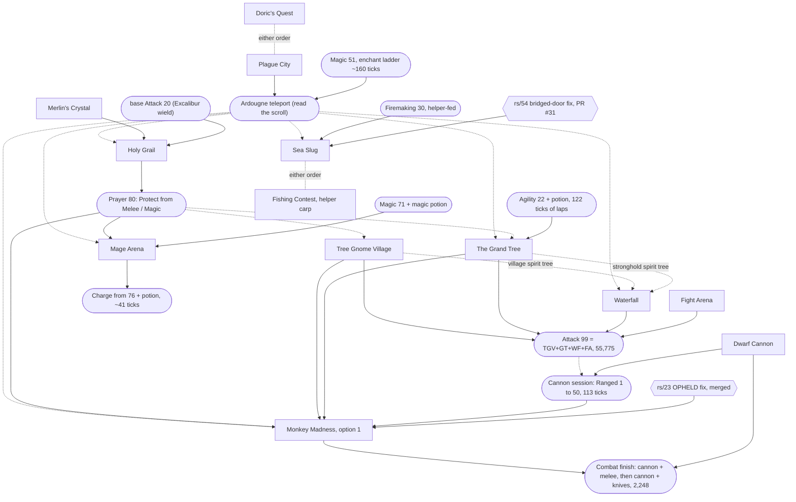
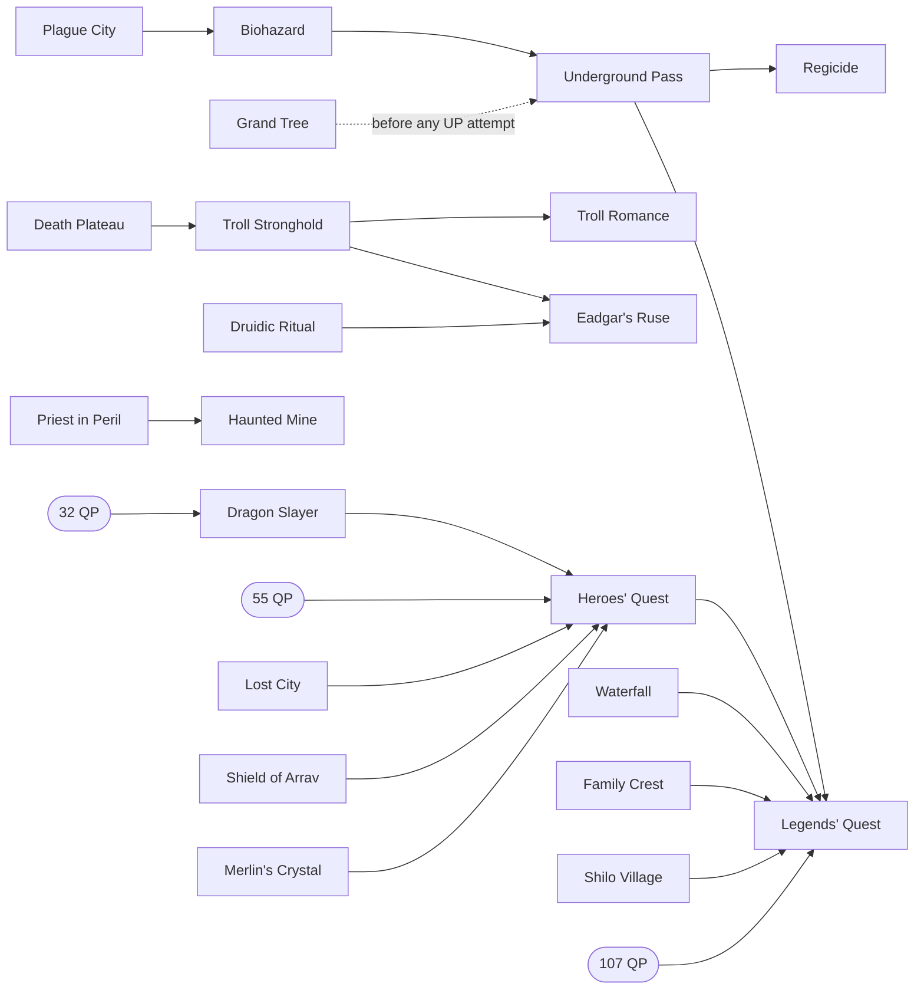

# Quest routes for the max-total speedrun

This page is the synthesis of the quest-route research (coordinator cairn://p/rs/3). Every
verdict below was made on the coordinator's board, from the per-quest documents in this
directory and the skill-rate inputs of the sibling missions (rs/2 for Agility, Mining,
Woodcutting, Fishing and Thieving; rs/28's children for combat, Magic and Ranged). This
page does not re-decide anything. It puts the numbers side by side, recomputes the burst
column under the current dialogue rule, and lists the inconsistencies it found
([Open flags](#open-flags-for-the-coordinator)).

Conventions: [CONVENTIONS.md](CONVENTIONS.md). Timing primitives: [primitives.md](primitives.md).
All xp is **base** xp (game xp / 25; level 99 is 39,938). All ticks are 300 ms server ticks
spent logged in on the scored account.

**Labels.** Every number carries one: **m** measured (a committed lab script at
`NODE_TICKRATE=300` unless the source says otherwise), **r** read (a script line, cited in
the quest document), **i** inferred (basis given in the cell or the footnote). Three
dialogue columns follow CONVENTIONS: **stock** (2 ticks per page, the historical client),
**fixed** (1 per page, cairn://p/rs/22, now the real client) and **burst** (blind
continues, cairn://p/rs/51).

## 1. Summary

**On the route: 12 quests and the Mage Arena miniquest**, in this order: Doric's Quest,
Plague City, Merlin's Crystal, Holy Grail, Tree Gnome Village, The Grand Tree, Waterfall,
Fight Arena, Dwarf Cannon, Monkey Madness (reward option 1), Mage Arena, Sea Slug and
Fishing Contest. They give 26 quest points, and no quest-point gate binds, because Dragon
Slayer is off.

| Whole on-route set | Stock | Fixed | Burst | Basis |
|---|---|---|---|---|
| Success path | **~14,470** | **~12,830** | **~11,930** | sum of the rows in section 3; about 70% measured, the rest i |
| With Monkey Madness's expected failures (+780) | ~15,250 | **~13,600** | ~12,710 | i, `monkey_madness.md` |
| Without Monkey Madness (also drops Tree Gnome Village and Dwarf Cannon) | ~7,960 | ~7,060 | ~6,620 | i; see section 6 for what it costs in training |

The main thread's rough estimate was ~21,000 fixed. The difference is that the route
shrank as quests were valued: the troll chain, the Regicide chain, Dragon Slayer and
Haunted Mine are all off.

**Headline recommendation.** Do Monkey Madness with option 1 (35,000 Strength and Hitpoints).
It is the largest single lever on the route. Without it, Hitpoints becomes the binding
combat line, because only damage the account deals itself gives Hitpoints. Training that
leaves about **15,250 ticks** of combat after the quests, against **~8,140** (success path)
or **~8,920** (expected) for Tree Gnome Village, Monkey Madness, Dwarf Cannon and the
cannon-led combat finish together (fixed column; i, section 6). That margin of about 6,300
expected ticks survives every failure case measured on Ape Atoll. Monkey Madness needs the
rs/23 client fix (merged). Sea Slug needs cairn://p/rs/54 (PR #31, open). Fishing Contest
is conditional on the fly-fishing cycle (cairn://p/rs/53).

Two verdicts on the route deserve another look (the coordinator decides). **Waterfall**
comes out about 270-520 ticks negative here, because Attack and Strength are capped
without it. **Merlin's Crystal + Holy Grail** pays back on Defence alone only if Prayer's
11,000 is worth about 550 ticks. See [Open flags](#open-flags-for-the-coordinator).

## 2. Dependency graph

Solid arrows are prerequisites the scripts enforce. Dotted arrows are ordering constraints
from the board: something gets cheaper or safer if it comes first. Rounded nodes are skill
levels or unlocks, not quests. Hexagons are client fixes.

What the edges rest on:

- **Monkey Madness needs Tree Gnome Village and The Grand Tree** (r, `king_narnode.rs2:7-10`),
  the stock-client blocker fixed by rs/23, Ranged 50 *base* for the magic shortbow against
  the Jungle Demon (r, `tier50.rs2:6`), and Protect from Magic. Melee died 2 of 2 (m).
- **Holy Grail needs Merlin's Crystal** (r, `king_arthur.rs2:41-45`) and base Attack 20.
  Excalibur's wield check uses `stat_base` (r, `levelrequire.rs2:7`), and the Titan only dies
  to a hit landed while Excalibur is worn (r, `black_knight_titan.rs2:30`).
- **Prayer from Holy Grail before every protect-prayer fight.** 11,000 base is Prayer 80
  (r). The Khazard warlord, the black demon and the Jungle Demon are survivable only under a
  protect prayer (m). Kolodion is fatal without Protect from Magic (m, 2 deaths).
- **Plague City before the teleport users.** The teleport needs `%elenaquest` 30 and Magic 51
  (`stat()`, so boostable) (r, `teleport.rs2:22-38`). The savings count only for quests done
  after it: Grand Tree ~290, Mage Arena ~185, Monkey Madness ~100, Waterfall ~38 and Holy
  Grail ~31 per crossing (i, tile model).
- **Attack 99 before the cannon session, and the cannon session before Monkey Madness.**
  The cannon's hit roll uses the *wielded* style (r, `cannon_fire.rs2:116`), so a melee
  weapon at Attack 99 earns 11.5 Ranged per tick from Ranged 1 (m, `ranged.md` on rs/31's
  branch). Tree Gnome Village + Grand Tree alone already give 29,850; with Waterfall and Fight
  Arena it is 55,775 (r).
- **Mage Arena at base Magic 71 + a magic potion, then Charge from base 76 + potion** (m,
  rs/52 `magic-boost.ts`). Kolodion's start check is `stat_base(magic) >= 60` (r); Fire Wave
  and Charge check boosted `stat()` (r, `magic.rs2:22`).
- **Grand Tree's only Agility check is `stat(agility) < 25`** (r, `quest_grandtree.rs2:25`):
  22 plus a potion passes.
- **Sea Slug** needs Firemaking 30 (`stat()`, r, `quest_seaslug.rs2:43`) and the rs/54 client
  fix (m: without it the bot cannot open bridged doors). **Fishing Contest** takes a
  helper-caught raw giant carp (tradeable, r, `fishing.obj:362`; main ruled it allowed,
  tenet 2).
- **Doric's Quest and Plague City** have no prerequisites. Their combined Mining saving is
  the same in either order (i, rs/2 `mining.md` §2).

Off-route chains, for reference (every node here is skipped; section 5):

## 3. Value table

"Training replaced" is **marginal**: the ticks of the skill route that the quest's xp
removes, given the rest of the on-route set, with skills already at 99 counted as 0. Each
marginal value is taken against the rest of the route, so the values do not add up across
rows. "Net" is training replaced minus the quest's fixed-client ticks. "Base xp per tick"
is the quest's total base xp over its fixed ticks, whether or not the xp is useful.

Burst figures marked **(r21)** were recomputed here from the recorded dialogue runs under
the current rule (CONVENTIONS, 21:14): a run that opens a dialogue costs ceil(k/5), and a
run after an option or state page costs 1 + ceil((k-1)/5). The recomputation added +9
(Tree Gnome Village), +20 (Grand Tree), about +19 (Monkey Madness; one cutscene's runs
are elided in the document), +3 (Mage Arena), +2 (Dwarf Cannon) and +36 (Tourist Trap).
Figures marked **(pm)** come from page and option counts, for documents that recorded no
runs. Each dialogue is modelled as one opening run of P - 2O continues, then for each option
the click plus a two-page run (3 ticks), as `plague_city.md` does. These are inferred. Fixed
figures for pre-ruling documents subtract one tick per click and 4 per trade (9 to 5,
primitives.md §6). Rows marked *pending rs/56* contain fights measured at 70/70/70 melee
with ~70 Hitpoints. The route reaches them with Hitpoints near 10, and
`pre_mm_fights.md` (cairn://p/rs/56) will replace them.

### On the route

| Quest | Ticks stock / fixed / burst | Reward | Training replaced (marginal) | Net (fixed) | Base xp/tick (fixed) | Verdict | Doc |
|---|---|---|---|---|---|---|---|
| Doric's Quest | 90 m / 65 m / 60 i | 1,300 Mining, 1 QP (r) | 139 i (rs/2 `mining.md` §2: 3,904 to 3,765 given Plague City) | **+74** | 20.0 | DO | [dorics_quest.md](dorics_quest.md) |
| Plague City | 737 m / 620 m / 564 i | 2,425 Mining, 1 QP, Ardougne teleport (r) | ~913 i: Mining 269 (4,034 to 3,765) + teleport legs ~644 | **+293** | 3.9 | DO, before any teleport user | [plague_city.md](plague_city.md) |
| Merlin's Crystal | 820 m / 703 i / 647 i (pm) | 0 xp, 6 QP, gate to Holy Grail (r) | 0 | -703 (see Holy Grail) | 0 | DO, as the Holy Grail gate | [merlins_crystal.md](merlins_crystal.md) |
| Holy Grail (Ardougne ship crossings) | 1,240 i / 1,152 i / 1,115 i (pm); Titan *pending rs/56* | 15,300 Defence, 11,000 Prayer, 2 QP (r) | Defence ~1,312 i (without it the Defence phase of the combat finish grows from 828 to ~3,560 ticks, while the knives phase disappears; `ranged.md` rates). Prayer: not priced (rs/28's Prayer rate is not published) | +160 on Defence alone; **Merlin's + Holy Grail block -543 + Prayer's value** | 22.8 | DO (board); flag 2 | [holy_grail.md](holy_grail.md) |
| Tree Gnome Village | 1,036 / 927 / 873 (r21); includes ~103 i to reach the maze from the Ardougne teleport and the gnome-chain trade; warlord *pending rs/56* | 11,450 Attack, 2 QP, village spirit tree (r) | 0: Attack is over 99 without it | -927 (counted in the Monkey Madness block) | 12.4 | DO, as the Monkey Madness gate | [tree_gnome_village.md](tree_gnome_village.md) |
| The Grand Tree (Ardougne teleport for B and C) | 1,930 i / 1,660 i / 1,525 (r21); black demon *pending rs/56* | 18,400 Attack, 7,900 Agility, 2,150 Magic, 5 QP, stronghold tree, Gnome Air (r) | ~2,228 i: Agility 2,143 (rs/2 `agility.md`: 6,960 without quests, 4,695 + 122 with), Magic ~85 (26 base/tick enchanting, `magic.md`), Attack 0 | **+568** | 17.1 | DO | [grand_tree.md](grand_tree.md) |
| Waterfall (spirit-tree variant) | 915 i / 888 i / 874 i (pm) | 13,750 Attack, 13,750 Strength, 1 QP (r) | Strength 4,938 of the gap left by MM option 1: ~370 i (cannon + aggressive melee, with the cannon's Ranged shortening the knives phase) to ~620 i (melee alone at rs/30's ~8/tick); Attack 0 | **-268 to -518** | 31.0 | DO (board); **flag 1** | [waterfall.md](waterfall.md) |
| Fight Arena | 846 m / 771 i / 724 i (pm); fights *pending rs/56* | 12,175 Attack, 2,175 Thieving, 2 QP (r) | Thieving ~865 i (rs/2 `thieving.md`: 2,840 from 1, ~1,975 from 57); Attack 0 | **+94** | 18.6 | DO, while Thieving is low | [fight_arena.md](fight_arena.md) |
| Dwarf Cannon | 1,078 m / 976 i / 920 (r21) | 750 Crafting, 1 QP, the multicannon (r) | ~3,956 i: the combat finish costs 6,584 ticks without the cannon and 2,628 with it (`ranged.md`) | **+2,980** | 0.8 | DO (Monkey Madness route only, section 6) | [dwarf_cannon.md](dwarf_cannon.md) |
| Monkey Madness, option 1 | success 4,399 / 3,865 / 3,514 (r21); expected 5,179 / 4,645 / 4,295; ~60% m | 35,000 Strength, 35,000 Hitpoints, 20,000 Attack, 20,000 Defence, 3 QP (r, `mm_daero.rs2:294-302`) | ~11,900 i: the scenario difference in section 6 (no-MM combat 15,254, minus the with-MM finish 2,371 and Dwarf Cannon 976) | **+7,116** success, **+6,336** expected (after Tree Gnome Village's 927) | 28.5 | DO | [monkey_madness.md](monkey_madness.md) |
| Mage Arena (base 71 + potion) | 606 i / 581 i / 574 (r21); fight 331 m (rs/52) | Charge (0 xp reward; the fight gives ~2,800-3,100 Magic) (r, m) | ~1,340 i: Magic 57 to 99 by enchanting is ~1,550 (364 to 80, then 29,251 at 26 base/tick plus banks, `magic.md`), against ~205 with the arena (rs/52) | **+759** | n/a | DO | [mage_arena.md](mage_arena.md) |
| Sea Slug | 495 i / 394 m / 340 i | 7,175 Fishing, 1 QP (r) | 955 i given Fishing Contest (rs/2 `fishing.md` §3); 586 i on the 3-tick cycle | **+561** (+192 on the 3-tick cycle) | 18.2 | DO, after rs/54 merges | [sea_slug.md](sea_slug.md) |
| Fishing Contest (helper carp) | 276 i / 223 m / 200 i | 2,437 Fishing, 1 QP (r) | 325 i given Sea Slug; 186 i on the 3-tick cycle | **+102** (-37 on the 3-tick cycle) | 10.9 | DO, if fly fishing stays on the normal cycle | [fishing_contest.md](fishing_contest.md) |

### Off the route

Burst figures marked *pre-rule* come from documents written before 21:14, which used
ceil(k/5) for every run. They undercount by at most one tick per run that follows an option
or state page, typically +10-40 per quest. Only Tourist Trap's margin is narrow enough for
that to matter, so it is recomputed (r21).

| Quest | Ticks stock / fixed / burst | Reward | Training replaced (marginal) | Net (fixed) | Verdict | Doc |
|---|---|---|---|---|---|---|
| Legends' Quest (with its chain and ~41 QP of filler) | ~22,500 i (15,000-35,000) | 4 picks of 7,650 (r) | ~3,600 i (with Heroes' along the way) | **about -19,000** | OFF | [legends.md](legends.md) |
| Heroes' Quest | ~3,000 i (2,000-5,000), plus the 55-QP gate | small xp in 13 skills (r) | ~800 i | about -2,200 | OFF: needs a live helper partner and Fishing/Cooking 53 for the untradeable lava eel | [legends.md](legends.md) |
| Dragon Slayer | 1,120 / 1,010 / 970 (~370 m; burst pre-rule) | 18,650 Strength, 18,650 Defence, 2 QP (r) | ~350 i with MM (the Defence gap only: the combat finish loses its 828-tick Defence phase but the knives phase grows ~480). ~0 without MM, because Hitpoints binds (section 6). The route has 26 QP, so the 32-QP door also needs ~6 QP of filler (Cook's Assistant + Goblin Diplomacy, ~215 fixed i) | about -870 | OFF in both scenarios; flag 4 | [dragon_slayer.md](dragon_slayer.md) |
| Haunted Mine (+ Priest in Peril) | ~1,072 m success; expected ~3,700-5,700 i with the Treus Dayth failures (1 kill in 6) | 22,000 Strength, 2 QP (r) | 0: Strength is capped | at most -3,700 | OFF | [haunted_mine.md](haunted_mine.md) |
| Priest in Peril | ~841 i | 1,406 Prayer, 1 QP, Morytania (r) | small (Prayer unpriced) | about -800 | OFF | [priest_in_peril.md](priest_in_peril.md) |
| The Knight's Sword | 911 m / ~837 i / ~803 i (pm) | 12,725 Smithing, 1 QP (r) | ~236 i (helper-fed Smithing ~54 base/tick) | -601 | OFF | [knights_sword.md](knights_sword.md) |
| Watchtower | ~1,100 i (900-1,500) + ~210 travel | 15,300 Magic, 4 QP (r) | at most ~510 i (only before enchanting) | about -600 to -800 | OFF | [watchtower.md](watchtower.md) |
| Temple of Ikov | ~750 i (550-1,000) | 10,500 Ranged, 8,000 Fletching, 1 QP (r) | doc: ~10-50 (Ranged valued free); up to ~550 i once Ranged is priced (it would shorten the knives phase) | about -200 to -740 | OFF; flag 5 | [temple_of_ikov.md](temple_of_ikov.md) |
| The Dig Site | 2,180 / 1,930 / 1,790 m (burst pre-rule) | 15,300 Mining, 2,000 Herblore, 2 QP (r) | ~1,610 i after Doric's (less once Plague City is counted) | about -320 | OFF; the finds have a long tail (p90 +411) | [digsite.md](digsite.md) |
| **Tourist Trap** (both picks Agility) | 1,830 m / 1,560 m / **1,466** (r21), plus 110-220 m of Rowdy Guard handling under Protect from Melee | 2 picks of 4,650, 2 QP (r) | 1,414 i (rs/2 rerun with Grand Tree as the only Agility quest) | **-256 to -366**; burst **-162 to -272** | OFF, **the narrowest margin on the list**: the fixed client may cut Agility lap ticks ~6%, which makes it worse | [tourist_trap.md](tourist_trap.md) |
| The Fremennik Trials | 3,130 m / 2,640 m / 2,320 (pre-rule) | 2,812 in each of 10 skills, 3 QP (r) | ~1,600 i: Agility 436, Woodcutting 392, Fishing 321, Thieving 260, Defence/HP 191 | about -1,040 | OFF | [fremennik_trials.md](fremennik_trials.md) |
| Horror from the Deep | ~800-1,000 i | 4,662 Magic, Strength, Ranged; 2 QP (r) | doc ~63 (Ranged valued free); ~300 i with Ranged priced | about -600 | OFF | [horror_from_the_deep.md](horror_from_the_deep.md) |
| Troll chain (Death Plateau, Troll Stronghold, Troll Romance) | 3,039 / 2,735 / 2,562 (m walks and fights, r pages; burst pre-rule) | 3,000 Attack; 8,000 Agility + 4,000 Strength; 4 QP (r) | 1,220 i (Agility only; Attack and Strength capped) | -1,515 | OFF | [troll_romance.md](troll_romance.md), [death_plateau.md](death_plateau.md), [troll_stronghold.md](troll_stronghold.md) |
| Biohazard | 1,564 m / 1,402 / ~1,323 | 1,250 Thieving, 3 QP, gate to Underground Pass (r) | ~100 i (rs/2: Thieving after Fight Arena barely moves) | about -1,300 | OFF | [biohazard.md](biohazard.md) |
| Underground Pass | 2,610 m / 2,553 / 2,521 (at Agility 99) | 3,000 Agility, 3,000 Attack, 5 QP (r) | chain value below | (chain) | OFF; if it is ever done, do it after Grand Tree | [underground_pass.md](underground_pass.md) |
| Regicide (+ two forced pass trips) | 3,147 / 3,063 / 3,015 m | 13,750 Agility, 3 QP (r) | Underground Pass + Regicide save 2,509 i of laps together | Biohazard + Pass + Regicide: about -4,400 | OFF | [regicide.md](regicide.md) |
| Monk's Friend | 397 i / 325 m / 287 i | 2,000 Woodcutting, 1 QP (r) | 301 i (230 on the knife cycle) (rs/6 model via rs/2) | -24 (burst +14, knife -95) | OFF, **break-even at best**, inside the model's error | [monks_friend.md](monks_friend.md) |
| Hazeel Cult | ~430 / ~325 / ~270 i | 1,500 Thieving (r) | ~130-146 i | about -190 | OFF | [hazeel_cult.md](hazeel_cult.md) |
| Tribal Totem | ~355 / ~300 / ~280 i | 1,775 Thieving (r) | ~150-173 i | about -140 | OFF | [tribal_totem.md](tribal_totem.md) |
| Eadgar's Ruse | not costed (needs Troll Stronghold and Druidic Ritual) | 11,000 Herblore (r) | ~25-120 i (helper-fed, ~89 ticks 1 to 99) | negative | OFF | cairn://p/rs/25 (closing comment) |
| Elemental Workshop | not costed (several hundred ticks i) | 5,000 Crafting, 5,000 Smithing (r) | ~150 i (helper-fed) | negative | OFF | cairn://p/rs/25 |
| Nature Spirit | not costed (several hundred ticks i) | 3,000 Crafting, 2,000 HP or Defence (r) | under 50 i (HP and Defence capped with MM) | negative | OFF | cairn://p/rs/25 (closing comment) |
| Big Chompy Bird Hunting | not costed | small quest reward; its 30,000 Ranged needs 4,000 kills (r, `chompy_bird.rs2:211`) | ~0 | negative | OFF | coordinator's board, 17:49 scan |

## 4. Recommended order

The order follows the coordinator's provisional route (the rs/56 brief). rs/56 may move
the early fights once it has measured them at the route's real levels. "Logout-unsafe"
marks the stretches where a logout loses progress (primitives.md §8, each document's
risks). Everything else is a clean logout point: the scored account can log out while
helpers gather and lose nothing. Logout is always refused within 16 ticks of combat (m).
Ticks are fixed-client figures.

| # | Step | Fixed ticks | Logout-unsafe stretch | Helper trade (tradeable items only) |
|---|---|---|---|---|
| 0 | Skill prep, not quests: Magic to ~51 on the enchant ladder (~160 i, counted in Magic's route); Firemaking 30 (helper-fed) any time before Sea Slug; Gnome course to Agility 22 (122 i) before Grand Tree's climb | | | rings and runes; logs |
| 1 | Doric's Quest | 65 | none | 6 clay, 4 copper ore, 2 iron ore, Falador runes (can ride on another trade) |
| 2 | Plague City (Camelot teleport in); **read the magic scroll** (`%elenaquest` 30) | 620 | none | dwellberries, 4 buckets of water, spade, rope, chocolate dust, milk, snape grass, Camelot runes |
| 3 | Merlin's Crystal; Sir Mordred *pending rs/56*. Base Attack 20 (179 base xp) must be reached before step 4; Mordred's fight gives most of it, and rs/56's stat timeline gives any top-up | 703 | none (all varps permanent) | bread, bucket of wax, tinderbox, bat bones, food, 2 Camelot + 1 Falador runes, glory (2+ charges) |
| 4 | Holy Grail, both Fisher Realm crossings by Ardougne teleport + Brimhaven ship. Excalibur and all armour banked before Entrana. Titan with a rune scimitar, switching to Excalibur at 30 hp or less, *pending rs/56* | 1,152 | none | rune scimitar and armour, food, Camelot/Falador/Ardougne runes, ship fare, glory |
| 5 | Tree Gnome Village (Ardougne teleport to the maze); warlord under Protect from Melee | 927 | Bolren's closing ceremony (step 23), until the quest scroll shows | 6 logs (for the whole gnome chain), rune scimitar, prayer potions, food |
| 6 | The Grand Tree (village tree in; Ardougne teleport for Hazelmere); Agility potion if under 25; black demon under Protect from Melee | 1,660 | **trapdoor to black demon kill** (segment N): the demon deletes itself on logout or beyond 17 tiles | rune scimitar, 2-3 prayer potions, food, Varrock and Ardougne runes, Agility potion |
| 7 | Waterfall (spirit-tree variant; Golrie's dungeon can fold into the gnome visit if steps 1-6 come first). Flag 1 | 888 | the rope crossing (steps 27-28, 8-tick temporary locs) | rope, 6 air/earth/water runes (dropped before the tombstone), teleport runes, glory |
| 8 | Fight Arena, before any Thieving training; Khazard need not be killed. Fights *pending rs/56* (Bouncer took 83-142 hp at 50-70 melee) | 771 | the arena fights (combat lock; the death hooks need you inside the arena) | 5 coins, weapon, shield, legs, amulet, ~15 swordfish, Ardougne runes |
| 9 | Dwarf Cannon | 976 | none (all varps permanent) | runes for 2 Ardougne + 1 Falador teleports |
| 10 | Cannon session, Ranged 1 to 50, wielding a melee weapon (Attack 99 from steps 5-8) at the Wilderness poison spiders (3288,3810) | 113 m + ~10 set-up + travel | combat; Wilderness level 37 (section 7) | cannon set and cannonballs from a helper who has **also done Dwarf Cannon** (the mould is untradeable), melee weapon, antipoison, food |
| 11 | Monkey Madness, option 1 at Daero | 3,865 success, 4,645 expected | **the hangar puzzle's last tile to the powered hangar** (timer); **the three chapter cutscenes** (Lumdo's ride to the atoll, the Karamja gree-gree, Garkor's sigil; `mm_cutscene_part` is temporary); **sigil to Jungle Demon kill** (the battle deletes itself) | gold bar, ball of wool, monkey bones, 5 bananas, magic shortbow + 100 rune arrows, 4-6 prayer potions, ~15 food, Varrock and Ardougne runes, antipoison (open lead) |
| 12 | Magic: enchant 57 to 71 (~164 i), sip, Mage Arena (Kolodion ~331 m under Protect from Magic, ~60 prayer points), sip on the exit walk, Charge 76 to 99 (~41 m). It can move earlier: any time after Holy Grail, Plague City and Magic 71 | 581 | the arena fight (combat; no teleport from the Wilderness legs, so leave from the cellar or chamber) | staff of fire, ~70 blood + 400 air runes, 489 blood + 489 air for Charge, a knife (webs), 2 magic potions (Herblore 76 brew or the Grand Exchange), Ardougne runes |
| 13 | Sea Slug (once rs/54 merges; Firemaking 30) | 394 | none | swamp paste, unlit torch, Ardougne runes |
| 14 | Fishing Contest (helper carp), if fly fishing stays on the normal cycle | 223 | inside the contest fence, steps 7-9: leaving through the gate resets the contest; logout inside was not tested | raw giant carp (a helper leaves the contest before its third catch), rod, 1 bait, 5 coins, 3 Camelot casts |
| 15 | Combat finish after MM, plan (e): cannon + defensive melee to Defence 99 (828 i), then cannon + rapid rune knives to Ranged 99 (1,420 i); Hitpoints fills as a by-product (~5,500 against the 4,938 gap) | 2,248 | combat | cannonballs, rune knives, food, antipoison |

Sea Slug and Fishing Contest can go anywhere after Plague City. Doing them before Fishing
training starts is what the marginal values assume.

## 5. Not worth doing

Each of these was costed and dropped on the board. Section 3 has the numbers.

- **Legends' Quest**: the 107-QP gate forces ~41 QP of filler on top of a seven-quest chain:
  ~22,500 ticks for ~3,600 of value. [legends.md](legends.md)
- **Heroes' Quest**: 55-QP gate, a live helper partner of the other gang, and Fishing and
  Cooking 53 because the lava eel is untradeable; ~800 of value. [legends.md](legends.md)
- **Dragon Slayer**: with MM option 1 only its Defence counts (~350). Without MM, Hitpoints
  binds and its Strength and Defence replace nothing either. The 26-QP route would also need
  filler for the 32-QP door. [dragon_slayer.md](dragon_slayer.md)
- **Haunted Mine**: Strength is capped, and the Treus Dayth fight completed 1 time in 6
  (expected cost 3,700-5,700 with failures). [haunted_mine.md](haunted_mine.md)
- **Priest in Peril**: only worth it as Haunted Mine's gate; 1,406 Prayer for ~841.
  [priest_in_peril.md](priest_in_peril.md)
- **The Knight's Sword**: 12,725 helper-fed Smithing is worth ~236 against ~910.
  [knights_sword.md](knights_sword.md)
- **Watchtower**: 15,300 Magic is worth at most ~510 against ~1,100; no QP gate needs its 4
  points. [watchtower.md](watchtower.md)
- **Temple of Ikov**: ~750 for Ranged and Fletching worth well under that (flag 5).
  [temple_of_ikov.md](temple_of_ikov.md)
- **The Dig Site**: 15,300 Mining saves ~1,610 against 1,930 fixed, and the finds have a
  long tail. [digsite.md](digsite.md)
- **Tourist Trap**: the narrowest margin. Both picks on Agility save 1,414 ticks against
  1,560 fixed (1,466 burst, recomputed) plus 110-220 of guard handling: a loss of
  about 160-370 depending on the column. Combat 87 lets the Rowdy Guards ignore you (r,
  `Npc.ts:1011`); below that, Protect from Melee survives them (m). [tourist_trap.md](tourist_trap.md)
- **The Fremennik Trials**: all seven trials are mandatory and every item is untradeable;
  ~1,600 of value against 2,640 fixed. [fremennik_trials.md](fremennik_trials.md)
- **Horror from the Deep**: ~800-1,000 for at most a few hundred ticks of Magic and Ranged.
  [horror_from_the_deep.md](horror_from_the_deep.md)
- **The troll chain** (Death Plateau, Troll Stronghold, Troll Romance): with Attack and
  Strength capped, only Troll Romance's 8,000 Agility counts (1,220) against 2,735.
  [troll_romance.md](troll_romance.md)
- **Biohazard**: 1,250 Thieving barely moves Thieving after Fight Arena; it exists on the
  route only as Underground Pass's gate. [biohazard.md](biohazard.md)
- **Underground Pass**: pays only as a Legends prerequisite, and Underground Pass before
  Grand Tree does not pay (expected falls 730-960 ticks at Agility 1-10).
  [underground_pass.md](underground_pass.md)
- **Regicide**: 13,750 Agility replaces ~2,000 ticks against ~3,060 of its own play,
  including two forced pass trips. [regicide.md](regicide.md)
- **Monk's Friend**: break-even at best. 301 ticks of Woodcutting (230 on the knife cycle)
  against 325 fixed; only bursts on the normal cycle reach +14, inside the model's error.
  [monks_friend.md](monks_friend.md)
- **Hazeel Cult**: ~130 of Thieving against ~325. [hazeel_cult.md](hazeel_cult.md)
- **Tribal Totem**: ~150 of Thieving against ~300; two ship rides and four teleports.
  [tribal_totem.md](tribal_totem.md)
- **Eadgar's Ruse**: 11,000 helper-fed Herblore (~25-120 ticks), and it needs Troll Stronghold
  and Druidic Ritual. cairn://p/rs/25 closing comment.
- **Elemental Workshop**: 5,000 Crafting + 5,000 Smithing, both helper-fed (~150 ticks).
  cairn://p/rs/25.
- **Nature Spirit**: 3,000 Crafting is worth under 50 ticks, and its HP/Defence choice lands
  in skills MM caps. cairn://p/rs/25 closing comment.
- **Big Chompy Bird Hunting**: the quest's own reward is small, and its 30,000 Ranged needs
  4,000 chompy kills (`chompy_bird.rs2:211`).

## 6. Scenarios: Monkey Madness option 1 against no Monkey Madness

The inputs are the melee rate from cairn://p/rs/30, **~8 base xp per tick to the trained
skill** (preliminary, measured at 100 ms; its 300 ms confirmation is not published yet),
and the Ranged rates from `ranged.md` on rs/31's branch (measured at 300 ms). The combat
facts are read: every point of damage gives 4 base xp to the trained style and 1.33
Hitpoints (`combat.rs2:146-167`), so **Hitpoints is one third of all personally earned
combat xp**. The cannon's xp is Ranged only (`cannon_fire.rs2:119`). Quest xp lands where
the quest says. All rows are fixed-client ticks and inferred unless marked.

### Combat state after the quests

| Skill | With MM option 1 | Without MM (no Tree Gnome Village either) |
|---|---|---|
| Attack | 75,775: capped (r) | 44,325 (GT + Waterfall + Fight Arena): capped (r) |
| Strength | 48,750: capped (r) | 13,750: gap 26,188 |
| Defence | 35,300: gap 4,638 | 15,300: gap 24,638 |
| Hitpoints | 35,000: gap 4,938 | ~0: gap ~39,900 |
| Ranged | ~54 after the demon fight (50 from the cannon session + ~485 from the fight, m) | 1: gap 39,938 |

### Side by side

| Line | With MM option 1 | Without MM |
|---|---|---|
| Tree Gnome Village | 927 | not done (Grand Tree does not require it) |
| Monkey Madness | 3,865 success (m/r/i mix), 4,645 expected | not done |
| Dwarf Cannon | 976 | **not done**: Hitpoints binds, and cannon xp gives no Hitpoints, so the cannon shortens nothing (see the Hitpoints line) |
| Ranged method | **cannon**: 113 m firing (+~10 set-up) for Ranged 50 before MM, wielding a melee weapon; after MM, plan (e): cannon + defensive melee to Defence 99 (828), then cannon + rapid rune knives (1,420) (`ranged.md`) | **rapid rune knives**, ~5,270 from level 1 (`ranged.md`; 8.1-8.75 Ranged + ~2.7-2.9 HP per tick, m). Longrange is no use: 2.63/tick to each of Ranged and Defence (m) |
| Strength and Defence | Defence 4,638 inside plan (e)'s first phase; Strength 0 | 50,826 by melee at ~8/tick: **~6,350** |
| **Hitpoints (its own line)** | 0 extra: plan (e) produces ~5,500 against the 4,938 gap | The Strength, Defence and Ranged training above yields 30,255 HP, leaving 9,683. That needs 29,049 more combat xp in a capped skill: **~3,630** |
| Combat training after the quests | **2,371** (123 + 2,248) | **~15,250** (6,350 + 5,270 + 3,630) |
| **Block total** | **~8,140 success, ~8,920 expected** | **~15,250** |

**MM option 1 wins by about 7,100 ticks on the success path and 6,300 expected.** The
other cannon variants on the MM route are worse: (c) cannon + longrange is 2,727; (a) the
cannon, then melee for Defence and Hitpoints, is 5,161; knives only is 5,689 (`ranged.md`).

Why no-MM is so expensive: Hitpoints needs 39,938, which is one third of 119,814 base of
personal combat xp, and the uncapped gaps (Strength, Defence, Ranged) add up to only 90,764.
So the whole no-MM block is about 119,814 divided by the combat rate, whichever skill the
xp goes into. That also means that **without MM, the Strength and Defence from Waterfall,
Holy Grail and Dragon Slayer replace nothing**: the xp would have been trained anyway to
reach Hitpoints 99. The only quests that help are Hitpoints quests. Witch's House (6,325 HP,
~163 fixed, `quest_points.md`) would cut the block to ~13,050, which makes it a no-MM-only
candidate.

**Sensitivity to the melee rate.** The no-MM block scales as 119,814 / rate: 15,000 at 8,
12,000 at 10, 10,000 at 12, and 8,320 at the old unmeasured 14.4. The MM block hardly
depends on the melee rate. No-MM would only draw level with MM's expected ~8,920 at about
**13.4 base xp per tick**, 1.7 times rs/30's preliminary figure. rs/30's 300 ms number
should be slotted in here when it lands; nothing short of a 1.7x error flips the call.

### Monkey Madness's failure budget

From `monkey_madness.md` (3-sample observations, so inferred):

| Item | Ticks (fixed) |
|---|---|
| Success path, after Plague City (Ardougne teleport on the zoo leg), trade included | ~3,865 |
| Expected extra: temple trapdoor +600, the monkey's aunt +120, Jungle Demon deaths +60 | +780 |
| **Expected total** | **~4,645** |
| Per failure: trapdoor stuck (walk out, eat, drink a prayer dose) | ~30 plus another ~110-tick try |
| Per failure: death at the trapdoor | ~340; ~990 if the enchanted bar is lost (only 3 items are kept) |
| Per failure: the aunt calls the guards (a jail cycle) | ~90-120 |
| Per failure: death to the Jungle Demon | ~60 (the sigil teleports you back) |
| Per failure: death in the Ape Atoll dungeon traps (none seen; not in the expected figure) | ~340 |
| **Bad-but-plausible worst case**: 6 trapdoor tries with 2 deaths (one losing the bar), the aunt twice, the demon twice, one dungeon death | +~2,650, so **~6,500** |

**Retry tolerance.** MM stays ahead of no-MM until its overrun reaches about 7,100 fixed
ticks: roughly 20 trapdoor deaths with the bar kept, or 7 with it lost. A run plan can
retry the temple freely. The open leads (antipoison, since the deaths may be jungle-spider
poison through the prayer; timing the guards' one-tile wander) would shrink the trapdoor's
+600. A logout inside a cutscene zone completes the cutscene on the next login (`mm_login`,
unmeasured, worth up to ~150).

## 7. Conditional calls

- **Fishing Contest depends on the fly-fishing cycle (cairn://p/rs/53).** On the normal
  cycle it saves 325 ticks given Sea Slug against 223 fixed (+102), with the helper-caught
  carp that main allowed (tenet 2). Done entirely on the scored account it costs ~367 and
  loses. If the run fly fishes on the 3-tick knife cycle, the same xp saves only 186, so it
  is -37 fixed: drop it. Sea Slug stays positive on either cycle (+561 normal, +192 knife).
  rs/53 is measuring the knife cycle through level-ups; its result decides this row.
- **Sea Slug depends on cairn://p/rs/54** (PR #31, open). The lite client keeps bridged
  doors closed for routing, so the bot cannot reach the broken glass or Kennith. With the
  fix applied in the lab it ran end to end twice (394 fixed, m). Until rs/54 merges, Sea
  Slug is blocked, and Fishing Contest's value without it rises to 755 (alone, from level 1).
- **The Wilderness spider site.** The cannon sessions (step 10 and the post-MM finish) are
  costed at the poison spiders (3288,3810), Wilderness level 37. There, players within 37
  combat levels can attack, a death keeps only 3-4 items, and the spiders poison for
  ~0.2-0.3 hp per tick through Protect from Melee (`ranged.md`). Step 10 happens before MM,
  at the route's low Hitpoints, so rs/56's timeline should check the poison. The
  non-Wilderness fallback is the **Battlefield of Khazard** (2523,3239): cannon alone 9.13
  Ranged per tick against 11.52 (m), and cannon + defensive melee 8.88 Ranged + 3.37 Defence
  against 11.03 + 5.60 (m). That is about 20-25% slower: the pre-MM session goes from ~113 to
  ~143 ticks, and plan (e) goes from 2,248 to roughly 2,700-2,800 (i).
- **Pre-MM fights at route levels (cairn://p/rs/56).** Every fight above was measured at
  70/70/70 with ~70 Hitpoints. The route reaches Mordred, the Titan, the warlord, the black
  demon and Fight Arena with Hitpoints near 10. rs/56 may add helper-fed Prayer before
  Holy Grail, or move fights. Slot `pre_mm_fights.md` into the Merlin's Crystal, Holy Grail,
  Tree Gnome Village, Grand Tree and Fight Arena rows when it lands.

## Open flags for the coordinator

These are arithmetic or consistency points found while assembling this page. None is
applied above; each needs a decision.

1. **Waterfall looks net-negative on the current route.** With MM option 1, Attack is over
   99 without it (Tree Gnome Village + Grand Tree + Fight Arena + MM = 62,025, and 42,025
   before MM, enough for the cannon session). Strength without it is 35,000, a 4,938 gap. Closing that gap
   costs ~370 ticks (cannon + aggressive melee, with the cannon's Ranged shortening the knives
   phase) to ~620 (melee alone), against ~888 fixed for the quest. Net -268 to -518. Without
   MM it is worth ~0 (Hitpoints binds).
2. **Merlin's Crystal + Holy Grail rests on Prayer's value.** Defence alone replaces ~1,312
   ticks of the combat finish, against 1,855 fixed for the pair. So the block needs Prayer's
   11,000 (or the protect prayers it gates) to be worth ~550 ticks of helper-fed bone
   training. rs/28's Prayer rate is not published.
3. **Quest-point count.** `quest_points.md` and `dragon_slayer.md` say the plan has 46-49
   QP. That total includes quests now off the route. The on-route set has **26** (21 without
   MM, Tree Gnome Village and Dwarf Cannon). No gate binds while Dragon Slayer is off, but
   any QP-gated quest would now need filler.
4. **No-MM Dragon Slayer.** `dragon_slayer.md`'s "+1,545 if MM is dropped" leaves out the
   Hitpoints caveat that the document itself raises. Without MM, Hitpoints binds, so its
   Strength and Defence replace ~0, and it would also need ~11 QP of filler. It stays off in
   both scenarios. In the same way, `ranged.md`'s no-MM "cannon in parallel, ~1,040 ticks"
   leaves out that cannon xp gives no Hitpoints.
5. **Stale rate assumptions in older documents.** `monkey_madness.md`, `tree_gnome_village.md`,
   `grand_tree.md`, `dragon_slayer.md` and `quest_points.md` cite "about 14 base xp per tick
   (README)". No README ever carried it; it was the per-skill estimate that main later
   labelled inferred, and rs/30 measures ~8. `temple_of_ikov.md` and `horror_from_the_deep.md`
   value Ranged at ~0 (the cannon "free"). Under rs/31's plan, Ranged xp shortens the knives
   phase (Ikov's 10,500 is worth up to ~550). Their verdicts hold, but the stated values are
   low.
6. **Plague City's Holy Grail saving** is quoted as ~31 for one crossing. Holy Grail crosses
   twice (steps 13 and 17), so it is ~60, which is what `holy_grail.md`'s 1,240 already uses.
   The value table uses 1,240 and leaves Plague City's 644 as written (+31 would not change
   any verdict).

## Source documents

Per-quest documents are in this directory; the value table links each one. Cross-mission
inputs: rs/2's `docs/speedrun/skills/{mining,fishing,thieving,agility}.md` (branch
`agent/rs-2-coordinator-0`), rs/6's Woodcutting model via the board, `ranged.md` on
`agent/rs-31-builder-0`, `magic.md` (rs/28's children), rs/52's Magic-boost measurements and
rs/30's preliminary melee rate (both as recorded on cairn://p/rs/3/1/coordinator/board).
