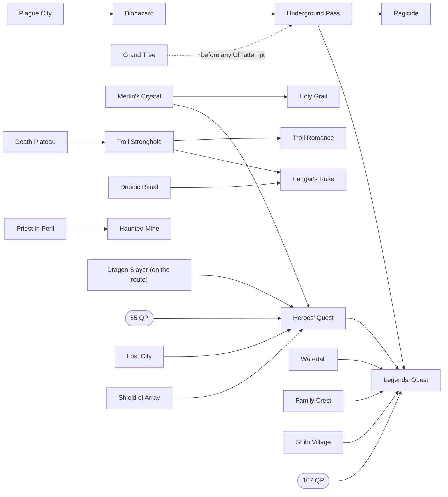

# Quest routes for the max-total speedrun

This page is the synthesis of the quest-route research (coordinator cairn://p/rs/3). Every
verdict below was made on the coordinator's board, from the per-quest documents in this
directory and the skill-rate inputs of the sibling missions (rs/2 for Agility, Mining,
Woodcutting, Fishing and Thieving; rs/28's children for combat, Magic, Prayer and Ranged).
This page puts the numbers side by side, recomputes the burst column under the current
dialogue rule, and records the decisions the synthesis prompted
([Decisions and pending items](#decisions-and-pending-items)).

Conventions: [CONVENTIONS.md](CONVENTIONS.md). Timing primitives: [primitives.md](primitives.md).
All xp is **base** xp (game xp / 25; level 99 is 39,938 on this server's 2^(L/10) curve). All
ticks are 300 ms server ticks spent logged in on the scored account.

**Labels.** Every number carries one: **m** measured (a committed lab script at
`NODE_TICKRATE=300` unless the source says otherwise), **r** read (a script line, cited in
the quest document), **i** inferred (basis given in the cell or the footnote). Three
dialogue columns follow CONVENTIONS: **stock** (2 ticks per page, the historical client),
**fixed** (1 per page, cairn://p/rs/22, now the real client) and **burst** (blind
continues, cairn://p/rs/51).

## 1. Summary

**On the route: 14 quests, the Mage Arena miniquest and one cannon session**, in this
order: Doric's Quest, Plague City, Tree Gnome Village, The Grand Tree, Fight Arena, Dwarf
Cannon, the pre-MM cannon session (Ranged 1 to 50), Monkey Madness (reward option 1), Mage
Arena, Sea Slug, Fishing Contest, then a Taverley-Varrock cluster of Cook's Assistant,
Druidic Ritual, Goblin Diplomacy and Romeo & Juliet, then Dragon Slayer. Three of these are
**mandatory unlocks** whatever their xp: Dwarf Cannon (the cannon), Mage Arena (Charge) and
**Druidic Ritual** (Herblore: every Herblore action needs level 3, and at Herblore 1 mixing
silently does nothing, m, cairn://p/rs/37 via rs/28; the quest's 250 base is the only
practical source, r, `quest_druid.rs2:3`). They give **34 quest points** (r,
`quest.constant`): 17 from the route's xp quests, 4 from Druidic Ritual, 11 of filler
(Goblin Diplomacy 5, Romeo & Juliet 5, Cook's Assistant 1) and 2 from Dragon Slayer. The one
gate that binds is the Champions' Guild door (32 QP) at the start of Dragon Slayer, and the
route reaches it with **no spare point** (section 7). Waterfall and Witch's House are off.

| Whole on-route set | Stock | Fixed | Burst | Basis |
|---|---|---|---|---|
| Success path | **~13,190** | **~11,510** | **~10,630** | sum of the rows in section 3; about 65% measured, the rest i |
| With Monkey Madness's expected failures (+180) | ~13,370 | **~11,690** | ~10,810 | i, `monkey_madness.md` (with rs/59's trapdoor ladder drop, section 6) |
| Without Monkey Madness (also drops Tree Gnome Village, Dwarf Cannon, Dragon Slayer and the filler; keeps Waterfall and Druidic Ritual) | ~5,970 | ~5,230 | ~4,870 | i; section 6 shows what it costs in training |

The cannon session (~123 fixed) is counted in the combat training of section 6, not in
these totals, as before. Against the previous Package A totals (Waterfall on, ~10,970
fixed) the quest ticks rise by ~510: Waterfall's 888 comes out; Dragon Slayer (~941), its
filler (~456) and the mandatory Druidic Ritual (~239) go in; and the measured pre-MM fights
take ~241 off Tree Gnome Village, Grand Tree and Fight Arena. The post-MM combat finish
falls by ~1,470-1,500 at the same time (3,520 to 2,023-2,051, rs/31), which is why the
trade pays (section 7). With rs/91's measured efficiency kit (Protect from Melee flicked,
ranging potion and glory, super antipoison in place of food; section 4 step 14) the Package B
finish is **1,857**, and 2,023-2,211 is the no-kit fallback. The package comparisons in
sections 6 and 7 stay on no-kit rates for every package, so they compare like with like.
The kit shortens Package A's and C's cannon finishes too.

The main thread's rough estimate was ~21,000 fixed. The difference is that the route
shrank as quests were valued: the troll chain, the Regicide chain, Waterfall, Haunted
Mine, and Merlin's Crystal with Holy Grail are all off.

**Headline recommendation.** Do Monkey Madness with option 1 (35,000 Strength and Hitpoints).
It is the largest single lever on the route. Without it, Hitpoints becomes the binding
combat line, because only damage the account deals itself gives Hitpoints. That leaves
about **13,900 ticks** of combat training after the quests (plus Waterfall's 888, which the
no-MM route keeps). With it, Tree Gnome Village, Monkey Madness, Dwarf Cannon, Dragon Slayer
with its filler, the cannon session and the cannon-led combat finish together cost
**~9,310-9,340** (success path) or **~9,490-9,520** (expected), against ~14,790. These are
fixed-column figures from a model over rs/30's and rs/31's measured rates (section 6). The
margin of about 5,270 expected ticks survives every failure case measured on Ape Atoll, but
those were measured at 70/70/70 and the route arrives at Defence 1 and ~42 Hitpoints
(open item (a)). Monkey Madness needs the rs/23 client fix (merged). Sea Slug needs
cairn://p/rs/54 (PR #31, open); while it is blocked, the route is one quest point short of
the guild door. Fishing Contest now stays on either fly-fishing cycle (cairn://p/rs/53),
because dropping it would cost a 1-QP replacement worth more than the 37 ticks saved.

**Waterfall or Dragon Slayer: decided, Package B** (coordinator, 2026-10-21 01:07, on
cairn://p/rs/56). Both fill MM option 1's Strength gap. cairn://p/rs/56 measured
([pre_mm_fights.md](pre_mm_fights.md), 300 ms) that Waterfall's Strength saves only
**~15-47 ticks** in the pre-MM fights (m): the warlord, the black demon and the Fight Arena
monsters have no magic defence, so spells from a level-1 melee account kill them as fast as
melee at Strength 83. The threshold was ~800-830. So **Waterfall is off, and Dragon Slayer
is on after Monkey Madness with 11 QP of filler**: about **910-970 fixed ticks cheaper** than
Package A (section 7).

## 2. Dependency graph

Solid arrows are prerequisites the scripts enforce. Dotted arrows are ordering constraints
from the board: something gets cheaper or safer if it comes first. Rounded nodes are skill
levels or unlocks, not quests. Hexagons are client fixes.

```mermaid
flowchart TD
  M59(["Magic 59 on the enchant ladder (51 is enough for the teleport and Fire Bolt)"])
  FM30(["Firemaking 30, helper-fed"])
  AGI(["Agility 22 + potion, 122 ticks of laps"])
  PRAY(["Prayer 43 from 11 dragon bones, 21 ticks, in TGV's helper trade; 2 prayer potion(4)"])
  AP(["1 Antipoison(4) in the same trade"])
  DOR["Doric's Quest"]
  PC["Plague City"]
  TELE(["Ardougne teleport (read the scroll)"])
  TGV["Tree Gnome Village: warlord by Fire Blast"]
  GT["The Grand Tree: demon by Fire Bolt"]
  FA["Fight Arena: Fire Blast"]
  ATK(["Attack 99 = TGV+GT+FA, 42,025"])
  DC["Dwarf Cannon"]
  CAN(["Cannon session: Ranged 1 to 50+, 113-153 ticks"])
  RS23{{"rs/23 OPHELD fix, merged"}}
  MM["Monkey Madness, option 1"]
  M76(["Magic ~76 from M59 + the pre-MM spells + GT's 2,150 (i)"])
  MA["Mage Arena"]
  CH(["Charge from base ~80, ~33 ticks, no potion"])
  RS54{{"rs/54 bridged-door fix, PR #31"}}
  SS["Sea Slug"]
  FC["Fishing Contest, helper carp"]
  DR["Druidic Ritual: mandatory Herblore unlock, 4 QP"]
  FILL["Filler, 11 QP: Cook's Assistant, Goblin Diplomacy, Romeo & Juliet"]
  Q32(["32 QP at the Champions' Guild door: 17 route + 4 Druidic Ritual + 11 filler, no spare"])
  HERB(["Herblore training on the scored account"])
  DS["Dragon Slayer"]
  FIN(["Combat finish: cannon + defensive melee, then cannon + knives, 1,857 with the kit (2,023-2,211 without)"])

  PC --> TELE
  M59 --> TELE
  M59 -. Fire Blast .-> TGV
  TELE -.-> GT
  TELE -.-> MM
  TELE -.-> MA
  TELE -.-> SS
  PRAY --> TGV
  PRAY --> GT
  PRAY -.-> FA
  PRAY --> MM
  PRAY --> MA
  AP -.-> CAN
  AP -.-> MM
  AGI --> GT
  TGV --> MM
  GT --> MM
  TGV --> ATK
  GT --> ATK
  FA --> ATK
  ATK -.-> CAN
  DC --> CAN
  CAN --> MM
  RS23 --> MM
  TGV --> M76
  GT --> M76
  FA --> M76
  M76 --> MA
  MA --> CH
  FM30 --> SS
  RS54 --> SS
  SS -. either order .- FC
  SS --> Q32
  FC --> Q32
  MM --> Q32
  FILL --> Q32
  DR --> Q32
  DR --> HERB
  Q32 --> DS
  MM -. Elvarg at 99 .-> DS
  MM --> FIN
  DS --> FIN
  DC --> FIN
  DOR -. either order .- PC
```

What the edges rest on:

- **Monkey Madness needs Tree Gnome Village and The Grand Tree** (r, `king_narnode.rs2:7-10`),
  the stock-client blocker fixed by rs/23, Ranged 50 *base* for the magic shortbow against
  the Jungle Demon (r, `tier50.rs2:6`), and Protect from Magic. Melee died 2 of 2 (m).
- **Protect from Melee before the first fight.** The route reaches the Khazard warlord, the
  black demon and Fight Arena at **Defence 1 and 10, 28 and 36 Hitpoints** (m, rs/56
  timeline). Under Protect from Melee all three took **0 damage in 20 fights** (m,
  [pre_mm_fights.md](pre_mm_fights.md)); without it the warlord and the demon are deaths (i,
  their max hits against 10-28 HP) and Fight Arena costs 14 swordfish (m, n=1). The Jungle
  Demon is survivable only under Protect from Magic (m), and Kolodion is fatal without it
  (m, 2 deaths). With Holy Grail off, the prayers come from helper-supplied dragon bones:
  Prayer 43 (both protect prayers) is 11 bones and 21 ticks of burying (m, rs/33), and the
  bones ride Tree Gnome Village's helper trade (pre_mm_fights.md §2). Prayer 43 gives only
  43 points: the pre-MM fights and the cannon session use ~115-125 (m), so the same trade
  carries **2 Prayer potion(4)**. The Jungle Demon (2-3 doses) and Kolodion (~54-62 points)
  need more potions later, unless the Prayer route has gone further by then.
- **Spells, not melee, for the pre-MM fights.** None of the three has magic defence (r,
  pre_mm_fights.md), and Strength is 1 until Monkey Madness. Fire Bolt needs Magic 35 and
  Fire Blast 59 (`stat()`); the staff of fire supplies the fire runes.
- **Plague City before the teleport users.** The teleport needs `%elenaquest` 30 and Magic 51
  (`stat()`, so boostable) (r, `teleport.rs2:22-38`). The savings count only for quests done
  after it: Grand Tree ~290, Mage Arena ~185 and Monkey Madness ~100 (i, tile model).
- **Attack 99 before the cannon session, and the cannon session before Monkey Madness.**
  The cannon's hit roll uses the *wielded* style (r, `cannon_fire.rs2:116`), so a melee
  weapon at Attack 99 earns 11.5 Ranged per tick from Ranged 1 (m, `ranged.md` on rs/31's
  branch). Tree Gnome Village + Grand Tree + Fight Arena give 42,025 (r), which is enough.
  At the route's 42 Hitpoints the spiders' poison takes 24-30 HP per session; one
  antipoison dose at the first poisoning makes it 0 (m, rs/56).
- **Mage Arena at base Magic ~76, with no potion for Fire Wave, then Charge from base ~80
  with no potion** (i, the Magic timeline in section 4 step 9, on the server's xp table,
  `Player.ts`). Kolodion's start check is `stat_base(magic) >= 60` (r); Fire Wave (75) and
  Charge (80) check boosted `stat()` (r, `magic.rs2:22`), so a magic potion is the fallback
  if the timeline falls short (rs/52 measured both boosts).
- **Dragon Slayer after the 32nd quest point and after Monkey Madness.** The Champions'
  Guild door needs 32 QP (r, `champions_guild.rs2:2`; m, the door refuses at 0), and the
  Guildmaster inside is the quest's first step, so Druidic Ritual's 4 and all 11 filler
  points come first. After
  MM the account is at Attack 99 / Strength ~97 / Defence ~89, which wears rune armour (base
  Defence 40, r) and kills Elvarg in 64-75 ticks (m at 99) against 102-166 at 70.
  Every Dragon Slayer varp is permanent (r).
- **Druidic Ritual before any Herblore training on the scored account** (m, rs/37:
  `brew_potion_level` and `identified_herb_level` default to 3, r). Nothing earlier needs
  the account's own Herblore, because helpers brew every potion, so it sits in the post-MM
  Taverley cluster. Its enchanted meats are untradeable (r, `quest_druid.obj`), so the
  account dips the raw meats itself.
- **Grand Tree's only Agility check is `stat(agility) < 25`** (r, `quest_grandtree.rs2:25`):
  22 plus a potion passes.
- **Sea Slug** needs Firemaking 30 (`stat()`, r, `quest_seaslug.rs2:43`) and the rs/54 client
  fix (m: without it the bot cannot open bridged doors). **Fishing Contest** takes a
  helper-caught raw giant carp (tradeable, r, `fishing.obj:362`; main ruled it allowed,
  tenet 2).
- **Doric's Quest and Plague City** have no prerequisites. Their combined Mining saving is
  the same in either order (i, rs/2 `mining.md` §2).

Off-route chains, for reference (every node here is skipped except Dragon Slayer, which is
now on the route; section 5):

## 3. Value table

"Training replaced" is **marginal**: the ticks of the skill route that the quest's xp
removes, given the rest of the on-route set, with skills already at 99 counted as 0. Each
marginal value is taken against the rest of the route, so the values do not add up across
rows. "Net" is training replaced minus the quest's fixed-client ticks. "Base xp per tick"
is the quest's total base xp over its fixed ticks, whether or not the xp is useful.

Burst figures marked **(r21)** were recomputed here from the recorded dialogue runs under
the current rule (CONVENTIONS, 21:14): a run that opens a dialogue costs ceil(k/5), and a
run after an option or state page costs 1 + ceil((k-1)/5). The recomputation added +9
(Tree Gnome Village), +20 (Grand Tree), about +19 (Monkey Madness; one cutscene's runs
are elided in the document), +3 (Mage Arena), +2 (Dwarf Cannon) and +36 (Tourist Trap).
Figures marked **(pm)** come from page and option counts, for documents that recorded no
runs. Each dialogue is modelled as one opening run of P - 2O continues, then for each option
the click plus a two-page run (3 ticks), as `plague_city.md` does. These are inferred. Fixed
figures for pre-ruling documents subtract one tick per click and 4 per trade (9 to 5,
primitives.md §6). The Tree Gnome Village, Grand Tree and Fight Arena rows carry
cairn://p/rs/56's fights at the route's real levels ([pre_mm_fights.md](pre_mm_fights.md),
300 ms): spells from Attack/Strength/Defence 1/1/1 to 94/1/1, Hitpoints 10-36 and Prayer 43
from bones. Each replaces the 70/70/70 melee fight of the quest document tick for tick, so
the change is the same in every column (Fight Arena's old chain is first put on the same
client; see its row). The old figures are in [Superseded figures](#superseded-figures).

### On the route

| Quest | Ticks stock / fixed / burst | Reward | Training replaced (marginal) | Net (fixed) | Base xp/tick (fixed) | Verdict | Doc |
|---|---|---|---|---|---|---|---|
| Doric's Quest | 90 m / 65 m / 60 i | 1,300 Mining, 1 QP (r) | 139 i (rs/2 `mining.md` §2: 3,904 to 3,765 given Plague City) | **+74** | 20.0 | DO | [dorics_quest.md](dorics_quest.md) |
| Plague City | 737 m / 620 m / 564 i | 2,425 Mining, 1 QP, Ardougne teleport (r) | ~844 i: Mining 269 (4,034 to 3,765) + teleport legs ~575 (`plague_city.md`'s 644 less Holy Grail's ~31 and Waterfall's ~38, both now off the route) | **+224** | 3.9 | DO, before any teleport user | [plague_city.md](plague_city.md) |
| Tree Gnome Village | 1,005 / 896 / 842 (r21); includes ~103 i to reach the maze from the Ardougne teleport and the gnome-chain trade; warlord **133 m** by Fire Blast at 1/1/1, Magic 59, 10 HP, Protect from Melee (rs/56, n=2) in place of 164 at 70/70/70. Fire Bolt at Magic 51 is 165 m (n=6): +32 | 11,450 Attack, 2 QP, village spirit tree (r) | 0: Attack is over 99 without it (GT + FA + MM = 50,575, r) | -896 (counted in the Monkey Madness block) | 12.8 | DO, as the Monkey Madness gate | [tree_gnome_village.md](tree_gnome_village.md) |
| The Grand Tree (Ardougne teleport for B and C) | 1,846 i / 1,576 i / 1,441 (r21); black demon **153 m** by Fire Bolt at 80/1/1, 28 HP, Protect from Melee (rs/56, n=5) in place of 237 at 70/70/70: -84 | 18,400 Attack, 7,900 Agility, 2,150 Magic, 5 QP, stronghold tree, Gnome Air (r) | ~2,228 i: Agility 2,143 (rs/2 `agility.md`: 6,960 without quests, 4,695 + 122 with), Magic ~85 (26 base/tick enchanting, `magic.md`), Attack 0 | **+652** | 18.1 | DO | [grand_tree.md](grand_tree.md) |
| Fight Arena | 720 i / 645 i / 598 i (pm); chain (keys to stage 12) **281 m** by Fire Blast at 94/1/1, 36 HP, Protect from Melee per fight (rs/56, n=1, current client) in place of 435 m stock at 70/70/70, which is ~407 once its 28 chain pages cost 1 tick: -126 in every column | 12,175 Attack, 2,175 Thieving, 2 QP (r) | Thieving ~865 i (rs/2 `thieving.md`: 2,840 from 1, ~1,975 from 57); Attack 0 | **+220** | 22.2 | DO, while Thieving is low | [fight_arena.md](fight_arena.md) |
| Dwarf Cannon | 1,078 m / 976 i / 920 (r21) | 750 Crafting, 1 QP, the multicannon (r) | ~3,070 i in Package B: a hand-only combat line (rune knives to Ranged 50 before MM ~600, then ~4,480 of knives from Ranged ~55 to 99 at rs/31's measured 8.1-8.75, and ~140 of Defence melee) is ~5,220 against the cannon's 123 + 2,023-2,051 (rs/31). Package A, with Defence starting at 20,000, gave ~4,090 | **+2,090** (A: +3,110) | 0.8 | DO (Monkey Madness route only, section 6) | [dwarf_cannon.md](dwarf_cannon.md) |
| Monkey Madness, option 1 | success 4,431 / 3,897 / 3,546 (r21, with rs/59's temple ladder drop -68 m and the walked zoo return +100 i); expected 4,611 / 4,077 / 3,726; ~60% m, its hazards at 70/70/70 (open item (a)) | 35,000 Strength, 35,000 Hitpoints, 20,000 Attack, 20,000 Defence, 3 QP (r, `mm_daero.rs2:294-302`) | ~10,250 i: the scenario difference in section 6 (no-MM ~14,790 including Waterfall, minus the with-MM lines: Dwarf Cannon 976, Dragon Slayer 941, filler 456, cannon session 123, finish ~2,037) | **+5,458** success, **+5,278** expected (after Tree Gnome Village's 896) | 28.2 | DO | [monkey_madness.md](monkey_madness.md) |
| Mage Arena (base Magic ~76, no potion) | 606 i / 581 i / 574 (r21); fight 331 m at base 71 + potion (rs/52), likely ~300-330 at base 76 (i, between that and rs/20's base-80 timing); the totals keep 581 | Charge (0 xp reward; the fight gives ~2,800-3,100 Magic, m) (r, m) | ~1,260 i: Magic 76 to 99 by enchanting is ~1,300 (~110 to 80, then ~1,190 from 80 as in `magic.md`), against Charge's ~33 from base ~80 (m, rs/20). The arrival level ~76 comes from the pre-MM spells (open item (c)) | **+680** | n/a | DO; Protect from Magic from bones, plus prayer potions | [mage_arena.md](mage_arena.md) |
| Sea Slug | 495 i / 394 m / 340 i | 7,175 Fishing, 1 QP (r) | 955 i given Fishing Contest (rs/2 `fishing.md` §3); 586 i on the 3-tick cycle | **+561** (+192 on the 3-tick cycle) | 18.2 | DO, after rs/54 merges; before Dragon Slayer (one of the 32 QP) | [sea_slug.md](sea_slug.md) |
| Fishing Contest (helper carp) | 276 i / 223 m / 200 i | 2,437 Fishing, 1 QP (r) | 325 i given Sea Slug; 186 i on the 3-tick cycle | **+102** (-37 on the 3-tick cycle, but see section 7: dropping it costs a 1-QP replacement) | 10.9 | DO, if fly fishing stays on the normal cycle; before Dragon Slayer | [fishing_contest.md](fishing_contest.md) |
| Cook's Assistant (filler) | ~41 / ~27 / ~22 i (quest_points.md; burst pre-rule ~20, +2 for the runs after its two options) | 300 Cooking, 1 QP (r, `quest_cook.rs2:89`) | 0 (Cooking is helper-fed) | counted in Dragon Slayer's net | 11.1 | DO, for the guild door | [quest_points.md](quest_points.md) |
| Goblin Diplomacy (filler) | ~229 / ~188 / ~168 i standalone (quest_points.md; burst pre-rule ~162, +~6 for the runs after its five options) | 200 Crafting, 5 QP (r, `quest_gobdip.rs2:62`) | 0 | counted in Dragon Slayer's net | 1.1 | DO, for the guild door. Its points are needed *at* the door, so it cannot share Dragon Slayer's later Port Sarim and Ice Mountain legs: quest_points.md's ~115 "on the Dragon Slayer route" does not apply | [quest_points.md](quest_points.md) |
| **Druidic Ritual** (mandatory unlock) | ~284 / ~239 / ~220 i (quest_points.md; burst pre-rule ~212, +~8 estimated: no recorded runs) | 250 Herblore, 4 QP (r, `quest_druid.rs2:3`) | the unlock: without it Herblore never leaves level 1 (m, rs/37 via rs/28; r, `brew_potion.param` and `identify.param` default the level to 3) | n/a: mandatory, like Dwarf Cannon and Mage Arena | 1.0 | **DO, mandatory**; its 4 QP also count toward the guild door | [quest_points.md](quest_points.md) |
| Romeo & Juliet (filler) | ~301 / ~241 / ~211 i (quest_points.md; burst pre-rule ~201, +~10 estimated: no recorded runs) | 5 QP, no xp (quest_points.md) | 0 | counted in Dragon Slayer's net | 0 | DO, for the guild door | [quest_points.md](quest_points.md) |
| Dragon Slayer (after Monkey Madness and the filler) | ~1,051 / ~941 / ~925 i: dragon_slayer.md's 1,120 / 1,010 / 970 with Elvarg at ~70 (64-75 m at 99, n=2; the account is at Attack 99 / Strength ~97 / Defence ~89) in place of 139 at 70, and the burst column recomputed from its recorded runs (r21, +24); ~300 m | 18,650 Strength, 18,650 Defence, 2 QP (r) | **~1,980-2,000**: Strength capped, Defence gap down to 1,288, so the post-MM finish falls from 4,054 (rs/31, neither Waterfall nor Dragon Slayer) to 2,051 (rs/31), or 4,006 to 2,023 (phase model). Against Package A's 3,520 it is ~1,470-1,500 | **+580 to +600** after the filler's 456 | 39.6 | DO (Package B) | [dragon_slayer.md](dragon_slayer.md) |

### Off the route

Burst figures marked *pre-rule* come from documents written before 21:14, which used
ceil(k/5) for every run. They undercount by at most one tick per run that follows an option
or state page, typically +10-40 per quest. Only Tourist Trap's margin is narrow enough for
that to matter, so it is recomputed (r21).

| Quest | Ticks stock / fixed / burst | Reward | Training replaced (marginal) | Net (fixed) | Verdict | Doc |
|---|---|---|---|---|---|---|
| **Waterfall** (spirit-tree variant) | 915 i / 888 i / 874 i (pm) | 13,750 Attack, 13,750 Strength, 1 QP (r) | After MM, without Dragon Slayer: Strength ~485 i (phase model; rs/31's 4,054 against 3,520 gives 534). Before MM: **S = 15-47 m** (rs/56): the warlord only (118 by melee at Strength 83 against 133 by Fire Blast or 165 by Fire Bolt); the demon (157 against 153) and Fight Arena (278-281 against 281) do not move. Done before the gnome quests to get its Strength earlier, it would also lose its ~285 spirit-tree saving (i, `waterfall.md`). Given Dragon Slayer (Package C against B): 0 for Strength; it saves only Cook's Assistant's 27 of filler | **about -356 to -388** without Dragon Slayer (-403 + S); **about -814 to -846** given it | **OFF** (coordinator, after rs/56): Package B, section 7 | [waterfall.md](waterfall.md), [pre_mm_fights.md](pre_mm_fights.md) |
| Witch's House | ~174 / ~163 / ~159 i (quest_points.md; burst pre-rule ~157, +~2) | 6,325 Hitpoints, 4 QP (r, `quest_ball.rs2:202`) | 0 with MM: the finish's Hitpoints by-product (5,089, rs/31; ~5,440 with rs/91's kit) already covers the post-MM gap (~4,220, section 6), so the finish is the same with or without it (i, phase model). Without MM it is worth ~1,480 (section 6) | -163 | OFF: it was Package B filler until Druidic Ritual's mandatory 4 QP took its place (coordinator, 2026-10-21); a no-MM-only candidate | [quest_points.md](quest_points.md) |
| Merlin's Crystal + Holy Grail | 820 m + 1,240 i = 2,060 / 703 + 1,152 = 1,855 i / 647 + 1,115 = 1,762 i (pm); the Mordred and Titan fights would also need re-costing at route levels | 15,300 Defence, 11,000 Prayer, 8 QP (r) | Defence ~1,272 i (the MM-route combat finish is ~2,249 with it, ~3,521 without; measured rates). Prayer ~150-350: ~350 m standalone (rs/33: dragon bones at 2 ticks each, ~34.8 base/tick with banking) down to ~150 m if the ~153 bones are buried in the idle ticks of 4-tick Woodcutting or 5-tick fly fishing (rs/38). The protect prayers do not need it (above) | **about -233 to -433** | OFF (coordinator, after rs/33) | [merlins_crystal.md](merlins_crystal.md), [holy_grail.md](holy_grail.md) |
| Legends' Quest (with its chain and ~41 QP of filler) | ~22,500 i (15,000-35,000) | 4 picks of 7,650 (r) | ~3,600 i (with Heroes' along the way) | **about -19,000** | OFF | [legends.md](legends.md) |
| Heroes' Quest | ~3,000 i (2,000-5,000), plus the 55-QP gate | small xp in 13 skills (r) | ~800 i | about -2,200 | OFF: needs a live helper partner and Fishing/Cooking 53 for the untradeable lava eel | [legends.md](legends.md) |
| Haunted Mine (+ Priest in Peril) | ~1,072 m success; expected ~3,700-5,700 i with the Treus Dayth failures (1 kill in 6) | 22,000 Strength, 2 QP (r) | 0: Strength is capped | at most -3,700 | OFF | [haunted_mine.md](haunted_mine.md) |
| Priest in Peril | ~841 i | 1,406 Prayer, 1 QP, Morytania (r) | ~40 i (Prayer at ~34.8 base/tick, rs/33) | about -800 | OFF | [priest_in_peril.md](priest_in_peril.md) |
| The Knight's Sword | 911 m / ~837 i / ~803 i (pm) | 12,725 Smithing, 1 QP (r) | ~236 i (helper-fed Smithing ~54 base/tick) | -601 | OFF | [knights_sword.md](knights_sword.md) |
| Watchtower | ~1,100 i (900-1,500) + ~210 travel | 15,300 Magic, 4 QP (r) | at most ~510 i (only before enchanting) | about -600 to -800 | OFF | [watchtower.md](watchtower.md) |
| Temple of Ikov | ~750 i (550-1,000) | 10,500 Ranged, 8,000 Fletching, 1 QP (r) | ~550 i with Ranged priced (quest Ranged shortens the cannon phase); the document's ~10-50 valued Ranged as free | about -200 | OFF | [temple_of_ikov.md](temple_of_ikov.md) |
| The Dig Site | 2,180 / 1,930 / 1,790 m (burst pre-rule) | 15,300 Mining, 2,000 Herblore, 2 QP (r) | ~1,610 i after Doric's (less once Plague City is counted) | about -320 | OFF; the finds have a long tail (p90 +411) | [digsite.md](digsite.md) |
| **Tourist Trap** (both picks Agility) | 1,830 m / 1,560 m / **1,466** (r21), plus 110-220 m of Rowdy Guard handling under Protect from Melee | 2 picks of 4,650, 2 QP (r) | 1,414 i (rs/2 rerun with Grand Tree as the only Agility quest) | **-256 to -366**; burst **-162 to -272** | OFF, **the narrowest margin on the list**: the fixed client may cut Agility lap ticks ~6%, which makes it worse | [tourist_trap.md](tourist_trap.md) |
| The Fremennik Trials | 3,130 m / 2,640 m / 2,320 (pre-rule) | 2,812 in each of 10 skills, 3 QP (r) | ~1,600 i: Agility 436, Woodcutting 392, Fishing 321, Thieving 260, Defence/HP 191 (Defence counts for more now that Holy Grail is off; still far short) | about -1,040 | OFF | [fremennik_trials.md](fremennik_trials.md) |
| Horror from the Deep | ~800-1,000 i | 4,662 Magic, Strength, Ranged; 2 QP (r) | ~300 i with Ranged priced (the document's ~63 valued Ranged as free) | about -600 | OFF | [horror_from_the_deep.md](horror_from_the_deep.md) |
| Troll chain (Death Plateau, Troll Stronghold, Troll Romance) | 3,039 / 2,735 / 2,562 (m walks and fights, r pages; burst pre-rule) | 3,000 Attack; 8,000 Agility + 4,000 Strength; 4 QP (r) | 1,220 i (Agility only; Attack and Strength capped) | -1,515 | OFF | [troll_romance.md](troll_romance.md), [death_plateau.md](death_plateau.md), [troll_stronghold.md](troll_stronghold.md) |
| Biohazard | 1,564 m / 1,402 / ~1,323 | 1,250 Thieving, 3 QP, gate to Underground Pass (r) | ~100 i (rs/2: Thieving after Fight Arena barely moves) | about -1,300 | OFF | [biohazard.md](biohazard.md) |
| Underground Pass | 2,610 m / 2,553 / 2,521 (at Agility 99) | 3,000 Agility, 3,000 Attack, 5 QP (r) | chain value below | (chain) | OFF; if it is ever done, do it after Grand Tree | [underground_pass.md](underground_pass.md) |
| Regicide (+ two forced pass trips) | 3,147 / 3,063 / 3,015 m | 13,750 Agility, 3 QP (r) | Underground Pass + Regicide save 2,509 i of laps together | Biohazard + Pass + Regicide: about -4,400 | OFF | [regicide.md](regicide.md) |
| Monk's Friend | 397 i / 325 m / 287 i | 2,000 Woodcutting, 1 QP (r) | 301 i (230 on the knife cycle) (rs/6 model via rs/2) | -24 (burst +14, knife -95) | OFF, **break-even at best**, inside the model's error | [monks_friend.md](monks_friend.md) |
| Hazeel Cult | ~430 / ~325 / ~270 i | 1,500 Thieving (r) | ~130-146 i | about -190 | OFF | [hazeel_cult.md](hazeel_cult.md) |
| Tribal Totem | ~355 / ~300 / ~280 i | 1,775 Thieving (r) | ~150-173 i | about -140 | OFF | [tribal_totem.md](tribal_totem.md) |
| Eadgar's Ruse | not costed (needs Troll Stronghold and Druidic Ritual) | 11,000 Herblore (r) | ~25-120 i (helper-fed, ~89 ticks 1 to 99) | negative | OFF | cairn://p/rs/25 (closing comment) |
| Elemental Workshop | not costed (several hundred ticks i) | 5,000 Crafting, 5,000 Smithing (r) | ~150 i (helper-fed) | negative | OFF | cairn://p/rs/25 |
| Nature Spirit | not costed (several hundred ticks i) | 3,000 Crafting, 2,000 HP or Defence (r) | under 50 i for Crafting; 2,000 Defence worth ~130 i now that Holy Grail is off | negative | OFF | cairn://p/rs/25 (closing comment) |
| Big Chompy Bird Hunting | not costed | small quest reward; its 30,000 Ranged needs 4,000 kills (r, `chompy_bird.rs2:211`) | ~0 | negative | OFF | coordinator's board, 17:49 scan |

## 4. Recommended order

The order is the coordinator's provisional route as amended by cairn://p/rs/56
([pre_mm_fights.md](pre_mm_fights.md) §5) and Package B: Waterfall out, Dragon Slayer and
its filler after Monkey Madness. "Logout-unsafe" marks the stretches where a logout loses
progress (primitives.md §8, each document's risks). Everything else is a clean logout
point: the scored account can log out while helpers gather and lose nothing. Logout is
always refused within 16 ticks of combat (m). Ticks are fixed-client figures.

| # | Step | Fixed ticks | Logout-unsafe stretch | Helper trade (tradeable items only) |
|---|---|---|---|---|
| 0 | Skill prep, not quests. **Magic to 59** on the enchant ladder (2,468 base, r from `Player.ts`; the Magic route's own casts, done earlier: 51 is enough for the teleport and Fire Bolt, 59 gives Fire Blast). **Prayer 43 by burying 11 dragon bones** (21 m, rs/33; counted in Prayer's route) at the start of step 3, from that step's trade, before the warlord. Firemaking 30 (helper-fed) any time before Sea Slug. Gnome course to Agility 22 (122 i) before Grand Tree's climb | | | rings and runes; logs |
| 1 | Doric's Quest | 65 | none | 6 clay, 4 copper ore, 2 iron ore, Falador runes (can ride on another trade) |
| 2 | Plague City (Camelot teleport in); **read the magic scroll** (`%elenaquest` 30) | 620 | none | dwellberries, 4 buckets of water, spade, rope, chocolate dust, milk, snape grass, Camelot runes |
| 3 | Tree Gnome Village (Ardougne teleport to the maze). **Warlord by Fire Blast** at 1/1/1 and 10 HP, 133 m (Fire Bolt at Magic 51: 165 m). Protect from Melee on before he attacks; sip below ~10 points (one Fire Bolt run used 46 points, m) | 896 | Bolren's closing ceremony (step 23), until the quest scroll shows | **the pre-MM trade** (pre_mm_fights.md §4): 6 logs (whole gnome chain), 11 dragon bones, staff of fire, amulet of magic, **2 Prayer potion(4)** (~115-125 points needed against 43, m), **1 Antipoison(4)** (for step 7), 2 sharks, and runes: ~25-40 Fire Blast casts per fight (1 death + 4 air each) or ~55-115 Fire Bolt casts (1 chaos + 3 air), i from the cast counts. **Rune counts unverified:** at the 5-tick spell attack delay a fight of T ticks fits at most ~T/5 casts (warlord 133 m -> ~27, demon 153 m -> ~31), so pre_mm_fights.md's 55-115 Fire Bolt counts look too high (flagged by rs/81); the fight ticks are measured and stand. Stock runes for ~T/5 casts per fight plus a margin until a run logs actual casts |
| 4 | The Grand Tree (village tree in; Ardougne teleport for Hazelmere); Agility potion if under 25. **Black demon by Fire Bolt** at 80/1/1 and 28 HP, 153 m (Fire Blast is available from Magic ~64 after the warlord, unmeasured). Protect from Melee on **before opening Glough's trapdoor**: the demon attacks inside the scene | 1,576 | **trapdoor to black demon kill** (segment N): the demon deletes itself on logout or beyond 17 tiles | Varrock and Ardougne runes, Agility potion (prayer potions from step 3) |
| 5 | Fight Arena, before any Thieving training; Khazard need not be killed. **Fire Blast** at Magic ~73 (i; measured at 65, 281 m), Protect from Melee on for each fight, and **left on after Bouncer dies until you are out of the arena door**: General Khazard attacks at stage 12 (m: the only damage taken in the melee runs, up to 15, came from him with prayer off) | 645 | the arena fights (combat lock; the death hooks need you inside the arena) | 5 coins, Ardougne runes, a few sharks as insurance (without prayer the chain took 14 swordfish, m) |
| 6 | Dwarf Cannon | 976 | none (all varps permanent) | runes for 2 Ardougne + 1 Falador teleports |
| 7 | Cannon session, Ranged 1 to 50 or a little past, **wielding the rune scimitar** (Attack 99 from steps 3-5), auto-retaliate off, at the Wilderness poison spiders (3288,3810). **Drink antipoison at the first poisoning**: 0 damage (m, n=1); without it the poison takes 24-30 of 42 HP per session (m, n=4) | 113 m to Ranged 50 (rs/31) + ~10 set-up + travel; rs/56's sessions ran 151-153 to Ranged 54-57 (m) | combat; Wilderness level 37, and at 42 HP and Defence 1 a player kill is likely if anyone tries (section 7) | cannon set and cannonballs from a helper who has **also done Dwarf Cannon** (the mould is untradeable), rune scimitar, the step 3 antipoison and sharks |
| 8 | Monkey Madness, option 1 at Daero. The account arrives at **Defence 1, ~42 HP, Strength 1, Magic ~76** (i; rs/56 timeline), not the 70s its hazards were measured at (open item (a)). **Temple trapdoor by the ladder drop** (south bamboo ladder (2794,2773) up, floor 1 to (2806,2785,1), east ladder down onto the access tile; 33-36 m, rs/59), Protect from Melee beside the guards. **Walk the monkey back from the zoo** or use the glider or glory: spirit trees delete it (`spirit_tree.rs2:74-76`) | 3,897 success, 4,077 expected | **the hangar puzzle's last tile to the powered hangar** (timer); **the three chapter cutscenes** (Lumdo's ride to the atoll, the Karamja gree-gree, Garkor's sigil; `mm_cutscene_part` is temporary); **sigil to Jungle Demon kill** (the battle deletes itself) | gold bar, ball of wool, monkey bones, 5 bananas, magic shortbow + 100 rune arrows, 4-6 prayer potions, ~15 food, Varrock and Ardougne runes, **a second Antipoison(4)** for the jungle spiders (the cannon session used ~2 doses of the first, m) |
| 9 | Mage Arena at **base Magic ~76** (i, timeline below): Fire Wave needs 75, so no enchanting and no magic potion. Kolodion under Protect from Magic (~54-62 prayer points, so 1-2 prayer potions at Prayer 43), ~300-330 i (331 m at 71 + potion, rs/52). The fight's ~2,800-3,100 Magic (m) lands base ~80-81, so **Charge 80 to 99 needs no potion** (~33 m, rs/20). It can move earlier: any time after Fight Arena | 581 (i, upper) | the arena fight (combat; no teleport from the Wilderness legs, so leave from the cellar or chamber) | staff of fire, ~70 blood + 400 air runes, ~500 blood + ~500 air for ~165 Charge casts (i), a knife (webs), **1 magic potion as insurance** (i: none needed if the timeline holds), prayer potions, Ardougne runes |
| 10 | Sea Slug (once rs/54 merges; Firemaking 30) | 394 | none | swamp paste, unlit torch, Ardougne runes |
| 11 | Fishing Contest (helper carp), if fly fishing stays on the normal cycle | 223 | inside the contest fence, steps 7-9: leaving through the gate resets the contest; logout inside was not tested | raw giant carp (a helper leaves the contest before its third catch), rod, 1 bait, 5 coins, 3 Camelot casts |
| 12 | **Druidic Ritual and the 11 QP of filler, all before Dragon Slayer** (the door needs 32: 17 from steps 1-11 + 4 + 11). A travel order (i, unmeasured as a chain): Lumbridge teleport, **Cook's Assistant** (cook at (3209,3215), 27); glory to Draynor and ~60 tiles to the Rusty Anchor in Port Sarim (3045,3257) for **Goblin Diplomacy**'s first stage; Falador teleport to Taverley for **Druidic Ritual** (Kaqemeex at the stone circle, Sanfew in Taverley, the cauldron in Taverley Dungeon; 239); then ~35 tiles from the stone circle to Goblin Village (2957,3511) for Goblin Diplomacy's four visits, dyeing a mail before visits 2 and 3 (188 standalone); Varrock teleport for **Romeo & Juliet** (241), which leaves the account in Varrock beside the Champions' Guild. Xp on the way: Cook's Assistant gives 300 Cooking (level 30) and Goblin Diplomacy 200 Crafting, which puts Crafting at 45 instead of Dwarf Cannon's 42 if Crafting is trained after this step (r, `quest_cook.rs2:89`, `quest_gobdip.rs2:62`). Both skills are helper-fed, so neither moves the route by more than a tick (`cooking.md`, `crafting.md`). Doric's Quest (step 1) is also beside Taverley; moving Druidic Ritual there would save a Falador teleport, but its dungeon at 10 HP and Defence 1 is unchecked | 695 i (filler 456 + Druidic Ritual 239) | Druidic Ritual's and the filler's varp scopes not checked | egg, bucket of milk, pot of flour; 3 goblin mail, orange and blue dye; raw rat meat, raw bear meat, raw beef, raw chicken (the enchanted meats are untradeable, r); Romeo & Juliet's items (no step list in quest_points.md) |
| 13 | **Dragon Slayer**: walk to the Champions' Guild door (3191,3363), then dragon_slayer.md's step list (Oziach, Oracle, Ice Mountain, Duke, Melzar's Maze, Wormbrain, the ship, Ned, the voyage). Elvarg at Attack 99 / Strength ~97 / Defence ~89 and ~97 HP with the Dragonfire shield: 64-75 m at 99 | 941 i | none: every varp is permanent (r). A death on Crandor is expensive (the return route is untested) | 12,000 coins, wizard's mind bomb, silk, lobster pot, unfired bowl, 3 planks, 12 steel nails, hammer, rune scimitar, rune full helm, chainbody and platelegs, amulet of strength, ~10 sharks, glory, Varrock, Lumbridge and Falador runes |
| 14 | Combat finish (Package B) with rs/91's efficiency kit: super attack, super strength and glory, with Protect from Melee, Ultimate Strength and Incredible Reflexes flicked every 4 ticks. Cannon + defensive melee at the spiders until Defence 99 (168; 13.66 Ranged + 7.65 Defence per tick, m). Then the cannon with the rune scimitar to Ranged 70, and cannon + rapid rune knives with a ranging potion and super antipoison in place of food to Ranged 99 (1,688; 21.95 Ranged per tick at 85 against the control's 18.56, m). Hitpoints fills as a by-product: ~5,440 against a gap of **~4,220** (section 6). The earlier "at most 4,938" counted MM's 35,000 alone and left out the ~720 HP from the pre-MM spell fights. Measured rates (rs/31, rs/91), inferred total (`cannon-kit-model.ts`; `docs/speedrun/research/helper-fed-and-combat.md` section 3 on cairn://p/rs/91/1/builder; [ranged.md](../skills/ranged.md) section 1, gotchas in its section 6). **Without the kit:** 2,023-2,051 on rs/31's rates (cannon + defensive melee 230, then cannon + knives 1,821; phase model 2,023), or 2,211 on rs/91's control (Prayer 43, real sips and food) | **1,857** (no kit: 2,023-2,211) | combat | cannonballs, rune knives, ~9 ranging doses, ~3 super antipoison, 1 dose each of super attack and super strength, glory; no sharks or prayer potions with the kit (food, antipoison and prayer potions without it) |

Sea Slug and Fishing Contest can go anywhere after Plague City, but before Dragon Slayer:
they carry two of its 32 quest points. Doing them before Fishing training starts is what the
marginal values assume.

**Magic timeline** (i: base xp from the quest documents and rs/56's measured fight xp, levels
from the server's table in `server/engine/src/engine/entity/Player.ts`). rs/81, on rs/28's
side, is updating `magic.md` from the same order.

| Point in the route | Base Magic | Level | Source of the step |
|---|---|---|---|
| Before Tree Gnome Village | 2,468 | 59 | enchant ladder (Magic route) |
| After the warlord | 3,515-3,705 | 64 | +1,047 m by Fire Bolt (rs/56); ~+1,240 i by Fire Blast (2 per damage on 170 hp, 34.5 per cast, ~26 casts) |
| After the black demon | 4,511-4,701 | 67-68 | +996 m by Fire Bolt |
| After Grand Tree's reward | 6,661-6,851 | 73 | +2,150 r |
| After Fight Arena (and so at Mage Arena) | **8,201-8,391** | **76** (77 needs 8,675) | ~+1,540 i (rs/56) |
| After Kolodion | 10,988-11,520 | **80-81** | +2,787-3,129 m (rs/52) |

Fire Wave (75) is castable at base 76 and Charge (80) at base 80 without a boost. If the
Fight Arena figure is short and the account reaches Mage Arena at 75, Fire Wave still casts;
only a fight that pays at the very bottom of rs/52's range and an arrival below ~7,900
would leave Charge at 79, which the insurance potion covers.

## 5. Not worth doing

Each of these was costed and dropped on the board. Section 3 has the numbers.

- **Merlin's Crystal + Holy Grail**: Holy Grail's Defence is worth ~1,270 ticks of the
  combat finish. Its 11,000 Prayer is worth ~350 standalone (rs/33, measured), or ~150 if the
  bones are buried in Woodcutting and fly-fishing idle ticks (rs/38). Together that is
  ~1,420-1,620 against 1,855 fixed for the pair, a loss of ~230-430, before the Mordred and
  Titan fights are re-costed at route levels. The protect prayers it used to gate cost
  ~11 dragon bones instead. [merlins_crystal.md](merlins_crystal.md), [holy_grail.md](holy_grail.md)
- **Legends' Quest**: the 107-QP gate forces ~41 QP of filler on top of a seven-quest chain:
  ~22,500 ticks for ~3,600 of value. [legends.md](legends.md)
- **Heroes' Quest**: 55-QP gate, a live helper partner of the other gang, and Fishing and
  Cooking 53 because the lava eel is untradeable; ~800 of value. [legends.md](legends.md)
- **Dragon Slayer, without MM**: Hitpoints binds, so its Strength and Defence replace little
  or nothing, and it would need filler. With MM it is on the route (Package B, section 7).
  [dragon_slayer.md](dragon_slayer.md)
- **Waterfall**: after MM its Strength is worth ~485-534 ticks without Dragon Slayer and
  nothing with it, and before MM it saves only 15-47 ticks of fights (m, rs/56), against
  888 fixed. [waterfall.md](waterfall.md), [pre_mm_fights.md](pre_mm_fights.md)
- **Witch's House** (with MM): its 6,325 Hitpoints are covered by the combat finish's
  by-product, and Druidic Ritual's mandatory 4 QP replace it as Dragon Slayer filler. Without
  MM it would be worth ~1,480 (section 6). [quest_points.md](quest_points.md)
- **Haunted Mine**: Strength is capped, and the Treus Dayth fight completed 1 time in 6
  (expected cost 3,700-5,700 with failures). [haunted_mine.md](haunted_mine.md)
- **Priest in Peril**: only worth it as Haunted Mine's gate; 1,406 Prayer for ~841.
  [priest_in_peril.md](priest_in_peril.md)
- **The Knight's Sword**: 12,725 helper-fed Smithing is worth ~236 against ~910.
  [knights_sword.md](knights_sword.md)
- **Watchtower**: 15,300 Magic is worth at most ~510 against ~1,100; no QP gate needs its 4
  points. [watchtower.md](watchtower.md)
- **Temple of Ikov**: ~750 for Ranged and Fletching worth ~550 once Ranged is priced.
  [temple_of_ikov.md](temple_of_ikov.md)
- **The Dig Site**: 15,300 Mining saves ~1,610 against 1,930 fixed, and the finds have a
  long tail. [digsite.md](digsite.md)
- **Tourist Trap**: the narrowest margin. Both picks on Agility save 1,414 ticks against
  1,560 fixed (1,466 burst, recomputed) plus 110-220 of guard handling: a loss of
  about 160-370 depending on the column. Combat 87 lets the Rowdy Guards ignore you (r,
  `Npc.ts:1011`); below that, Protect from Melee survives them (m). [tourist_trap.md](tourist_trap.md)
- **The Fremennik Trials**: all seven trials are mandatory and every item is untradeable;
  ~1,600 of value against 2,640 fixed. [fremennik_trials.md](fremennik_trials.md)
- **Horror from the Deep**: ~800-1,000 for a few hundred ticks of Magic and Ranged.
  [horror_from_the_deep.md](horror_from_the_deep.md)
- **The troll chain** (Death Plateau, Troll Stronghold, Troll Romance): with Attack and
  Strength capped, only Troll Romance's 8,000 Agility counts (1,220) against 2,735.
  [troll_romance.md](troll_romance.md)
- **Biohazard**: 1,250 Thieving barely moves Thieving after Fight Arena; it exists on the
  route only as Underground Pass's gate. [biohazard.md](biohazard.md)
- **Underground Pass**: pays only as a Legends prerequisite, and Underground Pass before
  Grand Tree does not pay (expected falls 730-960 ticks at Agility 1-10).
  [underground_pass.md](underground_pass.md)
- **Regicide**: 13,750 Agility replaces ~2,000 ticks against ~3,060 of its own play,
  including two forced pass trips. [regicide.md](regicide.md)
- **Monk's Friend**: break-even at best. 301 ticks of Woodcutting (230 on the knife cycle)
  against 325 fixed; only bursts on the normal cycle reach +14, inside the model's error.
  [monks_friend.md](monks_friend.md)
- **Hazeel Cult**: ~130 of Thieving against ~325. [hazeel_cult.md](hazeel_cult.md)
- **Tribal Totem**: ~150 of Thieving against ~300; two ship rides and four teleports.
  [tribal_totem.md](tribal_totem.md)
- **Eadgar's Ruse**: 11,000 helper-fed Herblore (~25-120 ticks), and it needs Troll Stronghold
  and Druidic Ritual. cairn://p/rs/25 closing comment.
- **Elemental Workshop**: 5,000 Crafting + 5,000 Smithing, both helper-fed (~150 ticks).
  cairn://p/rs/25.
- **Nature Spirit**: 3,000 Crafting is worth under 50 ticks, and its 2,000 Defence about 130.
  cairn://p/rs/25 closing comment.
- **Big Chompy Bird Hunting**: the quest's own reward is small, and its 30,000 Ranged needs
  4,000 chompy kills (`chompy_bird.rs2:211`).

## 6. Scenarios: Monkey Madness option 1 against no Monkey Madness

The melee inputs are **rs/30's measured rates** (via rs/28, `NODE_TICKRATE=300`; ogres near
Yanille, rune scimitar, super attack and strength potions, Ultimate Strength and Incredible
Reflexes, 1,000-tick samples; `combat.md` is still to land). Base xp per tick to the trained
skill, with Hitpoints a third on top:

| Trained | Band | Base xp/tick |
|---|---|---|
| Strength (Attack 40) | 40 to 62 | 4.14 |
| Strength | 70 to 82 | 7.58 |
| Strength | 90 to 95 | 8.99 |
| Strength | 95 to 99 | 10.08 |
| Defence, defensive style, Strength 99 | 85 to 91 / 95 to 98 | 9.34 / 9.18 |

The Ranged and cannon rates are from `ranged.md` and `ranged-model.ts` on rs/31's branch
(measured at 300 ms). The combat facts are read: every point of damage gives 4 base xp to the
trained style and 1.33 Hitpoints (`combat.rs2:146-167`), so **Hitpoints is one third of all
personally earned combat xp**. The cannon's xp is Ranged only (`cannon_fire.rs2:119`). Quest
xp lands where the quest says. The totals come from a phase model that integrates these
measured rates over the xp curve, so they are **inferred, on measured rates**, in the fixed
column. The model reproduces rs/31's published 2,248 for the old case with Holy Grail (2,249).
rs/28's quick check of the with-MM Defence gap alone, ~2,150 ticks of defensive melee at
~9.3 with ~6,600 HP as a by-product, agrees. rs/31 confirmed both packages' finishes on its
own model (3,520 for A, 2,051 for B; section 7). Package B is the recommended line below;
Package A is kept as the alternative.

### Combat state after the quests (Package B: Dragon Slayer on, Waterfall off)

| Skill | With MM option 1 | Without MM (no Tree Gnome Village or Dragon Slayer; Waterfall kept) |
|---|---|---|
| Attack | 62,025 (TGV + GT + FA + MM): capped (r) | 44,325 (GT + Waterfall + Fight Arena): capped (r) |
| Strength | 53,650 (MM 35,000 + DS 18,650): capped (r) | 13,750 (level 83): gap 26,188 |
| Defence | 38,650 (MM + DS, level 98): gap 1,288 (r) | 0: gap 39,938 |
| Hitpoints | 35,000 + ~720 from the pre-MM spell fights (m/i, rs/56): gap ~4,220 | ~0: gap ~39,900 |
| Ranged | 50-57 from the cannon session (m) + ~485 from the Jungle Demon fight (m) | 1: gap 39,938 |

### Side by side

| Line | With MM option 1 (Package B) | Without MM |
|---|---|---|
| Tree Gnome Village | 896 | not done (Grand Tree does not require it) |
| Monkey Madness | 3,897 success (m/r/i mix), 4,077 expected | not done |
| Dwarf Cannon | 976 | **not done**: Hitpoints binds, and cannon xp gives no Hitpoints, so the cannon shortens nothing (the model's best cannon plan is ~13,260 + 976 for the quest, against ~13,900 with knives and no quest: about even, and the knives need no Wilderness) |
| Waterfall | not done | 888: kept. Without MM its Attack and Strength save only the ~9,400 xp that lies above the Hitpoints floor, ~1,000 ticks of melee at ~9.3 against 888: about even (i) |
| Dragon Slayer + filler | 941 + 456 | not done: Hitpoints binds (decision 4) |
| Ranged method | **cannon**: 113 m firing (+~10 set-up) for Ranged 50 before MM, wielding a melee weapon. After Dragon Slayer, cannon + defensive melee at the spiders until Defence 99 (230, Ranged to 67), then cannon + rapid rune knives to Ranged 99 (1,821) (rs/31, on m rates) | **rapid rune knives**, ~5,270 from level 1 (`ranged.md`; 8.1-8.75 Ranged + ~2.7-2.9 HP per tick, m). Longrange is no use: 2.63/tick to each of Ranged and Defence (m) |
| Strength and Defence | Strength 0; Defence's last 1,288 inside the cannon phase | Strength 83 to 99 at the banded rates, **~2,860**; Defence 1 to 99 at ~9.3 with Strength 99, **~4,300** |
| **Hitpoints (its own line)** | 0 extra: the finish produces 5,089 (rs/31) against a gap of ~4,220 | The Strength, Defence and Ranged training above yields 35,355 HP, leaving 4,583. That needs 13,749 more combat xp in a capped skill: **~1,480** at ~9.3 |
| Combat training after the quests | **~2,146-2,174** (123 + 2,023-2,051); ~1,980 with rs/91's kit (123 + 1,857, step 14) | **~13,900** (2,862 + 4,295 + 5,270 + 1,478) |
| **Block total** | **~9,310-9,340 success, ~9,490-9,520 expected** | **~14,790** (888 + 13,900) |

**MM option 1 wins by about 5,450-5,480 ticks on the success path and 5,270-5,300
expected** (with rs/59's trapdoor ladder drop; before it, 4,700-4,730 expected). Package A, the alternative, gives the same block with Waterfall 888 and the
3,520 finish in place of Dragon Slayer, its filler and the 2,023-2,051 finish:
~10,220-10,250 success (after rs/56's measured S of 15-47), so MM wins by ~4,540 there and
Package B is ~910-970 better.

**With rs/91's kit** (step 14), Package B's finish is 1,857, 166-194 below 2,023-2,051. Its
block is then **~9,145 success, ~9,325 expected** (combat training after the quests ~1,980 =
123 + 1,857). The no-MM column is left on no-kit rates. Its knives would also gain from the
ranging potion, so the margin above is not recomputed, and MM option 1 wins either way.

**Option 1 against option 2, rechecked without Holy Grail** (same model, measured rates).
Option 2 (35,000 Attack and Defence, 20,000 Strength and Hitpoints) leaves Defence 4,938,
Strength 6,188 and Hitpoints 19,938, and Attack is capped either way. Hitpoints then binds,
with ~3,590 ticks of top-up alone. The finish is ~6,650 ticks against ~3,520 for option 1,
so **option 1 stays better by ~3,130** (Package A). Without Waterfall it is ~6,700 against
~4,010. Package B was not re-modelled under option 2: Dragon Slayer would cap Strength and
Defence there too, but it gives no Hitpoints, so option 2's ~19,200 HP gap still binds and
option 1 stays ahead (i).

Why no-MM is so expensive: Hitpoints needs 39,938, which is one third of 119,814 base of
personal combat xp, and the uncapped gaps (Strength, Defence, Ranged) add up to 106,064.
So the no-MM block is close to that xp divided by the combat rates, whichever skill the
xp goes into. That also means that **without MM, the Strength and Defence from Waterfall and
Dragon Slayer replace little or nothing**: most of that xp would have been trained anyway to
reach Hitpoints 99. Hitpoints quests are the ones that help. Witch's House (6,325 HP,
~163 fixed in `quest_points.md`, unmeasured) removes the ~1,480-tick top-up, cutting the
block to ~12,580. That makes it a no-MM-only candidate.

**Sensitivity to the melee rate.** With the knives fixed at ~5,270, the no-MM block is about
5,270 + 79,876 / (melee rate): ~15,250 at 8, ~13,860 at 9.3 (measured, Defence at Strength
99), ~13,260 at 10 and ~11,930 at 12. The MM block hardly depends on the melee rate; only
the 230 ticks of cannon + defensive melee are melee at all. No-MM (with Waterfall's 888)
would only draw level with MM's expected ~10,075 at about **20 base xp per tick** of melee
(i: 888 + 5,270 + 79,876 / rate), against rs/30's measured 9-10 at these levels.

### Monkey Madness's failure budget

From `monkey_madness.md` (3-sample observations at 70/70/70, so inferred; see open item (a)
for the route's real levels):

| Item | Ticks (fixed) |
|---|---|
| Success path, after Plague City (Ardougne teleport on the zoo leg), trade included, with rs/59's temple ladder drop (-68, m) and the walked zoo return (+100, i) | ~3,897 |
| Expected extra: the monkey's aunt +120, Jungle Demon deaths +60 (the temple trapdoor's former +600 is gone with the ladder drop: 4 of 4 clean runs, m) | +180 |
| **Expected total** | **~4,077** |
| Per failure: trapdoor stuck (walk out, eat, drink a prayer dose) | ~30 plus another ~110-tick try |
| Per failure: death at the trapdoor | ~340; ~990 if the enchanted bar is lost (only 3 items are kept) |
| Per failure: the aunt calls the guards (a jail cycle) | ~90-120 |
| Per failure: death to the Jungle Demon | ~60 (the sigil teleports you back) |
| Per failure: death in the Ape Atoll dungeon traps (none seen; not in the expected figure) | ~340 |
| **Bad-but-plausible worst case**: the aunt twice, the demon twice, one dungeon death, and one failed ladder approach (stuck or a death, the bar kept) | +~1,040, so **~4,940** (before the ladder drop it was +~2,650 with six trapdoor tries) |

**Retry tolerance.** MM stays ahead of no-MM until its overrun over the success path reaches
about **5,460** fixed ticks under Package B: roughly **16 deaths** of ~340 with the bar kept,
or 5 with it lost (Package A's margin of ~4,540 gave ~13 and 4). The bad-but-plausible worst
case (+1,040) is well inside that. The trapdoor's former +600 is gone: rs/59 measured the
ladder drop at 33-36 ticks in 4 of 4 runs (`quest-mm-temple-ladder.ts`), which lands on the
access tile inside the guard box instead of fighting through it. A logout inside a cutscene
zone completes the cutscene on the next login (`mm_login`, unmeasured, rs/59 puts it at
~40-80). Further rs/59 leads, untested: the cannon on the Jungle Demon (~100-170), skipping
Kruk with a fire push east of the Elder Guard (~40-70), and walking away from dialogues'
trailing pages (~20-50 burst). **Prayer re-toggle:** switching the protect prayer off and on
in the same tick every 4 ticks drained 1 point in 100 ticks against 20 held (m, rs/59,
`prayer.rs2:30-44`), so 'prayer ran out' stops being a failure mode; each toggle clears the
attack target (`protectfrommelee.rs2:9`), and re-sending the attack while toggling is
untested, so keep the prayer potions in the trades as insurance.

## 7. Conditional calls

- **Waterfall or Dragon Slayer: decided, Package B** (coordinator, 2026-10-21 01:07, on
  cairn://p/rs/56). Both fill MM option 1's Strength gap, so they compete. Fixed ticks;
  every package includes the same MM block and Druidic Ritual (mandatory, so its 4 QP count
  in all of them); only the lines that differ are shown.

  | Package | Quests | Filler | Post-MM finish | Total of the differing lines |
  |---|---|---|---|---|
  | **B** (decided): Waterfall off, Dragon Slayer on after MM | Dragon Slayer ~941 (i: Elvarg at 99, m) | 11 QP, ~456 (i, unmeasured: Goblin Diplomacy 188, Romeo & Juliet 241, Cook's Assistant 27) | **2,023-2,051** (rs/31 2,051: cannon + defensive melee 230, then cannon + rapid knives 1,821; phase model 2,023); **1,857 with rs/91's kit** (step 14) | **~3,420-3,448** (~3,254 with the kit) |
  | A: Waterfall on, Dragon Slayer off | Waterfall 888 | none | 3,520 (rs/31: cannon + defensive melee 3,459, then melee 62) | ~4,408 - S = **~4,361-4,393** (S = 15-47, m) |
  | C: both | 888 + 941 | 10 QP, ~429 (Cook's drops) | 2,023-2,051 | ~4,281-4,309 - S = ~4,234-4,294 |
  | Neither | | none | 4,054 (rs/31; phase model 4,006) | ~4,006-4,054 |

  The totals compare the packages on no-kit rates. rs/91's kit (step 14) shortens every
  package's cannon finish, so B stays the decision; with the kit, B's finish is 1,857.

  Dragon Slayer's 18,650 Strength caps Strength, and its 18,650 Defence leaves only a
  1,288 Defence gap. The cannon phase then ends in ~230 ticks and the rest is cannon + rapid
  knives, which is why B's finish is ~1,500 shorter than A's, not just the ~1,100 that
  pricing the two gaps separately gives. The filler is the cheapest 11-QP set in
  `quest_points.md`'s ranking once Druidic Ritual's 4 are counted: the route's xp quests
  give 17, Druidic Ritual 4, and the Champions' Guild door needs 32. **Goblin Diplomacy is
  priced standalone (~188), not at quest_points.md's ~115 "on the Dragon Slayer route"**:
  its 5 points must be held at the guild door, which is Dragon Slayer's first step, so it
  cannot share the later Port Sarim and Ice Mountain legs. Witch's House (4 QP, ~163) was the
  fourth filler quest until Druidic Ritual replaced it; its 6,325 Hitpoints were worth 0
  here, because the finish's Hitpoints by-product already covers the gap.

  **Decision.** Let *S* be the fixed ticks that Waterfall's Strength saves across the pre-MM
  fights. rs/56 measured **S = 15-47** (m, 300 ms): the warlord is 118 by melee at Strength
  83 against 133 by Fire Blast or 165 by Fire Bolt, and the demon (157 against 153) and Fight
  Arena (278-281 against 281) do not move, because none of them has magic defence. With
  Magic 59 before Tree Gnome Village, S is ~15. The threshold was ~800-830 when this page
  priced the filler at 546; with Druidic Ritual's points and Goblin Diplomacy standalone it
  is ~960-990. **Package B wins by ~910-970 fixed** over A, ~810-870 over C and ~560-630
  over doing neither. Against the previous Package A totals, the quest-route totals in
  section 1 change by -888 (Waterfall) + 941 (Dragon Slayer) + 456 (filler) = **+509 fixed**
  before Druidic Ritual and the measured fights, and the post-MM training falls by
  ~1,470-1,500.

- **Quest points at the guild door: exactly 32, none spare.** 17 from the xp quests
  (Doric's 1, Plague City 1, Tree Gnome Village 2, Grand Tree 5, Fight Arena 2, Dwarf Cannon
  1, Monkey Madness 3, Sea Slug 1, Fishing Contest 1; r, `quest.constant`), Druidic Ritual 4,
  Goblin Diplomacy 5, Romeo & Juliet 5 and Cook's Assistant 1. Any point lost before Dragon
  Slayer needs a 1-QP replacement first: **Sheep Shearer** (~68 fixed, i,
  `quest_points.md`) is the cheapest left, then Imp Catcher (~94).
- **Fishing Contest and the fly-fishing cycle (cairn://p/rs/53).** On the normal cycle it
  saves 325 ticks given Sea Slug against 223 fixed (+102), with the helper-caught carp that
  main allowed (tenet 2). Done entirely on the scored account it costs ~367 and loses. On the
  3-tick knife cycle the same xp saves only 186 (-37 fixed), **but dropping it now costs the
  32nd quest point**, and Sheep Shearer's ~68 is more than the 37 saved. So **Fishing Contest
  stays on either cycle** while Dragon Slayer is on (i). Sea Slug stays positive on either
  cycle (+561 normal, +192 knife).
- **Sea Slug depends on cairn://p/rs/54** (PR #31, open). The lite client keeps bridged
  doors closed for routing, so the bot cannot reach the broken glass or Kennith. With the
  fix applied in the lab it ran end to end twice (394 fixed, m). Until rs/54 merges, Sea
  Slug is blocked, Fishing Contest's value without it rises to 755 (alone, from level 1),
  and the route is one quest point short of the guild door (add Sheep Shearer, above).
- **The Wilderness spider site.** The cannon sessions (step 7 and the post-MM finish) are
  costed at the poison spiders (3288,3810), Wilderness level 37. There, players within 37
  combat levels can attack, and a death keeps only 3-4 items. rs/56 measured the pre-MM
  session at the route's levels (99/1/1, 42 HP, Prayer 43): Protect from Melee stops every
  spider hit, the poison takes 24-30 HP per session (lowest HP 8-19; m, n=4), and one
  antipoison dose at the first poisoning makes it 0 (m, n=1). At combat ~52 with 42 HP and
  Defence 1, a player kill is likely if anyone tries; that is not measurable locally. The
  non-Wilderness fallback is the **Battlefield of Khazard** (2523,3239): cannon alone 9.13
  Ranged per tick against 11.52 (m), and cannon + defensive melee 8.88 Ranged + 3.37 Defence
  against 11.03 + 5.60 (m). That is about 20-25% slower. The pre-MM session goes from ~113
  to ~143 ticks, and the 2,023-2,051 finish to roughly 2,450-2,600 (i).
- **Pre-MM fights at route levels: measured** (cairn://p/rs/56,
  [pre_mm_fights.md](pre_mm_fights.md)). Slotted into the Tree Gnome Village, Grand Tree and
  Fight Arena rows and into the order. Its open questions (Monkey Madness at these levels,
  Fight Arena's prayer points, the single antipoison sample) are carried below.

## Decisions and pending items

The coordinator's decisions (cairn://p/rs/3, 22:27 and after) on the points this synthesis
raised:

1. **Waterfall against Dragon Slayer: Package B** (2026-10-21 01:07, on rs/56). Waterfall's
   pre-MM Strength saves 15-47 ticks (m) against a threshold of ~800-830 (now ~960-990), so
   Waterfall is OFF and Dragon Slayer is ON after Monkey Madness with 11 QP of filler
   (section 7). The finish is 2,023-2,051 (rs/31 confirmed 2,051), or **1,857 with rs/91's
   measured kit**, the recommended line (step 14, `ranged.md` section 1). Package A stays as the
   documented alternative (section 6). Without MM both are worth ~0 (Hitpoints binds).
2. **Merlin's Crystal + Holy Grail: OFF** (after rs/33's measured Prayer rate). See
   section 5. Defence ~1,270 (this page's model on measured rates; the coordinator's ~1,312 was
   the earlier estimate) plus Prayer ~150-350, against 1,855 fixed: about -230 to -430. Taking them off
   removes Plague City's ~31 Holy Grail saving and the base-Attack-20 constraint, and moves
   the protect prayers to dragon bones. Under Package B Holy Grail's Defence is worth even
   less, because Dragon Slayer leaves only a 1,288 Defence gap.
3. **Quest points.** The on-route set gives **34**: 17 from the xp quests, 4 from Druidic
   Ritual, 11 of filler and 2 from Dragon Slayer. The guild door's 32 binds with **none
   spare** (section 7). `quest_points.md` and `dragon_slayer.md` quote 46-49 because they
   counted quests that have since dropped off the route.
4. **No-MM Dragon Slayer: OFF** (with MM it is on, item 1). Without MM, Hitpoints binds, so its
   Strength and Defence replace little or nothing (section 6), and it would also need filler.
   `dragon_slayer.md`'s "+1,545 if MM is dropped" leaves out that Hitpoints
   caveat, which the document itself raises. `ranged.md`'s no-MM "cannon in parallel, ~1,040
   ticks" line has the same gap: cannon xp gives no Hitpoints. **Witch's House** (6,325 HP,
   ~163 fixed, unmeasured) is a no-MM-only candidate.
5. **Monkey Madness option 1 rechecked without Holy Grail**, on measured melee rates: still
   better than option 2 by ~3,130 ticks (section 6). MM itself beats no-MM by ~5,270
   expected under Package B (~4,700 before rs/59's trapdoor ladder drop) (~3,760 under A with the measured fights), and only a melee rate of ~20 base/tick would
   flip it.
6. **Druidic Ritual: ON, mandatory** (coordinator, 2026-10-21, on rs/37's measurement via
   rs/28). Every Herblore action needs level 3, so without the quest's 250 base Herblore
   never leaves level 1. It is listed as a mandatory unlock, not as Dragon Slayer's cost;
   its 4 QP replace Witch's House in the filler (Witch's House OFF).

**Open items**

- **(a) Monkey Madness at the route's real levels is unmeasured.** The account arrives at
  **Defence 1, ~42 Hitpoints, Strength 1 and Magic ~76** (i; rs/56 timeline, Magic from the
  section 4 timeline). Its temple-trapdoor guards and the jungle-spider poison were measured
  at 70/70/70 with ~70 HP (`monkey_madness.md`). rs/59's ladder drop removes the trapdoor
  scrum (~5 ticks beside the guards, 0-1 HP taken, m), so the main remaining exposure at 42 HP
  is the jungle-spider poison and the dungeon traps; the failure budget (+180 expected) may
  still be optimistic there. The Jungle Demon is fought under
  Protect from Magic, so Defence does not matter there. The retry tolerance is **~16
  trapdoor deaths** under Package B (~13 under A; 5 and 4 if the bar is lost). An
  antipoison likely removes the poison deaths, since the cannon session showed all damage
  under Protect from Melee was poison and one dose made it 0 (m, rs/56); the order carries a
  second Antipoison(4) for this. A re-check at these levels, or a food and antipoison budget
  in MM's trade, is the next step.
- **(b) The filler, Druidic Ritual and Dragon Slayer at post-MM levels are inferred.** The
  four filler and unlock quests are unmeasured page-count estimates (`quest_points.md`),
  and the travel chain in step 12 is a map estimate. Dragon Slayer is ~300 measured; Elvarg
  was measured at 99/99/99 (64-75, n=2) and at 70 (102-166), and the route meets her at
  99/~97/~89 with ~97 HP. Melzar's Maze is inferred at 70s melee and should be faster at 99.
- **(c) The pre-MM fights give ~3,600 base Magic before Mage Arena** (m: warlord 1,047 and
  demon 996 by Fire Bolt; i: Fight Arena ~1,540), which overlaps rs/52's enchant ladder 57 to
  71 almost exactly (3,570 base, r from `Player.ts`). With Grand Tree's 2,150 the account
  reaches Mage Arena at base ~76 (section 4), so the 57-to-71 enchanting and the magic
  potions drop out of the Magic route. The Magic route owners were informed (rs/28 and rs/32
  by rs/56; rs/81 is updating `magic.md` from this order).
- **(d) No spare quest point at the guild door** (section 7): if Sea Slug stays blocked or
  any route quest drops, add Sheep Shearer before Dragon Slayer.

**Confirmed by rs/31 (2026-10-20 23:02, `ranged-model.ts` on measured 300 ms rates,
`ranged.md` section 1 on agent/rs-31-builder-0):** the Package A finish is **3,520** ticks
(defensive melee at the Wilderness spiders with the cannon running until Ranged 99, 3,459,
then 62 of melee alone; HP by-product ~6,590). Next best is 4,197 (melee alone for Defence,
then cannon + rapid knives); hand-only with longrange is 9,685. With Waterfall also off it
is 4,054 (this page's 'neither' line used ~4,006). The cannon saves ~2,630 on this route
including Dwarf Cannon's 1,078. Pushing Ranged to 70 before Monkey Madness does not pay
(4,017 vs 3,900).

**Package B's finish, also confirmed by rs/31 (23:03):** **2,051** (cannon + defensive
melee at the spiders 230, Ranged to 67; then cannon + rapid rune knives 1,821; HP by-product
5,089). This page's phase model gave ~2,023; the 28-tick gap is the Ranged 67-70 stretch,
where cannon + knives is unmeasured, so **2,023-2,051** is the honest range.

**rs/91's efficiency kit (2026-10-21, measured at 300 ms at the spiders, Prayer 43; under
rs/59):** cannon + rapid knives at Ranged 85, 3 runs each: control 18.56, Protect from Melee
flicked 19.41, plus ranging potion and glory 20.17, plus super antipoison in place of food
**21.95** (+18%). At Ranged 70 the rate goes from 17.40 to 19.46; at 99 from 19.88 (2 runs) to
24.47 (1 clean run). With the scimitar kit, cannon + defensive melee gives 13.66 Ranged + 7.65
Defence. Plan (e) with the kit is **1,857**. It is 2,051 on rs/31's rates, but 2,211 on
rs/91's own control, which ran below rs/31's at Ranged 99. The kit's gain is measured against
that control, so 1,857 stands. Two gotchas: top the cannon up only from beside it, because
under a flick schedule the re-attack cancels the walk back and the cannon runs dry; and send
each sip in the flick tick after the toggles, because a sip blocks the prayer buttons for two
ticks. Source: `docs/speedrun/research/helper-fed-and-combat.md` section 3 on
cairn://p/rs/91/1/builder (scripts `cannon-kit.ts`, `cannon-kit-model.ts`) and
[ranged.md](../skills/ranged.md).

**rs/30's final melee figures (23:30, measured at 300 ms; `docs/speedrun/skills/combat.md`
at 3beddb4b on agent/rs-30-builder-0, being re-ported to a clean branch by rs/28):** the
rates above stand (Strength 7.58 / 8.99 / 10.08 by band, Defence 9.2-9.3, HP a third). With
MM option 1, melee alone closes the 19,938 Defence gap in **2,121** ticks (HP 6,646, which
covers MM's 4,938); without MM, Strength + Defence is **7,149** ticks of melee and leaves
17,857 HP. rs/30 puts MM's margin at ~2,000-3,000 ticks and calls option 2 roughly a wash
with option 1, because it costs melee alone and lets Ranged-by-combat absorb the HP. This
page's larger margins (section 6) come from the cannon-led finish: the cannon trains Ranged
with no HP, which makes Hitpoints bind harder without MM and under option 2. Both models
recommend MM with option 1.

Still to slot in: rs/30's `combat.md` once re-ported (its rates are quoted here from rs/28),
rs/53 (the fly-fishing cycle; Fishing Contest now stays either way), the rs/54 merge (Sea
Slug), and rs/81's `magic.md` update (open item (c)).

## Superseded figures

These older documents are left as written. Use the replacements below.

| Figure | Where | Replacement |
|---|---|---|
| "Combat rate about 14 base xp per tick (README)". No README ever carried this; it was the per-skill estimate that main later labelled inferred | `monkey_madness.md`, `tree_gnome_village.md`, `grand_tree.md`, `dragon_slayer.md`, `quest_points.md` rs/30's measured 300 ms rates, 4.1-10.1 by Strength band and ~9.3 for Defence at Strength 99 (via rs/28; table in section 6). Combat is valued through the scenario arithmetic in section 6 |
| Ranged worth ~0 ("the cannon makes it free") | `temple_of_ikov.md` (~10-50), `horror_from_the_deep.md` (~63) | Ranged priced through rs/31's cannon plan: quest Ranged shortens the cannon phase, so Ikov's 10,500 is worth ~550 against ~750 (still OFF) and Horror ~300 against 800-1,000 (still OFF) |
| MM-route combat finish 2,248 (Defence gap 4,638) | `ranged.md` | 3,520 (rs/31) with Holy Grail off (Defence gap 19,938); in Package B, the route, **1,857** with rs/91's kit (2,023-2,211 without) |
| Dragon Slayer "skip", worth ~330 with MM | `dragon_slayer.md` | **ON** (Package B): with Waterfall and Holy Grail off it shortens the finish by ~2,000 against neither, ~1,500 against Package A (section 7) |
| Plan holds 46-49 QP; "no quest-point filler needed" | `quest_points.md`, `dragon_slayer.md` | 34 on the route, and the 32-QP door binds with none spare: 11 QP of filler (decision 3) |
| Goblin Diplomacy ~115 "on the Dragon Slayer route" | `quest_points.md` | ~188 standalone: its points are needed at the guild door, before Dragon Slayer's Port Sarim and Ice Mountain legs |
| Dragon Slayer "+1,545 if MM is dropped" | `dragon_slayer.md` | little or nothing: Hitpoints binds without MM (decision 4) |
| Plague City's teleport savings include Holy Grail ~31 and Waterfall ~38 | `plague_city.md` | both are off: ~575 of savings remain |
| Khazard warlord 164, black demon 237, Fight Arena chain 435, all at 70/70/70 melee | `tree_gnome_village.md`, `grand_tree.md`, `fight_arena.md` | at the route's levels by spell under Protect from Melee (rs/56, 300 ms): warlord 133 (Fire Blast) or 165 (Fire Bolt), demon 153, Fight Arena chain 281 |
| 2-4 prayer potions for the black demon; ~15 swordfish for Fight Arena | `grand_tree.md`, `fight_arena.md` | 2 Prayer potion(4) cover all three pre-MM fights and the cannon session; no food needed under prayer (rs/56) |
| Mage Arena at base 71 + a magic potion after enchanting 57 to 71; Charge from 76 + a second potion | rs/52 via the board; this page's earlier order | base ~76 at the arena and ~80 after it, so no enchanting and no potion (section 4 Magic timeline, i) |
| Waterfall "Package A" (on, pending rs/56) and Package B's filler at ~546 | this page's previous version | Waterfall OFF; filler ~456 for 11 QP after Druidic Ritual (section 7) |
| Troll Romance Agility ~1,150; Tourist Trap picks 1,060-1,336 | `troll_romance.md`, `tourist_trap.md` | 1,220 and 1,414, from rs/2's rerun with Grand Tree as the only Agility quest |

## Source documents

Per-quest documents are in this directory; the value table links each one. Cross-mission
inputs: rs/2's `docs/speedrun/skills/{mining,fishing,thieving,agility}.md` (branch
`agent/rs-2-coordinator-0`), rs/6's Woodcutting model via the board, `ranged.md` and
`ranged-model.ts` on `agent/rs-31-builder-0`, `magic.md` (rs/28's children), and, as
recorded on cairn://p/rs/3/1/coordinator/board and in its messages: rs/52's Magic-boost
measurements, rs/33's Prayer rate, rs/38's interleaving result, rs/30's measured
melee rate and rs/37's Herblore level-3 finding (via rs/28). The pre-MM fights are
[pre_mm_fights.md](pre_mm_fights.md) (cairn://p/rs/56).
