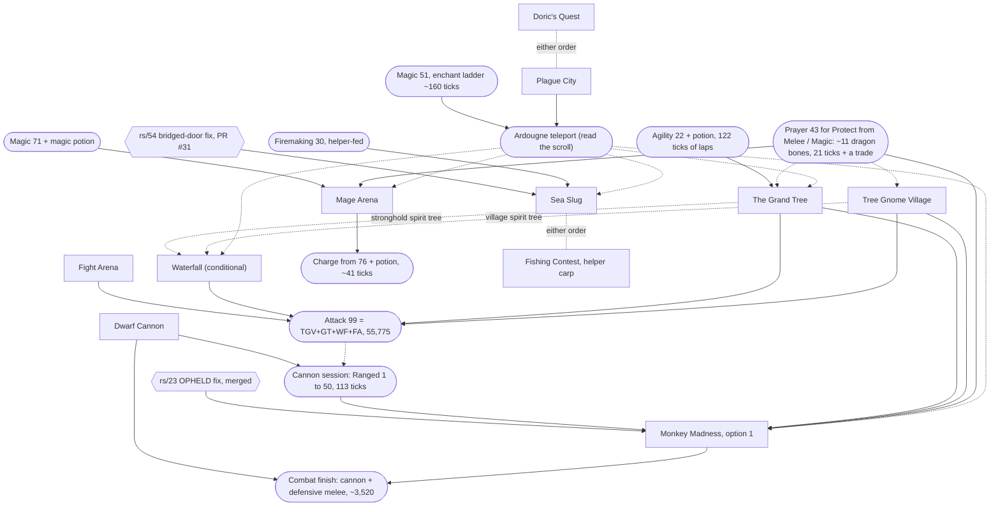
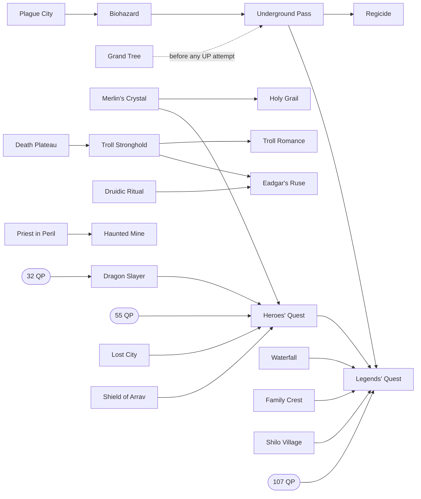

# Quest routes for the max-total speedrun

This page is the synthesis of the quest-route research (coordinator cairn://p/rs/3). Every
verdict below was made on the coordinator's board, from the per-quest documents in this
directory and the skill-rate inputs of the sibling missions (rs/2 for Agility, Mining,
Woodcutting, Fishing and Thieving; rs/28's children for combat, Magic, Prayer and Ranged).
This page puts the numbers side by side, recomputes the burst column under the current
dialogue rule, and records the decisions the synthesis prompted
([Decisions and pending items](#decisions-and-pending-items)).

Conventions: [CONVENTIONS.md](CONVENTIONS.md). Timing primitives: [primitives.md](primitives.md).
All xp is **base** xp (game xp / 25; level 99 is 39,938 on this server's 2^(L/10) curve). All
ticks are 300 ms server ticks spent logged in on the scored account.

**Labels.** Every number carries one: **m** measured (a committed lab script at
`NODE_TICKRATE=300` unless the source says otherwise), **r** read (a script line, cited in
the quest document), **i** inferred (basis given in the cell or the footnote). Three
dialogue columns follow CONVENTIONS: **stock** (2 ticks per page, the historical client),
**fixed** (1 per page, cairn://p/rs/22, now the real client) and **burst** (blind
continues, cairn://p/rs/51).

## 1. Summary

**On the route: 10 quests and the Mage Arena miniquest**, in this order: Doric's Quest,
Plague City, Tree Gnome Village, The Grand Tree, Waterfall (conditional), Fight Arena, Dwarf
Cannon, Monkey Madness (reward option 1), Mage Arena, Sea Slug and Fishing Contest. They give
18 quest points. No quest-point gate binds, because Dragon Slayer is off.

| Whole on-route set | Stock | Fixed | Burst | Basis |
|---|---|---|---|---|
| Success path | **~12,410** | **~10,970** | **~10,170** | sum of the rows in section 3; about 70% measured, the rest i |
| With Monkey Madness's expected failures (+780) | ~13,190 | **~11,750** | ~10,950 | i, `monkey_madness.md` |
| Success path without Waterfall (if rs/56 drops it) | ~11,490 | ~10,080 | ~9,290 | i |
| Without Monkey Madness (also drops Tree Gnome Village and Dwarf Cannon) | ~5,900 | ~5,200 | ~4,860 | i; section 6 shows what it costs in training |

The main thread's rough estimate was ~21,000 fixed. The difference is that the route
shrank as quests were valued: the troll chain, the Regicide chain, Dragon Slayer, Haunted
Mine, and Merlin's Crystal with Holy Grail are all off.

**Headline recommendation.** Do Monkey Madness with option 1 (35,000 Strength and Hitpoints).
It is the largest single lever on the route. Without it, Hitpoints becomes the binding
combat line, because only damage the account deals itself gives Hitpoints. That leaves
about **13,900 ticks** of combat training after the quests. With it, Tree Gnome Village,
Monkey Madness, Dwarf Cannon and the cannon-led combat finish together cost **~9,410**
(success path) or **~10,190** (expected). These are fixed-column figures from a model over
rs/30's and rs/31's measured rates (section 6). The margin of about 3,700 expected ticks
survives every failure case measured on Ape Atoll. Monkey Madness needs
the rs/23 client fix (merged). Sea Slug needs cairn://p/rs/54 (PR #31, open). Fishing Contest
is conditional on the fly-fishing cycle (cairn://p/rs/53).

**Waterfall or Dragon Slayer: one decision pending cairn://p/rs/56.** Both fill MM option
1's Strength gap. **Package A** (current: Waterfall on, Dragon Slayer off) is what the totals
above assume. **Package B** (Waterfall off; Dragon Slayer after MM plus 15 QP of filler) is
about **830 fixed ticks cheaper** after MM, because Dragon Slayer's Defence also fills most
of the Defence gap. But B gives up Waterfall's Strength in the pre-MM fights. **Rule: take B
unless rs/56 measures that Waterfall's Strength saves more than ~830 ticks across the pre-MM
fights** ([section 7](#7-conditional-calls)).

## 2. Dependency graph

Solid arrows are prerequisites the scripts enforce. Dotted arrows are ordering constraints
from the board: something gets cheaper or safer if it comes first. Rounded nodes are skill
levels or unlocks, not quests. Hexagons are client fixes.

What the edges rest on:

- **Monkey Madness needs Tree Gnome Village and The Grand Tree** (r, `king_narnode.rs2:7-10`),
  the stock-client blocker fixed by rs/23, Ranged 50 *base* for the magic shortbow against
  the Jungle Demon (r, `tier50.rs2:6`), and Protect from Magic. Melee died 2 of 2 (m).
- **A protect prayer before every protect-prayer fight.** The Khazard warlord, the black
  demon and the Jungle Demon are survivable only under a protect prayer (m), and Kolodion is
  fatal without Protect from Magic (m, 2 deaths). With Holy Grail off, the prayers come from
  helper-supplied dragon bones: Protect from Magic (Prayer 37) is 8 bones and 15 ticks,
  Protect from Melee (Prayer 43) 11 bones and 21 ticks, plus one trade (m, cairn://p/rs/33).
  Prayer 43 gives only 43 prayer points. The black demon (up to ~334 ticks), the Jungle
  Demon (2-3 doses) and Kolodion (~54-62 points) therefore need prayer potions, unless the
  Prayer route has gone further by then.
- **Plague City before the teleport users.** The teleport needs `%elenaquest` 30 and Magic 51
  (`stat()`, so boostable) (r, `teleport.rs2:22-38`). The savings count only for quests done
  after it: Grand Tree ~290, Mage Arena ~185, Monkey Madness ~100 and Waterfall ~38 (i, tile
  model).
- **Attack 99 before the cannon session, and the cannon session before Monkey Madness.**
  The cannon's hit roll uses the *wielded* style (r, `cannon_fire.rs2:116`), so a melee
  weapon at Attack 99 earns 11.5 Ranged per tick from Ranged 1 (m, `ranged.md` on rs/31's
  branch). Tree Gnome Village + Grand Tree + Fight Arena give 42,025 (r), enough without
  Waterfall; with Waterfall it is 55,775.
- **Mage Arena at base Magic 71 + a magic potion, then Charge from base 76 + potion** (m,
  rs/52 `magic-boost.ts`). Kolodion's start check is `stat_base(magic) >= 60` (r); Fire Wave
  and Charge check boosted `stat()` (r, `magic.rs2:22`).
- **Grand Tree's only Agility check is `stat(agility) < 25`** (r, `quest_grandtree.rs2:25`):
  22 plus a potion passes.
- **Sea Slug** needs Firemaking 30 (`stat()`, r, `quest_seaslug.rs2:43`) and the rs/54 client
  fix (m: without it the bot cannot open bridged doors). **Fishing Contest** takes a
  helper-caught raw giant carp (tradeable, r, `fishing.obj:362`; main ruled it allowed,
  tenet 2).
- **Doric's Quest and Plague City** have no prerequisites. Their combined Mining saving is
  the same in either order (i, rs/2 `mining.md` §2).

Off-route chains, for reference (every node here is skipped; section 5):

## 3. Value table

"Training replaced" is **marginal**: the ticks of the skill route that the quest's xp
removes, given the rest of the on-route set, with skills already at 99 counted as 0. Each
marginal value is taken against the rest of the route, so the values do not add up across
rows. "Net" is training replaced minus the quest's fixed-client ticks. "Base xp per tick"
is the quest's total base xp over its fixed ticks, whether or not the xp is useful.

Burst figures marked **(r21)** were recomputed here from the recorded dialogue runs under
the current rule (CONVENTIONS, 21:14): a run that opens a dialogue costs ceil(k/5), and a
run after an option or state page costs 1 + ceil((k-1)/5). The recomputation added +9
(Tree Gnome Village), +20 (Grand Tree), about +19 (Monkey Madness; one cutscene's runs
are elided in the document), +3 (Mage Arena), +2 (Dwarf Cannon) and +36 (Tourist Trap).
Figures marked **(pm)** come from page and option counts, for documents that recorded no
runs. Each dialogue is modelled as one opening run of P - 2O continues, then for each option
the click plus a two-page run (3 ticks), as `plague_city.md` does. These are inferred. Fixed
figures for pre-ruling documents subtract one tick per click and 4 per trade (9 to 5,
primitives.md §6). Rows marked *pending rs/56* contain fights measured at 70/70/70 melee
with ~70 Hitpoints. The route reaches them with Hitpoints near 10 and Strength near 1
(unless Waterfall comes first), and `pre_mm_fights.md` (cairn://p/rs/56) will replace them.

### On the route

| Quest | Ticks stock / fixed / burst | Reward | Training replaced (marginal) | Net (fixed) | Base xp/tick (fixed) | Verdict | Doc |
|---|---|---|---|---|---|---|---|
| Doric's Quest | 90 m / 65 m / 60 i | 1,300 Mining, 1 QP (r) | 139 i (rs/2 `mining.md` §2: 3,904 to 3,765 given Plague City) | **+74** | 20.0 | DO | [dorics_quest.md](dorics_quest.md) |
| Plague City | 737 m / 620 m / 564 i | 2,425 Mining, 1 QP, Ardougne teleport (r) | ~882 i: Mining 269 (4,034 to 3,765) + teleport legs ~613 (`plague_city.md`'s 644 less Holy Grail's ~31, now off the route) | **+262** | 3.9 | DO, before any teleport user | [plague_city.md](plague_city.md) |
| Tree Gnome Village | 1,036 / 927 / 873 (r21); includes ~103 i to reach the maze from the Ardougne teleport and the gnome-chain trade; warlord *pending rs/56* | 11,450 Attack, 2 QP, village spirit tree (r) | 0: Attack is over 99 without it | -927 (counted in the Monkey Madness block) | 12.4 | DO, as the Monkey Madness gate | [tree_gnome_village.md](tree_gnome_village.md) |
| The Grand Tree (Ardougne teleport for B and C) | 1,930 i / 1,660 i / 1,525 (r21); black demon *pending rs/56* | 18,400 Attack, 7,900 Agility, 2,150 Magic, 5 QP, stronghold tree, Gnome Air (r) | ~2,228 i: Agility 2,143 (rs/2 `agility.md`: 6,960 without quests, 4,695 + 122 with), Magic ~85 (26 base/tick enchanting, `magic.md`), Attack 0 | **+568** | 17.1 | DO | [grand_tree.md](grand_tree.md) |
| Waterfall (spirit-tree variant) | 915 i / 888 i / 874 i (pm) | 13,750 Attack, 13,750 Strength, 1 QP (r) | after MM: Strength 4,938 of the gap left by option 1, ~485 i of melee at rs/30's measured 9-10/tick for Strength 97-99 (the cannon cannot share it: its Ranged is used up in the Defence phase); Attack 0. Before MM: faster pre-MM fights, *pending rs/56* | **-403** + the pre-MM fight saving | 31.0 | **CONDITIONAL, pending rs/56**: Package A against Package B (section 7) | [waterfall.md](waterfall.md) |
| Fight Arena | 846 m / 771 i / 724 i (pm); fights *pending rs/56* | 12,175 Attack, 2,175 Thieving, 2 QP (r) | Thieving ~865 i (rs/2 `thieving.md`: 2,840 from 1, ~1,975 from 57); Attack 0 | **+94** | 18.6 | DO, while Thieving is low | [fight_arena.md](fight_arena.md) |
| Dwarf Cannon | 1,078 m / 976 i / 920 (r21) | 750 Crafting, 1 QP, the multicannon (r) | ~4,090 i: with Defence starting at 20,000, the combat finish (pre-MM Ranged 50, the Jungle Demon fight, then to 99/99/99) is ~8,000 ticks by hand against ~3,920 with the cannon (rs/31's rates) | **+3,110** | 0.8 | DO (Monkey Madness route only, section 6) | [dwarf_cannon.md](dwarf_cannon.md) |
| Monkey Madness, option 1 | success 4,399 / 3,865 / 3,514 (r21); expected 5,179 / 4,645 / 4,295; ~60% m | 35,000 Strength, 35,000 Hitpoints, 20,000 Attack, 20,000 Defence, 3 QP (r, `mm_daero.rs2:294-302`) | ~9,260 i: the scenario difference in section 6 (no-MM combat ~13,900, minus the with-MM finish ~3,644 and Dwarf Cannon 976) | **+4,470** success, **+3,690** expected (after Tree Gnome Village's 927) | 28.5 | DO | [monkey_madness.md](monkey_madness.md) |
| Mage Arena (base 71 + potion) | 606 i / 581 i / 574 (r21); fight 331 m (rs/52) | Charge (0 xp reward; the fight gives ~2,800-3,100 Magic) (r, m) | ~1,340 i: Magic 57 to 99 by enchanting is ~1,550 (364 to 80, then 29,251 at 26 base/tick plus banks, `magic.md`), against ~205 with the arena (rs/52) | **+759** | n/a | DO; Protect from Magic from bones, plus prayer potions | [mage_arena.md](mage_arena.md) |
| Sea Slug | 495 i / 394 m / 340 i | 7,175 Fishing, 1 QP (r) | 955 i given Fishing Contest (rs/2 `fishing.md` §3); 586 i on the 3-tick cycle | **+561** (+192 on the 3-tick cycle) | 18.2 | DO, after rs/54 merges | [sea_slug.md](sea_slug.md) |
| Fishing Contest (helper carp) | 276 i / 223 m / 200 i | 2,437 Fishing, 1 QP (r) | 325 i given Sea Slug; 186 i on the 3-tick cycle | **+102** (-37 on the 3-tick cycle) | 10.9 | DO, if fly fishing stays on the normal cycle | [fishing_contest.md](fishing_contest.md) |

### Off the route

Burst figures marked *pre-rule* come from documents written before 21:14, which used
ceil(k/5) for every run. They undercount by at most one tick per run that follows an option
or state page, typically +10-40 per quest. Only Tourist Trap's margin is narrow enough for
that to matter, so it is recomputed (r21).

| Quest | Ticks stock / fixed / burst | Reward | Training replaced (marginal) | Net (fixed) | Verdict | Doc |
|---|---|---|---|---|---|---|
| Merlin's Crystal + Holy Grail | 820 m + 1,240 i = 2,060 / 703 + 1,152 = 1,855 i / 647 + 1,115 = 1,762 i (pm); the Mordred and Titan fights would also need re-costing at route levels | 15,300 Defence, 11,000 Prayer, 8 QP (r) | Defence ~1,272 i (the MM-route combat finish is ~2,249 with it, ~3,521 without; measured rates). Prayer ~150-350: ~350 m standalone (rs/33: dragon bones at 2 ticks each, ~34.8 base/tick with banking) down to ~150 m if the ~153 bones are buried in the idle ticks of 4-tick Woodcutting or 5-tick fly fishing (rs/38). The protect prayers do not need it (above) | **about -233 to -433** | OFF (coordinator, after rs/33) | [merlins_crystal.md](merlins_crystal.md), [holy_grail.md](holy_grail.md) |
| Legends' Quest (with its chain and ~41 QP of filler) | ~22,500 i (15,000-35,000) | 4 picks of 7,650 (r) | ~3,600 i (with Heroes' along the way) | **about -19,000** | OFF | [legends.md](legends.md) |
| Heroes' Quest | ~3,000 i (2,000-5,000), plus the 55-QP gate | small xp in 13 skills (r) | ~800 i | about -2,200 | OFF: needs a live helper partner and Fishing/Cooking 53 for the untradeable lava eel | [legends.md](legends.md) |
| Dragon Slayer | 1,120 / 1,010 / 970 (~370 m; burst pre-rule) | 18,650 Strength, 18,650 Defence, 2 QP (r) | with MM, in place of Waterfall (Package B): its Strength and Defence shrink the post-MM finish from ~3,520 to ~2,020 (i, phase model), and Waterfall's 888 is saved; needs 15 QP of filler (546 fixed i). Without MM: little or nothing, because Hitpoints binds (section 6) | Package B is ~830 better than Package A before Waterfall's pre-MM saving | **CONDITIONAL with MM, pending rs/56** (section 7); OFF without MM | [dragon_slayer.md](dragon_slayer.md) |
| Haunted Mine (+ Priest in Peril) | ~1,072 m success; expected ~3,700-5,700 i with the Treus Dayth failures (1 kill in 6) | 22,000 Strength, 2 QP (r) | 0: Strength is capped | at most -3,700 | OFF | [haunted_mine.md](haunted_mine.md) |
| Priest in Peril | ~841 i | 1,406 Prayer, 1 QP, Morytania (r) | ~40 i (Prayer at ~34.8 base/tick, rs/33) | about -800 | OFF | [priest_in_peril.md](priest_in_peril.md) |
| The Knight's Sword | 911 m / ~837 i / ~803 i (pm) | 12,725 Smithing, 1 QP (r) | ~236 i (helper-fed Smithing ~54 base/tick) | -601 | OFF | [knights_sword.md](knights_sword.md) |
| Watchtower | ~1,100 i (900-1,500) + ~210 travel | 15,300 Magic, 4 QP (r) | at most ~510 i (only before enchanting) | about -600 to -800 | OFF | [watchtower.md](watchtower.md) |
| Temple of Ikov | ~750 i (550-1,000) | 10,500 Ranged, 8,000 Fletching, 1 QP (r) | ~550 i with Ranged priced (quest Ranged shortens the cannon phase); the document's ~10-50 valued Ranged as free | about -200 | OFF | [temple_of_ikov.md](temple_of_ikov.md) |
| The Dig Site | 2,180 / 1,930 / 1,790 m (burst pre-rule) | 15,300 Mining, 2,000 Herblore, 2 QP (r) | ~1,610 i after Doric's (less once Plague City is counted) | about -320 | OFF; the finds have a long tail (p90 +411) | [digsite.md](digsite.md) |
| **Tourist Trap** (both picks Agility) | 1,830 m / 1,560 m / **1,466** (r21), plus 110-220 m of Rowdy Guard handling under Protect from Melee | 2 picks of 4,650, 2 QP (r) | 1,414 i (rs/2 rerun with Grand Tree as the only Agility quest) | **-256 to -366**; burst **-162 to -272** | OFF, **the narrowest margin on the list**: the fixed client may cut Agility lap ticks ~6%, which makes it worse | [tourist_trap.md](tourist_trap.md) |
| The Fremennik Trials | 3,130 m / 2,640 m / 2,320 (pre-rule) | 2,812 in each of 10 skills, 3 QP (r) | ~1,600 i: Agility 436, Woodcutting 392, Fishing 321, Thieving 260, Defence/HP 191 (Defence counts for more now that Holy Grail is off; still far short) | about -1,040 | OFF | [fremennik_trials.md](fremennik_trials.md) |
| Horror from the Deep | ~800-1,000 i | 4,662 Magic, Strength, Ranged; 2 QP (r) | ~300 i with Ranged priced (the document's ~63 valued Ranged as free) | about -600 | OFF | [horror_from_the_deep.md](horror_from_the_deep.md) |
| Troll chain (Death Plateau, Troll Stronghold, Troll Romance) | 3,039 / 2,735 / 2,562 (m walks and fights, r pages; burst pre-rule) | 3,000 Attack; 8,000 Agility + 4,000 Strength; 4 QP (r) | 1,220 i (Agility only; Attack and Strength capped) | -1,515 | OFF | [troll_romance.md](troll_romance.md), [death_plateau.md](death_plateau.md), [troll_stronghold.md](troll_stronghold.md) |
| Biohazard | 1,564 m / 1,402 / ~1,323 | 1,250 Thieving, 3 QP, gate to Underground Pass (r) | ~100 i (rs/2: Thieving after Fight Arena barely moves) | about -1,300 | OFF | [biohazard.md](biohazard.md) |
| Underground Pass | 2,610 m / 2,553 / 2,521 (at Agility 99) | 3,000 Agility, 3,000 Attack, 5 QP (r) | chain value below | (chain) | OFF; if it is ever done, do it after Grand Tree | [underground_pass.md](underground_pass.md) |
| Regicide (+ two forced pass trips) | 3,147 / 3,063 / 3,015 m | 13,750 Agility, 3 QP (r) | Underground Pass + Regicide save 2,509 i of laps together | Biohazard + Pass + Regicide: about -4,400 | OFF | [regicide.md](regicide.md) |
| Monk's Friend | 397 i / 325 m / 287 i | 2,000 Woodcutting, 1 QP (r) | 301 i (230 on the knife cycle) (rs/6 model via rs/2) | -24 (burst +14, knife -95) | OFF, **break-even at best**, inside the model's error | [monks_friend.md](monks_friend.md) |
| Hazeel Cult | ~430 / ~325 / ~270 i | 1,500 Thieving (r) | ~130-146 i | about -190 | OFF | [hazeel_cult.md](hazeel_cult.md) |
| Tribal Totem | ~355 / ~300 / ~280 i | 1,775 Thieving (r) | ~150-173 i | about -140 | OFF | [tribal_totem.md](tribal_totem.md) |
| Eadgar's Ruse | not costed (needs Troll Stronghold and Druidic Ritual) | 11,000 Herblore (r) | ~25-120 i (helper-fed, ~89 ticks 1 to 99) | negative | OFF | cairn://p/rs/25 (closing comment) |
| Elemental Workshop | not costed (several hundred ticks i) | 5,000 Crafting, 5,000 Smithing (r) | ~150 i (helper-fed) | negative | OFF | cairn://p/rs/25 |
| Nature Spirit | not costed (several hundred ticks i) | 3,000 Crafting, 2,000 HP or Defence (r) | under 50 i for Crafting; 2,000 Defence worth ~130 i now that Holy Grail is off | negative | OFF | cairn://p/rs/25 (closing comment) |
| Big Chompy Bird Hunting | not costed | small quest reward; its 30,000 Ranged needs 4,000 kills (r, `chompy_bird.rs2:211`) | ~0 | negative | OFF | coordinator's board, 17:49 scan |

## 4. Recommended order

The order follows the coordinator's provisional route (the rs/56 brief), less Merlin's
Crystal and Holy Grail. rs/56 may move the early fights, or Waterfall, once it has measured
them at the route's real levels. "Logout-unsafe" marks the stretches where a logout loses
progress (primitives.md §8, each document's risks). Everything else is a clean logout
point: the scored account can log out while helpers gather and lose nothing. Logout is
always refused within 16 ticks of combat (m). Ticks are fixed-client figures.

| # | Step | Fixed ticks | Logout-unsafe stretch | Helper trade (tradeable items only) |
|---|---|---|---|---|
| 0 | Skill prep, not quests. Magic to ~51 on the enchant ladder (~160 i, counted in Magic's route). Prayer 43 by burying ~11 dragon bones (21 m + a trade, counted in Prayer's route) before step 3. Firemaking 30 (helper-fed) any time before Sea Slug. Gnome course to Agility 22 (122 i) before Grand Tree's climb | | | rings and runes; dragon bones; logs |
| 1 | Doric's Quest | 65 | none | 6 clay, 4 copper ore, 2 iron ore, Falador runes (can ride on another trade) |
| 2 | Plague City (Camelot teleport in); **read the magic scroll** (`%elenaquest` 30) | 620 | none | dwellberries, 4 buckets of water, spade, rope, chocolate dust, milk, snape grass, Camelot runes |
| 3 | Tree Gnome Village (Ardougne teleport to the maze); warlord under Protect from Melee, *pending rs/56* | 927 | Bolren's closing ceremony (step 23), until the quest scroll shows | 6 logs (for the whole gnome chain), rune scimitar, prayer potions, food |
| 4 | The Grand Tree (village tree in; Ardougne teleport for Hazelmere); Agility potion if under 25; black demon under Protect from Melee, *pending rs/56* | 1,660 | **trapdoor to black demon kill** (segment N): the demon deletes itself on logout or beyond 17 tiles | rune scimitar, 3-4 prayer potions (Prayer 43 is ~200 ticks of the prayer), food, Varrock and Ardougne runes, Agility potion |
| 5 | Waterfall (spirit-tree variant; Golrie's dungeon can fold into the gnome visit if Waterfall's steps 1-6 come first). **Conditional**, pending rs/56. If it is on, doing it before the fights gives them its Strength sooner; rs/56 decides where | 888 | the rope crossing (steps 27-28, 8-tick temporary locs) | rope, 6 air/earth/water runes (dropped before the tombstone), teleport runes, glory |
| 6 | Fight Arena, before any Thieving training; Khazard need not be killed. Fights *pending rs/56* (Bouncer took 83-142 hp at 50-70 melee) | 771 | the arena fights (combat lock; the death hooks need you inside the arena) | 5 coins, weapon, shield, legs, amulet, ~15 swordfish, Ardougne runes |
| 7 | Dwarf Cannon | 976 | none (all varps permanent) | runes for 2 Ardougne + 1 Falador teleports |
| 8 | Cannon session, Ranged 1 to 50, wielding a melee weapon (Attack 99 from steps 3-6) at the Wilderness poison spiders (3288,3810) | 113 m + ~10 set-up + travel | combat; Wilderness level 37 (section 7) | cannon set and cannonballs from a helper who has **also done Dwarf Cannon** (the mould is untradeable), melee weapon, antipoison, food |
| 9 | Monkey Madness, option 1 at Daero | 3,865 success, 4,645 expected | **the hangar puzzle's last tile to the powered hangar** (timer); **the three chapter cutscenes** (Lumdo's ride to the atoll, the Karamja gree-gree, Garkor's sigil; `mm_cutscene_part` is temporary); **sigil to Jungle Demon kill** (the battle deletes itself) | gold bar, ball of wool, monkey bones, 5 bananas, magic shortbow + 100 rune arrows, 4-6 prayer potions, ~15 food, Varrock and Ardougne runes, antipoison (open lead) |
| 10 | Magic: enchant 57 to 71 (~164 i), sip, Mage Arena (Kolodion ~331 m under Protect from Magic, ~54-62 prayer points, so 1-2 prayer potions at Prayer 43), sip on the exit walk, Charge 76 to 99 (~41 m). It can move earlier: any time after Plague City, Prayer 37 and Magic 71 | 581 | the arena fight (combat; no teleport from the Wilderness legs, so leave from the cellar or chamber) | staff of fire, ~70 blood + 400 air runes, 489 blood + 489 air for Charge, a knife (webs), 2 magic potions (Herblore 76 brew or the Grand Exchange), prayer potions, Ardougne runes |
| 11 | Sea Slug (once rs/54 merges; Firemaking 30) | 394 | none | swamp paste, unlit torch, Ardougne runes |
| 12 | Fishing Contest (helper carp), if fly fishing stays on the normal cycle | 223 | inside the contest fence, steps 7-9: leaving through the gate resets the contest; logout inside was not tested | raw giant carp (a helper leaves the contest before its third catch), rod, 1 bait, 5 coins, 3 Camelot casts |
| 13 | Combat finish after MM (Package A): cannon + defensive melee until Ranged 99 (~3,459 i), then defensive melee to Defence 99 (~62 i at rs/30's measured ~9.3); Hitpoints fills as a by-product (~6,400 against the 4,938 gap). Package B: Dragon Slayer and its filler go here instead of Waterfall, and the finish is cannon + defensive melee (~231) then cannon + rapid knives (~1,792) | ~3,520 (B: ~2,020) | combat | cannonballs, food, antipoison |

Sea Slug and Fishing Contest can go anywhere after Plague City. Doing them before Fishing
training starts is what the marginal values assume.

## 5. Not worth doing

Each of these was costed and dropped on the board. Section 3 has the numbers.

- **Merlin's Crystal + Holy Grail**: Holy Grail's Defence is worth ~1,270 ticks of the
  combat finish. Its 11,000 Prayer is worth ~350 standalone (rs/33, measured), or ~150 if the
  bones are buried in Woodcutting and fly-fishing idle ticks (rs/38). Together that is
  ~1,420-1,620 against 1,855 fixed for the pair, a loss of ~230-430, before the Mordred and
  Titan fights are re-costed at route levels. The protect prayers it used to gate cost
  ~11 dragon bones instead. [merlins_crystal.md](merlins_crystal.md), [holy_grail.md](holy_grail.md)
- **Legends' Quest**: the 107-QP gate forces ~41 QP of filler on top of a seven-quest chain:
  ~22,500 ticks for ~3,600 of value. [legends.md](legends.md)
- **Heroes' Quest**: 55-QP gate, a live helper partner of the other gang, and Fishing and
  Cooking 53 because the lava eel is untradeable; ~800 of value. [legends.md](legends.md)
- **Dragon Slayer, without MM**: Hitpoints binds, so its Strength and Defence replace little
  or nothing, and it would need ~20 QP of filler. With MM it is the Package B candidate
  (section 7), not a skip. [dragon_slayer.md](dragon_slayer.md)
- **Haunted Mine**: Strength is capped, and the Treus Dayth fight completed 1 time in 6
  (expected cost 3,700-5,700 with failures). [haunted_mine.md](haunted_mine.md)
- **Priest in Peril**: only worth it as Haunted Mine's gate; 1,406 Prayer for ~841.
  [priest_in_peril.md](priest_in_peril.md)
- **The Knight's Sword**: 12,725 helper-fed Smithing is worth ~236 against ~910.
  [knights_sword.md](knights_sword.md)
- **Watchtower**: 15,300 Magic is worth at most ~510 against ~1,100; no QP gate needs its 4
  points. [watchtower.md](watchtower.md)
- **Temple of Ikov**: ~750 for Ranged and Fletching worth ~550 once Ranged is priced.
  [temple_of_ikov.md](temple_of_ikov.md)
- **The Dig Site**: 15,300 Mining saves ~1,610 against 1,930 fixed, and the finds have a
  long tail. [digsite.md](digsite.md)
- **Tourist Trap**: the narrowest margin. Both picks on Agility save 1,414 ticks against
  1,560 fixed (1,466 burst, recomputed) plus 110-220 of guard handling: a loss of
  about 160-370 depending on the column. Combat 87 lets the Rowdy Guards ignore you (r,
  `Npc.ts:1011`); below that, Protect from Melee survives them (m). [tourist_trap.md](tourist_trap.md)
- **The Fremennik Trials**: all seven trials are mandatory and every item is untradeable;
  ~1,600 of value against 2,640 fixed. [fremennik_trials.md](fremennik_trials.md)
- **Horror from the Deep**: ~800-1,000 for a few hundred ticks of Magic and Ranged.
  [horror_from_the_deep.md](horror_from_the_deep.md)
- **The troll chain** (Death Plateau, Troll Stronghold, Troll Romance): with Attack and
  Strength capped, only Troll Romance's 8,000 Agility counts (1,220) against 2,735.
  [troll_romance.md](troll_romance.md)
- **Biohazard**: 1,250 Thieving barely moves Thieving after Fight Arena; it exists on the
  route only as Underground Pass's gate. [biohazard.md](biohazard.md)
- **Underground Pass**: pays only as a Legends prerequisite, and Underground Pass before
  Grand Tree does not pay (expected falls 730-960 ticks at Agility 1-10).
  [underground_pass.md](underground_pass.md)
- **Regicide**: 13,750 Agility replaces ~2,000 ticks against ~3,060 of its own play,
  including two forced pass trips. [regicide.md](regicide.md)
- **Monk's Friend**: break-even at best. 301 ticks of Woodcutting (230 on the knife cycle)
  against 325 fixed; only bursts on the normal cycle reach +14, inside the model's error.
  [monks_friend.md](monks_friend.md)
- **Hazeel Cult**: ~130 of Thieving against ~325. [hazeel_cult.md](hazeel_cult.md)
- **Tribal Totem**: ~150 of Thieving against ~300; two ship rides and four teleports.
  [tribal_totem.md](tribal_totem.md)
- **Eadgar's Ruse**: 11,000 helper-fed Herblore (~25-120 ticks), and it needs Troll Stronghold
  and Druidic Ritual. cairn://p/rs/25 closing comment.
- **Elemental Workshop**: 5,000 Crafting + 5,000 Smithing, both helper-fed (~150 ticks).
  cairn://p/rs/25.
- **Nature Spirit**: 3,000 Crafting is worth under 50 ticks, and its 2,000 Defence about 130.
  cairn://p/rs/25 closing comment.
- **Big Chompy Bird Hunting**: the quest's own reward is small, and its 30,000 Ranged needs
  4,000 chompy kills (`chompy_bird.rs2:211`).

## 6. Scenarios: Monkey Madness option 1 against no Monkey Madness

The melee inputs are **rs/30's measured rates** (via rs/28, `NODE_TICKRATE=300`; ogres near
Yanille, rune scimitar, super attack and strength potions, Ultimate Strength and Incredible
Reflexes, 1,000-tick samples; `combat.md` is still to land). Base xp per tick to the trained
skill, with Hitpoints a third on top:

| Trained | Band | Base xp/tick |
|---|---|---|
| Strength (Attack 40) | 40 to 62 | 4.14 |
| Strength | 70 to 82 | 7.58 |
| Strength | 90 to 95 | 8.99 |
| Strength | 95 to 99 | 10.08 |
| Defence, defensive style, Strength 99 | 85 to 91 / 95 to 98 | 9.34 / 9.18 |

The Ranged and cannon rates are from `ranged.md` and `ranged-model.ts` on rs/31's branch
(measured at 300 ms). The combat facts are read: every point of damage gives 4 base xp to the
trained style and 1.33 Hitpoints (`combat.rs2:146-167`), so **Hitpoints is one third of all
personally earned combat xp**. The cannon's xp is Ranged only (`cannon_fire.rs2:119`). Quest
xp lands where the quest says. The totals come from a phase model that integrates these
measured rates over the xp curve, so they are **inferred, on measured rates**, in the fixed
column. The model reproduces rs/31's published 2,248 for the old case with Holy Grail (2,249).
rs/28's quick check of the with-MM Defence gap alone, ~2,150 ticks of defensive melee at
~9.3 with ~6,600 HP as a by-product, agrees. The ~3,520 below covers Ranged and Defence
together.

### Combat state after the quests (Package A: Waterfall on)

| Skill | With MM option 1 | Without MM (no Tree Gnome Village either) |
|---|---|---|
| Attack | 75,775: capped (r) | 44,325 (GT + Waterfall + Fight Arena): capped (r) |
| Strength | 48,750: capped (r) | 13,750 (level 83): gap 26,188 |
| Defence | 20,000 (level 89): gap 19,938 | 0: gap 39,938 |
| Hitpoints | 35,000 (level 97): gap 4,938 | ~0: gap ~39,900 |
| Ranged | ~54 after the demon fight (50 from the cannon session + ~485 from the fight, m) | 1: gap 39,938 |

### Side by side

| Line | With MM option 1 | Without MM |
|---|---|---|
| Tree Gnome Village | 927 | not done (Grand Tree does not require it) |
| Monkey Madness | 3,865 success (m/r/i mix), 4,645 expected | not done |
| Dwarf Cannon | 976 | **not done**: Hitpoints binds, and cannon xp gives no Hitpoints, so the cannon shortens nothing (the model's best cannon plan is ~13,260 + 976 for the quest, against ~13,900 with knives and no quest: about even, and the knives need no Wilderness) |
| Ranged method | **cannon**: 113 m firing (+~10 set-up) for Ranged 50 before MM, wielding a melee weapon. After MM, cannon + defensive melee at the spiders until Ranged 99 (~3,459; 11.03 Ranged + 5.60 Defence + 1.85 HP per tick, m rates) | **rapid rune knives**, ~5,270 from level 1 (`ranged.md`; 8.1-8.75 Ranged + ~2.7-2.9 HP per tick, m). Longrange is no use: 2.63/tick to each of Ranged and Defence (m) |
| Strength and Defence | Defence: 19,371 inside the cannon phase, then ~62 of melee alone for the last ~570; Strength 0 | Strength 83 to 99 at the banded rates, **~2,860**; Defence 1 to 99 at ~9.3 with Strength 99 (the Defence level does not change the hit rate), **~4,300** |
| **Hitpoints (its own line)** | 0 extra: the cannon phase's defensive melee produces ~6,400 against the 4,938 gap | The Strength, Defence and Ranged training above yields 35,355 HP, leaving 4,583. That needs 13,749 more combat xp in a capped skill: **~1,480** at ~9.3 |
| Combat training after the quests | **~3,644** (123 + 3,521) | **~13,900** (2,862 + 4,295 + 5,270 + 1,478) |
| **Block total** | **~9,410 success, ~10,190 expected** | **~13,900** |

**MM option 1 wins by about 4,490 ticks on the success path and 3,710 expected.**

**Option 1 against option 2, rechecked without Holy Grail** (same model, measured rates).
Option 2 (35,000 Attack and Defence, 20,000 Strength and Hitpoints) leaves Defence 4,938,
Strength 6,188 and Hitpoints 19,938, and Attack is capped either way. Hitpoints then binds,
with ~3,590 ticks of top-up alone. The finish is ~6,650 ticks against ~3,520 for option 1,
so **option 1 stays better by ~3,130**. Without Waterfall it is ~6,700 against ~4,010.

Why no-MM is so expensive: Hitpoints needs 39,938, which is one third of 119,814 base of
personal combat xp, and the uncapped gaps (Strength, Defence, Ranged) add up to 106,064.
So the no-MM block is close to that xp divided by the combat rates, whichever skill the
xp goes into. That also means that **without MM, the Strength and Defence from Waterfall and
Dragon Slayer replace little or nothing**: most of that xp would have been trained anyway to
reach Hitpoints 99. Hitpoints quests are the ones that help. Witch's House (6,325 HP,
~163 fixed in `quest_points.md`, unmeasured) removes the ~1,480-tick top-up, cutting the
block to ~12,580. That makes it a no-MM-only candidate.

**Sensitivity to the melee rate.** With the knives fixed at ~5,270, the no-MM block is about
5,270 + 79,876 / (melee rate): ~15,250 at 8, ~13,860 at 9.3 (measured, Defence at Strength
99), ~13,260 at 10 and ~11,930 at 12. The MM block hardly depends on the melee rate; only
the last ~62 ticks are melee alone. No-MM would only draw level with MM's expected ~10,190
at about **16 base xp per tick** of melee, against rs/30's measured 9-10 at these levels.

### Monkey Madness's failure budget

From `monkey_madness.md` (3-sample observations, so inferred):

| Item | Ticks (fixed) |
|---|---|
| Success path, after Plague City (Ardougne teleport on the zoo leg), trade included | ~3,865 |
| Expected extra: temple trapdoor +600, the monkey's aunt +120, Jungle Demon deaths +60 | +780 |
| **Expected total** | **~4,645** |
| Per failure: trapdoor stuck (walk out, eat, drink a prayer dose) | ~30 plus another ~110-tick try |
| Per failure: death at the trapdoor | ~340; ~990 if the enchanted bar is lost (only 3 items are kept) |
| Per failure: the aunt calls the guards (a jail cycle) | ~90-120 |
| Per failure: death to the Jungle Demon | ~60 (the sigil teleports you back) |
| Per failure: death in the Ape Atoll dungeon traps (none seen; not in the expected figure) | ~340 |
| **Bad-but-plausible worst case**: 6 trapdoor tries with 2 deaths (one losing the bar), the aunt twice, the demon twice, one dungeon death | +~2,650, so **~6,500** |

**Retry tolerance.** MM stays ahead of no-MM until its overrun over the success path reaches
about 4,490 fixed ticks: roughly 13 trapdoor deaths with the bar kept, or 4 with it lost.
The bad-but-plausible worst case (+2,650) is well inside that. The open leads would shrink
the trapdoor's +600: an antipoison, since the deaths may be jungle-spider poison through the
prayer, and timing the guards' one-tile wander. A logout inside a cutscene zone completes
the cutscene on the next login (`mm_login`, unmeasured, worth up to ~150).

## 7. Conditional calls

- **Waterfall or Dragon Slayer (Package A or B), pending cairn://p/rs/56.** Both fill MM
  option 1's Strength gap, so they compete. Fixed ticks, from the phase model on measured
  rates (i). Every package includes the same MM block; only the lines that differ are shown.

  | Package | Quests | Filler | Post-MM finish | Total of the differing lines |
  |---|---|---|---|---|
  | **A** (current): Waterfall on, Dragon Slayer off | Waterfall 888 | none | ~3,521 (cannon + defensive melee 3,459, then melee 62) | **~4,409** minus Waterfall's pre-MM saving |
  | **B**: Waterfall off, Dragon Slayer on after MM | Dragon Slayer ~1,010 | 15 QP, 546 | ~2,023 (cannon + defensive melee 231, then cannon + rapid knives 1,792) | **~3,579** |
  | **C**: both | 888 + ~1,010 | 14 QP, 519 | ~2,023 | **~4,440** minus Waterfall's pre-MM saving |
  | Neither | | none | ~4,006 (adds 490 of Strength melee) | **~4,006** |

  Dragon Slayer's 18,650 Strength caps Strength, and its 18,650 Defence leaves only a
  1,288 Defence gap. The cannon phase then ends in ~231 ticks and the rest is cannon + rapid
  knives, which is why B's finish is ~1,500 shorter than A's, not just the ~1,100 that
  pricing the two gaps separately gives. The filler is the cheapest set in
  `quest_points.md`'s ranking, fixed column, inferred (unmeasured): **Goblin Diplomacy** (5 QP,
  ~115 on the Dragon Slayer route, which shares its Port Sarim and Ice Mountain legs; ~188
  alone), **Witch's House** (4 QP, ~163), **Romeo & Juliet** (5 QP, ~241) and **Cook's
  Assistant** (1 QP, ~27): 15 QP for ~546. The route without Waterfall has 17 QP, and the
  Champions' Guild door needs 32 to start Dragon Slayer. Package C needs only 14 (Cook's
  Assistant drops: ~519). Witch's House's 6,325 Hitpoints is worth **0** here, because the
  finish's Hitpoints by-product already covers the 4,938 gap (the model gives the same finish
  with or without it). The next-cheapest 15-QP set swaps Cook's Assistant for Sheep Shearer
  (~587). Dragon Slayer's ~1,010 assumes Elvarg at 70s melee (102-166 ticks); after MM, at
  99, it is 64-75 (m), so ~60 less.

  **Decision rule.** Let *S* be the fixed ticks that Waterfall's Strength saves across the
  pre-MM fights (warlord, black demon, Fight Arena; rs/56 measures them with and without
  it). **If S < ~830, take Package B. If S > ~830, take Package A.** Package C never beats A
  by more than about 30 ticks, so it is not worth Dragon Slayer's extra risk; B also beats
  doing neither by ~430. B does not win plainly. The fights total ~650 ticks at 70 Strength,
  and Waterfall moves Strength from ~1 to 83 before them, so an S of ~830 is plausible if
  low-Strength kills take a few times longer. However, Strength also rises from the fights'
  own xp at 25x. rs/56's measurement settles it. If B is chosen, the quest-route totals in
  section 1 change by -888 (Waterfall) + 1,010 (Dragon Slayer) + 546 (filler) = **+668 fixed**,
  and the post-MM training falls by ~1,498, so the net is ~-830.

- **Fishing Contest depends on the fly-fishing cycle (cairn://p/rs/53).** On the normal
  cycle it saves 325 ticks given Sea Slug against 223 fixed (+102), with the helper-caught
  carp that main allowed (tenet 2). Done entirely on the scored account it costs ~367 and
  loses. If the run fly fishes on the 3-tick knife cycle, the same xp saves only 186, so it
  is -37 fixed: drop it. Sea Slug stays positive on either cycle (+561 normal, +192 knife).
  rs/53 is measuring the knife cycle through level-ups; its result decides this row.
- **Sea Slug depends on cairn://p/rs/54** (PR #31, open). The lite client keeps bridged
  doors closed for routing, so the bot cannot reach the broken glass or Kennith. With the
  fix applied in the lab it ran end to end twice (394 fixed, m). Until rs/54 merges, Sea
  Slug is blocked, and Fishing Contest's value without it rises to 755 (alone, from level 1).
- **The Wilderness spider site.** The cannon sessions (step 8 and the post-MM finish) are
  costed at the poison spiders (3288,3810), Wilderness level 37. There, players within 37
  combat levels can attack, a death keeps only 3-4 items, and the spiders poison for
  ~0.2-0.3 hp per tick through Protect from Melee (`ranged.md`). Step 8 happens before MM,
  at the route's low Hitpoints, so rs/56's timeline should check the poison. The
  non-Wilderness fallback is the **Battlefield of Khazard** (2523,3239): cannon alone 9.13
  Ranged per tick against 11.52 (m), and cannon + defensive melee 8.88 Ranged + 3.37 Defence
  against 11.03 + 5.60 (m). That is about 20-25% slower. The pre-MM session goes from ~113
  to ~143 ticks, and the ~3,520 finish to roughly 4,300-4,500 (i).
- **Pre-MM fights at route levels (cairn://p/rs/56).** Every fight above was measured at
  70/70/70 with ~70 Hitpoints. The route reaches the Khazard warlord, the black demon and
  Fight Arena with Hitpoints near 10, Prayer 43 from bones, and Strength near 1 unless
  Waterfall comes first. rs/56 is costing those fights with and without Waterfall's
  Strength, which decides Waterfall. Slot `pre_mm_fights.md` into the Tree Gnome Village,
  Grand Tree, Waterfall and Fight Arena rows when it lands. Its Mordred and Titan figures
  are no longer needed for the route.

## Decisions and pending items

The coordinator's decisions (cairn://p/rs/3, 22:27 and after) on the points this synthesis
raised:

1. **Waterfall against Dragon Slayer: pending rs/56** (the package rule in section 7). After
   MM, Waterfall alone is worth ~485 ticks of Strength melee at the measured 9-10/tick (the
   finish rises from ~3,521 to ~4,006 without it) against ~888 fixed. Before MM it is the only
   Strength source. Dragon Slayer with 15 QP of filler (Package B) fills the same Strength gap
   and most of the Defence gap, and is ~830 cheaper after MM. So **Waterfall stays (Package
   A) only if its pre-MM fight saving exceeds ~830**. Without MM both are worth ~0
   (Hitpoints binds).
2. **Merlin's Crystal + Holy Grail: OFF** (after rs/33's measured Prayer rate). See
   section 5. Defence ~1,270 (this page's model on measured rates; the coordinator's ~1,312 was
   the earlier estimate) plus Prayer ~150-350, against 1,855 fixed: about -230 to -430. Taking them off
   removes Plague City's ~31 Holy Grail saving and the base-Attack-20 constraint, and moves
   the protect prayers to dragon bones.
3. **Quest points.** The on-route set gives **18** (12 without MM, Tree Gnome Village and
   Dwarf Cannon; 1 fewer without Waterfall). Nothing binds while Dragon Slayer is off.
   `quest_points.md` and `dragon_slayer.md` quote 46-49 because they counted quests that
   have since dropped off the route.
4. **No-MM Dragon Slayer: OFF** (with MM it is Package B's candidate, item 1). Without MM, Hitpoints binds, so its
   Strength and Defence replace little or nothing (section 6), and it would also need ~20 QP
   of filler. `dragon_slayer.md`'s "+1,545 if MM is dropped" leaves out that Hitpoints
   caveat, which the document itself raises. `ranged.md`'s no-MM "cannon in parallel, ~1,040
   ticks" line has the same gap: cannon xp gives no Hitpoints. **Witch's House** (6,325 HP,
   ~163 fixed, unmeasured) is a no-MM-only candidate.
5. **Monkey Madness option 1 rechecked without Holy Grail**, on measured melee rates: still
   better than option 2 by ~3,130 ticks (section 6). MM itself beats no-MM by ~3,710 expected,
   and only a melee rate of ~16 base/tick would flip it.

**Confirmed by rs/31 (2026-10-20 23:02, `ranged-model.ts` on measured 300 ms rates,
`ranged.md` section 1 on agent/rs-31-builder-0):** the Package A finish is **3,520** ticks
(defensive melee at the Wilderness spiders with the cannon running until Ranged 99, 3,459,
then 62 of melee alone; HP by-product ~6,590). Next best is 4,197 (melee alone for Defence,
then cannon + rapid knives); hand-only with longrange is 9,685. With Waterfall also off it
is 4,054 (this page's 'neither' line used ~4,006). The cannon saves ~2,630 on this route
including Dwarf Cannon's 1,078. Pushing Ranged to 70 before Monkey Madness does not pay
(4,017 vs 3,900).

Still to slot in: `pre_mm_fights.md` (rs/56: the pre-MM fights, and with them Package A
against B), rs/31's confirmation of the ~2,020 Package B finish, rs/30's `combat.md`
(its rates are quoted here from rs/28), rs/53 (Fishing Contest), and the rs/54 merge (Sea
Slug).

## Superseded figures

These older documents are left as written. Use the replacements below.

| Figure | Where | Replacement |
|---|---|---|
| "Combat rate about 14 base xp per tick (README)". No README ever carried this; it was the per-skill estimate that main later labelled inferred | `monkey_madness.md`, `tree_gnome_village.md`, `grand_tree.md`, `dragon_slayer.md`, `quest_points.md` rs/30's measured 300 ms rates, 4.1-10.1 by Strength band and ~9.3 for Defence at Strength 99 (via rs/28; table in section 6). Combat is valued through the scenario arithmetic in section 6 |
| Ranged worth ~0 ("the cannon makes it free") | `temple_of_ikov.md` (~10-50), `horror_from_the_deep.md` (~63) | Ranged priced through rs/31's cannon plan: quest Ranged shortens the cannon phase, so Ikov's 10,500 is worth ~550 against ~750 (still OFF) and Horror ~300 against 800-1,000 (still OFF) |
| MM-route combat finish 2,248 (Defence gap 4,638) | `ranged.md` | ~3,520 i with Holy Grail off (Defence gap 19,938); ~2,020 i in Package B |
| Dragon Slayer worth ~330 with MM | `dragon_slayer.md` | Package B: with Waterfall off and Holy Grail off, it shortens the finish by ~1,500 (section 7) |
| Plan holds 46-49 QP | `quest_points.md`, `dragon_slayer.md` | 18 on the route (decision 3) |
| Dragon Slayer "+1,545 if MM is dropped" | `dragon_slayer.md` | little or nothing: Hitpoints binds without MM (decision 4) |
| Plague City's teleport savings include Holy Grail ~31 | `plague_city.md` | Holy Grail is off: ~613 of savings remain |
| Troll Romance Agility ~1,150; Tourist Trap picks 1,060-1,336 | `troll_romance.md`, `tourist_trap.md` | 1,220 and 1,414, from rs/2's rerun with Grand Tree as the only Agility quest |

## Source documents

Per-quest documents are in this directory; the value table links each one. Cross-mission
inputs: rs/2's `docs/speedrun/skills/{mining,fishing,thieving,agility}.md` (branch
`agent/rs-2-coordinator-0`), rs/6's Woodcutting model via the board, `ranged.md` and
`ranged-model.ts` on `agent/rs-31-builder-0`, `magic.md` (rs/28's children), and, as
recorded on cairn://p/rs/3/1/coordinator/board and in its messages: rs/52's Magic-boost
measurements, rs/33's Prayer rate, rs/38's interleaving result and rs/30's measured
melee rate.
