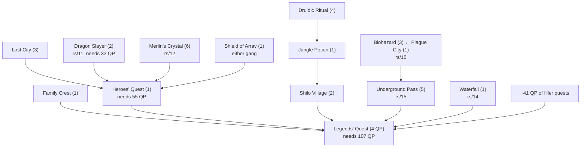

# Legends' Quest (feasibility: not worth doing)

**Verdict: skip Legends' Quest, and with it Heroes' Quest, Family Crest, Shilo Village,
Jungle Potion, Lost City and Shield of Arrav** (unless something else in the plan
needs them for their own sake; none of them pays for itself either).

The 107-quest-point gate forces about 41 quest points of filler quests that no
sibling plans, plus a seven-quest prerequisite chain that no sibling owns. Together
with Legends' own steps, that is about **22,500 ticks** (inferred, range
15,000-35,000). The reward is worth about **2,800 ticks** of training, plus about 800
from Heroes' Quest along the way. The net loss is about 19,000 ticks, which is
roughly the length of a whole projected run (18,000-23,000 ticks, from
cairn://p/rs/main/task/per-skill). Even the hard floor (below) is about twice the value.

Nothing here was measured. Phase 2 of the brief (measuring the jungle, puzzles and
fights) was not started, because the verdict does not depend on any of those
segments: Legends would stay negative even if its own steps cost zero ticks.

## Reward

- 4 training picks from Radimus Erkle, each `stat_advance($skill, 76500)`. That is
  tenths, so 7,650 base per pick, multiplied 25x by `addXp`
  (read, `radimus_erkle.rs2:119-122`; `Player.ts:1889`). 30,600 base in total.
- The menu offers 12 skills: Attack, Defence, Strength / Hitpoints, Prayer, Magic /
  Woodcutting, Crafting, Smithing / Herblore, Agility, Thieving (read,
  `radimus_erkle.rs2:87-117`). **Mining, Fishing, Ranged, Cooking, Firemaking,
  Fletching and Runecraft are not offered.**
- Picks **can repeat** a skill. Each pick just adds 5 to `%legendsquest`, until it reaches
  `^legends_radimus_training_4` = 70 (read, `radimus_erkle.rs2:79,121`,
  `quest_legends.constant:31-35`). Picks can be taken over several visits
  (`radimus_erkle.rs2:10-12`).
- 4 quest points (read, `general/configs/quest.constant`, `^legends_questpoints`).
- Unlocks the Legends' Guild. Nothing in the max-total plan needs it.

### What the picks are worth

Rates come from the skill model in cairn://p/rs/main/task/per-skill (inferred there,
not measured): Agility about 8 base xp/tick (Wilderness course), Woodcutting 11.6
(4-tick) to 15.5 (3-tick), Thieving about 15 on average (rising from 8.6 at 55 to 31 at 99).

- **Agility is mostly covered already.** Grand Tree 7,900, Regicide 13,750 and Troll
  Romance 8,000 add up to 29,650 base, which leaves 10,288 Agility base to train. If
  Tourist Trap's two 4,650 picks also go to Agility (it is the most expensive of
  Tourist Trap's four options), only about 1,000 is left.
- So the best four picks are about Agility up to the remaining gap, then
  Thieving, Woodcutting, Woodcutting (and Thieving again):

| Pick | Useful base | Ticks replaced | Basis |
|---|---|---|---|
| Agility (only if Tourist Trap's picks went elsewhere) | 7,650 | ~960 | inferred, 8/tick |
| Thieving #1 (from 2,175 after Fight Arena, levels ~57 to ~79) | 7,650 | ~720 | inferred, ~10.6/tick in that band |
| Woodcutting #1 | 7,650 | ~660-700 | inferred, ~11/tick |
| Woodcutting #2 | 7,650 | ~500-660 | inferred, 11.6-15.5/tick |
| Thieving #2 (levels ~79 to ~87) | 7,650 | ~460 | inferred, ~17/tick |

The best four come to **about 2,500-3,000 ticks**, depending on where Tourist Trap's
picks go. The upper bound, if no other quest gave Agility, is 30,600 / 8, about 3,800.
Combat picks are worthless, because Monkey Madness, Dragon Slayer, Waterfall, Holy
Grail and the others already cap Attack, Strength, Defence and Hitpoints. Crafting,
Herblore, Smithing, Magic and Prayer are cheap item-fed skills (under about 1,200 ticks
each, and most under 100).

**Pick recommendation, if Legends is ever done:** first Agility, up to whatever gap the
other Agility quests leave. Then Thieving and Woodcutting, alternating: Thieving first
while its level is low and its rate is poor, then Woodcutting. Never a combat skill.

## Requirements as enforced by this server

### Quest and quest-point gate

The Legends' Guild guard (`legends_guard.rs2:50-53`) requires:

- `%crestquest >= ^crest_complete` (Family Crest)
- `%heroquest >= ^hero_complete` (Heroes' Quest)
- `%zombiequeen >= ^zombiequeen_complete` (Shilo Village)
- `%upass >= ^upass_complete` (Underground Pass)
- `%waterfall_quest >= ^waterfall_complete` (Waterfall Quest)
- `%qp >= ^legends_required_questpoints`, and **that constant is 107**
  (`quest_legends.constant:76`; the guard's text repeats 107 at `legends_guard.rs2:60,165`).

`%qp` is recomputed as the sum of `^<quest>_questpoints` over every completed quest
(`general/scripts/quests.rs2:89-94`, `count_questpoints` at `:96-302`). **This server has
68 quests worth 145 quest points** (read: all 68 `^*_questpoints` constants in
`general/configs/quest.constant:72-139`, each summed by `count_questpoints`). Without
Legends' own 4 points, the ceiling is 141. Reaching 107 therefore means **skipping at
most 34 quest points across the entire game.**

### Prerequisite tree

| Quest | QP | Gates on this server (read) | Owner |
|---|---|---|---|
| Waterfall | 1 | none | rs/14 (Waterfall, Fight Arena, Knight's Sword) |
| Underground Pass | 5 | Biohazard; `stat(thieving) < 50` at `quest_upass.rs2:248` | rs/15 (Regicide chain) |
| Dragon Slayer | 2 | 32 QP | rs/11 |
| Merlin's Crystal | 6 | | rs/12 |
| Family Crest | 1 | no quest or `stat()` gate in `quest_crest/`. Chronozon must be hit by all four blast spells (`crest_chronozon.rs2:3`), so Fire Blast's Magic level applies | **none, this document** |
| Heroes' Quest | 1 | `%qp >= 55`, Lost City, Dragon Slayer, Merlin's Crystal, and either Shield of Arrav gang (`quest_hero.rs2:1-7`, `quest_hero.constant:20`). No `stat()` checks in `quest_hero/`, but the eel imposes two levels. The lava-eel spot needs `stat(fishing) >= 53` (`lavafish.rs2:84`). Cooking it needs Cooking 53 (`cooking_generic.dbrow:110`), because Achietties wants the cooked `lava_eel` (`achietties.rs2:12`). `raw_lava_eel`, `lava_eel`, `oily_fishing_rod` and `blamish_oil` are all `tradeable=no`, so **the scored account must make the oily rod, fish the eel and cook it itself** | **none** |
| Lost City | 3 | `stat(woodcutting) < 36`, `stat(crafting) < 31` (`quest_zanaris.rs2:37,78`) | **none** |
| Shield of Arrav | 1 | none; needs the other gang's broken-shield half (tradeable) | **none** |
| Shilo Village | 2 | Jungle Potion (`mosol_rei.rs2:2`); `stat(agility)` 32 / 15 (`quest_zombiequeen.rs2:390,527,619`), `stat(crafting)` 15 / 16 / 20 (`:1254,1270,1285`), HP 15, Prayer 10 | **none** |
| Jungle Potion | 1 | Druidic Ritual (`trufitus.rs2:280`) | **none** |
| Druidic Ritual | 4 | none | **none** (rs/11 may pick it as a 32-QP filler) |

### Skill gates (read; all use `stat()`, so a boost satisfies them)

| Skill | Level | Where |
|---|---|---|
| Agility | 50 | `quest_legends.rs2:327,587` |
| Thieving | 50 | `quest_legends.rs2:414` |
| Strength | 50 | `quest_legends.rs2:457` |
| Mining | 52 | `quest_legends.rs2:524` |
| Herblore | 45 | `quest_legends.rs2:1131` (germinating yommi seeds) |
| Woodcutting | 50 | `quest_legends.rs2:1135` |
| Smithing | 50 | `quest_legends.rs2:1463` (golden bowl) |
| Crafting | 50 | `quest_legends.rs2:1929`, `radimus_notes.rs2:73` (mapping) |
| Prayer | 42 | `gujuo.rs2:334` |
| Magic, Prayer | 10 | `book_of_binding.rs2:28,32` |
| Magic | 56 | **journal only** (`legends_journal.rs2:65`, `stat_base`, display). Not checked by any `stat()` in `quest_legends/`; the orb-door spells (`quest_legends.rs2:1530`) may carry their own spell levels (open question) |

The journal lists every level with `stat_base` (`legends_journal.rs2:65-128`), but
only for display; the enforcing checks are the `stat()` ones above.

Heroes' Quest adds Fishing 53 and Cooking 53 through the untradeable lava eel (see the
prerequisite table). **These gates cost the run nothing extra.** On this server's `2^(level/10)` curve,
level 50 is 1,305 base and 56 is about 1,980 base
(cairn://p/rs/main/task/per-skill). The max-total run takes every skill to 99 anyway,
so the only constraint is ordering: Legends would have to come after these levels.

## Cost estimate (all inferred)

### 1. Legends' own steps

The step list below is built from the scripts. Ticks use the provisional primitives in
`CONVENTIONS.md`: 0.5 per tile, 1 per dialogue page, `p_delay(n)` + 2 per interaction,
and about 5 per teleport. Coordinates come from `legends_zones.dbrow` and
`quest_legends.constant`. Kharazi west is map square 43_45 (x 2752-2815,
y 2882-2935), middle is 44_45, east is 45_45 to 46_45. The guild gate is at (2728,3349).
Fights assume about 2 HP/tick of damage at 70/70/70 melee and about 3 HP/tick at 99s
with helper gear (inferred).

| # | Segment (stage values from `quest_legends.constant`) | Tiles | Dialogue | Interactions | Fight HP | Ticks |
|---|---|---|---|---|---|---|
| 1 | Ardougne teleport, walk to the guild, guard "Can I go on the quest?" then "Yes, I'd like to talk to Grand Vizier Erkle", Radimus "Yes actually, what's involved?" then "Yes, it sounds great!" (stage 1), machete from the cupboard | ~100 | ~24 | 3 | | ~85 |
| 2 | To Kharazi: guild to Ardougne docks, ship to Brimhaven, Shilo cart (needs Shilo Village), walk to the jungle edge | ~160 | ~15 | ship + cart | | ~110 |
| 3 | Cut into the jungle (axe and machete, `jungle_tree.rs2`), map west / middle / east with papyrus and charcoal (`radimus_notes.rs2:60-133`; at Crafting 99 `stat_random(crafting,100,250)` succeeds about 98%) (stage 2) | ~150 | ~9 | ~13 | | ~150 |
| 4 | Jungle forester trades a bullroarer for a map copy (stage 3); swing it to summon Gujuo (stage 4); agree to rescue Ungadulu (stage 5) | ~40 | ~50 | 2 | | ~80 |
| 5 | North-west Kharazi: search the rocks (Agility 50) and enter the shaman cave (stage 6); investigate the fire wall; talk to Ungadulu (stage 7); Gujuo on holy water (stage 8) | ~100 | ~40 | ~5 | | ~130 |
| 6 | Golden bowl: 2 gold bars and a hammer (Smithing 50, `p_delay(4)`, `quest_legends.rs2:1458-1505`), bless it, fill at the sacred pool (stage 10) | ~100 | ~15 | ~6 | | ~150 |
| 7 | Pour sacred water on the fire wall, enter the octagram, use the book of binding on Ungadulu: **Nezikchened #1** (lvl 187, 150 HP) (stages 11-12); collect yommi seeds | ~60 | ~25 | ~6 | 150 | ~200 |
| 8 | Germinate the seeds (Herblore 45, `stat_random(herblore,40,243)`), plant them in fertile soil (stage 13); pool dries up (stage 14); Gujuo (stage 15); bravery potion from snake weed and ardrigal | ~80 | ~25 | ~6 | | ~100 |
| 9 | Viyeldi caves (stages 16-25): rope on the winch, bravery potion, ledges and climbing rocks (Agility 50), lockpick gate (Thieving 50), strength gate (Strength 50), boulder (Mining 52), crumbled wall, rune wall (soul, mind, earth, 2 law), the **7-gem puzzle** (opal, jade, topaz, sapphire, diamond, ruby, emerald), magic-trial orb door, three crystal pieces in the lava furnace, dragon-heart crystal in the recess, push the boulder, Echned Zekin's dagger, Ungadulu's Holy Force, **Echned Zekin / Nezikchened #2** (lvl 187, 150 HP), collect sacred water | ~300 | ~60 | ~45 | 150 | ~1,200 |
| 10 | Grow the yommi tree: water, chop (Woodcutting 50), trim, carve (Crafting 50). Each stage rots unless used within 100 ticks (`quest_legends.rs2:1151-1250`). Carry the totem to the evil totem pole: **Nezikchened #3** (stages 30-35); replace the totem (stage 40); Gujuo gives the gilded totem (stage 45) | ~120 | ~25 | ~10 | 150 | ~300 |
| 11 | Teleport back, hand in the totem and map (stage 50), enter the main hall, 4 picks (up to 4 menu clicks plus 1 mesbox each; stages 55-70) | ~60 | ~30 | | | ~100 |
| | **Step-count floor** | ~1,270 | ~320 | ~100 | 450 | **~2,600** |

The floor assumes one clean pass. It does not yet count:

- germination failures (about 52% success at Herblore 45, about 95% at 99);
- yommi rot (each stage has a 100-tick window);
- mapping failures that destroy papyrus or charcoal;
- golden-bowl failures (`stat_random(smithing,31,256)`, which wastes gold bars);
- bank trips for the gems, runes and herbs;
- back-and-forth between the jungle, the shaman cave and the Viyeldi caves.

The Holy Force route at step 9 avoids killing Viyeldi (lvl 79, 80 HP). That keeps San
Tojalon (106, 120 HP), Irvig Senay (100, 125 HP) and Ranalph Devere (92, 130 HP) out of
the final fight (`legends_journal.rs2:376-390`); killing Viyeldi adds about 450 HP of
fighting. **Central estimate: about 4,000 ticks; range 2,600-8,000** (inferred).

### 2. Prerequisite chain no sibling owns

| Quest | QP | Scored-account work (inferred from the scripts' structure) | Ticks (central / range) | Base xp reward (read) | Ticks of training it replaces |
|---|---|---|---|---|---|
| Druidic Ritual | 4 | Taverley: Kaqemeex, Sanfew, 4 meats in the cauldron in Taverley Dungeon | 400 / 250-700 | 250 Herblore (`quest_druid.rs2:3`) | ~0 |
| Jungle Potion | 1 | Karamja: Trufitus, 5 herbs from jungle locs, cleaned by the player (the stage advances on cleaning, `quest_junglepotion.rs2:59-63`) | 800 / 500-1,200 | 775 Herblore (`quest_junglepotion.rs2:74`) | ~0 |
| Shilo Village | 2 | Mosol Rei, Ah Za Rhoon temple, Zadimus corpse, Bervirius tomb, Rashiliyia | 2,500 / 1,500-4,000 | 3,875 Crafting (`quest_zombiequeen.rs2:1632`) | ~7 |
| Lost City | 3 | Lumbridge swamp shed, Entrana (no weapons or armour allowed), tree spirit, dramen staff, Zanaris | 2,000 / 1,200-3,000 | none | 0 |
| Shield of Arrav | 1 | Varrock: Reldo, Baraem, a gang, a shield half; the other half is traded from a helper; certificates | 800 / 500-1,200 | none | 0 |
| Family Crest | 1 | Dimintheis, Caleb (5 cooked fish from a helper), Avan, Boot, perfect gold, Johnathon, Chronozon (4 blast spells) in the Edgeville wilderness dungeon | 2,500 / 1,500-4,000 | none | 0 |
| Heroes' Quest | 1 | Achietties; fire feather from Entrana's firebird (ice gloves from the Ice Queen, untradeable feather); blamish oil, oily rod, lava eel fished in Taverley Dungeon and cooked (all untradeable, Fishing 53 and Cooking 53); gang side in the Brimhaven mansion with a **live partner** (below) | 3,000 / 2,000-5,000 | 3,075 each Atk/Def/Str/HP, 2,075 Ranged, 2,725 Fishing, 2,825 Cooking, 1,575 WC, 1,575 FM, 2,275 Smithing, 2,575 Mining, 1,325 Herblore (`quest_hero.rs2:27-40`) | ~800 (Fishing ~270, Mining ~220, WC ~140, Ranged ~130, the rest ~0 because capped or cheap) |
| **Total** | **13** | | **12,000 / 7,500-19,000** | | **~800** |

These are rough. Each will get its own document only if the plan ever adopts it.

### 3. Quest-point filler

The sibling children plan these quests: Tree Gnome Village 2, Grand Tree 5, Monkey
Madness 3, Merlin's Crystal 6, Holy Grail 2, Waterfall 1, Fight Arena 2, Knight's Sword 1,
Priest in Peril 1, Haunted Mine 2, Dwarf Cannon 1, Plague City 1, Biohazard 3,
Underground Pass 5, Regicide 3, Digsite 2, Tourist Trap 2, Watchtower 4, Temple of Ikov 1,
Death Plateau 1, Troll Stronghold 1, Troll Romance 2 and Dragon Slayer 2. That is **53 QP**.
The chain above adds 13, for 66. That leaves **41 QP** to find from the 75 QP of
remaining quests. In other words, every other quest in the game must be done except
exactly 34 QP of them.

The cheapest 41 QP by points per tick (inferred placeholder figures; cairn://p/rs/11
owns the real points-per-tick ranking for the 32-QP gate, so substitute its numbers when
they land):

| Quest | QP | Ticks (inferred) |
|---|---|---|
| Romeo & Juliet | 5 | 400 |
| Goblin Diplomacy | 5 | 250 |
| Sheep Herder | 4 | 700 |
| Witch's House | 4 | 700 |
| Ernest the Chicken | 4 | 900 |
| Vampire Slayer | 3 | 400 |
| Black Knights' Fortress | 3 | 400 |
| Prince Ali Rescue | 3 | 600 |
| Demon Slayer | 3 | 800 |
| Pirate's Treasure | 2 | 800 |
| Cook's Assistant, Sheep Shearer, Doric's Quest, Imp Catcher, Witch's Potion | 5 | 550 |
| **Total** | **41** | **~6,500 (4,000-10,000)** |

That leaves out exactly 34 QP: Fremennik Trials 3, Shades of Mort'ton 3, Murder
Mystery 3, In Search of the Myreque 2, Horror from the Deep 2, Big Chompy Bird Hunting 2,
Tai Bwo Wannai Trio 2, Nature Spirit 2, Observatory 2, and the 1-QP Clock Tower, Monk's
Friend, Eadgar's Ruse, Elemental Workshop, Fishing Contest, Gertrude's Cat, Hazeel Cult,
Throne of Miscellania, Restless Ghost, Rune Mysteries, Scorpion Catcher, Sea Slug and
Tribal Totem. The fillers' own xp is small, or goes to capped skills: Witch's House gives
Hitpoints, Vampire Slayer gives Attack, and Doric gives 1,300 Mining, worth about 110
ticks.

## Tick total

| Part | Ticks | Label |
|---|---|---|
| Travel, dialogue, interactions, fights and waits of Legends itself | 4,000 (2,600-8,000) | inferred, step counts above |
| Uncovered prerequisite chain (7 quests, 13 QP) | 12,000 (7,500-19,000) | inferred |
| Quest-point filler (about 15 quests, 41 QP) | 6,500 (4,000-10,000) | inferred |
| **Total cost** | **~22,500 (15,000-35,000)** | inferred |
| Value: 4 picks | ~2,800 (2,500-3,800) | inferred from the per-skill rates |
| Value: Heroes' Quest's useful xp | ~800 | inferred |
| **Net** | **about -19,000 ticks** | inferred |

**Hard floor.** Suppose every quest is executed perfectly at an absolute minimum: each
filler at 150 ticks (15 × 150 = 2,250), Heroes', Family Crest, Shilo and Lost City at
1,000 each (each has a boss and at least two long-distance legs), Druidic Ritual, Jungle
Potion and Shield of Arrav at 300 each, and Legends at its 2,600 step floor. That is still
about **9,750 ticks against at most 4,600 of value.** For Legends to pay, the whole
107-QP tree plus Legends would have to fit in about 3,600 ticks. That is less than the
lower bound of the filler and the chain alone.

Phase 2 measurement could not change the verdict, so it was not done. If anything ever
makes the 107 QP free (for example, if a later plan wants most quests for their own
reasons), re-evaluate Legends alone: about 4,000 ticks for about 2,800 of value is
still negative, and only a measured Legends under about 2,800 ticks would justify it.

## Second players (flagged)

- **Heroes' Quest needs a live partner of the opposite gang, who must have started
  Heroes' Quest themselves.** Only a Phoenix member at `^hero_phoenix_talked_charlie` may
  attack Grip (`grip.rs2:59-65`). Only a Black Arm member at
  `^hero_blackarm_id_papers_given` can open the treasure-room door with Grip's keys
  (`brimhaven_scarface_mansion.rs2:61-71`). The Black Arm side looting the chest gets
  two candlesticks, "one for you, and one for the person who killed Grip"
  (`:79-90`). `petecandlestick` is tradeable, but Grip's keyring, the ID papers and the
  thieves' armband are not (`quest_hero.obj`). So the helper account needs 55 QP,
  Dragon Slayer, Merlin's Crystal, Lost City and Shield of Arrav on the opposite gang
  before it can help. Cost to the scored account: a synchronised session in the
  mansion, killing Grip (Phoenix side, the cheaper role), waiting for the helper to loot
  the chest, and one trade. That is about 100-200 ticks plus any waiting (inferred).
- **Shield of Arrav** gives each gang one half of the shield; `arravshield1` and
  `arravshield2` are tradeable (`quest_blackarmgang.obj`). A helper who has joined the
  other gang can trade the missing half: one trade on the scored account.

## Helper-supplied items (only if Legends is ever done)

An axe (rune), papyrus ×4 and charcoal ×4 (spares for mapping failures), 2-4 gold bars
and a hammer, a rope, a vial of water, snake weed and ardrigal (or the finished bravery
potion if it turns out to be tradeable), opal, jade, topaz, sapphire, diamond, ruby and
emerald, soul, mind, earth and 2 law runes plus the orb-door spell runes, an Ardougne
teleport, coins for the ship, combat gear, food and prayer potions. The tradeability of
the herbs, the bravery potion and the golden bowl was not checked.

## Risks and gotchas

- Nezikchened (lvl 187, 150 HP) is fought three times, plus Ungadulu possessed (169,
  150 HP) and optionally Viyeldi and the three Viyeldi fighters. Deaths in the Viyeldi
  caves mean a long trip back.
- Yommi tree stages rot 100 ticks after each step (`loc_change(..., 100)` then `..._dead`,
  `quest_legends.rs2:1157-1250`); rotting means fetching new seeds.
- Mapping, germination and golden-bowl rolls can fail and consume items
  (`radimus_notes.rs2:78-94`, `quest_legends.rs2:1144`, `:1487-1499`).
- Killing Viyeldi with Echned Zekin's dagger adds the three Viyeldi fighters to the final
  fight; use Ungadulu's Holy Force instead.

## Open questions

- Whether the orb-door spells (`legends_cast_orb_door`, `quest_legends.rs2:1530`) enforce
  a Magic level, which would make the journal's "Magic 56" real.
- The travel options named in step 2 (Shilo cart, Ardougne-Brimhaven ship, Ardougne
  teleport) were not grepped in the configs.
- How the Black Arm partner obtains Grip's untradeable keyring after the Phoenix player
  kills Grip (drop visibility).
- The Heroes' Quest tick figure. Heroes' pays about 800 ticks of xp on its own and costs
  about 3,000 plus 55 QP and a live partner, so it is negative on its own too.
